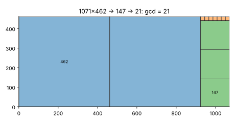
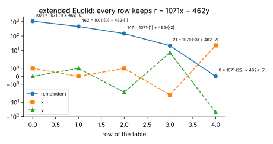
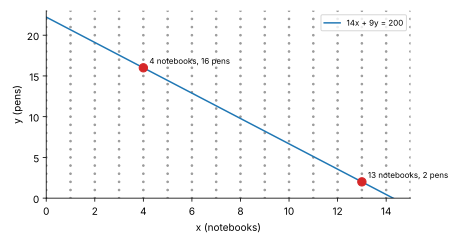
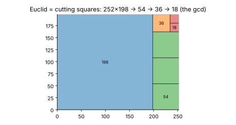
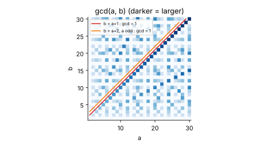
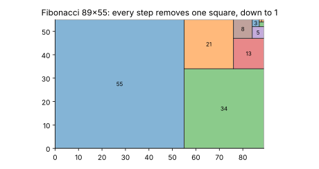
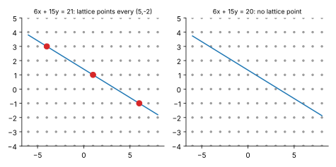
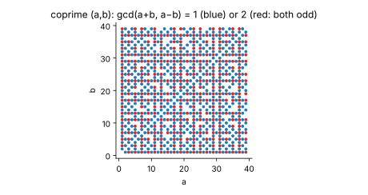
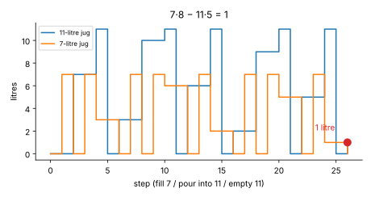

# שיעור 2: מחלק משותף מקסימלי ואלגוריתם אוקלידס

**מה נלמד:** מחלק משותף מקסימלי (ממ"מ), אלגוריתם אוקלידס לחישובו, הלמה של בזו (הצגת הממ"מ כצירוף ליניארי), מספרים זרים, הלמה של אוקלידס, כפולה משותפת מינימלית, ופתרון משוואות דיופנטיות ליניאריות.

**ידע קודם:** [שיעור 1](01-התחלקות.md) — התחלקות, צירופים ליניאריים וחלוקה עם שארית.

---

## 1. הגדרה

יהיו $`a, b`$ שלמים, לא שניהם אפס. **המחלק המשותף המקסימלי** שלהם, $`\gcd(a,b)`$, הוא המספר הטבעי הגדול ביותר שמחלק גם את $`a`$ וגם את $`b`$.

* $`\gcd(12, 18) = 6`$; $`\gcd(-8, 12) = 4`$; $`\gcd(7, 0) = 7`$; $`\gcd(9, 28) = 1`$.
* אם $`\gcd(a,b) = 1`$, אומרים ש-$`a`$ ו-$`b`$ **זרים**.

הממ"מ קיים תמיד: 1 הוא מחלק משותף, ולפי משפט 1.1 (3) כל מחלק משותף חסום על ידי $`\max(|a|,|b|)`$.

---

## 2. המפתח: הממ"מ אינו משתנה כשמחסרים כפולות

**למה 2.1.** לכל שלמים $`a, b, q`$: $`\gcd(a, b) = \gcd(b, a - qb)`$.

**הוכחה.** נראה שלשני הזוגות יש **אותה קבוצה** של מחלקים משותפים, ולכן גם אותו מחלק משותף מקסימלי.
1. אם $`d \mid a`$ ו-$`d \mid b`$, אז $`d \mid a - qb`$ (צירוף ליניארי). לכן $`d`$ מחלק משותף של $`b`$ ושל $`a - qb`$.
2. להפך, אם $`d \mid b`$ ו-$`d \mid a - qb`$, אז $`d \mid (a - qb) + qb = a`$. ∎

נבחר את $`q`$ להיות המנה בחלוקת $`a`$ ב-$`b`$. אז $`a - qb = r`$ היא השארית, ומקבלים:

```math
\gcd(a, b) = \gcd(b, r), \qquad 0 \le r < b .
```

---

## 3. אלגוריתם אוקלידס

כדי לחשב $`\gcd(a, b)`$ עם $`a \ge b > 0`$:
1. מחלקים את $`a`$ ב-$`b`$ עם שארית: $`a = q_1 b + r_1`$.
2. אם $`r_1 = 0`$, התשובה היא $`b`$.
3. אחרת מחליפים את $`(a, b)`$ ב-$`(b, r_1)`$ וחוזרים לשלב 1.

השאריות קטנות ממש בכל שלב ($`b > r_1 > r_2 > \dots \ge 0`$), ולכן האלגוריתם עוצר. לפי למה 2.1 הממ"מ לא משתנה לאורך הדרך, והשארית האחרונה שאינה אפס היא הממ"מ.

### דוגמה 1: חישוב $`\gcd(1071, 462)`$
```math
\begin{aligned}
1071 &= 2 \cdot 462 + 147 \\
462 &= 3 \cdot 147 + 21 \\
147 &= 7 \cdot 21 + 0
\end{aligned}
```
השארית האחרונה שאינה אפס היא 21, ולכן $`\gcd(1071, 462) = 21`$.

**בדיקה:** $`1071 = 21 \cdot 51`$ ו-$`462 = 21 \cdot 22`$, ו-$`\gcd(51, 22) = 1`$. ✓

**כמה צעדים זה לוקח?** אפשר להראות שבכל שני צעדים השארית קטנה לפחות פי 2 (אם $`r_{i+1} > r_i/2`$ אז $`r_{i+2} = r_i - r_{i+1} < r_i/2`$). לכן מספר הצעדים לכל היותר כפליים ממספר הספרות הבינאריות של $`b`$. אלגוריתם אוקלידס מהיר מאוד גם למספרים בני מאות ספרות.



<sub>אלגוריתם אוקלידס על 1071×462 כחיתוך ריבועים.</sub>

---

## 4. הלמה של בזו

**משפט 2.2 (הלמה של בזו).** לכל שלמים $`a, b`$, לא שניהם אפס, קיימים שלמים $`x, y`$ כך ש-

```math
ax + by = \gcd(a, b).
```

יתרה מזו, $`\gcd(a,b)`$ הוא המספר החיובי **הקטן ביותר** שאפשר לכתוב בצורה $`ax + by`$.

**הוכחה.**
1. נסמן ב-$`S`$ את קבוצת המספרים החיוביים מהצורה $`ax + by`$. היא אינה ריקה (למשל $`a^2 + b^2 > 0`$), ולכן יש בה איבר קטן ביותר; נסמן אותו $`g = ax_0 + by_0`$.
2. **$`g`$ מחלק את $`a`$:** נחלק $`a = qg + r`$ עם $`0 \le r < g`$. אז $`r = a - qg = a(1 - qx_0) + b(-qy_0)`$, כלומר $`r`$ מהצורה $`ax + by`$. אם $`r > 0`$ היה $`r \in S`$ ו-$`r < g`$ — סתירה למינימליות. לכן $`r = 0`$ ו-$`g \mid a`$. באותו אופן $`g \mid b`$.
3. **כל מחלק משותף מחלק את $`g`$:** אם $`d \mid a`$ ו-$`d \mid b`$ אז $`d \mid ax_0 + by_0 = g`$, ולכן $`d \le g`$.
4. מסעיפים 2–3, $`g`$ הוא מחלק משותף וכל מחלק משותף קטן ממנו, כלומר $`g = \gcd(a,b)`$. ∎

**מסקנה חשובה:** כל מחלק משותף של $`a`$ ושל $`b`$ מחלק את $`\gcd(a, b)`$ (שלב 3).

### אלגוריתם אוקלידס המורחב — איך מוצאים את $`x, y`$
עוברים על שורות האלגוריתם מלמטה למעלה, ובכל שלב מבטאים את השארית באמצעות השתיים שלפניה.

### דוגמה 2: מצאו $`x, y`$ כך ש-$`1071x + 462y = 21`$
1. מהשורה השנייה בדוגמה 1: $`21 = 462 - 3 \cdot 147`$.
2. מהשורה הראשונה: $`147 = 1071 - 2 \cdot 462`$.
3. נציב את 2 ב-1:
```math
21 = 462 - 3\,(1071 - 2 \cdot 462) = 462 - 3 \cdot 1071 + 6 \cdot 462 = 7 \cdot 462 - 3 \cdot 1071 .
```
4. לכן $`x = -3`$, $`y = 7`$.
5. **בדיקה:** $`1071 \cdot (-3) + 462 \cdot 7 = -3213 + 3234 = 21`$. ✓



<sub>טבלת אוקלידס המורחב: בכל שורה נשמר השוויון r = 1071x + 462y.</sub>

### שיטת הטבלה (נוחה לחישוב ידני)
מחזיקים בכל שורה שלשה $`(r, x, y)`$ המקיימת $`r = ax + by`$. מתחילים בשורות $`(a, 1, 0)`$ ו-$`(b, 0, 1)`$, ובכל שלב מחסירים מהשורה הקודמת $`q`$ פעמים את השורה הנוכחית:

| $`q`$ | $`r`$ | $`x`$ | $`y`$ |
|---|---|---|---|
| | 1071 | 1 | 0 |
| | 462 | 0 | 1 |
| 2 | 147 | 1 | −2 |
| 3 | 21 | −3 | 7 |
| 7 | 0 | 22 | −51 |

השורה האחרונה שבה $`r \neq 0`$ נותנת $`21 = 1071 \cdot (-3) + 462 \cdot 7`$. השורה עם $`r = 0`$ נותנת $`0 = 1071 \cdot 22 - 462 \cdot 51`$, ומכך נובע שאפשר להוסיף לכל פתרון כפולות של $`(22, -51)`$ — נשתמש בזה בסעיף 7.

---

## 5. הלמה של אוקלידס ומספרים זרים

**משפט 2.3.** אם $`a \mid bc`$ ו-$`\gcd(a, b) = 1`$, אז $`a \mid c`$.

**הוכחה.**
1. לפי בזו יש $`x, y`$ כך ש-$`ax + by = 1`$.
2. נכפול ב-$`c`$: $`acx + bcy = c`$.
3. $`a \mid acx`$ וגם $`a \mid bcy`$ (כי $`a \mid bc`$). לכן $`a`$ מחלק את הסכום, שהוא $`c`$. ∎

**מסקנה 2.4 (הלמה של אוקלידס).** אם $`p`$ ראשוני ו-$`p \mid bc`$, אז $`p \mid b`$ או $`p \mid c`$. (אם $`p \nmid b`$ אז $`\gcd(p,b)=1`$, כי המחלקים היחידים של $`p`$ הם 1 ו-$`p`$.)

**מסקנה 2.5.** אם $`a \mid c`$, $`b \mid c`$ ו-$`\gcd(a,b) = 1`$, אז $`ab \mid c`$.

**הוכחה.** $`c = ak`$. מאחר ש-$`b \mid ak`$ ו-$`\gcd(a,b)=1`$, לפי משפט 2.3 $`b \mid k`$, כלומר $`k = bm`$ ו-$`c = abm`$. ∎

זה בדיוק מה שהיה חסר לנו בדוגמה 3 בשיעור 1: מ-$`2 \mid N`$ ו-$`3 \mid N`$ נובע $`6 \mid N`$, כי 2 ו-3 זרים.

---

## 6. כפולה משותפת מינימלית

**הכפולה המשותפת המינימלית** $`\mathrm{lcm}(a,b)`$ של שני שלמים חיוביים היא הכפולה החיובית הקטנה ביותר של שניהם.

**משפט 2.6.** $`\gcd(a,b)\cdot\mathrm{lcm}(a,b) = ab`$.

**הוכחה.** נסמן $`d = \gcd(a,b)`$, $`a = da'`$, $`b = db'`$. אז $`\gcd(a', b') = 1`$ (אחרת $`d`$ לא היה מקסימלי). נראה ש-$`\mathrm{lcm}(a,b) = da'b'`$:
1. $`da'b' = ab' = a'b`$ היא כפולה של $`a`$ ושל $`b`$.
2. אם $`m`$ כפולה משותפת, אז $`m = ak = da'k`$, ו-$`db' \mid da'k`$, כלומר $`b' \mid a'k`$. מאחר ש-$`\gcd(a',b')=1`$, $`b' \mid k`$, ולכן $`da'b' \mid m`$.
3. לכן $`\mathrm{lcm}(a,b) = da'b'`$, ו-$`d \cdot da'b' = (da')(db') = ab`$. ∎

**דוגמה:** $`\mathrm{lcm}(1071, 462) = 1071 \cdot 462 / 21 = 51 \cdot 462 = 23{,}562`$.

---

## 7. משוואות דיופנטיות ליניאריות

משוואה מהצורה $`ax + by = c`$, שאת פתרונותיה מחפשים **במספרים שלמים**.

**משפט 2.7.** יהי $`d = \gcd(a, b)`$.
1. למשוואה יש פתרון שלם אם ורק אם $`d \mid c`$.
2. אם $`(x_0, y_0)`$ פתרון אחד, אז כל הפתרונות הם
```math
x = x_0 + \frac{b}{d}\,t, \qquad y = y_0 - \frac{a}{d}\,t, \qquad t \in \mathbb{Z}.
```

**הוכחה.**
1. אם יש פתרון, $`d`$ מחלק את $`ax + by = c`$. להפך, אם $`c = dk`$, ניקח את $`x', y'`$ מבזו ($`ax' + by' = d`$) ונכפול ב-$`k`$.
2. קל לבדוק שהנוסחה נותנת פתרונות: $`a(x_0 + \tfrac{b}{d}t) + b(y_0 - \tfrac{a}{d}t) = ax_0 + by_0 = c`$. להפך, אם $`(x, y)`$ פתרון, אז $`a(x - x_0) = b(y_0 - y)`$. נחלק ב-$`d`$: $`a'(x - x_0) = b'(y_0 - y)`$ עם $`a', b'`$ זרים. לפי משפט 2.3, $`b' \mid x - x_0`$, כלומר $`x = x_0 + b't`$, ואז $`y = y_0 - a't`$. ∎

### דוגמה 3: בעיה מילולית
**שאלה:** בחנות מוכרים מחברות ב-14 ש"ח ועטים ב-9 ש"ח. בכמה דרכים אפשר לקנות בדיוק ב-200 ש"ח (לפחות פריט אחד מכל סוג)?

**פתרון.**
1. המשוואה: $`14x + 9y = 200`$, עם $`x, y \ge 1`$ שלמים.
2. $`\gcd(14, 9)`$: $`14 = 1\cdot 9 + 5`$, $`9 = 1 \cdot 5 + 4`$, $`5 = 1 \cdot 4 + 1`$. לכן הממ"מ 1, ו-$`1 \mid 200`$ — יש פתרונות.
3. אוקלידס המורחב: $`1 = 5 - 4 = 5 - (9 - 5) = 2\cdot 5 - 9 = 2(14 - 9) - 9 = 2 \cdot 14 - 3 \cdot 9`$.
4. נכפול ב-200: $`14 \cdot 400 + 9 \cdot (-600) = 200`$. פתרון פרטי: $`x_0 = 400`$, $`y_0 = -600`$.
5. הפתרון הכללי: $`x = 400 + 9t`$, $`y = -600 - 14t`$.
6. תנאים: $`x \ge 1 \Rightarrow t \ge -44.3`$, כלומר $`t \ge -44`$. $`y \ge 1 \Rightarrow -14t \ge 601 \Rightarrow t \le -42.9`$, כלומר $`t \le -43`$.
7. לכן $`t \in \{-44, -43\}`$:
   * $`t = -44`$: $`x = 4`$, $`y = 16`$. בדיקה: $`56 + 144 = 200`$ ✓
   * $`t = -43`$: $`x = 13`$, $`y = 2`$. בדיקה: $`182 + 18 = 200`$ ✓
8. **תשובה:** שתי דרכים: 4 מחברות ו-16 עטים, או 13 מחברות ו-2 עטים.



<sub>הפתרונות בשלמים של 14x+9y=200 על הישר; שניים מהם ברביע החיובי.</sub>

---

## 8. תרגילים

**תרגיל 1.** חשבו $`\gcd(252, 198)`$ ומצאו $`x, y`$ כך ש-$`252x + 198y = \gcd(252,198)`$.



<sub>אלגוריתם אוקלידס כחיתוך ריבועים מתוך מלבן 198×252: הריבוע האחרון הוא 18×18.</sub>

<details><summary>פתרון</summary>

$`252 = 1\cdot198 + 54`$; $`198 = 3\cdot54 + 36`$; $`54 = 1\cdot36 + 18`$; $`36 = 2\cdot18`$. הממ"מ הוא 18.

הצבה לאחור: $`18 = 54 - 36 = 54 - (198 - 3\cdot54) = 4\cdot54 - 198 = 4(252 - 198) - 198 = 4\cdot252 - 5\cdot198`$. לכן $`x = 4, y = -5`$. בדיקה: $`1008 - 990 = 18`$ ✓.
</details>

**תרגיל 2.** הוכיחו ש-$`\gcd(n, n+1) = 1`$ לכל שלם $`n`$, ושאם $`n`$ אי-זוגי אז $`\gcd(n, n+2) = 1`$.



<sub>ה־gcd של כל הזוגות עד 30; על האלכסונים b=a+1 ו־b=a+2 (עם a אי־זוגי) הוא תמיד 1.</sub>

<details><summary>פתרון</summary>

מחלק משותף של $`n`$ ו-$`n+1`$ מחלק את ההפרש 1. מחלק משותף של $`n`$ ו-$`n+2`$ מחלק את 2, ולכן הוא 1 או 2; אבל $`n`$ אי-זוגי, ולכן 2 אינו מחלק אותו.
</details>

**תרגיל 3.** הוכיחו: $`\gcd(a, b) = \gcd(a, a+b)`$. השתמשו בזה כדי לחשב $`\gcd(F_{n+1}, F_n)`$, כאשר $`F_n`$ הם מספרי פיבונאצ'י ($`F_1 = F_2 = 1`$, $`F_{n+1} = F_n + F_{n-1}`$).



<sub>מלבן פיבונאצ׳י 55×89: בכל צעד של אוקלידס נחתך ריבוע אחד בלבד — מספר הצעדים המרבי.</sub>

<details><summary>פתרון</summary>

לפי למה 2.1 עם $`q=-1`$. לכן $`\gcd(F_{n+1}, F_n) = \gcd(F_n + F_{n-1}, F_n) = \gcd(F_{n-1}, F_n) = \dots = \gcd(F_2, F_1) = 1`$. כל שני מספרי פיבונאצ'י עוקבים זרים. (מעניין: אלגוריתם אוקלידס על זוג כזה מבצע את מספר הצעדים **המרבי** ביחס לגודל המספרים.)
</details>

**תרגיל 4.** מצאו את כל הפתרונות השלמים של $`6x + 15y = 21`$ ושל $`6x + 15y = 20`$.



<sub>הישר 6x+15y=21 עובר בנקודות סריג (כל (5,−2)); הישר 6x+15y=20 לא פוגע באף נקודה.</sub>

<details><summary>פתרון</summary>

$`\gcd(6,15) = 3`$. מאחר ש-$`3 \nmid 20`$, למשוואה השנייה אין פתרון. בראשונה נחלק ב-3: $`2x + 5y = 7`$. פתרון פרטי: $`x = 1, y = 1`$. הפתרון הכללי: $`x = 1 + 5t`$, $`y = 1 - 2t`$.
</details>

**תרגיל 5.** הוכיחו שאם $`\gcd(a, b) = 1`$ אז $`\gcd(a+b, a-b) \in \{1, 2\}`$.



<sub>לזוגות זרים: gcd(a+b, a−b) הוא 2 בדיוק כששניהם אי־זוגיים (אדום).</sub>

<details><summary>פתרון</summary>

יהי $`d`$ מחלק משותף. אז $`d \mid (a+b)+(a-b) = 2a`$ ו-$`d \mid (a+b)-(a-b) = 2b`$. לכן $`d \mid \gcd(2a, 2b) = 2\gcd(a,b) = 2`$. (הוכיחו כתרגיל נוסף ש-$`\gcd(2a,2b) = 2\gcd(a,b)`$ בעזרת בזו.)
</details>

**תרגיל 6.** לשני כדים נפח 7 ליטר ו-11 ליטר, וברז מים בלי הגבלה. האם אפשר למדוד בדיוק ליטר אחד? תארו איך.



<sub>מילוי ושפיכה של הכדים, צעד אחר צעד, עד שנשאר ליטר אחד בכד של 11.</sub>

<details><summary>פתרון</summary>

$`\gcd(7, 11) = 1`$, ולכן יש $`x, y`$ עם $`7x + 11y = 1`$: למשל $`7\cdot 8 - 11 \cdot 5 = 56 - 55 = 1`$. כלומר: ממלאים את כד ה-7 שמונה פעמים ומעבירים לכד ה-11, ובכל פעם שכד ה-11 מתמלא שופכים אותו (5 פעמים). מה שנשאר בסוף בכד ה-11 הוא ליטר אחד.
</details>

---

## סיכום
* $`\gcd(a,b) = \gcd(b, a \bmod b)`$ — זה כל אלגוריתם אוקלידס.
* בזו: הממ"מ הוא הצירוף הליניארי החיובי הקטן ביותר של $`a, b`$, ואת המקדמים מוצאים באוקלידס המורחב.
* אם $`a \mid bc`$ ו-$`a`$ זר ל-$`b`$, אז $`a \mid c`$; בפרט, ראשוני המחלק מכפלה מחלק אחד הגורמים.
* $`ax + by = c`$ פתירה בשלמים אם ורק אם $`\gcd(a,b) \mid c`$, וכל הפתרונות נבדלים בכפולות של $`(b/d, -a/d)`$.

**השיעור הקודם:** [שיעור 1: התחלקות](01-התחלקות.md) · **השיעור הבא:** [שיעור 3: מספרים ראשוניים והמשפט היסודי של האריתמטיקה](03-מספרים-ראשוניים.md)

**להעמקה:** [מחלק משותף מקסימלי](https://he.wikipedia.org/wiki/%D7%9E%D7%97%D7%9C%D7%A7_%D7%9E%D7%A9%D7%95%D7%AA%D7%A3_%D7%9E%D7%A7%D7%A1%D7%99%D7%9E%D7%9C%D7%99) · [אלגוריתם אוקלידס](https://he.wikipedia.org/wiki/%D7%90%D7%9C%D7%92%D7%95%D7%A8%D7%99%D7%AA%D7%9D_%D7%90%D7%95%D7%A7%D7%9C%D7%99%D7%93%D7%A1) · [הלמה של בזו](https://he.wikipedia.org/wiki/%D7%94%D7%9C%D7%9E%D7%94_%D7%A9%D7%9C_%D7%91%D7%96%D7%95)

---
<sub>חלק מהקורס [תורת המספרים בעברית](../COURSE.md). התוכן מופץ ברישיון [CC BY-SA 4.0](https://creativecommons.org/licenses/by-sa/4.0/).</sub>
