# שיעור 5: המשפטים של פרמה, אוילר ווילסון

**מה נלמד:** המשפט הקטן של פרמה, פונקציית אוילר ומשפט אוילר, משפט וילסון, משפט וולסטנהולם, ושימושים: חישוב חזקות ענקיות, בדיקת ראשוניות והצפנת RSA.

**ידע קודם:** [שיעור 4](04-חשבון-מודולרי.md) — חפיפות, הופכי מודולרי, משפט השאריות הסיני.

---

## 1. המשפט הקטן של פרמה

**משפט 5.1 (פרמה, 1640).** אם $`p`$ ראשוני ו-$`p \nmid a`$, אז
```math
a^{p-1} \equiv 1 \pmod p .
```
ובצורה שקולה: $`a^p \equiv a \pmod p`$ לכל שלם $`a`$.

**הוכחה (תמורה של השאריות).**
1. נתבונן במספרים $`a, 2a, 3a, \dots, (p-1)a`$ מודולו $`p`$.
2. אף אחד מהם אינו 0: $`p \nmid k`$ ו-$`p \nmid a`$, ולכן לפי הלמה של אוקלידס $`p \nmid ka`$.
3. הם שונים זה מזה: אם $`ia \equiv ja`$, נצמצם ב-$`a`$ (משפט 4.3) ונקבל $`i \equiv j`$.
4. לכן אלה $`p - 1`$ שאריות שונות מתוך $`\{1, \dots, p-1\}`$ — כלומר **אותה קבוצה** בסדר אחר.
5. מכפלותיהן שוות: $`a \cdot 2a \cdots (p-1)a \equiv 1 \cdot 2 \cdots (p-1)`$, כלומר $`a^{p-1}(p-1)! \equiv (p-1)! \pmod p`$.
6. $`(p-1)!`$ זר ל-$`p`$, ולכן מצמצמים ומקבלים $`a^{p-1} \equiv 1`$. ∎

**הוכחה שנייה (אינדוקציה ובינום).** נוכיח $`a^p \equiv a`$ לכל $`a \ge 0`$. עבור $`a=0`$ ברור. בצעד: $`(a+1)^p = \sum_{k=0}^p \binom pk a^k`$. לכל $`0 < k < p`$, $`p \mid \binom pk = \frac{p!}{k!(p-k)!}`$ (המונה מתחלק ב-$`p`$ והמכנה לא). לכן $`(a+1)^p \equiv a^p + 1 \equiv a + 1`$. ∎

### דוגמה 1: השארית של $`3^{1000}`$ בחלוקה ב-13
1. 13 ראשוני ו-$`13 \nmid 3`$, ולכן $`3^{12} \equiv 1 \pmod{13}`$.
2. $`1000 = 12 \cdot 83 + 4`$.
3. $`3^{1000} = (3^{12})^{83} \cdot 3^4 \equiv 3^4 = 81 = 6 \cdot 13 + 3 \equiv 3`$.
4. **תשובה:** 3.

**הכלל:** את המעריך אפשר לצמצם מודולו $`p - 1`$ (כשהבסיס זר ל-$`p`$).

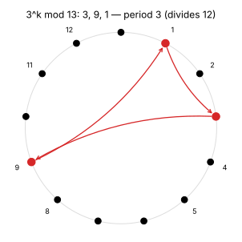

<sub>החזקות של 3 מודולו 13: מחזור באורך 3, שמחלק את 12.</sub>

### דוגמה 2: בדיקת פרמה — הוכחה שמספר פריק בלי לפרק אותו
**שאלה:** האם 91 ראשוני?
1. אם 91 ראשוני, אז $`2^{90} \equiv 1 \pmod{91}`$.
2. נחשב בריבוע חוזר: $`2^6 = 64`$; $`2^{12} = 4096 = 45 \cdot 91 + 1 \equiv 1`$. (מזל!)
3. $`2^{90} = (2^{12})^7 \cdot 2^6 \equiv 64 \not\equiv 1`$.
4. לכן 91 **פריק** ($`= 7 \cdot 13`$), ולא היינו צריכים למצוא את הגורמים.

> **הכיוון ההפוך לא נכון.** $`2^{340} \equiv 1 \pmod{341}`$, אבל $`341 = 11 \cdot 31`$. מספר פריק $`n`$ שמקיים $`a^{n-1} \equiv 1`$ לכל $`a`$ זר לו נקרא **מספר קרמייקל**; הקטן ביותר הוא $`561 = 3 \cdot 11 \cdot 17`$.

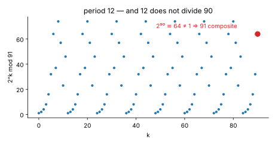

<sub>2ᵏ מודולו 91: מחזור 12, ולכן ⁹⁰2 אינו 1 — 91 פריק.</sub>

---

## 2. פונקציית אוילר ומשפט אוילר

**פונקציית אוילר** $`\varphi(n)`$ היא מספר השלמים $`1 \le k \le n`$ הזרים ל-$`n`$. כלומר, מספר השאריות ההפיכות מודולו $`n`$.

| $`n`$ | 1 | 2 | 3 | 4 | 5 | 6 | 7 | 8 | 9 | 10 | 12 |
|---|---|---|---|---|---|---|---|---|---|---|---|
| $`\varphi(n)`$ | 1 | 1 | 2 | 2 | 4 | 2 | 6 | 4 | 6 | 4 | 4 |

**נוסחאות בסיסיות:**
* $`\varphi(p) = p - 1`$ עבור $`p`$ ראשוני.
* $`\varphi(p^k) = p^k - p^{k-1}`$: מתוך $`p^k`$ המספרים, הלא-זרים הם הכפולות של $`p`$, ויש $`p^{k-1}`$ כאלה.
* $`\varphi(mn) = \varphi(m)\varphi(n)`$ כאשר $`\gcd(m,n) = 1`$. **הוכחה:** לפי משפט השאריות הסיני, $`x \bmod mn`$ מתאים לזוג $`(x \bmod m, x \bmod n)`$, ו-$`x`$ זר ל-$`mn`$ אם ורק אם הוא זר גם ל-$`m`$ וגם ל-$`n`$. לכן השאריות ההפיכות מודולו $`mn`$ מתאימות בדיוק לזוגות של שאריות הפיכות.
* מכאן: אם $`n = \prod p_i^{a_i}`$ אז
```math
\varphi(n) = n \prod_{p \mid n}\left(1 - \frac1p\right).
```

**דוגמה:** $`\varphi(360) = 360 \cdot \tfrac12 \cdot \tfrac23 \cdot \tfrac45 = 96`$.

**משפט 5.2 (אוילר).** אם $`\gcd(a, n) = 1`$ אז $`a^{\varphi(n)} \equiv 1 \pmod n`$.

**הוכחה.** בדיוק כמו ההוכחה הראשונה של פרמה, אבל במקום $`\{1, \dots, p-1\}`$ לוקחים את $`\varphi(n)`$ השאריות ההפיכות $`r_1, \dots, r_{\varphi(n)}`$. המספרים $`ar_1, \dots, ar_{\varphi(n)}`$ הפיכים ושונים, ולכן הם אותה קבוצה; משווים מכפלות ומצמצמים. ∎ פרמה הוא המקרה $`n = p`$.

### דוגמה 3: שתי הספרות האחרונות של $`3^{2026}`$
1. צריך את $`3^{2026} \bmod 100`$. $`\varphi(100) = 100 \cdot \tfrac12 \cdot \tfrac45 = 40`$.
2. $`\gcd(3,100) = 1`$, ולכן $`3^{40} \equiv 1`$. $`2026 = 40 \cdot 50 + 26`$, ו-$`3^{2026} \equiv 3^{26}`$.
3. $`3^5 = 243 \equiv 43`$; $`3^{10} \equiv 43^2 = 1849 \equiv 49`$; $`3^{20} \equiv 49^2 = 2401 \equiv 1`$.
4. (גילינו ש-$`3^{20} \equiv 1`$ כבר — המעריך המינימלי יכול להיות מחלק של $`\varphi(n)`$. נחזור לזה בשיעור 7.)
5. $`3^{26} = 3^{20} \cdot 3^5 \cdot 3 \equiv 1 \cdot 43 \cdot 3 = 129 \equiv 29`$.
6. **תשובה:** 29.

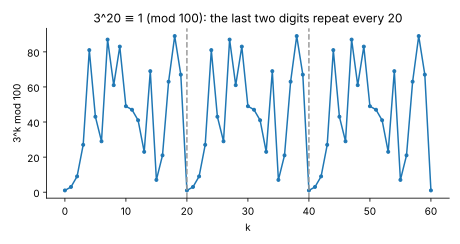

<sub>3ᵏ מודולו 100: שתי הספרות האחרונות חוזרות כל 20.</sub>

### דוגמה 4: הצפנת RSA בקטן
1. בוחרים ראשוניים $`p = 11`$, $`q = 13`$. $`n = 143`$, $`\varphi(n) = 10 \cdot 12 = 120`$.
2. בוחרים מעריך הצפנה $`e = 7`$ (זר ל-120). מעריך הפענוח $`d`$ הוא ההופכי של 7 מודולו 120: $`120 = 17 \cdot 7 + 1`$, ולכן $`7 \cdot (-17) \equiv 1`$ ו-$`d = 103`$.
3. **הצפנה** של ההודעה $`m = 9`$: $`c = 9^7 \bmod 143`$. $`9^2 = 81`$; $`9^4 = 6561 = 45\cdot143 + 126 \equiv 126 \equiv -17`$; $`9^6 \equiv 81 \cdot (-17) = -1377 = -10 \cdot 143 + 53 \equiv 53`$; $`9^7 \equiv 53 \cdot 9 = 477 = 3 \cdot 143 + 48`$. כלומר $`c = 48`$.
4. **פענוח:** $`48^{103} \bmod 143`$ מחזיר 9. **למה?** $`ed = 721 = 6 \cdot 120 + 1`$, ולכן $`c^d = m^{ed} = m \cdot (m^{120})^6 \equiv m`$ לפי אוילר.
5. **הביטחון:** מי שיודע רק את $`n`$ ואת $`e`$ צריך את $`\varphi(n)`$, וכדי לדעת אותו צריך לפרק את $`n`$ — שזה קל ל-143, וקשה מאוד למספר [חצי-ראשוני](../pages/מספר%20חצי-ראשוני.md) בן 600 ספרות.

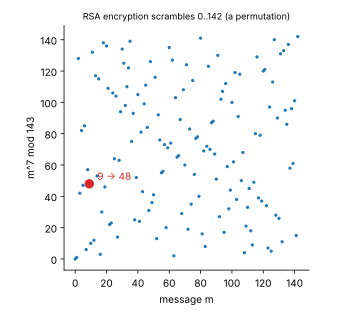

<sub>ההצפנה m ↦ m⁷ mod 143 מערבבת את כל ההודעות.</sub>

---

## 3. משפט וילסון

**משפט 5.3 (וילסון).** $`p`$ ראשוני אם ורק אם $`(p-1)! \equiv -1 \pmod p`$.

**הוכחה (כיוון ראשון, $`p`$ ראשוני).**
1. עבור $`p = 2, 3`$ בודקים ישירות: $`1! = 1 \equiv -1 \pmod 2`$; $`2! = 2 \equiv -1 \pmod 3`$.
2. עבור $`p \ge 5`$: לכל $`a \in \{1, \dots, p-1\}`$ יש הופכי יחיד באותה קבוצה.
3. אילו מספרים הופכיים לעצמם? $`a^2 \equiv 1 \Leftrightarrow p \mid (a-1)(a+1) \Leftrightarrow a \equiv \pm 1`$. כלומר רק 1 ו-$`p - 1`$.
4. את שאר המספרים $`2, \dots, p-2`$ מחלקים לזוגות $`\{a, a^{-1}\}`$, ומכפלת כל זוג היא 1.
5. לכן $`(p-1)! \equiv 1 \cdot (p-1) \cdot 1 \equiv -1`$. ∎

**כיוון שני.** אם $`n`$ פריק, $`n = ab`$ עם $`1 < a < n`$, אז $`a \mid (n-1)!`$. אילו $`(n-1)! \equiv -1 \pmod n`$, היה $`a \mid (n-1)! + 1`$, ולכן $`a \mid 1`$ — סתירה. ∎

### דוגמה 5
* $`p = 7`$: $`6! = 720 = 7 \cdot 103 - 1`$, כלומר $`720 \equiv -1 \pmod 7`$. ✓ ההתאמה לזוגות: $`2 \cdot 4 = 8 \equiv 1`$, $`3 \cdot 5 = 15 \equiv 1`$.
* **שאלה:** מה השארית של $`15!`$ בחלוקה ב-17? **פתרון:** $`16! \equiv -1`$, ו-$`16 \equiv -1`$, ולכן $`15! \cdot (-1) \equiv -1`$, כלומר $`15! \equiv 1 \pmod{17}`$.

> **הערה:** משפט וילסון הוא מבחן ראשוניות מושלם, אבל לא מעשי — חישוב $`(n-1)!`$ איטי הרבה יותר מבדיקת מחלקים.

> **השערה פתוחה בסגנון דומה:** לפי פרמה, אם $`p`$ ראשוני אז כל אחד מ-$`1^{p-1}, 2^{p-1}, \dots, (p-1)^{p-1}`$ חופף ל-1, ולכן סכומם חופף ל-$`p - 1 \equiv -1 \pmod p`$. **[השערת אגו–ג'וגה](../pages/השערת%20אגו-ג'וגה.md)** אומרת שגם הכיוון ההפוך נכון: אם $`\sum_{i=1}^{n-1} i^{n-1} \equiv -1 \pmod n`$ אז $`n`$ ראשוני. למשל עבור $`n = 4`$: $`1 + 8 + 27 = 36 \equiv 0 \pmod 4`$, ולא $`-1`$. בניגוד למשפט וילסון, הכיוון הזה לא הוכח; ידוע רק שדוגמה נגדית חייבת להיות ענקית (לפחות 13,800 ספרות).

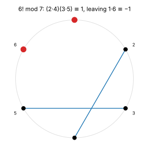

<sub>משפט וילסון מודולו 7: הזיווג 2·4 ו־3·5.</sub>

---

## 4. משפט וולסטנהולם

הזהות $`\binom{2p}{p} \equiv 2 \pmod p`$ נכונה לכל ראשוני (תרגיל). וולסטנהולם גילה (1862) שעבור $`p \ge 5`$ היא נכונה הרבה יותר בחוזקה:

**משפט 5.4 ([וולסטנהולם](../pages/משפט%20וולסטנהולם.md)).** לכל ראשוני $`p \ge 5`$:
```math
\binom{2p-1}{p-1} \equiv 1 \pmod{p^3}, \qquad \text{ובשקילות} \qquad \binom{2p}{p} \equiv 2 \pmod{p^3}.
```
וגם המונה של הסכום ההרמוני $`1 + \tfrac12 + \dots + \tfrac1{p-1}`$ מתחלק ב-$`p^2`$.

### דוגמה 6: בדיקה עבור $`p = 5`$
1. $`\binom{9}{4} = 126`$. $`126 - 1 = 125 = 5^3`$. ✓
2. $`1 + \tfrac12 + \tfrac13 + \tfrac14 = \tfrac{12 + 6 + 4 + 3}{12} = \tfrac{25}{12}`$. המונה 25 מתחלק ב-$`5^2`$. ✓

**רעיון ההוכחה של החלק ההרמוני (מודולו $`p`$ בלבד):** נצמיד את $`\tfrac1k`$ ל-$`\tfrac1{p-k}`$: $`\tfrac1k + \tfrac1{p-k} = \tfrac{p}{k(p-k)}`$. לכן המונה של הסכום מתחלק ב-$`p`$. כדי להגיע ל-$`p^2`$ מראים, בעזרת חשבון הופכיים מודולו $`p`$, ש-$`\sum_k \tfrac{1}{k(p-k)} \equiv -\sum_k k^{-2} \equiv -\sum_k k^2 \equiv 0 \pmod p`$ עבור $`p \ge 5`$ (כאן משתמשים בכך ש-$`k \mapsto k^{-1}`$ הוא תמורה של השאריות, ובנוסחה $`\sum k^2 = \tfrac{(p-1)p(2p-1)}{6}`$). ראשוני שעבורו החזקה גבוהה עוד יותר נקרא ראשוני וולסטנהולם; ידועים רק שניים: 16843 ו-2124679.

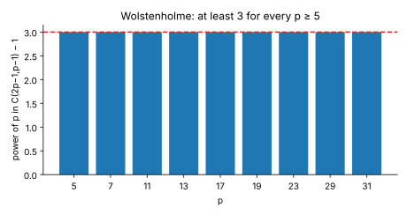

<sub>החזקה של p ב־C(2p−1,p−1)−1 היא לפחות 3 (משפט וולסטנהולם).</sub>

---

## 5. תרגילים

**תרגיל 1.** מצאו את השארית של $`5^{100}`$ בחלוקה ב-7, ואת השארית של $`2^{2^{2026}}`$ בחלוקה ב-7.

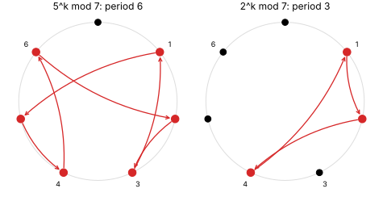

<sub>מחזורי החזקות מודולו 7: של 5 באורך 6, של 2 באורך 3.</sub>

<details><summary>פתרון</summary>

1. $`5^6 \equiv 1 \pmod 7`$; $`100 = 6 \cdot 16 + 4`$; $`5^4 = 625 = 89\cdot7 + 2`$. השארית 2.
2. $`2^3 = 8 \equiv 1 \pmod 7`$, ולכן צריך את $`2^{2026} \bmod 3`$. $`2 \equiv -1 \pmod 3`$, ו-$`(-1)^{2026} = 1`$. לכן המעריך $`\equiv 1 \pmod 3`$, והתשובה $`2^1 = 2`$.
</details>

**תרגיל 2.** חשבו את $`\varphi(1000)`$, $`\varphi(97)`$, $`\varphi(2026)`$.

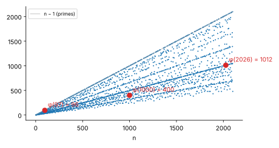

<sub>φ(n) עבור n עד 2100; הראשוניים יושבים על הקו העליון φ(p)=p−1.</sub>

<details><summary>פתרון</summary>

$`\varphi(1000) = 1000 \cdot \tfrac12 \cdot \tfrac45 = 400`$. $`\varphi(97) = 96`$ (97 ראשוני). $`\varphi(2026) = \varphi(2)\varphi(1013) = 1 \cdot 1012 = 1012`$.
</details>

**תרגיל 3.** הוכיחו: אם $`p`$ ראשוני אי-זוגי, אז $`1^{p-1} + 2^{p-1} + \dots + (p-1)^{p-1} \equiv -1 \pmod p`$.

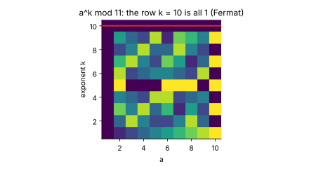

<sub>טבלת aᵏ מודולו 11: השורה k=10 כולה 1 — המשפט הקטן של פרמה.</sub>

<details><summary>פתרון</summary>

כל מחובר חופף ל-1 לפי פרמה, ויש $`p - 1`$ מחוברים. הסכום $`\equiv p - 1 \equiv -1`$.
</details>

**תרגיל 4.** הוכיחו ש-$`n^{13} - n`$ מתחלק ב-2730 לכל שלם $`n`$.

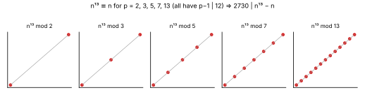

<sub>n¹³ ≡ n מודולו כל אחד מהראשוניים 2, 3, 5, 7, 13 (כל הנקודות על האלכסון).</sub>

<details><summary>פתרון</summary>

$`2730 = 2 \cdot 3 \cdot 5 \cdot 7 \cdot 13`$. לכל אחד מהראשוניים האלה $`p - 1 \mid 12`$ (1, 2, 4, 6, 12). אם $`p \nmid n`$ אז $`n^{p-1} \equiv 1`$, ולכן $`n^{12} \equiv 1`$ ו-$`n^{13} \equiv n`$. אם $`p \mid n`$, שני האגפים 0. לכן כל אחד מהם מחלק את $`n^{13} - n`$, והם זרים בזוגות.
</details>

**תרגיל 5.** מצאו את השארית של $`97!`$ בחלוקה ב-101.

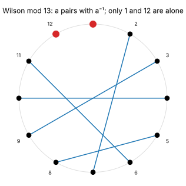

<sub>משפט וילסון מודולו 13: כל מספר מזווג להופכי שלו; רק 1 ו־12 בודדים.</sub>

<details><summary>פתרון</summary>

$`100! \equiv -1 \pmod{101}`$. $`100! = 97! \cdot 98 \cdot 99 \cdot 100 \equiv 97! \cdot (-3)(-2)(-1) = -6 \cdot 97!`$. לכן $`6 \cdot 97! \equiv 1`$, ו-$`97! \equiv 6^{-1}`$. $`6 \cdot 17 = 102 \equiv 1`$, כלומר $`97! \equiv 17 \pmod{101}`$.
</details>

**תרגיל 6.** הוכיחו ש-561 הוא מספר קרמייקל.

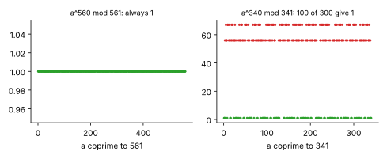

<sub>561 עובר את בדיקת פרמה לכל בסיס זר לו (קרמייקל); 341 נכשל ברוב הבסיסים.</sub>

<details><summary>פתרון</summary>

$`561 = 3 \cdot 11 \cdot 17`$, ו-$`2, 10, 16`$ כולם מחלקים את 560. אם $`\gcd(a, 561) = 1`$, לפי פרמה $`a^2 \equiv 1 \pmod 3`$, $`a^{10} \equiv 1 \pmod{11}`$, $`a^{16} \equiv 1 \pmod{17}`$, ולכן $`a^{560} \equiv 1`$ מודולו כל אחד מהם, ולפי משפט השאריות הסיני גם מודולו 561.
</details>

---

## סיכום
* פרמה: $`a^{p-1} \equiv 1 \pmod p`$. אוילר: $`a^{\varphi(n)} \equiv 1 \pmod n`$. שניהם: "כפל ב-$`a`$ מתמיר את השאריות ההפיכות".
* $`\varphi`$ כפלית, ו-$`\varphi(n) = n\prod_{p\mid n}(1 - 1/p)`$.
* וילסון: $`(p-1)! \equiv -1 \pmod p`$ מאפיין ראשוניים.
* וולסטנהולם: עבור $`p \ge 5`$, $`\binom{2p-1}{p-1} \equiv 1 \pmod{p^3}`$.

**השיעור הקודם:** [שיעור 4](04-חשבון-מודולרי.md) · **השיעור הבא:** [שיעור 6: פונקציות אריתמטיות](06-פונקציות-אריתמטיות.md)

**להעמקה:** [המשפט הקטן של פרמה](https://he.wikipedia.org/wiki/%D7%94%D7%9E%D7%A9%D7%A4%D7%98_%D7%94%D7%A7%D7%98%D7%9F_%D7%A9%D7%9C_%D7%A4%D7%A8%D7%9E%D7%94) · [השערת אגו–ג'וגה](../pages/השערת%20אגו-ג'וגה.md) · [משפט אוילר](https://he.wikipedia.org/wiki/%D7%9E%D7%A9%D7%A4%D7%98_%D7%90%D7%95%D7%99%D7%9C%D7%A8) · [משפט וילסון](https://he.wikipedia.org/wiki/%D7%9E%D7%A9%D7%A4%D7%98_%D7%95%D7%99%D7%9C%D7%A1%D7%95%D7%9F) · [משפט וולסטנהולם](../pages/משפט%20וולסטנהולם.md)

---
<sub>חלק מהקורס [תורת המספרים בעברית](../COURSE.md). התוכן מופץ ברישיון [CC BY-SA 4.0](https://creativecommons.org/licenses/by-sa/4.0/).</sub>
