# שיעור 8: משוואות דיופנטיות וסכומי ריבועים

**מה נלמד:** שלשות פיתגוריות ותיאורן המלא, הוכחת "אין פתרונות" בשיטת הירידה האינסופית של פרמה, אילו מספרים הם סכום של שני ריבועים, של שלושה ושל ארבעה, משוואת פל, ומספרים אידוניאליים.

**ידע קודם:** [שיעור 2](02-מחלק-משותף-מקסימלי.md) (משוואות ליניאריות), [שיעור 3](03-מספרים-ראשוניים.md) (פירוק יחיד), [שיעור 7](07-שאריות-ריבועיות.md) ($`-1`$ ריבוע מודולו $`p`$ ⇔ $`p \equiv 1 \pmod 4`$).

---

## 1. מהי משוואה דיופנטית

**[משוואה דיופנטית](https://he.wikipedia.org/wiki/%D7%9E%D7%A9%D7%95%D7%95%D7%90%D7%94_%D7%93%D7%99%D7%95%D7%A4%D7%A0%D7%98%D7%99%D7%AA)** היא משוואה פולינומית שאת פתרונותיה מחפשים במספרים שלמים (או רציונליים). את המקרה הליניארי $`ax + by = c`$ פתרנו בשיעור 2. כבר במעלה 2 התמונה עשירה הרבה יותר.

**ארגז כלים בסיסי:**
1. **שיקולי חפיפה:** אם אין פתרון מודולו $`m`$, אין פתרון בשלמים.
2. **פירוק לגורמים:** משתמשים ביחידות הפירוק.
3. **ירידה אינסופית:** מפתרון אחד בונים פתרון "קטן" יותר — וזה לא יכול להימשך לנצח.

### דוגמה 1: שיקולי חפיפה
**שאלה:** הוכיחו של-$`x^2 - 3y^2 = 2`$ ($`x^2 = 3y^2 + 2`$) אין פתרון בשלמים.

**פתרון.** מודולו 3: $`x^2 \equiv 2`$. אבל הריבועים מודולו 3 הם 0 ו-1 בלבד. אין פתרון. ∎

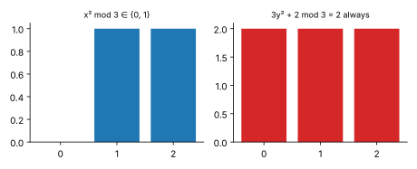

<sub>x² מודולו 3 לעומת 3y²+2 מודולו 3 — אף פעם לא שווים.</sub>

### דוגמה 2: פירוק לגורמים
**שאלה:** מצאו את כל הפתרונות השלמים החיוביים של $`x^2 - y^2 = 45`$.

**פתרון.**
1. $`(x - y)(x + y) = 45`$, עם $`0 < x - y < x + y`$.
2. שני הגורמים בעלי אותה זוגיות (הפרשם $`2y`$), ו-45 אי-זוגי, ולכן כל פירוק מתאים.
3. הפירוקים: $`1 \cdot 45`$, $`3 \cdot 15`$, $`5 \cdot 9`$.
4. $`x = \tfrac{a + b}2`$, $`y = \tfrac{b - a}2`$: $`(23, 22)`$, $`(9, 6)`$, $`(7, 2)`$.
5. **בדיקה:** $`529 - 484 = 45`$ ✓; $`81 - 36 = 45`$ ✓; $`49 - 4 = 45`$ ✓.

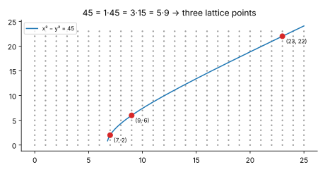

<sub>ההיפרבולה x²−y²=45 ונקודות הסריג עליה.</sub>

---

## 2. שלשות פיתגוריות

**[שלשה פיתגורית](https://he.wikipedia.org/wiki/%D7%A9%D7%9C%D7%A9%D7%94_%D7%A4%D7%99%D7%AA%D7%92%D7%95%D7%A8%D7%99%D7%AA)** היא פתרון של $`x^2 + y^2 = z^2`$ בטבעיים. היא **פרימיטיבית** אם $`\gcd(x,y,z) = 1`$.

**משפט 8.1.** השלשות הפרימיטיביות (עם $`y`$ זוגי) הן בדיוק
```math
x = m^2 - n^2, \qquad y = 2mn, \qquad z = m^2 + n^2,
```
כאשר $`m > n > 0`$, $`\gcd(m, n) = 1`$ ו-$`m, n`$ בזוגיות שונה.

**הוכחה.**
1. בשלשה פרימיטיבית $`x, y`$ אינם שניהם זוגיים (אחרת 2 מחלק גם את $`z`$), ואינם שניהם אי-זוגיים (אחרת $`z^2 \equiv 2 \pmod 4`$ — בלתי אפשרי, תרגיל 2 בשיעור 4). נניח ש-$`y`$ זוגי ו-$`x, z`$ אי-זוגיים.
2. $`y^2 = z^2 - x^2 = (z - x)(z + x)`$. שני הגורמים זוגיים; נכתוב $`z + x = 2u`$, $`z - x = 2v`$. אז $`(y/2)^2 = uv`$.
3. $`\gcd(u, v) = 1`$: מחלק משותף מחלק את $`u + v = z`$ ואת $`u - v = x`$, והם זרים.
4. **המפתח:** אם מכפלה של שני מספרים זרים היא ריבוע, כל אחד מהם ריבוע (לפי הפירוק היחיד: כל ראשוני מופיע רק באחד מהם, ובחזקה זוגית). לכן $`u = m^2`$, $`v = n^2`$.
5. $`z = u + v = m^2 + n^2`$, $`x = u - v = m^2 - n^2`$, $`y = 2mn`$.
6. התנאים על $`m, n`$: זרים (כי $`u, v`$ זרים), בזוגיות שונה (כי $`z`$ אי-זוגי). הכיוון ההפוך: בדיקה ישירה. ∎

### דוגמה 3: כל השלשות הפרימיטיביות עם $`z < 50`$

| $`m`$ | $`n`$ | $`(x, y, z)`$ |
|---|---|---|
| 2 | 1 | (3, 4, 5) |
| 3 | 2 | (5, 12, 13) |
| 4 | 1 | (15, 8, 17) |
| 4 | 3 | (7, 24, 25) |
| 5 | 2 | (21, 20, 29) |
| 5 | 4 | (9, 40, 41) |
| 6 | 1 | (35, 12, 37) |

(הזוג $`m = 5, n = 3`$ נפסל כי שניהם אי-זוגיים; $`m=6, n=5`$ נותן $`z = 61`$.)

**פירוש גאומטרי:** השלשות מתאימות לנקודות רציונליות על מעגל היחידה, $`\left(\frac{m^2-n^2}{m^2+n^2}, \frac{2mn}{m^2+n^2}\right)`$ — אלה נקודות החיתוך של ישרים בשיפוע רציונלי דרך $`(-1, 0)`$ עם המעגל.

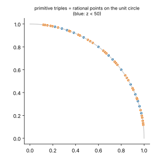

<sub>שלשות פיתגוריות פרימיטיביות כנקודות רציונליות על מעגל היחידה.</sub>

---

## 3. ירידה אינסופית: $`x^4 + y^4 = z^2`$

**משפט 8.2 (פרמה).** למשוואה $`x^4 + y^4 = z^2`$ אין פתרון בטבעיים. בפרט, $`x^4 + y^4 = z^4`$ אינה פתירה (המקרה $`n = 4`$ של המשפט האחרון של פרמה).

**הוכחה.**
1. נניח שיש פתרון, וניקח פתרון עם $`z`$ **מינימלי**. אז $`\gcd(x, y) = 1`$ (אחרת מחלקים ב-$`d^4`$ ומקבלים $`z`$ קטן יותר).
2. $`(x^2)^2 + (y^2)^2 = z^2`$ היא שלשה פיתגורית פרימיטיבית. נניח ש-$`y`$ זוגי: $`x^2 = m^2 - n^2`$, $`y^2 = 2mn`$, $`z = m^2 + n^2`$.
3. מ-$`x^2 + n^2 = m^2`$ — שוב שלשה פרימיטיבית, ו-$`x`$ אי-זוגי, ולכן $`n`$ זוגי: $`n = 2rs`$, $`m = r^2 + s^2`$, עם $`r, s`$ זרים.
4. $`y^2 = 2mn = 4rs(r^2 + s^2)`$. המספרים $`r`$, $`s`$, $`r^2 + s^2`$ זרים בזוגות, ומכפלתם ריבוע ($`(y/2)^2`$). לכן כל אחד ריבוע: $`r = a^2`$, $`s = b^2`$, $`r^2 + s^2 = c^2`$.
5. אז $`a^4 + b^4 = c^2`$ — פתרון חדש!
6. אבל $`c \le c^2 = m \le m^2 < m^2 + n^2 = z`$. סתירה למינימליות של $`z`$. ∎

**הרעיון הכללי:** אם מכל פתרון אפשר לבנות פתרון "קטן ממש" (במדד שהוא מספר טבעי), אין פתרונות כלל — כי אין סדרה יורדת אינסופית של טבעיים.

---

## 4. סכומים של שני ריבועים

איזה ראשוניים הם סכום של שני ריבועים? $`2 = 1 + 1`$, $`5 = 4 + 1`$, $`13 = 9 + 4`$, $`17 = 16 + 1`$, $`29 = 25 + 4`$… אבל לא 3, 7, 11, 19, 23. הדפוס: $`p \equiv 1 \pmod 4`$.

**משפט 8.3 (פרמה, הוכח על ידי אוילר).** ראשוני אי-זוגי $`p`$ הוא סכום של שני ריבועים אם ורק אם $`p \equiv 1 \pmod 4`$.

**הוכחה.**
* **כיוון "רק אם":** ריבוע חופף ל-0 או 1 מודולו 4, ולכן סכום שני ריבועים אינו $`\equiv 3`$.
* **כיוון "אם" (הוכחת תואה, בעזרת שובך היונים):**
  1. מאחר ש-$`p \equiv 1 \pmod 4`$, יש $`a`$ עם $`a^2 \equiv -1 \pmod p`$ (מסקנה 7.5).
  2. יהי $`k = \lfloor\sqrt p\rfloor`$, כך ש-$`k < \sqrt p < k + 1`$ ($`p`$ אינו ריבוע). נתבונן ב-$`(k+1)^2 > p`$ המספרים $`u - av`$ עם $`0 \le u, v \le k`$.
  3. לפי עקרון שובך היונים, שניים מהם חופפים מודולו $`p`$: $`u_1 - av_1 \equiv u_2 - av_2`$. נסמן $`x = u_1 - u_2`$, $`y = v_1 - v_2`$. אז $`x \equiv ay \pmod p`$, ו-$`(x,y) \ne (0, 0)`$, ו-$`|x|, |y| \le k < \sqrt p`$.
  4. $`x^2 \equiv a^2 y^2 \equiv -y^2`$, כלומר $`p \mid x^2 + y^2`$.
  5. $`0 < x^2 + y^2 < 2p`$, ולכן $`x^2 + y^2 = p`$. ∎

**משפט 8.4 ([משפט שני הריבועים](https://he.wikipedia.org/wiki/%D7%A1%D7%9B%D7%95%D7%9D_%D7%A9%D7%9C_%D7%A9%D7%A0%D7%99_%D7%A8%D7%99%D7%91%D7%95%D7%A2%D7%99%D7%9D)).** מספר טבעי $`n`$ הוא סכום של שני ריבועים אם ורק אם בפירוק שלו כל ראשוני $`q \equiv 3 \pmod 4`$ מופיע בחזקה **זוגית**.

**הוכחה (בקווים כלליים).**
* **"אם":** הזהות של ברהמגופטה
```math
(a^2 + b^2)(c^2 + d^2) = (ac - bd)^2 + (ad + bc)^2
```
(שהיא $`|z|^2|w|^2 = |zw|^2`$ עבור $`z = a + bi`$, $`w = c + di`$) מראה שמכפלה של סכומי שני ריבועים היא סכום שני ריבועים. 2 וכל $`p \equiv 1`$ הם כאלה, ו-$`q^2 = q^2 + 0^2`$.
* **"רק אם":** אם $`q \equiv 3 \pmod 4`$ ו-$`q \mid x^2 + y^2`$, אז $`q \mid x`$ ו-$`q \mid y`$ (אחרת $`(x/y)^2 \equiv -1 \pmod q`$, בסתירה למסקנה 7.5). מחלקים ב-$`q^2`$ וממשיכים באינדוקציה.

**כמה מספרים כאלה יש?** משפט 8.4 אומר בדיוק מי סכום של שני ריבועים, אבל לא כמה יש. נסמן ב-$`N(x)`$ את מספר השלמים החיוביים הקטנים מ-$`x`$ שהם סכום של שני ריבועים. עד 100 יש 42 כאלה, עד $`10^4`$ יש 2748, ועד $`10^7`$ יש 1,985,458. הם נעשים נדירים יותר ויותר: כל ראשוני $`q \equiv 3 \pmod 4`$ "פוסל" את המספרים שבהם הוא מופיע בחזקה אי-זוגית, ויש הרבה ראשוניים כאלה. לנדאו הוכיח (1908) ש-
```math
N(x) \sim \frac{b\,x}{\sqrt{\log x}}, \qquad b = \frac{1}{\sqrt 2}\prod_{p \equiv 3 \ (4)}\left(1 - \frac{1}{p^2}\right)^{-1/2} \approx 0.76422,
```
כאשר $`b`$ נקרא **[קבוע לנדאו–רמנוג'אן](../pages/קבוע%20לנדאו-רמנוג'אן.md)**. ההתכנסות איטית מאוד: ב-$`x = 10^7`$ היחס $`N(x)/(x/\sqrt{\log x})`$ עדיין 0.797.

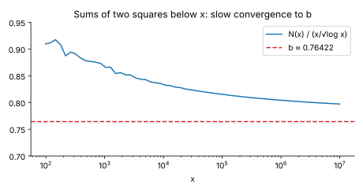

<sub>היחס בין N(x) ל-x/√log x, לעומת הקבוע b.</sub>

### דוגמה 4: כתבו את 65 ואת 1105 כסכום של שני ריבועים, בכל הדרכים
1. $`65 = 5 \cdot 13 = (2^2 + 1^2)(3^2 + 2^2)`$.
2. ברהמגופטה עם $`(a,b,c,d) = (2,1,3,2)`$: $`(6 - 2)^2 + (4 + 3)^2 = 16 + 49`$.
3. ועם הסימן השני ($`d \to -d`$): $`(6 + 2)^2 + (-4 + 3)^2 = 64 + 1`$.
4. **תשובה:** $`65 = 1^2 + 8^2 = 4^2 + 7^2`$.
5. $`1105 = 5 \cdot 13 \cdot 17`$. מכפילים כל הצגה של 65 ב-$`17 = 4^2 + 1^2`$, בשני הסימנים:
   * $`(1, 8)\cdot(4,1)`$: $`(4 - 8, 1 + 32) \to 4^2 + 33^2`$; $`(4 + 8, 1 - 32) \to 12^2 + 31^2`$.
   * $`(4,7)\cdot(4,1)`$: $`(16 - 7, 4 + 28) \to 9^2 + 32^2`$; $`(16+7, 4 - 28) \to 23^2 + 24^2`$.
6. **בדיקה:** $`16 + 1089 = 144 + 961 = 81 + 1024 = 529 + 576 = 1105`$. ✓ ארבע הצגות.

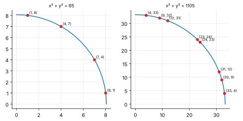

<sub>הצגות של 65 ושל 1105 כסכום שני ריבועים.</sub>

### דוגמה 5: האם 2026 ו-2027 הם סכום של שני ריבועים?
* $`2026 = 2 \cdot 1013`$, ו-$`1013 \equiv 1 \pmod 4`$ ראשוני. **כן.** (למשל $`2026 = 45^2 + 1^2 = 2025 + 1`$.)
* $`2027 \equiv 3 \pmod 4`$. **לא**, כבר מטיעון החפיפה.

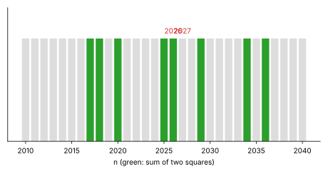

<sub>המספרים סביב 2026 שהם סכום של שני ריבועים (ירוק).</sub>

---

## 5. שלושה וארבעה ריבועים

**משפט 8.5 ([שלושת הריבועים של לז'נדר](../pages/משפט%20שלושת%20הריבועים%20של%20לז'נדר.md)).** $`n`$ הוא סכום של שלושה ריבועים אם ורק אם הוא **אינו** מהצורה $`4^a(8b + 7)`$.

**הכיוון הקל.** ריבועים מודולו 8 הם 0, 1, 4. סכומי שלושה: $`\{0,1,2,3,4,5,6\}`$ — אף פעם לא 7. ואם $`4 \mid x^2 + y^2 + z^2`$, אז $`x, y, z`$ כולם זוגיים (בדקו מודולו 4), ואפשר לחלק ב-4. הכיוון הקשה דורש את תורת התבניות הריבועיות של גאוס, או את משפט דיריכלה על ראשוניים בסדרות חשבוניות.

**דוגמה:** $`7, 15, 23, 28 = 4\cdot 7, 31`$ אינם סכום של שלושה ריבועים. $`2026 = 2 \cdot 1013`$ אינו מהצורה האסורה; למשל $`2026 = 45^2 + 1^2 + 0^2`$.

**משפט 8.6 ([ארבעת הריבועים של לגראנז'](../pages/%D7%9E%D7%A9%D7%A4%D7%98%20%D7%90%D7%A8%D7%91%D7%A2%D7%AA%20%D7%94%D7%A8%D7%99%D7%91%D7%95%D7%A2%D7%99%D7%9D%20%D7%A9%D7%9C%20%D7%9C%D7%92%D7%A8%D7%90%D7%A0%D7%96%27.md), 1770).** **כל** מספר טבעי הוא סכום של ארבעה ריבועים.

**הוכחה (שלדית).**
1. **זהות ארבעת הריבועים של אוילר:** $`(a_1^2 + a_2^2 + a_3^2 + a_4^2)(b_1^2 + \dots + b_4^2)`$ הוא סכום של ארבעה ריבועים (זהות מפורשת; זהו הנורמה של מכפלת קווטרניונים). לכן מספיק להוכיח לראשוניים.
2. **לכל ראשוני $`p`$ יש $`x, y`$ עם $`x^2 + y^2 + 1 \equiv 0 \pmod p`$:** הקבוצות $`\{x^2\}`$ ו-$`\{-1 - y^2\}`$ מכילות כל אחת $`\tfrac{p+1}{2}`$ שאריות, ולכן הן נחתכות (שובך היונים). אז $`mp = x^2 + y^2 + 1^2 + 0^2`$ עם $`m < p`$.
3. **ירידה:** אם $`mp`$ סכום ארבעה ריבועים עם $`1 < m < p`$, בונים (בעזרת שאריות מינימליות מודולו $`m`$ וזהות אוילר) הצגה של $`m'p`$ עם $`m' < m`$. ממשיכים עד $`m = 1`$. ∎

### דוגמה 6
$`2026 = 45^2 + 1^2 + 0^2 + 0^2`$; $`7 = 2^2 + 1^2 + 1^2 + 1^2`$; $`15 = 3^2 + 2^2 + 1^2 + 1^2`$. (7 ו-15 צריכים בדיוק ארבעה ריבועים חיוביים, לפי לז'נדר.)

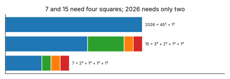

<sub>7 ו־15 דורשים ארבעה ריבועים; 2026 רק שניים.</sub>

**איך יודעים שתבנית מייצגת הכול?** לגראנז' אומר ש-$`w^2 + x^2 + y^2 + z^2`$ מקבלת כל ערך חיובי. **[משפט ה-15](../pages/משפטי%2015%20ו-290.md)** של קונוויי ושנייברגר (1993, הוכחה פשוטה: בהרגאווה 2000) נותן מבחן סופי לכל תבנית ריבועית מוגדרת חיובית עם מקדמים שלמים במטריצה: אם היא מקבלת את כל הערכים מ-1 עד 15, היא מקבלת **את כל** הערכים. ה-15 הכרחי: התבנית $`w^2 + 2x^2 + 5y^2 + 5z^2`$ מקבלת כל ערך חיובי פרט ל-15. לתבניות "שלמות" במובן הרחב (כמו $`x^2 + xy + y^2`$) הגבול הוא 290.

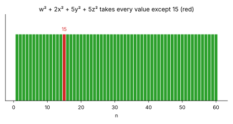

<sub>הערכים של w²+2x²+5y²+5z² עד 60: כולם מתקבלים מלבד 15.</sub>

---

## 6. משוואת פל

**[משוואת פל](https://he.wikipedia.org/wiki/%D7%9E%D7%A9%D7%95%D7%95%D7%90%D7%AA_%D7%A4%D7%9C)** היא $`x^2 - Dy^2 = 1`$, כאשר $`D > 0`$ אינו ריבוע.

**משפט 8.7.** למשוואת פל יש פתרון לא טריוויאלי. אם $`(x_1, y_1)`$ הפתרון החיובי הקטן ביותר (ה**פתרון היסודי**), אז כל הפתרונות החיוביים נתונים על ידי
```math
x_k + y_k\sqrt D = (x_1 + y_1\sqrt D)^k, \qquad k = 1, 2, 3, \dots
```

**למה זה עובד:** הנורמה $`N(x + y\sqrt D) = x^2 - Dy^2`$ כפלית: $`N(\alpha\beta) = N(\alpha)N(\beta)`$. לכן חזקה של פתרון היא פתרון. (שכל הפתרונות מתקבלים כך — מוכיחים בירידה: אם $`\alpha`$ פתרון, מחלקים אותו בחזקה המתאימה של הפתרון היסודי ומקבלים פתרון קטן ממנו.) הקיום מוכח בעזרת שברים משולבים או בעזרת משפט הקירוב של דיריכלה.

### דוגמה 7: $`x^2 - 2y^2 = 1`$
1. ניסוי: $`y = 1`$: $`x^2 = 3`$ ✗. $`y = 2`$: $`x^2 = 9`$ ✓. הפתרון היסודי $`(3, 2)`$.
2. $`(3 + 2\sqrt2)^2 = 9 + 12\sqrt 2 + 8 = 17 + 12\sqrt2`$: $`(17, 12)`$. בדיקה: $`289 - 288 = 1`$ ✓.
3. $`(3 + 2\sqrt2)^3 = (17 + 12\sqrt 2)(3 + 2\sqrt2) = 51 + 34\sqrt2 + 36\sqrt2 + 48 = 99 + 70\sqrt2`$. בדיקה: $`9801 - 9800 = 1`$ ✓.
4. נוסחת נסיגה: $`x_{k+1} = 3x_k + 4y_k`$, $`y_{k+1} = 2x_k + 3y_k`$.
5. **שימוש:** $`\tfrac{99}{70} = 1.414285\ldots`$ — קירוב מצוין ל-$`\sqrt 2 = 1.414213\ldots`$, כי $`\left|\tfrac xy - \sqrt2\right| = \tfrac{1}{y(x + y\sqrt2)} < \tfrac{1}{2\sqrt2\, y^2}`$.

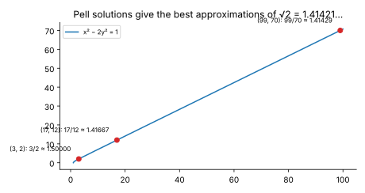

<sub>פתרונות משוואת פל x²−2y²=1 וקירובי √2.</sub>

### דוגמה 8: הפתרון היסודי יכול להיות ענק
עבור $`D = 61`$ הפתרון היסודי הוא $`x = 1{,}766{,}319{,}049`$, $`y = 226{,}153{,}980`$ (בעיה שפרמה הציב כאתגר ב-1657). ניסוי וטעייה לא יעבוד כאן; צריך שברים משולבים.

**השיטה (שברים משולבים):** פורשים את $`\sqrt D`$ לשבר משולב מחזורי $`[a_0; \overline{a_1, \dots, a_r}]`$. הפתרון היסודי הוא המונה והמכנה של השבר המצומצם $`[a_0; a_1, \dots, a_{r-1}]`$ (אם $`r`$ זוגי; אם $`r`$ אי-זוגי, מגיעים אחרי שני מחזורים). דוגמה: $`\sqrt 7 = [2; \overline{1, 1, 1, 4}]`$, $`r = 4`$; $`[2;1,1,1] = 2 + \cfrac1{1 + \cfrac1{1 + \cfrac11}} = \tfrac83`$. בדיקה: $`64 - 7\cdot 9 = 1`$ ✓.

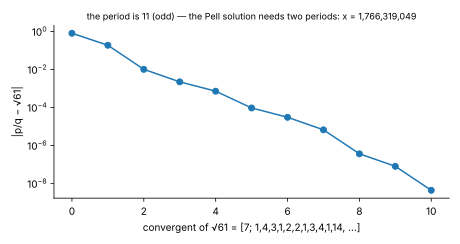

<sub>השגיאה של השברים המשולבים של √61.</sub>

---

## 7. מספרים אידוניאליים (העשרה)

אוילר שאל: עבור אילו $`n`$ התבנית $`x^2 + ny^2`$ "מזהה ראשוניים" — כלומר, מספר אי-זוגי $`m`$ הזר ל-$`n`$, שמוצג **באופן יחיד** כ-$`x^2 + ny^2`$ (עם $`x, y \ge 0`$ ו-$`\gcd(x, ny) = 1`$), הוא בהכרח ראשוני או חזקה של ראשוני? כך אפשר לבדוק ראשוניות של מספרים גדולים בלי לנסות מחלקים. מספרים כאלה הוא כינה **[אידוניאליים](../pages/מספר%20אידוניאלי.md)** ("מתאימים"). יש הגדרה שקולה: $`n`$ אידוניאלי אם ורק אם אי אפשר לכתוב אותו כ-$`ab + bc + ca`$ עם $`0 < a < b < c`$.

אוילר וגאוס מצאו 65 מספרים כאלה, הגדול ביותר 1848. ידוע שיש לכל היותר שניים נוספים, ואם [השערת רימן המוכללת](../pages/השערת%20רימן%20המוכללת.md) נכונה — אין בכלל. זו דוגמה ראשונה לשאלה אלמנטרית שהתשובה המלאה עליה תלויה באפסים של פונקציות L ([שיעור 13](13-קרקטרים-ופונקציות-L.md)).

### דוגמה 9: 5 אידוניאלי, 11 לא
* צורת $`ab + bc + ca`$ עם $`a = 1, b = 2, c = 3`$ נותנת $`2 + 6 + 3 = 11`$. לכן 11 **אינו** אידוניאלי.
* עבור $`n = 5`$: הערך הקטן ביותר של $`ab + bc + ca`$ עם $`0 < a < b < c`$ הוא 11. לכן 5 אידוניאלי. (וכן 1, 2, 3, 4, 6, 7, 8, 9, 10 — כל המספרים עד 10.)

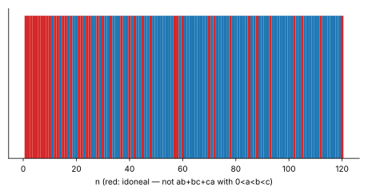

<sub>המספרים האידוניאליים עד 120 (אדום).</sub>

---

## 8. תרגילים

**תרגיל 1.** מצאו את כל השלשות הפיתגוריות (לא רק פרימיטיביות) שבהן 15 הוא אחד הניצבים.

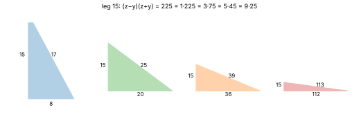

<sub>ארבעת המשולשים ישרי הזווית שאחד מניציביהם 15.</sub>

<details><summary>פתרון</summary>

$`z^2 - y^2 = 225`$, כלומר $`(z - y)(z + y) = 225`$ עם גורמים אי-זוגיים $`a < b`$: $`(1, 225), (3, 75), (5, 45), (9, 25)`$. נותן $`(y, z) = (112, 113), (36, 39), (20, 25), (8, 17)`$. השלשות: $`(15, 112, 113)`$, $`(15, 36, 39)`$, $`(15, 20, 25)`$, $`(15, 8, 17)`$.
</details>

**תרגיל 2.** הוכיחו של-$`x^2 + y^2 = 3z^2`$ אין פתרון בשלמים פרט ל-$`(0,0,0)`$.

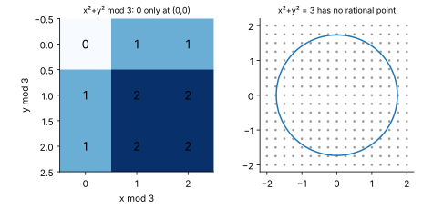

<sub>x²+y² מודולו 3 מתאפס רק כששניהם 0 — ולכן אין נקודה רציונלית על x²+y²=3.</sub>

<details><summary>פתרון</summary>

נניח פתרון עם $`z`$ מינימלי חיובי. $`3 \mid x^2 + y^2`$. ריבועים מודולו 3 הם 0, 1, ולכן $`x \equiv y \equiv 0 \pmod 3`$. אז $`9 \mid 3z^2`$, כלומר $`3 \mid z`$, ו-$`(x/3, y/3, z/3)`$ פתרון קטן יותר. סתירה (ירידה אינסופית).
</details>

**תרגיל 3.** כתבו את 221 כסכום של שני ריבועים בשתי דרכים.

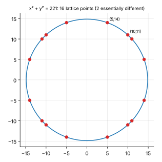

<sub>נקודות הסריג על המעגל x²+y²=221.</sub>

<details><summary>פתרון</summary>

$`221 = 13 \cdot 17 = (3^2 + 2^2)(4^2 + 1^2)`$. $`(12 - 2)^2 + (3 + 8)^2 = 100 + 121`$; $`(12+2)^2 + (3 - 8)^2 = 196 + 25`$. כלומר $`221 = 10^2 + 11^2 = 14^2 + 5^2`$.
</details>

**תרגיל 4.** איזה מבין 60, 71, 112, 135 אינם סכום של שלושה ריבועים?

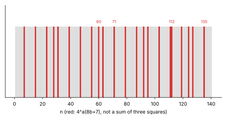

<sub>באדום: המספרים מהצורה 4ᵃ(8b+7), שאינם סכום של שלושה ריבועים.</sub>

<details><summary>פתרון</summary>

$`60 = 4 \cdot 15`$, ו-$`15 \equiv 7 \pmod 8`$ → **לא**. $`71 \equiv 7 \pmod 8`$ → **לא**. $`112 = 16 \cdot 7`$ → **לא**. $`135 \equiv 7 \pmod 8`$ → **לא**. (כולם! $`135 = 128 + 7`$.)
</details>

**תרגיל 5.** מצאו את הפתרון היסודי של $`x^2 - 3y^2 = 1`$ ואת הפתרון הבא אחריו.

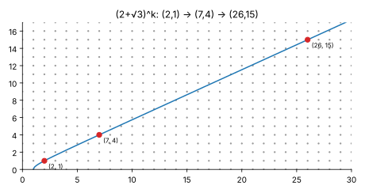

<sub>הפתרונות של x²−3y²=1 על ההיפרבולה: חזקות של 2+√3.</sub>

<details><summary>פתרון</summary>

$`y = 1`$: $`x^2 = 4`$ ✓, $`(2, 1)`$. $`(2 + \sqrt3)^2 = 7 + 4\sqrt 3`$: $`(7, 4)`$; בדיקה $`49 - 48 = 1`$ ✓.
</details>

**תרגיל 6.** הוכיחו שלמשוואה $`x^2 - 3y^2 = -1`$ אין פתרון.

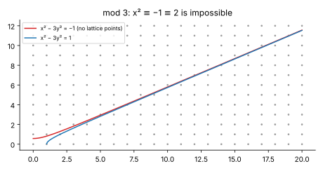

<sub>ההיפרבולה x²−3y²=−1 אינה עוברת באף נקודת סריג.</sub>

<details><summary>פתרון</summary>

מודולו 3: $`x^2 \equiv -1 \equiv 2`$ — אין. (באופן כללי, $`x^2 - Dy^2 = -1`$ פתירה רק אם אין ל-$`D`$ גורם ראשוני $`\equiv 3 \pmod 4`$, אבל זה תנאי הכרחי בלבד.)
</details>

**תרגיל 7 ([רביעיות פיתגוריות](../pages/רביעייה%20פיתגורית.md)).** רביעייה $`(a, b, c, d)`$ של שלמים חיוביים עם $`a^2 + b^2 + c^2 = d^2`$ נקראת רביעייה פיתגורית — תיבה עם צלעות $`a, b, c`$ ואלכסון $`d`$. (א) הוכיחו שאם הרביעייה פרימיטיבית אז $`d`$ אי-זוגי, ובדיוק אחד מ-$`a, b, c`$ אי-זוגי. (ב) מצאו את כל הרביעיות עם $`a = 1`$, $`b = 2`$ בעזרת הנוסחה: אם $`p \mid a^2 + b^2`$ ו-$`p^2 \lt a^2 + b^2`$, אז $`c = \frac{a^2 + b^2 - p^2}{2p}`$, $`d = \frac{a^2+b^2+p^2}{2p}`$. (ג) בדקו שגם $`(2, 3, 6, 7)`$ ו-$`(1, 4, 8, 9)`$ הן רביעיות פיתגוריות.

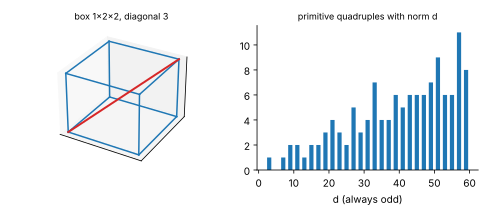

<sub>משמאל: התיבה 1×2×2 עם האלכסון 3. מימין: מספר הרביעיות הפרימיטיביות לכל נורמה d.</sub>

<details><summary>פתרון</summary>

(א) ריבועים מודולו 4 הם 0 (זוגי) או 1 (אי-זוגי). אם $`d`$ זוגי אז $`a^2 + b^2 + c^2 \equiv 0 \pmod 4`$, וזה אפשרי רק אם כל שלושתם זוגיים — ואז הרביעייה אינה פרימיטיבית. לכן $`d`$ אי-זוגי ו-$`a^2 + b^2 + c^2 \equiv 1 \pmod 4`$, כלומר בדיוק אחד מהם אי-זוגי (שלושה אי-זוגיים היו נותנים 3).

(ב) $`a^2 + b^2 = 5`$, והמחלק היחיד עם $`p^2 \lt 5`$ הוא $`p = 1`$: $`c = \frac{5 - 1}{2} = 2`$, $`d = \frac{5+1}2 = 3`$. הרביעייה היחידה: $`(1, 2, 2, 3)`$ — והיא גם בעלת המכפלה $`abcd`$ הקטנה ביותר.

(ג) $`4 + 9 + 36 = 49`$ ✓, $`1 + 16 + 64 = 81`$ ✓. בכולן $`12 \mid abcd`$: $`1\cdot2\cdot2\cdot3 = 12`$, $`2\cdot3\cdot6\cdot7 = 252`$, $`1\cdot4\cdot8\cdot9 = 288`$ — ואכן 12 תמיד מחלק את המכפלה.
</details>

---

## סיכום
* כלים: חפיפות, פירוק לגורמים, ירידה אינסופית.
* שלשות פיתגוריות פרימיטיביות: $`(m^2 - n^2, 2mn, m^2 + n^2)`$.
* שני ריבועים: ראשוניים $`\equiv 3 \pmod 4`$ בחזקה זוגית. שלושה: לא $`4^a(8b+7)`$. ארבעה: תמיד.
* משוואת פל: כל הפתרונות הם חזקות של הפתרון היסודי.

**השיעור הקודם:** [שיעור 7](07-שאריות-ריבועיות.md) · **השיעור הבא:** [שיעור 9: הסדר של פונקציות אריתמטיות](09-סדרים-של-פונקציות.md)

**להעמקה:** [משוואה דיופנטית](https://he.wikipedia.org/wiki/%D7%9E%D7%A9%D7%95%D7%95%D7%90%D7%94_%D7%93%D7%99%D7%95%D7%A4%D7%A0%D7%98%D7%99%D7%AA) · [שלשה פיתגורית](https://he.wikipedia.org/wiki/%D7%A9%D7%9C%D7%A9%D7%94_%D7%A4%D7%99%D7%AA%D7%92%D7%95%D7%A8%D7%99%D7%AA) · [משוואת פל](https://he.wikipedia.org/wiki/%D7%9E%D7%A9%D7%95%D7%95%D7%90%D7%AA_%D7%A4%D7%9C) · [משפט ארבעת הריבועים של לגראנז'](../pages/%D7%9E%D7%A9%D7%A4%D7%98%20%D7%90%D7%A8%D7%91%D7%A2%D7%AA%20%D7%94%D7%A8%D7%99%D7%91%D7%95%D7%A2%D7%99%D7%9D%20%D7%A9%D7%9C%20%D7%9C%D7%92%D7%A8%D7%90%D7%A0%D7%96%27.md) · [סכום של שני ריבועים](https://he.wikipedia.org/wiki/%D7%A1%D7%9B%D7%95%D7%9D_%D7%A9%D7%9C_%D7%A9%D7%A0%D7%99_%D7%A8%D7%99%D7%91%D7%95%D7%A2%D7%99%D7%9D) · [קבוע לנדאו–רמנוג'אן](../pages/קבוע%20לנדאו-רמנוג'אן.md) · [משפט שלושת הריבועים של לז'נדר](../pages/משפט%20שלושת%20הריבועים%20של%20לז'נדר.md) · [משפטי 15 ו-290](../pages/משפטי%2015%20ו-290.md) · [רביעייה פיתגורית](../pages/רביעייה%20פיתגורית.md) · [מספר אידוניאלי](../pages/מספר%20אידוניאלי.md) · [פונקציית E](../pages/פונקציית%20E.md) · [פונקציית G של זיגל](../pages/פונקציית%20G%20של%20זיגל.md) · [בעיית הקבוע](../pages/בעיית%20הקבוע.md) · [שיטת הדטרמיננטה](../pages/שיטת%20הדטרמיננטה.md)

---
<sub>חלק מהקורס [תורת המספרים בעברית](../COURSE.md). התוכן מופץ ברישיון [CC BY-SA 4.0](https://creativecommons.org/licenses/by-sa/4.0/).</sub>
