# שיעור 9: הסדר של פונקציות אריתמטיות

**מה נלמד:** פונקציות כמו $`d(n)`$ קופצות בפראות — $`d(p) = 2`$ אבל $`d(720720) = 240`$. לכן שואלים שלוש שאלות שונות: מה **הממוצע** שלהן (סדר ממוצע), מה הערך **הטיפוסי** שלהן (סדר נורמלי), ועד כמה הן יכולות להיות **קיצוניות** (סדרים קיצוניים). בדרך נלמד את שיטת ההיפרבולה של דיריכלה, את משפט הארדי–רמנוג'אן ומשפט ארדש–קאץ, ונכיר את פונקציית לנדאו ואת פונקציית דיקמן.

**ידע קודם:** [שיעור 6](06-פונקציות-אריתמטיות.md) (פונקציות אריתמטיות וקונבולוציה), חדו"א בסיסי (אינטגרלים, טורים, הסימון $`\log`$ ללוגריתם הטבעי).

---

## 1. סימונים אסימפטוטיים

* $`f(x) = O(g(x))`$ (או $`f \ll g`$): יש קבוע $`C`$ כך ש-$`|f(x)| \le C g(x)`$ לכל $`x`$ גדול מספיק.
* $`f(x) = o(g(x))`$: $`f/g \to 0`$.
* $`f(x) \sim g(x)`$: $`f/g \to 1`$.

**שתי עובדות שנשתמש בהן כל הזמן:**
1. $`\lfloor x \rfloor = x + O(1)`$.
2. $`\displaystyle\sum_{n \le x}\frac1n = \log x + \gamma + O\!\left(\frac1x\right)`$, כאשר $`\gamma = 0.5772\ldots`$ הוא קבוע אוילר–מסקרוני. (השוואה של הסכום לאינטגרל $`\int_1^x dt/t`$; ההפרש מתכנס.)

---

## 2. סדר ממוצע

אומרים ש-$`g`$ היא **[הסדר הממוצע](../pages/סדר%20ממוצע%20של%20פונקציה%20אריתמטית.md)** של $`f`$ אם $`\sum_{n\le x} f(n) \sim \sum_{n \le x} g(n)`$, כאשר $`g`$ פונקציה "חלקה".

### הטריק המרכזי: להחליף את סדר הסכימה
אם $`F(n) = \sum_{d \mid n} f(d)`$, אז
```math
\sum_{n \le x} F(n) = \sum_{d \le x} f(d) \cdot \#\{n \le x : d \mid n\} = \sum_{d \le x} f(d)\left\lfloor \frac xd \right\rfloor .
```
**למה?** כל זוג $`(d, n)`$ עם $`d \mid n \le x`$ נספר פעם אחת בכל צד. מימין: לכל $`d`$, יש $`\lfloor x/d\rfloor`$ כפולות שלו עד $`x`$.

### דוגמה 1: הסדר הממוצע של $`d(n)`$ הוא $`\log n`$
1. $`d = \mathbf1 * \mathbf1`$, ולכן $`\sum_{n\le x} d(n) = \sum_{k \le x}\lfloor x/k \rfloor`$.
2. $`= \sum_{k\le x}\left(\frac xk + O(1)\right) = x\sum_{k \le x}\frac1k + O(x)`$.
3. $`= x(\log x + \gamma + O(1/x)) + O(x) = x\log x + O(x)`$.
4. מאחר ש-$`\sum_{n \le x}\log n = x\log x - x + O(\log x)`$, גם הוא $`\sim x\log x`$. ✓

**בדיקה מספרית:** $`\sum_{n \le 100} d(n) = 482`$, ו-$`100\log 100 = 460.5`$. המונח הבא ישפר את ההתאמה — ראו סעיף 3.

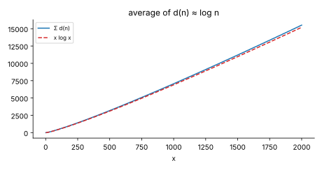

<sub>Σd(n) לעומת x log x.</sub>

### דוגמה 2: הסדר הממוצע של $`\sigma(n)`$
1. $`\sigma = \mathrm{id} * \mathbf1`$: $`\sum_{n \le x}\sigma(n) = \sum_{d \le x}\sum_{m \le x/d} m`$ (כאן $`n = dm`$, ו-$`\sigma(n) = \sum_{m\mid n} m`$).
2. $`\sum_{m \le y} m = \tfrac{y^2}2 + O(y)`$. לכן הסכום $`= \sum_{d \le x}\left(\frac{x^2}{2d^2} + O\!\left(\frac xd\right)\right)`$.
3. $`= \frac{x^2}2\sum_{d \le x}\frac1{d^2} + O(x\log x) = \frac{x^2}{2}\left(\zeta(2) + O(1/x)\right) + O(x\log x)`$.
4. $`\zeta(2) = \sum 1/d^2 = \pi^2/6`$ (נוכיח ב[שיעור 11](11-טורי-דיריכלה-וזטא.md)), ולכן
```math
\sum_{n\le x}\sigma(n) = \frac{\pi^2}{12}x^2 + O(x \log x).
```
5. **מסקנה:** הסדר הממוצע של $`\sigma(n)`$ הוא $`\frac{\pi^2}6 n \approx 1.645\,n`$.

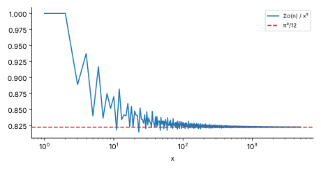

<sub>Σσ(n)/x² מתכנס ל־π²/12.</sub>

### דוגמה 3: הסדר הממוצע של $`\varphi(n)`$ והסתברות להיות זרים
את [הפונקציה הסכומית של פונקציית אוילר](../pages/הפונקציה%20הסכומית%20של%20פונקציית%20אוילר.md) $`\Phi(x) = \sum_{n \le x}\varphi(n)`$ מחשבים באותה דרך:
1. $`\varphi = \mu * \mathrm{id}`$: $`\Phi(x) = \sum_{d \le x}\mu(d)\sum_{m \le x/d} m = \sum_{d\le x}\mu(d)\left(\frac{x^2}{2d^2} + O\!\left(\frac xd\right)\right)`$.
2. $`= \frac{x^2}2\sum_{d=1}^\infty\frac{\mu(d)}{d^2} + O(x\log x)`$ (הזנב $`\sum_{d > x}1/d^2 = O(1/x)`$).
3. $`\sum \mu(d)/d^2 = 1/\zeta(2)`$ (כי $`\mu * \mathbf 1 = \varepsilon`$; ראו שיעור 11). לכן
```math
\Phi(x) = \frac{3}{\pi^2}x^2 + O(x\log x).
```
4. **פירוש:** מספר הזוגות $`1 \le a, b \le x`$ עם $`\gcd(a,b) = 1`$ הוא $`2\Phi(x) - 1 \approx \frac{6}{\pi^2}x^2`$. כלומר **ההסתברות ששני מספרים "אקראיים" זרים היא $`6/\pi^2 \approx 0.608`$**.
5. **הסבר היוריסטי:** ההסתברות ששניהם מתחלקים ב-$`p`$ היא $`1/p^2`$, ולכן ההסתברות שהם זרים היא $`\prod_p(1 - 1/p^2) = 1/\zeta(2)`$.

**בדיקה מספרית:** $`\Phi(100) = 3044`$, ו-$`\tfrac{3}{\pi^2}\cdot 10^4 = 3039.6`$. ✓

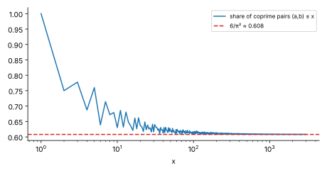

<sub>שיעור הזוגות הזרים מתכנס ל־6/π².</sub>

---

## 3. שיטת ההיפרבולה של דיריכלה

בדוגמה 1 קיבלנו שגיאה $`O(x)`$ — גדולה כמו המונח השני. [שיטת ההיפרבולה](../pages/שיטת%20ההיפרבולה%20של%20דיריכלה.md) משפרת זאת.

**הרעיון:** $`\sum_{n\le x}d(n)`$ סופר את נקודות הסריג $`(a, b)`$ עם $`a, b \ge 1`$ ו-$`ab \le x`$ — מתחת להיפרבולה $`ab = x`$. האזור סימטרי ביחס לאלכסון. נסמן $`y = \sqrt x`$:
```math
\#\{ab \le x\} = 2\#\{ab \le x,\ a \le y\} - \#\{a \le y,\ b \le y\} = 2\sum_{a \le y}\left\lfloor\frac xa\right\rfloor - \lfloor y\rfloor^2 .
```
(סופרים את הנקודות עם $`a \le y`$, ואת אלה עם $`b \le y`$; את הריבוע $`a, b \le y`$ ספרנו פעמיים.)

### דוגמה 4: הנוסחה של דיריכלה
1. $`2\sum_{a\le y}\left(\frac xa + O(1)\right) = 2x\left(\log y + \gamma + O(1/y)\right) + O(y) = x\log x + 2\gamma x + O(\sqrt x)`$.
2. $`\lfloor y \rfloor^2 = (y + O(1))^2 = x + O(\sqrt x)`$.
3. בסך הכול:
```math
\sum_{n \le x} d(n) = x\log x + (2\gamma - 1)x + O(\sqrt x).
```
4. **בדיקה:** עבור $`x = 100`$: $`460.5 + 0.1544 \cdot 100 = 475.9`$, לעומת 482 בפועל — השגיאה 6, בגודל של $`\sqrt{100} = 10`$. ✓

**[בעיית המחלקים של דיריכלה](../pages/בעיית%20המחלקים%20של%20דיריכלה.md):** מהו המעריך הקטן ביותר $`\theta`$ כך שהשגיאה היא $`O(x^{\theta + \varepsilon})`$? דיריכלה: $`\theta \le 1/2`$. הארדי הראה ש-$`\theta \ge 1/4`$. התוצאה הטובה ביותר הידועה קרובה ל-$`0.314`$, והשערה ש-$`\theta = 1/4`$ פתוחה.

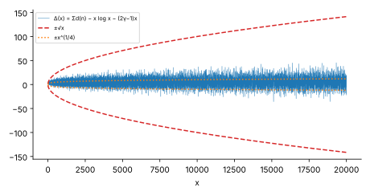

<sub>השגיאה בבעיית המחלקים של דיריכלה, בין √x± ל־x^(1/4)±.</sub>

---

## 4. סדר נורמלי

$`g`$ היא **[הסדר הנורמלי](../pages/סדר%20נורמלי%20של%20פונקציה%20אריתמטית.md)** של $`f`$ אם לכל $`\varepsilon > 0`$, **כמעט כל** $`n`$ (כלומר, כל המספרים חוץ מקבוצה בצפיפות 0) מקיימים $`(1 - \varepsilon)g(n) \le f(n) \le (1+\varepsilon)g(n)`$.

**הבדל חשוב:** הסדר הממוצע של $`\omega(n)`$ והסדר הנורמלי שלו שניהם $`\log\log n`$. אבל עבור $`d(n)`$ הם **שונים**: הממוצע הוא $`\log n`$, ואילו הערך הטיפוסי הוא בערך $`2^{\log\log n} = (\log n)^{\log 2} \approx (\log n)^{0.69}`$. הממוצע נגרר למעלה על ידי מעט מספרים עם הרבה מחלקים.

**משפט 9.1 ([הארדי–רמנוג'אן](../pages/משפט%20הארדי-רמנוג'אן.md), 1917).** הסדר הנורמלי של $`\omega(n)`$ הוא $`\log\log n`$.

**הוכחה (של טוראן, 1934) — באמצעות שונות.**
1. **ממוצע:** $`\sum_{n\le x}\omega(n) = \sum_{p \le x}\lfloor x/p \rfloor = x\sum_{p\le x}\frac1p + O(\pi(x))`$.
2. **משפט מרטנס** ([שיעור 10](10-התפלגות-אלמנטרית.md)): $`\sum_{p\le x}1/p = \log\log x + O(1)`$. לכן הממוצע של $`\omega(n)`$ הוא $`\log\log x + O(1)`$.
3. **מומנט שני:** $`\sum_{n \le x}\omega(n)^2 = \sum_{p, q \le x}\#\{n \le x: p \mid n, q \mid n\}`$. איברים עם $`p \ne q`$ תורמים לכל היותר $`x\left(\sum 1/p\right)^2`$, ואיברים עם $`p = q`$ תורמים $`x\sum 1/p`$. לכן $`\sum \omega^2 \le x(\log\log x)^2 + O(x\log\log x)`$.
4. **שונות:** $`\sum_{n\le x}(\omega(n) - \log\log x)^2 = \sum\omega^2 - 2\log\log x\sum\omega + x(\log\log x)^2 = O(x\log\log x)`$.
5. **צ'בישב:** מספר ה-$`n \le x`$ עם $`|\omega(n) - \log\log x| > \varepsilon\log\log x`$ הוא לכל היותר $`\frac{O(x\log\log x)}{\varepsilon^2(\log\log x)^2} = o(x)`$.
6. ($`\log\log n`$ ו-$`\log\log x`$ שונים זה מזה רק ב-$`o(1)`$ עבור $`\sqrt x < n \le x`$.) ∎

**משמעות מפתיעה:** מספר טיפוסי בסביבת $`10^{100}`$ (מספר עם 100 ספרות!) מתחלק רק בכ-$`\log\log 10^{100} \approx 5.4`$ ראשוניים שונים.

**משפט 9.2 ([ארדש–קאץ](../pages/משפט%20ארדש-קאץ.md), 1940).** ההתפלגות של $`\omega(n)`$ היא **נורמלית** (גאוסיאנית): לכל $`a < b`$,
```math
\frac1x\#\left\{n \le x : a \le \frac{\omega(n) - \log\log n}{\sqrt{\log\log n}} \le b\right\} \longrightarrow \frac1{\sqrt{2\pi}}\int_a^b e^{-t^2/2}\,dt .
```
**אינטואיציה:** $`\omega(n) = \sum_p X_p(n)`$, כאשר $`X_p(n) = 1`$ אם $`p \mid n`$. אלה "כמעט" משתנים מקריים בלתי תלויים עם הסתברות $`1/p`$, והשונות $`\sum_p \tfrac1p(1 - \tfrac1p) \approx \log\log x`$. משפט הגבול המרכזי נותן התפלגות נורמלית. ההוכחה המלאה דורשת לכמת את ה"כמעט" (בעזרת [תורת הנפה](14-תורת-הנפה.md) או שיטת המומנטים).

**מתי צריך לנרמל?** ל-$`\omega(n)`$ אין התפלגות גבולית "כמו שהיא" — היא שואפת לאינסוף אצל כמעט כל $`n`$, ולכן ארדש–קאץ מחסירים $`\log\log n`$ ומחלקים ב-$`\sqrt{\log\log n}`$. **[משפט ארדש–וינטנר](../pages/משפט%20ארדש-וינטנר.md)** אומר מתי פונקציה אדיטיבית $`f`$ (כלומר $`f(mn) = f(m) + f(n)`$ עבור $`m, n`$ זרים) **כן** מתפלגת בלי נרמול: כשהטורים $`\sum_{|f(p)|>1}\frac1p`$, $`\sum_{|f(p)|\le1}\frac{f(p)}p`$ ו-$`\sum_{|f(p)|\le1}\frac{f(p)^2}p`$ מתכנסים. עבור $`\omega`$, $`f(p) = 1`$ והטור השני הוא $`\sum 1/p = \infty`$. לעומת זאת, עבור $`f(n) = \log\frac{\varphi(n)}{n}`$ מתקיים $`f(p) = \log(1 - \tfrac1p) \approx -\tfrac1p`$, כל הטורים מתכנסים, ולכן ל-$`\varphi(n)/n`$ יש התפלגות גבולית — ואף רציפה, כי $`f(p) \ne 0`$ לכל $`p`$ ו-$`\sum 1/p`$ מתבדר.

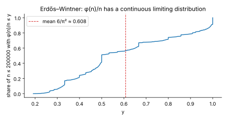

<sub>ההתפלגות המצטברת של φ(n)/n עבור n עד 200,000. המדרגות התלולות באות ממספרים כמו 2p ו-6p.</sub>

---

## 5. סדרים קיצוניים

[הסדרים הקיצוניים](../pages/סדרים%20קיצוניים%20של%20פונקציה%20אריתמטית.md) מתארים את $`\limsup`$ ו-$`\liminf`$.

**$`d(n)`$:** לכל $`\varepsilon > 0`$, $`d(n) = O(n^\varepsilon)`$. ויתרה מזו (וויגרט):
```math
\limsup_{n\to\infty}\frac{\log d(n)}{\log n/\log\log n} = \log 2 .
```

### דוגמה 5: הוכחת $`d(n) = O(n^\varepsilon)`$
1. $`\frac{d(n)}{n^\varepsilon} = \prod_{p^a \| n}\frac{a+1}{p^{a\varepsilon}}`$.
2. עבור $`p \ge 2^{1/\varepsilon}`$: $`p^{a\varepsilon} \ge 2^a \ge a + 1`$, כך שהגורם $`\le 1`$.
3. עבור כל אחד מהראשוניים הקטנים $`p < 2^{1/\varepsilon}`$ (שמספרם סופי): $`\frac{a+1}{p^{a\varepsilon}} \le \frac{a+1}{2^{a\varepsilon}}`$, והביטוי הזה חסום בקבוע $`C(\varepsilon)`$ שאינו תלוי ב-$`a`$ (כי אקספוננט גובר על פונקציה ליניארית).
4. לכן $`d(n)/n^\varepsilon \le C(\varepsilon)^{2^{1/\varepsilon}}`$ — קבוע. ∎

**$`\sigma(n)`$ (גרונוול, 1913):**
```math
\limsup_{n\to\infty}\frac{\sigma(n)}{n\log\log n} = e^\gamma \approx 1.781, \qquad \liminf\frac{\sigma(n)}n = 1 .
```
(ה-$`\liminf`$ מושג בראשוניים: $`\sigma(p)/p = 1 + 1/p`$.) רובין הוכיח ש**השערת רימן שקולה** לכך ש-$`\sigma(n) < e^\gamma n\log\log n`$ לכל $`n > 5040`$.

**$`\varphi(n)`$:**
```math
\liminf_{n\to\infty}\frac{\varphi(n)\log\log n}{n} = e^{-\gamma}, \qquad \limsup\frac{\varphi(n)}{n} = 1 .
```
ה-$`\liminf`$ מושג על פרימוריאלים $`n = p\#`$, שבהם $`\varphi(n)/n = \prod_{q\le p}(1 - 1/q) \approx e^{-\gamma}/\log p`$ (משפט מרטנס השלישי).


<sub>d(n)/n^ε נשאר חסום.</sub>

### דוגמה 6: פונקציית לנדאו
**[פונקציית לנדאו](../pages/פונקציית%20לנדאו.md)** $`g(n)`$ היא הסדר המקסימלי של תמורה על $`n`$ איברים. סדר התמורה הוא ה-lcm של אורכי המעגלים שלה, ולכן
```math
g(n) = \max\{\mathrm{lcm}(a_1, \dots, a_k) : a_1 + \dots + a_k = n\}.
```
**חישוב $`g(10)`$:**
1. כדאי לבחור אורכים זרים בזוגות (אחרת lcm קטן מהמכפלה). חזקות ראשוניים שסכומן עד 10: $`2+3+5 = 10 \to 30`$; $`3 + 7 = 10 \to 21`$; $`2 + 7 = 9 \to 14`$; $`4 + 5 = 9 \to 20`$; $`4 + 3 = 7 \to 12`$; $`2 + 3 + 4`$ אסור (2 ו-4 לא זרים).
2. **תשובה:** $`g(10) = 30`$, עם מעגלים באורכים 2, 3, 5.

לנדאו הוכיח ש-$`\log g(n) \sim \sqrt{n\log n}`$ — גדל מהר מכל פולינום, אבל לאט בהרבה מ-$`n!`$.

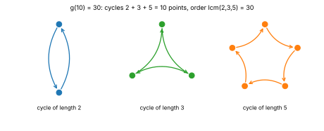

<sub>תמורה מסדר 30 על 10 נקודות: מעגלים באורכים 2, 3, 5.</sub>

---

## 6. מספרים חלקים ופונקציית דיקמן

נסמן ב-$`\Psi(x, y)`$ את מספר ה-$`n \le x`$ שכל גורמיהם הראשוניים $`\le y`$ (מספרים [חלקים](../pages/מספר%20חלק.md)).

**משפט 9.3 (דיקמן, 1930).** לכל $`u \ge 1`$ קבוע, $`\Psi(x, x^{1/u}) \sim \rho(u)\,x`$, כאשר $`\rho`$ היא **[פונקציית דיקמן](../pages/פונקציית%20דיקמן.md)**: $`\rho(u) = 1`$ עבור $`0 \le u \le 1`$, ו-
```math
u\rho'(u) = -\rho(u - 1), \qquad u > 1 .
```

### דוגמה 7: חישוב $`\rho(u)`$ עבור $`1 \le u \le 2`$
1. בתחום הזה $`\rho(u-1) = 1`$, ולכן $`\rho'(u) = -1/u`$.
2. אינטגרציה מ-1: $`\rho(u) = 1 - \log u`$.
3. בפרט $`\rho(2) = 1 - \log 2 \approx 0.307`$.
4. **פירוש ישיר:** $`\Psi(x, \sqrt x)`$ = כל ה-$`n`$ פחות אלה שיש להם גורם ראשוני $`p > \sqrt x`$ (ואחד כזה לכל היותר). מספרם $`\sum_{\sqrt x < p \le x}\lfloor x/p\rfloor \approx x\sum_{\sqrt x\lt p\le x}\frac1p \approx x(\log\log x - \log\log\sqrt x) = x\log 2`$. לכן $`\Psi(x, \sqrt x) \approx x(1 - \log 2)`$. ✓ (השתמשנו במרטנס.)

$`\rho(u)`$ יורדת מהר מאוד: $`\rho(3) \approx 0.0486`$, $`\rho(5) \approx 0.000354`$, ובקירוב $`\rho(u) \approx u^{-u}`$. זה בדיוק מה שקובע את זמן הריצה של אלגוריתמי פירוק לגורמים (נפת השדה הריבועי, נפת שדה המספרים): הם מחפשים מספרים חלקים.

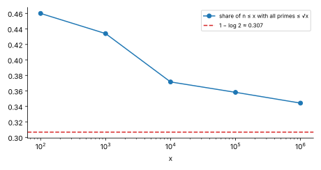

<sub>שיעור המספרים ש־√x־חלקים, לעומת 1−log 2.</sub>

---

## 7. תרגילים

**תרגיל 1.** הוכיחו ש-$`\sum_{n\le x}\left\lfloor\frac xn\right\rfloor`$ ו-$`\sum_{n \le x}d(n)`$ שווים, ובדקו זאת עבור $`x = 10`$.

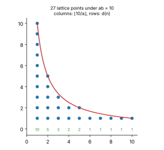

<sub>נקודות הסריג מתחת להיפרבולה ab≤10: סופרים לפי עמודות (⌊10/a⌋) או לפי מכפלות (d(n)).</sub>

<details><summary>פתרון</summary>

שניהם סופרים זוגות $`(a, b)`$ עם $`ab \le x`$. עבור $`x = 10`$: $`10 + 5 + 3 + 2 + 2 + 1 + 1 + 1 + 1 + 1 = 27`$, ו-$`d(1) + \dots + d(10) = 1 + 2 + 2 + 3 + 2 + 4 + 2 + 4 + 3 + 4 = 27`$. ✓
</details>

**תרגיל 2.** מצאו את הסדר הממוצע של $`\omega(n)`$ בעזרת $`\sum_{n\le x}\omega(n) = \sum_{p\le x}\lfloor x/p\rfloor`$ ומשפט מרטנס, והסבירו מדוע זה גם הסדר הממוצע של $`\Omega(n)`$.

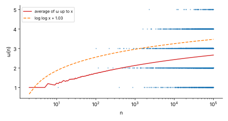

<sub>ω(n) והממוצע שלו, שגדל כמו log log n.</sub>

<details><summary>פתרון</summary>

$`\sum_{n\le x}\omega(n) = x\log\log x + O(x)`$. עבור $`\Omega`$ נוספים איברים מחזקות: $`\sum_{p^k \le x, k\ge2}\lfloor x/p^k\rfloor \le x\sum_p\sum_{k\ge2}p^{-k} = x\sum_p\frac{1}{p(p-1)} = O(x)`$. אז גם הסדר הממוצע של $`\Omega`$ הוא $`\log\log n`$.
</details>

**תרגיל 3.** הוכיחו ש-$`\sum_{n\le x}\frac{\varphi(n)}n = \frac{6}{\pi^2}x + O(\log x)`$.

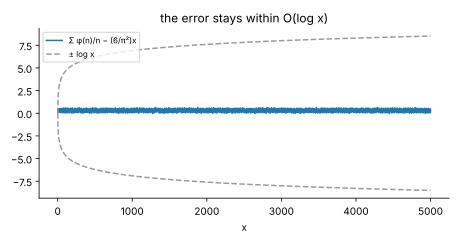

<sub>ההפרש בין Σφ(n)/n לבין 6x/π² נשאר קטן ביחס ל־log x.</sub>

<details><summary>פתרון</summary>

$`\frac{\varphi(n)}n = \sum_{d\mid n}\frac{\mu(d)}d`$. לכן הסכום $`= \sum_{d\le x}\frac{\mu(d)}{d}\left\lfloor\frac xd\right\rfloor = x\sum_{d \le x}\frac{\mu(d)}{d^2} + O\!\left(\sum_{d\le x}\frac1d\right) = \frac{x}{\zeta(2)} + O(1) + O(\log x)`$.
</details>

**תרגיל 4.** חשבו את $`g(7)`$ ואת $`g(12)`$.

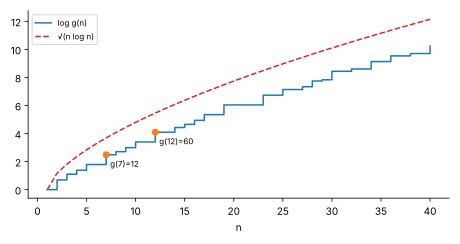

<sub>פונקציית לנדאו g(n) (בלוגריתם) לעומת √(n log n).</sub>

<details><summary>פתרון</summary>

$`g(7)`$: $`3 + 4 = 7 \to 12`$; $`2 + 5 = 7 \to 10`$; $`7 \to 7`$. התשובה 12. $`g(12)`$: $`3 + 4 + 5 = 12 \to 60`$; $`5 + 7 = 12 \to 35`$; $`2+3+7 = 12 \to 42`$. התשובה 60.
</details>

**תרגיל 5.** הסבירו בעזרת דיקמן: איזה חלק בערך מהמספרים עד $`10^{12}`$ הם $`10^4`$-חלקים?

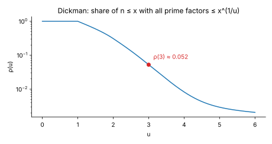

<sub>פונקציית דיקמן; ρ(3) ≈ 0.049.</sub>

<details><summary>פתרון</summary>

$`y = 10^4 = x^{1/3}`$, כלומר $`u = 3`$. החלק הוא בערך $`\rho(3) \approx 0.049`$, כלומר כ-5%.
</details>

**תרגיל 6 ([פונקציית הדלתא של הולי](../pages/פונקציית%20הדלתא%20של%20הולי.md)).** נגדיר $`\Delta(n)`$ כמספר המרבי של מחלקים של $`n`$ בקטע מהצורה $`[u, eu]`$. (א) חשבו את $`\Delta(p)`$ עבור ראשוני $`p \ge 3`$, ואת $`\Delta(12)`$ ו-$`\Delta(24)`$. (ב) הסבירו למה $`\Delta(n) \le d(n)`$ ולמה בדרך כלל $`\Delta(n)`$ קטן בהרבה מ-$`d(n)`$. (ג) למה מספיק לבדוק קטעים שמתחילים במחלק של $`n`$?

![משמאל: המחלקים של 24 בסקאלה לוגריתמית, וחלון ברוחב 1 (כלומר [u, eu]). מימין: Δ(n) עבור n עד 240.](img/09-6.svg)

<sub>משמאל: המחלקים של 24 בסקאלה לוגריתמית, וחלון ברוחב 1 (כלומר [u, eu]). מימין: Δ(n) עבור n עד 240.</sub>

<details><summary>פתרון</summary>

(ג) אם קטע $`[u, eu]`$ מכיל מחלקים, נזיז את $`u`$ ימינה עד המחלק הקטן ביותר בקטע. הקטע זז ימינה, לא מאבד אף מחלק שהיה בו (הקצה הימני רק גדל), ולכן מספר המחלקים לא קטן. לכן $`\Delta(n) = \max_{d \mid n}\#\{d' \mid n : d \le d' \le ed\}`$.

(א) לראשוני $`p \ge 3`$ המחלקים 1 ו-$`p`$, ו-$`p \gt e`$, ולכן אף קטע לא מכיל את שניהם: $`\Delta(p) = 1`$. עבור 12 (מחלקים 1, 2, 3, 4, 6, 12): הקטע $`[2, 2e] \approx [2, 5.44]`$ מכיל 2, 3, 4; הקטע $`[3, 8.15]`$ מכיל 3, 4, 6; אין קטע עם 4 מחלקים (למשל $`[2, 5.44]`$ לא מגיע ל-6). לכן $`\Delta(12) = 3`$. עבור 24 מוסיפים את 8 ו-24: $`[3, 8.15]`$ מכיל 3, 4, 6, 8, ולכן $`\Delta(24) = 4`$.

(ב) כל קטע מכיל לכל היותר את כל $`d(n)`$ המחלקים. אבל בסקאלה לוגריתמית המחלקים פרושים על פני הקטע $`[0, \log n]`$, והחלון ברוחב 1 בלבד. אם המחלקים פרושים באופן "אחיד", בחלון יש בערך $`d(n)/\log n`$ מהם. השאלה היא עד כמה המחלקים יכולים **להתקבץ** — וזה בדיוק מה ש-$`\Delta`$ מודדת. קוקולופולוס וטאו הוכיחו (2023) שהממוצע של $`\Delta(n)`$ עד $`x`$ הוא לכל היותר $`(\log\log x)^{11/4}`$ — זניח לעומת הממוצע $`\log x`$ של $`d(n)`$.
</details>

**תרגיל 7 ([קבוע פלר–טורנייר](../pages/קבוע%20פלר-טורנייר.md)).** נסמן ב-$`\omega_2(k)`$ את מספר הראשוניים $`p`$ כך ש-$`p^2 \mid k`$. (א) חשבו $`\omega_2`$ עבור 12, 72, 30, 900. (ב) הסבירו בעזרת "הסתברות" למה הצפיפות של $`\{k : \omega_2(k) \text{ זוגי}\}`$ היא $`\frac12\left(1 + \prod_p\left(1 - \frac{2}{p^2}\right)\right) \approx 0.6613`$. (ג) למה הצפיפות של $`\{k : \Omega(k) \text{ זוגי}\}`$, לעומת זאת, היא $`\frac12`$?

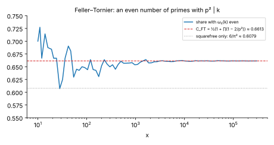

<sub>השיעור של המספרים עם ω₂(k) זוגי מתייצב על קבוע פלר–טורנייר, מעל השיעור 6/π² של המספרים החופשיים מריבועים.</sub>

<details><summary>פתרון</summary>

(א) $`12 = 2^2\cdot3`$: $`\omega_2 = 1`$. $`72 = 2^3\cdot3^2`$: $`\omega_2 = 2`$. $`30`$ חופשי מריבועים: $`\omega_2 = 0`$. $`900 = 2^2 3^2 5^2`$: $`\omega_2 = 3`$. רק 72 ו-30 בקבוצה.

(ב) נחשב את הצפיפות הממוצעת של $`(-1)^{\omega_2(k)} = \prod_p \varepsilon_p(k)`$, כאשר $`\varepsilon_p = -1`$ אם $`p^2 \mid k`$ ו-$`+1`$ אחרת. ל-$`p^2 \mid k`$ צפיפות $`1/p^2`$, ובמשפט השאריות הסיני התנאים עבור ראשוניים שונים בלתי תלויים, ולכן הממוצע הוא $`\prod_p\left((1 - \tfrac1{p^2}) - \tfrac{1}{p^2}\right) = \prod_p(1 - \tfrac{2}{p^2}) \approx 0.3226`$. הצפיפות של $`\omega_2`$ זוגי היא $`\frac{1 + \text{ממוצע}}{2} \approx 0.6613`$. (כדי להפוך את זה להוכחה צריך לחתוך את המכפלה בראשוני גדול ולהעריך את הזנב, $`\sum_{p > y} 1/p^2 \to 0`$.)

(ג) הממוצע של $`(-1)^{\Omega(k)} = \lambda(k)`$ (פונקציית ליוביל) הוא $`0`$: גם כאן החישוב ה"הסתברותי" נותן $`\prod_p \frac{1 - 1/p}{1 + 1/p} = 0`$ (המכפלה מתבדרת לאפס), אבל כאן הוא רק היוריסטיקה: ההוכחה שהממוצע של $`\lambda`$ הוא 0 שקולה למשפט המספרים הראשוניים, כי ההשפעה של כל הראשוניים יחד אינה נשלטת על ידי זנב קטן. לכן הצפיפות היא $`\frac{1 + 0}{2} = \frac12`$. (בבדיקה עד $`2\cdot10^6`$: 0.4997.)
</details>

**תרגיל 8 ([משפט דזוייה–דרס–טננבאום](../pages/משפט%20דזוייה-דרס-טננבאום.md)).** בוחרים $`n \le x`$ באקראי, ואז מחלק $`d`$ של $`n`$ באקראי (כל המחלקים באותה הסתברות), ומתבוננים ב-$`D = \log d/\log n \in [0,1]`$. לפי המשפט, כאשר $`x \to \infty`$, $`\mathbb P(D \le t) \to \frac{2}{\pi}\arcsin\sqrt t`$. (א) הסבירו למה ההתפלגות סימטרית סביב $`\tfrac12`$. (ב) מה ההסתברות ש-$`d \le n^{1/4}`$? ושהוא בין $`n^{1/4}`$ ל-$`n^{3/4}`$? (ג) הסבירו אינטואיטיבית למה מחלקים נוטים להיות קרובים ל-1 או ל-$`n`$ ולא ל-$`\sqrt n`$.

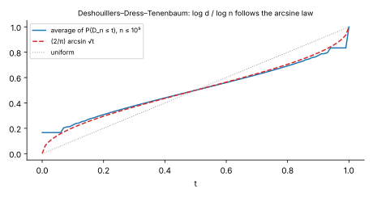

<sub>הממוצע של פונקציות ההתפלגות של log d / log n עבור n עד 10⁵, לעומת חוק הארקסינוס.</sub>

<details><summary>פתרון</summary>

(א) $`d \mapsto n/d`$ היא התאמה חד-חד-ערכית של מחלקי $`n`$ לעצמם, ו-$`\log(n/d)/\log n = 1 - D`$. לכן $`D`$ ו-$`1 - D`$ מתפלגים אותו דבר.

(ב) $`\frac2\pi\arcsin\frac12 = \frac2\pi\cdot\frac\pi6 = \frac13`$. בגלל הסימטריה גם $`\mathbb P(D \ge 3/4) = \tfrac13`$, ולכן $`\mathbb P(\tfrac14 \lt D \lt \tfrac34) = \tfrac13`$ — חצי מהקטע מקבל רק שליש מההסתברות. (בבדיקה עד $`2\cdot10^5`$: 0.343 עבור $`t = 1/4`$.)

(ג) מחלק של $`n`$ הוא בחירה של תת-קבוצה של הגורמים הראשוניים. ל-$`n`$ טיפוסי יש כ-$`\log\log n`$ גורמים ראשוניים, ואחד מהם (הגדול) "שוקל" חלק משמעותי מ-$`\log n`$. הסכום $`\log d`$ נשלט במידה רבה על ידי השאלה אם בחרנו את הגורמים הגדולים, ולכן $`D`$ נוטה להיות קרוב לקצוות. (ההוכחה בפועל משתמשת בממוצע על $`n`$ ובחישוב עם טורי דיריכלה.)
</details>

---

## סיכום
* **ממוצע:** $`d(n) \approx \log n`$, $`\sigma(n) \approx \frac{\pi^2}6 n`$, $`\varphi(n) \approx \frac6{\pi^2}n`$. הטריק: להחליף סדר סכימה.
* **היפרבולה:** $`\sum d(n) = x\log x + (2\gamma-1)x + O(\sqrt x)`$.
* **נורמלי:** $`\omega(n) \approx \log\log n`$ עבור כמעט כל $`n`$, ואף בהתפלגות נורמלית (ארדש–קאץ).
* **קיצוני:** $`\sigma(n)/n`$ מגיע עד $`e^\gamma\log\log n`$; $`d(n) = O(n^\varepsilon)`$.
* **מספרים חלקים:** $`\Psi(x, x^{1/u}) \sim \rho(u)x`$.

**השיעור הקודם:** [שיעור 8](08-משוואות-דיופנטיות.md) · **השיעור הבא:** [שיעור 10: התפלגות הראשוניים בשיטות אלמנטריות](10-התפלגות-אלמנטרית.md)

**להעמקה:** [סדר ממוצע](../pages/סדר%20ממוצע%20של%20פונקציה%20אריתמטית.md) · [משפט ארדש–וינטנר](../pages/משפט%20ארדש-וינטנר.md) · [פונקציית הדלתא של הולי](../pages/פונקציית%20הדלתא%20של%20הולי.md) · [קבוע פלר–טורנייר](../pages/קבוע%20פלר-טורנייר.md) · [משפט דזוייה–דרס–טננבאום](../pages/משפט%20דזוייה-דרס-טננבאום.md) · [סדר נורמלי](../pages/סדר%20נורמלי%20של%20פונקציה%20אריתמטית.md) · [סדרים קיצוניים](../pages/סדרים%20קיצוניים%20של%20פונקציה%20אריתמטית.md) · [בעיית המחלקים של דיריכלה](../pages/בעיית%20המחלקים%20של%20דיריכלה.md) · [שיטת ההיפרבולה](../pages/שיטת%20ההיפרבולה%20של%20דיריכלה.md) · [הפונקציה הסכומית של פונקציית אוילר](../pages/הפונקציה%20הסכומית%20של%20פונקציית%20אוילר.md) · [פונקציית לנדאו](../pages/פונקציית%20לנדאו.md) · [משפט הארדי–רמנוג'אן](../pages/משפט%20הארדי-רמנוג'אן.md) · [משפט ארדש–קאץ](../pages/משפט%20ארדש-קאץ.md) · [פונקציית דיקמן](../pages/פונקציית%20דיקמן.md)

---
<sub>חלק מהקורס [תורת המספרים בעברית](../COURSE.md). התוכן מופץ ברישיון [CC BY-SA 4.0](https://creativecommons.org/licenses/by-sa/4.0/).</sub>
