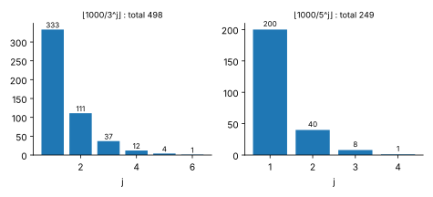
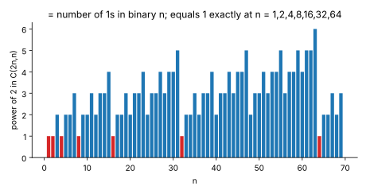
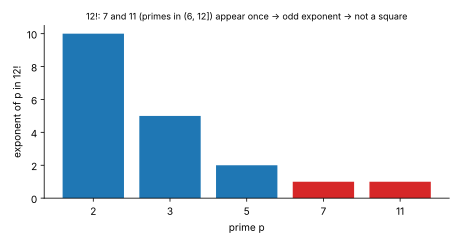
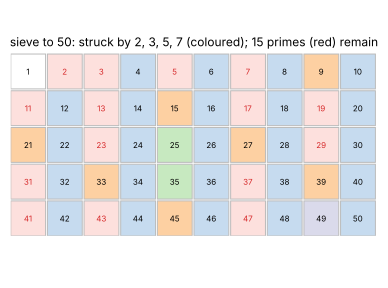
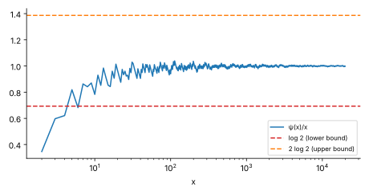

# שיעור 10: התפלגות הראשוניים בשיטות אלמנטריות

**מה נלמד:** כמה ראשוניים יש עד $`x`$? נגדיר את פונקציות צ'בישב $`\theta`$ ו-$`\psi`$, נוכיח שבין $`n`$ ל-$`2n`$ תמיד יש ראשוני (השערת ברטראן), נוכיח את שלושת המשפטים של מרטנס, ונראה איך מחשבים את $`\pi(x)`$ בלי למנות ראשוניים (לז'נדר, מייסל, להמר). הכול בלי אנליזה מרוכבת — בעזרת עצרת, מקדמים בינומיים והחלפת סדר סכימה.

**ידע קודם:** [שיעור 3](03-מספרים-ראשוניים.md), [שיעור 6](06-פונקציות-אריתמטיות.md) (מביוס), [שיעור 9](09-סדרים-של-פונקציות.md) (סימוני $`O`$).

---

## 1. פונקציות הספירה

* $`\pi(x)`$ — מספר הראשוניים $`p \le x`$. למשל $`\pi(10) = 4`$, $`\pi(100) = 25`$, $`\pi(1000) = 168`$, $`\pi(10^6) = 78498`$.
* **[פונקציות צ'בישב](../pages/פונקציית%20צ'בישב.md):**
```math
\theta(x) = \sum_{p \le x}\log p, \qquad \psi(x) = \sum_{p^k \le x}\log p = \sum_{n \le x}\Lambda(n),
```
כאשר **פונקציית פון מנגולדט** היא $`\Lambda(n) = \log p`$ אם $`n = p^k`$, ו-0 אחרת.

**למה עובדים עם $`\theta`$ ו-$`\psi`$ ולא עם $`\pi`$?** כי הן נותנות לכל ראשוני "משקל" $`\log p`$ שהופך את הנוסחאות לפשוטות. העובדה המרכזית:
```math
\sum_{d \mid n}\Lambda(d) = \log n, \qquad \text{כלומר}\qquad \Lambda * \mathbf1 = \log .
```
**הוכחה.** אם $`n = \prod p_i^{a_i}`$, המחלקים שהם חזקות ראשוניים הם $`p_i, p_i^2, \dots, p_i^{a_i}`$, וכל אחד תורם $`\log p_i`$. סך הכול $`\sum a_i\log p_i = \log n`$. ∎

**הקשר בין הפונקציות:**
* $`\psi(x) = \theta(x) + \theta(x^{1/2}) + \theta(x^{1/3}) + \dots = \theta(x) + O(\sqrt x\log x)`$ (חזקות ראשוניים נדירות).
* $`\theta(x) \le \pi(x)\log x`$, ובכיוון השני (סכימה בחלקים) $`\pi(x) = \frac{\theta(x)}{\log x} + O\!\left(\frac{x}{\log^2 x}\right)`$.
* לכן $`\pi(x) \sim \frac{x}{\log x} \iff \theta(x) \sim x \iff \psi(x) \sim x`$. זהו **משפט המספרים הראשוניים**, שנוכיח ב[שיעור 12](12-משפט-המספרים-הראשוניים.md).

**דוגמה מספרית:** $`\theta(100) = \log(2\cdot3\cdot5\cdots97) \approx 83.7`$; $`\theta(1000) \approx 956.2`$. היחס $`\theta(x)/x`$ כבר קרוב ל-1.

---

## 2. הנוסחה של לז'נדר לעצרת

**משפט 10.1.** החזקה של $`p`$ בפירוק של $`n!`$ היא
```math
v_p(n!) = \left\lfloor\frac np\right\rfloor + \left\lfloor\frac n{p^2}\right\rfloor + \left\lfloor\frac n{p^3}\right\rfloor + \cdots
```
**הוכחה.** $`v_p(n!) = \sum_{m \le n}v_p(m)`$. מספר $`m`$ עם $`v_p(m) = k`$ נספר בדיוק $`k`$ פעמים בצד ימין: פעם אחת בכל אחד מהאיברים $`\lfloor n/p\rfloor, \dots, \lfloor n/p^k\rfloor`$ (כי הוא כפולה של $`p, \dots, p^k`$). ∎

### דוגמה 1: בכמה אפסים מסתיים $`100!`$?
1. מספר האפסים הוא $`\min(v_2, v_5)`$, וברור ש-$`v_5 \le v_2`$.
2. $`v_5(100!) = \lfloor 100/5\rfloor + \lfloor 100/25\rfloor + \lfloor 100/125 \rfloor = 20 + 4 + 0 = 24`$.
3. **תשובה:** 24 אפסים.

**בשפת $`\Lambda`$:** $`\log n! = \sum_{m\le n}\log m = \sum_{m \le n}\sum_{d\mid m}\Lambda(d) = \sum_{d \le n}\Lambda(d)\left\lfloor\frac nd\right\rfloor`$.

---

## 3. החסמים של צ'בישב

**משפט 10.2 (צ'בישב, 1852).** יש קבועים חיוביים $`c_1, c_2`$ כך ש-$`c_1 x \le \theta(x) \le c_2 x`$ עבור $`x \ge 2`$. בפרט $`\pi(x) \asymp x/\log x`$.

**הוכחת החסם העליון (בעזרת $`\binom{2n}n`$).**
1. כל ראשוני $`n < p \le 2n`$ מחלק את $`\binom{2n}{n} = \frac{(2n)!}{n!\,n!}`$: הוא מופיע במונה ולא במכנה.
2. לכן $`\prod_{n<p\le2n}p \le \binom{2n}n \le 2^{2n} = 4^n`$ (המקדם הוא אחד המחוברים ב-$`(1+1)^{2n}`$).
3. בלוגריתם: $`\theta(2n) - \theta(n) \le 2n\log 2`$.
4. נסכם על $`n = x/2, x/4, x/8, \dots`$: $`\theta(x) \le 2\log 2\,(x/2 + x/4 + \dots) + O(\log x)= 2\log 2 \cdot x + O(\log x)`$.
5. כלומר $`\theta(x) \le 1.39x`$ בערך. ∎

**הוכחת החסם התחתון.**
1. $`\binom{2n}n`$ הוא המקדם הגדול ביותר מבין $`2n + 1`$ מחוברים שסכומם $`4^n`$, ולכן $`\binom{2n}n \ge \frac{4^n}{2n+1}`$.
2. לפי לז'נדר, החזקה של $`p`$ ב-$`\binom{2n}n`$ היא $`\sum_k\left(\lfloor 2n/p^k\rfloor - 2\lfloor n/p^k\rfloor\right)`$. כל איבר הוא 0 או 1 (כי $`\lfloor 2y\rfloor - 2\lfloor y \rfloor \in \{0, 1\}`$), ואיברים עם $`p^k > 2n`$ מתאפסים. לכן $`p^{v_p} \le 2n`$.
3. לכן $`\binom{2n}{n} \le (2n)^{\pi(2n)}`$, כלומר $`\pi(2n) \ge \frac{n\log 4 - \log(2n+1)}{\log 2n}`$. ∎

### דוגמה 2: $`n = 10`$
$`\binom{20}{10} = 184756 = 2^2\cdot 11 \cdot 13 \cdot 17 \cdot 19`$. אכן: הראשוניים בין 10 ל-20 (11, 13, 17, 19) כולם מופיעים פעם אחת; 3, 5, 7 לא מופיעים בכלל; $`2^2 \le 20`$. והחסם התחתון: $`4^{10}/21 \approx 49932 \le 184756`$. ✓

---

## 4. השערת ברטראן

**משפט 10.3 ([השערת ברטראן](https://he.wikipedia.org/wiki/%D7%94%D7%A9%D7%A2%D7%A8%D7%AA_%D7%91%D7%A8%D7%98%D7%A8%D7%90%D7%9F), הוכח על ידי צ'בישב).** לכל $`n \ge 1`$ יש ראשוני $`p`$ עם $`n < p \le 2n`$.

**ההוכחה של ארדש (1932), שלב אחר שלב** (ההוכחה המלאה, עם כל הלמות: [הוכחת השערת ברטראן](../pages/הוכחת%20השערת%20ברטראן.md)).
1. **עבור $`n < 512`$** בודקים ישירות בעזרת שרשרת הראשוניים $`2, 3, 5, 7, 13, 23, 43, 83, 163, 317, 631`$: כל אחד קטן מכפליים הקודם, ולכן כל קטע $`(n, 2n]`$ עם $`n < 631`$ מכיל אחד מהם.
2. **נניח בשלילה** שאין ראשוני ב-$`(n, 2n]`$, ונפרק את $`N = \binom{2n}{n}`$ לפי גודל הראשוניים:
   * $`p > 2n`$: לא מחלקים את $`N`$.
   * $`n < p \le 2n`$: אין כאלה, לפי ההנחה.
   * $`\tfrac{2n}3 < p \le n`$: $`p`$ מופיע **פעמיים** ב-$`(2n)!`$ (כ-$`p`$ וכ-$`2p`$) ופעמיים ב-$`n!\,n!`$. לכן $`p \nmid N`$. (כאן צריך $`p > 2`$ ו-$`3p > 2n`$.)
   * $`\sqrt{2n} < p \le \tfrac{2n}3`$: לפי שלב 2 של החסם התחתון, $`p`$ מופיע לכל היותר בחזקה 1, ומכפלתם $`\le \prod_{p \le 2n/3}p \le 4^{2n/3}`$ (לפי החסם העליון בצורה $`\prod_{p \le x}p \le 4^x`$).
   * $`p \le \sqrt{2n}`$: יש לכל היותר $`\sqrt{2n}`$ כאלה, וכל אחד תורם לכל היותר $`2n`$.
3. **מכפלה:** $`\frac{4^n}{2n+1} \le N \le (2n)^{\sqrt{2n}}\cdot 4^{2n/3}`$.
4. כלומר $`4^{n/3} \le (2n+1)(2n)^{\sqrt{2n}}`$. בלוגריתם, אגף שמאל גדל כמו $`n`$ ואגף ימין כמו $`\sqrt n\log n`$, והאי-שוויון נכשל לכל $`n \ge 512`$ (בדיקה ישירה ב-$`n = 512`$: $`4^{170.7} \approx 10^{102.7}`$ לעומת $`1025 \cdot 1024^{32} \approx 10^{99.4}`$, ואגף שמאל ממשיך לגדול מהר יותר). סתירה. ∎

**משפטים קשורים:**
* **[משפט רוסר](../pages/משפט%20רוסר.md) (1938):** הראשוני ה-$`n`$-י מקיים $`p_n > n\log n`$ לכל $`n \ge 1`$. (למשל $`p_{1000} = 7919 > 1000\log 1000 \approx 6908`$.)
* באותה שיטה רמנוג'אן הוכיח שלכל $`n \ge 6`$ יש לפחות **שני** ראשוניים ב-$`(n, 2n]`$.

---

## 5. שלושת המשפטים של מרטנס

**משפט 10.4 (מרטנס, 1874).** כאשר $`x \to \infty`$:
```math
\text{(1)}\quad\sum_{p \le x}\frac{\log p}p = \log x + O(1), \qquad
\text{(2)}\quad\sum_{p\le x}\frac1p = \log\log x + M + O\!\left(\frac1{\log x}\right),
```
```math
\text{(3)}\quad\prod_{p \le x}\left(1 - \frac1p\right) \sim \frac{e^{-\gamma}}{\log x}.
```

**הוכחת (1).**
1. מהנוסחה של לז'נדר: $`\log n! = \sum_{d\le n}\Lambda(d)\lfloor n/d\rfloor = n\sum_{d \le n}\frac{\Lambda(d)}d + O(\psi(n))`$.
2. $`\psi(n) = O(n)`$ (צ'בישב), ו-$`\log n! = n\log n - n + O(\log n)`$ (סטירלינג, או השוואה לאינטגרל).
3. מחלקים ב-$`n`$: $`\sum_{d \le n}\frac{\Lambda(d)}d = \log n + O(1)`$.
4. ההבדל בין $`\sum\Lambda(d)/d`$ לבין $`\sum_p \log p/p`$ הוא $`\sum_{p, k\ge2}\frac{\log p}{p^k}`$, שמתכנס. ∎

**הוכחת (2) בקווים כלליים.** כותבים $`\frac1p = \frac{\log p}{p}\cdot\frac1{\log p}`$ ומשתמשים בסכימה בחלקים (הגרסה הבדידה של אינטגרציה בחלקים) עם (1). האיבר הראשי $`\int_2^x\frac{dt}{t\log t} = \log\log x - \log\log 2`$.

**הקבוע:** $`M = 0.2614972\ldots`$ הוא **[קבוע מייסל–מרטנס](../pages/קבוע%20מייסל-מרטנס.md)**. בדיקה מספרית: $`\sum_{p\le10^6}1/p - \log\log 10^6 \approx 0.2615`$. ✓

**(3)** מתקבל מ-(2) על ידי לוגריתם: $`\log\prod(1 - 1/p) = -\sum\frac1p - \sum_p\sum_{k\ge2}\frac1{kp^k}`$. הקשר לקבוע אוילר $`\gamma`$ אינו אלמנטרי (דורש את $`\zeta(s)`$ ליד $`s = 1`$). בדיקה מספרית: $`\prod_{p \le 1000}(1 - 1/p)\cdot\log 1000 \approx 0.559`$, ו-$`e^{-\gamma} \approx 0.561`$. ✓

**משמעות:** הטור $`\sum 1/p`$ **מתבדר** (הוכחה נוספת לאינסוף ראשוניים, של אוילר), אבל לאט מאוד: הסכום על כל הראשוניים עד $`10^{18}`$ קטן מ-4.

[ארנסט מייסל](../pages/ארנסט%20מייסל.md) חישב את הקבוע $`M`$ בדיוק רב, ו[פרנץ מרטנס](../pages/פרנץ%20מרטנס.md) הוכיח את המשפטים. (על שניהם — ב[שיעור 17](17-אישים.md).)

---

## 6. ההשערה של לז'נדר והקבוע שלו

לז'נדר הציע ב-1808, על סמך טבלאות, ש-
```math
\pi(x) \approx \frac{x}{\log x - B}, \qquad B \approx 1.08366 .
```
**[קבוע לז'נדר](../pages/קבוע%20לז'נדר.md)**: היום ידוע (ממשפט המספרים הראשוניים עם איבר שגיאה) ש-$`\lim\left(\log x - \frac{x}{\pi(x)}\right) = 1`$, כלומר הערך ה"נכון" של $`B`$ הוא **1**. הערך של לז'נדר נבע מכך שהטבלאות שלו הגיעו רק עד כ-$`10^6`$, שם ההתכנסות עוד לא הושלמה.

### דוגמה 3: השוואה ב-$`x = 10^6`$
* $`x/\log x \approx 72382`$ (שגיאה של 8%).
* $`x/(\log x - 1) \approx 78030`$ (שגיאה של 0.6%).
* $`\pi(10^6) = 78498`$.

הקירוב הטוב ביותר הוא $`\mathrm{Li}(x) = \int_2^x\frac{dt}{\log t} \approx 78626`$ — ונראה בשיעור 12 למה.

---

## 7. חישוב $`\pi(x)`$: לז'נדר, מייסל, להמר

נסמן ב-$`\phi(x, a)`$ את מספר ה-$`n \le x`$ שאינם מתחלקים באף אחד מ-$`a`$ הראשוניים הראשונים. לפי עקרון ההכלה וההדחה:
```math
\phi(x, a) = \lfloor x\rfloor - \sum_{i}\left\lfloor\frac x{p_i}\right\rfloor + \sum_{i<j}\left\lfloor\frac x{p_ip_j}\right\rfloor - \cdots = \sum_{d \mid p_1\cdots p_a}\mu(d)\left\lfloor\frac xd\right\rfloor .
```
אם $`a = \pi(\sqrt x)`$, המספרים שנשארים הם 1 והראשוניים בין $`\sqrt x`$ ל-$`x`$, ולכן
```math
\pi(x) = \phi(x, \pi(\sqrt x)) + \pi(\sqrt x) - 1 .
```

### דוגמה 4: חישוב $`\pi(100)`$ בשיטת לז'נדר
1. $`\sqrt{100} = 10`$, הראשוניים 2, 3, 5, 7.
2. $`\lfloor 100 \rfloor = 100`$.
3. אחדים: $`50 + 33 + 20 + 14 = 117`$.
4. זוגות: $`\lfloor100/6\rfloor + \lfloor100/10\rfloor + \lfloor100/14\rfloor + \lfloor100/15\rfloor + \lfloor100/21\rfloor + \lfloor100/35\rfloor = 16 + 10 + 7 + 6 + 4 + 2 = 45`$.
5. שלשות: $`\lfloor100/30\rfloor + \lfloor100/42\rfloor + \lfloor100/70\rfloor + \lfloor100/105\rfloor = 3 + 2 + 1 + 0 = 6`$.
6. רביעייה: $`\lfloor 100/210\rfloor = 0`$.
7. $`\phi(100, 4) = 100 - 117 + 45 - 6 + 0 = 22`$.
8. $`\pi(100) = 22 + 4 - 1 = 25`$. ✓

**הבעיה:** מספר האיברים הוא $`2^{\pi(\sqrt x)}`$ — אקספוננציאלי. רובם אפסים, אבל עדיין.

**שיפור מייסל (1870) ולהמר (1959):** משתמשים בנסיגה $`\phi(x, a) = \phi(x, a-1) - \phi(x/p_a, a-1)`$ ועוצרים מוקדם, עם $`a = \pi(x^{1/3})`$ במקום $`\pi(x^{1/2})`$, ומתקנים בעזרת ספירה של מספרים עם בדיוק שני גורמים ראשוניים גדולים:
```math
\pi(x) = \phi(x, a) + a - 1 - P_2(x, a), \qquad P_2(x, a) = \#\{n \le x : n = pq,\ p_a < p \le q\}.
```
כך עובד **[אלגוריתם מייסל–להמר](../pages/אלגוריתם%20מייסל-להמר.md)**. מייסל חישב ביד את $`\pi(10^9)`$ (וטעה ב-56); עם שיפורים מודרניים (לגריאס–מילר–אודליזקו, דלגליז–ריבה) מחשבים את $`\pi(x)`$ בזמן של בערך $`x^{2/3}`$ פעולות, ו-$`\pi(10^{29})`$ כבר חושב.

---

## 8. תרגילים

**תרגיל 1.** מהי החזקה של 3 ב-$`1000!`$? בכמה אפסים מסתיים $`1000!`$?



<sub>האיברים בנוסחה של לז׳נדר עבור 3 ו־5 ב־1000!.</sub>

<details><summary>פתרון</summary>

$`v_3 = 333 + 111 + 37 + 12 + 4 + 1 = 498`$. $`v_5 = 200 + 40 + 8 + 1 = 249`$ אפסים.
</details>

**תרגיל 2.** הוכיחו ש-$`\binom{2n}n`$ זוגי לכל $`n \ge 1`$, ומצאו מתי הוא **לא** מתחלק ב-4.



<sub>החזקה של 2 ב־C(2n,n); היא 1 בדיוק כש־n חזקה של 2.</sub>

<details><summary>פתרון</summary>

$`\binom{2n}{n} = 2\binom{2n-1}{n-1}`$. החזקה של 2 בו היא מספר ה"נשאים" בחיבור $`n + n`$ בבסיס 2 (משפט קומר), שהוא מספר הספרות 1 של $`n`$ בבסיס 2. לכן $`4 \nmid \binom{2n}n`$ בדיוק כש-$`n`$ חזקה של 2.
</details>

**תרגיל 3.** בעזרת השערת ברטראן, הוכיחו שלכל $`n \ge 2`$, $`n!`$ אינו ריבוע שלם.



<sub>החזקות של הראשוניים ב־12!: הראשוניים בין 6 ל־12 מופיעים פעם אחת בלבד.</sub>

<details><summary>פתרון</summary>

יש ראשוני $`p`$ עם $`n/2 < p \le n`$ (עבור $`n \ge 2`$; ל-$`n`$ אי-זוגי משתמשים ב-$`\lfloor n/2\rfloor`$). אז $`2p > n`$, ולכן $`p`$ מופיע ב-$`n!`$ בחזקה 1 בדיוק — אי-זוגית.
</details>

**תרגיל 4.** חשבו את $`\pi(50)`$ בשיטת לז'נדר.



<sub>הנפה עד 50: מחיקת כפולות של 2, 3, 5, 7 משאירה 15 ראשוניים.</sub>

<details><summary>פתרון</summary>

$`\sqrt{50} \approx 7.07`$; הראשוניים 2, 3, 5, 7. $`\phi = 50 - (25 + 16 + 10 + 7) + (8 + 5 + 3 + 3 + 2 + 1) - (1 + 1 + 0 + 0) + 0 = 50 - 58 + 22 - 2 = 12`$. $`\pi(50) = 12 + 4 - 1 = 15`$. ✓ (בדקו מול דוגמה 2 בשיעור 3.)
</details>

**תרגיל 5.** הוכיחו ש-$`\sum_{n \le x}\Lambda(n)\left\lfloor\frac xn\right\rfloor = \log\lfloor x\rfloor!`$ והסיקו ש-$`\psi(x) \ge \log 2 \cdot x + O(\log x)`$ — בלי מקדמים בינומיים.



<sub>ψ(x)/x בין החסם התחתון log 2 לחסם העליון 2 log 2.</sub>

<details><summary>פתרון</summary>

הזהות: כמו בסעיף 2. עכשיו $`\log\lfloor x\rfloor! - 2\log\lfloor x/2\rfloor! = \sum_{n\le x}\Lambda(n)\left(\lfloor x/n\rfloor - 2\lfloor x/2n\rfloor\right) \le \sum_{n \le x}\Lambda(n) = \psi(x)`$, כי הסוגריים 0 או 1. לפי סטירלינג אגף שמאל הוא $`x\log 2 + O(\log x)`$.
</details>

---

## סיכום
* $`\Lambda * \mathbf1 = \log`$ — הזהות שמחברת ראשוניים לעצרת.
* צ'בישב: $`\pi(x) \asymp x/\log x`$, דרך $`\binom{2n}n`$.
* ברטראן: תמיד יש ראשוני בין $`n`$ ל-$`2n`$.
* מרטנס: $`\sum_{p\le x}1/p = \log\log x + M + o(1)`$.
* $`\pi(x)`$ מחשבים בהכלה והדחה, משופרת (מייסל–להמר).

**השיעור הקודם:** [שיעור 9](09-סדרים-של-פונקציות.md) · **השיעור הבא:** [שיעור 11: טורי דיריכלה ופונקציית זטא](11-טורי-דיריכלה-וזטא.md)

**להעמקה:** [פונקציית צ'בישב](../pages/פונקציית%20צ'בישב.md) · [הוכחת השערת ברטראן](../pages/הוכחת%20השערת%20ברטראן.md) · [השערת ברטראן](https://he.wikipedia.org/wiki/%D7%94%D7%A9%D7%A2%D7%A8%D7%AA_%D7%91%D7%A8%D7%98%D7%A8%D7%90%D7%9F) · [קבוע מייסל–מרטנס](../pages/קבוע%20מייסל-מרטנס.md) · [קבוע לז'נדר](../pages/קבוע%20לז'נדר.md) · [משפט רוסר](../pages/משפט%20רוסר.md) · [אלגוריתם מייסל–להמר](../pages/אלגוריתם%20מייסל-להמר.md) · [ארנסט מייסל](../pages/ארנסט%20מייסל.md) · [פרנץ מרטנס](../pages/פרנץ%20מרטנס.md)

---
<sub>חלק מהקורס [תורת המספרים בעברית](../COURSE.md). התוכן מופץ ברישיון [CC BY-SA 4.0](https://creativecommons.org/licenses/by-sa/4.0/).</sub>
