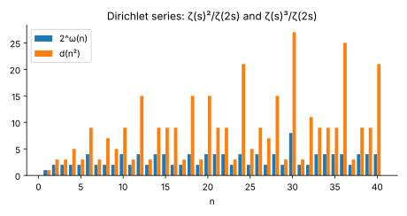
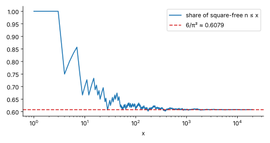
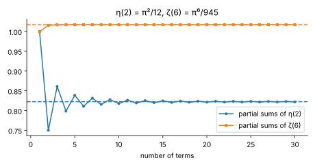
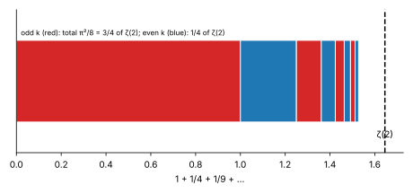
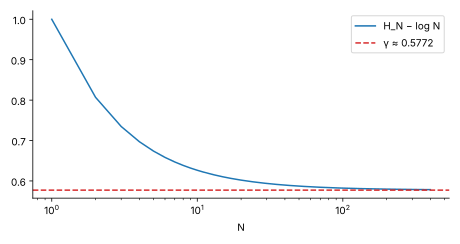

# שיעור 11: טורי דיריכלה ופונקציית זטא

**מה נלמד:** כאן עוברים מ"תורת מספרים אלמנטרית" ל"תורת מספרים אנליטית". נלמד טורי דיריכלה ($`\sum a_n n^{-s}`$), נראה שהם הופכים קונבולוציה לכפל, נוכיח את **מכפלת אוילר** — הגרסה האנליטית של הפירוק היחיד — ונכיר את **פונקציית זטא של רימן**: ערכיה המיוחדים, ההמשכה האנליטית שלה ומשוואת הפונקציה. בסוף נלמד את התמרת מלין ואת **נוסחת פרון**, הגשר שמאפשר לחלץ מידע על $`\sum_{n\le x}a_n`$ מתוך טור דיריכלה.

**ידע קודם:** [שיעור 6](06-פונקציות-אריתמטיות.md) (קונבולוציית דיריכלה, טורי בל), [שיעור 10](10-התפלגות-אלמנטרית.md). מעכשיו נשתמש גם בפונקציות של משתנה מרוכב: התכנסות טורים, פונקציות הולומורפיות, וקטבים ושאריות (משפט השאריות של קושי).

**סימון:** משתנה מרוכב נכתב $`s = \sigma + it`$. מתקיים $`|n^{-s}| = n^{-\sigma}`$, כי $`n^{-it} = e^{-it\log n}`$ בעל ערך מוחלט 1.

---

## 1. טורי דיריכלה

**[טור דיריכלה](https://he.wikipedia.org/wiki/%D7%98%D7%95%D7%A8_%D7%93%D7%99%D7%A8%D7%99%D7%9B%D7%9C%D7%94)** הוא טור מהצורה $`F(s) = \sum_{n=1}^\infty \frac{a_n}{n^s}`$.

**התכנסות.** אם $`|a_n| \le Cn^{\alpha}`$, הטור מתכנס בהחלט עבור $`\sigma > 1 + \alpha`$ (השוואה ל-$`\sum n^{\alpha - \sigma}`$). באופן כללי יש **אבסציסת התכנסות** $`\sigma_c`$: הטור מתכנס בחצי-המישור $`\sigma > \sigma_c`$ ומתבדר עבור $`\sigma < \sigma_c`$, ובחצי-המישור שבו הוא מתכנס הוא מגדיר פונקציה הולומורפית.

**משפט 11.1 (כפל = קונבולוציה).** בתחום התכנסות בהחלט,
```math
\left(\sum_n\frac{a_n}{n^s}\right)\left(\sum_m\frac{b_m}{m^s}\right) = \sum_k\frac{(a * b)_k}{k^s}.
```
**הוכחה.** פותחים: $`\sum_{n,m}\frac{a_nb_m}{(nm)^s}`$, ומקבצים לפי $`k = nm`$. ההתכנסות בהחלט מתירה לשנות סדר. ∎

### מילון
| פונקציה | טור דיריכלה | נובע מ- |
|---|---|---|
| $`\mathbf1`$ | $`\zeta(s)`$ | הגדרה |
| $`\mu`$ | $`\frac1{\zeta(s)}`$ | $`\mu * \mathbf1 = \varepsilon`$ |
| $`d`$ | $`\zeta(s)^2`$ | $`d = \mathbf1 * \mathbf1`$ |
| $`\sigma`$ | $`\zeta(s)\zeta(s-1)`$ | $`\sigma = \mathrm{id} * \mathbf1`$ |
| $`\varphi`$ | $`\frac{\zeta(s-1)}{\zeta(s)}`$ | $`\varphi = \mu * \mathrm{id}`$ |
| $`\Lambda`$ | $`-\frac{\zeta'(s)}{\zeta(s)}`$ | $`\Lambda * \mathbf1 = \log`$, ו-$`\sum\frac{\log n}{n^s} = -\zeta'(s)`$ |
| $`\lambda`$ | $`\frac{\zeta(2s)}{\zeta(s)}`$ | טורי בל: $`\frac{1-x}{1-x^2} = \frac1{1+x}`$ |
| $`\lvert\mu\rvert`$ | $`\frac{\zeta(s)}{\zeta(2s)}`$ | טורי בל: $`1 + x = \frac{1-x^2}{1-x}`$ |

השורה של $`\Lambda`$ היא החשובה ביותר בקורס: **הראשוניים מקודדים בנגזרת הלוגריתמית של זטא.**

---

## 2. מכפלת אוילר

**משפט 11.2 ([מכפלת אוילר](https://he.wikipedia.org/wiki/%D7%9E%D7%9B%D7%A4%D7%9C%D7%AA_%D7%90%D7%95%D7%99%D7%9C%D7%A8)).** אם $`f`$ כפלית ו-$`\sum|f(n)|n^{-\sigma} < \infty`$, אז
```math
\sum_{n=1}^\infty\frac{f(n)}{n^s} = \prod_p\left(1 + \frac{f(p)}{p^s} + \frac{f(p^2)}{p^{2s}} + \cdots\right) = \prod_p f_p(p^{-s}),
```
כאשר $`f_p`$ הוא טור הבל. אם $`f`$ כפלית לחלוטין, הגורם הוא $`\frac1{1 - f(p)p^{-s}}`$. בפרט
```math
\zeta(s) = \sum_{n=1}^\infty\frac1{n^s} = \prod_p\frac1{1 - p^{-s}}, \qquad \sigma > 1 .
```

**הוכחה (עבור $`\zeta`$, $`s > 1`$ ממשי, שלב אחר שלב).**
1. לכל $`p`$: $`\frac1{1 - p^{-s}} = 1 + p^{-s} + p^{-2s} + \cdots`$ (טור הנדסי).
2. נכפול את הגורמים עבור כל $`p \le N`$. כל מחובר בתוצאה הוא $`(p_1^{a_1}\cdots p_k^{a_k})^{-s}`$, ולפי **הפירוק היחיד** כל $`n`$ שכל גורמיו $`\le N`$ מופיע **בדיוק פעם אחת**:
```math
\prod_{p\le N}\frac1{1 - p^{-s}} = \sum_{n:\ P^+(n) \le N}\frac1{n^s},
```
כאשר $`P^+(n)`$ הוא הגורם הראשוני הגדול ביותר של $`n`$.
3. ההפרש מ-$`\zeta(s)`$ הוא סכום על $`n`$ שיש להם גורם ראשוני $`> N`$, ובפרט $`n > N`$. לכן הוא לכל היותר $`\sum_{n>N}n^{-s} \to 0`$. ∎

**מסקנות:**
* **$`\zeta(s) \ne 0`$ עבור $`\sigma > 1`$** — מכפלה מתכנסת של גורמים שאינם אפס.
* **הוכחה של אוילר לאינסוף ראשוניים:** כאשר $`s \to 1^+`$, $`\zeta(s) \to \infty`$ (הטור ההרמוני). אילו היו סופית ראשוניים, המכפלה הייתה נשארת חסומה.
* בלוגריתם: $`\log\zeta(s) = \sum_p\sum_{k}\frac{1}{kp^{ks}} = \sum_p\frac1{p^s} + O(1)`$ כאשר $`s \to 1^+`$. מכאן $`\sum_p 1/p`$ מתבדר כמו $`\log\frac1{s-1}`$.

**פונקציית זטא הראשונית.** הטור $`P(s) = \sum_p p^{-s}`$ נקרא **[פונקציית זטא הראשונית](../pages/פונקציית%20זטא%20הראשונית.md)**. מתקיים $`\log\zeta(s) = \sum_{n\ge1}\frac{P(ns)}n`$, ובהיפוך מביוס $`P(s) = \sum_{n\ge1}\frac{\mu(n)}{n}\log\zeta(ns)`$. כך מחשבים במהירות למשל $`P(2) = \sum_p p^{-2} = 0.45224\ldots`$.

---

## 3. בעיית בזל: $`\zeta(2) = \pi^2/6`$

**משפט 11.3 (אוילר, 1734).** $`\displaystyle\sum_{n=1}^\infty\frac1{n^2} = \frac{\pi^2}6`$.

**הוכחה אלמנטרית (בעזרת קוטנגנס).**
1. **אי-שוויון:** עבור $`0 < x < \pi/2`$: $`\sin x < x < \tan x`$, ולכן $`\cot^2 x < \frac1{x^2} < \frac{1}{\sin^2 x} = 1 + \cot^2 x`$.
2. **זהות:** עבור $`m \ge 1`$, $`\sum_{k=1}^m\cot^2\frac{k\pi}{2m+1} = \frac{m(2m-1)}3`$.
   *הוכחת הזהות:* לפי דה-מואבר, $`\sin((2m+1)\theta) = \mathrm{Im}(\cos\theta + i\sin\theta)^{2m+1} = \sin^{2m+1}\theta\cdot Q(\cot^2\theta)`$, כאשר $`Q(y) = \binom{2m+1}1y^m - \binom{2m+1}3y^{m-1} + \cdots`$ הוא פולינום ממעלה $`m`$. עבור $`\theta_k = \frac{k\pi}{2m+1}`$, $`k = 1..m`$, אגף שמאל מתאפס ו-$`\sin\theta_k \ne 0`$, ולכן $`\cot^2\theta_k`$ הם $`m`$ השורשים (השונים) של $`Q`$. לפי נוסחאות וייטה סכומם $`\binom{2m+1}3/\binom{2m+1}1 = \frac{m(2m-1)}3`$.
3. נציב $`x = \theta_k`$ באי-השוויון ונסכם על $`k = 1..m`$:
```math
\frac{m(2m-1)}3 < \frac{(2m+1)^2}{\pi^2}\sum_{k=1}^m\frac1{k^2} < m + \frac{m(2m-1)}3 .
```
4. נכפול ב-$`\frac{\pi^2}{(2m+1)^2}`$ וניתן ל-$`m \to \infty`$: שני הקצוות שואפים ל-$`\frac{\pi^2}{3}\cdot\frac{2}{4} = \frac{\pi^2}6`$. ∎

**שימושים שכבר ראינו:** הסדר הממוצע של $`\sigma`$ ושל $`\varphi`$, וההסתברות $`6/\pi^2`$ ששני מספרים זרים ([שיעור 9](09-סדרים-של-פונקציות.md)), וגם הצפיפות של מספרים חסרי ריבועים: $`\#\{n\le x: |\mu(n)| = 1\} \sim \frac6{\pi^2}x`$.

### ערכי זטא בשלמים זוגיים
באופן כללי (אוילר):
```math
\zeta(2k) = \frac{(-1)^{k+1}B_{2k}(2\pi)^{2k}}{2(2k)!},
```
כאשר $`B_n`$ הם **מספרי ברנולי**: $`\frac{x}{e^x - 1} = \sum B_n\frac{x^n}{n!}`$, כלומר $`B_0 = 1, B_1 = -\tfrac12, B_2 = \tfrac16, B_4 = -\tfrac1{30}, B_6 = \tfrac1{42}`$.

### דוגמה 1: $`\zeta(4)`$
$`k = 2`$: $`\zeta(4) = \frac{(-1)^3\cdot(-\tfrac1{30})(2\pi)^4}{2\cdot 24} = \frac{16\pi^4}{30\cdot48} = \frac{\pi^4}{90}`$. בדיקה: $`\pi^4/90 \approx 1.0823`$, ו-$`1 + \tfrac1{16} + \tfrac1{81} + \tfrac1{256} + \dots \approx 1.0823`$. ✓

על הערכים באי-זוגיים ($`\zeta(3) = 1.2020\ldots`$, קבוע אפרי) ידוע הרבה פחות: אפרי הוכיח ב-1978 ש-$`\zeta(3)`$ אי-רציונלי, וב-2026 פרסם פאוזן הוכחה (שנבדקה פורמלית במערכת Lean) שגם $`\zeta(5)`$ אי-רציונלי. על $`\zeta(7)`$ עדיין לא ידוע. טבלאות, נוסחאות פלאף לערכים האי-זוגיים ועוד — בערך [ערכים מיוחדים של פונקציית זטא של רימן](../pages/ערכים%20מיוחדים%20של%20פונקציית%20זטא%20של%20רימן.md).

---

## 4. המשכה אנליטית

הטור $`\sum n^{-s}`$ מתכנס רק עבור $`\sigma > 1`$. אבל לפונקציה $`\zeta(s)`$ יש **המשכה מרומורפית** לכל המישור, עם קוטב יחיד ב-$`s = 1`$.

### שלב 1: עד $`\sigma > 0`$ בעזרת פונקציית אטא
**[פונקציית אטא של דיריכלה](../pages/פונקציית%20אטא%20של%20דיריכלה.md)** היא הטור המתחלף
```math
\eta(s) = 1 - \frac1{2^s} + \frac1{3^s} - \frac1{4^s} + \cdots,
```
שמתכנס עבור $`\sigma > 0`$ (קיבוץ זוגות; כל זוג הוא $`O(n^{-\sigma-1})`$).

**הקשר:** $`\eta(s) = \zeta(s) - 2\sum_{n}\frac1{(2n)^s} = (1 - 2^{1-s})\zeta(s)`$.

לכן $`\zeta(s) = \frac{\eta(s)}{1 - 2^{1-s}}`$ מגדירה את זטא ב-$`\sigma > 0`$, פרט לנקודות שבהן $`2^{1-s} = 1`$. ב-$`s = 1`$: $`\eta(1) = \log 2`$ ו-$`1 - 2^{1-s} \approx (s-1)\log 2`$, כך שזטא מקבלת **קוטב פשוט עם שארית 1**:
```math
\zeta(s) = \frac{1}{s-1} + \gamma + O(s - 1).
```
(בשאר הנקודות $`s = 1 + \frac{2\pi ik}{\log 2}`$ גם $`\eta`$ מתאפסת, והסינגולריות סליקה.)

### שלב 2: נוסחת סכימה (אוילר–מקלורן הפשוטה)
עבור $`\sigma > 1`$, השוואת הסכום לאינטגרל נותנת
```math
\zeta(s) = \frac{s}{s-1} - s\int_1^\infty\frac{\{x\}}{x^{s+1}}\,dx,
```
כאשר $`\{x\} = x - \lfloor x\rfloor`$. האינטגרל מתכנס עבור $`\sigma > 0`$, וזו המשכה נוספת. (זהו המקרה $`a_n = 1`$ של זהות פרון בסעיף 6: $`\zeta(s) = s\int_1^\infty\lfloor x\rfloor x^{-s-1}dx`$.)

### קבועי סטילטיס
את הפיתוח של זטא סביב הקוטב כותבים כ-
```math
\zeta(s) = \frac1{s-1} + \sum_{n=0}^\infty\frac{(-1)^n}{n!}\gamma_n(s-1)^n ,
```
כאשר **[קבועי סטילטיס](../pages/קבועי%20סטילטיס.md)** הם $`\gamma_n = \lim_{m\to\infty}\left(\sum_{k=1}^m\frac{(\log k)^n}k - \frac{(\log m)^{n+1}}{n+1}\right)`$. $`\gamma_0 = \gamma`$, $`\gamma_1 \approx -0.0728`$.

### שלב 3: משוואת הפונקציה
**משפט 11.4 (רימן, 1859).** הפונקציה $`\xi(s) = \pi^{-s/2}\Gamma\!\left(\frac s2\right)\zeta(s)`$ מקיימת
```math
\xi(s) = \xi(1 - s).
```
(ההוכחה של רימן משתמשת בפונקציית התטא $`\vartheta(x) = \sum_n e^{-\pi n^2 x}`$ ובזהות $`\vartheta(1/x) = \sqrt x\,\vartheta(x)`$, שנובעת מנוסחת הסכימה של פואסון.)

משוואת הפונקציה מגדירה את זטא גם ב-$`\sigma < 0`$, ומחלקת את המישור לשלושה:
* **$`\sigma > 1`$:** מכפלת אוילר, אין אפסים.
* **$`\sigma < 0`$:** "שיקוף" של $`\sigma > 1`$. האפסים היחידים הם **האפסים הטריוויאליים** $`s = -2, -4, -6, \dots`$ — הקטבים של $`\Gamma(s/2)`$ "מבטלים" את $`\xi`$.
* **$`0 \le \sigma \le 1`$, ה"רצועה הקריטית":** כאן נמצאים כל האפסים הלא-טריוויאליים. **השערת רימן**: כולם על הישר $`\sigma = \tfrac12`$. נדבר עליה בשיעור 12.

### דוגמה 2: ערכים בשלמים שליליים
ממשוואת הפונקציה: $`\zeta(-n) = (-1)^n\frac{B_{n+1}}{n+1}`$ עבור $`n \ge 0`$ (עם $`B_1 = -\tfrac12`$).
* $`\zeta(0) = -\tfrac12`$.
* $`\zeta(-1) = -\frac{B_2}{2} = -\frac1{12}`$. (זהו המקור של ה"זהות" המפורסמת $`1 + 2 + 3 + \dots = -\tfrac1{12}`$. **אין** כאן טענה שהטור מתכנס — הוא מתבדר; זה הערך של ההמשכה האנליטית.)
* $`\zeta(-2) = -\frac{B_3}3 = 0`$ — אפס טריוויאלי.

---

## 5. הכללות: הורוויץ ולרך

**[פונקציית זטא של הורוויץ](../pages/פונקציית%20זטא%20של%20הורוויץ.md)** מוגדרת עבור $`0 < a \le 1`$:
```math
\zeta(s, a) = \sum_{n=0}^\infty\frac1{(n+a)^s}.
```
$`\zeta(s, 1) = \zeta(s)`$. החשיבות שלה: סכום על סדרה חשבונית מתפרק לפונקציות הורוויץ:
```math
\sum_{n \equiv r\ (\mathrm{mod}\ q)}\frac1{n^s} = \sum_{m=0}^\infty\frac{1}{(r + mq)^s} = q^{-s}\zeta\!\left(s, \frac rq\right).
```
### דוגמה 3
$`\zeta(s) = \sum_{r=1}^q\sum_{n\equiv r}n^{-s} = q^{-s}\sum_{r=1}^q\zeta(s, r/q)`$. עבור $`q = 2`$: $`\zeta(s) = 2^{-s}\left(\zeta(s, \tfrac12) + \zeta(s)\right)`$, ומכאן $`\zeta(s, \tfrac12) = (2^s - 1)\zeta(s)`$. בדיקה עבור $`s = 2`$: $`\sum_{n\ge0}\frac{1}{(n + 1/2)^2} = 4\sum\frac1{(2n+1)^2} = 4\cdot\frac{\pi^2}8 = 3\cdot\frac{\pi^2}{6}`$. ✓

**נוסחת הורוויץ** מבטאת את $`\zeta(1 - s, a)`$ באמצעות טורים מהצורה $`\sum_n\frac{\cos(2\pi na)}{n^s}`$ ו-$`\sum_n\frac{\sin(2\pi na)}{n^s}`$ — ומכאן קשר לפונקציות קלאוזן ול[טרנסצנדנט של לרך](../pages/הטרנסצנדנט%20של%20לרך.md) $`\Phi(z, s, a) = \sum_n\frac{z^n}{(n+a)^s}`$, שמאחד את זטא של הורוויץ ואת הפולילוגריתם. (ראו [פונקציית קלאוזן](../pages/פונקציית%20קלאוזן.md): למשל $`\mathrm{Cl}_2(\pi/2) = \sum_k \frac{\sin(k\pi/2)}{k^2} = 1 - \frac1{3^2} + \frac1{5^2} - \cdots`$ הוא קבוע קטלן, כלומר $`L(2, \chi_4)`$.) בשיעור 13 נשתמש בהורוויץ כדי להמשיך אנליטית פונקציות L.

---

## 6. התמרת מלין ונוסחת פרון

**הבעיה:** יש לנו טור דיריכלה $`F(s) = \sum a_nn^{-s}`$ עם תכונות אנליטיות ידועות. איך מסיקים ממנו משהו על $`A(x) = \sum_{n\le x}a_n`$?

**[התמרת מלין](../pages/התמרת%20מלין.md)** של פונקציה $`f`$ על $`(0, \infty)`$ היא
```math
\mathcal M f(s) = \int_0^\infty x^{s-1}f(x)\,dx ,
```
ו**[משפט ההיפוך של מלין](../pages/משפט%20ההיפוך%20של%20מלין.md)** אומר שבתנאים מתאימים
```math
f(x) = \frac1{2\pi i}\int_{c - i\infty}^{c + i\infty}x^{-s}\,\mathcal Mf(s)\,ds .
```
**דוגמה בסיסית:** $`\mathcal M[e^{-x}](s) = \Gamma(s)`$, ולכן $`e^{-x} = \frac1{2\pi i}\int_{(c)}\Gamma(s)x^{-s}ds`$ — בדיקה: מזיזים את קו האינטגרציה שמאלה ואוספים את השאריות של $`\Gamma`$ בקטבים $`s = -k`$, שהן $`\frac{(-1)^k}{k!}`$: מקבלים $`\sum\frac{(-x)^k}{k!} = e^{-x}`$. ✓

### "המסנן" של פרון
**למה 11.5.** עבור $`c > 0`$ ו-$`y > 0`$:
```math
\frac1{2\pi i}\int_{c-i\infty}^{c+i\infty}\frac{y^s}{s}\,ds = \begin{cases}1 & y > 1\\ \tfrac12 & y = 1 \\ 0 & 0 < y < 1.\end{cases}
```
**רעיון ההוכחה.** אם $`y > 1`$, סוגרים את המסילה **שמאלה** (שם $`|y^s| \to 0`$) ואוספים את השארית של $`y^s/s`$ ב-$`s = 0`$, שהיא 1. אם $`y < 1`$, סוגרים **ימינה**, שם אין קטבים, ומקבלים 0. ∎

**משפט 11.6 ([נוסחת פרון](../pages/נוסחת%20פרון.md)).** אם $`F(s) = \sum a_nn^{-s}`$ מתכנס בהחלט עבור $`\sigma = c > 0`$, אז
```math
{\sum_{n\le x}}'a_n = \frac{1}{2\pi i}\int_{c-i\infty}^{c+i\infty}F(s)\frac{x^s}{s}\,ds ,
```
(הגרש: אם $`x`$ שלם, האיבר האחרון נספר בחצי).

**הוכחה.** מציבים את הטור, מחליפים סכום ואינטגרל, ומפעילים את הלמה על כל איבר עם $`y = x/n`$: המסנן נותן 1 בדיוק כש-$`n < x`$. ∎

**האסטרטגיה של תורת המספרים האנליטית בשורה אחת:** כדי להעריך $`\sum_{n\le x}a_n`$, כותבים אותו לפי פרון, **מזיזים את קו האינטגרציה שמאלה**, ואוספים שאריות בקטבים של $`F(s)x^s/s`$. כל קוטב תורם איבר ראשי, וכמה רחוק שמאלה מותר להזיז קובע את גודל השגיאה.

### דוגמה 4: האיבר הראשי ב-$`\sum_{n\le x}d(n)`$
1. $`F(s) = \zeta(s)^2`$, עם קוטב כפול ב-$`s = 1`$: $`\zeta(s)^2 = \frac1{(s-1)^2} + \frac{2\gamma}{s-1} + \cdots`$.
2. $`\frac{x^s}{s} = x\left(1 + (s-1)\log x + \cdots\right)\left(1 - (s-1) + \cdots\right)`$.
3. השארית של $`\zeta(s)^2\frac{x^s}{s}`$ ב-$`s = 1`$ היא המקדם של $`(s-1)^{-1}`$: $`x(\log x - 1) + 2\gamma x = x\log x + (2\gamma - 1)x`$.
4. בדיוק האיבר הראשי שמצאנו בשיטת ההיפרבולה בשיעור 9! ✓

### דוגמה 5: מה צריך עבור $`\psi(x)`$
$`\psi(x) = \sum_{n\le x}\Lambda(n) = \frac1{2\pi i}\int_{(c)}\left(-\frac{\zeta'(s)}{\zeta(s)}\right)\frac{x^s}s\,ds`$. ל-$`-\zeta'/\zeta`$ יש קוטב פשוט עם שארית 1 ב-$`s = 1`$ (מהקוטב של זטא), שנותן את האיבר הראשי $`x`$ — אבל **גם קוטב בכל אפס של זטא**. לכן התפלגות הראשוניים נשלטת על ידי האפסים של זטא. זה הנושא של השיעור הבא.

---

## 7. תרגילים

**תרגיל 1.** מצאו את טור הדיריכלה של $`2^{\omega(n)}`$ ושל $`d(n^2)`$.


<sub>הפונקציות 2^ω(n) ו־d(n²).</sub>

<details><summary>פתרון</summary>

$`2^{\omega}`$: טור בל $`1 + 2x + 2x^2 + \dots = \frac{1+x}{1-x}`$, ולכן $`\sum 2^{\omega(n)}n^{-s} = \frac{\zeta(s)^2}{\zeta(2s)}`$. $`d(n^2)`$: על $`p^k`$ ערכו $`2k+1`$; טור בל $`\sum(2k+1)x^k = \frac{1+x}{(1-x)^2}`$, ולכן $`\frac{\zeta(s)^3}{\zeta(2s)}`$.
</details>

**תרגיל 2.** הוכיחו בעזרת מכפלת אוילר ש-$`\sum_n\frac{|\mu(n)|}{n^s} = \frac{\zeta(s)}{\zeta(2s)}`$, והסיקו שהממוצע של $`|\mu(n)|`$ הוא $`6/\pi^2`$ (בהנחה שאפשר לקרוא את הממוצע משארית הקוטב ב-$`s = 1`$).


<sub>שיעור המספרים חסרי הריבועים מתכנס ל־6/π².</sub>

<details><summary>פתרון</summary>

$`\prod_p(1 + p^{-s}) = \prod_p\frac{1 - p^{-2s}}{1 - p^{-s}} = \frac{\zeta(s)}{\zeta(2s)}`$. השארית ב-$`s = 1`$ היא $`1/\zeta(2) = 6/\pi^2`$.
</details>

**תרגיל 3.** חשבו $`\eta(2)`$ ו-$`\zeta(6)`$.


<sub>הסכומים החלקיים של η(2) ושל ζ(6) מתכנסים לערכים המדויקים.</sub>

<details><summary>פתרון</summary>

$`\eta(2) = (1 - 2^{-1})\zeta(2) = \pi^2/12`$. $`\zeta(6) = \frac{(-1)^4 B_6(2\pi)^6}{2\cdot720} = \frac{64\pi^6}{42\cdot1440} = \frac{\pi^6}{945}`$.
</details>

**תרגיל 4.** הוכיחו ש-$`\sum_{n \text{ אי-זוגי}}\frac1{n^2} = \frac{\pi^2}8`$, ומצאו את הסכום $`1 - \frac1{2^2} + \frac1{3^2} - \cdots`$.


<sub>האיברים האי־זוגיים של ζ(2) (אדום) תורמים 3/4 מהסכום.</sub>

<details><summary>פתרון</summary>

$`\sum_{\text{אי-זוגי}} = \zeta(2) - \frac14\zeta(2) = \frac34\cdot\frac{\pi^2}6 = \frac{\pi^2}8`$. הסכום המתחלף הוא $`\eta(2) = \pi^2/12`$.
</details>

**תרגיל 5.** בעזרת $`\zeta(s) = \frac{s}{s-1} - s\int_1^\infty\{x\}x^{-s-1}dx`$, הוכיחו ש-$`\lim_{s\to1}\left(\zeta(s) - \frac1{s-1}\right) = 1 - \int_1^\infty\frac{\{x\}}{x^2}dx`$, ובדקו שזה $`\gamma`$.


<sub>Hₙ − log N מתכנס לקבוע אוילר γ.</sub>

<details><summary>פתרון</summary>

$`\frac{s}{s-1} = 1 + \frac1{s-1}`$, ולכן הגבול הוא $`1 - \int_1^\infty\{x\}x^{-2}dx`$. מצד שני $`\int_1^N\frac{\{x\}}{x^2}dx = \int_1^N\frac{dx}{x} - \sum_{k=1}^{N-1}\int_k^{k+1}\frac{k}{x^2}dx = \log N - \sum_{k=1}^{N-1}\left(1 - \frac{k}{k+1}\right) = \log N - \sum_{k=2}^{N}\frac1k`$. לכן הגבול הוא $`1 - \log N + H_N - 1 \to \gamma`$.
</details>

---

## סיכום
* טורי דיריכלה הופכים קונבולוציה לכפל; $`-\zeta'/\zeta = \sum\Lambda(n)n^{-s}`$.
* מכפלת אוילר = פירוק יחיד; לכן $`\zeta(s) \ne 0`$ עבור $`\sigma > 1`$.
* $`\zeta(2) = \pi^2/6`$, ובאופן כללי $`\zeta(2k)`$ דרך מספרי ברנולי.
* זטא ממשיכה לכל המישור עם קוטב יחיד ב-1; משוואת הפונקציה; אפסים טריוויאליים ב-$`-2, -4, \dots`$.
* פרון: $`\sum_{n\le x}a_n = \frac1{2\pi i}\int F(s)x^s\frac{ds}s`$, והקטבים נותנים את האיברים הראשיים.

**השיעור הקודם:** [שיעור 10](10-התפלגות-אלמנטרית.md) · **השיעור הבא:** [שיעור 12: משפט המספרים הראשוניים ואפסי זטא](12-משפט-המספרים-הראשוניים.md)

**להעמקה:** [טור דיריכלה](https://he.wikipedia.org/wiki/%D7%98%D7%95%D7%A8_%D7%93%D7%99%D7%A8%D7%99%D7%9B%D7%9C%D7%94) · [מכפלת אוילר](https://he.wikipedia.org/wiki/%D7%9E%D7%9B%D7%A4%D7%9C%D7%AA_%D7%90%D7%95%D7%99%D7%9C%D7%A8) · [פונקציית זטא של רימן](https://he.wikipedia.org/wiki/%D7%A4%D7%95%D7%A0%D7%A7%D7%A6%D7%99%D7%99%D7%AA_%D7%96%D7%98%D7%90_%D7%A9%D7%9C_%D7%A8%D7%99%D7%9E%D7%9F) · [פונקציית אטא](../pages/פונקציית%20אטא%20של%20דיריכלה.md) · [זטא של הורוויץ](../pages/פונקציית%20זטא%20של%20הורוויץ.md) · [קבועי סטילטיס](../pages/קבועי%20סטילטיס.md) · [זטא הראשונית](../pages/פונקציית%20זטא%20הראשונית.md) · [התמרת מלין](../pages/התמרת%20מלין.md) · [משפט ההיפוך של מלין](../pages/משפט%20ההיפוך%20של%20מלין.md) · [נוסחת פרון](../pages/נוסחת%20פרון.md) · [ערכים מיוחדים של זטא](../pages/ערכים%20מיוחדים%20של%20פונקציית%20זטא%20של%20רימן.md) · [פונקציית קלאוזן](../pages/פונקציית%20קלאוזן.md) · [הטרנסצנדנט של לרך](../pages/הטרנסצנדנט%20של%20לרך.md)

---
<sub>חלק מהקורס [תורת המספרים בעברית](../COURSE.md). התוכן מופץ ברישיון [CC BY-SA 4.0](https://creativecommons.org/licenses/by-sa/4.0/).</sub>
