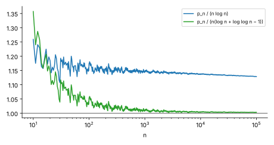
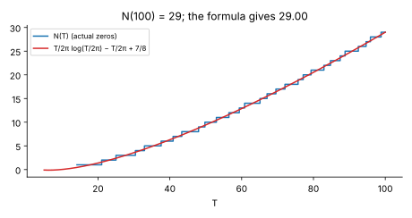
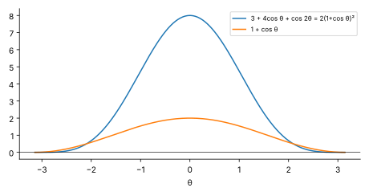
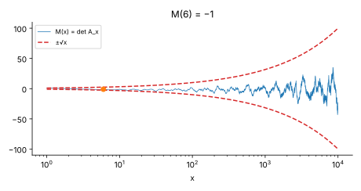
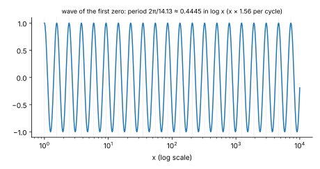

# שיעור 12: משפט המספרים הראשוניים ואפסי זטא

**מה נלמד:** את **משפט המספרים הראשוניים** $`\pi(x) \sim x/\log x`$ ואת הרעיון של הוכחתו; את **הנוסחה המפורשת** שמבטאת את הראשוניים באמצעות האפסים של זטא; כמה אפסים יש (רימן–פון מנגולדט); את **השערת רימן** ומה נובע ממנה; איך מחשבים אפסים בפועל (פונקציית Z, נוסחת רימן–זיגל, אלגוריתם אודליצקו–שנהאגה); ואת פונקציית מרטנס ושלוש ניסוחים שקולים להשערת רימן. בסוף — השערות עמוקות יותר: לינדלף, הילברט–פוליה ומונטגומרי.

**ידע קודם:** [שיעור 10](10-התפלגות-אלמנטרית.md) ($`\psi`$, $`\theta`$, צ'בישב, מרטנס) ו[שיעור 11](11-טורי-דיריכלה-וזטא.md) (זטא, $`-\zeta'/\zeta`$, נוסחת פרון).

---

## 0. איפה אנחנו במפה

[תורת המספרים האנליטית](../pages/תורת%20המספרים%20האנליטית.md) משתמשת בכלים של אנליזה כדי לענות על שאלות של ספירה. החלק שעוסק בראשוניים ובפונקציות כפליות, דרך טורי דיריכלה ומכפלות אוילר, נקרא **[תורת המספרים הכפלית](../pages/תורת%20המספרים%20הכפלית.md)** (בניגוד לתורה ה**חיבורית**, שעוסקת בבעיות כמו גולדבך וּוארינג — [שיעור 15](15-סכומים-אקספוננציאליים.md)). השיעור הזה הוא לב התחום הכפלי.

---

## 1. המשפט

**משפט 12.1 ([משפט המספרים הראשוניים](https://he.wikipedia.org/wiki/%D7%9E%D7%A9%D7%A4%D7%98_%D7%94%D7%9E%D7%A1%D7%A4%D7%A8%D7%99%D7%9D_%D7%94%D7%A8%D7%90%D7%A9%D7%95%D7%A0%D7%99%D7%99%D7%9D), אדמר ודה לה ואלה פוסן, 1896).**
```math
\pi(x) \sim \frac{x}{\log x}, \qquad \text{ובשקילות} \qquad \psi(x) \sim x .
```
ובצורה מדויקת יותר, $`\pi(x) = \mathrm{Li}(x) + O\!\left(xe^{-c\sqrt{\log x}}\right)`$ עבור קבוע $`c > 0`$, כאשר $`\mathrm{Li}(x) = \int_2^x\frac{dt}{\log t}`$.

| $`x`$ | $`\pi(x)`$ | $`x/\log x`$ | $`\mathrm{Li}(x)`$ |
|---|---|---|---|
| $`10^3`$ | 168 | 145 | 177 |
| $`10^6`$ | 78,498 | 72,382 | 78,626 |
| $`10^9`$ | 50,847,534 | 48,254,942 | 50,849,233 |

**פירוש הסתברותי (גאוס):** "ההסתברות" שמספר בסביבת $`t`$ ראשוני היא $`1/\log t`$, ולכן מצפים ל-$`\int^x dt/\log t`$ ראשוניים.

**מסקנות מיידיות:**
* הראשוני ה-$`n`$-י: $`p_n \sim n\log n`$ (השוו ל[משפט רוסר](../pages/משפט%20רוסר.md), שנותן חסם תחתון מדויק).
* לכל $`\varepsilon > 0`$, יש ראשוני בין $`x`$ ל-$`(1 + \varepsilon)x`$ עבור $`x`$ גדול מספיק (חיזוק של ברטראן).

---

## 2. רעיון ההוכחה

מהנוסחה של פרון (שיעור 11, דוגמה 5):
```math
\psi(x) = \frac{1}{2\pi i}\int_{c - i\infty}^{c + i\infty}\left(-\frac{\zeta'(s)}{\zeta(s)}\right)\frac{x^s}{s}\,ds, \qquad c > 1 .
```
* הקוטב של זטא ב-$`s = 1`$ נותן ל-$`-\zeta'/\zeta`$ קוטב עם שארית 1, ולכן תרומה של **$`x`$**.
* כל אפס $`\rho`$ של זטא נותן קוטב עם שארית $`-x^\rho/\rho`$ (מוכפל בריבוי). $`|x^\rho| = x^{\mathrm{Re}\rho}`$.
* כדי שהאיבר הראשי $`x`$ ינצח, צריך להזיז את קו האינטגרציה עד $`\sigma = 1`$ ולדעת **שאין אפסים על הישר $`\sigma = 1`$**.

**משפט 12.2 (המפתח).** $`\zeta(1 + it) \ne 0`$ לכל $`t`$ ממשי.

**הוכחה (מרטנס, האי-שוויון 3-4-1).**
1. **אי-שוויון טריגונומטרי:** $`3 + 4\cos\theta + \cos 2\theta = 2(1 + \cos\theta)^2 \ge 0`$. (בדיקה: $`\cos 2\theta = 2\cos^2\theta - 1`$.)
2. עבור $`\sigma > 1`$: $`\log|\zeta(\sigma + it)| = \mathrm{Re}\sum_{p,k}\frac{1}{kp^{k(\sigma+it)}} = \sum_{p,k}\frac{\cos(kt\log p)}{kp^{k\sigma}}`$.
3. לכן
```math
\log\left|\zeta(\sigma)^3\,\zeta(\sigma + it)^4\,\zeta(\sigma + 2it)\right| = \sum_{p,k}\frac{3 + 4\cos(kt\log p) + \cos(2kt\log p)}{kp^{k\sigma}} \ge 0 ,
```
כלומר $`|\zeta(\sigma)^3\zeta(\sigma+it)^4\zeta(\sigma + 2it)| \ge 1`$.
4. נניח בשלילה ש-$`\zeta(1 + it) = 0`$ עבור $`t \ne 0`$. כאשר $`\sigma \to 1^+`$:
   * $`\zeta(\sigma)^3 \approx (\sigma - 1)^{-3}`$ (קוטב).
   * $`\zeta(\sigma + it)^4 = O((\sigma - 1)^4)`$ (אפס, לפחות מסדר 1).
   * $`\zeta(\sigma + 2it)`$ חסומה (אין קוטב ב-$`1 + 2it`$).
5. המכפלה היא $`O(\sigma - 1) \to 0`$ — סתירה ל-$`\ge 1`$. ∎

**השלמת ההוכחה** דורשת עוד עבודה אנליטית: או חסמים על $`\zeta'/\zeta`$ ליד הישר $`\sigma = 1`$ (הדרך הקלאסית, שנותנת גם את איבר השגיאה), או **משפט טאובריאני** (ויינר–איקהרה; ההוכחה הקצרה של ניומן, 1980, משתמשת רק במשפט קושי). ב-1949 סלברג וארדש מצאו הוכחה "אלמנטרית" — בלי אנליזה מרוכבת — בעזרת הזהות של סלברג $`\sum_{n\le x}\Lambda(n)\log n + \sum_{mn\le x}\Lambda(m)\Lambda(n) = 2x\log x + O(x)`$.

**איבר השגיאה ואזור חסר אפסים.** דה לה ואלה פוסן הוכיח ש-$`\zeta(\sigma + it) \ne 0`$ עבור $`\sigma > 1 - \frac{c}{\log|t|}`$. ככל שהאזור חסר האפסים רחב יותר, השגיאה ב-PNT קטנה יותר.

---

## 3. הנוסחה המפורשת

אם מזיזים את קו האינטגרציה עד $`-\infty`$ ואוספים את **כל** השאריות, מקבלים זהות מדויקת:

**משפט 12.3 ([הנוסחה המפורשת](https://he.wikipedia.org/wiki/%D7%94%D7%A0%D7%95%D7%A1%D7%97%D7%94_%D7%94%D7%9E%D7%A4%D7%95%D7%A8%D7%A9%D7%AA_%D7%A9%D7%9C_%D7%A8%D7%99%D7%9E%D7%9F_%D7%A4%D7%95%D7%9F_%D7%9E%D7%A0%D7%92%D7%95%D7%9C%D7%93), פון מנגולדט 1895).** עבור $`x > 1`$ שאינו חזקת ראשוני,
```math
\psi(x) = x - \sum_\rho\frac{x^\rho}{\rho} - \log 2\pi - \tfrac12\log\left(1 - x^{-2}\right),
```
כאשר הסכום על האפסים הלא-טריוויאליים $`\rho`$ (בסדר עולה של $`|\mathrm{Im}\rho|`$).

### דוגמה 1: מאיפה מגיע כל איבר
| איבר | מקור |
|---|---|
| $`x`$ | הקוטב של $`\zeta`$ ב-$`s = 1`$ |
| $`-\sum x^\rho/\rho`$ | האפסים הלא-טריוויאליים |
| $`-\log 2\pi`$ | הקוטב של $`1/s`$ ב-$`s = 0`$: שם $`-\zeta'(0)/\zeta(0) = -\log 2\pi`$ |
| $`-\tfrac12\log(1 - x^{-2})`$ | האפסים הטריוויאליים: $`\sum_{k\ge1}\frac{x^{-2k}}{2k}`$ |

**הפירוש — "מוזיקת הראשוניים":** אם $`\rho = \tfrac12 + i\gamma`$, אז זוג האפסים $`\rho, \bar\rho`$ תורם $`-\frac{2\sqrt x}{|\rho|}\cos(\gamma\log x - \arg\rho)`$: **גל** בתדר $`\gamma`$ (ביחס ל-$`\log x`$) ובמשרעת $`\sqrt x`$. פונקציית המדרגות $`\psi(x)`$ היא סכום של הקו הישר $`x`$ ועוד אינסוף גלים כאלה. ככל שלוקחים יותר אפסים, הסכום מתקרב למדרגות החדות.

**לגבי $`\pi(x)`$ עצמה** (רימן 1859): נגדיר $`\Pi(x) = \sum_{p^k\le x}\frac1k = \pi(x) + \tfrac12\pi(x^{1/2}) + \tfrac13\pi(x^{1/3}) + \cdots`$. אז
```math
\Pi(x) = \mathrm{li}(x) - \sum_\rho\mathrm{li}(x^\rho) - \log 2 + \int_x^\infty\frac{dt}{t(t^2-1)\log t},
```
ובהיפוך מביוס $`\pi(x) = \sum_n\frac{\mu(n)}n\Pi(x^{1/n})`$. אם זורקים את האפסים מקבלים את **פונקציית רימן** $`R(x) = \sum_n\frac{\mu(n)}n\mathrm{li}(x^{1/n})`$, שהיא קירוב מצוין: $`R(10^6) \approx 78527`$, שגיאה של 29 בלבד (לעומת 128 של $`\mathrm{Li}`$).

**הכללה:** לכל פונקציית L יש [נוסחה מפורשת](../pages/נוסחאות%20מפורשות%20לפונקציות%20L.md) מאותו סוג, ווייל ניסח אותן כזהות כללית: סכום של פונקציית מבחן על האפסים = סכום על הראשוניים + איברים "ארכימדיים". זו הסיבה שכל שאלה על ראשוניים היא שאלה על אפסים, ולהפך.

---

## 4. כמה אפסים יש?

נסמן ב-$`N(T)`$ את מספר האפסים $`\rho = \beta + i\gamma`$ עם $`0 < \gamma \le T`$.

**משפט 12.4 ([נוסחת רימן–פון מנגולדט](../pages/נוסחת%20רימן-פון%20מנגולדט.md)).**
```math
N(T) = \frac T{2\pi}\log\frac T{2\pi} - \frac T{2\pi} + \frac78 + S(T) + O\!\left(\frac1T\right), \qquad S(T) = O(\log T).
```
**רעיון ההוכחה.** סופרים אפסים בעזרת עקרון הארגומנט: $`N(T)`$ הוא השינוי בארגומנט של $`\xi(s)`$ סביב מלבן, חלקי $`2\pi`$. בזכות משוואת הפונקציה מספיק לעקוב אחרי הארגומנט לאורך חצי מהשפה. האיבר הראשי מגיע מ-$`\Gamma(s/2)`$ (סטירלינג), ו-$`S(T) = \frac1\pi\arg\zeta(\tfrac12 + iT)`$ הוא התיקון הקטן.

### דוגמה 2: $`N(100)`$
1. $`\frac{100}{2\pi} = 15.9155`$, $`\log 15.9155 = 2.7674`$.
2. $`15.9155 \cdot 2.7674 - 15.9155 + 0.875 = 44.044 - 15.916 + 0.875 = 29.00`$.
3. ואכן יש בדיוק **29** אפסים עם $`0 < \gamma \le 100`$. שלושת הראשונים: $`\gamma_1 = 14.1347`$, $`\gamma_2 = 21.0220`$, $`\gamma_3 = 25.0109`$.

**מסקנה:** הצפיפות הממוצעת של האפסים בגובה $`T`$ היא $`\frac1{2\pi}\log\frac T{2\pi}`$ — הם מתקרבים זה לזה ככל שעולים.

---

## 5. השערת רימן

**[השערת רימן](https://he.wikipedia.org/wiki/%D7%94%D7%A9%D7%A2%D7%A8%D7%AA_%D7%A8%D7%99%D7%9E%D7%9F) (1859).** כל האפסים הלא-טריוויאליים של $`\zeta(s)`$ נמצאים על **הישר הקריטי** $`\mathrm{Re}s = \tfrac12`$.

**למה דווקא ½?** משוואת הפונקציה $`\xi(s) = \xi(1-s)`$ ו-$`\overline{\xi(\bar s)} = \xi(s)`$ אומרות שהאפסים סימטריים ביחס לישר $`\sigma = \tfrac12`$ וביחס לציר הממשי. אפס מחוץ לישר מגיע ברביעייה $`\rho, \bar\rho, 1 - \rho, 1 - \bar\rho`$.

**משפט 12.5 (פון קוך, 1901).** השערת רימן שקולה ל-
```math
\pi(x) = \mathrm{Li}(x) + O(\sqrt x\log x).
```
**כיוון אחד מתוך הנוסחה המפורשת:** אם כל $`\mathrm{Re}\rho = \tfrac12`$, כל איבר $`x^\rho/\rho`$ הוא $`O(\sqrt x/|\rho|)`$; עם ספירת האפסים ($`N(T) \approx \frac{T}{2\pi}\log T`$) הסכום הוא $`O(\sqrt x\log^2 x)`$. **הכיוון השני:** אם יש אפס עם $`\mathrm{Re}\rho = \beta > \tfrac12`$, הוא יוצר תנודות בגודל $`x^\beta`$ שאי אפשר לבטל.

**דוגמה מספרית:** עבור $`x = 10^6`$: $`|\pi(x) - \mathrm{Li}(x)| \approx 128`$, ואילו $`\sqrt x\log x \approx 13{,}816`$. השגיאה קטנה בהרבה מהחסם.

**מה ידוע:**
* יותר מ-$`10^{13}`$ האפסים הראשונים נמצאים על הישר (חישובית).
* הארדי (1914): אינסוף אפסים על הישר. סלברג: חלק חיובי מהם; קונרי (1989): לפחות 40%.

---

## 6. איך מחשבים אפסים: פונקציית Z ונוסחת רימן–זיגל

**[פונקציית התטא של רימן–זיגל](../pages/פונקציית%20התטא%20של%20רימן-זיגל.md)** מוגדרת כך:
```math
\vartheta(t) = \arg\Gamma\!\left(\tfrac14 + \tfrac{it}2\right) - \frac t2\log\pi \approx \frac t2\log\frac t{2\pi} - \frac t2 - \frac\pi8 + \frac1{48t} + \cdots
```
ו**[פונקציית Z](../pages/פונקציית%20Z.md)** (של הארדי): $`Z(t) = e^{i\vartheta(t)}\zeta(\tfrac12 + it)`$.

**העובדה המרכזית:** $`Z(t)`$ **ממשית** עבור $`t`$ ממשי (נובע ממשוואת הפונקציה), ו-$`|Z(t)| = |\zeta(\tfrac12 + it)|`$. לכן כל **החלפת סימן** של $`Z`$ היא אפס של זטא על הישר הקריטי.

### דוגמה 3: איתור האפס הראשון
* $`Z(14) \approx -0.106`$, $`Z(15) \approx +0.720`$.
* לכן יש אפס על הישר בין 14 ל-15 — אכן $`\gamma_1 = 14.1347\ldots`$
* $`Z(20) \approx 1.148`$, $`Z(22) \approx -0.984`$: האפס השני, $`\gamma_2 = 21.022`$.

**[נוסחת רימן–זיגל](../pages/נוסחת%20רימן-זיגל.md)** מאפשרת לחשב את $`Z(t)`$ מהר: עם $`N = \lfloor\sqrt{t/2\pi}\rfloor`$,
```math
Z(t) = 2\sum_{n=1}^N\frac{\cos(\vartheta(t) - t\log n)}{\sqrt n} + R(t), \qquad R(t) = O(t^{-1/4}),
```
כאשר ל-$`R(t)`$ יש פיתוח אסימפטוטי מפורש. רק $`\sqrt{t/2\pi}`$ איברים במקום $`t`$! רימן השתמש בנוסחה הזו (שנמצאה ברשימותיו רק ב-1932, על ידי זיגל) כדי לחשב אפסים ביד.

**אימות השערת רימן עד גובה $`T`$:** מוצאים מספיק החלפות סימן של $`Z`$ ומשווים ל-$`N(T)`$ מנוסחת רימן–פון מנגולדט. אם המספרים שווים — **כל** האפסים עד $`T`$ על הישר.

**[אלגוריתם אודליצקו–שנהאגה](../pages/אלגוריתם%20אודליצקו-שנהאגה.md) (1988)** מחשב את $`Z(t)`$ בהרבה נקודות בבת אחת, בעלות ממוצעת של $`T^\varepsilon`$ לנקודה (בעזרת FFT ופיתוח ברנצ'ים של סכום רימן–זיגל). כך אודליצקו חישב מיליארדי אפסים בגובה $`10^{20}`$ ומעלה.

**[זוגות להמר](../pages/זוג%20להמר.md):** לפעמים שני אפסים קרובים מאוד זה לזה, ו-$`Z`$ "בקושי" חוצה את הציר ביניהם (להמר מצא דוגמה כזו ב-1956 ליד $`t \approx 7005`$). זוגות כאלה מסוכנים לאלגוריתמי האימות, ומעניינים תאורטית: מקיומם של מספיק זוגות להמר נובע שקבוע דה ברויין–ניומן $`\Lambda`$ (פרמטר שהשערת רימן שקולה ל-$`\Lambda \le 0`$) הוא $`\ge 0`$ — מה שרוג'רס וטאו הוכיחו ב-2018. כלומר, השערת רימן, אם נכונה, נכונה "בקושי".

---

## 7. פונקציית מרטנס ושקילויות להשערת רימן

**[פונקציית מרטנס](../pages/פונקציית%20מרטנס.md):** $`M(x) = \sum_{n\le x}\mu(n)`$.

| $`x`$ | 10 | 100 | 1000 | 10000 |
|---|---|---|---|---|
| $`M(x)`$ | −1 | 1 | 2 | −23 |

* **משפט המספרים הראשוניים שקול ל-$`M(x) = o(x)`$** (לנדאו).
* **השערת רימן שקולה ל-$`M(x) = O(x^{1/2 + \varepsilon})`$** לכל $`\varepsilon > 0`$.

**הוכחת ה"⇐" (שלב אחר שלב).**
1. $`\frac1{\zeta(s)} = \sum\frac{\mu(n)}{n^s} = s\int_1^\infty\frac{M(x)}{x^{s+1}}dx`$ (סכימה בחלקים, כמו בנוסחת פרון).
2. אם $`M(x) = O(x^{1/2+\varepsilon})`$, האינטגרל מתכנס בהחלט עבור $`\sigma > \tfrac12 + \varepsilon`$.
3. לכן $`1/\zeta(s)`$ הולומורפית שם, כלומר אין ל-$`\zeta`$ אפסים ב-$`\sigma > \tfrac12 + \varepsilon`$. ∎

**[השערת מרטנס](../pages/השערת%20מרטנס.md)** (1897) הייתה טענה חזקה עוד יותר: $`|M(x)| < \sqrt x`$ לכל $`x > 1`$. היא הייתה גוררת את השערת רימן. **אודליצקו וטה רילה הפריכו אותה ב-1985** — בלי למצוא דוגמה נגדית מפורשת! הם הראו ש-$`\limsup M(x)/\sqrt x > 1.06`$ בעזרת חישוב של אפסים רבים ואלגוריתם LLL. הדוגמה הנגדית הראשונה גדולה מ-$`10^{16}`$ ויודעים שהיא קטנה מ-$`e^{1.004 \cdot 10^{33}}`$ בערך. (על [הרמן טה רילה](../pages/הרמן%20טה%20רילה.md) — בשיעור 17.)

**[מטריצת רדהפר](../pages/מטריצת%20רדהפר.md):** המטריצה $`A_n`$ מגודל $`n \times n`$ עם $`a_{ij} = 1`$ אם $`j = 1`$ או $`i \mid j`$, ו-0 אחרת. **הדטרמיננטה שלה היא $`M(n)`$.** לכן השערת רימן שקולה לכך ש-$`|\det A_n| = O(n^{1/2 + \varepsilon})`$ — ניסוח באלגברה ליניארית בלבד.

### דוגמה 4: $`\det A_4`$
```math
A_4 = \begin{pmatrix}1&1&1&1\\1&1&0&1\\1&0&1&0\\1&0&0&1\end{pmatrix}.
```
1. פעולות שורה (לא משנות את הדטרמיננטה): $`R_1 \to R_1 - R_2 = (0,0,1,0)`$, אחר כך $`R_2 \to R_2 - R_4 = (0,1,0,0)`$ ו-$`R_3 \to R_3 - R_4 = (0,0,1,-1)`$.
2. בעמודה הראשונה נשאר רק ה-1 בשורה 4, בסימן $`(-1)^{4+1} = -1`$. המינור (שורות 1–3, עמודות 2–4) הוא $`\det\begin{pmatrix}0&1&0\\1&0&0\\0&1&-1\end{pmatrix} = -1\cdot(1\cdot(-1) - 0) = 1`$.
3. לכן $`\det A_4 = -1 \cdot 1 = -1`$.
4. $`M(4) = \mu(1) + \mu(2) + \mu(3) + \mu(4) = 1 - 1 - 1 + 0 = -1`$. ✓

**[פונקציית ריס](../pages/פונקציית%20ריס.md)** (1916):
```math
\mathrm{Riesz}(x) = \sum_{k=1}^\infty\frac{(-1)^{k-1}x^k}{(k-1)!\,\zeta(2k)} = x\sum_{n=1}^\infty\frac{\mu(n)}{n^2}e^{-x/n^2}.
```
**הקריטריון של ריס:** השערת רימן שקולה ל-$`\mathrm{Riesz}(x) = O(x^{1/4 + \varepsilon})`$. זו פונקציה שלמה שמקדמי הטור שלה מפורשים (באמצעות מספרי ברנולי), ובכל זאת השאלה על קצב הגידול שלה היא השערת רימן.

---

## 8. השערות עמוקות יותר

* **[השערת לינדלף](../pages/השערת%20לינדלף.md):** $`\zeta(\tfrac12 + it) = O(|t|^\varepsilon)`$ לכל $`\varepsilon > 0`$. נובעת מהשערת רימן. החסם הטריוויאלי (מנוסחת הפונקציה וקמירות) הוא $`|t|^{1/4 + \varepsilon}`$; וייל, ואן דר קורפוט ואחרים הורידו את המעריך, והתוצאה הטובה ביותר (בורגיין, 2017) היא $`13/84 \approx 0.155`$. לינדלף שקולה לכך שמספר האפסים בכל קטע $`[T, T+1]`$ עם $`\mathrm{Re}\rho > \tfrac12 + \varepsilon`$ הוא $`o(\log T)`$.

* **[השערת הילברט–פוליה](../pages/השערת%20הילברט-פוליה.md):** הגבהים $`\gamma`$ של האפסים הם הערכים העצמיים של אופרטור **צמוד לעצמו**. אם זה נכון — הם ממשיים, וזו בדיוק השערת רימן. זו תוכנית מחקר, לא משפט.

* **[השערת המתאם הזוגי של מונטגומרי](../pages/השערת%20המתאם%20הזוגי%20של%20מונטגומרי.md) (1973):** אחרי נרמול כך שהמרווח הממוצע הוא 1, צפיפות הזוגות של אפסים במרחק $`u`$ היא
```math
1 - \left(\frac{\sin\pi u}{\pi u}\right)^2 .
```
האפסים **דוחים** זה את זה (הצפיפות 0 ב-$`u = 0`$). דייסון זיהה שזו בדיוק ההתפלגות של ערכים עצמיים של מטריצות אקראיות אוניטריות גדולות (GUE). אודליצקו אימת את ההתאמה בדיוק מדהים במיליוני אפסים — רמז חזק בכיוון הילברט–פוליה.

---

## 9. תרגילים

**תרגיל 1.** הסיקו מ-PNT ש-$`p_n \sim n\log n`$.


<sub>p_n/(n log n) מתקרב ל־1 (לאט); עם תיקון log log n — מהר יותר.</sub>

<details><summary>פתרון</summary>

$`\pi(p_n) = n`$. לפי PNT $`n \sim p_n/\log p_n`$, ולכן $`\log n = \log p_n - \log\log p_n + o(1) \sim \log p_n`$. מכאן $`p_n \sim n\log p_n \sim n\log n`$.
</details>

**תרגיל 2.** חשבו את $`N(1000)`$ מנוסחת רימן–פון מנגולדט (התעלמו מ-$`S(T)`$).


<sub>מספר האפסים N(T) (מדרגות) לעומת נוסחת רימן–פון מנגולדט.</sub>

<details><summary>פתרון</summary>

$`\frac{1000}{2\pi} = 159.155`$, $`\log 159.155 = 5.0700`$. $`159.155 \cdot 5.07 - 159.155 + 0.875 = 806.9 - 159.2 + 0.9 \approx 648.6`$. הערך האמיתי הוא 649.
</details>

**תרגיל 3.** הוכיחו את הזהות $`3 + 4\cos\theta + \cos2\theta = 2(1 + \cos\theta)^2`$, והסבירו למה האי-שוויון $`1 + \cos\theta \ge 0`$ **לא** היה מספיק להוכחה.


<sub>3+4cosθ+cos2θ אף פעם אינו שלילי.</sub>

<details><summary>פתרון</summary>

$`2(1 + 2\cos\theta + \cos^2\theta) = 2 + 4\cos\theta + 2\cos^2\theta = 2 + 4\cos\theta + 1 + \cos2\theta`$. עם $`1 + \cos\theta`$ היינו מקבלים $`|\zeta(\sigma)\zeta(\sigma+it)| \ge 1`$, וקוטב מסדר 1 כפול אפס מסדר 1 אינו מוביל לסתירה. היחס $`4 > 3`$ בין המקדמים הוא שגורם לאפס "לנצח" את הקוטב.
</details>

**תרגיל 4.** חשבו את $`\det A_6`$ של מטריצת רדהפר בלי לבנות אותה.


<sub>פונקציית מרטנס M(x) = det Aₓ, בין ±√x.</sub>

<details><summary>פתרון</summary>

$`M(6) = 1 - 1 - 1 + 0 - 1 + 1 = -1`$.
</details>

**תרגיל 5.** עבור אפס $`\rho = \tfrac12 + 14.1347i`$, מה ה"אורך גל" של התנודה שהוא יוצר ב-$`\psi(x)`$, כפונקציה של $`\log x`$?


<sub>הגל שיוצר האפס הראשון, כפונקציה של log x.</sub>

<details><summary>פתרון</summary>

התנודה היא $`\cos(14.1347\log x - \phi)`$, כלומר מחזור של $`2\pi/14.1347 \approx 0.4445`$ ב-$`\log x`$: בכל פעם ש-$`x`$ גדל פי $`e^{0.4445} \approx 1.56`$, הגל משלים מחזור.
</details>

---

## סיכום
* PNT: $`\psi(x) \sim x`$. המפתח: $`\zeta(1 + it) \ne 0`$, דרך $`3 + 4\cos\theta + \cos2\theta \ge 0`$.
* נוסחה מפורשת: $`\psi(x) = x - \sum_\rho x^\rho/\rho - \cdots`$ — כל אפס הוא גל.
* $`N(T) \approx \frac T{2\pi}\log\frac T{2\pi} - \frac T{2\pi}`$.
* השערת רימן ⇔ $`\pi(x) = \mathrm{Li}(x) + O(\sqrt x\log x)`$ ⇔ $`M(x) = O(x^{1/2+\varepsilon})`$ ⇔ קריטריון ריס.
* אפסים מחשבים בעזרת פונקציית Z ונוסחת רימן–זיגל; ההתפלגות שלהם דומה לזו של ערכים עצמיים של מטריצות אקראיות.

**השיעור הקודם:** [שיעור 11](11-טורי-דיריכלה-וזטא.md) · **השיעור הבא:** [שיעור 13: קרקטרים של דיריכלה ופונקציות L](13-קרקטרים-ופונקציות-L.md)

**להעמקה:** [תורת המספרים האנליטית](../pages/תורת%20המספרים%20האנליטית.md) · [תורת המספרים הכפלית](../pages/תורת%20המספרים%20הכפלית.md) · [משפט המספרים הראשוניים](https://he.wikipedia.org/wiki/%D7%9E%D7%A9%D7%A4%D7%98_%D7%94%D7%9E%D7%A1%D7%A4%D7%A8%D7%99%D7%9D_%D7%94%D7%A8%D7%90%D7%A9%D7%95%D7%A0%D7%99%D7%99%D7%9D) · [הנוסחה המפורשת](https://he.wikipedia.org/wiki/%D7%94%D7%A0%D7%95%D7%A1%D7%97%D7%94_%D7%94%D7%9E%D7%A4%D7%95%D7%A8%D7%A9%D7%AA_%D7%A9%D7%9C_%D7%A8%D7%99%D7%9E%D7%9F_%D7%A4%D7%95%D7%9F_%D7%9E%D7%A0%D7%92%D7%95%D7%9C%D7%93) · [נוסחאות מפורשות לפונקציות L](../pages/נוסחאות%20מפורשות%20לפונקציות%20L.md) · [נוסחת רימן–פון מנגולדט](../pages/נוסחת%20רימן-פון%20מנגולדט.md) · [השערת רימן](https://he.wikipedia.org/wiki/%D7%94%D7%A9%D7%A2%D7%A8%D7%AA_%D7%A8%D7%99%D7%9E%D7%9F) · [פונקציית Z](../pages/פונקציית%20Z.md) · [נוסחת רימן–זיגל](../pages/נוסחת%20רימן-זיגל.md) · [פונקציית התטא של רימן–זיגל](../pages/פונקציית%20התטא%20של%20רימן-זיגל.md) · [זוג להמר](../pages/זוג%20להמר.md) · [אלגוריתם אודליצקו–שנהאגה](../pages/אלגוריתם%20אודליצקו-שנהאגה.md) · [פונקציית מרטנס](../pages/פונקציית%20מרטנס.md) · [השערת מרטנס](../pages/השערת%20מרטנס.md) · [מטריצת רדהפר](../pages/מטריצת%20רדהפר.md) · [פונקציית ריס](../pages/פונקציית%20ריס.md) · [השערת לינדלף](../pages/השערת%20לינדלף.md) · [השערת הילברט–פוליה](../pages/השערת%20הילברט-פוליה.md) · [השערת המתאם הזוגי של מונטגומרי](../pages/השערת%20המתאם%20הזוגי%20של%20מונטגומרי.md)

---
<sub>חלק מהקורס [תורת המספרים בעברית](../COURSE.md). התוכן מופץ ברישיון [CC BY-SA 4.0](https://creativecommons.org/licenses/by-sa/4.0/).</sub>
