# שיעור 13: קרקטרים של דיריכלה ופונקציות L

**מה נלמד:** איך סופרים ראשוניים **בסדרה חשבונית** — למשל, כמה ראשוניים $`p \le x`$ מקיימים $`p \equiv 3 \pmod 4`$? הכלי הוא **קרקטרים של דיריכלה** ו**פונקציות L**. נוכיח את משפט דיריכלה (אינסוף ראשוניים בכל סדרה חשבונית "סבירה"), נראה חסמים על סכומי קרקטרים (פוליה–וינוגרדוב, ברג'ס), נכיר את ההטיה של צ'בישב, ונגיע לבעיה הפתוחה החשובה ביותר בתחום: **אפסי זיגל**, והקשר שלהם למספרי מחלקה של שדות ריבועיים. בסוף — השערת רימן המוכללת ומחלקת סלברג.

**ידע קודם:** [שיעור 7](07-שאריות-ריבועיות.md) (שורשים פרימיטיביים, סימן לז'נדר), [שיעור 11](11-טורי-דיריכלה-וזטא.md) (מכפלת אוילר, הורוויץ), [שיעור 12](12-משפט-המספרים-הראשוניים.md) (PNT, אזור חסר אפסים).

---

## 1. קרקטרים של דיריכלה

**[קרקטר של דיריכלה](https://he.wikipedia.org/wiki/%D7%A7%D7%A8%D7%A7%D7%98%D7%A8_%D7%93%D7%99%D7%A8%D7%99%D7%9B%D7%9C%D7%94)** מודולו $`q`$ הוא פונקציה $`\chi: \mathbb Z \to \mathbb C`$ כך ש:
1. $`\chi(n + q) = \chi(n)`$ (מחזורית);
2. $`\chi(mn) = \chi(m)\chi(n)`$ (כפלית לחלוטין);
3. $`\chi(n) = 0`$ אם $`\gcd(n, q) > 1`$, ו-$`\chi(n) \ne 0`$ אחרת.

מ-$`\chi(1) = 1`$ ומאוילר ($`n^{\varphi(q)} \equiv 1`$) נובע $`\chi(n)^{\varphi(q)} = 1`$: הערכים הם **שורשי יחידה**. הקרקטר **הראשי** $`\chi_0`$ הוא 1 על כל המספרים הזרים ל-$`q`$.

### דוגמה 1: הקרקטרים מודולו 4 ומודולו 5
**מודולו 4:** $`\chi_0`$ ו-$`\chi_4(n) = (-1)^{(n-1)/2}`$ ל-$`n`$ אי-זוגי (1 על $`n \equiv 1`$, $`-1`$ על $`n \equiv 3`$).

**מודולו 5:** 2 הוא שורש פרימיטיבי ($`2^0, 2^1, 2^2, 2^3 \equiv 1, 2, 4, 3`$). קרקטר נקבע על ידי $`\chi(2)`$, שחייב להיות שורש יחידה רביעי: $`1, i, -1, -i`$.

| $`n`$ | 1 | 2 | 3 | 4 |
|---|---|---|---|---|
| $`\chi_0`$ | 1 | 1 | 1 | 1 |
| $`\chi_1`$ | 1 | $`i`$ | $`-i`$ | $`-1`$ |
| $`\chi_2`$ | 1 | $`-1`$ | $`-1`$ | 1 |
| $`\chi_3`$ | 1 | $`-i`$ | $`i`$ | $`-1`$ |

($`\chi_1(3) = \chi_1(2^3) = i^3 = -i`$; $`\chi_1(4) = \chi_1(2^2) = i^2 = -1`$.) שימו לב: $`\chi_2`$ הוא **סימן לז'נדר** $`\left(\frac{n}{5}\right)`$, ו-$`\chi_3 = \overline{\chi_1}`$.

**עובדות:**
* יש בדיוק $`\varphi(q)`$ קרקטרים מודולו $`q`$, והם יוצרים חבורה תחת כפל.
* **אורתוגונליות:**
```math
\sum_{a \bmod q}\chi(a) = \begin{cases}\varphi(q) & \chi = \chi_0\\0 & \text{אחרת}\end{cases},
\qquad
\sum_\chi\chi(a) = \begin{cases}\varphi(q) & a \equiv 1\\0 & \text{אחרת.}\end{cases}
```
**הוכחת הראשונה:** אם $`\chi \ne \chi_0`$ יש $`b`$ עם $`\chi(b) \ne 1`$. הכפל ב-$`b`$ מתמיר את השאריות, ולכן $`S = \sum\chi(a) = \sum\chi(ab) = \chi(b)S`$, כלומר $`S = 0`$. ∎

**המסנן:** מהאורתוגונליות השנייה, עבור $`\gcd(a,q) = 1`$:
```math
\mathbf 1_{n \equiv a\ (\mathrm{mod}\ q)} = \frac1{\varphi(q)}\sum_\chi\overline{\chi(a)}\chi(n).
```
זו הנקודה: **תנאי חפיפה הופך לצירוף ליניארי של פונקציות כפליות**. ועל פונקציות כפליות יש לנו מכפלות אוילר.

**קרקטר פרימיטיבי ומוליך:** $`\chi`$ מודולו $`q`$ **מושרה** מקרקטר מודולו $`d \mid q`$ אם הוא מסכים איתו על המספרים הזרים ל-$`q`$. ה-$`d`$ הקטן ביותר כזה הוא **המוליך**, ואם הוא $`q`$ עצמו, $`\chi`$ **פרימיטיבי**.

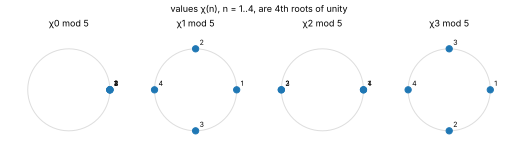

<sub>הערכים של ארבעת הקרקטרים מודולו 5 על מעגל היחידה.</sub>

---

## 2. פונקציות L ומשפט דיריכלה

**[פונקציית L של דיריכלה](https://he.wikipedia.org/wiki/%D7%A4%D7%95%D7%A0%D7%A7%D7%A6%D7%99%D7%99%D7%AA_L_%D7%A9%D7%9C_%D7%93%D7%99%D7%A8%D7%99%D7%9B%D7%9C%D7%94):**
```math
L(s, \chi) = \sum_{n=1}^\infty\frac{\chi(n)}{n^s} = \prod_p\frac1{1 - \chi(p)p^{-s}}, \qquad \sigma > 1 .
```
* $`L(s, \chi_0) = \zeta(s)\prod_{p\mid q}(1 - p^{-s})`$: קוטב ב-$`s = 1`$.
* עבור $`\chi \ne \chi_0`$: הסכומים החלקיים $`\sum_{n\le N}\chi(n)`$ חסומים (על ידי $`\varphi(q)`$, לפי האורתוגונליות), ולכן הטור מתכנס עבור $`\sigma > 0`$, ו-$`L(s, \chi)`$ הולומורפית שם. בעזרת הורוויץ, $`L(s, \chi) = q^{-s}\sum_{a=1}^q\chi(a)\zeta(s, a/q)`$, והיא ממשיכה לפונקציה שלמה.

### דוגמה 2: $`L(1, \chi_4) = \pi/4`$
$`L(1, \chi_4) = 1 - \frac13 + \frac15 - \frac17 + \cdots`$. זהו טור לייבניץ: $`\arctan 1 = \sum\frac{(-1)^k}{2k+1} = \frac\pi4`$. בפרט $`L(1, \chi_4) \ne 0`$.

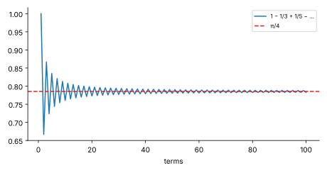

<sub>טור לייבניץ מתכנס ל־π/4 = L(1, χ₄).</sub>

**משפט 13.1 ([דיריכלה](https://he.wikipedia.org/wiki/%D7%9E%D7%A9%D7%A4%D7%98_%D7%93%D7%99%D7%A8%D7%99%D7%9B%D7%9C%D7%94), 1837).** אם $`\gcd(a, q) = 1`$, יש אינסוף ראשוניים $`p \equiv a \pmod q`$. יתרה מזו:
```math
\sum_{\substack{p \le x\\ p\equiv a\ (q)}}\frac1p = \frac{1}{\varphi(q)}\log\log x + O(1).
```

**ההוכחה, שלב אחר שלב.**
1. **לוגריתם של מכפלת אוילר:** $`\log L(s, \chi) = \sum_p\frac{\chi(p)}{p^s} + O(1)`$ כאשר $`s \to 1^+`$ (האיברים עם $`p^k`$, $`k \ge 2`$, מתכנסים).
2. **מסנן:** $`\sum_{p\equiv a}\frac1{p^s} = \frac1{\varphi(q)}\sum_\chi\overline{\chi(a)}\sum_p\frac{\chi(p)}{p^s} = \frac1{\varphi(q)}\sum_\chi\overline{\chi(a)}\log L(s, \chi) + O(1)`$.
3. **הקרקטר הראשי:** $`\log L(s, \chi_0) = \log\frac1{s-1} + O(1) \to \infty`$.
4. **שאר הקרקטרים:** אם $`L(1, \chi) \ne 0`$, אז $`\log L(s, \chi)`$ חסום ליד $`s = 1`$.
5. **מסקנה:** $`\sum_{p\equiv a}p^{-s} = \frac{1}{\varphi(q)}\log\frac1{s-1} + O(1) \to \infty`$. לכן יש אינסוף ראשוניים כאלה.

הכול נשען על **$`L(1, \chi) \ne 0`$ לכל $`\chi \ne \chi_0`$** — הלב של ההוכחה.

**קרקטר מרוכב ($`\chi \ne \bar\chi`$).**
1. לכל $`\sigma > 1`$: $`\prod_\chi L(\sigma, \chi) \ge 1`$, כי $`\log\prod_\chi L(\sigma,\chi) = \varphi(q)\sum_{p^k\equiv 1}\frac{1}{kp^{k\sigma}} \ge 0`$ (אורתוגונליות עם $`a = 1`$).
2. אם $`L(1, \chi) = 0`$, אז גם $`L(1, \bar\chi) = \overline{L(1,\chi)} = 0`$ — **שני** אפסים מול קוטב **אחד** של $`L(s, \chi_0)`$. המכפלה שואפת ל-0 כאשר $`\sigma \to 1^+`$. סתירה.

**קרקטר ממשי ($`\chi = \bar\chi`$, ערכים $`\pm1`$) — המקרה הקשה.**
1. נתבונן ב-$`F(s) = \zeta(s)L(s, \chi) = \sum_n\frac{r(n)}{n^s}`$, עם $`r(n) = \sum_{d\mid n}\chi(d)`$.
2. $`r`$ כפלית, ובדיקה על חזקות ראשוניים מראה ש-$`r(n) \ge 0`$ תמיד ו-$`r(m^2) \ge 1`$.
3. לכן $`\sum_n r(n)n^{-1/2} \ge \sum_m\frac{1}{m} = \infty`$.
4. מצד שני, אם $`L(1, \chi) = 0`$, האפס מבטל את הקוטב של $`\zeta`$, ו-$`F`$ הולומורפית ב-$`\sigma > 0`$. לפי משפט של לנדאו (טור דיריכלה עם מקדמים אי-שליליים מתכנס עד הסינגולריות הממשית הראשונה שלו), הטור $`\sum r(n)n^{-s}`$ מתכנס ב-$`s = 1/2`$. סתירה. ∎

(הוכחה אחרת למקרה הממשי: **נוסחת מספר המחלקה** של דיריכלה, סעיף 6, שמראה ש-$`L(1, \chi)`$ הוא מכפלה של קבוע חיובי במספר המחלקה — שהוא $`\ge 1`$.)

### דוגמה 3: ספירת ראשוניים מודולו 4 בעזרת המסנן
$`\#\{p \le x: p \equiv 3 \pmod 4\} = \frac12\sum_{2 < p \le x}(1 - \chi_4(p))`$. עד $`x = 100`$ יש 24 ראשוניים אי-זוגיים, ו-$`\sum\chi_4(p) = 11 - 13 = -2`$. לכן יש $`\frac12(24 + 2) = 13`$ ראשוניים $`\equiv 3`$ ו-11 ראשוניים $`\equiv 1`$. ✓

**הגרסה הכמותית:** עם אזור חסר אפסים לפונקציות L מקבלים את משפט המספרים הראשוניים לסדרות חשבוניות: $`\psi(x; q, a) = \sum_{n\le x, n\equiv a}\Lambda(n) \sim \frac{x}{\varphi(q)}`$. **הראשוניים מתפלגים שווה בין $`\varphi(q)`$ המחלקות.**

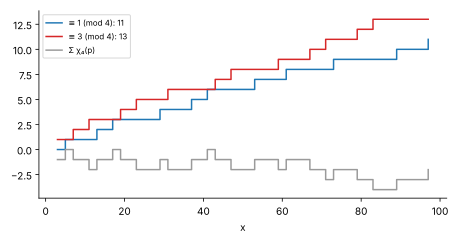

<sub>מירוץ הראשוניים מודולו 4 עד 100.</sub>

---

## 3. סכומי קרקטרים

**[סכום קרקטרים](../pages/סכום%20קרקטרים.md)** הוא $`\sum_{M \le n < M + N}\chi(n)`$. על קטע שלם של $`q`$ מספרים הסכום 0, ולכן תמיד $`|\sum| \le q`$. השאלה: כמה קטן הוא על קטעים קצרים?

**משפט 13.2 (פוליה–וינוגרדוב, 1918).** לכל קרקטר לא ראשי $`\chi`$ מודולו $`q`$:
```math
\left|\sum_{M\le n\lt M+N}\chi(n)\right| = O(\sqrt q\log q).
```
**רעיון ההוכחה.** עבור $`\chi`$ פרימיטיבי, $`\chi(n) = \frac{1}{\tau(\bar\chi)}\sum_{a}\bar\chi(a)e^{2\pi ian/q}`$, כאשר $`\tau(\chi) = \sum_a\chi(a)e^{2\pi ia/q}`$ הוא **סכום גאוס**, ו-$`|\tau(\chi)| = \sqrt q`$ (הכללה של משפט 7.9). מציבים, מחליפים סדר סכימה, ומשתמשים בכך שסכום של סדרה הנדסית $`\sum_n e^{2\pi ian/q}`$ חסום ב-$`\frac1{2\|a/q\|}`$. הסכום על $`a`$ נותן $`\sqrt q\log q`$.

### דוגמה 4: בדיקה מספרית
עבור סימן לז'נדר מודולו 101: הסכום החלקי $`\max_h\left|\sum_{n=1}^h\left(\frac n{101}\right)\right|`$ הוא 7, לעומת $`\sqrt{101}\log 101 \approx 46`$. (החסם אינו הדוק, אבל הוא הנכון בסדר גודל עד כדי $`\log\log q`$.)

**שימוש: אי-השארית הקטנה ביותר.** אם כל $`n \le H`$ שאריות ריבועיות מודולו $`p`$, אז גם כל מספר $`H`$-חלק הוא שארית, ובאמצעות [פונקציית דיקמן](../pages/פונקציית%20דיקמן.md) מראים שסכום הקרקטר על $`[1, x]`$ גדול מדי. מכאן (וינוגרדוב) אי-השארית הקטנה ביותר היא $`O(p^{1/(2\sqrt e) + \varepsilon})`$.

**[אי-שוויון ברג'ס](../pages/אי-שוויון%20ברג'ס.md) (1962)** חזק בהרבה לקטעים קצרים: לכל $`r \ge 1`$,
```math
\left|\sum_{N < n \le N + H}\chi(n)\right| \ll H^{1 - 1/r}p^{(r+1)/(4r^2) + \varepsilon}.
```
הוא נותן ביטול לא-טריוויאלי כבר עבור $`H > p^{1/4 + \varepsilon}`$, ומשפר את אי-השארית הקטנה ביותר ל-$`O(p^{1/(4\sqrt e) + \varepsilon})`$. כמעט 60 שנה לא שופר המעריך $`1/4`$.

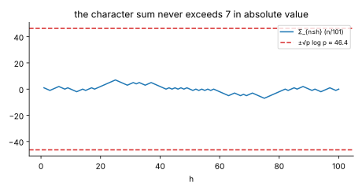

<sub>סכומי סימן לז׳נדר מודולו 101, לעומת חסם פוליה–וינוגרדוב.</sub>

---

## 4. ההטיה של צ'בישב

לפי PNT בסדרות חשבוניות, $`\pi(x; 4, 1) \sim \pi(x; 4, 3)`$. אבל בפועל:

| $`x`$ | $`\pi(x;4,1)`$ | $`\pi(x;4,3)`$ |
|---|---|---|
| 100 | 11 | 13 |
| 1000 | 80 | 87 |
| 10000 | 609 | 619 |

הראשוניים $`\equiv 3`$ מובילים כמעט תמיד. הפעם הראשונה ש-$`\equiv 1`$ עוקפים היא ב-$`x = 26861`$.

**[ההטיה של צ'בישב](../pages/הטיה%20של%20צ'בישב.md) — ההסבר.** בנוסחה המפורשת עבור $`\psi(x; 4, 1) - \psi(x; 4, 3)`$, המעבר מ-$`\psi`$ ל-$`\pi`$ מכניס איבר $`-\frac{\sqrt x}{\log x}`$ מהריבועים של ראשוניים (כל ריבוע של ראשוני אי-זוגי הוא $`\equiv 1 \pmod 4`$, ו-$`\psi`$ סופר אותם בעוד ש-$`\pi`$ לא). תחת השערת רימן המוכללת וההנחה שהאפסים "בלתי תלויים ליניארית", רובינשטיין וסרנק (1994) חישבו: **הצפיפות הלוגריתמית** של ה-$`x`$-ים שבהם $`\pi(x;4,3) > \pi(x;4,1)`$ היא $`0.9959\ldots`$. כלומר הם "מנצחים" 99.6% מהזמן, אבל לא תמיד.

---

## 5. משפט זיגל–ולפיש ואפסי זיגל

**השאלה:** משפט המספרים הראשוניים לסדרות חשבוניות — עד כמה $`q`$ יכול להיות גדול ביחס ל-$`x`$?

**אזור חסר אפסים:** לכל פונקציה $`L(s, \chi)`$ מודולו $`q`$ אין אפסים באזור $`\sigma > 1 - \frac{c}{\log(q(|t| + 2))}`$ — **פרט אולי לאפס ממשי אחד** $`\beta_1`$, של קרקטר ממשי אחד. אפס כזה, אם קיים, נקרא **[אפס זיגל](../pages/אפס%20זיגל.md)** (או "אפס חריג").

**משפט 13.3 (זיגל, 1935).** לכל $`\varepsilon > 0`$ יש $`C(\varepsilon) > 0`$ כך שלכל קרקטר ממשי פרימיטיבי $`\chi`$ מודולו $`q`$: $`L(1, \chi) > C(\varepsilon)q^{-\varepsilon}`$, ולכן $`\beta_1 < 1 - C'(\varepsilon)q^{-\varepsilon}`$.

**הבעיה:** הקבוע $`C(\varepsilon)`$ **אינו אפקטיבי** — ההוכחה היא "בשלילה כפולה": אם יש אפס זיגל אחד, הוא דוחה את כל האחרים; ואם אין — מצוין. אבל אי אפשר לחשב את $`C(\varepsilon)`$.

**משפט 13.4 ([זיגל–ולפיש](../pages/משפט%20זיגל-ולפיש.md)).** לכל $`A > 0`$, עבור $`q \le (\log x)^A`$ ו-$`\gcd(a, q) = 1`$:
```math
\psi(x; q, a) = \frac{x}{\varphi(q)} + O_A\!\left(x\exp(-c_A\sqrt{\log x})\right).
```
כלומר PNT בסדרות חשבוניות **אחיד** עבור מודולים עד חזקה של $`\log x`$. הקבועים אינם אפקטיביים (בגלל זיגל).

**[תופעת דויירינג–היילברון](../pages/תופעת%20דויירינג-היילברון.md):** אם אפס זיגל קיים, הוא **דוחה** את כל שאר האפסים של כל פונקציות L האחרות הרחק מהישר $`\sigma = 1`$. זה "הצד המועיל" של אפס זיגל: אם הוא קיים, כמה בעיות קשות נעשות קלות יותר (למשל, היט-בראון הראה שאז יש אינסוף ראשוניים תאומים!).

---

## 6. מספרי מחלקה

לכל $`d < 0`$ (דיסקרימיננטה) יש **מספר מחלקה** $`h(d)`$: מספר התבניות הריבועיות $`ax^2 + bxy + cy^2`$ המצומצמות עם $`b^2 - 4ac = d`$, או בשפה של אלגברה — הגודל של חבורת מחלקות האידיאלים של $`\mathbb Q(\sqrt d)`$. $`h(d) = 1`$ פירושו שבחוג השלמים של השדה יש **פירוק יחיד**.

**נוסחת מספר המחלקה (דיריכלה).** עבור $`d < -4`$ ו-$`\chi_d`$ סימן קרונקר:
```math
L(1, \chi_d) = \frac{\pi\,h(d)}{\sqrt{|d|}}.
```
ועבור $`d = -p`$, $`p \equiv 3 \pmod 4`$, $`p > 3`$, יש נוסחה סופית: $`h(-p) = -\frac1p\sum_{a=1}^{p-1}a\left(\frac ap\right)`$.

### דוגמה 5: $`h(-7)`$ ו-$`h(-23)`$
1. מודולו 7 השאריות הריבועיות הן 1, 2, 4. $`\sum a\left(\frac a7\right) = 1 + 2 - 3 + 4 - 5 - 6 = -7`$. לכן $`h(-7) = 1`$.
2. מודולו 23 החישוב (ארוך יותר) נותן $`\sum a\left(\frac a{23}\right) = -69`$, ולכן $`h(-23) = 3`$. ואכן, יש שלוש תבניות מצומצמות: $`x^2 + xy + 6y^2`$, $`2x^2 \pm xy + 3y^2`$.

**[בעיית מספר המחלקה](../pages/בעיית%20מספר%20המחלקה.md) של גאוס:** מצאו את כל ה-$`d < 0`$ עם $`h(d) = 1`$. התשובה (הגנר 1952, בייקר וסטארק 1967):
```math
d = -3, -4, -7, -8, -11, -19, -43, -67, -163 .
```
**למה זה קשה:** $`h(d) \to \infty`$ (היילברון, 1934), אבל ההוכחה לא אפקטיבית — בדיוק בגלל אפסי זיגל. משפט זיגל נותן $`h(d) \gg_\varepsilon |d|^{1/2-\varepsilon}`$, לא-אפקטיבית.

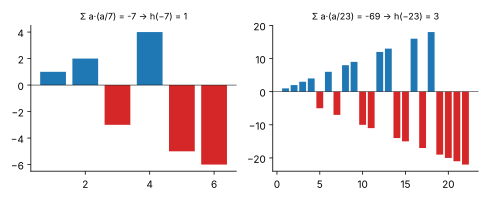

<sub>החישוב של h(−7) ושל h(−23) בנוסחה הסופית.</sub>

### דוגמה 6: הפולינום של אוילר
$`h(-163) = 1`$ קשור ישירות לכך ש-$`n^2 + n + 41`$ ראשוני לכל $`n = 0, 1, \dots, 39`$ ($`41, 43, 47, 53, \dots, 1601`$), ונכשל רק ב-$`n = 40`$: $`40^2 + 40 + 41 = 1681 = 41^2`$. (הדיסקרימיננטה של $`n^2 + n + 41`$ היא $`1 - 164 = -163`$. רבינוביץ' הוכיח ש-$`n^2 + n + A`$ ראשוני עבור $`n = 0..A-2`$ אם ורק אם $`h(1 - 4A) = 1`$.)

**[משפט בראואר–זיגל](../pages/משפט%20בראואר-זיגל.md)** מכליל לשדות מספרים: עבור סדרת שדות עם $`[K:\mathbb Q]/\log|D_K| \to 0`$, $`\log(h_KR_K) \sim \log\sqrt{|D_K|}`$, כאשר $`R_K`$ הוא הרגולטור.

**[משפט האידיאלים הראשוניים של לנדאו](../pages/משפט%20האידיאלים%20הראשוניים%20של%20לנדאו.md)** הוא ה-PNT לשדות מספרים: מספר האידיאלים הראשוניים בעלי נורמה $`\le X`$ הוא $`\sim X/\log X`$. (ובשדה ריבועי אפשר לראות את זה ישירות: ראשוני $`p`$ "מתפצל" לשני אידיאלים אם $`\chi_d(p) = 1`$, ונשאר אחד אם $`\chi_d(p) = -1`$; לפי דיריכלה, חצי מהראשוניים מכל סוג.)

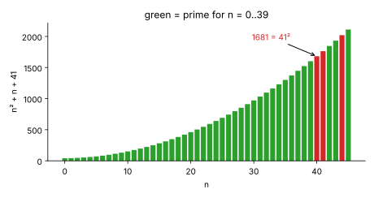

<sub>n²+n+41 ראשוני לכל n עד 39.</sub>

---

## 7. משפט ליניק

**[משפט ליניק](../pages/משפט%20ליניק.md) (1944).** יש קבועים $`c, L`$ כך שהראשוני הקטן ביותר בסדרה $`a + nq`$ ($`\gcd(a,q) = 1`$) קטן מ-$`cq^L`$.

* ה"קבוע של ליניק" הידוע הטוב ביותר: $`L \le 5`$ (שיאנג'ו, 2011).
* תחת השערת רימן המוכללת: $`L = 2 + \varepsilon`$. ההשערה: $`L = 1 + \varepsilon`$.
* **דוגמה:** הראשוני הקטן ביותר $`\equiv 1 \pmod{101}`$ הוא $`607 = 6 \cdot 101 + 1`$.

ההוכחה משלבת שלושה רכיבים: אזור חסר אפסים, **הערכת צפיפות אפסים** ליד $`\sigma = 1`$, ותופעת דויירינג–היילברון כדי לטפל באפס זיגל אפשרי.

---

## 8. השערת רימן המוכללת ומחלקת סלברג

**[השערת רימן המוכללת](../pages/השערת%20רימן%20המוכללת.md) (GRH):** לכל קרקטר $`\chi`$, כל האפסים הלא-טריוויאליים של $`L(s, \chi)`$ נמצאים על $`\sigma = \tfrac12`$.

**מה נובע ממנה:**
* $`\psi(x; q, a) = \frac{x}{\varphi(q)} + O(\sqrt x\log^2 x)`$ — **אחיד** ב-$`q`$, אפקטיבי.
* אין אפסי זיגל; $`h(d) \gg \sqrt{|d|}/\log\log|d|`$ אפקטיבית; הרשימה של 65 ה[מספרים האידוניאליים](../pages/מספר%20אידוניאלי.md) שלמה (שיעור 8).
* אי-השארית הקטנה ביותר היא $`O(\log^2 p)`$ (אנקני) — ולכן מבחן הראשוניות של מילר הופך לדטרמיניסטי ופולינומי.

**[מחלקת סלברג](../pages/מחלקת%20סלברג.md) (1989).** סלברג ניסח מסגרת אקסיומטית לכל "פונקציות L טבעיות": טור דיריכלה $`F(s) = \sum a_nn^{-s}`$ עם
1. המשכה מרומורפית (קוטב לכל היותר ב-$`s = 1`$);
2. משוואת פונקציה עם גורמי גמא: $`\Phi(s) = Q^s\prod\Gamma(\omega_is + \mu_i)F(s)`$ מקיימת $`\Phi(s) = w\overline{\Phi(1-\bar s)}`$;
3. השערת רמנוג'אן: $`a_n = O(n^\varepsilon)`$;
4. מכפלת אוילר: $`\log F(s) = \sum b_nn^{-s}`$ עם $`b_n = 0`$ אלא אם $`n`$ חזקת ראשוני, ו-$`b_n = O(n^\theta)`$, $`\theta < 1/2`$.

$`\zeta(s)`$ ו-$`L(s, \chi)`$ שייכות למחלקה. **השערת רימן הגדולה:** לכל פונקציה במחלקה, האפסים הלא-טריוויאליים על $`\sigma = \tfrac12`$.

**[קרקטרים של הקה](../pages/קרקטר%20של%20הקה.md)** הם ההכללה של קרקטרים של דיריכלה לשדות מספרים, ופונקציות ה-L שלהם הן דוגמאות נוספות במחלקת סלברג.

---

## 9. תרגילים

**תרגיל 1.** כתבו את כל הקרקטרים מודולו 8 והוכיחו שכולם ממשיים.

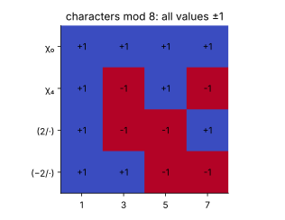

<sub>כל הקרקטרים מודולו 8 — ערכים ±1 בלבד.</sub>

<details><summary>פתרון</summary>

השאריות ההפיכות $`\{1,3,5,7\}`$, וכל אחת בריבוע 1. לכן $`\chi(n)^2 = 1`$ ו-$`\chi(n) = \pm1`$. הקרקטרים: $`\chi_0 = (1,1,1,1)`$; $`(1,-1,1,-1)`$ (זה $`\chi_4`$ מושרה); $`(1,-1,-1,1)`$ (זה $`\left(\frac2n\right)`$); $`(1,1,-1,-1)`$ (זה $`\left(\frac{-2}n\right)`$). (הסדר: $`n = 1, 3, 5, 7`$.)
</details>

**תרגיל 2.** חשבו את $`L(1, \chi_2)`$ עבור הקרקטר הממשי מודולו 5 (נוסחה: $`L(1, \chi) = \frac{2}{\sqrt 5}\log\frac{1 + \sqrt5}{2}`$) ובדקו מספרית.

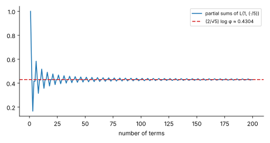

<sub>הסכומים החלקיים של L(1, (·/5)) מתכנסים ל־0.4304.</sub>

<details><summary>פתרון</summary>

$`\frac{2}{\sqrt5}\log\varphi = 0.8944 \cdot 0.4812 = 0.4304`$. הסכום $`1 - \tfrac12 - \tfrac13 + \tfrac14 + \tfrac16 - \tfrac17 - \tfrac18 + \tfrac19 + \cdots`$ אכן מתכנס ל-$`0.43041`$. (זו נוסחת מספר המחלקה לדיסקרימיננטה חיובית 5: $`L(1,\chi) = \frac{2h\log\varepsilon}{\sqrt d}`$ עם $`h = 1`$ ויחידת היסוד $`\varepsilon = \tfrac{1+\sqrt5}2`$.)
</details>

**תרגיל 3.** חשבו את $`h(-11)`$ ואת $`h(-47)`$ בנוסחה הסופית.

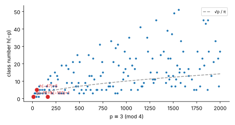

<sub>מספר המחלקה h(−p) לראשוניים p≡3 (mod 4); גדל בערך כמו √p.</sub>

<details><summary>פתרון</summary>

מודולו 11 השאריות: 1, 3, 4, 5, 9. $`\sum a\left(\frac a{11}\right) = (1 + 3 + 4 + 5 + 9) - (2 + 6 + 7 + 8 + 10) = 22 - 33 = -11`$, ולכן $`h(-11) = 1`$. עבור 47 החישוב נותן $`-235`$, ולכן $`h(-47) = 5`$.
</details>

**תרגיל 4.** הסבירו בעזרת המסנן למה $`\sum_{p\le x, p\equiv 1(4)}\frac{1}{p} - \sum_{p\le x, p\equiv 3(4)}\frac1p`$ מתכנס כאשר $`x \to \infty`$.

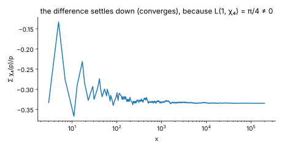

<sub>Σχ₄(p)/p מתייצב — הוא מתכנס.</sub>

<details><summary>פתרון</summary>

ההפרש הוא $`\sum_{p\le x}\frac{\chi_4(p)}p`$, והוא מתכנס ל-$`\log L(1, \chi_4) - \sum_{p,k\ge2}\frac{\chi_4(p)^k}{kp^k}`$ — סופי כי $`L(1,\chi_4) = \pi/4 \ne 0`$. (ההתכנסות עצמה דורשת את אזור חסר האפסים, או סכימה בחלקים עם PNT בסדרות.)
</details>

**תרגיל 5.** בדקו שהפולינום $`n^2 + n + 17`$ ראשוני עבור $`n = 0, \dots, 15`$, וקשרו לרשימה של גאוס.

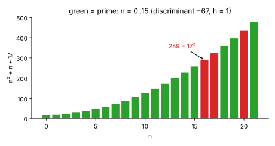

<sub>n²+n+17 ראשוני (ירוק) לכל n עד 15.</sub>

<details><summary>פתרון</summary>

הערכים: 17, 19, 23, 29, 37, 47, 59, 73, 89, 107, 127, 149, 173, 199, 227, 257 — כולם ראשוניים. ב-$`n = 16`$: $`289 = 17^2`$. הדיסקרימיננטה $`1 - 68 = -67`$, ו-$`h(-67) = 1`$.
</details>

---

## סיכום
* קרקטרים: פונקציות כפליות מחזוריות; האורתוגונליות הופכת תנאי חפיפה לסכום של קרקטרים.
* דיריכלה: $`L(1,\chi) \ne 0`$ ⇒ אינסוף ראשוניים בכל סדרה, ובצפיפות שווה.
* סכומי קרקטרים: פוליה–וינוגרדוב $`\sqrt q\log q`$; ברג'ס לקטעים מאורך $`q^{1/4+\varepsilon}`$.
* אפס זיגל אפשרי הוא מקור אי-האפקטיביות; קשור למספרי מחלקה ($`h(d) = 1`$ רק ל-9 ערכים).
* GRH ומחלקת סלברג: המסגרת הכללית.

**השיעור הקודם:** [שיעור 12](12-משפט-המספרים-הראשוניים.md) · **השיעור הבא:** [שיעור 14: תורת הנפה](14-תורת-הנפה.md)

**להעמקה:** [קרקטר דיריכלה](https://he.wikipedia.org/wiki/%D7%A7%D7%A8%D7%A7%D7%98%D7%A8_%D7%93%D7%99%D7%A8%D7%99%D7%9B%D7%9C%D7%94) · [פונקציית L של דיריכלה](https://he.wikipedia.org/wiki/%D7%A4%D7%95%D7%A0%D7%A7%D7%A6%D7%99%D7%99%D7%AA_L_%D7%A9%D7%9C_%D7%93%D7%99%D7%A8%D7%99%D7%9B%D7%9C%D7%94) · [משפט דיריכלה](https://he.wikipedia.org/wiki/%D7%9E%D7%A9%D7%A4%D7%98_%D7%93%D7%99%D7%A8%D7%99%D7%9B%D7%9C%D7%94) · [סכום קרקטרים](../pages/סכום%20קרקטרים.md) · [אי-שוויון ברג'ס](../pages/אי-שוויון%20ברג'ס.md) · [הטיה של צ'בישב](../pages/הטיה%20של%20צ'בישב.md) · [משפט זיגל–ולפיש](../pages/משפט%20זיגל-ולפיש.md) · [אפס זיגל](../pages/אפס%20זיגל.md) · [תופעת דויירינג–היילברון](../pages/תופעת%20דויירינג-היילברון.md) · [משפט בראואר–זיגל](../pages/משפט%20בראואר-זיגל.md) · [בעיית מספר המחלקה](../pages/בעיית%20מספר%20המחלקה.md) · [משפט ליניק](../pages/משפט%20ליניק.md) · [השערת רימן המוכללת](../pages/השערת%20רימן%20המוכללת.md) · [מחלקת סלברג](../pages/מחלקת%20סלברג.md) · [משפט האידיאלים הראשוניים של לנדאו](../pages/משפט%20האידיאלים%20הראשוניים%20של%20לנדאו.md) · [קרקטר של הקה](../pages/קרקטר%20של%20הקה.md)

---
<sub>חלק מהקורס [תורת המספרים בעברית](../COURSE.md). התוכן מופץ ברישיון [CC BY-SA 4.0](https://creativecommons.org/licenses/by-sa/4.0/).</sub>
