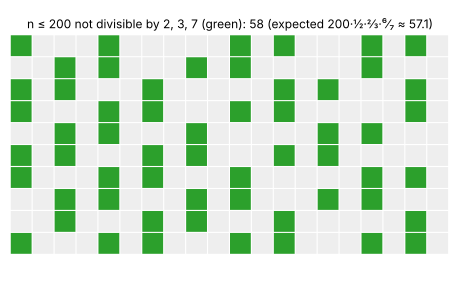
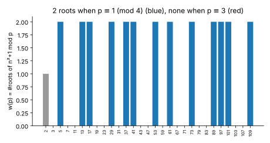
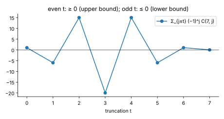
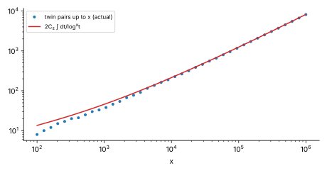
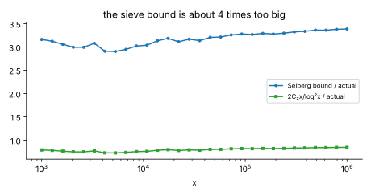

# שיעור 14: תורת הנפה

**מה נלמד:** הנפה של ארטוסתנס מוחקת כפולות של ראשוניים קטנים. **[תורת הנפה](../pages/תורת%20הנפה.md)** הופכת את הרעיון הזה לכלי לספירה **משוערת**: כמה מספרים בקבוצה נתונה "שורדים" את המחיקה? נלמד את נפת לז'נדר ואת הבעיה שלה, את נפת ברון (וההוכחה שסכום ההופכיים של הראשוניים התאומים מתכנס), את נפת סלברג ($`\Lambda^2`$), את נפת טוראן, את הלמה היסודית, את הנפה הגדולה ואת "הנפה הגדולה יותר". בסוף: משפטי ברון–טיצ'מרש ובומביירי–וינוגרדוב, השערת אליוט–הלברשטם, **בעיית הזוגיות** — המכשול העקרוני של כל הנפות — ומשפט צ'ן, שעוקף אותה כמעט.

**ידע קודם:** [שיעור 3](03-מספרים-ראשוניים.md) (ארטוסתנס), [שיעור 6](06-פונקציות-אריתמטיות.md) (מביוס, כפליות), [שיעור 10](10-התפלגות-אלמנטרית.md) (מרטנס, $`\phi(x,a)`$), [שיעור 13](13-קרקטרים-ופונקציות-L.md) (ראשוניים בסדרות חשבוניות).

---

## 1. המסגרת

* $`A`$ — קבוצה סופית של מספרים שלמים (למשל $`\{n \le x\}`$, או $`\{n(n+2) : n \le x\}`$).
* $`P`$ — קבוצת ראשוניים; $`P(z) = \prod_{p \in P,\, p < z}p`$.
* $`A_d = \{a \in A : d \mid a\}`$.
* **פונקציית הנפה:** $`S(A, P, z) = \#\{a \in A : \gcd(a, P(z)) = 1\}`$ — האיברים ששרדו.

**ההנחה הבסיסית:** "ההסתברות" להתחלק ב-$`d`$ היא בערך $`w(d)/d`$, כאשר $`w`$ כפלית:
```math
|A_d| = \frac{w(d)}{d}X + R_d ,
```
עם $`X`$ קירוב ל-$`|A|`$ ו-$`R_d`$ שארית קטנה. $`w(p)`$ הוא מספר מחלקות השאריות שמוחקים מודולו $`p`$.

**הצפי ההיוריסטי:** אם ההתחלקויות "בלתי תלויות",
```math
S(A, P, z) \approx X\,W(z), \qquad W(z) = \prod_{p < z,\ p \in P}\left(1 - \frac{w(p)}p\right).
```
הבעיה: לכמת את השגיאה. **מימד הנפה** $`\kappa`$ הוא הממוצע של $`w(p)`$: לראשוניים $`\kappa = 1`$, לראשוניים תאומים $`\kappa = 2`$.

### דוגמה 1: שתי בעיות בשפת הנפה
* **ראשוניים עד $`x`$:** $`A = \{n \le x\}`$, $`w(p) = 1`$ (מוחקים את 0 מודולו $`p`$). $`S(A, P, \sqrt x) = \pi(x) - \pi(\sqrt x) + 1`$.
* **ראשוניים תאומים:** $`A = \{n(n+2) : n \le x\}`$. מודולו $`p > 2`$ מוחקים **שתי** מחלקות: $`n \equiv 0`$ ו-$`n \equiv -2`$, ולכן $`w(p) = 2`$. מודולו 2: $`w(2) = 1`$. אם $`n`$ שורד עם $`z = \sqrt{x + 2}`$, אז $`n`$ ו-$`n+2`$ שניהם ראשוניים.

---

## 2. נפת לז'נדר

**[נפת לז'נדר](../pages/נפת%20לז'נדר.md)** היא פשוט הכלה והדחה:
```math
S(A, P, z) = \sum_{d \mid P(z)}\mu(d)|A_d| = X\,W(z) + \sum_{d\mid P(z)}\mu(d)R_d .
```
**למה?** $`\sum_{d\mid\gcd(a, P(z))}\mu(d)`$ הוא 1 אם $`\gcd = 1`$ ו-0 אחרת (משפט 6.2). מסכמים על $`a`$ ומחליפים סדר.

### דוגמה 2: כמה $`n \le 100`$ זרים ל-30?
1. $`A = \{1..100\}`$, $`P(z) = 2\cdot3\cdot5`$.
2. $`S = 100 - (50 + 33 + 20) + (16 + 10 + 6) - 3 = 100 - 103 + 32 - 3 = 26`$.
3. הצפי: $`100 \cdot \tfrac12\cdot\tfrac23\cdot\tfrac45 = 26.67`$. השגיאה $`0.67`$, כי כל $`\lfloor 100/d\rfloor`$ שונה מ-$`100/d`$ בפחות מ-1.

**הבעיה:** יש $`2^{\pi(z)}`$ איברי שגיאה, וכל אחד עד 1. עם $`z = \sqrt x`$, השגיאה $`2^{\pi(\sqrt x)}`$ ענקית. נפת לז'נדר נותנת תוצאה טובה רק עבור $`z \approx \log x`$, ואז רק $`\pi(x) \ll x/\log\log x`$.

---

## 3. נפת ברון

**[נפת ברון](../pages/נפת%20ברון.md)** (1915–1919) — הרעיון: **לקטוע** את סכום ההכלה וההדחה. לכל $`r`$:
```math
\sum_{\substack{d \mid m\\ \omega(d) \le 2r-1}}\mu(d) \;\le\; \sum_{d\mid m}\mu(d) \;\le\; \sum_{\substack{d \mid m\\ \omega(d) \le 2r}}\mu(d) .
```
(**אי-שוויוני בונפרוני**: אם ל-$`m`$ יש $`k`$ גורמים, הסכום הקטוע הוא $`\sum_{j \le t}(-1)^j\binom kj = (-1)^t\binom{k-1}{t}`$ — ובסימן הנכון.) כך מספר איברי השגיאה יורד ל-$`z^{O(r)}`$, ואפשר לבחור $`z = x^{c/\log\log x}`$.

**משפט 14.1 (ברון).** מספר הראשוניים התאומים עד $`x`$ הוא $`O\!\left(\frac{x(\log\log x)^2}{\log^2 x}\right)`$ (ובשיטות מאוחרות יותר: $`O(x/\log^2 x)`$).

**מסקנה 14.2 (ברון, 1919).** הטור $`\sum_{p,\,p+2 \text{ ראשוניים}}\left(\frac1p + \frac1{p+2}\right)`$ **מתכנס**.

**הוכחה (מתוך משפט 14.1).**
1. נסמן ב-$`p_n`$ את הראשוני התאום ה-$`n`$-י (הקטן בזוג). לפי 14.1, $`n \ll \frac{p_n}{\log^{2-\varepsilon}p_n}`$, כלומר $`p_n \gg n\log^{2-\varepsilon}n`$.
2. לכן $`\frac1{p_n} \ll \frac1{n\log^{2-\varepsilon}n}`$, והטור $`\sum\frac1{n\log^{1.5}n}`$ מתכנס (מבחן האינטגרל). ∎

**[קבוע ברון](https://he.wikipedia.org/wiki/%D7%A7%D7%91%D7%95%D7%A2_%D7%91%D7%A8%D7%95%D7%9F)** הוא הסכום: $`B_2 \approx 1.902`$. ההתכנסות איטית להפליא: הסכום עד $`10^6`$ הוא רק $`1.7108`$. (בחישוב $`B_2`$ התגלה ב-1994 הבאג בחילוק של מעבד הפנטיום.)

**המשמעות:** אוילר הראה ש-$`\sum 1/p`$ מתבדר. ברון הראה שהתאומים "נדירים מספיק" כדי שהטור שלהם יתכנס — **בלי** לדעת אם יש אינסוף מהם.

---

## 4. נפת סלברג ($`\Lambda^2`$)

**[נפת סלברג](../pages/נפת%20סלברג.md)** (1947) נותנת **חסמים עליונים** טובים בדרך פשוטה להפליא.

**הרעיון.** לכל בחירה של מספרים ממשיים $`\lambda_d`$ עם $`\lambda_1 = 1`$ (ו-$`\lambda_d = 0`$ עבור $`d \ge z`$):
```math
\sum_{d\mid\gcd(a, P(z))}\mu(d) \le \Big(\sum_{d \mid \gcd(a, P(z))}\lambda_d\Big)^2 .
```
(אם $`\gcd = 1`$, אגף ימין הוא $`\lambda_1^2 = 1`$; אחרת אגף שמאל 0 וימין ריבוע $`\ge 0`$.)

**השלבים.**
1. מסכמים על $`a \in A`$: $`S(A, P, z) \le \sum_{d_1, d_2}\lambda_{d_1}\lambda_{d_2}|A_{[d_1, d_2]}| = X\cdot Q(\lambda) + \sum\lambda_{d_1}\lambda_{d_2}R_{[d_1,d_2]}`$.
2. $`Q(\lambda) = \sum_{d_1,d_2}\lambda_{d_1}\lambda_{d_2}\frac{w([d_1,d_2])}{[d_1,d_2]}`$ היא **תבנית ריבועית** ב-$`\lambda`$.
3. ממזערים את $`Q`$ תחת $`\lambda_1 = 1`$ (אלגברה ליניארית — אלכסון בעזרת היפוך מביוס). המינימום הוא $`1/G(z)`$, כאשר $`G(z) = \sum_{d < z,\, d \mid P(z)}\prod_{p\mid d}\frac{w(p)}{p - w(p)}`$.
4. מקבלים $`S(A, P, z) \le \frac{X}{G(z)} + \sum_{d_1, d_2 < z}|\lambda_{d_1}\lambda_{d_2}R_{[d_1,d_2]}|`$, ו-$`|\lambda_d| \le 1`$.

עבור $`w(p) = 1`$: $`G(z) = \sum_{d < z}\frac{\mu(d)^2}{\varphi(d)} \ge \log z`$. **רק $`z^2`$ איברי שגיאה** — עם $`z = \sqrt{X}`$ בערך הם בגודל $`X`$ בלבד.

### דוגמה 3: ראשוניים בקטע קצר
**שאלה:** כמה ראשוניים יש בקטע $`(x, x + y]`$?

**פתרון בעזרת סלברג.**
1. $`A = (x, x+y]`$, $`X = y`$, $`w(p) = 1`$, $`|R_d| \le 1`$.
2. $`S \le \frac{y}{\log z} + z^2`$. נבחר $`z = \sqrt{y}/\log y`$: $`S \le \frac{y}{\tfrac12\log y - \log\log y} + \frac{y}{\log^2 y}`$.
3. ראשוני בקטע ששורד הוא ראשוני, ולכן $`\pi(x + y) - \pi(x) \le (2 + o(1))\frac{y}{\log y}`$.
4. **בדיקה:** בקטע $`(10^6, 10^6 + 1000]`$ יש 75 ראשוניים. החסם: $`2\cdot1000/\log 1000 \approx 290`$. (הצפי, $`1000/\log 10^6 \approx 72`$ — החסם גדול פי 4 בגלל ה-$`\log y`$ במכנה במקום $`\log x`$; עבור $`y`$ קרוב ל-$`x`$ הפער הוא פי 2.)

**[משפט ברון–טיצ'מרש](../pages/משפט%20ברון-טיצ'מרש.md):** באותה דרך, לכל $`q < x`$:
```math
\pi(x; q, a) \le \frac{2x}{\varphi(q)\log(x/q)} .
```
**חשוב:** זה עובד לכל $`q`$ עד כמעט $`x`$ — בניגוד לזיגל–ולפיש ($`q \le \log^A x`$) — אבל רק כחסם עליון, ועם קבוע 2. הורדת ה-2 לכל $`2 - \delta`$ (עבור $`q`$ גדול) הייתה **שוללת אפסי זיגל**.

---

## 5. נפת טוראן והלמה היסודית

**[נפת טוראן](../pages/נפת%20טוראן.md)** (1934) היא הגרסה הפשוטה ביותר: אי-שוויון השונות (צ'בישב) מהשיעור הקודם. אם $`\omega_z(a) = \#\{p \mid a : p < z\}`$, אז איבר ששרד מקיים $`\omega_z(a) = 0`$, ולכן
```math
S(A, P, z) \le \frac{\sum_{a\in A}\left(\omega_z(a) - \mu_z\right)^2}{\mu_z^2}, \qquad \mu_z = \sum_{p < z}\frac{w(p)}{p}.
```
זו בדיוק ההוכחה של טוראן למשפט הארדי–רמנוג'אן ([שיעור 9](09-סדרים-של-פונקציות.md)), בשפת הנפה. היא נותנת חסמים חלשים יחסית ($`S \ll X/\log\log z`$), אבל דורשת רק מידע על זוגות $`A_{pq}`$.

**[הלמה היסודית של תורת הנפה](../pages/הלמה%20היסודית%20של%20תורת%20הנפה.md):** כאשר $`z`$ **קטן** ביחס ל-$`X`$ (כלומר $`u = \frac{\log X}{\log z}`$ גדול), הצפי ההיוריסטי **נכון**:
```math
S(A, P, z) = X\,W(z)\left\{1 + O(u^{-u/2})\right\} + O\Big(\sum_{d \le z^u,\ d\mid P(z)}|R_d|\Big).
```
כלומר הנפה עובדת היטב בתחום "המימד הנמוך". הבעיה היא רק כש-$`z`$ מתקרב ל-$`\sqrt X`$ — שם צריך לזהות ראשוניים.

---

## 6. הנפה הגדולה

**[הנפה הגדולה](../pages/הנפה%20הגדולה.md)** (לינק 1941, רני, בומביירי, מונטגומרי) מטפלת במצב ההפוך: **מוחקים הרבה** מחלקות לכל ראשוני.

**אי-שוויון הנפה הגדולה (צורה אנליטית).** לכל מספרים מרוכבים $`a_n`$, $`M < n \le M + N`$, עם $`S(\alpha) = \sum a_ne^{2\pi in\alpha}`$:
```math
\sum_{q \le Q}\ \sum_{\substack{a \bmod q\\ \gcd(a,q) = 1}}\left|S\!\left(\frac aq\right)\right|^2 \le (N + Q^2)\sum_n|a_n|^2 .
```
**אינטואיציה:** השברים $`a/q`$ עם $`q \le Q`$ מרוחקים זה מזה לפחות $`1/Q^2`$. פונקציה $`S(\alpha)`$ שהיא "טריגונומטרית מאורך $`N`$" לא יכולה להיות גדולה בהרבה נקודות מרוחקות — יותר מ"מספר הנקודות הבלתי תלויות", שהוא בערך $`N + Q^2`$.

**צורה אריתמטית.** אם $`A \subseteq [M, M+N]`$ **נמנעת** מ-$`\omega(p)`$ מחלקות שאריות מודולו כל $`p \le Q`$, אז
```math
|A| \le \frac{N + Q^2}{L}, \qquad L = \sum_{q \le Q}\mu(q)^2\prod_{p \mid q}\frac{\omega(p)}{p - \omega(p)} .
```

### דוגמה 4: ריבועים
**שאלה:** כמה ריבועים שלמים יש ב-$`[1, N]`$? (התשובה $`\sqrt N`$, אבל בואו נבדוק מה הנפה נותנת.)
1. ריבוע נמנע מכל אי-השאריות מודולו $`p`$: $`\omega(p) = \frac{p-1}{2}`$.
2. $`\frac{\omega(p)}{p - \omega(p)} = \frac{(p-1)/2}{(p+1)/2} \approx 1`$, ולכן $`L \approx \#\{q \le Q \text{ חסרי ריבועים}\} \approx \frac{6}{\pi^2}Q`$.
3. עם $`Q = \sqrt N`$: $`|A| \ll \frac{N}{\sqrt N} = \sqrt N`$. ✓ סדר הגודל הנכון!

**שימוש:** בעיית אי-השארית הקטנה ביותר "בממוצע" (לינק): לכל $`\varepsilon > 0`$, מספר הראשוניים $`p \le x`$ שאי-השארית הקטנה ביותר שלהם גדולה מ-$`p^\varepsilon`$ חסום בקבוע.

**[הנפה הגדולה יותר](../pages/הנפה%20הגדולה%20יותר.md)** (גלאגר, 1971) עדיפה כשמוחקים **כמעט את כל** המחלקות. אם $`A \subseteq [1, N]`$ ולכל חזקת ראשוני $`q`$ בקבוצה $`\mathcal S`$ האיברים של $`A`$ נופלים ב-$`g(q)`$ מחלקות מודולו $`q`$:
```math
|A| \le \frac{\sum_{q\in\mathcal S}\Lambda(q) - \log N}{\sum_{q\in\mathcal S}\frac{\Lambda(q)}{g(q)} - \log N}
```
(כאשר המכנה חיובי). דוגמה: חזקות של 2 — בכל מודולו הן נופלות במעט מחלקות.

---

## 7. ראשוניים בסדרות חשבוניות — בממוצע

**[משפט בומביירי–וינוגרדוב](../pages/משפט%20בומביירי-וינוגרדוב.md) (1965).** לכל $`A > 0`$ יש $`B`$ כך ש-
```math
\sum_{q \le x^{1/2}/\log^Bx}\ \max_{\gcd(a,q)=1}\left|\psi(x; q, a) - \frac{x}{\varphi(q)}\right| \ll \frac{x}{\log^Ax}.
```
**המשמעות:** "בממוצע על $`q`$", PNT בסדרות חשבוניות מתקיים עם שגיאה **כאילו השערת רימן המוכללת נכונה**, עד $`q \approx \sqrt x`$. זה מספיק כמעט לכל יישום. ההוכחה: הנפה הגדולה + [הזהות של ווהן](15-סכומים-אקספוננציאליים.md) (שיעור 15).

**[השערת אליוט–הלברשטם](../pages/השערת%20אליוט-הלברשטם.md):** אותו דבר עד $`q \le x^\theta`$ לכל $`\theta < 1`$. מה נובע ממנה: גולדסטון–פינץ–ילדירים (2005) הראו שאם היא נכונה עם $`\theta > 1/2`$ (ולו מעט), יש אינסוף זוגות ראשוניים במרחק חסום. ב-2013 ג'אנג הוכיח מרחק חסום **בלי** ההשערה (בעזרת גרסה חלקית של בומביירי–וינוגרדוב לכיוון $`\theta > 1/2`$ עבור מודולים חלקים), ומיינרד–טאו הורידו את המרחק ל-246.

---

## 8. בעיית הזוגיות ומשפט צ'ן

**[בעיית הזוגיות](../pages/בעיית%20הזוגיות%20%28תורת%20הנפה%29.md)** (סלברג): נפה "טהורה" — שמשתמשת רק במידע על $`|A_d|`$ — **לא יכולה להבחין** בין מספרים עם מספר **זוגי** ומספר **אי-זוגי** של גורמים ראשוניים.

**הדוגמה של סלברג.** נגדיר שתי קבוצות:
* $`A^+ = \{n \le x : \lambda(n) = +1\}`$ (מספר זוגי של גורמים, עם ריבוי);
* $`A^- = \{n \le x : \lambda(n) = -1\}`$.

לשתיהן $`|A^\pm_d| \approx \frac{x}{2d}`$ — **אותם נתוני נפה**. אבל ב-$`A^+`$ אין אף ראשוני, וב-$`A^-`$ יש את כולם. לכן שום נפה טהורה לא יכולה לתת חסם תחתון חיובי לראשוניים, ולא חסם עליון טוב יותר מפי 2 מהאמת. (זה ההסבר ל-"2" בברון–טיצ'מרש ובדוגמה 3.)

**מה כן אפשר:** מספרים עם **מעט** גורמים ראשוניים. מספר $`n`$ נקרא $`P_r`$ אם יש לו לכל היותר $`r`$ גורמים ראשוניים (עם ריבוי). ברון הוכיח: יש אינסוף $`n`$ עם $`n, n+2`$ שניהם $`P_9`$.

**[משפט צ'ן](../pages/משפט%20צ'ן.md) (1966/1973).**
1. כל מספר זוגי גדול מספיק הוא $`p + P_2`$ (ראשוני ועוד מספר שהוא ראשוני או [חצי-ראשוני](../pages/מספר%20חצי-ראשוני.md)).
2. יש אינסוף ראשוניים $`p`$ כך ש-$`p + 2`$ הוא $`P_2`$.

**איך צ'ן עקף את בעיית הזוגיות?** הוא לא עקף אותה — הוא עצר בדיוק עליה. $`P_2`$ כולל גם ראשוניים (אי-זוגי) וגם חצי-ראשוניים (זוגי), ולכן אין צורך להבחין ביניהם. הטכניקה: חסם תחתון לכמות ה-$`P_3`$ מנפה משוקללת, פחות חסם **עליון** למספר אלה שיש להם בדיוק 3 גורמים — שמתקבל מספירה **חכמה** (החלפת התפקידים של המשתנים, "switching"), ולא מנפה ישירה.

---

## 9. תרגילים

**תרגיל 1.** בעזרת נפת לז'נדר, חשבו כמה מספרים $`n \le 200`$ אינם מתחלקים ב-2, 3 או 7.



<sub>המספרים עד 200 שאינם מתחלקים ב־2, 3, 7 (ירוק): 58.</sub>

<details><summary>פתרון</summary>

$`200 - (100 + 66 + 28) + (33 + 14 + 9) - 4 = 200 - 194 + 56 - 4 = 58`$. הצפי: $`200 \cdot \tfrac12\cdot\tfrac23\cdot\tfrac67 = 57.1`$.
</details>

**תרגיל 2.** מצאו את $`w(p)`$ עבור הבעיה "כמה $`n \le x`$ כך ש-$`n^2 + 1`$ ראשוני".



<sub>מספר השורשים של n²+1 מודולו p: 2 אם p≡1 (mod 4), 0 אם p≡3.</sub>

<details><summary>פתרון</summary>

מוחקים את $`n`$ עם $`p \mid n^2 + 1`$, כלומר $`n^2 \equiv -1 \pmod p`$. מספר הפתרונות: 1 עבור $`p = 2`$, 2 עבור $`p \equiv 1 \pmod 4`$, 0 עבור $`p \equiv 3 \pmod 4`$. זה $`w(p) = 1 + \chi_4(p)`$ עבור $`p`$ אי-זוגי. הממוצע 1 — נפה ממימד 1. (השאלה אם יש אינסוף כאלה היא בעיה פתוחה של לנדאו; ראו [השערת בוניאקובסקי](16-השערות-על-ראשוניים.md).)
</details>

**תרגיל 3.** הוכיחו את אי-שוויון בונפרוני: אם $`k \ge 1`$ ו-$`t < k`$, אז $`\sum_{j=0}^t(-1)^j\binom kj = (-1)^t\binom{k-1}t`$.



<sub>קטיעה של סכום ההכלה וההדחה: לסירוגין מעל ומתחת לערך האמיתי 0.</sub>

<details><summary>פתרון</summary>

אינדוקציה על $`t`$ עם $`\binom kj = \binom{k-1}{j} + \binom{k-1}{j-1}`$: הסכום מתקפל (טלסקופי) ומשאיר את האיבר האחרון. בפרט, עבור $`t`$ זוגי הסכום $`\ge 0`$ ועבור $`t`$ אי-זוגי $`\le 0`$.
</details>

**תרגיל 4.** לפי ההשערה של הארדי–ליטלווד, מספר הראשוניים התאומים עד $`x`$ הוא בערך $`2C_2\int_2^x\frac{dt}{\log^2t}`$, עם $`C_2 = \prod_{p>2}\frac{p(p-2)}{(p-1)^2} \approx 0.6602`$. בדקו עבור $`x = 10^6`$ (הערך האמיתי: 8169).



<sub>מספר הראשוניים התאומים לעומת הצפי של הארדי–ליטלווד.</sub>

<details><summary>פתרון</summary>

$`2C_2\int_2^{10^6}\frac{dt}{\log^2t} \approx 8248`$. השגיאה כ-1%. (הקירוב הפשוט $`2C_2x/\log^2x \approx 6918`$ גרוע יותר — כמו $`x/\log x`$ לעומת $`\mathrm{Li}(x)`$.)
</details>

**תרגיל 5.** הסבירו למה נפת סלברג נותנת לראשוניים תאומים את החסם $`\pi_2(x) \le (8 + o(1))C_2\frac{x}{\log^2x}`$, שגדול פי 4 מהצפי.



<sub>חסם הנפה של סלברג גדול בערך פי 4 מהאמת.</sub>

<details><summary>פתרון</summary>

מימד 2: $`G(z) \approx c(\log z)^2`$, ו-$`z`$ מוגבל ל-$`\approx\sqrt x`$ כדי ששגיאת $`z^2`$ תישאר קטנה. לכן $`(\log z)^2 \approx \tfrac14\log^2x`$ במקום $`\log^2x`$ — הפסד של פי 4. חלק מההפסד הזה הוא בעיית הזוגיות (פי 2), וחלק טכני.
</details>

---

## סיכום
* נפה = הכלה והדחה + שליטה בשגיאות. לז'נדר: $`2^{\pi(z)}`$ שגיאות — רע.
* ברון: קטיעה ⇒ $`\sum 1/p`$ על תאומים מתכנס.
* סלברג $`\Lambda^2`$: חסמים עליונים עם $`z^2`$ שגיאות; ברון–טיצ'מרש.
* הנפה הגדולה: $`\sum_q\sum_a|S(a/q)|^2 \le (N + Q^2)\sum|a_n|^2`$; בומביירי–וינוגרדוב.
* בעיית הזוגיות: נפה טהורה לא מבחינה בין זוגי לאי-זוגי מספר גורמים. צ'ן: $`p + P_2`$.

**השיעור הקודם:** [שיעור 13](13-קרקטרים-ופונקציות-L.md) · **השיעור הבא:** [שיעור 15: סכומים אקספוננציאליים ושיטת המעגל](15-סכומים-אקספוננציאליים.md)

**להעמקה:** [תורת הנפה](../pages/תורת%20הנפה.md) · [נפת לז'נדר](../pages/נפת%20לז'נדר.md) · [נפת ברון](../pages/נפת%20ברון.md) · [נפת סלברג](../pages/נפת%20סלברג.md) · [נפת טוראן](../pages/נפת%20טוראן.md) · [הלמה היסודית](../pages/הלמה%20היסודית%20של%20תורת%20הנפה.md) · [הנפה הגדולה](../pages/הנפה%20הגדולה.md) · [הנפה הגדולה יותר](../pages/הנפה%20הגדולה%20יותר.md) · [בעיית הזוגיות](../pages/בעיית%20הזוגיות%20%28תורת%20הנפה%29.md) · [משפט ברון–טיצ'מרש](../pages/משפט%20ברון-טיצ'מרש.md) · [משפט בומביירי–וינוגרדוב](../pages/משפט%20בומביירי-וינוגרדוב.md) · [השערת אליוט–הלברשטם](../pages/השערת%20אליוט-הלברשטם.md) · [משפט צ'ן](../pages/משפט%20צ'ן.md) · [קבוע ברון](https://he.wikipedia.org/wiki/%D7%A7%D7%91%D7%95%D7%A2_%D7%91%D7%A8%D7%95%D7%9F)

---
<sub>חלק מהקורס [תורת המספרים בעברית](../COURSE.md). התוכן מופץ ברישיון [CC BY-SA 4.0](https://creativecommons.org/licenses/by-sa/4.0/).</sub>
