# שיעור 15: סכומים אקספוננציאליים ושיטת המעגל

**מה נלמד:** עד עכשיו עסקנו ב**תורת המספרים הכפלית** (ראשוניים, פונקציות כפליות). כאן נעבור ל**חיבורית**: האם כל מספר הוא סכום של 9 קוביות? של שלושה ראשוניים? הכלי המרכזי הוא **סכומים אקספוננציאליים** $`\sum e^{2\pi i f(n)}`$, ו**שיטת המעגל** של הארדי וליטלווד שמתרגמת בעיית ספירה לאינטגרל של סכום כזה. נלמד את שיטת וייל, את סכומי קלוסטרמן, את הזהות של ווהן לסכומים על ראשוניים, ונגיע לבעיית וארינג ולהשערת גולדבך.

**ידע קודם:** [שיעור 7](07-שאריות-ריבועיות.md) (סכומי גאוס), [שיעור 13](13-קרקטרים-ופונקציות-L.md) (סכומי קרקטרים), [שיעור 14](14-תורת-הנפה.md) (הנפה הגדולה, בומביירי–וינוגרדוב).

**סימון:** $`e(x) = e^{2\pi ix}`$. שימו לב ש-$`e(x)`$ תלויה רק ב-$`x \bmod 1`$, ו-$`e(x + y) = e(x)e(y)`$.

---

## 1. העיקרון הבסיסי: אורתוגונליות

**הזהות שעליה הכול בנוי:**
```math
\int_0^1 e(m\alpha)\,d\alpha = \begin{cases}1 & m = 0\\ 0 & m \ne 0.\end{cases}
```
(עבור $`m \ne 0`$: $`\int_0^1 e^{2\pi im\alpha}d\alpha = \frac{e^{2\pi im} - 1}{2\pi im} = 0`$.) והגרסה הבדידה: $`\frac1q\sum_{a=0}^{q-1}e(am/q)`$ הוא 1 אם $`q \mid m`$ ו-0 אחרת.

### דוגמה 1: ספירת פתרונות כאינטגרל
**שאלה:** בכמה דרכים אפשר לכתוב $`n`$ כ-$`x + y`$ עם $`x, y \in A`$?

**פתרון.** נגדיר $`S(\alpha) = \sum_{a\in A}e(a\alpha)`$. אז
```math
S(\alpha)^2 = \sum_{x, y\in A}e((x+y)\alpha), \qquad\text{ולכן}\qquad \int_0^1 S(\alpha)^2e(-n\alpha)\,d\alpha = \#\{(x,y) \in A^2 : x + y = n\}.
```
כל זוג עם $`x + y = n`$ תורם 1, וכל השאר 0. **בעיה חיבורית הפכה לבעיה על גודל הפונקציה $`S(\alpha)`$.**

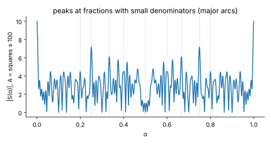

<sub>|S(α)| עבור הריבועים עד 100: פסגות ליד שברים עם מכנה קטן.</sub>

---

## 2. סכומים אקספוננציאליים

**[סכום אקספוננציאלי](../pages/סכום%20אקספוננציאלי.md)** הוא $`S = \sum_{n \in I}e(f(n))`$. החסם הטריוויאלי: $`|S| \le |I|`$. כל חסם טוב יותר — **ביטול** בין האיברים — הוא תוצאה.

**ההיוריסטיקה:** אם הערכים $`f(n) \bmod 1`$ "אקראיים", מצפים ל-$`|S| \approx \sqrt{|I|}`$ (הליכה מקרית). זה בדיוק מה שקורה בסכום גאוס: $`|g| = \sqrt p`$.

### סוגים חשובים
| סכום | הגדרה | ערך/חסם |
|---|---|---|
| סדרה הנדסית | $`\sum_{n=1}^Ne(n\alpha)`$ | $`\le \min\left(N, \frac1{2\lVert\alpha\rVert}\right)`$ |
| סכום גאוס | $`\sum_{x \bmod p}e(x^2/p)`$ | $`\sqrt p`$ בערך מוחלט |
| סכום קרקטרים | $`\sum\chi(n)`$ | פוליה–וינוגרדוב, ברג'ס |
| סכום וייל | $`\sum_{n\le N}e(\alpha n^k)`$ | שיטת וייל |
| סכום קלוסטרמן | $`\sum_x e\!\left(\frac{ax + b\bar x}p\right)`$ | $`\le 2\sqrt p`$ |

($`\|\alpha\|`$ = המרחק מ-$`\alpha`$ לשלם הקרוב; $`\bar x`$ = ההופכי של $`x`$ מודולו $`p`$.)

**הסדרה ההנדסית — הוכחה:** $`\left|\sum_{n=1}^Ne(n\alpha)\right| = \left|\frac{e(N\alpha) - 1}{e(\alpha) - 1}\right| \le \frac{2}{|e(\alpha) - 1|} = \frac{1}{|\sin\pi\alpha|} \le \frac{1}{2\|\alpha\|}`$.

### שיטת וייל (1916): "הפרשים"
**הרעיון:** $`|S|^2 = \sum_{m,n}e(f(m) - f(n))`$. נציב $`m = n + h`$:
```math
|S|^2 = \sum_{|h| < N}\ \sum_n e\big(f(n+h) - f(n)\big).
```
$`f(n + h) - f(n)`$ הוא פולינום ממעלה **נמוכה באחת**. חוזרים $`k - 1`$ פעמים ומגיעים לסדרה הנדסית.

### דוגמה 2: $`f(n) = \alpha n^2`$
1. $`f(n + h) - f(n) = 2\alpha hn + \alpha h^2`$ — ליניארי ב-$`n`$.
2. $`|S|^2 \le \sum_{|h|\lt N}\left|\sum_n e(2\alpha hn)\right| \le \sum_{|h| < N}\min\left(N, \frac{1}{2\|2\alpha h\|}\right)`$.
3. אם $`\alpha`$ קרוב ל-$`a/q`$ עם $`q`$ "בינוני" ($`|\alpha - a/q| \le 1/q^2`$), הערכים $`2\alpha h`$ מתפזרים, ומקבלים $`|S|^2 \ll N\log N\left(\frac Nq + 1 + \frac qN\right)`$.
4. **מסקנה:** עבור $`q`$ בין $`N^\varepsilon`$ ל-$`N^{2-\varepsilon}`$, $`|S| = o(N)`$.

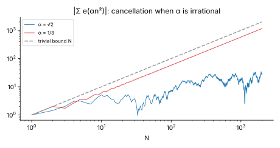

<sub>סכום וייל: ביטול כש־α אי־רציונלי.</sub>

**משפט וייל על פיזור שווה:** אם ל-$`f`$ יש מקדם אי-רציונלי (שאינו קבוע), הסדרה $`f(n) \bmod 1`$ מתפזרת **שווה** ב-$`[0,1)`$. (קריטריון וייל: פיזור שווה ⇔ $`\frac1N\sum e(hf(n)) \to 0`$ לכל $`h \ne 0`$.) למשל $`n^2\sqrt2 \bmod 1`$ מתפזרת שווה.

**שיפורים:** ואן דר קורפוט (נגזרת שנייה), וינוגרדוב (ערכי ממוצע), ו**משפט ערכי הממוצע של וינוגרדוב** שהוכח בשלמותו ב-2016 (וולי; בורגיין–דמטר–גות) — נותן חסמים כמעט אופטימליים לסכומי וייל.

---

## 3. סכומי קלוסטרמן

**[סכום קלוסטרמן](../pages/סכום%20קלוסטרמן.md):**
```math
K(a, b; m) = \sum_{\substack{x \bmod m\\ \gcd(x, m) = 1}}e\!\left(\frac{ax + b\bar x}{m}\right).
```
הסכום **ממשי** (החלפת $`x \to -x`$ מצמידה כל איבר), ו-$`K(a, b; m) = K(1, ab; m)`$ כאשר $`\gcd(a,m) = 1`$.

**משפט 15.1 (חסם וייל, 1948).** עבור $`p`$ ראשוני ו-$`p \nmid ab`$:
```math
|K(a, b; p)| \le 2\sqrt p .
```
ההוכחה משתמשת בהשערת רימן ל**עקומות מעל שדות סופיים** (שוייל הוכיח): $`K = -(\omega + \bar\omega)`$ עבור מספר מרוכב $`\omega`$ עם $`|\omega| = \sqrt p`$.

### דוגמה 3: בדיקה מספרית
| $`p`$ | $`K(1,1;p)`$ | $`2\sqrt p`$ |
|---|---|---|
| 5 | 0.382 | 4.47 |
| 7 | 2.049 | 5.29 |
| 11 | −2.358 | 6.63 |
| 13 | 5.260 | 7.21 |
| 101 | 1.526 | 20.10 |

**חישוב ידני עבור $`p = 5`$:**
1. ההופכיים מודולו 5: $`\bar1 = 1, \bar2 = 3, \bar3 = 2, \bar4 = 4`$.
2. $`x + \bar x`$: $`2, 5, 5, 8`$, כלומר מודולו 5: $`2, 0, 0, 3`$.
3. $`K = e(2/5) + 2 + e(3/5) = 2 + 2\cos(4\pi/5) = 2 - 1.618 = 0.382`$. ✓

**חשיבות:** סכומי קלוסטרמן מופיעים בפיתוח פורייה של תבניות מודולריות, בספירת פתרונות של $`n = x^2 + y^2 + z^2 + w^2`$ עם משקלות, ובבעיות של ראשוניים בסדרות חשבוניות מעבר ל-$`\sqrt x`$ (בומביירי–פרידלנדר–איוואניץ', ג'אנג).

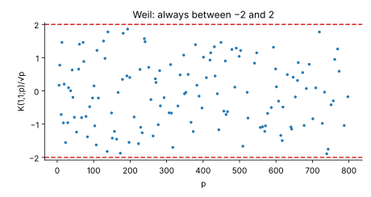

<sub>סכומי קלוסטרמן מנורמלים — תמיד בין 2− ל־2.</sub>

---

## 4. סכומים על ראשוניים: הזהות של ווהן

**הבעיה:** איך מעריכים $`\sum_{n\le N}\Lambda(n)e(n\alpha)`$? אין לנו מבנה פולינומי.

**[הזהות של ווהן](../pages/הזהות%20של%20ווהן.md) (1977).** לכל $`U, V \ge 1`$ ו-$`n > V`$:
```math
\Lambda(n) = \underbrace{\sum_{\substack{bd = n\\ d\le U}}\mu(d)\log b}_{\text{סוג I}}
\;-\; \underbrace{\sum_{\substack{mdr = n\\ m \le V,\ d\le U}}\Lambda(m)\mu(d)}_{\text{סוג I}}
\;-\; \underbrace{\sum_{\substack{mk = n\\ m > V,\ k > 1}}\Lambda(m)\Big(\sum_{\substack{d \mid k\\ d\le U}}\mu(d)\Big)}_{\text{סוג II}} .
```
**מאיפה היא באה:** נסמן $`F(s) = \sum_{m\le V}\Lambda(m)m^{-s}`$ ו-$`G(s) = \sum_{d\le U}\mu(d)d^{-s}`$. אז מתקיימת הזהות האלגברית
```math
-\frac{\zeta'}{\zeta} = F - \zeta FG - \zeta'G + \left(-\frac{\zeta'}{\zeta} - F\right)(1 - \zeta G),
```
(פתחו את הסוגריים ובדקו), ומשווים את המקדם של $`n^{-s}`$ בשני האגפים. (בדקנו את הזהות מספרית לכל $`n \le 400`$ עם $`U = V = 5`$.)

**הרעיון:** $`\Lambda`$ הוא "לא חלק" — אבל הוא מתפרק ל:
* **סכומי סוג I:** $`\sum_{d\le U}a_d\sum_m e(dm\alpha)`$ — הסכום הפנימי **הנדסי**, ונחסם ישירות.
* **סכומי סוג II (בילינאריים):** $`\sum_{d}\sum_m a_db_me(dm\alpha)`$ עם $`d, m`$ שניהם "בינוניים" — נחסמים בעזרת קושי–שוורץ, שמחזיר אותנו לסדרות הנדסיות.

**משפט 15.2 (וינוגרדוב, 1937; עם ווהן).** אם $`|\alpha - a/q| \le 1/q^2`$, אז
```math
\sum_{n\le N}\Lambda(n)e(n\alpha) \ll \left(\frac{N}{\sqrt q} + N^{4/5} + \sqrt{Nq}\right)\log^4N .
```
כלומר כש-$`\alpha`$ "רחוק" משברים עם מכנה קטן, יש ביטול.

---

## 5. שיטת המעגל

**[שיטת המעגל של הארדי וליטלווד](../pages/שיטת%20המעגל%20של%20הארדי%20וליטלווד.md)** (1920; במקור עם רמנוג'אן, לספירת חלוקות).

**ההתחלה:** כמו בדוגמה 1, $`r(n) = \int_0^1S(\alpha)^se(-n\alpha)\,d\alpha`$.

**הפירוק:** מחלקים את $`[0,1)`$ ל:
* **קשתות ראשיות (major arcs) $`\mathfrak M`$:** סביבות קטנות של שברים $`a/q`$ עם $`q`$ קטן. שם $`S(\alpha)`$ גדול, ומתנהג כמו $`\frac{S(q,a)}{q}\cdot\int e(\beta t^k)dt`$ — סכום גאוס כפול אינטגרל. התרומה נותנת את **האיבר הראשי**.
* **קשתות משניות (minor arcs) $`\mathfrak m`$:** כל השאר. שם משתמשים בחסם וייל/וינוגרדוב כדי להראות שהתרומה **קטנה**.

**התוצאה הטיפוסית:**
```math
r(n) = \mathfrak S(n)\cdot J(n) + o(J(n)),
```
כאשר $`J(n)`$ הוא ה"צפי הרציף" (נפח), ו-$`\mathfrak S(n) = \sum_{q}\sum_{a}\left(\frac{S(q,a)}q\right)^se(-an/q)`$ — **הטור הסינגולרי** — הוא מכפלה של "צפיפויות מקומיות" מודולו כל ראשוני: $`\mathfrak S(n) = \prod_p\sigma_p(n)`$. הוא אפס בדיוק כשיש **מכשול מקומי** (חפיפה שאין לה פתרון). כאן מופיעים [סכומי רמנוג'אן](../pages/סכום%20רמנוג'אן.md): עבור ראשוניים, $`\frac{S(q,a)}q = \frac{\mu(q)}{\varphi(q)}`$.

---

## 6. בעיית וארינג

**[בעיית וארינג](https://he.wikipedia.org/wiki/%D7%91%D7%A2%D7%99%D7%99%D7%AA_%D7%95%D7%90%D7%A8%D7%99%D7%A0%D7%92) (1770):** לכל $`k`$, האם יש $`s`$ כך שכל מספר טבעי הוא סכום של $`s`$ חזקות $`k`$-יות?

* $`g(k)`$ — ה-$`s`$ הקטן ביותר שעובד **לכל** $`n`$.
* $`G(k)`$ — ה-$`s`$ הקטן ביותר שעובד לכל $`n`$ **גדול מספיק**.

| $`k`$ | $`g(k)`$ | $`G(k)`$ |
|---|---|---|
| 2 | 4 (לגראנז', [שיעור 8](08-משוואות-דיופנטיות.md)) | 4 |
| 3 | 9 | בין 4 ל-7 |
| 4 | 19 | 16 |

**הילברט (1909)** הוכיח ש-$`g(k)`$ סופי. **הארדי–ליטלווד** הוכיחו בשיטת המעגל נוסחה אסימפטוטית ל-$`r_{s,k}(n)`$ עבור $`s`$ גדול מספיק.

**מספרים "פאוניים" במקום חזקות.** פולוק שיער (1850) גרסאות של וארינג למספרים צורניים תלת-ממדיים — **[השערות פולוק](../pages/השערות%20פולוק.md)**. למשל, כל מספר הוא סכום של 5 מספרים טטרהדרליים $`T_n = \frac{n(n+1)(n+2)}6`$ (1, 4, 10, 20, 35, ...) לכל היותר: $`17 = 10 + 4 + 1 + 1 + 1`$ צריך חמישה. רק 241 מספרים ידועים צריכים חמישה, והגדול שבהם הוא כנראה 343,867. ההשערה הזו עדיין פתוחה; גרסת המעוקבים ($`g(3) = 9`$) הוכחה, וגרסאות האיקוסהדרליים, הדודקהדרליים והתשעוניים המרכזיים הוכחו לאחרונה (2023–2025).

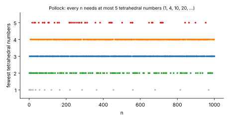

<sub>מספר המספרים הטטרהדרליים המזערי הנדרש לכל n עד 1000: רק מעטים (באדום, החל מ־17, 27, 33, 52, 73) צריכים חמישה.</sub>

### דוגמה 4: למה $`g(3) \ge 9`$
1. הקוביות הקטנות מ-23: 1 ו-8 בלבד.
2. $`23 = 8 + 8 + 1 + 1 + 1 + 1 + 1 + 1 + 1`$: שתי שמיניות ושבע אחדות = **9** קוביות.
3. אי אפשר בפחות: עם שלוש שמיניות כבר 24 > 23; עם $`j \le 2`$ שמיניות צריך $`23 - 8j`$ אחדות, וסך הכול $`23 - 7j \ge 9`$.
4. רק 23 ו-239 צריכים 9 קוביות; כל מספר אחר מסתפק ב-8.

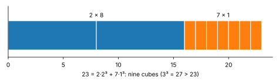

<sub>23 כסכום של תשע קוביות.</sub>

### דוגמה 5: הנוסחה הכללית לחסם התחתון על $`g(k)`$
נתבונן ב-$`n = 2^k\lfloor(3/2)^k\rfloor - 1 < 3^k`$. הוא חייב להשתמש רק ב-$`1^k`$ וב-$`2^k`$; הדרך החסכונית: $`\lfloor(3/2)^k\rfloor - 1`$ פעמים $`2^k`$ ו-$`2^k - 1`$ אחדות. לכן
```math
g(k) \ge 2^k + \lfloor(3/2)^k\rfloor - 2 .
```
עבור $`k = 3`$: $`8 + 3 - 2 = 9`$ ($`n = 8\cdot3 - 1 = 23`$ ✓). עבור $`k = 4`$: $`16 + 5 - 2 = 19`$ ($`n = 79`$). ידוע שזה **שוויון** לכל $`k`$ שעבורו $`\{(3/2)^k\}`$ אינו קרוב מדי ל-1 (ובדיקה ממוחשבת מראה שאין חריג עד $`k`$ ענק).

**$`G(k)`$ קשה בהרבה:** מודולו 16 מראים ש-$`G(4) \ge 16`$ (חזקות רביעיות הן 0 או 1 מודולו 16, ולכן $`31 \cdot 16^m`$ צריך 16), ודבנפורט הוכיח $`G(4) = 16`$. עבור $`k`$ גדול, וולי: $`G(k) \le k\log k + O(k\log\log k)`$.

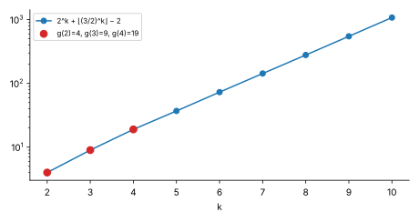

<sub>החסם התחתון על g(k).</sub>

---

## 7. השערת גולדבך

**[השערת גולדבך](https://he.wikipedia.org/wiki/%D7%94%D7%A9%D7%A2%D7%A8%D7%AA_%D7%92%D7%95%D7%9C%D7%93%D7%91%D7%9A) (1742):**
* **הבינארית (החזקה):** כל מספר זוגי גדול מ-2 הוא סכום של שני ראשוניים. **פתוחה.** נבדקה עד $`4 \cdot 10^{18}`$.
* **הטרנרית (החלשה):** כל מספר אי-זוגי גדול מ-5 הוא סכום של שלושה ראשוניים. **הוכחה**: וינוגרדוב (1937) לכל $`n`$ גדול מספיק; **הלפגוט (2013)** — לכל $`n`$.

**ראשוני ועוד חזקה של 2.** דה פוליניאק שיער (1849) שכל מספר אי-זוגי הוא סכום של ראשוני ושל חזקה של 2, אבל זה נכשל כבר ב-127: $`127 - 2^k`$ עבור $`k = 1, \dots, 6`$ הם $`125, 123, 119, 111, 95, 63`$, וכולם פריקים. **[משפט רומנוב](../pages/משפט%20רומנוב.md)** (1934) אומר שבכל זאת חלק **חיובי** מהמספרים הם מהצורה $`p + 2^k`$, וארדש הראה שגם חלק חיובי מהמספרים האי-זוגיים **אינם** מהצורה הזו.

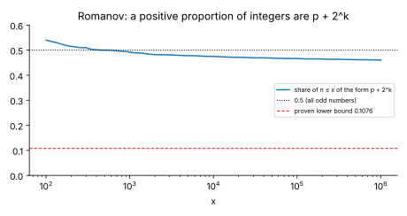

<sub>השיעור של המספרים עד x מהצורה p+2^k: יורד לאט מעל 0.45, הרבה מעל החסם המוכח.</sub>

### דוגמה 6: מספר ההצגות כסכום שני ראשוניים
| $`n`$ | 4 | 10 | 28 | 100 | 1000 |
|---|---|---|---|---|---|
| זוגות $`p \le q`$ | 1 | 2 | 2 | 6 | 28 |

(למשל $`100 = 3 + 97 = 11 + 89 = 17 + 83 = 29 + 71 = 41 + 59 = 47 + 53`$.)

**שיטת המעגל לשלושה ראשוניים, שלב אחר שלב.**
1. $`S(\alpha) = \sum_{p\le N}(\log p)e(p\alpha)`$, ו-$`R_3(N) = \sum_{p_1+p_2+p_3 = N}\log p_1\log p_2\log p_3 = \int_0^1S(\alpha)^3e(-N\alpha)d\alpha`$.
2. **קשתות ראשיות:** ליד $`a/q`$, לפי זיגל–ולפיש, $`S(a/q + \beta) \approx \frac{\mu(q)}{\varphi(q)}\sum_{n\le N}e(n\beta)`$. התרומה: $`\mathfrak S(N)\frac{N^2}{2}`$, עם
```math
\mathfrak S(N) = \prod_{p \mid N}\left(1 - \frac1{(p-1)^2}\right)\prod_{p\nmid N}\left(1 + \frac1{(p-1)^3}\right).
```
עבור $`N`$ אי-זוגי, $`\mathfrak S(N) \ge 0.66`$ — חיובי. (עבור $`N`$ זוגי, הגורם של $`p = 2`$ הוא 0: אין מכשול מקומי ב-3 ראשוניים אי-זוגיים לסכום אי-זוגי, אבל יש לסכום זוגי.)
3. **קשתות משניות:** $`\int_{\mathfrak m}|S|^3 \le \max_{\mathfrak m}|S|\cdot\int_0^1|S|^2 = \max_{\mathfrak m}|S|\cdot O(N\log N)`$ (פרסבל). לפי וינוגרדוב, $`\max_{\mathfrak m}|S| \ll N/\log^AN`$. לכן התרומה $`o(N^2)`$.
4. $`R_3(N) \sim \mathfrak S(N)\frac{N^2}2 > 0`$ לכל $`N`$ אי-זוגי גדול. ∎

**למה זה לא עובד לשני ראשוניים?** עם $`S^2`$, הקשתות המשניות נחסמות על ידי $`\int|S|^2 \approx N\log N`$ — **באותו גודל** כמו האיבר הראשי $`\approx N`$. אין מקום לשגיאה. זו עוד גרסה של מכשול הזוגיות. **מה שכן ידוע:** כמעט כל מספר זוגי הוא סכום של שני ראשוניים (הקבוצה החריגה בצפיפות 0); וצ'ן: $`p + P_2`$ ([שיעור 14](14-תורת-הנפה.md)).

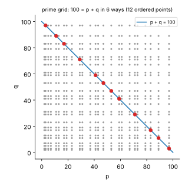

<sub>ההצגות של 100 כסכום שני ראשוניים, על רשת הראשוניים.</sub>

---

## 8. תרגילים

**תרגיל 1.** חשבו $`K(1, 1; 7)`$ ביד.

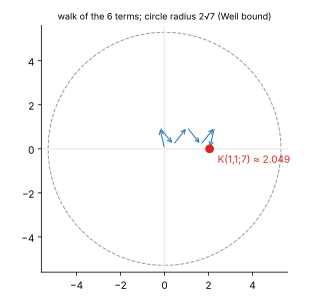

<sub>ששת האיברים של K(1,1;7) כהליכה במישור המרוכב, בתוך מעגל ברדיוס 2√7.</sub>

<details><summary>פתרון</summary>

הופכיים מודולו 7: $`\bar1 = 1, \bar2 = 4, \bar3 = 5, \bar4 = 2, \bar5 = 3, \bar6 = 6`$. $`x + \bar x`$: $`2, 6, 8, 6, 8, 12`$, מודולו 7: $`2, 6, 1, 6, 1, 5`$. לכן $`e(1/7)`$ ו-$`e(6/7)`$ מופיעים פעמיים כל אחד, ו-$`e(2/7)`$, $`e(5/7)`$ פעם אחת. $`K = 2(e(1/7) + e(6/7)) + e(2/7) + e(5/7) = 4\cos\frac{2\pi}7 + 2\cos\frac{4\pi}7 = 2.494 - 0.445 = 2.049`$. ✓
</details>

**תרגיל 2.** הוכיחו ש-$`\int_0^1\left|\sum_{n\le N}a_ne(n\alpha)\right|^2d\alpha = \sum|a_n|^2`$ (פרסבל).

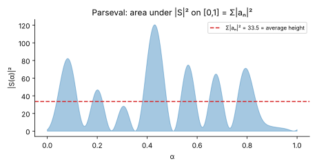

<sub>זהות פרסבל: השטח מתחת ל־|S(α)|² שווה ל־Σ|aₙ|².</sub>

<details><summary>פתרון</summary>

פותחים את הריבוע: $`\sum_{m,n}a_m\bar a_n\int_0^1e((m-n)\alpha)d\alpha`$, ולפי האורתוגונליות רק $`m = n`$ שורד.
</details>

**תרגיל 3.** הראו ש-$`79`$ צריך 19 חזקות רביעיות.

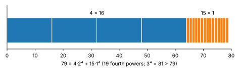

<sub>79 = 4·16 + 15·1 — תשע־עשרה חזקות רביעיות.</sub>

<details><summary>פתרון</summary>

החזקות הרביעיות עד 79: 1 ו-16 (כי $`3^4 = 81`$). $`79 = 4\cdot16 + 15 \cdot 1`$: 19 איברים. עם $`j \le 4`$ פעמים 16, צריך $`79 - 16j`$ אחדות, וסך $`79 - 15j \ge 19`$.
</details>

**תרגיל 4.** הסבירו למה $`\mathfrak S(N) = 0`$ ל-$`N`$ זוגי בבעיית שלושת הראשוניים, ומה זה אומר.

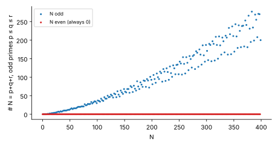

<sub>מספר ההצגות כסכום שלושה ראשוניים אי־זוגיים: אפס לכל N זוגי.</sub>

<details><summary>פתרון</summary>

מודולו 2: ראשוניים אי-זוגיים הם 1, וסכום שלושה הוא 1 — לא 0. לכן אין פתרונות עם ראשוניים אי-זוגיים בלבד (חייב להיות $`2 + p + q`$, ואלה מעטים מדי כדי להופיע באיבר הראשי).
</details>

**תרגיל 5.** מצאו את כל ההצגות של 60 כסכום שני ראשוניים.

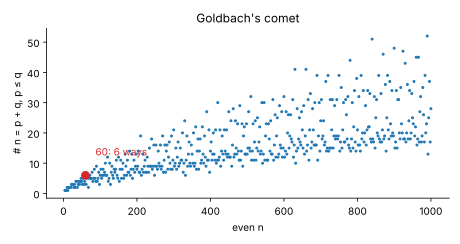

<sub>"השביט של גולדבך": מספר ההצגות של n זוגי כסכום שני ראשוניים.</sub>

<details><summary>פתרון</summary>

$`7 + 53, 13 + 47, 17 + 43, 19 + 41, 23 + 37, 29 + 31`$ — שש הצגות.
</details>

**תרגיל 6 ([בסיסים אדיטיביים](../pages/בסיס%20אדיטיבי.md)).** קבוצה $`B \subseteq \mathbb{N}`$ היא **בסיס מסדר 2** אם כל $`n`$ גדול מספיק הוא סכום של שני איברים של $`B`$; נסמן $`r_B(n) = \#\{(a, b) \in B^2 : a + b = n\}`$. (א) הוכיחו שאם $`B`$ בסיס מסדר 2 אז $`|B \cap [1, n]| \ge c\sqrt n`$ לקבוע $`c > 0`$ כלשהו. (ב) הריבועים אינם בסיס מסדר 2 — למה? (ג) [השערת ארדש–טוראן](../pages/השערת%20ארדש-טוראן%20על%20בסיסים%20אדיטיביים.md) אומרת ש-$`r_B(n)`$ אינו חסום לכל בסיס מסדר 2, ו[משפט ארדש–טטלי](../pages/משפט%20ארדש-טטלי.md) מראה שאפשר להגיע ל-$`r_B(n) \asymp \log n`$. הסבירו בעזרת חישוב תוחלת למה בחירה אקראית של $`m \in B`$ בהסתברות $`p_m \approx C\sqrt{\log m / m}`$ נותנת $`\mathbb E\, r_B(n) \asymp \log n`$.

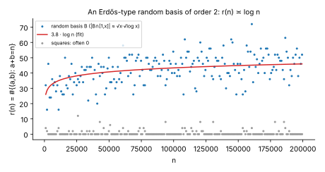

<sub>בסיס אקראי בסגנון ארדש: r(n) מתנהג כמו קבוע כפול log n ולעולם אינו מתאפס, לעומת הריבועים, שבהם r(n) מתאפס לעיתים קרובות.</sub>

<details><summary>פתרון</summary>

(א) יהי $`k = |B \cap [1, n]|`$. כל $`m \le n`$ שמוצג כ-$`a + b`$ משתמש ב-$`a, b \in B \cap [1, n]`$ (או באפס, אם $`0 \in B`$), ויש לכל היותר $`(k+1)^2`$ זוגות כאלה. לכן $`(k + 1)^2 \ge n - n_0`$, כלומר $`k \ge \sqrt{n - n_0} - 1 \ge c\sqrt n`$.

(ב) סכום של שני ריבועים מקיים את תנאי משפט 8.4 (ראשוני $`q \equiv 3 \pmod 4`$ בחזקה זוגית). כל $`n \equiv 3 \pmod 4`$ נכשל — יש אינסוף כאלה. (בגרף: ה-$`r(n)`$ של הריבועים מתאפס שוב ושוב.)

(ג) $`\mathbb E\, r_B(n) = \sum_{a + b = n} p_a p_b \approx C^2 \sum_{a=1}^{n-1}\sqrt{\frac{\log a \cdot \log(n-a)}{a(n-a)}}`$. רוב התרומה באה מ-$`a`$ ו-$`n - a`$ מסדר גודל $`n`$, ושם $`\log a \approx \log(n-a) \approx \log n`$, ולכן $`\mathbb E\, r_B(n) \approx C^2 \log n \int_0^1 \frac{dt}{\sqrt{t(1-t)}} = \pi C^2 \log n`$. החזקות של $`n`$ מתבטלות ונשאר הלוגריתם. החלק הקשה בהוכחה הוא להראות שכמעט בוודאות $`r_B(n)`$ קרוב לתוחלת **לכל** $`n`$ גדול בבת אחת; לוגריתם הוא בדיוק הגודל שבו אי-שוויונות ריכוז מספיקים. (ההסתברות ש-$`r_B(n)`$ מסוים רחוק מהתוחלת שלו היא בערך $`e^{-c\log n} = n^{-c}`$, וכשהקבוע $`C`$ גדול זה סכים על $`n`$.)
</details>

**תרגיל 7 ([משפט הערך הממוצע של וינוגרדוב](../pages/משפט%20הערך%20הממוצע%20של%20וינוגרדוב.md)).** יהי $`J_{s,k}(X)`$ מספר הפתרונות של $`x_1^j + \dots + x_s^j = y_1^j + \dots + y_s^j`$ לכל $`1 \le j \le k`$, עם $`1 \le x_i, y_i \le X`$. (א) הוכיחו ש-$`J_{s,k}(X) = \int_{[0,1)^k}\left|\sum_{x \le X} e(\alpha_1 x + \dots + \alpha_k x^k)\right|^{2s} d\boldsymbol\alpha`$. (ב) חשבו את $`J_{2,2}(X)`$ במדויק. (ג) הסבירו את החסם התחתון $`J_{s,k}(X) \gg X^s + X^{2s - k(k+1)/2}`$; ההשערה המרכזית (שהוכחה ב-2016 על ידי בורגן–דמטר–גות') אומרת שזה כמעט גם חסם עליון.

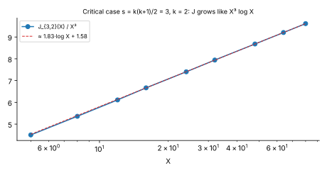

<sub>במקרה הקריטי s=3, k=2 (שבו שני האיברים בחסם שווים) J/X³ גדל כמו log X.</sub>

<details><summary>פתרון</summary>

(א) $`|f|^{2s} = f^s\bar f^s = \sum_{\mathbf x, \mathbf y} e\left(\sum_j \alpha_j\left(\sum_i x_i^j - \sum_i y_i^j\right)\right)`$. האינטגרל על $`\alpha_j \in [0,1)`$ של $`e(\alpha_j m_j)`$ הוא 1 אם $`m_j = 0`$ ו-0 אחרת (סעיף 1). לכן נשארים בדיוק הזוגות $`(\mathbf x, \mathbf y)`$ שבהם כל $`k`$ ההפרשים מתאפסים.

(ב) $`x_1 + x_2 = y_1 + y_2`$ ו-$`x_1^2 + x_2^2 = y_1^2 + y_2^2`$ נותנים גם $`x_1x_2 = y_1y_2`$ (כי $`(x_1+x_2)^2 - (x_1^2 + x_2^2) = 2x_1x_2`$). לכן $`\{x_1, x_2\}`$ ו-$`\{y_1, y_2\}`$ הם שורשי אותו פולינום ריבועי, כלומר $`(y_1, y_2)`$ הוא $`(x_1, x_2)`$ או $`(x_2, x_1)`$. לכל אחד מ-$`X^2`$ הזוגות יש שני פתרונות, פרט ל-$`X`$ הזוגות עם $`x_1 = x_2`$ שבהם יש אחד: $`J_{2,2}(X) = 2X^2 - X`$. (בדיקה: $`X = 10`$ נותן 190.)

(ג) הפתרונות $`\mathbf y = \mathbf x`$ נותנים $`X^s`$. לחסם השני: לכל $`\mathbf x`$ נסמן $`\mathbf v(\mathbf x) = (\sum x_i, \sum x_i^2, \dots, \sum x_i^k)`$, ויהי $`N(\mathbf v)`$ מספר ה-$`\mathbf x`$ עם ערך $`\mathbf v`$. אז $`J_{s,k} = \sum_{\mathbf v} N(\mathbf v)^2`$ ו-$`\sum_{\mathbf v} N(\mathbf v) = X^s`$. הרכיב ה-$`j`$-י של $`\mathbf v`$ נע בין $`s`$ ל-$`sX^j`$, ולכן יש לכל היותר $`\prod_j sX^j = s^kX^{k(k+1)/2}`$ ערכים אפשריים. לפי קושי–שוורץ, $`J_{s,k} \ge \frac{(X^s)^2}{s^kX^{k(k+1)/2}} \gg X^{2s - k(k+1)/2}`$. כאשר $`s = k(k+1)/2`$ שני האיברים שווים, ואז מופיע גם לוגריתם — כמו בגרף.
</details>

---

## סיכום
* $`\int_0^1e(m\alpha)d\alpha = [m = 0]`$ הופך ספירה לאינטגרל של סכום אקספוננציאלי.
* וייל: הפרשים מורידים מעלה; ביטול כש-$`\alpha`$ "אי-רציונלי".
* קלוסטרמן: $`|K| \le 2\sqrt p`$ (וייל, דרך גאומטריה אלגברית).
* ווהן: $`\Lambda`$ = סוג I + סוג II ⇒ ביטול בסכומים על ראשוניים.
* שיטת המעגל: קשתות ראשיות ⇒ טור סינגולרי × נפח; משניות ⇒ שגיאה. פותרת את וארינג ואת גולדבך הטרנרי; גולדבך הבינארי עדיין פתוח.

**השיעור הקודם:** [שיעור 14](14-תורת-הנפה.md) · **השיעור הבא:** [שיעור 16: השערות פתוחות על מספרים ראשוניים](16-השערות-על-ראשוניים.md)

**להעמקה:** [סכום אקספוננציאלי](../pages/סכום%20אקספוננציאלי.md) · [סכום קלוסטרמן](../pages/סכום%20קלוסטרמן.md) · [השיטה של טוראן](../pages/השיטה%20של%20טוראן.md) · [משפט רומנוב](../pages/משפט%20רומנוב.md) · [בעיית בולי הדואר](../pages/בעיית%20בולי%20הדואר.md) · [בסיס אדיטיבי](../pages/בסיס%20אדיטיבי.md) · [השערת ארדש–טוראן](../pages/השערת%20ארדש-טוראן%20על%20בסיסים%20אדיטיביים.md) · [משפט ארדש–טטלי](../pages/משפט%20ארדש-טטלי.md) · [השערות פולוק](../pages/השערות%20פולוק.md) · [משפט הערך הממוצע של וינוגרדוב](../pages/משפט%20הערך%20הממוצע%20של%20וינוגרדוב.md) · [סכום של שלושה מעוקבים](../pages/סכום%20של%20שלושה%20מעוקבים.md) · [הזהות של ווהן](../pages/הזהות%20של%20ווהן.md) · [שיטת המעגל](../pages/שיטת%20המעגל%20של%20הארדי%20וליטלווד.md) · [בעיית וארינג](https://he.wikipedia.org/wiki/%D7%91%D7%A2%D7%99%D7%99%D7%AA_%D7%95%D7%90%D7%A8%D7%99%D7%A0%D7%92) · [השערת גולדבך](https://he.wikipedia.org/wiki/%D7%94%D7%A9%D7%A2%D7%A8%D7%AA_%D7%92%D7%95%D7%9C%D7%93%D7%91%D7%9A) · [השערות וייל](../pages/השערות%20וייל.md) · [הלמה של הואה](../pages/הלמה%20של%20הואה.md) · [משפט בירץ'](../pages/משפט%20בירץ'.md) · [סכום קבוצות מוגבל](../pages/סכום%20קבוצות%20מוגבל.md) · [משפט פולקמן](../pages/משפט%20פולקמן.md) · [בעיית החפיפה המינימלית](../pages/בעיית%20החפיפה%20המינימלית.md) · [קבוצה ללא הפרשים ריבועיים](../pages/קבוצה%20ללא%20הפרשים%20ריבועיים.md) · [השערת קמרון–ארדש](../pages/השערת%20קמרון–ארדש.md) · [קומבינטוריקה אריתמטית](../pages/קומבינטוריקה%20אריתמטית.md) · [נוסחת העקבה של פטרסון](../pages/נוסחת%20העקבה%20של%20פטרסון.md) · [נוסחת העקבה של קוזנצוב](../pages/נוסחת%20העקבה%20של%20קוזנצוב.md) · [אופרטור הקה](../pages/אופרטור%20הקה.md) · [העקום המודולרי הקלאסי](../pages/העקום%20המודולרי%20הקלאסי.md)

---
<sub>חלק מהקורס [תורת המספרים בעברית](../COURSE.md). התוכן מופץ ברישיון [CC BY-SA 4.0](https://creativecommons.org/licenses/by-sa/4.0/).</sub>
