# שיעור 16: השערות פתוחות על מספרים ראשוניים

**מה נלמד:** את ההשערות הגדולות על **תבניות** של ראשוניים — ראשוניים תאומים, ראשוניים בפולינומים, פערים בין ראשוניים — ואת המסגרת הכמותית שמסבירה את כולן: ההשערות של הארדי–ליטלווד ובייטמן–הורן. נראה מה **כן** הוכח (ג'אנג ומיינרד על פערים חסומים, גרין–טאו על סדרות חשבוניות), ואיך הכלים מהשיעורים הקודמים (נפה, שיטת המעגל) מגיעים עד הגבול הזה ולא מעבר לו.

**ידע קודם:** [שיעור 12](12-משפט-המספרים-הראשוניים.md) (PNT), [שיעור 14](14-תורת-הנפה.md) (נפה, בעיית הזוגיות), [שיעור 15](15-סכומים-אקספוננציאליים.md) (טור סינגולרי).

---

## 1. המודל ההסתברותי וה"מכשולים המקומיים"

**המודל של קרמר:** נתייחס לכל $`n`$ כ"ראשוני" בהסתברות $`1/\log n`$, באופן בלתי תלוי. המודל מנבא נכון את PNT, אבל טועה בדבר פשוט: הוא מנבא ש-$`n`$ ו-$`n+1`$ שניהם ראשוניים בהסתברות $`1/\log^2n`$, כשבפועל זה קורה רק פעם אחת (2, 3).

**התיקון:** צריך להתחשב ב**מכשולים מקומיים** — ההתנהגות מודולו כל ראשוני קטן. מודל מתוקן: ההסתברות שתבנית מסוימת מופיעה היא (ההסתברות הנאיבית) × (גורם תיקון לכל ראשוני $`p`$). הגורם לכל $`p`$:
```math
\frac{\text{ההסתברות האמיתית שאף איבר לא מתחלק ב-}p}{\text{ההסתברות במודל הבלתי תלוי}} = \frac{1 - w(p)/p}{(1 - 1/p)^k},
```
כאשר $`w(p)`$ הוא מספר מחלקות השאריות שמוחקים (כמו בנפה!) ו-$`k`$ מספר האיברים בתבנית.

**גם המודל המתוקן אינו מושלם: [משפט מאייר](../pages/משפט%20מאייר.md) (1985).** לפי קרמר, בקטע $`(x, x + (\log x)^\lambda]`$ צפויים בערך $`(\log x)^{\lambda - 1}`$ ראשוניים, ועבור $`\lambda \ge 2`$ המודל מנבא שהיחס בין המספר בפועל לצפוי שואף ל-1. מאייר הוכיח שליחס הזה **אין גבול**: הגבול העליון גדול מ-1 והתחתון קטן מ-1. ההסבר: אם בוחרים $`x`$ שמתחלק במכפלת הראשוניים הקטנים (פרימוריאל), הקטע אחריו "נקי" ממכפלות של ראשוניים קטנים בצורה לא אקראית, וזה משנה את מספר הראשוניים בו.

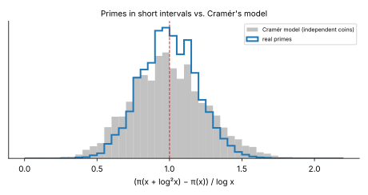

<sub>התפלגות מספר הראשוניים בקטעים באורך log²x, בפועל ולפי מודל קרמר: הראשוניים האמיתיים מפוזרים אחרת מהמודל.</sub>

---

## 2. ראשוניים תאומים והשערת פוליניאק

**[ראשוניים תאומים](https://he.wikipedia.org/wiki/%D7%A8%D7%90%D7%A9%D7%95%D7%A0%D7%99%D7%99%D7%9D_%D7%AA%D7%90%D7%95%D7%9E%D7%99%D7%9D):** זוגות $`(p, p+2)`$ ששניהם ראשוניים: (3,5), (5,7), (11,13), (17,19), (29,31), ... **השערה:** יש אינסוף.

**[השערת פוליניאק](../pages/השערת%20פוליניאק.md) (1849):** לכל $`k`$ זוגי, יש אינסוף ראשוניים עוקבים $`p_n, p_{n+1}`$ עם $`p_{n+1} - p_n = k`$.

### דוגמה 1: הקבוע של ראשוניים תאומים
1. התבנית $`(n, n+2)`$, $`k = 2`$.
2. $`p = 2`$: מוחקים רק $`n \equiv 0`$ (כי $`n+2 \equiv n`$), $`w(2) = 1`$. הגורם: $`\frac{1 - 1/2}{(1/2)^2} = 2`$.
3. $`p > 2`$: מוחקים $`n \equiv 0`$ ו-$`n \equiv -2`$, $`w(p) = 2`$. הגורם: $`\frac{1 - 2/p}{(1 - 1/p)^2} = \frac{p(p-2)}{(p-1)^2}`$.
4. הצפי:
```math
\pi_2(x) \sim 2C_2\int_2^x\frac{dt}{\log^2t}, \qquad C_2 = \prod_{p > 2}\frac{p(p-2)}{(p-1)^2} = 0.66016\ldots
```
5. **בדיקה:** עד $`10^6`$ יש 8169 זוגות; הצפי 8248. ✓

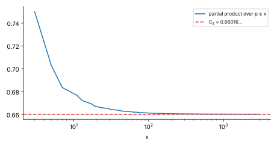

<sub>המכפלה החלקית שמגדירה את קבוע הראשוניים התאומים C₂.</sub>

### דוגמה 2: פערים של 6 שכיחים פי 2 מפערים של 2
עבור $`(n, n+6)`$: מודולו 3, $`n + 6 \equiv n`$, כך שמוחקים רק **מחלקה אחת** ($`w(3) = 1`$ במקום 2). הגורם של $`p = 3`$ גדל מ-$`\frac{3\cdot1}{4}`$ ל-$`\frac{1 - 1/3}{(2/3)^2} = \frac32`$ — פי 2. **בדיקה:** עד $`10^6`$ יש 16,386 זוגות $`(p, p+6)`$ (לא בהכרח עוקבים) לעומת 8,169 זוגות תאומים. ✓ (באופן כללי, הקבוע של פער $`h`$ הוא $`2C_2\prod_{p\mid h, p>2}\frac{p-1}{p-2}`$.)

**[ההשערה הראשונה של הארדי–ליטלווד](../pages/השערת%20הארדי-ליטלווד%20הראשונה.md)** (1923) מכלילה זאת לכל $`k`$-יה: מספר ה-$`n \le x`$ שעבורם $`n + h_1, \dots, n + h_k`$ כולם ראשוניים הוא
```math
\sim \mathfrak S(H)\int_2^x\frac{dt}{\log^kt}, \qquad \mathfrak S(H) = \prod_p\frac{1 - w_H(p)/p}{(1 - 1/p)^k}.
```

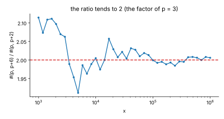

<sub>היחס בין מספר הזוגות (p, p+6) ל־(p, p+2) שואף ל־2.</sub>

---

## 3. מה הוכח: פערים חסומים

**ג'אנג (2013):** $`\liminf(p_{n+1} - p_n) < 70{,}000{,}000`$. כלומר יש **מספר סופי** $`h`$ שעבורו יש אינסוף זוגות ראשוניים במרחק $`h`$.

**מיינרד וטאו (2013, בנפרד):** שיטה פשוטה יותר (גרסה משוקללת רב-ממדית של נפת סלברג), שנותנת: לכל $`m`$, יש אינסוף $`n`$ כך שבקטע $`[n, n + C_m]`$ יש לפחות $`m`$ ראשוניים. פרויקט Polymath8 הוריד את החסם ל-**246**. תחת השערת אליוט–הלברשטם — 12, ותחת גרסה מוכללת שלה — 6.

**למה לא 2?** בעיית הזוגיות ([שיעור 14](14-תורת-הנפה.md)) חוסמת את הנפות מלהגיע לשני ראשוניים בדיוק בתבנית נתונה.

---

## 4. השערת דיקסון ותבניות קבילות

**תבנית קבילה:** $`k`$-יה $`(h_1, \dots, h_k)`$ היא **קבילה** אם לכל ראשוני $`p`$ היא **לא** מכסה את כל המחלקות מודולו $`p`$ (כלומר $`w(p) < p`$). אחרת, אחד מהאיברים תמיד מתחלק ב-$`p`$.

**[השערת דיקסון](../pages/השערת%20דיקסון.md) (1904):** אם $`a_i n + b_i`$ ($`i = 1..k`$) הם פולינומים ליניאריים עם $`a_i \ge 1`$, ואין ראשוני שמחלק את המכפלה $`\prod(a_in + b_i)`$ לכל $`n`$, אז יש אינסוף $`n`$ שבהם כולם ראשוניים בו-זמנית.

### דוגמה 3: $`(0, 2, 4)`$ אינה קבילה
1. מודולו 3: $`n, n+2, n+4 \equiv n, n+2, n+1`$ — כל שלוש המחלקות.
2. לכן אחד משלושת המספרים מתחלק ב-3, ושלושה ראשוניים בתבנית הזו אפשריים רק אם אחד מהם הוא 3 עצמו: $`(3, 5, 7)`$ — הדוגמה היחידה.
3. לעומת זאת $`(0, 2, 6)`$ ו-$`(0, 4, 6)`$ קבילות (מודולו 3: $`\{0, 2, 0\}`$ ו-$`\{0, 1, 0\}`$). עד $`10^6`$: 1393 שלשות $`(p, p+2, p+6)`$ ו-1444 שלשות $`(p, p+4, p+6)`$.

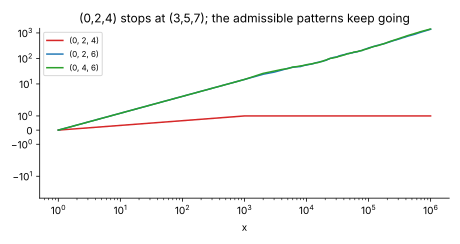

<sub>שלשות (0,2,4) נעצרות; התבניות הקבילות ממשיכות.</sub>

---

## 5. ראשוניים בפולינומים

**[השערת בוניאקובסקי](../pages/השערת%20בוניאקובסקי.md) (1857):** פולינום $`f(x) \in \mathbb Z[x]`$ אי-פריק עם מקדם מוביל חיובי, שערכיו $`f(1), f(2), \dots`$ אינם בעלי מחלק משותף גדול מ-1, מקבל **אינסוף** ערכים ראשוניים.

**שלושת התנאים — כל אחד הכרחי:**
1. **אי-פריק:** $`x^2 - 1 = (x-1)(x+1)`$ ראשוני רק כש-$`x = 2`$.
2. **מקדם מוביל חיובי:** אחרת הערכים שליליים.
3. **בלי מחלק משותף קבוע:** $`x^2 + x + 2 = x(x+1) + 2`$ תמיד זוגי (מכפלת עוקבים זוגית), ולכן ראשוני רק כשהוא 2.

**המקרה היחיד שהוכח:** מעלה 1 — זה משפט דיריכלה ([שיעור 13](13-קרקטרים-ופונקציות-L.md)). כבר עבור $`x^2 + 1`$ (אחת מ**בעיות לנדאו** מ-1912) הבעיה פתוחה. מה שידוע: איוואניץ' (1978) — אינסוף $`n`$ שבהם $`n^2 + 1`$ הוא $`P_2`$; פרידלנדר–איוואניץ' (1998) — אינסוף ראשוניים מהצורה $`a^2 + b^4`$.

**[השערה H של שינצל](../pages/השערה%20H%20של%20שינצל.md) (1958):** הכללה משותפת לדיקסון ולבוניאקובסקי — כמה פולינומים אי-פריקים $`f_1, \dots, f_k`$ מקבלים ערכים ראשוניים **בו-זמנית** אינסוף פעמים, אם אין ראשוני שמחלק את $`f_1(n)\cdots f_k(n)`$ לכל $`n`$.

**[השערת בייטמן–הורן](../pages/השערת%20בייטמן-הורן.md) (1962)** היא הגרסה הכמותית:
```math
\#\{n \le x : f_1(n), \dots, f_k(n) \text{ ראשוניים}\} \sim \frac{C}{D}\int_2^x\frac{dt}{\log^kt},
\qquad C = \prod_p\frac{1 - w(p)/p}{(1 - 1/p)^k},
```
כאשר $`D = \prod\deg f_i`$ ו-$`w(p)`$ מספר הפתרונות של $`f_1\cdots f_k \equiv 0 \pmod p`$.

### דוגמה 4: $`n^2 + 1`$
1. $`w(2) = 1`$ ($`n`$ אי-זוגי). עבור $`p`$ אי-זוגי, $`w(p) = 1 + \chi_4(p)`$: 2 אם $`p \equiv 1 \pmod 4`$, 0 אם $`p \equiv 3`$ ([שיעור 7](07-שאריות-ריבועיות.md)).
2. $`C = \prod_p\frac{1 - w(p)/p}{1 - 1/p} \approx 1.3728`$ (המכפלה מתכנסת לאט, בתנאי).
3. $`D = 2`$. הצפי עד $`10^4`$: $`\frac{1.3728}2\mathrm{Li}(10^4) \approx 855`$.
4. **בפועל:** 841 ערכים של $`n \le 10^4`$ שבהם $`n^2 + 1`$ ראשוני. ✓ (שגיאה של 1.6%.)

**שימוש בהשערה:** הקבוע מסביר את "הספירלה של אולאם": ישרים מסוימים בה צפופים בראשוניים יותר מאחרים, כי לפולינומים המתאימים קבוע $`C`$ גדול. הפולינום של אוילר $`n^2 + n + 41`$ ([שיעור 13](13-קרקטרים-ופונקציות-L.md)) הוא שיאן: אין לו אף מחלק ראשוני קטן מ-41, ולכן ה-$`C`$ שלו גבוה (כ-6.6).

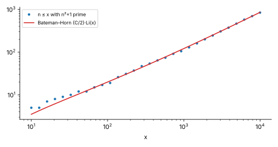

<sub>מספר ה־n שבהם n²+1 ראשוני, לעומת השערת בייטמן–הורן.</sub>

**מה כן הוכח: [משפט פרידלנדר–איוואניץ](../pages/משפט%20פרידלנדר-איוואניץ.md) (1997).** האם $`n^2 + 1`$ ראשוני אינסוף פעמים — זו אחת מבעיות לנדאו, ועדיין פתוחה. אבל פרידלנדר ואיוואניץ הוכיחו שיש אינסוף ראשוניים מהצורה $`a^2 + b^4`$, בשני משתנים. זו קבוצה דלילה מאוד — רק כ-$`X^{3/4}`$ מספרים עד $`X`$ הם מהצורה הזו — ובכל זאת הם קיבלו אפילו נוסחה אסימפטוטית: מספר הזוגות $`(a, b) \in \mathbb Z^2`$ עם $`a^2 + b^4 \le x`$ ראשוני הוא בערך $`4.80\, x^{3/4}/\log x`$. הכלי המרכזי הוא נפה ש"מבחינה בזוגיות" של מספר הגורמים הראשוניים, וכך עוקפת את בעיית הזוגיות של [שיעור 14](14-תורת-הנפה.md).

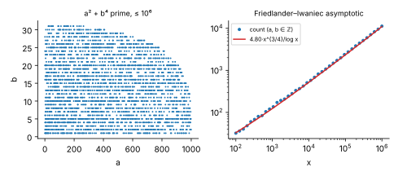

<sub>משמאל: הזוגות (a,b) שבהם a²+b⁴ ראשוני עד 10⁶. מימין: מספרם לעומת הנוסחה האסימפטוטית.</sub>

---

## 6. פערים בין ראשוניים

נסמן $`g_n = p_{n+1} - p_n`$. מ-PNT, הפער **הממוצע** ליד $`x`$ הוא $`\log x`$.

**פערים גדולים:**
* **[השערת קרמר](../pages/השערת%20קרמר.md) (1936):** $`g_n = O(\log^2p_n)`$. (מהמודל ההסתברותי.)
* **מה ידוע:** $`g_n = O(p_n^{0.525})`$ (בייקר–הרמן–פינץ, 2001). תחת השערת רימן: $`O(\sqrt{p_n}\log p_n)`$.
* **פערים גדולים במיוחד קיימים:** פורד–גרין–קוניאגין–מיינרד–טאו (2014) — $`g_n`$ גדול מ-$`c\log p_n\frac{\log\log p_n\log\log\log\log p_n}{\log\log\log p_n}`$ עבור אינסוף $`n`$.

### דוגמה 5: פערי שיא
| $`p_n`$ | $`g_n`$ | $`\log^2p_n`$ |
|---|---|---|
| 155,921 | 86 | 143 |
| 370,261 | 112 | 164 |
| 492,113 | 114 | 172 |
| 1,357,201 | 132 | 199 |

כל הפערים קטנים מ-$`\log^2p`$, כפי שקרמר מנבא. (היחס $`g/\log^2p`$ בכל הפערים שנמצאו עד היום לא עלה על כ-0.92.)

**[השערת לז'נדר](https://he.wikipedia.org/wiki/%D7%94%D7%A9%D7%A2%D7%A8%D7%AA_%D7%9C%D7%96%27%D7%A0%D7%93%D7%A8):** לכל $`n \ge 1`$ יש ראשוני בין $`n^2`$ ל-$`(n+1)^2`$. (נבדקה כאן עד $`n = 1400`$; נובעת מקרמר, אבל **לא** מהשערת רימן — שנותנת רק פערים $`O(\sqrt p\log p)`$, וזה בדיוק קצת יותר מדי.)

**[השערת אנדריקה](../pages/השערת%20אנדריקה.md) (1985):** $`\sqrt{p_{n+1}} - \sqrt{p_n} < 1`$ לכל $`n`$. זו טענה חזקה מעט מלז'נדר.

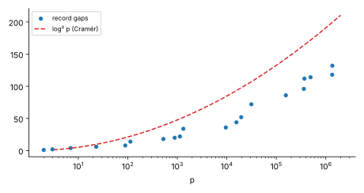

<sub>פערי השיא בין ראשוניים לעומת log²p.</sub>

### דוגמה 6: איפה אנדריקה הכי "צמודה"?
1. $`\sqrt{p_{n+1}} - \sqrt{p_n} = \frac{g_n}{\sqrt{p_{n+1}} + \sqrt{p_n}} \approx \frac{g_n}{2\sqrt{p_n}}`$.
2. הערך הגדול ביותר (עד $`2\cdot10^6`$) מתקבל ב-$`p_n = 7`$: $`\sqrt{11} - \sqrt7 = 3.3166 - 2.6458 = 0.6709`$.
3. ככל ש-$`p`$ גדל, $`g/(2\sqrt p)`$ קטן מאוד (גם עם $`g \approx \log^2p`$), ולכן ההשערה "כמעט בטוחה" — אבל לא מוכחת.


<sub>√pₙ₊₁ − √pₙ — הערך המרבי ב־p=7.</sub>

**[השערת אופרמן](../pages/השערת%20אופרמן.md) (1877):** לכל $`n > 1`$ יש ראשוני בין $`n^2 - n`$ ל-$`n^2`$, ועוד ראשוני בין $`n^2`$ ל-$`n^2 + n`$. היא חזקה גם מלז'נדר וגם מאנדריקה: היא נותנת **שני** ראשוניים בין $`n^2`$ ל-$`(n+1)^2`$, ופערים $`g_n \lt \sqrt{p_n}`$.

### דוגמה 7: אופרמן עבור $`n = 10`$ ו-$`n = 2`$
1. $`n = 10`$: הטווח הראשון הוא $`(90, 100)`$. המספרים האי-זוגיים בו הם 91, 93, 95, 97, 99. $`91 = 7 \cdot 13`$, $`93 = 3 \cdot 31`$, $`95 = 5 \cdot 19`$, $`99 = 9 \cdot 11`$, ו-97 ראשוני. ✓
2. הטווח השני הוא $`(100, 110)`$, ובו 101, 103, 107, 109 — ארבעה ראשוניים. ✓
3. $`n = 2`$ הוא המקרה הצפוף ביותר: הטווחים $`(2, 4)`$ ו-$`(4, 6)`$ מכילים כל אחד מספר אחד בלבד (3 ו-5), ושניהם ראשוניים — בדיוק "על הקצה".
4. ככל ש-$`n`$ גדל, מספר הראשוניים בכל טווח גדל בערך כמו $`n/(2\log n)`$ (אורך הטווח $`n`$ חלקי $`\log n^2`$), ולכן ההשערה נראית בטוחה — אבל, כמו לז'נדר, היא מעבר להישג של השערת רימן.

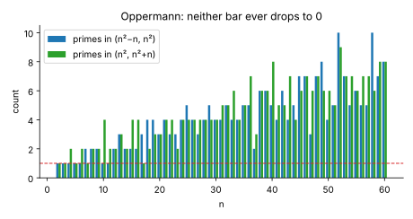

<sub>מספר הראשוניים בכל אחד משני הטווחים של אופרמן, עבור n עד 60.</sub>

מאופרמן נובעת גם **[השערת ברוקאר](../pages/השערת%20ברוקאר.md)**: בין $`p_n^2`$ ל-$`p_{n+1}^2`$ יש לפחות 4 ראשוניים (לכל $`n \ge 2`$). ההוכחה: $`p_{n+1} \ge p_n + 2`$, והקטע $`(p_n^2, (p_n+2)^2)`$ מתפרק לארבעה קטעי אופרמן — $`(m^2, m(m+1))`$ ו-$`(m(m+1), (m+1)^2)`$ עבור $`m = p_n`$ ו-$`m = p_n + 1`$ — ובכל אחד מהם יש ראשוני. חזקה אף יותר היא **[השערת פירוזבח](../pages/השערת%20פירוזבח.md)**: $`\sqrt[n]{p_n}`$ יורדת ממש ($`2, 1.732, 1.710, 1.627, 1.615, \dots`$), ומכאן $`g_n \lt \log^2 p_n - \log p_n`$ — חסם חזק אפילו מזה של קרמר. היא נבדקה עד $`2^{64}`$.

גישה אחרת לפערים היא דרך **הגורמים** של המספרים הפריקים שביניהם. **[השערת גרים](../pages/השערת%20גרים.md)** (1969): אם $`n+1, \dots, n+k`$ כולם פריקים, אפשר להתאים לכל אחד מהם ראשוני **שונה** המחלק אותו. למשל בין 23 ל-29: $`24 \to 2`$, $`25 \to 5`$, $`26 \to 13`$, $`27 \to 3`$, $`28 \to 7`$. ההשערה נבדקה עד $`1.9 \cdot 10^{10}`$, ומתוכה נובע $`g_n \ll \sqrt{p_n/\log p_n}`$ — יותר ממה שנותנת השערת רימן.

---

## 7. משפט גרין–טאו

**[משפט גרין–טאו](../pages/משפט%20גרין-טאו.md) (2004):** לכל $`k`$ יש **סדרה חשבונית** של $`k`$ ראשוניים.

**דוגמאות:** $`3, 5, 7`$; $`5, 11, 17, 23, 29`$ (הפרש 6); $`7, 37, 67, 97, 127, 157`$ (הפרש 30). הסדרה הארוכה ביותר הידועה (2019) באורך 27: $`224{,}584{,}605{,}939{,}537{,}911 + 81{,}292{,}139\cdot 23\#\cdot n`$, עבור $`n = 0, \dots, 26`$ (בדקנו בחישוב שכל 27 האיברים ראשוניים).

**למה ההפרשים מתחלקים ב-30?** בסדרה של 5 ראשוניים גדולים מ-5, ההפרש $`d`$ חייב להתחלק ב-2, ב-3 וב-5: אחרת, מודולו $`p \le 5`$ שאינו מחלק את $`d`$, ה-$`p`$ איברים הראשונים עוברים על כל המחלקות ואחד מהם מתחלק ב-$`p`$. (שוב: תבנית קבילה.)

**הרעיון של ההוכחה:**
1. **משפט סמרדי (1975):** כל קבוצה של **צפיפות חיובית** בטבעיים מכילה סדרות חשבוניות באורך כרצוננו.
2. הראשוניים בצפיפות **0** — סמרדי לא חל ישירות.
3. **עקרון ההעברה:** גרין וטאו הראו שהראשוניים הם קבוצה בצפיפות חיובית **בתוך** קבוצה "פסאודו-אקראית" גדולה יותר (מספרים בלי מחלקים קטנים, עם משקלות מנפת גולדסטון–פינץ–ילדירים), ושמשפט סמרדי "עובר" לקבוצות כאלה.

**אפשר לשאול יותר:** משפט גרין–טאו–זיגלר נותן **ספירה** אסימפטוטית של סדרות כאלה (מקרה של הארדי–ליטלווד שהוכח!), עם הקבוע שההשערה מנבאת.

---

## 8. סיכום ההשערות

| השערה | מצב |
|---|---|
| אינסוף תאומים | פתוח; פער $`\le 246`$ אינסוף פעמים |
| פוליניאק | פתוח; לפחות אחד מהזוגיים $`\le 246`$ |
| הארדי–ליטלווד (I) | פתוח; נכון לסדרות חשבוניות (גרין–טאו–זיגלר) |
| דיקסון / שינצל / בוניאקובסקי | פתוח (פרט למעלה 1 = דיריכלה) |
| בייטמן–הורן | פתוח; מתאים מצוין לנתונים |
| קרמר | פתוח; ידוע $`p^{0.525}`$ |
| לז'נדר / אנדריקה / אופרמן / ברוקאר / פירוזבח | פתוח |
| גולדבך הבינארית | פתוח; הטרנרית הוכחה (הלפגוט) |
| [למואן](../pages/השערת%20למואן.md): $`2n+1 = p + 2q`$ | פתוח; נבדקה עד $`10^9`$ |
| גרין–טאו | **הוכח** |

---

## 9. תרגילים

**תרגיל 1.** הוכיחו ש-$`(p, p+2, p+4)`$ ראשוניים רק עבור $`p = 3`$, ומצאו תבנית מאורך 4 קבילה.

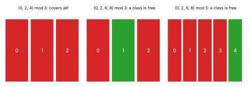

<sub>(0,2,4) מכסה את כל השאריות מודולו 3; (0,2,6,8) משאיר מחלקה פנויה מודולו 3 ומודולו 5.</sub>

<details><summary>פתרון</summary>

החלק הראשון — דוגמה 3. תבנית מאורך 4: $`(0, 2, 6, 8)`$. מודולו 2: $`\{0\}`$; מודולו 3: $`\{0, 2, 0, 2\}`$; מודולו 5: $`\{0, 2, 1, 3\}`$ — חסר 4; ראשוניים $`\ge 7`$ לא יכולים להיות מכוסים ב-4 איברים. קבילה. דוגמה: $`(5, 7, 11, 13)`$, $`(11, 13, 17, 19)`$.
</details>

**תרגיל 2.** חשבו את גורם התיקון של $`p = 5`$ עבור התבנית $`(n, n+10)`$ ביחס לתבנית $`(n, n+2)`$.

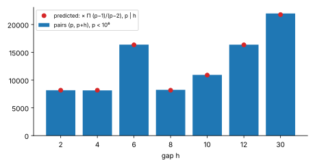

<sub>מספר זוגות הראשוניים במרחק h, לעומת הצפי לפי גורמי התיקון.</sub>

<details><summary>פתרון</summary>

עבור $`(n, n+10)`$ מודולו 5: $`n + 10 \equiv n`$, $`w(5) = 1`$, הגורם $`\frac{4/5}{(4/5)^2} = \frac54`$. עבור $`(n, n+2)`$: $`w(5) = 2`$, הגורם $`\frac{3/5}{16/25} = \frac{15}{16}`$. היחס: $`\frac{5/4}{15/16} = \frac43 = \frac{p-1}{p-2}`$ עם $`p = 5`$.
</details>

**תרגיל 3.** למה $`n^2 + n + 1`$ מקיים את תנאי בוניאקובסקי? מה $`w(3)`$ ו-$`w(7)`$ עבורו?

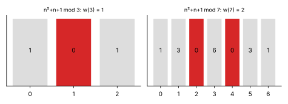

<sub>השורשים של n²+n+1 מודולו 3 ומודולו 7.</sub>

<details><summary>פתרון</summary>

אי-פריק (דיסקרימיננטה $`-3`$), מקדם מוביל 1, ו-$`f(0) = 1`$ — אין מחלק משותף. $`w(3) = 1`$ ($`n \equiv 1`$: $`1 + 1 + 1 = 3`$). $`w(7) = 2`$ ($`n \equiv 2`$: $`7`$; $`n \equiv 4`$: $`21`$). באופן כללי $`w(p) = 1 + \left(\frac{-3}p\right)`$.
</details>

**תרגיל 4.** הסבירו למה השערת רימן אינה מספיקה כדי להוכיח את השערת לז'נדר.

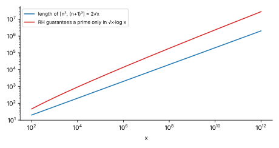

<sub>אורך הקטע בין ריבועים עוקבים לעומת מה שהשערת רימן מבטיחה.</sub>

<details><summary>פתרון</summary>

השערת רימן נותנת $`\pi(x + h) - \pi(x) > 0`$ עבור $`h \ge C\sqrt x\log x`$. הקטע $`[n^2, (n+1)^2]`$ באורך $`2n + 1 \approx 2\sqrt x`$ — קצר יותר מ-$`C\sqrt x\log x`$ בגורם $`\log x`$.
</details>

**תרגיל 5.** מצאו סדרה חשבונית של 4 ראשוניים עם הפרש 6, ונמקו למה אין סדרה של 4 ראשוניים גדולים מ-3 עם הפרש 2 או 4.

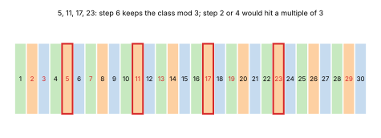

<sub>5, 11, 17, 23 — הפרש 6 שומר על אותה מחלקה מודולו 3.</sub>

<details><summary>פתרון</summary>

$`5, 11, 17, 23`$. עם הפרש $`d`$ שאינו מתחלק ב-3, האיברים $`a, a+d, a+2d`$ עוברים על כל המחלקות מודולו 3, ואחד מתחלק ב-3.
</details>

---

## סיכום
* ההשערות כולן נובעות מעיקרון אחד: **צפי = מודל אקראי × תיקונים מקומיים** (הטור הסינגולרי).
* תבנית אפשרית רק אם היא **קבילה** (אין מכשול מודולו אף ראשוני).
* הוכח: פערים חסומים (246), סדרות חשבוניות (גרין–טאו), $`p + P_2`$ (צ'ן).
* חסום על ידי: בעיית הזוגיות, וחוסר שליטה בראשוניים בקטעים קצרים.

**השיעור הקודם:** [שיעור 15: סכומים אקספוננציאליים ושיטת המעגל](15-סכומים-אקספוננציאליים.md) · **השיעור הבא:** [שיעור 17: אנשים בתורת המספרים האנליטית](17-אישים.md)

**להעמקה:** [ראשוניים תאומים](https://he.wikipedia.org/wiki/%D7%A8%D7%90%D7%A9%D7%95%D7%A0%D7%99%D7%99%D7%9D_%D7%AA%D7%90%D7%95%D7%9E%D7%99%D7%9D) · [השערת פוליניאק](../pages/השערת%20פוליניאק.md) · [השערת אופרמן](../pages/השערת%20אופרמן.md) · [השערת ברוקאר](../pages/השערת%20ברוקאר.md) · [השערת פירוזבח](../pages/השערת%20פירוזבח.md) · [השערת גרים](../pages/השערת%20גרים.md) · [משפט מאייר](../pages/משפט%20מאייר.md) · [משפט פרידלנדר–איוואניץ](../pages/משפט%20פרידלנדר-איוואניץ.md) · [השערת למואן](../pages/השערת%20למואן.md) · [השערת דיקסון](../pages/השערת%20דיקסון.md) · [השערת בוניאקובסקי](../pages/השערת%20בוניאקובסקי.md) · [השערה H של שינצל](../pages/השערה%20H%20של%20שינצל.md) · [השערת בייטמן–הורן](../pages/השערת%20בייטמן-הורן.md) · [השערת קרמר](../pages/השערת%20קרמר.md) · [השערת אנדריקה](../pages/השערת%20אנדריקה.md) · [השערת לז'נדר](https://he.wikipedia.org/wiki/%D7%94%D7%A9%D7%A2%D7%A8%D7%AA_%D7%9C%D7%96%27%D7%A0%D7%93%D7%A8) · [משפט גרין–טאו](../pages/משפט%20גרין-טאו.md) · [השערת הארדי–ליטלווד הראשונה](../pages/השערת%20הארדי-ליטלווד%20הראשונה.md) · [השערת גילברת'](../pages/השערת%20גילברת'.md) · [מספר רייזל](../pages/מספר%20רייזל.md) · [השערות מרסן](../pages/השערות%20מרסן.md) · [שיטת המטריצה של מאייר](../pages/שיטת%20המטריצה%20של%20מאייר.md)

---
<sub>חלק מהקורס [תורת המספרים בעברית](../COURSE.md). התוכן מופץ ברישיון [CC BY-SA 4.0](https://creativecommons.org/licenses/by-sa/4.0/).</sub>
