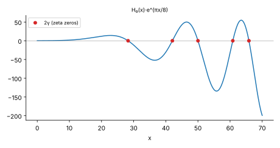
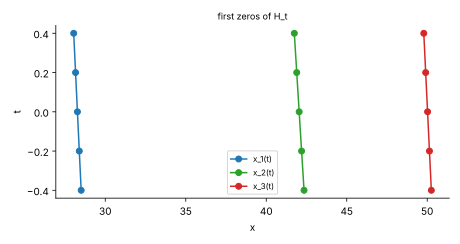
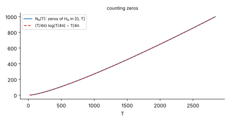
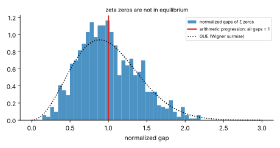
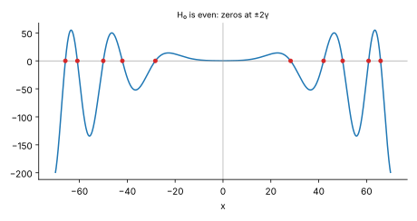
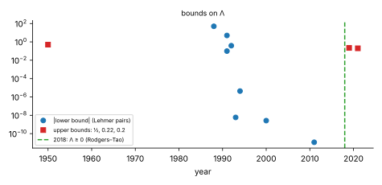
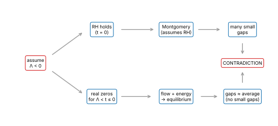
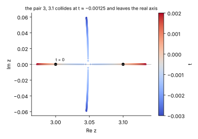

# שיעור 18: קבוע דה ברויין–ניומן – קריאה מודרכת במאמר של רוג'רס וטאו

**מה נלמד:** זה שיעור הסיום של הקורס. נקרא יחד מאמר מחקר אמיתי:

> B. Rodgers, T. Tao, *The De Bruijn–Newman constant is non-negative*, Forum of Mathematics, Pi **8** (2020), e6. ‏(arXiv:1801.05914)

המאמר מוכיח השערה של ניומן מ-1976: $`\Lambda\ge0`$. המשמעות: **אם השערת רימן נכונה, היא נכונה "בקושי"** – כל הזזה קטנה של פונקציית הזטא לכיוון הלא נכון יוצרת אפסים מחוץ לישר הקריטי. נבין את ההגדרות, את ההיסטוריה, ואת מבנה ההוכחה, צעד אחר צעד, וכל צעד יפנה לשיעור בקורס שבו למדנו את הכלי.

**ידע קודם:** כל הקורס, ובמיוחד [שיעור 11](11-טורי-דיריכלה-וזטא.md) ו[שיעור 12](12-משפט-המספרים-הראשוניים.md) (זטא, אפסים, ספירת אפסים), [שיעור כלים כ11](T11-גמא-פורייה-ותטא.md) (משוואת הפונקציה), [שיעור כלים כ12](T12-פונקציות-שלמות.md) (הדמר), ו[שיעור כלים כ13](T13-משוואת-החום.md) (משוואת החום ותנועת האפסים).

---

## 0. איך קוראים מאמר מתמטי

1. **קוראים את התקציר ואת המבוא** – מה הטענה, ולמה היא מעניינת.
2. **מוצאים את ההגדרות** ומוודאים שמבינים כל סימן (כאן: $`\Phi`$, $`H_t`$, $`\Lambda`$).
3. **מוצאים את "מפת ההוכחה"** – כמעט בכל מאמר טוב יש פסקה שמתארת את מבנה ההוכחה. קוראים אותה לפני הפרטים.
4. **בודקים דוגמאות קטנות במחשב** – כמו שעשינו בכל הקורס.
5. **רק אחר כך** נכנסים לפרטים הטכניים, סעיף אחר סעיף.

## 1. ההגדרות

**פונקציית $`\Xi`$** ([שיעור כ12](T12-פונקציות-שלמות.md)): $`\Xi(s) = \frac12s(s-1)\pi^{-s/2}\Gamma\left(\frac s2\right)\zeta(s)`$ – שלמה, מסדר 1, $`\Xi(s) = \Xi(1-s)`$, והאפסים שלה הם בדיוק האפסים הלא-טריוויאליים של $`\zeta`$. (במאמר היא נקראת $`\xi`$.)

**הסיבוב:** $`H_0(z) = \frac18\Xi\left(\frac12 + \frac{iz}2\right)`$. ההצבה $`s = \frac12 + \frac{iz}{2}`$ מסובבת את הישר הקריטי $`\mathrm{Re}\,s = \frac12`$ אל **הציר הממשי** $`\mathrm{Im}\,z = 0`$, ומותחת פי 2: האפס $`\frac12 + i\gamma`$ הופך ל-$`z = 2\gamma`$.

**השערת רימן ⇔ כל האפסים של $`H_0`$ ממשיים.**

**הייצוג האינטגרלי:** $`H_0(z) = \int_0^\infty\Phi(u)\cos(zu)\,du`$, עם $`\Phi`$ מ[שיעור כ13](T13-משוואת-החום.md). כלומר $`H_0`$ היא (בעיקרון) **התמרת פורייה** של $`\Phi`$.

**המשפחה של דה ברויין:** $`H_t(z) = \int_0^\infty e^{tu^2}\Phi(u)\cos(zu)\,du`$. היא פותרת את **משוואת החום ההפוכה** $`\partial_tH_t = -\partial_z^2H_t`$.

**קבוע דה ברויין–ניומן:** המספר $`\Lambda`$ כך ש
```math
H_t \text{ has only real zeros} \iff t \ge \Lambda .
```
ולכן **השערת רימן ⇔ $`\Lambda\le0`$**.

## 2. ההיסטוריה

| שנה | תוצאה | מי |
|---|---|---|
| 1950 | ל-$`H_t`$ יש רק אפסים ממשיים עבור $`t\ge\frac12`$; ואם עבור $`t`$ מסוים, אז לכל $`t' \gt t`$ | דה ברויין |
| 1976 | $`\Lambda`$ קיים וסופי; **השערה: $`\Lambda\ge0`$** | ניומן |
| 1988–2011 | חסמים תחתונים מ"זוגות להמר": $`-50,\ -5,\ \ldots,\ -1.15\cdot10^{-11}`$ | צ'ורדש, וארגה, אודליזקו, סאוטר ואחרים |
| 2018 (פורסם 2020) | **$`\Lambda\ge0`$** | רוג'רס וטאו |
| 2019 | $`\Lambda\le0.22`$ | פרויקט Polymath 15 |
| 2021 | $`\Lambda\le0.2`$ | פלאט וטרודג'יאן |

**המצב היום:** $`0\le\Lambda\le0.2`$, ו**השערת רימן שקולה ל-$`\Lambda = 0`$**.

## 3. ההוכחה: מפת הדרכים

ההוכחה היא **בדרך השלילה** ([שיעור P3](P03-הוכחה-בדרך-השלילה.md)). מניחים ש-$`\Lambda \lt 0`$, ומגיעים לסתירה בחמישה צעדים.

**צעד 0: מה ההנחה נותנת.** אם $`\Lambda \lt 0`$, אז לכל $`t`$ בקטע $`(\Lambda, 0]`$, כל האפסים של $`H_t`$ ממשיים. בפרט **השערת רימן נכונה** (ב-$`t = 0`$). **זה טריק חשוב:** מעכשיו מותר להשתמש בכל משפט שהוכח **בהנחת** השערת רימן!

**צעד 1: אסימפטוטיקה וספירת אפסים.** בעזרת [סטירלינג](T07-סכומים-ואינטגרלים.md) ושיטות "נקודת אוכף" מקבלים קירוב טוב ל-$`H_t`$, ומתוכו, כמו בנוסחת רימן–פון מנגולדט ([שיעור 12](12-משפט-המספרים-הראשוניים.md)), את מספר האפסים של $`H_t`$ בקטע $`[0, T]`$:
```math
N_t(T) = \frac{T}{4\pi}\log\frac{T}{4\pi} - \frac{T}{4\pi} + O(\log^2T).
```
**המרווח הממוצע** בגובה $`T`$ הוא לכן $`\approx\frac{4\pi}{\log T}`$ – והוא **שואף ל-0**.

**צעד 2: המשוואה של האפסים.** כל האפסים ממשיים (ופשוטים), וזזים לפי ([שיעור כ13](T13-משוואת-החום.md))
```math
\partial_tx_k(t) = 2\sum_{j\ne k}\frac{1}{x_k(t) - x_j(t)} .
```

**צעד 3: אנרגיה.** המשוואה הזו היא "ירידה במדרון" (gradient flow) של האנרגיה $`E = -\sum_{j \lt k}\log|x_j - x_k|`$ – כמו מטענים חשמליים שנדחים. האנרגיה **יורדת** עם הזמן, והיא קטנה ביותר כשהאפסים שווי מרווחים. המחברים מגדירים גרסה **מקומית ומנורמלת** של האנרגיה, שמודדת כמה האפסים ליד גובה $`T`$ רחוקים מסדרה חשבונית.

**צעד 4: הרפיה לשיווי משקל.** הזמן מ-$`\Lambda`$ עד 0 הוא קבוע חיובי $`|\Lambda|`$. אבל הזמן שלוקח לאפסים עם מרווח $`\delta`$ "להתיישר" הוא בסדר גודל $`\delta^2`$ ([שיעור כ13](T13-משוואת-החום.md), דוגמה 4), ו-$`\delta = \frac{4\pi}{\log T}\to0`$. לכן, גבוה מספיק, יש "הרבה זמן" להתיישר. בעזרת המונוטוניות של האנרגיה ושיקול **שובך יונים** ([שיעור P5](P05-שובך-היונים.md)) על הזמן, מקבלים: **ב-$`t = 0`$, האפסים של זטא מתנהגים מקומית (בממוצע) כמו סדרה חשבונית, והמרווחים קרובים כמעט תמיד למרווח הממוצע.**

**צעד 5: הסתירה.** ידוע שהאפסים של זטא **אינם** כמו סדרה חשבונית: לפי עבודות של **מונטגומרי** (קורלציית הזוגות, 1973) וממשיכיו – בהנחת השערת רימן, שמותר לנו להניח לפי צעד 0 – **חלק חיובי** מהמרווחים קטן באופן ניכר מהממוצע. זה סותר את צעד 4. לכן $`\Lambda\ge0`$. ∎

## 4. מה צריך לדעת כדי לקרוא את המאמר

| מושג במאמר | איפה בקורס |
|---|---|
| $`\zeta`$, מכפלת אוילר, המשכה, משוואת הפונקציה | [11](11-טורי-דיריכלה-וזטא.md), [כ10](T10-משפט-קושי-ושאריות.md), [כ11](T11-גמא-פורייה-ותטא.md) |
| $`\xi`$, מכפלת הדמר, סדר 1 | [כ12](T12-פונקציות-שלמות.md) |
| ספירת אפסים (רימן–פון מנגולדט), עקרון הארגומנט | [12](12-משפט-המספרים-הראשוניים.md), [כ10](T10-משפט-קושי-ושאריות.md) |
| סטירלינג, $`\Gamma`$ | [כ7](T07-סכומים-ואינטגרלים.md), [כ11](T11-גמא-פורייה-ותטא.md) |
| התמרת פורייה, תטא | [כ11](T11-גמא-פורייה-ותטא.md) |
| משוואת החום, תנועת אפסים | [כ13](T13-משוואת-החום.md) |
| סימוני $`O`$, $`o`$, $`\ll`$ | [כ6](T06-אסימפטוטיקה.md) |
| ממוצעים, שונות, "כמעט תמיד" | [כ8](T08-הסתברות.md), [9](09-סדרים-של-פונקציות.md) |
| הוכחה בדרך השלילה, שובך יונים | [P3](P03-הוכחה-בדרך-השלילה.md), [P5](P05-שובך-היונים.md) |

מה **לא** למדנו (ומופיע בפרטים הטכניים): שיטת נקודת האוכף בפירוט, וההוכחה של משפטי מונטגומרי. אלה הצעדים הבאים למי שרוצה להמשיך.

---

## 5. דוגמאות פתורות

### דוגמה 1: האפסים של $`H_0`$

**שאלה.** חשבו את $`H_0(x)`$ על הציר הממשי, ומצאו את שלושת האפסים החיוביים הראשונים.



<sub>H₀(x) כפול e^(πx/8) (כדי לבטל את הדעיכה) עבור 0 ≤ x ≤ 70. האפסים ב-x = 2γ: ‏28.27, 42.04, 50.02, 60.85, 65.87.</sub>

**פתרון.**
1. **הגדרה:** $`H_0(x) = \frac18\Xi\left(\frac12 + \frac{ix}2\right)`$. עבור $`x`$ ממשי זה מספר **ממשי** (תרגיל 1).
2. **דעיכה:** לפי סטירלינג, $`|\Gamma(\frac14 + \frac{ix}{4})|`$ קטן כמו $`e^{-\pi x/8}`$. לכן מציירים $`H_0(x)e^{\pi x/8}`$.
3. **ערך ב-0:** $`H_0(0) = \frac18\Xi(\tfrac12) = 0.0621`$.
4. **אפסים:** $`H_0`$ מחליפה סימן ב-$`x = 28.27,\ 42.04,\ 50.02`$, כלומר $`2\cdot14.1347`$, $`2\cdot21.0220`$, $`2\cdot25.0109`$ – פעמיים הגבהים של אפסי זטא ✓.
5. **בדיקה:** גם האינטגרל $`\int_0^\infty\Phi(u)\cos(xu)\,du`$ נותן $`H_0(1) = 0.06178`$, בדיוק כמו $`\frac18\Xi(\frac12 + \frac i2)`$ ✓.

### דוגמה 2: איך זזים האפסים כש-$`t`$ משתנה

**שאלה.** חשבו את שלושת האפסים הראשונים של $`H_t`$ עבור $`t = -0.4, -0.2, 0, 0.2, 0.4`$.



<sub>מסלולי שלושת האפסים הראשונים של H_t כש-t משתנה מ-−0.4 ל-0.4: כולם זזים לאט שמאלה, והמרווח בין השני לשלישי (הזוג הקרוב) גדל.</sub>

**פתרון (אינטגרציה מספרית של $`\int_0^\infty e^{tu^2}\Phi(u)\cos(xu)\,du`$ וחיפוש שורש):**

| $`t`$ | $`x_1`$ | $`x_2`$ | $`x_3`$ | $`x_3 - x_2`$ |
|---|---|---|---|---|
| $`-0.4`$ | 28.502 | 42.347 | 50.256 | 7.908 |
| $`-0.2`$ | 28.386 | 42.195 | 50.139 | 7.943 |
| $`0`$ | 28.270 | 42.044 | 50.022 | 7.978 |
| $`0.2`$ | 28.154 | 41.893 | 49.904 | 8.011 |
| $`0.4`$ | 28.038 | 41.743 | 49.787 | 8.044 |

1. **כל האפסים זזים שמאלה** בקצב $`\approx0.58`$: מעליהם יש הרבה יותר אפסים (הצפיפות גדלה עם הגובה), והם דוחפים למטה.
2. **הזוג הקרוב** ($`x_2, x_3`$) נדחה: המרווח גדל עם $`t`$, כמו שהמשוואה מנבאת.
3. **האפסים הנמוכים יציבים:** הם רחוקים זה מזה, ולכן נשארים ממשיים גם עבור $`t`$ שלילי. הקושי ב-$`\Lambda`$ הוא **גבוה**, שם האפסים צפופים.

### דוגמה 3: ספירת אפסים והמרווח הממוצע

**שאלה.** בדקו את $`N_0(T)\approx\frac{T}{4\pi}\log\frac{T}{4\pi} - \frac{T}{4\pi}`$ עבור $`T = 2\gamma_{100} = 473.05`$, וחשבו את המרווח הממוצע בגבהים $`T = 10^6`$ ו-$`T = 10^{100}`$.



<sub>N₀(T) (מדרגות, מתוך 1000 אפסי זטא) והקירוב (T/4π)log(T/4π) − T/4π.</sub>

**פתרון.**
1. $`\frac{T}{4\pi} = 37.64`$, $`\log37.64 = 3.628`$. לכן $`37.64\cdot3.628 - 37.64 = 98.9`$. בפועל: 100 אפסים ✓ (התיקון $`+\frac78`$ מנוסחת רימן–פון מנגולדט נותן $`99.8`$).
2. **מרווח ממוצע:** $`\frac{1}{N'(T)}`$, ו-$`N'(T) \approx \frac{1}{4\pi}\log\frac{T}{4\pi}`$. לכן המרווח $`\approx\frac{4\pi}{\log(T/4\pi)}`$.
3. **$`T = 10^6`$:** $`\frac{12.566}{11.28} = 1.11`$, ו"זמן ההתיישרות" $`\delta^2\approx1.24`$.
4. **$`T = 10^{100}`$:** $`\delta = 0.055`$, $`\delta^2 = 0.003`$. אם $`\Lambda = -0.01`$, למשל, האפסים בגובה הזה היו מקבלים זמן של יותר מפי 3 מזמן ההתיישרות – ויותר ויותר ככל שעולים.

### דוגמה 4: האפסים של זטא אינם סדרה חשבונית

**שאלה.** חשבו את המרווחים **המנורמלים** בין 1000 האפסים הראשונים של זטא, והשוו לסדרה חשבונית.



<sub>היסטוגרמה של 999 המרווחים המנורמלים בין אפסי זטא (ממוצע 1). בסדרה חשבונית כל המרווחים היו בדיוק 1 (הקו האדום); בפועל 14% מהמרווחים קטנים מ-0.6.</sub>

**פתרון.**
1. **נרמול:** בגובה $`\gamma`$ המרווח הממוצע (במשתנה $`\gamma`$) הוא $`\frac{2\pi}{\log(\gamma/2\pi)}`$. מגדירים $`g_n = (\gamma_{n+1} - \gamma_n)\cdot\frac{\log(\gamma_n/2\pi)}{2\pi}`$.
2. **ממוצע:** $`0.999`$ ✓.
3. **פיזור:** סטיית התקן $`0.38`$; המרווח הקטן ביותר $`0.14`$; **14%** מהמרווחים קטנים מ-$`0.6`$, ו-7% קטנים מ-$`0.5`$.
4. **בסדרה חשבונית:** כל $`g_n = 1`$, סטיית תקן 0.
5. **מסקנה:** האפסים של זטא רחוקים מאוד מ"שיווי משקל". צעד 4 של ההוכחה אומר שאם $`\Lambda \lt 0`$, הם היו צריכים להיות קרובים אליו – **סתירה**. (המחשב רק ממחיש; ההוכחה משתמשת במשפטים של מונטגומרי, שתקפים לכל הגבהים.)

---

## 6. תרגילים

**תרגיל 1.** הראו ש-$`H_0`$ זוגית, ושהיא ממשית על הציר הממשי.



<sub>H₀(x)·e^(π|x|/8) עבור −70 ≤ x ≤ 70: סימטרית סביב 0, עם אפסים ב-±2γ.</sub>

<details><summary>פתרון</summary>

1. **זוגיות:** $`z\mapsto-z`$ מתאים ל-$`s = \frac12 + \frac{iz}2 \mapsto \frac12 - \frac{iz}2 = 1 - s`$. לפי $`\Xi(s) = \Xi(1-s)`$ ([שיעור כ11](T11-גמא-פורייה-ותטא.md)), $`H_0(-z) = H_0(z)`$.
2. **ממשיות:** $`\Xi`$ ממשית על הציר הממשי, ולכן $`\overline{\Xi(s)} = \Xi(\bar s)`$. עבור $`x`$ ממשי: $`\overline{s} = \frac12 - \frac{ix}2 = 1 - s`$, ולכן $`\overline{H_0(x)} = \frac18\Xi(1-s) = H_0(x)`$.
3. **בדרך אחרת:** מהייצוג $`\int\Phi(u)\cos(xu)\,du`$ עם $`\Phi`$ ממשית – גם זוגי וגם ממשי, מיד.
</details>

**תרגיל 2.** הוכיחו בעזרת המשפט של דה ברויין: השערת רימן $`\iff\Lambda\le0`$.



<sub>ציר הזמן של החסמים על Λ: חסמים תחתונים מזוגות להמר (1988–2011) מתקרבים ל-0 מלמטה; רוג'רס–טאו (2018): Λ ≥ 0; חסמים עליונים: ½ (1950), 0.22 (2019), 0.2 (2021).</sub>

<details><summary>פתרון</summary>

1. **⇐:** אם $`\Lambda\le0`$, אז $`0\ge\Lambda`$, ולפי ההגדרה ל-$`H_0`$ יש רק אפסים ממשיים. זו השערת רימן.
2. **⇒:** אם השערת רימן נכונה, ל-$`H_0`$ יש רק אפסים ממשיים. לפי דה ברויין, גם לכל $`H_t`$ עם $`t \gt 0`$. לכן $`\Lambda`$ – הגבול התחתון של הקבוצה הזו – הוא לכל היותר 0.
3. **לאור רוג'רס–טאו:** השערת רימן $`\iff\Lambda = 0`$.
</details>

**תרגיל 3.** לפי צעד 0, ההנחה $`\Lambda \lt 0`$ גוררת את השערת רימן. למה זה מאפשר להשתמש בתוצאות של מונטגומרי? ולמה אי אפשר להשתמש בהן בהוכחה של $`\Lambda\le0`$?



<sub>מבנה ההוכחה: הנחה Λ < 0 ← RH ← (מונטגומרי) מרווחים קטנים רבים; ובמקביל Λ < 0 ← זרימה מ-Λ עד 0 ← שיווי משקל ← אין מרווחים קטנים. סתירה.</sub>

<details><summary>פתרון</summary>

1. **בהוכחה בדרך השלילה** מותר להשתמש בכל מה שנובע מההנחה. $`\Lambda \lt 0`$ ⇐ RH, ולכן כל משפט מהצורה "אם RH אז X" נותן את X.
2. התוצאה של מונטגומרי (קורלציית הזוגות) היא בדיוק כזו: היא מניחה RH ומסיקה שיש הרבה מרווחים קטנים.
3. **בכיוון ההפוך** ($`\Lambda\le0`$, כלומר RH עצמה) אי אפשר להניח את RH – זה מה שרוצים להוכיח. לכן הטריק עובד רק בכיוון $`\Lambda\ge0`$.
4. **מוסר השכל:** כשמנסים להוכיח משהו, כדאי לבדוק אילו "הנחות חינם" ההנחה בשלילה נותנת.
</details>

**תרגיל 4.** "צעצוע" של $`\Lambda\ge0`$: הפולינום $`p_0(z) = (z^2 - 1)(z - 3)(z - 3.1)`$ יש לו זוג אפסים קרוב (3 ו-3.1). פתרו את $`\partial_tp = -\partial_z^2p`$ ומצאו (מספרית) את ה-$`\Lambda`$ של הפולינום הזה – הזמן הראשון שממנו והלאה כל האפסים ממשיים.



<sub>מסלול הזוג 3, 3.1 של p_t במישור המרוכב, צבוע לפי t: אחורה בזמן (כחול) האפסים מתקרבים, מתנגשים ב-t ≈ −0.00125 ויוצאים מהציר הממשי. לכן כאן Λ ≈ −0.00125 – שלילי, אבל קרוב מאוד ל-0.</sub>

<details><summary>פתרון</summary>

1. **פתרון מפורש לפולינום:** $`p_t = \sum_{k\ge0}\frac{(-t)^k}{k!}p_0^{(2k)}`$ (הסכום סופי). בדיקה: גזירה לפי $`t`$ נותנת $`-\partial_z^2p_t`$ ✓.
2. **כאן** $`p_0`$ ממעלה 4: $`p_t = p_0 - t\,p_0'' + \frac{t^2}{2}p_0''''`$, עם $`p_0'''' = 24`$.
3. **הערכה לפי [תרגיל 4 של שיעור כ13](T13-משוואת-החום.md):** זוג במרחק $`\delta_0 = 0.1`$ מתנגש בערך ב-$`t = -\frac{\delta_0^2}{8} = -0.00125`$.
4. **מספרית:** מחשבים את השורשים של $`p_t`$ עבור $`t`$ שליליים: ב-$`t = -0.0012`$ הזוג עדיין ממשי ($`3.038,\ 3.058`$), וב-$`t = -0.0013`$ הוא כבר מרוכב ($`3.048\pm0.010i`$). ההתנגשות ב-$`t\approx-0.00125`$ – כמעט בדיוק ההערכה (האפסים $`\pm1`$ רחוקים ומשפיעים מעט).
5. **ל-$`t`$ גדול יותר** כל האפסים ממשיים, ולכן $`\Lambda\approx-0.00125`$.
6. **ההבדל מזטא:** לפולינום יש מספר סופי של אפסים, ו-$`\Lambda`$ שלו שלילי. לזטא יש אינסוף אפסים, צפופים יותר ויותר, ולכן "תמיד יש זוג קרוב מספיק" – זו האינטואיציה מאחורי $`\Lambda\ge0`$, ורוג'רס וטאו הפכו אותה להוכחה בעזרת טיעון סטטיסטי.
</details>

---

## סיכום
* $`H_t(z) = \int_0^\infty e^{tu^2}\Phi(u)\cos(zu)\,du`$, $`H_0(z) = \frac18\Xi(\frac12 + \frac{iz}2)`$, $`\partial_tH_t = -\partial_z^2H_t`$.
* **$`\Lambda`$:** אפסים ממשיים בלבד $`\iff t\ge\Lambda`$. **RH $`\iff\Lambda\le0`$.**
* **רוג'רס–טאו:** $`\Lambda\ge0`$. ההוכחה: $`\Lambda \lt 0`$ ⇐ אפסים ממשיים שזורמים לשיווי משקל (סדרה חשבונית), אבל אפסי זטא (לפי מונטגומרי, בהנחת RH, שנובעת מ-$`\Lambda \lt 0`$) אינם כאלה.
* **היום:** $`0\le\Lambda\le0.2`$; RH $`\iff\Lambda = 0`$.

**מה הלאה?** עכשיו אפשר לפתוח את [המאמר](https://arxiv.org/abs/1801.05914) ולקרוא את המבוא ואת מפת ההוכחה שלו; לקרוא את הרשומה של טאו על המאמר בבלוג שלו ("What's new", ינואר 2018); או לקרוא את המאמר של פרויקט Polymath 15 ([arXiv:1904.12438](https://arxiv.org/abs/1904.12438)), שחסם את $`\Lambda`$ מלמעלה.

**השיעור הקודם:** [שיעור כלים כ13: משוואת החום ותנועת האפסים](T13-משוואת-החום.md) · **השיעור הבא:** [שיעור כלים כ14: חוגים, אידיאלים והרחבות שדות](T14-חוגים-אידיאלים-ושדות.md)

**להעמקה:** [השערת ניומן](../pages/השערת%20ניומן.md) · [השערת רימן](https://he.wikipedia.org/wiki/%D7%94%D7%A9%D7%A2%D7%A8%D7%AA_%D7%A8%D7%99%D7%9E%D7%9F) · [טרנס טאו](https://he.wikipedia.org/wiki/%D7%98%D7%A8%D7%A0%D7%A1_%D7%98%D7%90%D7%95) · [השיטה של טיורינג](../pages/השיטה%20של%20טיורינג.md) · [תנועה בראונית ופונקציית זטא של רימן](../pages/תנועה%20בראונית%20ופונקציית%20זטא%20של%20רימן.md) · [מחלקת לגר–פויה](../pages/%D7%9E%D7%97%D7%9C%D7%A7%D7%AA%20%D7%9C%D7%92%D7%A8%E2%80%93%D7%A4%D7%95%D7%99%D7%94.md)

---
<sub>חלק מ[קורס תורת המספרים](../COURSE.md). התוכן מופץ ברישיון [CC BY-SA 4.0](https://creativecommons.org/licenses/by-sa/4.0/).</sub>
