# שיעור 19: תורת המספרים האלגברית – שדות מספרים, אידיאלים וחבורת המחלקות

**מה נלמד:** עד עכשיו פירקנו מספרים שלמים לגורמים ראשוניים. עכשיו נעבור ל**שדות מספרים** – הרחבות כמו $`\mathbb Q(i)`$, $`\mathbb Q(\sqrt{-5})`$ או $`\mathbb Q(\zeta_5)`$ – ול"מספרים השלמים" שלהם. נראה ש:
1. ב-$`\mathbb Z[\sqrt{-5}]`$ **הפירוק לגורמים אינו יחיד**: $`6 = 2\cdot 3 = (1 + \sqrt{-5})(1 - \sqrt{-5})`$.
2. דדקינד הציל את המצב: **הפירוק לאידיאלים ראשוניים הוא תמיד יחיד**.
3. ראשוני רגיל $`p`$ יכול **להתפצל**, **להישאר ראשוני** או **להסתעף** – ויש מתכון לדעת מה מהשלושה (משפט דדקינד–קומר), שקשור לחוק ההדדיות הריבועית.
4. **חבורת המחלקות** מודדת כמה הפירוק היחיד נכשל, והיא תמיד **סופית** (חסם מינקובסקי).
5. **היחידות**: בשדות ריבועיים ממשיים יש אינסוף יחידות (משוואת פל), ומשפט היחידות של דיריכלה מתאר אותן.
6. **פונקציית הזטא של דדקינד** מחברת את כל זה לפונקציות ה-L של שיעור 13, דרך **נוסחת מספר המחלקה**.

**ידע קודם:** [שיעור 7](07-שאריות-ריבועיות.md) (סימן לז'נדר, הדדיות ריבועית), [שיעור 8](08-משוואות-דיופנטיות.md) (סכומי ריבועים, משוואת פל), [שיעור 13](13-קרקטרים-ופונקציות-L.md) (פונקציות L, מספרי מחלקה), [שיעור כלים כ14](T14-חוגים-אידיאלים-ושדות.md) (חוגים, אידיאלים, הרחבות, נורמה).

---

## 1. למה לצאת מ-$`\mathbb Z`$?

**פרמה ושני ריבועים.** ב[שיעור 8](08-משוואות-דיופנטיות.md) ראינו ש-$`p \equiv 1 \pmod 4`$ הוא סכום של שני ריבועים. בשפה של $`\mathbb Z[i]`$: $`p = a^2 + b^2 = (a + bi)(a - bi)`$ – **הראשוני $`p`$ מתפרק** ב-$`\mathbb Z[i]`$. למשל $`13 = (3 + 2i)(3 - 2i)`$. שאלות על משוואות במספרים שלמים הופכות לשאלות על **פירוק** בחוגים גדולים יותר.

**המלכודת.** לאמה (1847) "הוכיח" את המשפט האחרון של פרמה בכך שפירק $`x^p + y^p = \prod_{k}(x + \zeta_p^k y)`$ ב-$`\mathbb Z[\zeta_p]`$, והניח שהפירוק יחיד. קומר הראה שזה לא נכון בכלל. הדוגמה הפשוטה ביותר:

### דוגמה 1: פירוק לא יחיד ב-$`\mathbb Z[\sqrt{-5}]`$
```math
6 = 2\cdot 3 = (1 + \sqrt{-5})(1 - \sqrt{-5}).
```
כל ארבעת הגורמים **אי-פריקים**. נשתמש בנורמה $`N(a + b\sqrt{-5}) = a^2 + 5b^2`$ (כפלית):
* $`N(2) = 4`$, $`N(3) = 9`$, $`N(1 \pm \sqrt{-5}) = 6`$.
* פירוק של 2 לשני גורמים לא הפיכים היה דורש גורם מנורמה 2; של 3 – מנורמה 3; של $`1 \pm \sqrt{-5}`$ – מנורמה 2 או 3.
* אבל $`a^2 + 5b^2 \in \{2, 3\}`$ בלתי אפשרי: אם $`b \ne 0`$ הנורמה לפחות 5, ואם $`b = 0`$ היא ריבוע.

והפירוקים שונים באמת: $`2`$ אינו שווה ל-$`1 \pm \sqrt{-5}`$ כפול יחידה (היחידות הן רק $`\pm1`$). **הפירוק לגורמים אי-פריקים אינו יחיד.**

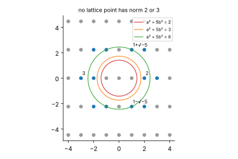

<sub>הסריג ℤ［√−5］ והנורמות: אין אף נקודה על האליפסות a² + 5b² = 2 ו-a² + 5b² = 3.</sub>

---

## 2. שדות מספרים וחוגי שלמים

**שדה מספרים** הוא הרחבה סופית $`K`$ של $`\mathbb Q`$. המעלה $`n = [K : \mathbb Q]`$.

**שלם אלגברי** הוא מספר שהוא שורש של פולינום **מתוקן** עם מקדמים **שלמים**. השלמים האלגבריים ב-$`K`$ יוצרים חוג, $`\mathcal O_K`$, **חוג השלמים** של $`K`$. הוא ממלא את התפקיד של $`\mathbb Z`$ בתוך $`\mathbb Q`$: למשל, המספרים הרציונליים שהם שלמים אלגבריים הם בדיוק $`\mathbb Z`$.

**שדות ריבועיים** $`K = \mathbb Q(\sqrt d)`$, $`d`$ חופשי מריבועים:
```math
\mathcal O_K = \mathbb Z[\omega],\qquad \omega = \begin{cases}\sqrt d & d \equiv 2, 3 \pmod 4,\\[2pt] \dfrac{1 + \sqrt d}{2} & d \equiv 1 \pmod 4.\end{cases}
```
**למה יש חצאים כש-$`d \equiv 1`$?** האיבר $`\omega = \tfrac{1 + \sqrt d}{2}`$ הוא שורש של $`x^2 - x + \tfrac{1 - d}{4}`$, ו-$`\tfrac{1-d}{4}`$ שלם בדיוק כש-$`d \equiv 1 \pmod 4`$. לדוגמה, $`\tfrac{1 + \sqrt{-3}}{2}`$ שורש של $`x^2 - x + 1`$ (זהו $`e^{i\pi/3}`$, שורש יחידה), ו-$`\tfrac{1 + \sqrt5}{2}`$ – יחס הזהב – שורש של $`x^2 - x - 1`$. (ההוכחה המלאה: [שלם ריבועי](../pages/%D7%A9%D7%9C%D7%9D%20%D7%A8%D7%99%D7%91%D7%95%D7%A2%D7%99.md).)

**הדיסקרימיננטה** של שדה ריבועי:
```math
\Delta_K = \begin{cases} d & d \equiv 1 \pmod 4,\\ 4d & d \equiv 2, 3 \pmod 4.\end{cases}
```
למשל $`\Delta_{\mathbb Q(i)} = -4`$, $`\Delta_{\mathbb Q(\sqrt{-5})} = -20`$, $`\Delta_{\mathbb Q(\sqrt{-23})} = -23`$, $`\Delta_{\mathbb Q(\sqrt 5)} = 5`$. באופן כללי, הדיסקרימיננטה של שדה ממעלה $`n`$ עם בסיס שלם $`b_1, \ldots, b_n`$ היא $`\det\bigl(\mathrm{Tr}(b_ib_j)\bigr)`$; ל-$`\mathbb Z[\sqrt{-5}]`$ עם הבסיס $`1, \sqrt{-5}`$: $`\det\begin{pmatrix}2 & 0\\ 0 & -10\end{pmatrix} = -20`$. ([דיסקרימיננטה של שדה מספרים](../pages/%D7%93%D7%99%D7%A1%D7%A7%D7%A8%D7%99%D7%9E%D7%99%D7%A0%D7%A0%D7%98%D7%94%20%D7%A9%D7%9C%20%D7%A9%D7%93%D7%94%20%D7%9E%D7%A1%D7%A4%D7%A8%D7%99%D7%9D.md).) נראה בהמשך: **הראשוניים שמחלקים את $`\Delta_K`$ הם בדיוק הראשוניים "המיוחדים"** (המסועפים).

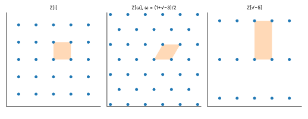

<sub>שלושה חוגי שלמים: ℤ［i］ (ריבועי), ℤ［ω］ עם ω = (1+√−3)/2 (משושה), ℤ［√−5］ (מלבני).</sub>

---

## 3. אידיאלים: הפירוק היחיד חוזר

הרעיון של קומר ודדקינד: אם אין מספיק "ראשוניים" ב-$`\mathcal O_K`$, נוסיף **ראשוניים אידיאליים**. במקום לפרק את המספר $`6`$, נפרק את **האידיאל** $`(6) = 6\mathcal O_K`$.

**המשפט היסודי של דדקינד.** בחוג השלמים $`\mathcal O_K`$ של כל שדה מספרים, כל אידיאל $`I \ne 0`$ מתפרק **באופן יחיד** (עד כדי סדר) למכפלה של אידיאלים ראשוניים:
```math
I = \mathfrak p_1^{e_1}\cdots\mathfrak p_r^{e_r}.
```
(חוגים עם התכונה הזו נקראים **[חוגי דדקינד](https://he.wikipedia.org/wiki/%D7%97%D7%95%D7%92_%D7%93%D7%93%D7%A7%D7%99%D7%A0%D7%93)**.) בנוסף, "לחלק = להכיל": $`\mathfrak a \mid \mathfrak b \iff \mathfrak a \supseteq \mathfrak b`$.

**מכפלת אידיאלים:** $`IJ`$ = האידיאל שנוצר על ידי כל המכפלות $`ab`$ עם $`a \in I`$, $`b \in J`$. אם $`I = (a_1, a_2)`$ ו-$`J = (b_1, b_2)`$, אז $`IJ = (a_1b_1, a_1b_2, a_2b_1, a_2b_2)`$.

### דוגמה 2: איך 6 מתפרק לאידיאלים ב-$`\mathbb Z[\sqrt{-5}]`$
נגדיר שלושה אידיאלים:
```math
\mathfrak p_2 = (2,\ 1 + \sqrt{-5}),\qquad \mathfrak p_3 = (3,\ 1 + \sqrt{-5}),\qquad \mathfrak p_3' = (3,\ 1 - \sqrt{-5}).
```
**$`\mathfrak p_2^2 = (2)`$.** היוצרים של $`\mathfrak p_2^2`$: $`4`$, $`2(1 + \sqrt{-5}) = 2 + 2\sqrt{-5}`$, ו-$`(1 + \sqrt{-5})^2 = -4 + 2\sqrt{-5}`$. כולם מתחלקים ב-2, ולכן $`\mathfrak p_2^2 \subseteq (2)`$. בכיוון השני, $`(2 + 2\sqrt{-5}) - (-4 + 2\sqrt{-5}) - 4 = 2`$, ולכן $`2 \in \mathfrak p_2^2`$.

**$`\mathfrak p_3\mathfrak p_3' = (3)`$.** היוצרים: $`9`$, $`3(1 - \sqrt{-5})`$, $`3(1 + \sqrt{-5})`$, $`(1 + \sqrt{-5})(1 - \sqrt{-5}) = 6`$. כולם כפולות של 3, ו-$`9 - 6 = 3`$ במכפלה.

**$`\mathfrak p_2\mathfrak p_3 = (1 + \sqrt{-5})`$** ו-**$`\mathfrak p_2\mathfrak p_3' = (1 - \sqrt{-5})`$** (בדיקה דומה; תרגיל 1).

ועכשיו שני הפירוקים של 6 הם **אותו פירוק**, בקיבוץ שונה:
```math
(6) = (2)(3) = \mathfrak p_2^2\cdot\mathfrak p_3\mathfrak p_3' \qquad\text{וגם}\qquad (6) = (1+\sqrt{-5})(1 - \sqrt{-5}) = \mathfrak p_2\mathfrak p_3\cdot\mathfrak p_2\mathfrak p_3' .
```
האידיאלים $`\mathfrak p_2, \mathfrak p_3, \mathfrak p_3'`$ ראשוניים ו**לא ראשיים** – הם ה"מספרים האידיאליים" של קומר.

**למה $`\mathfrak p_2`$ אינו ראשי?** אילו $`\mathfrak p_2 = (\alpha)`$, אז $`(\alpha)^2 = (2)`$, ולכן $`N(\alpha)^2 = N(2) = 4`$, $`N(\alpha) = 2`$ – ואין איבר כזה.

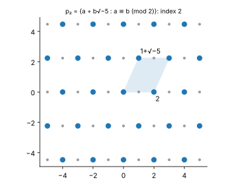

<sub>האידיאל 𝔭₂ = (2, 1+√−5) כתת-סריג מאינדקס 2 ב-ℤ［√−5］ (נקודות כחולות): "חצי" מהנקודות.</sub>

### נורמה של אידיאל
**הנורמה** של אידיאל $`I`$ היא מספר האיברים בחוג המנה: $`N(I) = |\mathcal O_K/I|`$. היא **כפלית**, ולאידיאל ראשי $`N((\alpha)) = |N(\alpha)|`$. ב-$`\mathbb Z[\sqrt{-5}]`$: $`N(\mathfrak p_2) = 2`$ (מודולו $`\mathfrak p_2`$: $`\sqrt{-5} \equiv -1`$ ו-$`2 \equiv 0`$, נשארים $`\{0, 1\}`$), $`N(\mathfrak p_3) = N(\mathfrak p_3') = 3`$, ובדיקה: $`N((1 + \sqrt{-5})) = 6 = 2\cdot 3`$. ([נורמה של אידיאל](../pages/%D7%A0%D7%95%D7%A8%D7%9E%D7%94%20%D7%A9%D7%9C%20%D7%90%D7%99%D7%93%D7%99%D7%90%D7%9C.md).)

---

## 4. איך ראשוני מתפרק: פיצול, אינרציה וסיעוף

בהינתן ראשוני רגיל $`p`$, איך מתפרק $`(p) = p\mathcal O_K`$? אם $`(p) = \mathfrak p_1^{e_1}\cdots\mathfrak p_g^{e_g}`$ ו-$`N(\mathfrak p_i) = p^{f_i}`$, אז מהכפליות
```math
\sum_{i=1}^g e_if_i = n = [K:\mathbb Q].
```
בשדה ריבועי ($`n = 2`$) יש רק שלוש אפשרויות:
| סוג | פירוק | $`e, f, g`$ |
|---|---|---|
| **מתפצל** | $`(p) = \mathfrak p\,\mathfrak p'`$, $`\mathfrak p \ne \mathfrak p'`$ | $`1, 1, 2`$ |
| **אינרטי** | $`(p)`$ נשאר ראשוני | $`1, 2, 1`$ |
| **מסועף** | $`(p) = \mathfrak p^2`$ | $`2, 1, 1`$ |

### משפט דדקינד–קומר
אם $`\mathcal O_K = \mathbb Z[\alpha]`$ ו-$`f`$ הפולינום המינימלי של $`\alpha`$, אז **הפירוק של $`(p)`$ מחקה את הפירוק של $`f`$ מודולו $`p`$**: אם $`f \equiv \pi_1^{e_1}\cdots\pi_g^{e_g} \pmod p`$ (גורמים אי-פריקים שונים), אז
```math
(p) = \mathfrak p_1^{e_1}\cdots\mathfrak p_g^{e_g},\qquad \mathfrak p_i = (p,\ \pi_i(\alpha)),\qquad N(\mathfrak p_i) = p^{\deg\pi_i}.
```
(הניסוח הכללי, והתנאי כשאין בסיס חזקות: [משפט דדקינד–קומר](../pages/%D7%9E%D7%A9%D7%A4%D7%98%20%D7%93%D7%93%D7%A7%D7%99%D7%A0%D7%93%E2%80%93%D7%A7%D7%95%D7%9E%D7%A8.md).)

### דוגמה 3: הראשוניים ב-$`\mathbb Z[\sqrt{-5}]`$
$`f = x^2 + 5`$:
* $`p = 2`$: $`x^2 + 5 \equiv x^2 + 1 \equiv (x + 1)^2`$ → $`(2) = (2, 1 + \sqrt{-5})^2`$, **מסועף**.
* $`p = 3`$: $`x^2 + 5 \equiv x^2 - 1 = (x - 1)(x + 1)`$ → $`(3) = (3, \sqrt{-5} - 1)(3, \sqrt{-5} + 1)`$, **מתפצל** (בדיוק $`\mathfrak p_3'\mathfrak p_3`$ מדוגמה 2).
* $`p = 5`$: $`x^2`$ → $`(5) = (\sqrt{-5})^2`$, **מסועף**.
* $`p = 7`$: $`x^2 + 5 \equiv x^2 - 2`$, ו-$`3^2 = 9 \equiv 2`$ → מתפצל.
* $`p = 11`$: $`x^2 + 5 \equiv x^2 - 6`$; הריבועים מודולו 11 הם $`1, 4, 9, 5, 3`$, ו-6 לא ביניהם → **אינרטי**.

### הכלל לשדות ריבועיים
בשדה ריבועי, עבור $`p`$ אי-זוגי שאינו מחלק את $`\Delta`$: הפולינום $`x^2 - d`$ מתפרק מודולו $`p`$ אם ורק אם $`d`$ ריבוע מודולו $`p`$. לכן
```math
p \text{ מתפצל} \iff \left(\frac{\Delta}{p}\right) = 1,\qquad p \text{ אינרטי} \iff \left(\frac{\Delta}{p}\right) = -1,\qquad p \text{ מסועף} \iff p \mid \Delta .
```
(גם הראשוני 2 מתנהג לפי סימן קרונקר המתאים.) נגדיר $`\chi_\Delta(p) = \left(\frac{\Delta}{p}\right)`$. **חוק ההדדיות הריבועית** (שיעור 7) אומר ש-$`\chi_\Delta(p)`$ תלוי רק ב-**$`p`$ מודולו $`|\Delta|`$** – כלומר $`\chi_\Delta`$ הוא **קרקטר של דיריכלה** מודולו $`|\Delta|`$! למשל ב-$`\mathbb Q(i)`$: $`\chi_{-4}(p) = \left(\frac{-1}{p}\right) = (-1)^{(p-1)/2}`$, ולכן $`p`$ מתפצל ב-$`\mathbb Z[i]`$ אם ורק אם $`p \equiv 1 \pmod 4`$ – שוב פרמה. זה המקרה הפשוט ביותר של **חוק הדדיות**: "איך $`p`$ מתפרק" נקבע לפי חפיפה של $`p`$.

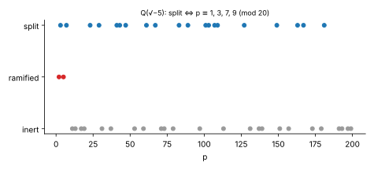

<sub>הראשוניים עד 200 ב-Q(√−5): מתפצלים (כחול), אינרטיים (אפור), מסועפים (אדום, 2 ו-5). הפיצול תלוי רק ב-p mod 20.</sub>

**בדיקה מספרית ל-$`\mathbb Q(\sqrt{-5})`$:** $`\chi_{-20}(p) = 1`$ בדיוק כש-$`p \bmod 20 \in \{1, 3, 7, 9\}`$. ואכן 3, 7 מתפצלים ו-11 (≡ 11) אינרטי. (ראו גם [פיצול של אידיאלים ראשוניים בהרחבות גלואה](../pages/%D7%A4%D7%99%D7%A6%D7%95%D7%9C%20%D7%A9%D7%9C%20%D7%90%D7%99%D7%93%D7%99%D7%90%D7%9C%D7%99%D7%9D%20%D7%A8%D7%90%D7%A9%D7%95%D7%A0%D7%99%D7%99%D7%9D%20%D7%91%D7%94%D7%A8%D7%97%D7%91%D7%95%D7%AA%20%D7%92%D7%9C%D7%95%D7%90%D7%94.md).)

### דוגמה 4: שדה ממעלה 3 – $`\mathbb Q(\sqrt[3]2)`$
כאן $`\mathcal O_K = \mathbb Z[\sqrt[3]2]`$, $`f = x^3 - 2`$, $`\Delta = -108 = -2^2\cdot3^3`$:
* $`p = 5`$: $`3^3 = 27 \equiv 2`$, ולכן $`x^3 - 2 \equiv (x - 3)(x^2 + 3x + 4)`$, והגורם הריבועי אי-פריק (הדיסקרימיננטה שלו $`9 - 16 \equiv 3`$ אינה ריבוע מודולו 5). לכן $`(5) = \mathfrak p\,\mathfrak q`$ עם $`N(\mathfrak p) = 5`$, $`N(\mathfrak q) = 25`$: **$`f`$-ים שונים** – זה קורה כי ההרחבה אינה גלואה.
* $`p = 7`$: הקובים מודולו 7 הם $`0, 1, 6`$, ו-2 לא ביניהם → $`x^3 - 2`$ אי-פריק, $`(7)`$ אינרטי, $`N = 343`$.
* $`p = 31`$: $`4^3 \equiv 7^3 \equiv 20^3 \equiv 2 \pmod{31}`$ → מתפצל לחלוטין לשלושה ראשוניים מנורמה 31.
* $`p = 2, 3`$: $`x^3`$ ו-$`(x+1)^3`$ → **מסועפים לחלוטין**, בהתאם ל-$`2, 3 \mid \Delta`$.

---

## 5. חבורת המחלקות

**שני אידיאלים שקולים** אם $`(a)I = (b)J`$ עבור $`a, b \ne 0`$ – כלומר אם הם "שווים עד כדי אידיאל ראשי". מחלקות השקילות יוצרות **חבורה** תחת כפל אידיאלים: **[חבורת מחלקות האידיאלים](../pages/%D7%97%D7%91%D7%95%D7%A8%D7%AA%20%D7%9E%D7%97%D7%9C%D7%A7%D7%95%D7%AA%20%D7%94%D7%90%D7%99%D7%93%D7%99%D7%90%D7%9C%D7%99%D7%9D.md)** $`\mathrm{Cl}(K)`$. האיבר הנייטרלי הוא מחלקת האידיאלים הראשיים. הגודל שלה, $`h_K`$, הוא **מספר המחלקה**.
```math
h_K = 1 \iff \text{כל אידיאל ראשי} \iff \mathcal O_K \text{ תחום פריקות יחידה}.
```

**משפט (חסם מינקובסקי).** בכל מחלקה יש אידיאל עם נורמה
```math
N(I) \le M_K = \left(\frac4\pi\right)^{r_2}\frac{n!}{n^n}\sqrt{|\Delta_K|},
```
כאשר $`r_2`$ מספר הזוגות של שיכונים מרוכבים. מאחר שיש רק מספר סופי של אידיאלים עם נורמה חסומה (כל אחד מחלק את $`(m)`$ עבור $`m \le M_K`$), **$`h_K`$ סופי**. ההוכחה משתמשת בגאומטריה של סריגים: גוף קמור סימטרי גדול מספיק חייב להכיל נקודת סריג ([משפט מינקובסקי](https://he.wikipedia.org/wiki/%D7%9E%D7%A9%D7%A4%D7%98_%D7%9E%D7%99%D7%A0%D7%A7%D7%95%D7%91%D7%A1%D7%A7%D7%99)). לשדה ריבועי מדומה ($`n = 2`$, $`r_2 = 1`$): $`M_K = \tfrac{2}{\pi}\sqrt{|\Delta|}`$.

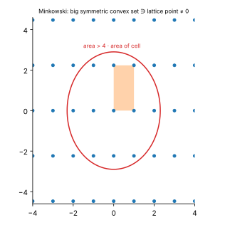

<sub>משפט מינקובסקי: אליפסה סימטרית ששטחה גדול מ-4 כפול שטח התא היסודי חייבת להכיל נקודת סריג שאינה 0.</sub>

### דוגמה 5: $`h(\mathbb Q(\sqrt{-5})) = 2`$
$`M_K = \tfrac2\pi\sqrt{20} \approx 2.85`$. לכן כל מחלקה מכילה אידיאל מנורמה 1 או 2. נורמה 1: רק $`\mathcal O_K`$. נורמה 2: אידיאל כזה מכיל את $`2`$ (כי $`|\mathcal O_K/I| = 2`$ גורר $`2 \cdot 1 \in I`$), ולכן מופיע בפירוק $`(2) = \mathfrak p_2^2`$ – הוא $`\mathfrak p_2`$. יש אפוא **לכל היותר שתי מחלקות**: $`[\mathcal O_K]`$ ו-$`[\mathfrak p_2]`$. הן שונות, כי $`\mathfrak p_2`$ לא ראשי. לכן $`h = 2`$ ו-$`\mathrm{Cl} \cong \mathbb Z/2`$. ומה עם $`\mathfrak p_3`$? $`\mathfrak p_2\mathfrak p_3 = (1 + \sqrt{-5})`$ ראשי, ולכן $`[\mathfrak p_3] = [\mathfrak p_2]^{-1} = [\mathfrak p_2]`$.

**מסקנה מעשית:** ב-$`\mathbb Z[\sqrt{-5}]`$, ראשוני $`p`$ הוא מהצורה $`a^2 + 5b^2`$ אם ורק אם $`p`$ מתפצל **לאידיאלים ראשיים**. למשל $`29 = 3^2 + 5\cdot2^2`$ (מתפצל, $`29 \equiv 9 \pmod{20}`$, ובמחלקה הטריוויאלית), אבל $`3`$ ו-$`7`$ מתפצלים לאידיאלים לא ראשיים, ואינם מהצורה $`a^2 + 5b^2`$. במקום זאת הם מיוצגים על ידי התבנית השנייה $`2x^2 + 2xy + 3y^2`$: $`3`$ עם $`(x, y) = (0, 1)`$, ו-$`7 = 2 + 2 + 3`$ עם $`(x, y) = (1, 1)`$. באופן כללי, ראשוני $`p \ne 2, 5`$ מתפצל ב-$`\mathbb Q(\sqrt{-5})`$ אם ורק אם $`p \equiv 1, 3, 7, 9 \pmod{20}`$; אם $`p \equiv 1, 9`$ הוא מהצורה $`x^2 + 5y^2`$, ואם $`p \equiv 3, 7`$ – מהצורה $`2x^2 + 2xy + 3y^2`$.

### דוגמה 6: $`h(\mathbb Q(\sqrt{-23})) = 3`$, דרך תבניות ריבועיות
לשדות ריבועיים מדומים יש דרך נוחה לחשב: $`h`$ = מספר ה**תבניות המצומצמות** $`ax^2 + bxy + cy^2`$ עם $`b^2 - 4ac = \Delta`$, $`|b| \le a \le c`$ (ו-$`b \ge 0`$ אם $`|b| = a`$ או $`a = c`$), ו-$`\gcd(a,b,c) = 1`$. מ-$`b^2 \le a^2 \le ac`$ נובע $`3a^2 \le |\Delta|`$. עבור $`\Delta = -23`$: $`a \le 2`$, ו-$`b`$ אי-זוגי.
* $`a = 1`$: $`b = 1`$, $`c = 6`$: $`x^2 + xy + 6y^2`$.
* $`a = 2`$: $`b = \pm1`$, $`c = 3`$: $`2x^2 \pm xy + 3y^2`$.
שלוש תבניות, ולכן $`h = 3`$ ו-$`\mathrm{Cl} \cong \mathbb Z/3`$.

### דוגמה 7: 163 ופולינום של אוילר
עבור $`\Delta = -163`$: $`3a^2 \le 163`$ נותן $`a \le 7`$, וצריך $`b^2 + 163 = 4ac`$ עם $`b`$ אי-זוגי, $`|b| \le a`$. בודקים: $`a = 1, b = 1, c = 41`$ – יש. עבור $`a = 2, \ldots, 7`$ אין: $`(b^2 + 163)/4 = 41, 43.5, \ldots`$; למשל $`a = 3`$ דורש $`3 \mid 41`$ (עם $`b = \pm1`$) או $`3 \mid 43`$ (עם $`b = \pm 3`$) – לא. (בדיקה מלאה: תרגיל 4.) לכן $`h(-163) = 1`$. **ומכאן:** $`n^2 + n + 41`$ ראשוני לכל $`0 \le n \le 39`$! הסיבה: אילו ראשוני $`q \lt 41`$ היה מחלק $`n^2 + n + 41 = N\!\left(n + \tfrac{1 + \sqrt{-163}}{2}\right)`$, אז $`q`$ היה מתפצל ב-$`\mathbb Q(\sqrt{-163})`$ לאידיאלים **ראשיים** (כי $`h = 1`$) מנורמה $`q`$, כלומר $`q = x^2 + xy + 41y^2`$ – אבל זה לפחות 41 כש-$`y \ne 0`$. זה המשפט של רבינוביץ' ([מספר הגנר](../pages/%D7%9E%D7%A1%D7%A4%D7%A8%20%D7%94%D7%92%D7%A0%D7%A8.md)).

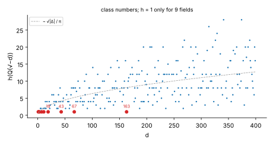

<sub>מספר המחלקה h(−d) לשדות ריבועיים מדומים, d חופשי מריבועים עד 400; תשעת השדות עם h = 1 מסומנים.</sub>

**התמונה הכללית:** $`h(\Delta) \to \infty`$ כש-$`|\Delta| \to \infty`$ (גאוס שיער, היילברון הוכיח), ויש בדיוק **תשעה** שדות ריבועיים מדומים עם $`h = 1`$: $`d = 1, 2, 3, 7, 11, 19, 43, 67, 163`$ (הגנר, בייקר, סטארק). לשדות ממשיים, **לא ידוע** אם יש אינסוף שדות עם $`h = 1`$ ([בעיית מספר המחלקה](../pages/%D7%91%D7%A2%D7%99%D7%99%D7%AA%20%D7%9E%D7%A1%D7%A4%D7%A8%20%D7%94%D7%9E%D7%97%D7%9C%D7%A7%D7%94.md)).

---

## 6. יחידות

**יחידה** של $`\mathcal O_K`$ היא איבר הפיך, ובשדה ריבועי – איבר מנורמה $`\pm1`$.
* **מדומה:** $`a^2 + |d|b^2 = 1`$ (או $`= 4`$ עם חצאים) – מספר סופי: $`\pm1, \pm i`$ ב-$`\mathbb Z[i]`$; ששת שורשי היחידה ב-$`\mathbb Z[\omega]`$; $`\pm1`$ בכל השאר.
* **ממשי:** $`a^2 - db^2 = \pm1`$ – **משוואת פל** (שיעור 8). יש **יחידה יסודית** $`\varepsilon \gt 1`$, וכל היחידות הן $`\pm\varepsilon^k`$.

**משפט היחידות של דיריכלה.** אם ל-$`K`$ יש $`r_1`$ שיכונים ממשיים ו-$`r_2`$ זוגות של מרוכבים, אז
```math
\mathcal O_K^\times \cong (\text{שורשי היחידה ב-}K) \times \mathbb Z^{r_1 + r_2 - 1}.
```
שדה ריבועי ממשי: $`r_1 = 2, r_2 = 0`$ → דרגה 1. מדומה: $`r_1 = 0, r_2 = 1`$ → דרגה 0. $`\mathbb Q(\sqrt[3]2)`$: $`r_1 = 1, r_2 = 1`$ → דרגה 1, עם היחידה היסודית $`1 + \sqrt[3]2 + \sqrt[3]4`$ (ההופכי שלה: $`\sqrt[3]2 - 1`$).

### דוגמה 8: היחידה היסודית של $`\mathbb Q(\sqrt 7)`$
השבר המשולב $`\sqrt7 = [2; \overline{1, 1, 1, 4}]`$; השברים המצטברים $`\tfrac21, \tfrac31, \tfrac52, \tfrac83`$; ו-$`8^2 - 7\cdot 3^2 = 1`$. לכן $`\varepsilon = 8 + 3\sqrt7 \approx 15.94`$. כל פתרון של $`x^2 - 7y^2 = 1`$ נתון על ידי $`x + y\sqrt7 = \pm(8 + 3\sqrt7)^k`$; למשל $`(8 + 3\sqrt7)^2 = 127 + 48\sqrt7`$, ואכן $`127^2 - 7\cdot48^2 = 16129 - 16128 = 1`$. ([יחידה יסודית](../pages/%D7%99%D7%97%D7%99%D7%93%D7%94%20%D7%99%D7%A1%D7%95%D7%93%D7%99%D7%AA%20%28%D7%AA%D7%95%D7%A8%D7%AA%20%D7%94%D7%9E%D7%A1%D7%A4%D7%A8%D7%99%D7%9D%29.md).)

**הרגולטור.** הגודל $`R_K = \log\varepsilon`$ (בשדה ריבועי ממשי) – "כמה גדולה היחידה" – מופיע לצד $`h_K`$ בנוסחה של הסעיף הבא.

---

## 7. פונקציית הזטא של דדקינד ונוסחת מספר המחלקה

כמו ש-$`\zeta(s) = \sum n^{-s}`$ סופרת שלמים חיוביים, **פונקציית הזטא של דדקינד** סופרת אידיאלים:
```math
\zeta_K(s) = \sum_{I \ne 0}\frac{1}{N(I)^s} = \prod_{\mathfrak p}\frac{1}{1 - N(\mathfrak p)^{-s}},\qquad \sigma \gt 1 .
```
מכפלת האוילר נובעת מהפירוק היחיד לאידיאלים – בדיוק כמו בשיעור 11.

**לשדה ריבועי** נקבץ לפי ראשוני $`p`$ את הגורמים של האידיאלים מעליו:
* מתפצל: $`(1 - p^{-s})^{-2}`$; אינרטי: $`(1 - p^{-2s})^{-1} = (1 - p^{-s})^{-1}(1 + p^{-s})^{-1}`$; מסועף: $`(1 - p^{-s})^{-1}`$.
בכל המקרים זה $`(1 - p^{-s})^{-1}(1 - \chi_\Delta(p)p^{-s})^{-1}`$, ולכן
```math
\zeta_K(s) = \zeta(s)\,L(s, \chi_\Delta).
```
**זו הנקודה:** פונקציית הזטא של השדה הריבועי היא **מכפלה של זטא של רימן בפונקציית L של דיריכלה** (שיעור 13). חוק ההדדיות הריבועית הוא מה שהופך את $`\chi_\Delta`$ לקרקטר.

**נוסחת מספר המחלקה של דיריכלה.** ל-$`\zeta_K`$ יש קוטב ב-$`s = 1`$ עם שארית שמכילה את $`h_K`$:
```math
\lim_{s\to1}(s - 1)\zeta_K(s) = L(1, \chi_\Delta) = \begin{cases}\dfrac{2\pi\,h_K}{w_K\sqrt{|\Delta|}} & \Delta \lt 0,\\[8pt] \dfrac{2h_K\log\varepsilon}{\sqrt{\Delta}} & \Delta \gt 0,\end{cases}
```
כאשר $`w_K`$ מספר שורשי היחידה ($`w = 4`$ ל-$`\mathbb Q(i)`$, $`6`$ ל-$`\mathbb Q(\sqrt{-3})`$, $`2`$ אחרת).

### דוגמה 9: בדיקה מספרית לנוסחה
* $`\mathbb Q(i)`$: $`L(1, \chi_{-4}) = 1 - \tfrac13 + \tfrac15 - \cdots = \tfrac\pi4`$ (לייבניץ). הנוסחה: $`\tfrac{2\pi\cdot h}{4\cdot 2} = \tfrac{\pi h}{4}`$ → $`h = 1`$. ✓
* $`\mathbb Q(\sqrt{-23})`$: חישוב מספרי נותן $`L(1, \chi_{-23}) \approx 1.9652`$, ו-$`\tfrac{2\pi\cdot 3}{2\sqrt{23}} \approx 1.9652`$. ✓ ($`h = 3`$, כמו בדוגמה 6.)
* $`\mathbb Q(\sqrt5)`$: $`L(1, \chi_5) = \tfrac{2}{\sqrt5}\log\tfrac{1 + \sqrt5}{2} \approx 0.4304`$, ו-$`h = 1`$, $`\varepsilon = \tfrac{1 + \sqrt5}{2}`$ (ראו תרגיל 2 בשיעור 13).

הנוסחה מסבירה את הקשר בין **אפסי זיגל** למספרי מחלקה (שיעור 13): $`L(1, \chi)`$ קטן מאוד ⇔ $`h`$ קטן ביחס ל-$`\sqrt{|\Delta|}`$.

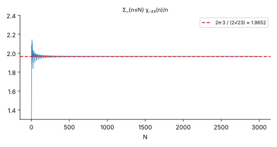

<sub>הסכומים החלקיים של Σχ₋₂₃(n)/n מתכנסים ל־2π·3/(2√23) ≈ 1.9652.</sub>

---

## 8. מבט קדימה: חבורת גלואה ופרובניוס

בהרחבת גלואה $`L/\mathbb Q`$, ראשוני לא מסועף $`p`$ קובע איבר מיוחד של חבורת הגלואה – **איבר פרובניוס** $`\mathrm{Frob}_p`$, שפועל כמו $`x \mapsto x^p`$ מודולו ראשוני מעל $`p`$. דוגמאות:
* $`\mathbb Q(i)`$: $`\mathrm{Frob}_p`$ הוא הזהות אם $`p \equiv 1 \pmod 4`$, וההצמדה אם $`p \equiv 3`$. אכן $`(a + bi)^p \equiv a + bi^p = a + b\,i\cdot(i^2)^{(p-1)/2}`$.
* $`\mathbb Q(\zeta_n)`$: $`\mathrm{Frob}_p = \sigma_p : \zeta \mapsto \zeta^p`$, ודרגת האינרציה $`f`$ של $`p`$ היא **הסדר של $`p`$ מודולו $`n`$**. למשל ב-$`\mathbb Q(\zeta_5)`$: 11 מתפצל לחלוטין ($`11 \equiv 1`$), 19 מתפצל לשני ראשוניים עם $`f = 2`$ ($`19 \equiv 4`$, מסדר 2), ו-2 אינרטי ($`2`$ מסדר 4 מודולו 5).

**חוק ההדדיות של ארטין** (תורת שדות המחלקה) אומר שבכל [הרחבה אבלית](../pages/%D7%94%D7%A8%D7%97%D7%91%D7%94%20%D7%90%D7%91%D7%9C%D7%99%D7%AA.md), $`\mathrm{Frob}_p`$ תלוי רק במחלקה של $`p`$ ב"חבורת מחלקות מוכללת" – ההכללה המרחיקת לכת של חוק ההדדיות הריבועית. הניסוח המודרני שלו משתמש ב[אידלים](../pages/%D7%97%D7%91%D7%95%D7%A8%D7%AA%20%D7%94%D7%90%D7%99%D7%93%D7%9C%D7%99%D7%9D.md). הרחבות **לא אבליות** – כאן מתחילה [תוכנית לנגלנדס](https://he.wikipedia.org/wiki/%D7%AA%D7%95%D7%9B%D7%A0%D7%99%D7%AA_%D7%9C%D7%A0%D7%92%D7%9C%D7%A0%D7%93%D7%A1) (שיעור 23).

---

## 9. תרגילים

**תרגיל 1.** הוכיחו ש-$`\mathfrak p_2\mathfrak p_3 = (1 + \sqrt{-5})`$ ב-$`\mathbb Z[\sqrt{-5}]`$, כאשר $`\mathfrak p_2 = (2, 1 + \sqrt{-5})`$ ו-$`\mathfrak p_3 = (3, 1 + \sqrt{-5})`$.

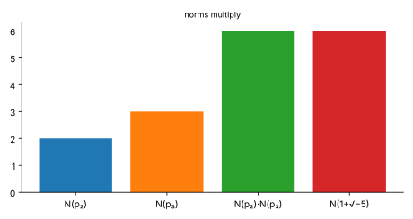

<sub>הנורמות כופלות: N(𝔭₂)·N(𝔭₃) = 2·3 = 6 = N(1+√−5).</sub>

<details><summary>פתרון</summary>

נסמן $`\beta = 1 + \sqrt{-5}`$. היוצרים של המכפלה: $`6`$, $`2\beta`$, $`3\beta`$, $`\beta^2 = -4 + 2\sqrt{-5}`$. כולם כפולות של $`\beta`$: $`6 = \beta\bar\beta = \beta(1 - \sqrt{-5})`$, ו-$`\beta^2 = \beta\cdot\beta`$. לכן $`\mathfrak p_2\mathfrak p_3 \subseteq (\beta)`$. בכיוון ההפוך: $`3\beta - 2\beta = \beta`$ נמצא במכפלה. לכן שוויון. (בדיקה: הנורמות $`2\cdot 3 = 6 = N(\beta)`$.)
</details>

**תרגיל 2.** קבעו איך מתפרקים 2, 3, 5, 7, 11, 13 ב-$`\mathbb Z[i]`$, ומצאו יוצר לכל אידיאל ראשוני.

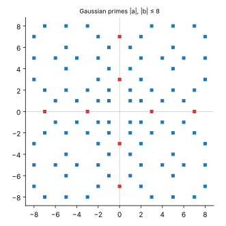

<sub>הראשוניים של ℤ［i］ במישור: ראשוניים רציונליים p ≡ 3 (mod 4) על הצירים, ו-a+bi עם a²+b² ראשוני.</sub>

<details><summary>פתרון</summary>

$`x^2 + 1`$ מודולו $`p`$: $`p = 2`$: $`(x + 1)^2`$ → $`(2) = (1 + i)^2`$, מסועף (ו-$`2 = -i(1+i)^2`$). $`p = 3, 7, 11`$ ($`\equiv 3 \pmod 4`$): אי-פריק → אינרטיים. $`p = 5`$: $`x^2 + 1 \equiv (x - 2)(x + 2)`$ → $`5 = (2 + i)(2 - i)`$. $`p = 13`$: $`5^2 = 25 \equiv -1`$ → $`(x - 5)(x + 5)`$, ו-$`13 = (3 + 2i)(3 - 2i)`$. (את היוצר מוצאים מ-$`p = a^2 + b^2`$, כי $`\mathbb Z[i]`$ תחום ראשי.)
</details>

**תרגיל 3.** חשבו את $`h(-20)`$, $`h(-24)`$ ו-$`h(-47)`$ בעזרת תבניות מצומצמות.

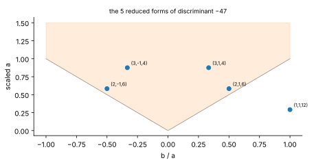

<sub>התחום היסודי של התבניות המצומצמות: |b| ≤ a ≤ c; הנקודות הן התבניות ל-Δ = −47.</sub>

<details><summary>פתרון</summary>

**$`\Delta = -20`$:** $`a \le 2`$, $`b`$ זוגי. $`a = 1`$: $`b = 0`$, $`c = 5`$. $`a = 2`$: $`b = 0`$ נותן $`c = 5/2`$ – לא; $`b = 2`$: $`c = 3`$ ✓. שתי תבניות: $`x^2 + 5y^2`$, $`2x^2 + 2xy + 3y^2`$ → $`h = 2`$.
**$`\Delta = -24`$:** $`a \le 2`$. $`a = 1, b = 0, c = 6`$; $`a = 2, b = 0, c = 3`$ ✓ ($`b = 2`$ נותן $`c = 28/8`$ – לא). → $`h = 2`$.
**$`\Delta = -47`$:** $`a \le 3`$, $`b`$ אי-זוגי. $`a = 1`$: $`(1, 1, 12)`$. $`a = 2`$: $`b = \pm1`$, $`c = 6`$: $`(2, \pm1, 6)`$. $`a = 3`$: $`b = \pm1`$, $`c = 4`$: $`(3, \pm1, 4)`$; $`b = \pm 3`$ נותן $`c = 56/12`$ – לא. סה"כ 5 → $`h(-47) = 5`$ (כמו בתרגיל 3 של שיעור 13).
</details>

**תרגיל 4.** השלימו את הבדיקה ש-$`h(-163) = 1`$: הראו שאין תבנית מצומצמת $`(a, b, c)`$ עם $`2 \le a \le 7`$.

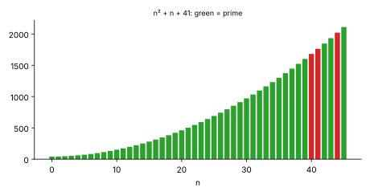

<sub>n² + n + 41 עבור n = 0..45: כולם ראשוניים עד n = 39 (ירוק); ב-n = 40 מתקבל 41².</sub>

<details><summary>פתרון</summary>

צריך $`b`$ אי-זוגי, $`|b| \le a`$, ו-$`4ac = b^2 + 163`$. הערכים האפשריים של $`(b^2 + 163)/4`$: $`b = \pm1 \to 41`$, $`\pm3 \to 43`$, $`\pm5 \to 47`$, $`\pm7 \to 53`$. כל אלה **ראשוניים**, ולכן $`ac = 41, 43, 47, 53`$ מחייב $`a = 1`$ (כי $`a \le c`$). לכן אין תבנית עם $`a \ge 2`$, ו-$`h = 1`$. (זו בעצם אותה תופעה כמו ב-$`n^2 + n + 41`$: הערכים $`41, 43, 47, 53`$ הם $`n^2 + n + 41`$ עבור $`n = 0, 1, 2, 3`$.)
</details>

**תרגיל 5.** מצאו את היחידה היסודית של $`\mathbb Q(\sqrt{13})`$ ושל $`\mathbb Q(\sqrt{19})`$. באיזה מהם יש יחידה מנורמה $`-1`$?

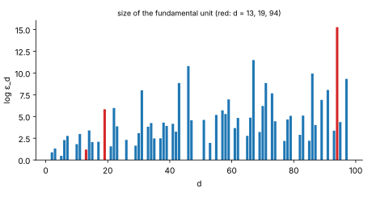

<sub>log ε_d עבור d חופשי מריבועים עד 100: היחידה היסודית יכולה להיות גדולה מאוד (d = 94).</sub>

<details><summary>פתרון</summary>

**$`d = 13 \equiv 1 \pmod 4`$:** מחפשים את הפתרון הקטן של $`x^2 - 13y^2 = \pm4`$: $`(3, 1)`$ עם $`9 - 13 = -4`$. לכן $`\varepsilon = \tfrac{3 + \sqrt{13}}{2}`$, מנורמה $`-1`$. (ב-$`\mathbb Z[\sqrt{13}]`$ לבדו היחידה הקטנה היא $`\varepsilon^3 = 18 + 5\sqrt{13}`$.)
**$`d = 19`$:** השבר המשולב של $`\sqrt{19}`$ הוא $`[4; \overline{2, 1, 3, 1, 2, 8}]`$ (מחזור 6, זוגי), והשברים המצטברים מגיעים ל-$`\tfrac{170}{39}`$: $`170^2 - 19\cdot39^2 = 28900 - 28899 = 1`$. לכן $`\varepsilon = 170 + 39\sqrt{19}`$, מנורמה $`+1`$; אין יחידה מנורמה $`-1`$ (גם כי $`19 \equiv 3 \pmod 4`$ מחלק את $`\Delta = 76`$).
</details>

**תרגיל 6.** ב-$`\mathbb Q(\zeta_5)`$ (שדה ממעלה 4), קבעו את $`e, f, g`$ עבור $`p = 2, 5, 11, 19`$, ובדקו ש-$`efg = 4`$.

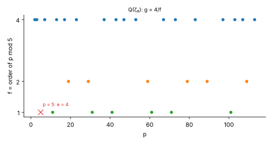

<sub>הפירוק של x⁴+x³+x²+x+1 מודולו p: מספר הגורמים g והמעלה f לפי הסדר של p מודולו 5.</sub>

<details><summary>פתרון</summary>

$`f`$ = הסדר של $`p`$ מודולו 5, ו-$`g = 4/f`$ (כש-$`p \ne 5`$). $`p = 2`$: $`2, 4, 3, 1`$ → סדר 4 → $`f = 4, g = 1`$ (אינרטי). $`p = 11 \equiv 1`$ → $`f = 1, g = 4`$ (מתפצל לחלוטין; מודולו 11 הפולינום מתפרק לארבעה גורמים ליניאריים: שורשיו $`3, 4, 5, 9`$, השאריות מסדר 5 מודולו 11). $`p = 19 \equiv 4`$, מסדר 2 → $`f = 2, g = 2`$: $`x^4 + x^3 + x^2 + x + 1 \equiv (x^2 + 5x + 1)(x^2 - 4x + 1) \pmod{19}`$. $`p = 5`$: $`(x - 1)^4`$ → $`e = 4, f = g = 1`$ (מסועף לחלוטין; $`\Delta = 125 = 5^3`$). בכל המקרים $`efg = 4`$.
</details>

---

## סיכום
* **$`\mathcal O_K`$**: השלמים האלגבריים בשדה. בשדה ריבועי $`\mathbb Z[\sqrt d]`$ או $`\mathbb Z[\tfrac{1 + \sqrt d}{2}]`$; דיסקרימיננטה $`d`$ או $`4d`$.
* **פירוק לאיברים** יכול להיכשל ($`6`$ ב-$`\mathbb Z[\sqrt{-5}]`$); **פירוק לאידיאלים ראשוניים** תמיד יחיד (דדקינד).
* **פיצול**: $`\sum e_if_i = n`$; דדקינד–קומר = פירוק הפולינום מודולו $`p`$; בשדה ריבועי – לפי $`\left(\frac{\Delta}{p}\right)`$, קרקטר מודולו $`|\Delta|`$ (הדדיות). מסועפים ⇔ $`p \mid \Delta`$.
* **חבורת המחלקות** סופית (מינקובסקי); $`h(-5) = 2`$, $`h(-23) = 3`$, $`h(-163) = 1`$ ⇒ $`n^2 + n + 41`$.
* **יחידות**: דרגה $`r_1 + r_2 - 1`$ (דיריכלה); פל = יחידות של שדה ריבועי ממשי.
* **$`\zeta_K = \zeta\cdot L(s, \chi_\Delta)`$** ונוסחת מספר המחלקה: $`L(1, \chi_\Delta)`$ שווה ל-$`h`$ כפול גורמים מפורשים.

**להעמקה:** [שדה מספרים](https://he.wikipedia.org/wiki/%D7%A9%D7%93%D7%94_%D7%9E%D7%A1%D7%A4%D7%A8%D7%99%D7%9D) · [חוג דדקינד](https://he.wikipedia.org/wiki/%D7%97%D7%95%D7%92_%D7%93%D7%93%D7%A7%D7%99%D7%A0%D7%93) · [משפט היחידות של דיריכלה](https://he.wikipedia.org/wiki/%D7%9E%D7%A9%D7%A4%D7%98_%D7%94%D7%99%D7%97%D7%99%D7%93%D7%95%D7%AA_%D7%A9%D7%9C_%D7%93%D7%99%D7%A8%D7%99%D7%9B%D7%9C%D7%94) · [פונקציית זטא של דדקינד](https://he.wikipedia.org/wiki/%D7%A4%D7%95%D7%A0%D7%A7%D7%A6%D7%99%D7%99%D7%AA_%D7%96%D7%98%D7%90_%D7%A9%D7%9C_%D7%93%D7%93%D7%A7%D7%99%D7%A0%D7%93) · [שלם ריבועי](../pages/%D7%A9%D7%9C%D7%9D%20%D7%A8%D7%99%D7%91%D7%95%D7%A2%D7%99.md) · [אידיאל שבור](../pages/%D7%90%D7%99%D7%93%D7%99%D7%90%D7%9C%20%D7%A9%D7%91%D7%95%D7%A8.md) · [נורמה של אידיאל](../pages/%D7%A0%D7%95%D7%A8%D7%9E%D7%94%20%D7%A9%D7%9C%20%D7%90%D7%99%D7%93%D7%99%D7%90%D7%9C.md) · [חבורת מחלקות האידיאלים](../pages/%D7%97%D7%91%D7%95%D7%A8%D7%AA%20%D7%9E%D7%97%D7%9C%D7%A7%D7%95%D7%AA%20%D7%94%D7%90%D7%99%D7%93%D7%99%D7%90%D7%9C%D7%99%D7%9D.md) · [דיסקרימיננטה של שדה מספרים](../pages/%D7%93%D7%99%D7%A1%D7%A7%D7%A8%D7%99%D7%9E%D7%99%D7%A0%D7%A0%D7%98%D7%94%20%D7%A9%D7%9C%20%D7%A9%D7%93%D7%94%20%D7%9E%D7%A1%D7%A4%D7%A8%D7%99%D7%9D.md) · [אידיאל השונה](../pages/%D7%90%D7%99%D7%93%D7%99%D7%90%D7%9C%20%D7%94%D7%A9%D7%95%D7%A0%D7%94.md) · [משפט דדקינד–קומר](../pages/%D7%9E%D7%A9%D7%A4%D7%98%20%D7%93%D7%93%D7%A7%D7%99%D7%A0%D7%93%E2%80%93%D7%A7%D7%95%D7%9E%D7%A8.md) · [פיצול של אידיאלים ראשוניים בהרחבות גלואה](../pages/%D7%A4%D7%99%D7%A6%D7%95%D7%9C%20%D7%A9%D7%9C%20%D7%90%D7%99%D7%93%D7%99%D7%90%D7%9C%D7%99%D7%9D%20%D7%A8%D7%90%D7%A9%D7%95%D7%A0%D7%99%D7%99%D7%9D%20%D7%91%D7%94%D7%A8%D7%97%D7%91%D7%95%D7%AA%20%D7%92%D7%9C%D7%95%D7%90%D7%94.md) · [סיעוף (מתמטיקה)](../pages/%D7%A1%D7%99%D7%A2%D7%95%D7%A3%20%28%D7%9E%D7%AA%D7%9E%D7%98%D7%99%D7%A7%D7%94%29.md) · [יחידה יסודית (תורת המספרים)](../pages/%D7%99%D7%97%D7%99%D7%93%D7%94%20%D7%99%D7%A1%D7%95%D7%93%D7%99%D7%AA%20%28%D7%AA%D7%95%D7%A8%D7%AA%20%D7%94%D7%9E%D7%A1%D7%A4%D7%A8%D7%99%D7%9D%29.md) · [שדה ממעלה שלישית](../pages/%D7%A9%D7%93%D7%94%20%D7%9E%D7%9E%D7%A2%D7%9C%D7%94%20%D7%A9%D7%9C%D7%99%D7%A9%D7%99%D7%AA.md) · [שדה דו-ריבועי](../pages/%D7%A9%D7%93%D7%94%20%D7%93%D7%95-%D7%A8%D7%99%D7%91%D7%95%D7%A2%D7%99.md) · [מספר הגנר](../pages/%D7%9E%D7%A1%D7%A4%D7%A8%20%D7%94%D7%92%D7%A0%D7%A8.md) · [בעיית מספר המחלקה](../pages/%D7%91%D7%A2%D7%99%D7%99%D7%AA%20%D7%9E%D7%A1%D7%A4%D7%A8%20%D7%94%D7%9E%D7%97%D7%9C%D7%A7%D7%94.md) · [הערכה p-אדית](../pages/%D7%94%D7%A2%D7%A8%D7%9B%D7%94%20p-%D7%90%D7%93%D7%99%D7%AA.md) · [חבורת סיעוף](../pages/%D7%97%D7%91%D7%95%D7%A8%D7%AA%20%D7%A1%D7%99%D7%A2%D7%95%D7%A3.md) · [תורת קומר](../pages/%D7%AA%D7%95%D7%A8%D7%AA%20%D7%A7%D7%95%D7%9E%D7%A8.md) · [חבורת האידלים](../pages/%D7%97%D7%91%D7%95%D7%A8%D7%AA%20%D7%94%D7%90%D7%99%D7%93%D7%9C%D7%99%D7%9D.md)

**השיעור הקודם:** [שיעור כלים כ14: חוגים, אידיאלים והרחבות שדות](T14-חוגים-אידיאלים-ושדות.md) · **השיעור הבא:** [שיעור 19א: תורת שדות המחלקה: הדדיות ארטין, משפט הקיום ותורה מקומית](19א-תורת-שדות-המחלקה.md)

---
<sub>חלק מ[קורס תורת המספרים](../COURSE.md). התוכן מופץ ברישיון [CC BY-SA 4.0](https://creativecommons.org/licenses/by-sa/4.0/).</sub>
