# שיעור 19א: תורת שדות המחלקה – הדדיות ארטין, משפט הקיום ותורה מקומית

**מה נלמד:** בסוף שיעור 19 ראינו שבשדה $`\mathbb Q(\zeta_n)`$ האופן שבו ראשוני $`p`$ מתפרק תלוי רק ב-$`p \bmod n`$. תורת שדות המחלקה אומרת שזו לא מקריות: **בכל הרחבה אבלית** הפירוק של ראשוניים נקבע על ידי "חבורת מחלקות מוכללת". נראה ש:
1. **משפט קרונקר–ובר**: כל הרחבה אבלית של $`\mathbb Q`$ יושבת בתוך שדה ציקלוטומי $`\mathbb Q(\zeta_m)`$.
2. **הדדיות ארטין**: איבר פרובניוס $`\mathrm{Frob}_\mathfrak p`$ תלוי רק במחלקה של $`\mathfrak p`$ בחבורת מחלקות קרן, וההעתקה $`\mathfrak p \mapsto \mathrm{Frob}_\mathfrak p`$ היא איזומורפיזם. זו ההכללה של חוק ההדדיות הריבועית.
3. **משפט הקיום**: לכל חבורת מחלקות קרן יש שדה מתאים. המקרה הראשון הוא **שדה מחלקות הילברט**, והוא עונה על השאלה "אילו ראשוניים הם מהצורה $`x^2 + 5y^2`$?".
4. **התורה המקומית**: אותו סיפור מעל $`\mathbb Q_p`$, עם **סמל הילברט** ו**נוסחת המכפלה**, שהיא שוב ההדדיות הריבועית.
5. **סכומי גאוס ויעקובי**: הכלים המפורשים שמאחורי התורה, והקשר לחבורת המחלקות של $`\mathbb Q(\zeta_p)`$ (שטיקלברגר, הרברנד–ריבט).

**ידע קודם:** [שיעור 7](07-שאריות-ריבועיות.md) (הדדיות ריבועית, שורשים פרימיטיביים), [שיעור 13](13-קרקטרים-ופונקציות-L.md) (קרקטרים של דיריכלה), [שיעור 19](19-תורת-המספרים-האלגברית.md) (אידיאלים, פיצול, חבורת המחלקות, פרובניוס), [שיעור כלים כ14](T14-חוגים-אידיאלים-ושדות.md) (חבורות גלואה, נורמה).

---

## 1. הנקודה שבה עצרנו: פרובניוס ב-$`\mathbb Q(\zeta_n)`$

תזכורת: חבורת הגלואה של $`\mathbb Q(\zeta_n)/\mathbb Q`$ היא $`(\mathbb Z/n\mathbb Z)^\times`$, כאשר $`a`$ מתאים לאוטומורפיזם $`\sigma_a : \zeta_n \mapsto \zeta_n^a`$. לראשוני $`p \nmid n`$:
```math
\mathrm{Frob}_p = \sigma_p .
```
כלומר **פרובניוס של $`p`$ הוא פשוט $`p \bmod n`$**. ההעתקה
```math
\{\text{ראשוניים } p \nmid n\} \longrightarrow \mathrm{Gal}(\mathbb Q(\zeta_n)/\mathbb Q), \qquad p \mapsto \mathrm{Frob}_p
```
מתרחבת באופן כפלי לכל המספרים הרציונליים החיוביים הזרים ל-$`n`$, ותלויה רק בשארית מודולו $`n`$. זו **העתקת ארטין** של השדה הציקלוטומי, וכאן היא ברורה לגמרי.

### דוגמה 1: העתקת ארטין של $`\mathbb Q(\zeta_5)`$
$`\mathrm{Gal}(\mathbb Q(\zeta_5)/\mathbb Q) \cong (\mathbb Z/5)^\times = \{1, 2, 3, 4\}`$, ציקלית מסדר 4 (נוצרת על ידי 2).
* $`p = 11 \equiv 1`$: $`\mathrm{Frob}_{11} = \mathrm{id}`$, ולכן 11 **מתפצל לחלוטין** (לארבעה ראשוניים, $`f = 1`$).
* $`p = 19 \equiv 4`$: $`\mathrm{Frob}_{19} = \sigma_4`$ מסדר 2, ולכן $`f = 2`$, $`g = 2`$.
* $`p = 2`$ ו-$`p = 3`$: $`\sigma_2, \sigma_3`$ מסדר 4, ולכן הם **אינרטיים**.

תת-השדות של $`\mathbb Q(\zeta_5)`$ מתאימים לתת-חבורות של $`(\mathbb Z/5)^\times`$. תת-החבורה $`\{1, 4\}`$ מתאימה לשדה הריבועי היחיד בפנים, $`\mathbb Q(\sqrt 5)`$ (כי $`\zeta_5 + \zeta_5^4 - \zeta_5^2 - \zeta_5^3 = \sqrt 5`$; זה [סכום גאוס](../pages/%D7%A1%D7%9B%D7%95%D7%9D%20%D7%92%D7%90%D7%95%D7%A1.md), סעיף 7). מכאן מיד: **$`p`$ מתפצל ב-$`\mathbb Q(\sqrt 5)`$ אם ורק אם $`p \equiv \pm 1 \pmod 5`$**, כלומר $`\left(\frac{5}{p}\right) = 1 \iff p \equiv \pm1 \pmod 5`$. זה חוק ההדדיות הריבועית עבור 5, שהתקבל בלי חישוב אחד של סמלי לז'נדר.

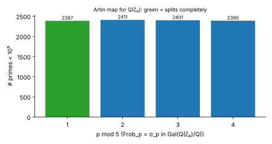

<sub>ספירת הראשוניים עד 10⁵ לפי p mod 5: כל אחת מארבע המחלקות מקבלת בערך רבע (צ'בוטרב/דיריכלה); הירוקים מתפצלים לחלוטין ב-ℚ(ζ₅).</sub>

---

## 2. משפט קרונקר–ובר

**משפט (קרונקר 1853, ובר 1886, הילברט 1896).** כל הרחבה אבלית סופית של $`\mathbb Q`$ מוכלת באיזה שדה ציקלוטומי $`\mathbb Q(\zeta_m)`$.

ה-$`m`$ הקטן ביותר נקרא ה[מוליך](../pages/%D7%9E%D7%95%D7%9C%D7%99%D7%9A%20%28%D7%AA%D7%95%D7%A8%D7%AA%20%D7%A9%D7%93%D7%95%D7%AA%20%D7%94%D7%9E%D7%97%D7%9C%D7%A7%D7%94%29.md) של ההרחבה. המשמעות: כל שאלה על פירוק ראשוניים בהרחבה אבלית של $`\mathbb Q`$ נענית על ידי **תנאי קונגרואנציה** על $`p`$. השדה $`K \subseteq \mathbb Q(\zeta_m)`$ מתאים לתת-חבורה $`H \le (\mathbb Z/m)^\times`$, ו-$`p \nmid m`$ מתפצל לחלוטין ב-$`K`$ אם ורק אם $`p \bmod m \in H`$.

### דוגמה 2: שדות ריבועיים
לכל שדה ריבועי עם דיסקרימיננטה $`\Delta`$: $`\mathbb Q(\sqrt\Delta) \subseteq \mathbb Q(\zeta_{|\Delta|})`$, והמוליך הוא $`|\Delta|`$.
* $`\mathbb Q(i) = \mathbb Q(\zeta_4)`$, מוליך 4.
* $`\mathbb Q(\sqrt 2) \subseteq \mathbb Q(\zeta_8)`$: $`\zeta_8 + \zeta_8^{-1} = 2\cos\tfrac{\pi}{4} = \sqrt 2`$. תת-החבורה היא $`\{1, 7\} = \{\pm 1\} \le (\mathbb Z/8)^\times`$ (האוטומורפיזמים $`\sigma_{\pm1}`$ קובעים את $`\zeta_8 + \zeta_8^{-1}`$). לכן $`p`$ מתפצל ב-$`\mathbb Q(\sqrt 2)`$ אם ורק אם $`p \equiv \pm 1 \pmod 8`$ – **החוק המשלים השני** $`\left(\frac 2p\right) = 1 \iff p \equiv \pm1 \pmod 8`$.
* $`\mathbb Q(\sqrt{-5})`$: $`\Delta = -20`$, מוליך 20.

### דוגמה 3: שדה ממעלה 3 בתוך $`\mathbb Q(\zeta_7)`$
$`(\mathbb Z/7)^\times`$ ציקלית מסדר 6, ותת-החבורה $`\{\pm 1\}`$ מסדר 2 מתאימה לשדה ממעלה 3: $`\mathbb Q(\zeta_7)^+ = \mathbb Q(\cos\tfrac{2\pi}{7})`$. המספר $`\alpha = 2\cos\tfrac{2\pi}{7} = \zeta_7 + \zeta_7^{-1}`$ הוא שורש של
```math
x^3 + x^2 - 2x - 1 .
```
(בדיקה: $`\alpha^2 = \zeta^2 + \zeta^{-2} + 2`$, $`\alpha^3 = \zeta^3 + \zeta^{-3} + 3\alpha`$, והסכום $`\zeta + \zeta^2 + \dots + \zeta^6 = -1`$ נותן $`\alpha^3 + \alpha^2 - 2\alpha - 1 = 0`$.)

מסקנת קרונקר–ובר: **לפולינום $`x^3 + x^2 - 2x - 1`$ יש שלושה שורשים מודולו $`p`$ אם ורק אם $`p \equiv \pm 1 \pmod 7`$**, ואחרת (עבור $`p \ne 7`$) אין לו אף שורש. למשל: מודולו 13 ($`\equiv -1`$) ומודולו 29 ($`\equiv 1`$) יש שלושה שורשים; מודולו 2, 3, 5, 11 אין שורשים; מודולו 7 יש שורש אחד (משולש: $`x^3 + x^2 - 2x - 1 \equiv (x - 2)^3 \pmod 7`$, כי 7 מסועף). בדקנו בחישוב את השקילות לכל הראשוניים עד 2000.

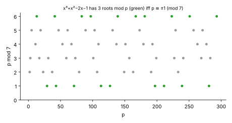

<sub>p mod 7 לעומת מספר השורשים של x³+x²−2x−1 מודולו p: ירוק (שלושה שורשים) מופיע בדיוק בשורות 1 ו-6.</sub>

**ומה לא אבלי?** עבור $`x^3 - 2`$ (חבורת גלואה $`S_3`$, לא אבלית) **אין** תנאי קונגרואנציה: שלושה שורשים מודולו $`p`$ אם ורק אם $`p \equiv 1 \pmod 3`$ **ו**-2 הוא שארית ממעלה שלישית מודולו $`p`$, וגאוס הוכיח שזה שקול ל-$`p = x^2 + 27y^2`$ (תרגיל 3). תבנית ריבועית במקום קונגרואנציה – זה בדיוק סימן לתורת שדות המחלקה מעל שדה **ריבועי** ($`\mathbb Q(\sqrt{-3})`$), לא מעל $`\mathbb Q`$.

---

## 3. מעל שדה מספרים כללי: חבורת מחלקות קרן והדדיות ארטין

מעל שדה $`K`$ כללי אין "שארית מודולו $`n`$" פשוטה. התחליף:

**מודולוס** $`\mathfrak m`$ הוא אידיאל $`\mathfrak m_0`$ של $`\mathcal O_K`$, אולי יחד עם חלק מהשיכונים הממשיים של $`K`$ ("ראשוניים אינסופיים"). **חבורת מחלקות קרן** (ray class group) היא
```math
\mathrm{Cl}_\mathfrak m(K) = \frac{I^\mathfrak m}{P_{\mathfrak m, 1}},
```
כאשר $`I^\mathfrak m`$ הם האידיאלים השבורים הזרים ל-$`\mathfrak m_0`$, ו-$`P_{\mathfrak m,1}`$ הם האידיאלים הראשיים $`(\alpha)`$ עם $`\alpha \equiv 1 \pmod{\mathfrak m_0}`$ (וחיובי בשיכונים הממשיים שבתוך $`\mathfrak m`$). היא תמיד סופית.
* $`\mathfrak m = (1)`$: מקבלים את חבורת המחלקות הרגילה $`\mathrm{Cl}(K)`$.
* $`K = \mathbb Q`$, $`\mathfrak m = (m)\infty`$: כל אידיאל הוא $`(a)`$ עם $`a > 0`$ יחיד, ומקבלים $`(\mathbb Z/m)^\times`$. בלי $`\infty`$ מקבלים $`(\mathbb Z/m)^\times/\{\pm 1\}`$.

**משפט ההדדיות של ארטין (1927).** תהי $`L/K`$ הרחבה אבלית. קיים מודולוס $`\mathfrak m`$ (המתחלק בכל הראשוניים המסועפים) כך ש[העתקת ארטין](../pages/%D7%94%D7%93%D7%93%D7%99%D7%95%D7%AA%20%D7%90%D7%A8%D7%98%D7%99%D7%9F.md)
```math
\mathrm{Cl}_\mathfrak m(K) \longrightarrow \mathrm{Gal}(L/K), \qquad \mathfrak p \longmapsto \mathrm{Frob}_\mathfrak p
```
מוגדרת היטב (כלומר $`\mathrm{Frob}_\mathfrak p`$ תלוי רק במחלקה של $`\mathfrak p`$) ו**על**. הגרעין הוא תת-החבורה שנוצרת על ידי הנורמות $`N_{L/K}(\mathfrak P)`$ מ-$`L`$.

**משפט הקיום (טקאגי 1920).** להפך: לכל תת-חבורה $`H \le \mathrm{Cl}_\mathfrak m(K)`$ יש הרחבה אבלית **יחידה** $`L/K`$ שהעתקת ארטין שלה משרה $`\mathrm{Cl}_\mathfrak m(K)/H \cong \mathrm{Gal}(L/K)`$. ([משפט הקיום של טקאגי](../pages/%D7%9E%D7%A9%D7%A4%D7%98%20%D7%94%D7%A7%D7%99%D7%95%D7%9D%20%D7%A9%D7%9C%20%D7%98%D7%A7%D7%90%D7%92%D7%99.md).)

השדה המתאים ל-$`H = \{1\}`$ נקרא [שדה מחלקת הקרן](../pages/%D7%A9%D7%93%D7%94%20%D7%9E%D7%97%D7%9C%D7%A7%D7%AA%20%D7%A7%D7%A8%D7%9F.md) מודולו $`\mathfrak m`$. עבור $`K = \mathbb Q`$ שדה מחלקת הקרן מודולו $`m\infty`$ הוא $`\mathbb Q(\zeta_m)`$ – וזה בדיוק קרונקר–ובר. עבור $`\mathfrak m = (1)`$ מקבלים את **[שדה מחלקות הילברט](../pages/%D7%A9%D7%93%D7%94%20%D7%94%D7%9E%D7%97%D7%9C%D7%A7%D7%94%20%D7%A9%D7%9C%20%D7%94%D7%99%D7%9C%D7%91%D7%A8%D7%98.md)** $`H_K`$:
* $`H_K/K`$ היא ההרחבה האבלית **הלא-מסועפת** המקסימלית של $`K`$ (גם באינסוף);
* $`\mathrm{Gal}(H_K/K) \cong \mathrm{Cl}(K)`$, ולכן $`[H_K : K] = h_K`$;
* אידיאל ראשוני $`\mathfrak p`$ של $`K`$ מתפצל לחלוטין ב-$`H_K`$ **אם ורק אם הוא ראשי**.

**למה זה "הדדיות"?** עבור $`K = \mathbb Q`$ ו-$`L = \mathbb Q(\sqrt q)`$: $`\mathrm{Frob}_p`$ הוא $`\left(\frac{q}{p}\right)`$ (כאיבר של $`\{\pm1\}`$), וארטין אומר שהוא תלוי רק ב-$`p \bmod 4q`$ (המוליך). זה תוכן ההדדיות הריבועית: $`\left(\frac qp\right)`$, שמוגדר כשאלה **מודולו $`p`$**, מתברר כפונקציה של **$`p`$ מודולו $`q`$** (ו-4).

---

## 4. שדה מחלקות הילברט בפעולה

### דוגמה 4: $`H`$ של $`\mathbb Q(\sqrt{-5})`$, ומתי $`p = x^2 + 5y^2`$
מ[שיעור 19](19-תורת-המספרים-האלגברית.md): $`K = \mathbb Q(\sqrt{-5})`$, $`h = 2`$, ושתי התבניות המצומצמות עם $`\Delta = -20`$ הן $`x^2 + 5y^2`$ (המחלקה הראשית) ו-$`2x^2 + 2xy + 3y^2`$ (המחלקה האחרת).

**השדה $`H`$.** צריך הרחבה ריבועית של $`K`$ שאינה מסועפת אף במקום. הטענה: $`H = K(i) = \mathbb Q(\sqrt{-5}, i)`$.
* $`\mathbb Q(\sqrt{-5}, i)`$ מכיל שלושה שדות ריבועיים: $`\mathbb Q(\sqrt{-5})`$ (מסועף ב-2, 5), $`\mathbb Q(i)`$ (מסועף רק ב-2), $`\mathbb Q(\sqrt 5)`$ (מסועף רק ב-5).
* 5 אינו מסועף ב-$`\mathbb Q(i)`$, ו-2 אינו מסועף ב-$`\mathbb Q(\sqrt 5)`$. לכן אינדקס הסיעוף של כל ראשוני ב-$`\mathbb Q(\sqrt{-5}, i)/\mathbb Q`$ הוא לכל היותר 2, והוא כבר "מוצה" ב-$`K`$: ההרחבה $`H/K`$ לא מסועפת מעל 2 ו-5, וכמובן לא מעל ראשוניים אחרים. באינסוף $`K`$ כבר מרוכב, ולכן אין שם סיעוף.
* מעלה 2 = $`h`$, ולכן זה **כל** שדה מחלקות הילברט.

(זהו גם [שדה הגנוס](../pages/%D7%A9%D7%93%D7%94%20%D7%94%D7%92%D7%A0%D7%95%D7%A1.md): $`\Delta = -20 = (-4)\cdot 5`$ מתפרק לשתי דיסקרימיננטות ראשוניות, $`H \supseteq K(\sqrt{-4}, \sqrt 5)`$. כאן $`\mathrm{Cl}(K) \cong \mathbb Z/2`$, וכל הגנוס מכיל מחלקה אחת, ולכן שדה הגנוס הוא כל $`H`$.)

**המסקנה.** ראשוני $`p \ne 2, 5`$ הוא $`x^2 + 5y^2`$ $`\iff`$ $`p`$ מתפצל ב-$`K`$ לאידיאלים **ראשיים** $`\iff`$ $`p`$ מתפצל לחלוטין ב-$`H`$ $`\iff`$ $`p`$ מתפצל ב-$`\mathbb Q(\sqrt{-5})`$ **וגם** ב-$`\mathbb Q(i)`$ $`\iff`$ $`\left(\frac{-5}{p}\right) = \left(\frac{-1}{p}\right) = 1`$ $`\iff`$
```math
p \equiv 1 \text{ או } 9 \pmod{20}.
```
באותו אופן $`p = 2x^2 + 2xy + 3y^2`$ $`\iff`$ $`p`$ מתפצל ב-$`K`$ אבל לא ב-$`\mathbb Q(i)`$ $`\iff`$ $`p \equiv 3, 7 \pmod{20}`$.

| $`p`$ | $`p \bmod 20`$ | הצגה |
|---|---|---|
| 3 | 3 | $`2\cdot0^2 + 2\cdot0\cdot1 + 3\cdot1^2`$ |
| 7 | 7 | $`2 + 2 + 3`$ ($`x = y = 1`$) |
| 29 | 9 | $`3^2 + 5\cdot 2^2`$ |
| 41 | 1 | $`6^2 + 5\cdot 1^2`$ |
| 43 | 3 | $`2\cdot 1^2 + 2\cdot 1\cdot 3 + 3\cdot 3^2 = 2 + 6 + 27`$ |
| 61 | 1 | $`4^2 + 5\cdot 3^2`$ |
| 11, 13, 17, 19 | 11, 13, 17, 19 | אף אחת (לא מתפצלים ב-$`K`$) |

בדקנו בחישוב את שתי השקילויות לכל הראשוניים עד 200.

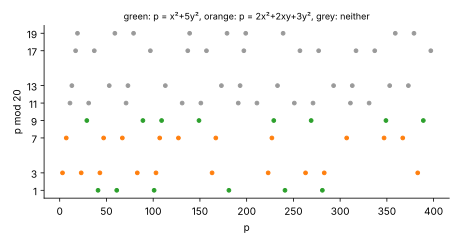

<sub>p mod 20 לעומת p: ירוק = x²+5y², כתום = 2x²+2xy+3y²; כל צבע תופס בדיוק שתי שורות.</sub>

### דוגמה 5: $`\mathbb Q(\sqrt{-23})`$ – שדה הילברט שאינו אבלי מעל $`\mathbb Q`$
כאן $`h = 3`$ (שיעור 19, דוגמה 6). $`H`$ הוא הרחבה ממעלה 3 של $`K`$ וממעלה 6 של $`\mathbb Q`$, וחבורת הגלואה $`\mathrm{Gal}(H/\mathbb Q)`$ היא $`S_3`$ – **לא אבלית**. מתברר ש-$`H`$ הוא שדה הפיצול של
```math
x^3 - x - 1 \qquad (\text{דיסקרימיננטה } -4\cdot(-1)^3 - 27 = -23).
```
מכאן: $`p \ne 23`$ הוא $`x^2 + xy + 6y^2`$ (התבנית הראשית עם $`\Delta = -23`$) אם ורק אם ל-$`x^3 - x - 1`$ יש **שלושה** שורשים מודולו $`p`$. הראשוני הראשון כזה (מלבד 23 המסועף) הוא $`59 = 5^2 + 5\cdot 2 + 6\cdot 2^2 = 25 + 10 + 24`$, ומודולו 59 אכן יש ל-$`x^3 - x - 1`$ שלושה שורשים. אחריו $`101, 167, 173`$. מודולו 2, 3, 13 אין לו שורשים כלל. בדקנו בחישוב גם ש-$`H`$, שדה ממעלה 6, הוא בעל דיסקרימיננטה $`-23^3 = -12167`$ – בדיוק מה שמצפים מהרחבה לא מסועפת ממעלה 3 של $`K`$. בדקנו בחישוב את השקילות של "שלושה שורשים" ו"$`p = x^2 + xy + 6y^2`$" לכל הראשוניים עד 3000.

אין כאן שום תנאי קונגרואנציה: הקבוצה $`\{59, 101, 167, 173, \dots\}`$ אינה איחוד של מחלקות מודולו מספר כלשהו. זה ההבדל בין הרחבות אבליות של $`\mathbb Q`$ (קרונקר–ובר) לבין הרחבות אבליות של **שדה ריבועי** – שמעל $`\mathbb Q`$ הן כבר לא אבליות.

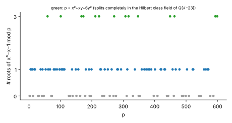

<sub>מספר השורשים של x³−x−1 מודולו p: ירוק (שלושה שורשים) = הראשוניים שהם x²+xy+6y².</sub>

**הכללה (כפל מרוכב).** לשדה ריבועי מדומה $`K`$, שדה מחלקות הילברט הוא $`K(j(\tau))`$, כאשר $`j`$ היא פונקציית j של קליין ו-$`\tau = \tfrac{-b + \sqrt\Delta}{2a}`$. זו תורת ה[כפל המרוכב](../pages/%D7%9B%D7%A4%D7%9C%20%D7%9E%D7%A8%D7%95%D7%9B%D7%91.md) – "החלום של קרונקר" שהתגשם עבור שדות ריבועיים מדומים. (מעל $`\mathbb Q`$ הפונקציה $`e^{2\pi i x}`$ ממלאת את אותו תפקיד: הערכים שלה בנקודות רציונליות יוצרים את כל ההרחבות האבליות.)

---

## 5. מגדל שדות המחלקה

שאלה טבעית: אם $`h_K \gt 1`$, אפשר לעבור ל-$`H_K`$, ואז ל-$`H_{H_K}`$, וכן הלאה. האם התהליך נעצר בשדה עם $`h = 1`$? (אם כן, כל שדה נמצא בתוך שדה עם פירוק יחיד.)
* ל-$`\mathbb Q(\sqrt{-5})`$: $`H = \mathbb Q(\sqrt{-5}, i)`$, ומספר המחלקה שלו 1 (בדקנו בחישוב). המגדל נעצר אחרי צעד אחד. כך גם עבור $`\mathbb Q(\sqrt{-23})`$: לשדה הפיצול של $`x^3 - x - 1`$ מספר מחלקה 1.
* **[משפט גולוד–שפרביץ'](../pages/%D7%9E%D7%A9%D7%A4%D7%98%20%D7%92%D7%95%D7%9C%D7%95%D7%93%E2%80%93%D7%A9%D7%A4%D7%A8%D7%91%D7%99%D7%A5%27.md) (1964):** יש שדות שהמגדל שלהם אינסופי. דוגמה: $`\mathbb Q(\sqrt{-30030})`$, עם $`30030 = 2\cdot3\cdot5\cdot7\cdot11\cdot13`$. לשדה כזה אין שום הרחבה סופית עם מספר מחלקה 1.

---

## 6. התורה המקומית: $`\mathbb Q_p`$ וסמל הילברט

מעל המספרים ה-$`p`$-אדיים התמונה פשוטה יותר. **[תורת שדות המחלקה המקומית](../pages/%D7%AA%D7%95%D7%A8%D7%AA%20%D7%A9%D7%93%D7%95%D7%AA%20%D7%94%D7%9E%D7%97%D7%9C%D7%A7%D7%94%20%D7%94%D7%9E%D7%A7%D7%95%D7%9E%D7%99%D7%AA.md):** לשדה מקומי $`F`$ (כמו $`\mathbb Q_p`$) יש התאמה הפוכת-סדר בין ההרחבות האבליות הסופיות $`L/F`$ לבין תת-החבורות מאינדקס סופי (הפתוחות) של $`F^\times`$:
```math
L \longmapsto N_{L/F}(L^\times), \qquad F^\times / N_{L/F}(L^\times) \;\cong\; \mathrm{Gal}(L/F).
```
* לשדה $`F = \mathbb Q_p`$ עם $`p`$ אי-זוגי: $`\mathbb Q_p^\times/(\mathbb Q_p^\times)^2`$ מסדר 4 (נציגים $`1, u, p, up`$, כאשר $`u`$ אי-שארית). לכן יש בדיוק **3** הרחבות ריבועיות: $`\mathbb Q_p(\sqrt u)`$ (הלא מסועפת), $`\mathbb Q_p(\sqrt p)`$, $`\mathbb Q_p(\sqrt{up})`$.
* לשדה $`\mathbb Q_2`$: $`\mathbb Q_2^\times/(\mathbb Q_2^\times)^2`$ מסדר 8 (נציגים $`\pm1, \pm 5, \pm 2, \pm 10`$, או $`1, 3, 5, 7, 2, 6, 10, 14`$), ולכן **7** הרחבות ריבועיות. רק אחת מהן לא מסועפת: $`\mathbb Q_2(\sqrt 5) = \mathbb Q_2(\sqrt{-3})`$ (כי $`5 \equiv -3 \pmod 8`$ ו-$`-15`$ הוא ריבוע ב-$`\mathbb Q_2`$, כי $`-15 \equiv 1 \pmod 8`$).

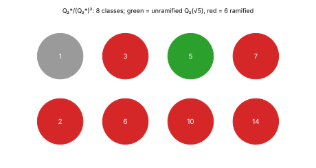

<sub>שמונה המחלקות של ℚ₂*/(ℚ₂*)²: אחת טריוויאלית, אחת נותנת את ההרחבה הלא מסועפת ℚ₂(√5), ושש נותנות הרחבות מסועפות.</sub>

**[סמל הילברט](../pages/%D7%A1%D7%9E%D7%9C%20%D7%94%D7%99%D7%9C%D7%91%D7%A8%D7%98.md).** עבור $`a, b \in \mathbb Q_v^\times`$ ($`v`$ ראשוני או $`\infty`$):
```math
(a, b)_v = \begin{cases} +1 & \text{אם ל-} z^2 = ax^2 + by^2 \text{ יש פתרון לא טריוויאלי ב-} \mathbb Q_v,\\ -1 & \text{אחרת.}\end{cases}
```
שקול: $`(a, b)_v = 1`$ אם ורק אם $`b`$ הוא נורמה מ-$`\mathbb Q_v(\sqrt a)`$. זו בדיוק העתקת ארטין המקומית של $`\mathbb Q_v(\sqrt a)/\mathbb Q_v`$, מופעלת על $`b`$.

**נוסחאות.**
* $`(a, b)_\infty = -1`$ אם ורק אם $`a \lt 0`$ ו-$`b \lt 0`$.
* $`p`$ אי-זוגי, $`a = p^\alpha u`$, $`b = p^\beta w`$ עם $`u, w`$ יחידות: $`(a, b)_p = (-1)^{\alpha\beta\frac{p-1}{2}}\left(\frac up\right)^\beta\left(\frac wp\right)^\alpha`$.
* $`p = 2`$: $`(a, b)_2 = (-1)^{\epsilon(u)\epsilon(w) + \alpha\,\omega(w) + \beta\,\omega(u)}`$, כאשר $`\epsilon(x) = \tfrac{x - 1}{2}`$ ו-$`\omega(x) = \tfrac{x^2 - 1}{8}`$ (מודולו 2).

### דוגמה 6: $`(2, 3)_v`$ בכל המקומות
* $`v = \infty`$: שניהם חיוביים → $`+1`$.
* $`v = 3`$: $`\alpha = 0`$, $`\beta = 1`$, $`u = 2`$: $`(2, 3)_3 = \left(\tfrac 23\right) = -1`$.
* $`v = 2`$: $`a = 2`$ ($`\alpha = 1`$, $`u = 1`$), $`b = 3`$ ($`\beta = 0`$, $`w = 3`$): המעריך $`\epsilon(1)\epsilon(3) + 1\cdot\omega(3) + 0 = 0 + 1 = 1`$ → $`-1`$.
* כל $`p \ge 5`$: $`2, 3`$ יחידות → $`+1`$.

מסקנה: **ל-$`2x^2 + 3y^2 = z^2`$ אין פתרון רציונלי לא טריוויאלי** – כבר ב-$`\mathbb Q_3`$ אין. (ישירות: מודולו 3, $`z^2 \equiv 2x^2`$ מחייב $`3 \mid x, z`$, ואז $`3 \mid y`$, וירידה אינסופית.) ושני ה-$`-1`$ מופיעים **בזוג**.

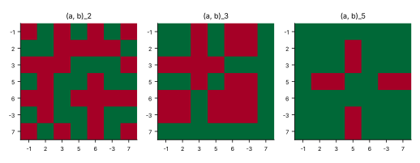

<sub>סמלי הילברט (a,b)_p עבור p = 2, 3, 5 ו-a, b מתוך {−1, 2, 3, 5, 6, −3, 7}: ירוק = +1, אדום = −1.</sub>

**נוסחת המכפלה של הילברט.** לכל $`a, b \in \mathbb Q^\times`$:
```math
\prod_{v} (a, b)_v = 1 \qquad (v \text{ רץ על כל הראשוניים ועל } \infty).
```
**זו ההדדיות הריבועית.** קחו $`a = p`$, $`b = q`$ ראשוניים אי-זוגיים שונים. הגורמים השונים מ-1 יכולים להיות רק ב-$`p`$, $`q`$, 2:
```math
(p, q)_p = \left(\tfrac qp\right), \qquad (p, q)_q = \left(\tfrac pq\right), \qquad (p, q)_2 = (-1)^{\frac{p-1}{2}\cdot\frac{q-1}{2}},
```
ונוסחת המכפלה אומרת $`\left(\tfrac qp\right)\left(\tfrac pq\right) = (-1)^{\frac{p-1}{2}\frac{q-1}{2}}`$. (עם $`a = -1`$ או $`a = 2`$ מקבלים את החוקים המשלימים.) בדקנו בחישוב את נוסחת המכפלה לכל $`a, b`$ עם $`|a|, |b| \le 30`$.

**עקרון האסה.** משפט האסה–מינקובסקי: לתבנית ריבועית מעל $`\mathbb Q`$ יש אפס לא טריוויאלי אם ורק אם יש לה כזה בכל $`\mathbb Q_v`$. עבור $`z^2 = ax^2 + by^2`$ פירוש הדבר: פתיר מעל $`\mathbb Q`$ $`\iff`$ $`(a, b)_v = 1`$ לכל $`v`$. ובגלל נוסחת המכפלה, מספיק לבדוק את כל המקומות **חוץ מאחד**. [משפט הנורמה של האסה](../pages/%D7%9E%D7%A9%D7%A4%D7%98%20%D7%94%D7%A0%D7%95%D7%A8%D7%9E%D7%94%20%D7%A9%D7%9C%20%D7%94%D7%90%D7%A1%D7%94.md) מכליל: בהרחבה **ציקלית** $`L/K`$, איבר הוא נורמה גלובלית אם ורק אם הוא נורמה מקומית בכל מקום.

**אלגברות קווטרניונים.** לכל זוג $`a, b`$ מתאימה אלגברת הקווטרניונים $`(a, b)_\mathbb Q`$ (עם $`i^2 = a`$, $`j^2 = b`$, $`ij = -ji`$). היא מתפצלת ב-$`\mathbb Q_v`$ בדיוק כש-$`(a, b)_v = 1`$. הקווטרניונים של המילטון, $`(-1, -1)`$, מסועפים ב-$`\infty`$ וב-2 בלבד – שוב מספר זוגי. [משפט אלברט–בראואר–האסה–נתר](../pages/%D7%9E%D7%A9%D7%A4%D7%98%20%D7%90%D7%9C%D7%91%D7%A8%D7%98%E2%80%93%D7%91%D7%A8%D7%90%D7%95%D7%90%D7%A8%E2%80%93%D7%94%D7%90%D7%A1%D7%94%E2%80%93%D7%A0%D7%AA%D7%A8.md) מכליל זאת לכל אלגברה פשוטה מרכזית.

**מקומי לגלובלי.** הניסוח המודרני מדביק את כל ההעתקות המקומיות להעתקה אחת על [חבורת האידלים](../pages/%D7%97%D7%91%D7%95%D7%A8%D7%AA%20%D7%94%D7%90%D7%99%D7%93%D7%9C%D7%99%D7%9D.md) $`\mathbb A_K^\times`$:
```math
\mathbb A_K^\times / K^\times \longrightarrow \mathrm{Gal}(K^{ab}/K),
```
והעובדה שהיא מתאפסת על $`K^\times`$ היא הגרסה הכללית של נוסחת המכפלה. ([חבורת וייל](../pages/%D7%97%D7%91%D7%95%D7%A8%D7%AA%20%D7%95%D7%99%D7%99%D7%9C.md) היא העידון שמשמש בתוכנית לנגלנדס, שיעור 23.)

---

## 7. סכומי גאוס וסכומי יעקובי

הדדיות ארטין היא משפט קיום מופשט. הצד המפורש שלה מגיע מ**סכומים** על שדות סופיים.

**[סכום גאוס](../pages/%D7%A1%D7%9B%D7%95%D7%9D%20%D7%92%D7%90%D7%95%D7%A1.md).** לקרקטר $`\chi`$ מודולו $`p`$:
```math
g(\chi) = \sum_{a = 1}^{p-1} \chi(a)\,\zeta_p^{a}, \qquad |g(\chi)| = \sqrt p \text{ (עבור } \chi \ne 1).
```
עבור הקרקטר הריבועי $`\chi = \left(\frac{\cdot}{p}\right)`$: $`g(\chi)^2 = \chi(-1)\,p = p^*`$, כלומר $`\sqrt{p^*} \in \mathbb Q(\zeta_p)`$ עם $`p^* = (-1)^{(p-1)/2}p`$. זו ההוכחה המפורשת ש-$`\mathbb Q(\sqrt{p^*}) \subseteq \mathbb Q(\zeta_p)`$ (קרונקר–ובר לשדות ריבועיים), ומכאן הדדיות ריבועית.

### דוגמה 7: סכומי גאוס הריבועיים ל-$`p = 5, 7, 13`$
* $`p = 5`$: השאריות $`\{1, 4\}`$; $`g = \zeta + \zeta^4 - \zeta^2 - \zeta^3 = 2\cos 72^\circ - 2\cos 144^\circ = 0.618 + 1.618 = 2.236 = \sqrt 5`$.
* $`p = 7`$: $`g = i\sqrt 7 \approx 2.6458\,i`$, ו-$`g^2 = -7`$ (כי $`7 \equiv 3 \pmod 4`$).
* $`p = 13`$: $`g = \sqrt{13} \approx 3.6056`$.

גאוס עצמו הוכיח שהסימן תמיד חיובי: $`g = \sqrt p`$ או $`i\sqrt p`$. בדקנו בחישוב את שלושת הערכים.

**[סכום יעקובי](../pages/%D7%A1%D7%9B%D7%95%D7%9D%20%D7%99%D7%A2%D7%A7%D7%95%D7%91%D7%99.md).** לשני קרקטרים: $`J(\chi, \psi) = \sum_{a} \chi(a)\psi(1 - a)`$. אם $`\chi\psi \ne 1`$:
```math
J(\chi, \psi) = \frac{g(\chi)\,g(\psi)}{g(\chi\psi)}, \qquad |J(\chi,\psi)| = \sqrt p .
```
היתרון: $`J`$ שייך לחוג **קטן** – $`\mathbb Z[i]`$ לקרקטר מסדר 4, $`\mathbb Z[\omega]`$ לקרקטר מסדר 3 – ו-$`|J|^2 = p`$ נותן הצגה מפורשת של $`p`$ כנורמה.

### דוגמה 8: $`p = a^2 + b^2`$ ו-$`4p = L^2 + 27M^2`$ מסכומי יעקובי
**קרקטר מסדר 4, $`p = 13`$.** השורש הפרימיטיבי 2; $`\chi(2^k) = i^k`$. מחשבים $`J(\chi, \chi) = 3 - 2i`$, ו-$`3^2 + 2^2 = 13`$. עבור $`p = 17`$: $`J = -1 + 4i`$, $`1 + 16 = 17`$. עבור $`p = 29`$: $`J = -5 - 2i`$, $`25 + 4 = 29`$.

**קרקטר מסדר 3, $`p \equiv 1 \pmod 3`$.** $`J(\chi, \chi) = a + b\omega`$ עם $`a^2 - ab + b^2 = p`$, ו-$`4p = (2a - b)^2 + 3b^2`$. מתברר ש-$`3 \mid b`$, ולכן $`4p = L^2 + 27M^2`$:

| $`p`$ | $`J = a + b\omega`$ | $`a^2 - ab + b^2`$ | $`4p = L^2 + 27M^2`$ |
|---|---|---|---|
| 7 | $`-1 - 3\omega`$ | $`1 - 3 + 9 = 7`$ | $`28 = 1 + 27`$ |
| 13 | $`-4 - 3\omega`$ | $`16 - 12 + 9 = 13`$ | $`52 = 25 + 27`$ |
| 19 | $`2 - 3\omega`$ | $`4 + 6 + 9 = 19`$ | $`76 = 49 + 27`$ |
| 31 | $`5 + 6\omega`$ | $`25 - 30 + 36 = 31`$ | $`124 = 16 + 108`$ |
| 37 | $`-4 + 3\omega`$ | $`16 + 12 + 9 = 37`$ | $`148 = 121 + 27`$ |

(הערכים של $`J`$ תלויים בבחירת השורש הפרימיטיבי; $`L, M`$ – עד סימן – לא.) ב-$`p = 31`$ המקדם $`M = 2`$ **זוגי**, ולכן $`31 = (L/2)^2 + 27(M/2)^2 = 2^2 + 27\cdot 1^2`$. זה בדיוק המקרה שבו 2 הוא שארית ממעלה שלישית (תרגיל 3). בדקנו בחישוב את כל השורות.

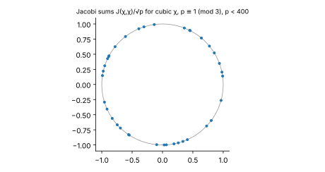

<sub>J(χ,χ)/√p עבור הקרקטר הממעלה השלישית, לכל p ≡ 1 (mod 3) עד 400: כל הנקודות על מעגל היחידה.</sub>

**[יחס האסה–דבנפורט](../pages/%D7%99%D7%97%D7%A1%20%D7%94%D7%90%D7%A1%D7%94%E2%80%93%D7%93%D7%91%D7%A0%D7%A4%D7%95%D7%A8%D7%98.md).** אם מרימים קרקטר $`\chi`$ של $`\mathbb F_p`$ ל-$`\mathbb F_{p^s}`$ דרך הנורמה, אז $`-g(\chi\circ N) = (-g(\chi))^s`$. בדיקה עם $`p = 3`$, $`s = 2`$, $`\chi`$ ריבועי: $`g(\chi) = i\sqrt 3`$, ולכן $`(-g(\chi))^2 = -3`$; וחישוב ישיר ב-$`\mathbb F_9 = \mathbb F_3[i]`$ נותן $`g(\chi\circ N) = 3`$, כלומר $`-g = -3`$ ✓. (בדקנו בחישוב.) זה הבסיס לספירת נקודות של עקומים מעל שדות סופיים ולפונקציות הזטא של שיעור 22.

---

## 8. חבורת המחלקות של $`\mathbb Q(\zeta_p)`$: שטיקלברגר, הרברנד–ריבט, איוואסאווה

סכומי גאוס שייכים ל-$`\mathbb Q(\zeta_p, \zeta_{p-1})`$, ו[משפט שטיקלברגר](../pages/%D7%9E%D7%A9%D7%A4%D7%98%20%D7%A9%D7%98%D7%99%D7%A7%D7%9C%D7%91%D7%A8%D7%92%D7%A8.md) מתאר את **הפירוק שלהם לאידיאלים ראשוניים**. מסקנה: **אלמנט שטיקלברגר** $`\theta = \sum_{a=1}^{p-1}\tfrac ap\sigma_a^{-1}`$ (בחוג החבורה) כמעט מאפס את חבורת המחלקות של $`\mathbb Q(\zeta_p)`$: $`\theta`$ עצמו אינו בעל מקדמים שלמים, אבל כל כפולה שלו שנופלת בחוג החבורה $`\mathbb Z[G]`$ (למשל $`(c - \sigma_c)\theta`$ עבור $`c`$ זר ל-$`p`$) **מאפסת** אותה.

כדי לפרק את חבורת המחלקות לפי הפעולה של $`(\mathbb Z/p)^\times`$, משתמשים ב[קרקטר טייכמילר](../pages/%D7%A7%D7%A8%D7%A7%D7%98%D7%A8%20%D7%98%D7%99%D7%99%D7%9B%D7%9E%D7%99%D7%9C%D7%A8.md) $`\omega : (\mathbb Z/p)^\times \to \mathbb Z_p^\times`$: $`\omega(a)`$ הוא שורש היחידה מסדר $`p - 1`$ ב-$`\mathbb Z_p`$ ש-$`\equiv a \pmod p`$. אפשר לחשב אותו: $`\omega(a) = \lim_k a^{p^k}`$.

### דוגמה 9: $`\omega(2)`$ ב-$`\mathbb Z_5`$
$`\omega(2)`$ הוא השורש של $`x^2 = -1`$ ב-$`\mathbb Z_5`$ ש-$`\equiv 2 \pmod 5`$:
* $`2^5 = 32 \equiv 7 \pmod{25}`$, ו-$`7^2 = 49 \equiv -1 \pmod{25}`$ ✓;
* $`2^{25} \equiv 57 \pmod{125}`$, ו-$`57^2 \equiv -1 \pmod{125}`$ ✓;
* $`2^{125} \equiv 182 \pmod{625}`$, ו-$`182^2 \equiv -1 \pmod{625}`$ ✓.

כלומר $`\omega(2) = 2 + 1\cdot 5 + 2\cdot 25 + 1\cdot 125 + \dots = \sqrt{-1} \in \mathbb Z_5`$. בדקנו בחישוב.

נסמן ב-$`A`$ את החלק ה-$`p`$-י של חבורת המחלקות של $`\mathbb Q(\zeta_p)`$, ו-$`A(\omega^i)`$ את הרכיב שעליו $`\sigma_a`$ פועל ככפל ב-$`\omega(a)^i`$.

**[משפט הרברנד–ריבט](../pages/%D7%9E%D7%A9%D7%A4%D7%98%20%D7%94%D7%A8%D7%91%D7%A8%D7%A0%D7%93%E2%80%93%D7%A8%D7%99%D7%91%D7%98.md).** עבור $`k`$ זוגי, $`2 \le k \le p - 3`$:
```math
A(\omega^{1-k}) \ne 0 \iff p \mid B_k \quad (\text{המונה של מספר ברנולי}).
```
הרברנד (1932) הוכיח את $`\Rightarrow`$ משטיקלברגר; ריבט (1976) הוכיח את $`\Leftarrow`$ בבניית הרחבה לא מסועפת מתבנית מודולרית (שיעור 21). זה מחדד את הקריטריון של קומר: $`p`$ **אי-רגולרי** ($`p \mid h(\mathbb Q(\zeta_p))`$) אם ורק אם $`p`$ מחלק מונה של $`B_k`$ כלשהו.

### דוגמה 10: $`p = 37`$
הראשוניים האי-רגולריים מתחת ל-200 הם $`37, 59, 67, 101, 103, 131, 149, 157`$. עבור 37: $`B_{32} = -\tfrac{7709321041217}{510}`$, ו-$`7709321041217 = 37 \cdot 208360028141`$. לכן $`k = 32`$, והרכיב הלא טריוויאלי הוא $`A(\omega^{1-32}) = A(\omega^{-31}) = A(\omega^{5})`$ (כי $`-31 \equiv 5 \pmod{36}`$). ואכן $`h(\mathbb Q(\zeta_{37})) = 37`$, וכל חבורת המחלקות היא הרכיב $`\omega^5`$. בדקנו בחישוב את רשימת האי-רגולריים ואת ההתחלקות.

**הכיוון ההפוך: יחידות.** [היחידות הציקלוטומיות](../pages/%D7%99%D7%97%D7%99%D7%93%D7%94%20%D7%A6%D7%99%D7%A7%D7%9C%D7%95%D7%98%D7%95%D7%9E%D7%99%D7%AA.md) $`\tfrac{1 - \zeta^a}{1 - \zeta}`$ יוצרות תת-חבורה מאינדקס $`h^+`$ ביחידות של $`\mathbb Q(\zeta_p)^+`$. [משפט תיין](../pages/%D7%9E%D7%A9%D7%A4%D7%98%20%D7%AA%D7%99%D7%99%D7%9F.md) משתמש בהן כדי לחסום את הרכיבים ה"זוגיים" של חבורת המחלקות, ו[ההשערה המרכזית של תורת איוואסאווה](../pages/%D7%94%D7%94%D7%A9%D7%A2%D7%A8%D7%94%20%D7%94%D7%9E%D7%A8%D7%9B%D7%96%D7%99%D7%AA%20%D7%A9%D7%9C%20%D7%AA%D7%95%D7%A8%D7%AA%20%D7%90%D7%99%D7%95%D7%95%D7%90%D7%A1%D7%90%D7%95%D7%95%D7%94.md) (מזור–וויילס 1984) מזהה את **גודל** כל רכיב, לאורך כל המגדל $`\mathbb Q(\zeta_{p^n})`$, עם פונקציית L ה-$`p`$-אדית. כאן נכנס [הקרקטר הציקלוטומי](../pages/%D7%A7%D7%A8%D7%A7%D7%98%D7%A8%20%D7%A6%D7%99%D7%A7%D7%9C%D7%95%D7%98%D7%95%D7%9E%D7%99.md) $`\chi_{\mathrm{cyc}} : \mathrm{Gal}(\mathbb Q(\zeta_{p^\infty})/\mathbb Q) \xrightarrow{\ \sim\ } \mathbb Z_p^\times`$, ש-$`\omega`$ הוא הצמצום שלו ל"רמה הראשונה".

---

## 9. תרגילים

**תרגיל 1.** הראו ש-$`\mathbb Q(\sqrt 2) \subseteq \mathbb Q(\zeta_8)`$, מצאו את תת-החבורה של $`(\mathbb Z/8)^\times`$ שמקבעת אותו, והסיקו את החוק המשלים $`\left(\frac 2p\right) = 1 \iff p \equiv \pm 1 \pmod 8`$.

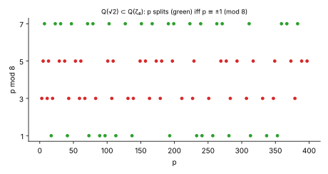

<sub>p mod 8: הראשוניים שמתפצלים ב-ℚ(√2) (ירוק) נמצאים בדיוק בשורות 1 ו-7.</sub>

<details><summary>פתרון</summary>

$`\zeta_8 = \tfrac{1 + i}{\sqrt 2}`$, ולכן $`\zeta_8 + \zeta_8^{-1} = \zeta_8 + \zeta_8^7 = 2\cos 45^\circ = \sqrt 2`$. האוטומורפיזמים $`\sigma_a`$, $`a \in \{1, 3, 5, 7\}`$: $`\sigma_a(\sqrt 2) = \zeta_8^a + \zeta_8^{-a} = 2\cos(45^\circ a)`$, שהוא $`+\sqrt 2`$ ל-$`a = 1, 7`$ ו-$`-\sqrt 2`$ ל-$`a = 3, 5`$. לכן תת-החבורה היא $`\{1, 7\}`$. $`p`$ אי-זוגי מתפצל ב-$`\mathbb Q(\sqrt 2)`$ אם ורק אם $`\mathrm{Frob}_p = \sigma_p`$ מקבע את $`\sqrt 2`$, כלומר $`p \equiv \pm 1 \pmod 8`$. מצד שני, לפי דדקינד–קומר (שיעור 19), $`p`$ מתפצל ב-$`\mathbb Q(\sqrt 2)`$ אם ורק אם ל-$`x^2 - 2`$ יש שורש מודולו $`p`$, כלומר $`\left(\frac 2p\right) = 1`$.
</details>

**תרגיל 2.** חשבו את $`(a, b)_v`$ לכל המקומות עבור $`(a, b) = (-1, -1)`$, $`(3, 5)`$, $`(-1, 3)`$, ובדקו את נוסחת המכפלה. לאילו מהמשוואות $`ax^2 + by^2 = z^2`$ יש פתרון רציונלי לא טריוויאלי?

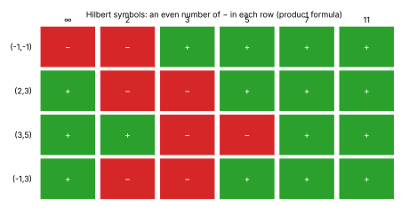

<sub>סמלי הילברט ב-∞, 2, 3, 5, 7, 11 לארבעה זוגות: בכל שורה מספר זוגי של −.</sub>

<details><summary>פתרון</summary>

**$`(-1, -1)`$:** $`\infty`$: שניהם שליליים → $`-1`$. $`v = 2`$: $`u = w = -1`$, $`\epsilon(-1) = 1`$, המעריך $`1\cdot1 = 1`$ → $`-1`$. $`p`$ אי-זוגי: שתי יחידות → $`+1`$. שני מינוסים ✓. אין פתרון ($`-x^2 - y^2 = z^2`$ – כבר מעל $`\mathbb R`$).
**$`(3, 5)`$:** $`\infty`$: $`+1`$. $`v = 3`$: $`(3, 5)_3 = \left(\tfrac 53\right) = \left(\tfrac 23\right) = -1`$. $`v = 5`$: $`\left(\tfrac 35\right) = -1`$. $`v = 2`$: $`\epsilon(3)\epsilon(5) = 1\cdot 2 \equiv 0`$ → $`+1`$. שני מינוסים ✓. אין פתרון.
**$`(-1, 3)`$:** $`\infty`$: $`+1`$. $`v = 3`$: $`\left(\tfrac{-1}{3}\right) = -1`$. $`v = 2`$: $`\epsilon(-1)\epsilon(3) = 1\cdot1`$ → $`-1`$. שני מינוסים ✓. אין פתרון: 3 אינו סכום של שני ריבועים רציונליים.
</details>

**תרגיל 3.** בדקו את משפט גאוס: עבור $`p \equiv 1 \pmod 3`$, 2 הוא שארית ממעלה שלישית מודולו $`p`$ אם ורק אם $`p = x^2 + 27y^2`$. בדקו עבור $`p = 7, 13, 31, 43`$.

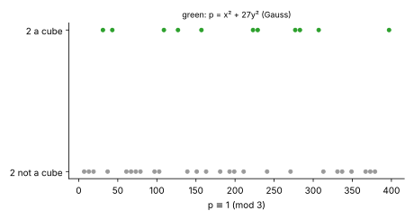

<sub>ראשוניים p ≡ 1 (mod 3) עד 400: הנקודות הירוקות (p = x² + 27y²) הן בדיוק אלה שבשורה "2 a cube".</sub>

<details><summary>פתרון</summary>

2 הוא קוביה מודולו $`p`$ אם ורק אם $`2^{(p-1)/3} \equiv 1 \pmod p`$.
* $`p = 7`$: $`2^2 = 4 \ne 1`$ – לא קוביה. $`x^2 + 27y^2 = 7`$: $`y = 0`$ נותן ריבוע – לא. ✓
* $`p = 13`$: $`2^4 = 16 \equiv 3`$ – לא. $`13`$ לא מהצורה. ✓
* $`p = 31`$: $`2^{10} = 1024 = 33\cdot 31 + 1`$ – קוביה ($`2 \equiv 4^3 = 64 \pmod{31}`$). $`31 = 2^2 + 27`$. ✓
* $`p = 43`$: $`2^{14} = 16384 = 381\cdot 43 + 1`$ – קוביה ($`2 \equiv 20^3 \pmod{43}`$, כי $`8000 = 186\cdot43 + 2`$). $`43 = 4^2 + 27`$. ✓

בדקנו בחישוב את השקילות לכל $`p \equiv 1 \pmod 3`$ עד 400. (ההסבר: הסדר $`\mathbb Z[\sqrt{-27}]`$ בתוך $`\mathbb Q(\sqrt{-3})`$, עם דיסקרימיננטה $`-108`$, מספר המחלקה שלו 3 (בדקנו בחישוב), ו"שדה מחלקת הטבעת" שלו – הגרסה של שדה הילברט לסדר שאינו מקסימלי – הוא $`\mathbb Q(\sqrt{-3}, \sqrt[3]2)`$. הראשוניים שמתפצלים בו לחלוטין הם בדיוק $`p = x^2 + 27y^2`$.)
</details>

**תרגיל 4.** הסבירו למה $`p = x^2 + 5y^2`$ שקול ל-$`\left(\frac{-5}{p}\right) = \left(\frac{-1}{p}\right) = 1`$, והסיקו ש-$`p \equiv 1, 9 \pmod{20}`$. בדקו עבור $`p = 89`$ ו-$`p = 101`$.

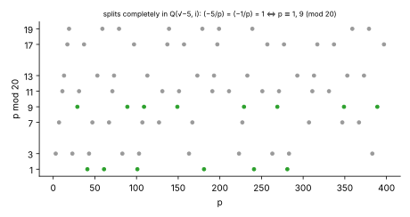

<sub>ראשוניים שמתפצלים לחלוטין ב-ℚ(√−5, i): בדיוק השורות p ≡ 1, 9 (mod 20).</sub>

<details><summary>פתרון</summary>

לפי דוגמה 4, $`p = x^2 + 5y^2`$ $`\iff`$ $`p`$ מתפצל לחלוטין ב-$`H = \mathbb Q(\sqrt{-5}, i)`$ $`\iff`$ מתפצל בשני תת-שדות ריבועיים שיוצרים אותו, $`\mathbb Q(\sqrt{-5})`$ ו-$`\mathbb Q(i)`$. כלומר $`\left(\frac{-1}{p}\right) = 1`$ ($`p \equiv 1 \pmod 4`$) ו-$`\left(\frac{-5}{p}\right) = 1`$, ואז גם $`\left(\frac{5}{p}\right) = 1`$, כלומר $`p \equiv \pm 1 \pmod 5`$. צירוף: $`p \equiv 1 \pmod 4`$ ו-$`p \equiv 1, 4 \pmod 5`$ → $`p \equiv 1, 9 \pmod{20}`$.
* $`89 \equiv 9`$: $`89 = 3^2 + 5\cdot 4^2 = 9 + 80`$ ✓.
* $`101 \equiv 1`$: $`101 = 9^2 + 5\cdot 2^2 = 81 + 20`$ ✓.
</details>

**תרגיל 5.** מצאו את $`\omega(3)`$ ב-$`\mathbb Z_5`$ מודולו 125, ובדקו ש-$`\omega(2)\,\omega(3) \equiv \omega(6) = \omega(1) = 1`$.

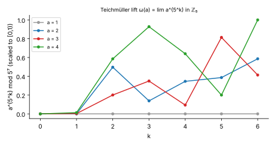

<sub>הסדרה a^(5^k) מודולו 5⁷ עבור a = 1, 2, 3, 4: הערכים מתייצבים, והגבולות הם ארבעת שורשי היחידה ±1, ±√−1 של ℤ₅.</sub>

<details><summary>פתרון</summary>

$`3^{25} \pmod{125}`$: $`3^5 = 243 \equiv 118`$; $`3^{25} = 118^5`$. $`118 \equiv -7`$, $`(-7)^2 = 49`$, $`(-7)^4 = 2401 \equiv 26`$, $`(-7)^5 \equiv -182 \equiv 68 \pmod{125}`$. לכן $`\omega(3) \equiv 68 \pmod{125}`$. בדיקה: $`68^2 = 4624 = 37\cdot125 - 1 \equiv -1`$ ✓ (כצפוי, $`\omega(3) = -\omega(2)`$ כי $`3 \equiv -2`$), ו-$`57 \cdot 68 = 3876 = 31\cdot 125 + 1 \equiv 1`$ ✓.
</details>

---

## סיכום
* **קרונקר–ובר:** כל הרחבה אבלית של $`\mathbb Q`$ בתוך $`\mathbb Q(\zeta_m)`$; פירוק ראשוניים בה נקבע על ידי $`p \bmod m`$. דוגמאות: $`\mathbb Q(\sqrt 5) \subset \mathbb Q(\zeta_5)`$, $`\mathbb Q(\sqrt 2) \subset \mathbb Q(\zeta_8)`$, $`x^3 + x^2 - 2x - 1`$ ו-$`p \equiv \pm1 \pmod 7`$.
* **הדדיות ארטין:** $`\mathrm{Cl}_\mathfrak m(K) \twoheadrightarrow \mathrm{Gal}(L/K)`$, $`\mathfrak p \mapsto \mathrm{Frob}_\mathfrak p`$. **משפט הקיום:** כל תת-חבורה של $`\mathrm{Cl}_\mathfrak m`$ באה משדה.
* **שדה מחלקות הילברט:** $`\mathrm{Gal}(H/K) \cong \mathrm{Cl}(K)`$; $`\mathfrak p`$ מתפצל לחלוטין ⇔ ראשי. לכן $`p = x^2 + 5y^2 \iff p \equiv 1, 9 \pmod{20}`$, ו-$`p = x^2 + xy + 6y^2 \iff x^3 - x - 1`$ מתפצל מודולו $`p`$.
* **מקומי:** $`F^\times/N(L^\times) \cong \mathrm{Gal}(L/F)`$; **סמל הילברט** ונוסחת המכפלה $`\prod_v (a,b)_v = 1`$ – שהיא ההדדיות הריבועית.
* **סכומי גאוס ויעקובי:** $`g^2 = p^*`$; $`|J|^2 = p`$ נותן $`p = a^2 + b^2`$ ו-$`4p = L^2 + 27M^2`$.
* **$`\mathbb Q(\zeta_p)`$:** שטיקלברגר מאפס את חבורת המחלקות; הרברנד–ריבט: $`A(\omega^{1-k}) \ne 0 \iff p \mid B_k`$ (דוגמה: 37 ו-$`B_{32}`$).

**להעמקה:** [הדדיות ארטין](../pages/%D7%94%D7%93%D7%93%D7%99%D7%95%D7%AA%20%D7%90%D7%A8%D7%98%D7%99%D7%9F.md) · [משפט הקיום של טקאגי](../pages/%D7%9E%D7%A9%D7%A4%D7%98%20%D7%94%D7%A7%D7%99%D7%95%D7%9D%20%D7%A9%D7%9C%20%D7%98%D7%A7%D7%90%D7%92%D7%99.md) · [משפט הנורמה של האסה](../pages/%D7%9E%D7%A9%D7%A4%D7%98%20%D7%94%D7%A0%D7%95%D7%A8%D7%9E%D7%94%20%D7%A9%D7%9C%20%D7%94%D7%90%D7%A1%D7%94.md) · [סמל הילברט](../pages/%D7%A1%D7%9E%D7%9C%20%D7%94%D7%99%D7%9C%D7%91%D7%A8%D7%98.md) · [תורת שדות המחלקה המקומית](../pages/%D7%AA%D7%95%D7%A8%D7%AA%20%D7%A9%D7%93%D7%95%D7%AA%20%D7%94%D7%9E%D7%97%D7%9C%D7%A7%D7%94%20%D7%94%D7%9E%D7%A7%D7%95%D7%9E%D7%99%D7%AA.md) · [שדה מחלקת קרן](../pages/%D7%A9%D7%93%D7%94%20%D7%9E%D7%97%D7%9C%D7%A7%D7%AA%20%D7%A7%D7%A8%D7%9F.md) · [מוליך (תורת שדות המחלקה)](../pages/%D7%9E%D7%95%D7%9C%D7%99%D7%9A%20%28%D7%AA%D7%95%D7%A8%D7%AA%20%D7%A9%D7%93%D7%95%D7%AA%20%D7%94%D7%9E%D7%97%D7%9C%D7%A7%D7%94%29.md) · [שדה הגנוס](../pages/%D7%A9%D7%93%D7%94%20%D7%94%D7%92%D7%A0%D7%95%D7%A1.md) · [סכום גאוס](../pages/%D7%A1%D7%9B%D7%95%D7%9D%20%D7%92%D7%90%D7%95%D7%A1.md) · [סכום יעקובי](../pages/%D7%A1%D7%9B%D7%95%D7%9D%20%D7%99%D7%A2%D7%A7%D7%95%D7%91%D7%99.md) · [משפט שטיקלברגר](../pages/%D7%9E%D7%A9%D7%A4%D7%98%20%D7%A9%D7%98%D7%99%D7%A7%D7%9C%D7%91%D7%A8%D7%92%D7%A8.md) · [יחס האסה–דבנפורט](../pages/%D7%99%D7%97%D7%A1%20%D7%94%D7%90%D7%A1%D7%94%E2%80%93%D7%93%D7%91%D7%A0%D7%A4%D7%95%D7%A8%D7%98.md) · [קרקטר טייכמילר](../pages/%D7%A7%D7%A8%D7%A7%D7%98%D7%A8%20%D7%98%D7%99%D7%99%D7%9B%D7%9E%D7%99%D7%9C%D7%A8.md) · [משפט הרברנד–ריבט](../pages/%D7%9E%D7%A9%D7%A4%D7%98%20%D7%94%D7%A8%D7%91%D7%A8%D7%A0%D7%93%E2%80%93%D7%A8%D7%99%D7%91%D7%98.md) · [יחידה ציקלוטומית](../pages/%D7%99%D7%97%D7%99%D7%93%D7%94%20%D7%A6%D7%99%D7%A7%D7%9C%D7%95%D7%98%D7%95%D7%9E%D7%99%D7%AA.md) · [משפט הילברט–שפייזר](../pages/%D7%9E%D7%A9%D7%A4%D7%98%20%D7%94%D7%99%D7%9C%D7%91%D7%A8%D7%98%E2%80%93%D7%A9%D7%A4%D7%99%D7%99%D7%96%D7%A8.md) · [משפט תיין](../pages/%D7%9E%D7%A9%D7%A4%D7%98%20%D7%AA%D7%99%D7%99%D7%9F.md) · [קרקטר ציקלוטומי](../pages/%D7%A7%D7%A8%D7%A7%D7%98%D7%A8%20%D7%A6%D7%99%D7%A7%D7%9C%D7%95%D7%98%D7%95%D7%9E%D7%99.md) · [ההשערה המרכזית של תורת איוואסאווה](../pages/%D7%94%D7%94%D7%A9%D7%A2%D7%A8%D7%94%20%D7%94%D7%9E%D7%A8%D7%9B%D7%96%D7%99%D7%AA%20%D7%A9%D7%9C%20%D7%AA%D7%95%D7%A8%D7%AA%20%D7%90%D7%99%D7%95%D7%95%D7%90%D7%A1%D7%90%D7%95%D7%95%D7%94.md) · [משפט גולוד–שפרביץ'](../pages/%D7%9E%D7%A9%D7%A4%D7%98%20%D7%92%D7%95%D7%9C%D7%95%D7%93%E2%80%93%D7%A9%D7%A4%D7%A8%D7%91%D7%99%D7%A5%27.md) · [משפט אלברט–בראואר–האסה–נתר](../pages/%D7%9E%D7%A9%D7%A4%D7%98%20%D7%90%D7%9C%D7%91%D7%A8%D7%98%E2%80%93%D7%91%D7%A8%D7%90%D7%95%D7%90%D7%A8%E2%80%93%D7%94%D7%90%D7%A1%D7%94%E2%80%93%D7%A0%D7%AA%D7%A8.md) · [חבורת וייל](../pages/%D7%97%D7%91%D7%95%D7%A8%D7%AA%20%D7%95%D7%99%D7%99%D7%9C.md) · [כפל מרוכב](../pages/%D7%9B%D7%A4%D7%9C%20%D7%9E%D7%A8%D7%95%D7%9B%D7%91.md) · [חבורת האידלים](../pages/%D7%97%D7%91%D7%95%D7%A8%D7%AA%20%D7%94%D7%90%D7%99%D7%93%D7%9C%D7%99%D7%9D.md) · [שדה המחלקה של הילברט](../pages/%D7%A9%D7%93%D7%94%20%D7%94%D7%9E%D7%97%D7%9C%D7%A7%D7%94%20%D7%A9%D7%9C%20%D7%94%D7%99%D7%9C%D7%91%D7%A8%D7%98.md) · [שדה מחלקת הטבעת](../pages/%D7%A9%D7%93%D7%94%20%D7%9E%D7%97%D7%9C%D7%A7%D7%AA%20%D7%94%D7%98%D7%91%D7%A2%D7%AA.md) · [משפט האידיאל הראשי (תורת שדות המחלקה)](../pages/%D7%9E%D7%A9%D7%A4%D7%98%20%D7%94%D7%90%D7%99%D7%93%D7%99%D7%90%D7%9C%20%D7%94%D7%A8%D7%90%D7%A9%D7%99%20%28%D7%AA%D7%95%D7%A8%D7%AA%20%D7%A9%D7%93%D7%95%D7%AA%20%D7%94%D7%9E%D7%97%D7%9C%D7%A7%D7%94%29.md) · [קונגרואנציות קומר](../pages/%D7%A7%D7%95%D7%A0%D7%92%D7%A8%D7%95%D7%90%D7%A0%D7%A6%D7%99%D7%95%D7%AA%20%D7%A7%D7%95%D7%9E%D7%A8.md)

**השיעור הקודם:** [שיעור 19: תורת המספרים האלגברית: שדות מספרים, אידיאלים וחבורת המחלקות](19-תורת-המספרים-האלגברית.md) · **השיעור הבא:** [שיעור 20: עקומים אליפטיים](20-עקומים-אליפטיים.md)

---
<sub>חלק מ[קורס תורת המספרים](../COURSE.md). התוכן מופץ ברישיון [CC BY-SA 4.0](https://creativecommons.org/licenses/by-sa/4.0/).</sub>
