# שיעור 20: עקומים אליפטיים

**מה נלמד:** עקום אליפטי הוא משוואה כמו $`y^2 = x^3 - 2`$. זה נראה צנוע, אבל על הנקודות שלו יש **פעולת חבורה**, וזה הופך אותו לאחד האובייקטים המרכזיים בתורת המספרים: הוא הופיע בהוכחת המשפט האחרון של פרמה, בבעיית המספרים החופפים, בפירוק לגורמים ובהצפנה. נראה ש:
1. על הנקודות הרציונליות יש **חוק חיבור** גאומטרי (מיתר ומשיק), וזו חבורה אבלית.
2. **מורדל–וייל**: החבורה $`E(\mathbb Q)`$ נוצרת סופית: $`E(\mathbb Q) \cong E(\mathbb Q)_{\mathrm{tors}} \times \mathbb Z^r`$. את החלק הסופי מוצאים בעזרת **נגל–לוץ**, ו**מאזור** מונה את כל האפשרויות.
3. מודולו $`p`$ עקום הוא חבורה סופית, ו**משפט האסה** אומר ש-$`|\#E(\mathbb F_p) - (p + 1)| \le 2\sqrt p`$.
4. המספרים $`a_p = p + 1 - \#E(\mathbb F_p)`$ בונים את **פונקציית ה-L** של העקום, ו**השערת בירץ' וסווינרטון-דייר** קושרת אותה לדרגה $`r`$. דוגמה: **מספרים חופפים** ומשפט טאנל.
5. ההתפלגות של $`a_p/2\sqrt p`$ היא חצי-עיגול (**סאטו–טייט**), חוץ מעקומים עם **כפל מרוכב**.
6. **אלגוריתם לנסטרה** משתמש בעקומים כדי לפרק מספרים.

**ידע קודם:** [שיעור 4](04-חשבון-מודולרי.md) (חשבון מודולרי, הופכיים), [שיעור 8](08-משוואות-דיופנטיות.md) (משוואות דיופנטיות, ירידה אינסופית), [שיעור כלים כ3](T03-חבורות.md) (חבורות אבליות), [שיעור 19](19-תורת-המספרים-האלגברית.md) ו-[19א](19א-תורת-שדות-המחלקה.md) (שדות מספרים, $`p = a^2 + b^2`$ דרך $`\mathbb Z[i]`$).

---

## 1. מאיפה זה בא: משולשים ישרי זווית בעלי שטח נתון

מספר שלם $`n`$ נקרא **מספר חופף** (congruent number) אם הוא השטח של משולש ישר זווית שכל צלעותיו **רציונליות**. למשל 6 חופף (המשולש $`3, 4, 5`$), ו-5 חופף בזכות המשולש $`\tfrac32, \tfrac{20}{3}, \tfrac{41}{6}`$: שטחו $`\tfrac12\cdot\tfrac32\cdot\tfrac{20}{3} = 5`$, ו-$`\tfrac94 + \tfrac{400}{9} = \tfrac{81 + 1600}{36} = \tfrac{1681}{36} = \left(\tfrac{41}{6}\right)^2`$. פרמה הוכיח ש-1 **אינו** חופף (בירידה אינסופית).

**התרגום לעקום.** אם $`a^2 + b^2 = c^2`$ ו-$`\tfrac12 ab = n`$, אז הנקודה
```math
x = \frac{c^2}{4}, \qquad y = \frac{c\,(b^2 - a^2)}{8}
```
נמצאת על העקום $`E_n : y^2 = x^3 - n^2x`$. ולהפך, מנקודה $`(x, y)`$ עם $`y \ne 0`$ מקבלים משולש:
```math
a = \left|\frac{x^2 - n^2}{y}\right|, \qquad b = \left|\frac{2nx}{y}\right|, \qquad c = \left|\frac{x^2 + n^2}{y}\right|.
```
עבור $`n = 5`$ והמשולש של למעלה: $`x = \tfrac{1681}{144}`$, ו-$`x^3 - 25x = \left(\tfrac{62279}{1728}\right)^2`$. (בדקנו בחישוב.)

**שאלת המספר החופף** הופכת לשאלה: **האם ל-$`E_n`$ יש נקודה רציונלית עם $`y \ne 0`$?** – ונראה שזה שקול לכך שלחבורה $`E_n(\mathbb Q)`$ יש איבר מסדר אינסופי.

---

## 2. עקומים אליפטיים וחוק החיבור

**עקום אליפטי** מעל $`\mathbb Q`$ (בצורת ויירשטראס קצרה):
```math
E : y^2 = x^3 + ax + b, \qquad \Delta = -16(4a^3 + 27b^2) \ne 0,
```
יחד עם **נקודה באינסוף** $`O`$. התנאי $`\Delta \ne 0`$ אומר של-$`x^3 + ax + b`$ אין שורש כפול, כלומר העקום חלק. (בצורה הכללית $`y^2 + a_1xy + a_3y = x^3 + a_2x^2 + a_4x + a_6`$, שנוחה לעבודה מודולו 2 ו-3.)

**חוק החיבור (מיתר ומשיק).** ישר חותך עקום ממעלה 3 בשלוש נקודות (עם ריבוי, וכולל $`O`$). מגדירים: $`P + Q + R = O`$ אם $`P, Q, R`$ על ישר אחד. כלומר: מעבירים ישר דרך $`P`$ ו-$`Q`$, מוצאים את נקודת החיתוך השלישית $`R`$, ומשקפים: $`P + Q = -R`$, כאשר $`-(x, y) = (x, -y)`$. $`O`$ הוא האיבר הניטרלי. בנוסחאות, עבור $`P = (x_1, y_1)`$, $`Q = (x_2, y_2)`$:
```math
\lambda = \begin{cases} \dfrac{y_2 - y_1}{x_2 - x_1} & P \ne Q,\\[2mm] \dfrac{3x_1^2 + a}{2y_1} & P = Q,\end{cases} \qquad x_3 = \lambda^2 - x_1 - x_2, \qquad y_3 = \lambda(x_1 - x_3) - y_1 .
```
מקדמים רציונליים נותנים תוצאה רציונלית, ולכן $`E(\mathbb Q)`$ – הנקודות הרציונליות ועוד $`O`$ – היא **חבורה אבלית**. (הקיבוציות היא החלק הקשה; היא נובעת ממשפט קיילי–בכרך על קוביות, או מחישוב ישיר.)

### דוגמה 1: הכפלת נקודה על $`y^2 = x^3 - 2`$
$`P = (3, 5)`$: $`27 - 2 = 25`$ ✓. המשיק:
```math
\lambda = \frac{3\cdot 9}{2\cdot 5} = \frac{27}{10}, \qquad x_3 = \frac{729}{100} - 6 = \frac{129}{100}, \qquad y_3 = \frac{27}{10}\left(3 - \frac{129}{100}\right) - 5 = \frac{27\cdot 171}{1000} - 5 = \frac{4617 - 5000}{1000} = -\frac{383}{1000}.
```
לכן $`2P = \left(\tfrac{129}{100}, -\tfrac{383}{1000}\right)`$. בדיקה: $`\left(\tfrac{129}{100}\right)^3 - 2 = \tfrac{2146689 - 2000000}{10^6} = \tfrac{146689}{10^6} = \left(\tfrac{383}{1000}\right)^2`$ ✓. ממשיכים: $`3P = \left(\tfrac{164323}{29241}, -\tfrac{66234835}{5000211}\right)`$, והמכנים גדלים מהר מאוד (המונה של $`x(nP)`$ גדל בערך כמו $`e^{c n^2}`$ – "גובה ריבועי"). זו הדוגמה שבאשה ופרמה הכירו: מנקודה אחת מייצרים אינסוף פתרונות רציונליים. בדקנו בחישוב.

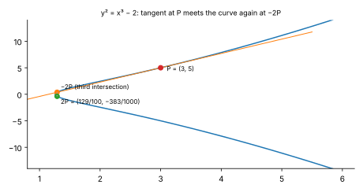

<sub>y² = x³ − 2: המשיק ב-P = (3, 5) חותך שוב את העקום ב-−2P; השיקוף הוא 2P = (129/100, −383/1000).</sub>

(ל-$`y^2 = x^3 - 2`$ יש רק שתי נקודות **שלמות**, $`(3, \pm 5)`$ – פרמה טען זאת, ואוילר נתן הוכחה (עם פער שהושלם מאוחר יותר); ראו [עקום מורדל](../pages/%D7%A2%D7%A7%D7%95%D7%9D%20%D7%9E%D7%95%D7%A8%D7%93%D7%9C.md).)

---

## 3. מבנה $`E(\mathbb Q)`$: מורדל–וייל, נגל–לוץ ומאזור

**[משפט מורדל–וייל](../pages/%D7%9E%D7%A9%D7%A4%D7%98%20%D7%9E%D7%95%D7%A8%D7%93%D7%9C%E2%80%93%D7%95%D7%99%D7%99%D7%9C.md) (מורדל 1922).** $`E(\mathbb Q)`$ נוצרת סופית:
```math
E(\mathbb Q) \cong E(\mathbb Q)_{\mathrm{tors}} \oplus \mathbb Z^r .
```
$`r`$ נקרא ה**דרגה** של העקום. ההוכחה היא ירידה אינסופית: משפט "מורדל–וייל החלש" ($`E(\mathbb Q)/2E(\mathbb Q)`$ סופית) ועוד **פונקציית גובה** שקטנה כשחוצים נקודה. אין אלגוריתם מוכח לחישוב $`r`$.

**[משפט נגל–לוץ](../pages/%D7%9E%D7%A9%D7%A4%D7%98%20%D7%A0%D7%92%D7%9C%E2%80%93%D7%9C%D7%95%D7%A5.md).** אם $`a, b \in \mathbb Z`$ ו-$`P = (x, y)`$ נקודה מסדר סופי, אז $`x, y \in \mathbb Z`$, ו**או ש-$`y = 0`$ או ש-$`y^2 \mid 4a^3 + 27b^2`$**. מסקנה מעשית: אם לאיזו כפולה של $`P`$ יש קואורדינטה לא שלמה, $`P`$ מסדר אינסופי. בדוגמה 1: $`2P`$ לא שלם, ולכן $`(3, 5)`$ מסדר אינסופי ו-$`r \ge 1`$ (למעשה $`r = 1`$).

### דוגמה 2: הפיתול של $`y^2 = x^3 + 1`$
$`4a^3 + 27b^2 = 27`$. נגל–לוץ: $`y = 0`$ או $`y^2 \mid 27`$, כלומר $`y \in \{0, \pm1, \pm3\}`$.
* $`y = 0`$: $`x^3 = -1`$, $`x = -1`$.
* $`y = \pm 1`$: $`x^3 = 0`$, $`x = 0`$.
* $`y = \pm 3`$: $`x^3 = 8`$, $`x = 2`$.

המועמדים: $`(-1, 0), (0, \pm1), (2, \pm3)`$. נבדוק שהם באמת מסדר סופי עם $`P = (2, 3)`$:
* $`2P`$: $`\lambda = \tfrac{12}{6} = 2`$, $`x = 4 - 4 = 0`$, $`y = 2(2 - 0) - 3 = 1`$ → $`(0, 1)`$.
* $`3P = P + 2P`$: $`\lambda = \tfrac{1 - 3}{0 - 2} = 1`$, $`x = 1 - 2 - 0 = -1`$, $`y = 1\cdot(2 + 1) - 3 = 0`$ → $`(-1, 0)`$, מסדר 2.
* לכן $`6P = O`$, ו-$`4P = -2P = (0, -1)`$, $`5P = -P = (2, -3)`$.

$`E(\mathbb Q)_{\mathrm{tors}} \cong \mathbb Z/6`$, והדרגה 0: $`E(\mathbb Q)`$ הוא בדיוק שש הנקודות. בדקנו בחישוב.

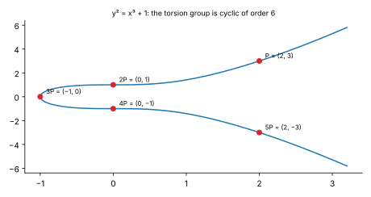

<sub>y² = x³ + 1: חמש הנקודות הרציונליות (ועוד O) הן הכפולות של P = (2, 3).</sub>

**משפט מאזור (1977).** תת-חבורת הפיתול של עקום אליפטי מעל $`\mathbb Q`$ היא אחת מ-15 החבורות:
```math
\mathbb Z/n \ (1 \le n \le 10 \text{ או } n = 12), \qquad \mathbb Z/2 \times \mathbb Z/2m \ (1 \le m \le 4).
```
כל אחת מהן מתקבלת (ואף באינסוף עקומים). דוגמה ל-$`\mathbb Z/5`$: העקום **11a**, $`y^2 + y = x^3 - x^2 - 10x - 20`$, עם הנקודות $`(5, 5), (5, -6), (16, 60), (16, -61)`$ ו-$`O`$. ראו [השערת הפיתול](../pages/%D7%94%D7%A9%D7%A2%D7%A8%D7%AA%20%D7%94%D7%A4%D7%99%D7%AA%D7%95%D7%9C.md) להכללות לשדות מספרים.

### דוגמה 3: 6 חופף, ובאינסוף דרכים
$`E_6 : y^2 = x^3 - 36x`$. הנקודה $`P = (-3, 9)`$: $`-27 + 108 = 81`$ ✓. המשולש: $`a = \left|\tfrac{9 - 36}{9}\right| = 3`$, $`b = \left|\tfrac{-36}{9}\right| = 4`$, $`c = \tfrac{45}{9} = 5`$. מכפילים:
```math
\lambda = \frac{3\cdot 9 - 36}{18} = -\frac12, \qquad x(2P) = \frac14 + 6 = \frac{25}{4}, \qquad y(2P) = -\frac12\left(-3 - \frac{25}{4}\right) - 9 = \frac{37}{8} - 9 = -\frac{35}{8}.
```
$`2P = \left(\tfrac{25}{4}, -\tfrac{35}{8}\right)`$, וממנו משולש חדש:
```math
a = \frac{625/16 - 36}{35/8} = \frac{49/16}{35/8} = \frac{7}{10}, \qquad b = \frac{75}{35/8} = \frac{120}{7}, \qquad c = \frac{1201/16}{35/8} = \frac{1201}{70}.
```
בדיקה: $`\tfrac12\cdot\tfrac{7}{10}\cdot\tfrac{120}{7} = 6`$ ✓, ו-$`\tfrac{49}{100} + \tfrac{14400}{49} = \left(\tfrac{1201}{70}\right)^2`$ ✓. כיוון ש-$`2P`$ אינו שלם, $`P`$ מסדר אינסופי (נגל–לוץ), ולכן יש **אינסוף** משולשים רציונליים ישרי זווית בעלי שטח 6. הפיתול של $`E_n`$ הוא תמיד $`\{O, (0, 0), (\pm n, 0)\} \cong (\mathbb Z/2)^2`$ – בדיוק הנקודות עם $`y = 0`$ – ולכן **$`n`$ חופף ⇔ $`r(E_n) \ge 1`$**. בדקנו בחישוב.

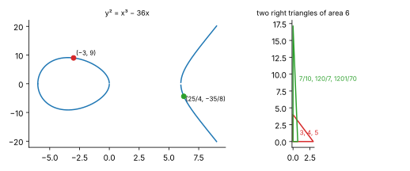

<sub>משמאל: y² = x³ − 36x עם P = (−3, 9) ו-2P = (25/4, −35/8). מימין: שני המשולשים בעלי שטח 6 שהם נותנים.</sub>

---

## 4. מודולו $`p`$: ספירת נקודות ומשפט האסה

אם $`p \nmid \Delta`$, העקום מודולו $`p`$ עדיין חלק ("**רדוקציה טובה**"), ו-$`E(\mathbb F_p)`$ חבורה **סופית**. מגדירים
```math
a_p = p + 1 - \#E(\mathbb F_p).
```
לצורה $`y^2 = f(x)`$ עם $`p`$ אי-זוגי: כל $`x`$ נותן $`1 + \left(\frac{f(x)}{p}\right)`$ ערכי $`y`$, ולכן
```math
\#E(\mathbb F_p) = 1 + \sum_{x \in \mathbb F_p}\left(1 + \left(\tfrac{f(x)}{p}\right)\right) = p + 1 + \sum_x \left(\tfrac{f(x)}{p}\right), \qquad a_p = -\sum_{x}\left(\tfrac{f(x)}{p}\right).
```
"בממוצע" חצי מהערכים ריבועים, ולכן מצפים ל-$`a_p`$ קטן. כמה קטן?

**[משפט האסה](../pages/%D7%9E%D7%A9%D7%A4%D7%98%20%D7%94%D7%90%D7%A1%D7%94%20%D7%A2%D7%9C%20%D7%A2%D7%A7%D7%95%D7%9E%D7%99%D7%9D%20%D7%90%D7%9C%D7%99%D7%A4%D7%98%D7%99%D7%99%D7%9D.md) (1933).** $`|a_p| \le 2\sqrt p`$.

רעיון ההוכחה: אנדומורפיזם פרובניוס $`\phi(x, y) = (x^p, y^p)`$ מקיים $`\phi^2 - a_p\phi + p = 0`$, ו-$`\deg(m - n\phi) = m^2 - a_pmn + pn^2 \ge 0`$ לכל $`m, n`$. תבנית ריבועית אי-שלילית ⇒ הדיסקרימיננטה $`a_p^2 - 4p \le 0`$. במילים אחרות, $`a_p = \alpha + \bar\alpha`$ כאשר $`|\alpha| = \sqrt p`$ – זו **השערת רימן** לעקום מעל $`\mathbb F_p`$ (שיעור 22).

### דוגמה 4: $`y^2 = x^3 - 2`$ מודולו 7 ו-13
**$`p = 7`$:** הריבועים מודולו 7 הם $`\{0, 1, 2, 4\}`$. הקוביות: $`x^3 \in \{0, 1, 6\}`$ ($`0^3 = 0`$; $`1, 2, 4 \mapsto 1`$; $`3, 5, 6 \mapsto 6`$). אז $`x^3 - 2 \in \{5, 6, 4\}`$:
* $`x = 0`$: $`5`$ – לא ריבוע → 0 נקודות.
* $`x = 1, 2, 4`$: $`-1 \equiv 6`$ – לא ריבוע → 0.
* $`x = 3, 5, 6`$: $`4 = 2^2`$ → 2 נקודות כל אחד, $`y = \pm 2`$.

סה"כ $`6 + 1 = 7`$ נקודות (עם $`O`$), ו-$`a_7 = 8 - 7 = 1`$. **$`p = 13`$:** חישוב דומה נותן 19 נקודות, $`a_{13} = 14 - 19 = -5`$, ו-$`5 \le 2\sqrt{13} \approx 7.2`$ ✓. **$`p = 5`$ ו-$`p = 11`$:** $`a_p = 0`$ – ולא במקרה: כש-$`p \equiv 2 \pmod 3`$, $`x \mapsto x^3`$ היא פרמוטציה של $`\mathbb F_p`$, ולכן $`x^3 - 2`$ עובר על כל $`\mathbb F_p`$ פעם אחת, ו-$`\sum\left(\frac{\cdot}{p}\right) = 0`$. בדקנו בחישוב.

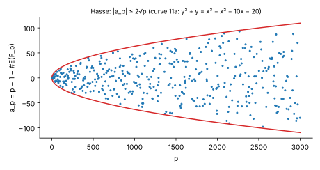

<sub>a_p של העקום 11a לכל p < 3000: כל הנקודות בין ±2√p.</sub>

### דוגמה 5: כפל מרוכב – $`y^2 = x^3 - x`$ ו-$`p = a^2 + b^2`$
לעקום הזה יש אנדומורפיזם נוסף, $`(x, y) \mapsto (-x, iy)`$ (כפל ב-$`i`$). התוצאה:
* $`p \equiv 3 \pmod 4`$: $`a_p = 0`$ – העקום מודולו $`p`$ [על-סינגולרי](../pages/%D7%A2%D7%A7%D7%95%D7%9D%20%D7%90%D7%9C%D7%99%D7%A4%D7%98%D7%99%20%D7%A2%D7%9C-%D7%A1%D7%99%D7%A0%D7%92%D7%95%D7%9C%D7%A8%D7%99.md). (הסבר: $`f(-x) = -f(x)`$ ו-$`\left(\frac{-1}{p}\right) = -1`$, אז התרומות של $`x`$ ו-$`-x`$ מבטלות זו את זו.)
* $`p \equiv 1 \pmod 4`$, $`p = a^2 + b^2`$ עם $`a`$ אי-זוגי: $`a_p = \pm 2a`$.

| $`p`$ | $`a^2 + b^2`$ | $`a_p`$ |
|---|---|---|
| 5 | $`1 + 4`$ | $`-2`$ |
| 13 | $`9 + 4`$ | $`6`$ |
| 17 | $`1 + 16`$ | $`2`$ |
| 29 | $`25 + 4`$ | $`-10`$ |
| 37 | $`1 + 36`$ | $`-2`$ |
| 41 | $`25 + 16`$ | $`10`$ |
| 53 | $`49 + 4`$ | $`14`$ |

(הסימן נקבע כך ש-$`a + bi`$ "ראשוני": $`\equiv 1 \pmod{2 + 2i}`$.) זו ההופעה של $`\mathbb Z[i]`$ מ[שיעור 19א](19א-תורת-שדות-המחלקה.md): פרובניוס $`\alpha`$ הוא ממש הראשוני הגאוסי $`\pm(a \pm bi)`$, ו-$`a_p = \alpha + \bar\alpha`$. בדקנו בחישוב לכל $`p \lt 60`$. ראו [כפל מרוכב](../pages/%D7%9B%D7%A4%D7%9C%20%D7%9E%D7%A8%D7%95%D7%9B%D7%91.md).

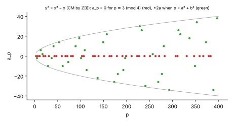

<sub>y² = x³ − x: a_p = 0 לכל p ≡ 3 (mod 4) (אדום), ו-a_p = ±2a לכל p = a² + b² (ירוק).</sub>

---

## 5. רדוקציה רעה, המוליך ופונקציית L

ב-$`p \mid \Delta`$ העקום מודולו $`p`$ סינגולרי. יש שלושה סוגים:
* **כפלית מפוצלת** (צומת עם משיקים מעל $`\mathbb F_p`$): $`a_p = 1`$;
* **כפלית לא מפוצלת**: $`a_p = -1`$;
* **חיבורית** (חוד): $`a_p = 0`$.

ה[מוליך](../pages/%D7%9E%D7%95%D7%9C%D7%99%D7%9A%20%D7%A9%D7%9C%20%D7%A2%D7%A7%D7%95%D7%9D%20%D7%90%D7%9C%D7%99%D7%A4%D7%98%D7%99.md) $`N = \prod p^{f_p}`$ מקודד את זה: $`f_p = 0`$ לרדוקציה טובה, $`1`$ לכפלית, $`\ge 2`$ לחיבורית. (חשוב לבחור משוואה **מינימלית**: $`\Delta`$ תלוי בבחירת המשוואה, $`N`$ לא. [האלגוריתם של טייט](../pages/%D7%94%D7%90%D7%9C%D7%92%D7%95%D7%A8%D7%99%D7%AA%D7%9D%20%D7%A9%D7%9C%20%D7%98%D7%99%D7%99%D7%98.md) מחשב אותו.) דוגמאות שבדקנו בחישוב:

| עקום | $`\Delta`$ | $`N`$ | $`E(\mathbb Q)`$ |
|---|---|---|---|
| 11a: $`y^2 + y = x^3 - x^2 - 10x - 20`$ | $`-11^5`$ | 11 | $`\mathbb Z/5`$ |
| 37a: $`y^2 + y = x^3 - x`$ | $`37`$ | 37 | $`\mathbb Z`$, יוצר $`(0, 0)`$ |
| $`y^2 = x^3 - x`$ | $`64`$ | 32 | $`(\mathbb Z/2)^2`$ |
| $`y^2 = x^3 + 1`$ | $`-432`$ | 36 | $`\mathbb Z/6`$ |
| $`y^2 = x^3 - 36x`$ ($`E_6`$) | $`2^{12}3^6`$ | 576 | $`(\mathbb Z/2)^2 \times \mathbb Z`$ |
| $`y^2 = x^3 - 2`$ | $`-1728`$ | 1728 | $`\mathbb Z`$, יוצר $`(3, 5)`$ |

לפי [קריטריון נרון–אוג–שפרביץ'](../pages/%D7%A7%D7%A8%D7%99%D7%98%D7%A8%D7%99%D7%95%D7%9F%20%D7%A0%D7%A8%D7%95%D7%9F%E2%80%93%D7%90%D7%95%D7%92%E2%80%93%D7%A9%D7%A4%D7%A8%D7%91%D7%99%D7%A5%27.md), הרדוקציה ב-$`p`$ טובה בדיוק כשהפעולה של גלואה על נקודות הפיתול מסדר זר ל-$`p`$ אינה מסועפת ב-$`p`$ – ההכללה של "מסועף ⇔ $`p \mid \Delta`$" משיעור 19.

**פונקציית L** של העקום היא מכפלת אוילר
```math
L(E, s) = \prod_{p \nmid N} \frac{1}{1 - a_pp^{-s} + p^{1 - 2s}} \prod_{p \mid N}\frac{1}{1 - a_pp^{-s}} = \sum_{n \ge 1}\frac{a_n}{n^s},
```
מתכנסת ל-$`\mathrm{Re}\,s \gt \tfrac32`$ (בזכות האסה). **משפט המודולריות** (ויילס, טיילור–ויילס, ובצורה מלאה ברויל–קונרד–דיימונד–טיילור 2001): $`\sum a_nq^n`$ היא **תבנית מודולרית** ממשקל 2 ורמה $`N`$, ולכן ל-$`L(E, s)`$ יש המשכה אנליטית ומשוואה פונקציונלית $`s \leftrightarrow 2 - s`$.

### דוגמה 6: העקום 11a ותבנית האטה
סופרים נקודות של 11a: $`a_2 = -2`$, $`a_3 = -1`$, $`a_5 = 1`$, $`a_7 = -2`$, $`a_{11} = 1`$, $`a_{13} = 4`$, $`a_{17} = -2`$, $`a_{19} = 0`$. עכשיו פותחים את המכפלה
```math
q\prod_{n \ge 1}(1 - q^n)^2(1 - q^{11n})^2 = q - 2q^2 - q^3 + 2q^4 + q^5 + 2q^6 - 2q^7 - 2q^9 - 2q^{10} + q^{11} - 2q^{12} + 4q^{13} + \dots
```
המקדמים ב-$`q^p`$ **זהים** ל-$`a_p`$! (ו-$`a_4 = a_2^2 - 2 = 2`$, $`a_6 = a_2a_3 = 2`$, כפי שמכפלת אוילר דורשת.) בדקנו בחישוב עד $`q^{19}`$. זו הדוגמה הראשונה של משפט המודולריות, ואליה נחזור בשיעור 21.

---

## 6. השערת בירץ' וסווינרטון-דייר ומספרים חופפים

בשנות ה-60 בירץ' וסווינרטון-דייר חישבו את $`\prod_{p \le X}\#E(\mathbb F_p)/p`$ וראו שהיא גדלה כמו $`(\log X)^r`$. אם יש הרבה נקודות רציונליות, הן "מורגשות" מודולו כל $`p`$. הניסוח המדויק:

**השערת BSD.** $`\mathrm{ord}_{s = 1} L(E, s) = r`$, והמקדם המוביל נתון בנוסחה
```math
\frac{L^{(r)}(E, 1)}{r!} = \frac{\Omega_E\cdot R_E\cdot |\text{Ш}|\cdot\prod_p c_p}{|E(\mathbb Q)_{\mathrm{tors}}|^2}.
```
(כאן $`\Omega_E`$ מחזור, $`R_E`$ רגולטור של גבהים, $`c_p`$ מספרי טמגאווה, ו-Ш [חבורת טייט–שפרביץ'](../pages/%D7%97%D7%91%D7%95%D7%A8%D7%AA%20%D7%98%D7%99%D7%99%D7%98%E2%80%93%D7%A9%D7%A4%D7%A8%D7%91%D7%99%D7%A5%27.md).) מה שידוע: אם $`\mathrm{ord}_{s=1}L \le 1`$ אז ההשערה נכונה לגבי הדרגה (גרוס–זגייה 1986 עם [נקודות הגנר](../pages/%D7%A0%D7%A7%D7%95%D7%93%D7%AA%20%D7%94%D7%92%D7%A0%D7%A8.md), וקוליווגין 1990).

### דוגמה 7: BSD עבור 11a
$`r = 0`$, $`L(E, 1) = 0.253841860\ldots`$, $`\Omega = 1.269209304\ldots`$, ולכן $`L(E, 1)/\Omega = 0.2000\ldots = \tfrac15`$. בצד ימין: $`R = 1`$, $`|E(\mathbb Q)_{\mathrm{tors}}| = 5`$, ו-$`c_{11} = 5`$ (סוג הרדוקציה $`I_5`$). אם $`|\text{Ш}| = 1`$: $`\tfrac{1\cdot 5}{5^2} = \tfrac15`$ ✓. בדקנו בחישוב.

**[משפט טאנל](../pages/%D7%9E%D7%A9%D7%A4%D7%98%20%D7%98%D7%90%D7%A0%D7%9C.md) (1983).** לכל $`n`$ אי-זוגי חופשי מריבועים, נגדיר
```math
A(n) = \#\{(x, y, z) \in \mathbb Z^3 : 2x^2 + y^2 + 8z^2 = n\}, \qquad B(n) = \#\{(x, y, z) : 2x^2 + y^2 + 32z^2 = n\}.
```
אם $`n`$ חופף, אז $`A(n) = 2B(n)`$. אם BSD נכונה, גם ההפך נכון. (ל-$`n`$ זוגי: $`4x^2 + y^2 + 8z^2`$ ו-$`4x^2 + y^2 + 32z^2`$ עבור $`n/2`$.)

### דוגמה 8: טאנל עבור $`n = 1, 3, 5, 11`$
* $`n = 1`$: $`2x^2 + y^2 + 8z^2 = 1`$ רק עם $`y = \pm 1`$ → $`A = 2`$; גם $`B = 2`$. $`2 \ne 4`$ → **לא חופף** (משפט פרמה).
* $`n = 3`$: $`(\pm1, \pm1, 0)`$ → $`A = 4`$; $`B = 4`$. $`4 \ne 8`$ → לא חופף.
* $`n = 5`$: $`2x^2 + y^2 + 8z^2 = 5`$: $`y^2 \in \{5, 3, \ldots\}`$ – $`5 - 2 = 3`$, $`5 - 8 \lt 0`$ – אין פתרונות → $`A = B = 0`$, ו-$`0 = 2\cdot 0`$ → **חופף** ✓ (המשולש מסעיף 1).
* $`n = 11`$: $`A = 12`$ ($`2\cdot1 + 9 = 11`$ נותן $`(\pm1, \pm3, 0)`$; $`2 + 1 + 8 = 11`$ נותן $`(\pm1, \pm1, \pm1)`$), ו-$`B = 4`$. $`12 \ne 8`$ → לא חופף.

עבור כל $`n \lt 30`$ חופשי מריבועים בדקנו בחישוב שהקריטריון מסכים עם הדרגה האנליטית של $`E_n`$: החופפים הם $`5, 6, 7, 13, 14, 15, 21, 22, 23, 29`$.

**ומה עם $`n \equiv 5, 6, 7 \pmod 8`$?** לפי השערת BSD ושוויון השורשים במשוואה הפונקציונלית, כל $`n`$ כזה חופף (הסימן של המשוואה הפונקציונלית הוא $`-1`$, ולכן $`L(E_n, 1) = 0`$).

---

## 7. סאטו–טייט: ההתפלגות של $`a_p`$

נכתוב $`a_p = 2\sqrt p\cos\theta_p`$ עם $`\theta_p \in [0, \pi]`$. איך מתפלגות הזוויות?

**[משפט סאטו–טייט](../pages/%D7%94%D7%A9%D7%A2%D7%A8%D7%AA%20%D7%A1%D7%90%D7%98%D7%95%E2%80%93%D7%98%D7%99%D7%99%D7%98.md) (קלוזל, האריס, שפרד-ברון וטיילור 2008; המקרה הכללי – בארנט-לאמב, גרגטי, האריס וטיילור 2011).** אם ל-$`E`$ אין כפל מרוכב, $`\theta_p`$ מתפלגות לפי הצפיפות $`\tfrac2\pi\sin^2\theta`$ ("חצי עיגול").

לעקום **עם** כפל מרוכב ההתפלגות שונה לגמרי: חצי מהראשוניים נותנים $`a_p = 0`$ ($`\theta_p = \pi/2`$ – העמודה הגבוהה באיור), והשאר מתפלגים אחיד.

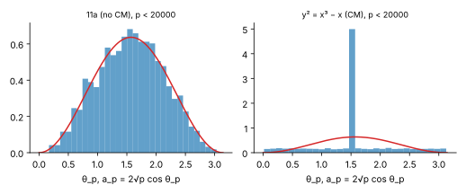

<sub>היסטוגרמות של θ_p לכל p < 20000: משמאל 11a מול הצפיפות (2/π)sin²θ; מימין y² = x³ − x, שבו חצי מהזוויות בדיוק π/2.</sub>

---

## 8. עקומים אליפטיים בחישוב: פירוק לגורמים והצפנה

**[אלגוריתם לנסטרה](../pages/%D7%90%D7%9C%D7%92%D7%95%D7%A8%D7%99%D7%AA%D7%9D%20%D7%9C%D7%A0%D7%A1%D7%98%D7%A8%D7%94%20%D7%9C%D7%A4%D7%99%D7%A8%D7%95%D7%A7%20%D7%91%D7%A2%D7%A7%D7%95%D7%9E%D7%99%D7%9D%20%D7%90%D7%9C%D7%99%D7%A4%D7%98%D7%99%D7%99%D7%9D.md) (1985).** רוצים לפרק $`n`$. בוחרים עקום $`E`$ ונקודה $`P`$ "מודולו $`n`$", ומחשבים $`k!\cdot P`$ עבור $`k = 2, 3, \ldots`$ בנוסחאות החיבור – כשכל חילוק הוא הפיכה מודולו $`n`$. אם $`p \mid n`$ והסדר של $`P`$ ב-$`E(\mathbb F_p)`$ מחלק את $`k!`$, אז מודולו $`p`$ מגיעים ל-$`O`$ – כלומר במהלך החישוב צריך להפוך מספר שמתחלק ב-$`p`$. ההיפוך נכשל, ו-$`\gcd`$ של המספר הזה עם $`n`$ נותן גורם. היתרון על פני שיטת $`p - 1`$ של פולארד: אם $`\#E(\mathbb F_p)`$ לא "חלק", מחליפים עקום.

### דוגמה 9: פירוק 455839
$`E : y^2 = x^3 + 5x - 5`$, $`P = (1, 1)`$ (אכן $`1 + 5 - 5 = 1`$). מחשבים מודולו $`n = 455839`$: $`2P = (14, 455786)`$, $`3!P = (179685, 427131)`$, ..., $`7!P = (70028, 403526)`$. בצעד $`k = 8`$ צריך להפוך מכנה שה-$`\gcd`$ שלו עם $`n`$ הוא **599**. אכן $`455839 = 599\cdot 761`$.

למה דווקא 599? $`\#E(\mathbb F_{599}) = 640 = 2^7\cdot 5`$, והסדר של $`P`$ שם הוא 640. $`640 \mid k!`$ לראשונה ב-$`k = 8`$ (צריך $`2^7`$, ו-$`8!`$ הוא הראשון עם $`2^7`$). מצד שני $`\#E(\mathbb F_{761}) = 777 = 3\cdot 7\cdot 37`$, וזה מחלק את $`k!`$ רק מ-$`k = 37`$. לכן מודולו 761 עדיין לא הגענו ל-$`O`$, וה-$`\gcd`$ הוא בדיוק 599 ולא $`n`$. בדקנו בחישוב.

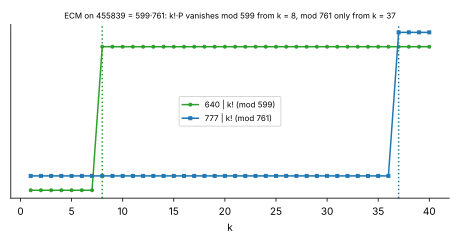

<sub>ECM על 455839: k!·P מתאפס מודולו 599 מ-k = 8, ומודולו 761 רק מ-k = 37.</sub>

**הצפנה.** בעיית הלוגריתם הבדיד על $`E(\mathbb F_p)`$ (בהינתן $`P`$ ו-$`kP`$, למצוא $`k`$) נראית קשה הרבה יותר מאשר ב-$`\mathbb F_p^\times`$, ולכן מפתחות של 256 ביטים מספיקים. החישוב היסודי הוא [כפל סקלרי](../pages/%D7%9B%D7%A4%D7%9C%20%D7%A1%D7%A7%D7%9C%D7%A8%D7%99%20%D7%A2%D7%9C%20%D7%A2%D7%A7%D7%95%D7%9D%20%D7%90%D7%9C%D7%99%D7%A4%D7%98%D7%99.md) ("הכפל-וחבר"), ובפועל משתמשים בצורות נוחות כמו [עקום מונטגומרי](../pages/%D7%A2%D7%A7%D7%95%D7%9D%20%D7%9E%D7%95%D7%A0%D7%98%D7%92%D7%95%D7%9E%D7%A8%D7%99.md) ו[עקום אדוארדס](../pages/%D7%A2%D7%A7%D7%95%D7%9D%20%D7%90%D7%93%D7%95%D7%90%D7%A8%D7%93%D7%A1.md). את $`\#E(\mathbb F_p)`$ עבור $`p`$ ענק מחשבים ב[אלגוריתם של סחוף](../pages/%D7%94%D7%90%D7%9C%D7%92%D7%95%D7%A8%D7%99%D7%AA%D7%9D%20%D7%A9%D7%9C%20%D7%A1%D7%97%D7%95%D7%A3.md), בזמן פולינומי ב-$`\log p`$.

**ולמשפט האחרון של פרמה.** אם $`a^\ell + b^\ell = c^\ell`$, אז ל[עקום פריי](../pages/%D7%A2%D7%A7%D7%95%D7%9D%20%D7%A4%D7%A8%D7%99%D7%99.md) $`y^2 = x(x - a^\ell)(x + b^\ell)`$ יש תכונות מוזרות מדי: לפי ריבט הוא לא יכול להיות מודולרי – וויילס הוכיח שהוא כן. זה שיעור 21.

---

## 9. תרגילים

**תרגיל 1.** על $`E_6 : y^2 = x^3 - 36x`$, חשבו $`3P`$ עבור $`P = (-3, 9)`$ (בעזרת $`2P = (\tfrac{25}{4}, -\tfrac{35}{8})`$), והסבירו בלי חישוב נוסף למה $`P`$ מסדר אינסופי.

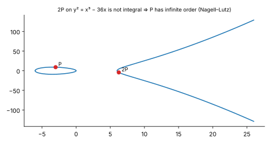

<sub>2P על y² = x³ − 36x אינו נקודה שלמה, ולכן לפי נגל–לוץ P מסדר אינסופי.</sub>

<details><summary>פתרון</summary>

$`\lambda = \dfrac{-35/8 - 9}{25/4 + 3} = \dfrac{-107/8}{37/4} = -\dfrac{107}{74}`$. אז $`x(3P) = \lambda^2 - (-3) - \tfrac{25}{4} = \tfrac{11449}{5476} - \tfrac{13}{4} = \tfrac{11449 - 17797}{5476} = -\tfrac{6348}{5476} = -\tfrac{1587}{1369}`$, ו-$`y(3P) = \lambda(-3 - x_3) - 9 = -\tfrac{107}{74}\cdot\left(-3 + \tfrac{1587}{1369}\right) - 9 = -\tfrac{107}{74}\cdot\left(-\tfrac{2520}{1369}\right) - 9 = \tfrac{269640}{101306} - 9 = \tfrac{134820 - 455877}{50653} = -\tfrac{321057}{50653}`$. ($`1369 = 37^2`$, $`50653 = 37^3`$.) בדיקה: $`x^3 - 36x`$ עבור $`x = -\tfrac{1587}{1369}`$ שווה ל-$`\left(\tfrac{321057}{50653}\right)^2`$ ✓ (בדקנו בחישוב). **הסדר:** כבר $`2P`$ לא שלם, ונגל–לוץ אומר שכל נקודה מסדר סופי שלמה. אילו $`P`$ היה מסדר סופי, גם $`2P`$ היה – סתירה.
</details>

**תרגיל 2.** מצאו את $`E(\mathbb Q)_{\mathrm{tors}}`$ עבור $`y^2 = x^3 - x`$.

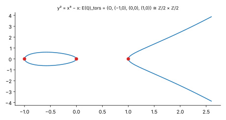

<sub>y² = x³ − x: שלוש נקודות על ציר x, ועוד O.</sub>

<details><summary>פתרון</summary>

$`a = -1`$, $`b = 0`$: $`4a^3 + 27b^2 = -4`$. נגל–לוץ: $`y = 0`$ או $`y^2 \mid 4`$, כלומר $`y \in \{\pm1, \pm2\}`$.
* $`y = 0`$: $`x^3 - x = x(x - 1)(x + 1) = 0`$ → $`x \in \{0, \pm 1\}`$: שלוש נקודות מסדר 2.
* $`y^2 = 1`$: $`x^3 - x = 1`$ – בשלמים: $`x = 1 \to 0`$, $`x = 2 \to 6`$, ו-$`x \le 0 \to \le 0`$. אין פתרון.
* $`y^2 = 4`$: $`x^3 - x = 4`$ – $`x = 2 \to 6`$. אין.

לכן $`E(\mathbb Q)_{\mathrm{tors}} = \{O, (0, 0), (1, 0), (-1, 0)\} \cong \mathbb Z/2 \times \mathbb Z/2`$. (ומכיוון ש-1 אינו חופף, הדרגה 0 ואלה **כל** הנקודות הרציונליות – זה המשפט של פרמה בשפה של עקומים.)
</details>

**תרגיל 3.** ספרו את הנקודות של $`y^2 = x^3 - 2`$ מעל $`\mathbb F_{13}`$, ובדקו את חסם האסה.

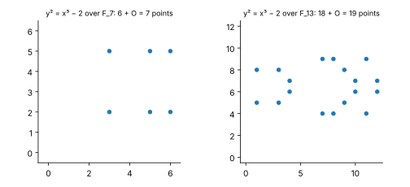

<sub>y² = x³ − 2 מעל F₇ ומעל F₁₃.</sub>

<details><summary>פתרון</summary>

הריבועים מודולו 13: $`\{0, 1, 3, 4, 9, 10, 12\}`$. הקוביות: $`x^3 \in \{0, 1, 5, 8, 12\}`$ – $`x^3 = 1`$ עבור $`x = 1, 3, 9`$; $`= 8`$ עבור $`x = 2, 5, 6`$; $`= 12`$ עבור $`x = 4, 10, 12`$; $`= 5`$ עבור $`x = 7, 8, 11`$; ו-$`0^3 = 0`$. לכן $`x^3 - 2`$:
* $`x = 0`$: $`11`$ – לא ריבוע.
* $`x^3 = 1`$: $`-1 = 12`$ – ריבוע ($`5^2 = 25 \equiv 12`$) → 3 ערכי $`x`$, כל אחד 2 נקודות → 6.
* $`x^3 = 8`$: $`6`$ – לא ריבוע.
* $`x^3 = 12`$: $`10`$ – ריבוע ($`6^2 = 36 \equiv 10`$) → 6 נקודות.
* $`x^3 = 5`$: $`3`$ – ריבוע ($`4^2 = 16 \equiv 3`$) → 6 נקודות.

סה"כ $`18 + 1 = 19`$, $`a_{13} = 14 - 19 = -5`$, ו-$`25 \le 4\cdot 13 = 52`$ ✓.
</details>

**תרגיל 4.** לעקום $`y^2 = x^3 - x`$: חשבו $`a_{13}`$ ישירות (סכום של סמלי לז'נדר), והשוו ל-$`13 = 3^2 + 2^2`$.

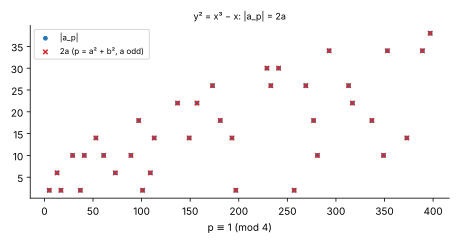

<sub>|a_p| מול 2a עבור p ≡ 1 (mod 4) עד 400: הנקודות מתלכדות.</sub>

<details><summary>פתרון</summary>

$`a_{13} = -\sum_{x = 0}^{12}\left(\frac{x^3 - x}{13}\right)`$. כיוון ש-$`\left(\frac{-1}{13}\right) = 1`$ והפונקציה אי-זוגית, $`x`$ ו-$`-x`$ תורמים אותו דבר. מספיק $`x = 1..6`$ (ו-$`x = 0`$ תורם 0):
* $`x = 1`$: $`0`$.
* $`x = 2`$: $`6`$ – לא ריבוע → $`-1`$.
* $`x = 3`$: $`24 \equiv 11`$ – לא → $`-1`$.
* $`x = 4`$: $`60 \equiv 8`$ – לא → $`-1`$.
* $`x = 5`$: $`120 \equiv 3`$ – ריבוע → $`+1`$.
* $`x = 6`$: $`210 \equiv 2`$ – לא → $`-1`$.

סכום: $`-3`$; כפול 2: $`-6`$. לכן $`a_{13} = 6 = 2\cdot 3`$, עם $`a = 3`$ מ-$`13 = 3^2 + 2^2`$ ✓, ו-$`\#E(\mathbb F_{13}) = 14 - 6 = 8`$.
</details>

**תרגיל 5.** השתמשו במשפט טאנל כדי להראות ש-7 **צפוי** להיות חופף, ומצאו משולש: הנקודה $`(x, y) = (25, 120)`$ על $`E_7`$.

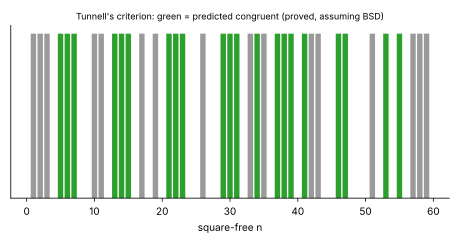

<sub>מספרים חופשיים מריבועים עד 60: ירוק = טאנל מנבא חופף.</sub>

<details><summary>פתרון</summary>

$`2x^2 + y^2 + 8z^2 = 7`$: $`y^2 \in \{7, 5\}`$ (עם $`x = 0, \pm1`$, $`z = 0`$) – לא ריבועים; $`z \ne 0`$ נותן $`\ge 8`$. לכן $`A = 0`$, וגם $`B = 0`$, ו-$`A = 2B`$ – טאנל מנבא "חופף". בדיקת הנקודה: $`25^3 - 49\cdot 25 = 15625 - 1225 = 14400 = 120^2`$ ✓. המשולש: $`a = \tfrac{625 - 49}{120} = \tfrac{576}{120} = \tfrac{24}{5}`$, $`b = \tfrac{2\cdot7\cdot25}{120} = \tfrac{350}{120} = \tfrac{35}{12}`$, $`c = \tfrac{674}{120} = \tfrac{337}{60}`$. שטח: $`\tfrac12\cdot\tfrac{24}{5}\cdot\tfrac{35}{12} = 7`$ ✓, ו-$`\tfrac{576}{25} + \tfrac{1225}{144} = \tfrac{82944 + 30625}{3600} = \tfrac{113569}{3600} = \left(\tfrac{337}{60}\right)^2`$ ✓.
</details>

**תרגיל 6.** בדוגמה 9, למה $`k = 8`$ הוא הצעד שבו ECM מצליח? אילו היינו משתמשים בשיטת $`p - 1`$ של פולארד (כלומר מחשבים $`\gcd(2^{k!} - 1, n)`$), מתי היא הייתה מצליחה?

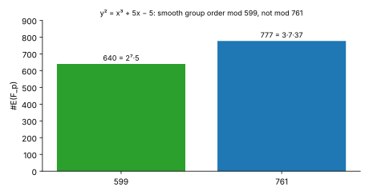

<sub>#E(F_p) עבור שני הגורמים: 640 = 2⁷·5 "חלק", 777 = 3·7·37 לא.</sub>

<details><summary>פתרון</summary>

הסדר של $`P`$ מודולו 599 הוא $`640 = 2^7\cdot 5`$. $`v_2(k!)`$: $`k = 6 \to 4`$, $`k = 7 \to 4`$, $`k = 8 \to 7`$. לכן $`640 \mid 8!`$ ולא $`7!`$. מודולו 761 הסדר $`777`$ מחלק $`k!`$ רק מ-$`k = 37`$, ולכן ב-$`k = 8`$ ה-$`\gcd`$ הוא 599 בלבד.
**פולארד:** צריך ש-$`\mathrm{ord}_p(2) \mid k!`$. כאן $`598 = 2\cdot 13\cdot 23`$ ו-$`760 = 2^3\cdot 5\cdot 19`$, ובחישוב: הסדר של 2 מודולו 599 הוא $`299 = 13\cdot 23`$, ומודולו 761 הוא $`380 = 2^2\cdot 5\cdot 19`$. לכן $`\gcd(2^{k!} - 1, n)`$ נעשה לא טריוויאלי לראשונה ב-$`k = 19`$, ואז הוא נותן את הגורם **761** (כי $`380 \mid 19!`$ אבל $`299 \nmid 19!`$). שיטת פולארד הייתה מצליחה, אבל רק אחרי 19 צעדים במקום 8 – היתרון של ECM: לכל עקום יש "$`p - 1`$" משלו, $`\#E(\mathbb F_p)`$, ואם הוא לא חלק – מחליפים עקום.
</details>

---

## סיכום
* **עקום אליפטי** $`y^2 = x^3 + ax + b`$, $`\Delta \ne 0`$; חוק חיבור מיתר-משיק הופך את $`E(\mathbb Q)`$ לחבורה אבלית.
* **מורדל–וייל:** $`E(\mathbb Q) \cong T \oplus \mathbb Z^r`$; **נגל–לוץ** מוצא את $`T`$; **מאזור:** 15 אפשרויות.
* **מספרים חופפים:** $`n`$ חופף ⇔ $`r(E_n) \ge 1`$ (עבור $`E_n : y^2 = x^3 - n^2x`$); טאנל נותן קריטריון מפורש בהנחת BSD.
* **האסה:** $`|a_p| \le 2\sqrt p`$; עם כפל מרוכב, $`a_p`$ נקבע על ידי ראשוניים בשדה ריבועי מדומה ($`y^2 = x^3 - x`$: $`a_p = \pm2a`$, $`p = a^2 + b^2`$).
* **$`L(E, s)`$** מה-$`a_p`$; **מודולריות** (11a ↔ $`\eta(\tau)^2\eta(11\tau)^2`$); **BSD**: הדרגה = סדר האפס ב-$`s = 1`$.
* **סאטו–טייט:** $`\theta_p`$ מתפלגות $`\tfrac2\pi\sin^2\theta`$ ללא כפל מרוכב.
* **ECM** ו**הצפנה** – אותה חבורה, בשימוש חישובי.

**להעמקה:** [משפט מורדל–וייל](../pages/%D7%9E%D7%A9%D7%A4%D7%98%20%D7%9E%D7%95%D7%A8%D7%93%D7%9C%E2%80%93%D7%95%D7%99%D7%99%D7%9C.md) · [חבורת מורדל–וייל](../pages/%D7%97%D7%91%D7%95%D7%A8%D7%AA%20%D7%9E%D7%95%D7%A8%D7%93%D7%9C%E2%80%93%D7%95%D7%99%D7%99%D7%9C.md) · [משפט נגל–לוץ](../pages/%D7%9E%D7%A9%D7%A4%D7%98%20%D7%A0%D7%92%D7%9C%E2%80%93%D7%9C%D7%95%D7%A5.md) · [השערת הפיתול](../pages/%D7%94%D7%A9%D7%A2%D7%A8%D7%AA%20%D7%94%D7%A4%D7%99%D7%AA%D7%95%D7%9C.md) · [משפט האסה על עקומים אליפטיים](../pages/%D7%9E%D7%A9%D7%A4%D7%98%20%D7%94%D7%90%D7%A1%D7%94%20%D7%A2%D7%9C%20%D7%A2%D7%A7%D7%95%D7%9E%D7%99%D7%9D%20%D7%90%D7%9C%D7%99%D7%A4%D7%98%D7%99%D7%99%D7%9D.md) · [ספירת נקודות על עקומים אליפטיים](../pages/%D7%A1%D7%A4%D7%99%D7%A8%D7%AA%20%D7%A0%D7%A7%D7%95%D7%93%D7%95%D7%AA%20%D7%A2%D7%9C%20%D7%A2%D7%A7%D7%95%D7%9E%D7%99%D7%9D%20%D7%90%D7%9C%D7%99%D7%A4%D7%98%D7%99%D7%99%D7%9D.md) · [האלגוריתם של סחוף](../pages/%D7%94%D7%90%D7%9C%D7%92%D7%95%D7%A8%D7%99%D7%AA%D7%9D%20%D7%A9%D7%9C%20%D7%A1%D7%97%D7%95%D7%A3.md) · [עקום אליפטי על-סינגולרי](../pages/%D7%A2%D7%A7%D7%95%D7%9D%20%D7%90%D7%9C%D7%99%D7%A4%D7%98%D7%99%20%D7%A2%D7%9C-%D7%A1%D7%99%D7%A0%D7%92%D7%95%D7%9C%D7%A8%D7%99.md) · [מוליך של עקום אליפטי](../pages/%D7%9E%D7%95%D7%9C%D7%99%D7%9A%20%D7%A9%D7%9C%20%D7%A2%D7%A7%D7%95%D7%9D%20%D7%90%D7%9C%D7%99%D7%A4%D7%98%D7%99.md) · [האלגוריתם של טייט](../pages/%D7%94%D7%90%D7%9C%D7%92%D7%95%D7%A8%D7%99%D7%AA%D7%9D%20%D7%A9%D7%9C%20%D7%98%D7%99%D7%99%D7%98.md) · [קריטריון נרון–אוג–שפרביץ'](../pages/%D7%A7%D7%A8%D7%99%D7%98%D7%A8%D7%99%D7%95%D7%9F%20%D7%A0%D7%A8%D7%95%D7%9F%E2%80%93%D7%90%D7%95%D7%92%E2%80%93%D7%A9%D7%A4%D7%A8%D7%91%D7%99%D7%A5%27.md) · [עקום טייט](../pages/%D7%A2%D7%A7%D7%95%D7%9D%20%D7%98%D7%99%D7%99%D7%98.md) · [צמד וייל](../pages/%D7%A6%D7%9E%D7%93%20%D7%95%D7%99%D7%99%D7%9C.md) · [השערת סאטו–טייט](../pages/%D7%94%D7%A9%D7%A2%D7%A8%D7%AA%20%D7%A1%D7%90%D7%98%D7%95%E2%80%93%D7%98%D7%99%D7%99%D7%98.md) · [עקום אליפטי מודולרי](../pages/%D7%A2%D7%A7%D7%95%D7%9D%20%D7%90%D7%9C%D7%99%D7%A4%D7%98%D7%99%20%D7%9E%D7%95%D7%93%D7%95%D7%9C%D7%A8%D7%99.md) · [עקום פריי](../pages/%D7%A2%D7%A7%D7%95%D7%9D%20%D7%A4%D7%A8%D7%99%D7%99.md) · [נקודת הגנר](../pages/%D7%A0%D7%A7%D7%95%D7%93%D7%AA%20%D7%94%D7%92%D7%A0%D7%A8.md) · [משפט טאנל](../pages/%D7%9E%D7%A9%D7%A4%D7%98%20%D7%98%D7%90%D7%A0%D7%9C.md) · [משפט בירץ'](../pages/%D7%9E%D7%A9%D7%A4%D7%98%20%D7%91%D7%99%D7%A8%D7%A5%27.md) · [עקום מורדל](../pages/%D7%A2%D7%A7%D7%95%D7%9D%20%D7%9E%D7%95%D7%A8%D7%93%D7%9C.md) · [סיבוב של עקום אליפטי](../pages/%D7%A1%D7%99%D7%91%D7%95%D7%91%20%D7%A9%D7%9C%20%D7%A2%D7%A7%D7%95%D7%9D%20%D7%90%D7%9C%D7%99%D7%A4%D7%98%D7%99.md) · [חסם ברומר](../pages/%D7%97%D7%A1%D7%9D%20%D7%91%D7%A8%D7%95%D7%9E%D7%A8.md) · [חסם מסטר](../pages/%D7%97%D7%A1%D7%9D%20%D7%9E%D7%A1%D7%98%D7%A8.md) · [אלגוריתם לנסטרה לפירוק בעקומים אליפטיים](../pages/%D7%90%D7%9C%D7%92%D7%95%D7%A8%D7%99%D7%AA%D7%9D%20%D7%9C%D7%A0%D7%A1%D7%98%D7%A8%D7%94%20%D7%9C%D7%A4%D7%99%D7%A8%D7%95%D7%A7%20%D7%91%D7%A2%D7%A7%D7%95%D7%9E%D7%99%D7%9D%20%D7%90%D7%9C%D7%99%D7%A4%D7%98%D7%99%D7%99%D7%9D.md) · [כפל סקלרי על עקום אליפטי](../pages/%D7%9B%D7%A4%D7%9C%20%D7%A1%D7%A7%D7%9C%D7%A8%D7%99%20%D7%A2%D7%9C%20%D7%A2%D7%A7%D7%95%D7%9D%20%D7%90%D7%9C%D7%99%D7%A4%D7%98%D7%99.md) · [עקום מונטגומרי](../pages/%D7%A2%D7%A7%D7%95%D7%9D%20%D7%9E%D7%95%D7%A0%D7%98%D7%92%D7%95%D7%9E%D7%A8%D7%99.md) · [עקום אדוארדס](../pages/%D7%A2%D7%A7%D7%95%D7%9D%20%D7%90%D7%93%D7%95%D7%90%D7%A8%D7%93%D7%A1.md) · [סדרת התחלקות אליפטית](../pages/%D7%A1%D7%93%D7%A8%D7%AA%20%D7%94%D7%AA%D7%97%D7%9C%D7%A7%D7%95%D7%AA%20%D7%90%D7%9C%D7%99%D7%A4%D7%98%D7%99%D7%AA.md) · [סדרת סומוס](../pages/%D7%A1%D7%93%D7%A8%D7%AA%20%D7%A1%D7%95%D7%9E%D7%95%D7%A1.md) · [כפל מרוכב](../pages/%D7%9B%D7%A4%D7%9C%20%D7%9E%D7%A8%D7%95%D7%9B%D7%91.md) · [חבורת טייט–שפרביץ'](../pages/%D7%97%D7%91%D7%95%D7%A8%D7%AA%20%D7%98%D7%99%D7%99%D7%98%E2%80%93%D7%A9%D7%A4%D7%A8%D7%91%D7%99%D7%A5%27.md) · [חבורת סלמר](../pages/%D7%97%D7%91%D7%95%D7%A8%D7%AA%20%D7%A1%D7%9C%D7%9E%D7%A8.md) · [איזוגניה](../pages/%D7%90%D7%99%D7%96%D7%95%D7%92%D7%A0%D7%99%D7%94.md) · [פולינומי חלוקה](../pages/%D7%A4%D7%95%D7%9C%D7%99%D7%A0%D7%95%D7%9E%D7%99%20%D7%97%D7%9C%D7%95%D7%A7%D7%94.md) · [גובה נרון–טייט](../pages/%D7%92%D7%95%D7%91%D7%94%20%D7%A0%D7%A8%D7%95%D7%9F%E2%80%93%D7%98%D7%99%D7%99%D7%98.md) · [חבורת וייל–שאטלה](../pages/%D7%97%D7%91%D7%95%D7%A8%D7%AA%20%D7%95%D7%99%D7%99%D7%9C%E2%80%93%D7%A9%D7%90%D7%98%D7%9C%D7%94.md) · [מודל נרון](../pages/%D7%9E%D7%95%D7%93%D7%9C%20%D7%A0%D7%A8%D7%95%D7%9F.md) · [מודול טייט](../pages/%D7%9E%D7%95%D7%93%D7%95%D7%9C%20%D7%98%D7%99%D7%99%D7%98.md) · [הוכחת ראשוניות בעקומים אליפטיים](../pages/%D7%94%D7%95%D7%9B%D7%97%D7%AA%20%D7%A8%D7%90%D7%A9%D7%95%D7%A0%D7%99%D7%95%D7%AA%20%D7%91%D7%A2%D7%A7%D7%95%D7%9E%D7%99%D7%9D%20%D7%90%D7%9C%D7%99%D7%A4%D7%98%D7%99%D7%99%D7%9D.md) · [השערת להמר על מידת מאהלר](../pages/%D7%94%D7%A9%D7%A2%D7%A8%D7%AA%20%D7%9C%D7%94%D7%9E%D7%A8%20%D7%A2%D7%9C%20%D7%9E%D7%99%D7%93%D7%AA%20%D7%9E%D7%90%D7%94%D7%9C%D7%A8.md) · [צמד טייט](../pages/%D7%A6%D7%9E%D7%93%20%D7%98%D7%99%D7%99%D7%98.md)

**השיעור הקודם:** [שיעור 19א: תורת שדות המחלקה: הדדיות ארטין, משפט הקיום ותורה מקומית](19א-תורת-שדות-המחלקה.md) · **השיעור הבא:** [שיעור 21: תבניות מודולריות](21-תבניות-מודולריות.md)

---
<sub>חלק מ[קורס תורת המספרים](../COURSE.md). התוכן מופץ ברישיון [CC BY-SA 4.0](https://creativecommons.org/licenses/by-sa/4.0/).</sub>
