# שיעור 21: תבניות מודולריות

**מה נלמד:** בשיעור 20 גילינו שהמספרים $`a_p`$ של העקום 11a הם המקדמים של המכפלה $`q\prod(1 - q^n)^2(1 - q^{11n})^2`$. זו דוגמה ל**תבנית מודולרית** – פונקציה על חצי המישור העליון עם סימטריה עצומה. נראה ש:
1. החבורה $`\mathrm{SL}_2(\mathbb Z)`$ פועלת על חצי המישור העליון, ויש לה **תחום יסודי** פשוט.
2. תבניות מודולריות ממשקל $`k`$ יוצרות **מרחב וקטורי ממימד סופי** – ולכן כל שוויון בין שתי תבניות נבדק על ידי השוואת כמה מקדמים, וזה מייצר זהויות מפתיעות בין פונקציות מחלקים.
3. **פונקציית הדלתא** $`\Delta = q\prod(1 - q^n)^{24} = \sum\tau(n)q^n`$ ו**פונקציית ה-$`j`$**; מכאן $`e^{\pi\sqrt{163}} \approx 640320^3 + 744`$.
4. **אופרטורי הקה** מסבירים למה $`\tau(n)`$ כפלית, ו**דלין** הוכיח $`|\tau(p)| \le 2p^{11/2}`$.
5. **פונקציות תטא** סופרות הצגות כסכום ריבועים (יעקובי: $`r_4(n)`$), ו**פונקציית האטא** שולטת בחלוקות (רמנוג'אן: $`5 \mid p(5n + 4)`$).
6. ברמה $`N`$: **תבניות חדשות**, **משפט המודולריות**, ו**משפט ריבט** שסוגר את המשפט האחרון של פרמה.

**ידע קודם:** [שיעור 6](06-פונקציות-אריתמטיות.md) (פונקציות מחלקים $`\sigma_k`$), [שיעור כלים כ9](T09-פונקציות-מרוכבות.md) ו-[כ11](T11-גמא-פורייה-ותטא.md) (פונקציות הולומורפיות, פונקציית תטא, נוסחת פואסון), [שיעור 20](20-עקומים-אליפטיים.md) (עקומים אליפטיים, $`a_p`$, פונקציית L).

---

## 1. חצי המישור העליון והחבורה המודולרית

[חצי המישור העליון](../pages/%D7%97%D7%A6%D7%99%20%D7%94%D7%9E%D7%99%D7%A9%D7%95%D7%A8%20%D7%94%D7%A2%D7%9C%D7%99%D7%95%D7%9F.md) $`\mathbb H = \{\tau : \mathrm{Im}\,\tau \gt 0\}`$. החבורה המודולרית $`\mathrm{SL}_2(\mathbb Z)`$ (מטריצות שלמות עם דטרמיננטה 1) פועלת עליו בטרנספורמציות מביוס:
```math
\gamma = \begin{pmatrix} a & b\\ c & d\end{pmatrix}: \quad \tau \longmapsto \frac{a\tau + b}{c\tau + d}, \qquad \mathrm{Im}\,\gamma\tau = \frac{\mathrm{Im}\,\tau}{|c\tau + d|^2}.
```
החבורה נוצרת על ידי שתי מטריצות: $`T = \begin{pmatrix}1&1\\0&1\end{pmatrix}`$ ($`\tau \mapsto \tau + 1`$) ו-$`S = \begin{pmatrix}0&-1\\1&0\end{pmatrix}`$ ($`\tau \mapsto -1/\tau`$).

**התחום היסודי.** $`\mathcal F = \{\tau : |\mathrm{Re}\,\tau| \le \tfrac12,\ |\tau| \ge 1\}`$. כל נקודה ב-$`\mathbb H`$ שקולה לנקודה ב-$`\mathcal F`$, ושתי נקודות בפנים של $`\mathcal F`$ אינן שקולות. האלגוריתם (צמצום, כמו אלגוריתם אוקלידס):
1. הזיזו ב-$`T^n`$ כך ש-$`|\mathrm{Re}\,\tau| \le \tfrac12`$.
2. אם $`|\tau| \lt 1`$, הפעילו $`S`$ – זה מגדיל את $`\mathrm{Im}\,\tau`$ פי $`1/|\tau|^2`$ – וחזרו לשלב 1.

### דוגמה 1: צמצום של $`\tau = \tfrac{3 + i}{10}`$
* $`|\mathrm{Re}\,\tau| = 0.3 \le \tfrac12`$, אבל $`|\tau|^2 = \tfrac{10}{100} = 0.1 \lt 1`$. מפעילים $`S`$: $`-\tfrac1\tau = -\tfrac{10}{3 + i} = -\tfrac{10(3 - i)}{10} = -3 + i`$. ($`\mathrm{Im}`$ גדל מ-0.1 ל-1.)
* מזיזים ב-$`T^3`$: $`-3 + i + 3 = i`$. עכשיו $`|i| = 1`$ – על השפה של $`\mathcal F`$.

לכן $`\tau \sim i`$, דרך $`\gamma = T^3S = \begin{pmatrix}3&-1\\1&0\end{pmatrix}`$: $`\gamma\tau = \tfrac{3\tau - 1}{\tau} = 3 - \tfrac1\tau = 3 - (3 - i) = i`$ ✓.

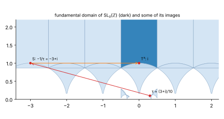

<sub>התחום היסודי של SL₂(ℤ) (כהה) וכמה מהעתקיו; המסלול של τ = (3+i)/10 → −3+i → i.</sub>

**הקשר לעקומים.** לכל $`\tau \in \mathbb H`$ מתאים הסריג $`\Lambda_\tau = \mathbb Z + \mathbb Z\tau`$ והעקום $`\mathbb C/\Lambda_\tau`$, שהוא עקום אליפטי ([הפונקציה של ויירשטראס](../pages/%D7%94%D7%A4%D7%95%D7%A0%D7%A7%D7%A6%D7%99%D7%94%20%D7%94%D7%90%D7%9C%D7%99%D7%A4%D7%98%D7%99%D7%AA%20%D7%A9%D7%9C%20%D7%95%D7%99%D7%99%D7%A8%D7%A9%D7%98%D7%A8%D7%90%D7%A1.md) $`\wp`$ נותנת $`y^2 = 4x^3 - g_2x - g_3`$). שני ערכים $`\tau, \tau'`$ נותנים עקומים איזומורפיים **בדיוק** כשהם שקולים תחת $`\mathrm{SL}_2(\mathbb Z)`$. כלומר $`\mathcal F`$ הוא "מרחב המודולים" של עקומים אליפטיים מעל $`\mathbb C`$.

---

## 2. תבניות מודולריות וטורי אייזנשטיין

**הגדרה.** פונקציה הולומורפית $`f : \mathbb H \to \mathbb C`$ היא **תבנית מודולרית ממשקל $`k`$** (ביחס ל-$`\mathrm{SL}_2(\mathbb Z)`$) אם
```math
f\!\left(\frac{a\tau + b}{c\tau + d}\right) = (c\tau + d)^k f(\tau) \quad \text{לכל } \gamma \in \mathrm{SL}_2(\mathbb Z),
```
והיא חסומה כש-$`\mathrm{Im}\,\tau \to \infty`$. מ-$`T`$: $`f(\tau + 1) = f(\tau)`$, ולכן יש **טור פורייה** ($`q`$-פיתוח) $`f = \sum_{n \ge 0}a(n)q^n`$, $`q = e^{2\pi i\tau}`$. אם $`a(0) = 0`$, $`f`$ היא [תבנית שפיץ](../pages/%D7%AA%D7%91%D7%A0%D7%99%D7%AA%20%D7%A9%D7%A4%D7%99%D7%A5.md). המרחבים: $`M_k \supseteq S_k`$. (מ-$`\gamma = -I`$: $`f = (-1)^kf`$, ולכן $`k`$ זוגי.)

**טורי אייזנשטיין.** לכל $`k \ge 4`$ זוגי, $`G_k(\tau) = \sum_{(m,n) \ne (0,0)}(m\tau + n)^{-k}`$ היא תבנית ממשקל $`k`$ (הסכום על כל הסריג, ולכן ההחלפה $`\tau \mapsto \gamma\tau`$ רק מסדרת אותו מחדש). אחרי נרמול:
```math
E_4 = 1 + 240\sum_{n \ge 1}\sigma_3(n)q^n, \qquad E_6 = 1 - 504\sum_{n\ge1}\sigma_5(n)q^n, \qquad E_8 = 1 + 480\sum_{n\ge1}\sigma_7(n)q^n .
```
(באופן כללי $`E_k = 1 - \tfrac{2k}{B_k}\sum\sigma_{k-1}(n)q^n`$, עם מספרי ברנולי.)

**משפט המימד.** $`M_k`$ ממימד סופי: $`\dim M_k = \lfloor k/12\rfloor + 1`$, חוץ מ-$`k \equiv 2 \pmod{12}`$ שבו $`\dim M_k = \lfloor k/12 \rfloor`$. בפרט $`\dim M_4 = \dim M_6 = \dim M_8 = \dim M_{10} = \dim M_{14} = 1`$, ו-$`M_2 = 0`$. הכלי בהוכחה: נוסחת $`k/12`$ – מספר האפסים של $`f \ne 0`$ ב-$`\mathcal F`$ (עם משקלות $`\tfrac12`$ ב-$`i`$ ו-$`\tfrac13`$ ב-$`\rho`$) הוא $`k/12`$.

### דוגמה 2: $`E_4^2 = E_8`$ וזהות בין פונקציות מחלקים
גם $`E_4^2`$ וגם $`E_8`$ שייכים ל-$`M_8`$, שהוא חד-ממדי, ושניהם מתחילים ב-1. לכן $`E_4^2 = E_8`$. נשווה מקדמים של $`q^n`$:
```math
480\,\sigma_7(n) = 2\cdot 240\,\sigma_3(n) + 240^2\sum_{m=1}^{n-1}\sigma_3(m)\sigma_3(n - m),
```
כלומר
```math
\sigma_7(n) = \sigma_3(n) + 120\sum_{m=1}^{n-1}\sigma_3(m)\,\sigma_3(n - m).
```
בדיקה: $`n = 2`$: $`\sigma_7(2) = 129`$, ובצד ימין $`\sigma_3(2) + 120\cdot\sigma_3(1)^2 = 9 + 120 = 129`$ ✓. $`n = 3`$: $`\sigma_7(3) = 2188`$, ובצד ימין $`28 + 120\cdot(1\cdot 9 + 9\cdot 1) = 28 + 2160 = 2188`$ ✓. אין הוכחה "אלמנטרית" קצרה לזהות הזו – היא נובעת מכך שהמרחב חד-ממדי. בדקנו בחישוב עד $`n = 30`$.

---

## 3. פונקציית הדלתא ופונקציית $`j`$

$`M_{12}`$ דו-ממדי, נפרש על ידי $`E_4^3`$ ו-$`E_6^2`$. ההפרש שלהם מתאפס ב-$`q^0`$, ולכן הוא תבנית שפיץ:
```math
\Delta = \frac{E_4^3 - E_6^2}{1728} = q\prod_{n \ge 1}(1 - q^n)^{24} = \sum_{n\ge1}\tau(n)q^n = q - 24q^2 + 252q^3 - 1472q^4 + 4830q^5 - 6048q^6 - \dots
```
($`1728 = 12^3`$; השוויון עם המכפלה – של יעקובי – נובע מכך ש-$`S_{12}`$ חד-ממדי.) המספרים $`\tau(n)`$ הם [פונקציית הטאו של רמנוג'אן](../pages/%D7%A4%D7%95%D7%A0%D7%A7%D7%A6%D7%99%D7%99%D7%AA%20%D7%94%D7%98%D7%90%D7%95%20%D7%A9%D7%9C%20%D7%A8%D7%9E%D7%A0%D7%95%D7%92%27%D7%90%D7%9F.md). $`\Delta`$ לא מתאפסת על $`\mathbb H`$ (המכפלה), ו-$`\Delta(\tau) = \eta(\tau)^{24}`$, כאשר $`\eta(\tau) = q^{1/24}\prod(1 - q^n)`$ היא [פונקציית האטא של דדקינד](../pages/%D7%A4%D7%95%D7%A0%D7%A7%D7%A6%D7%99%D7%99%D7%AA%20%D7%90%D7%98%D7%90%20%D7%A9%D7%9C%20%D7%93%D7%93%D7%A7%D7%99%D7%A0%D7%93.md).

**רמנוג'אן (1916) ניחש:**
1. $`\tau(mn) = \tau(m)\tau(n)`$ אם $`\gcd(m, n) = 1`$.
2. $`\tau(p^{r+1}) = \tau(p)\tau(p^r) - p^{11}\tau(p^{r-1})`$.
3. $`|\tau(p)| \le 2p^{11/2}`$.

את 1–2 הוכיח מורדל (1917), ואת 3 – דלין (1974), כמסקנה מהשערות וייל (שיעור 22).

### דוגמה 3: בדיקת הכפליות
* $`\tau(6) = -6048`$ ו-$`\tau(2)\tau(3) = (-24)(252) = -6048`$ ✓.
* $`\tau(4) = \tau(2)^2 - 2^{11} = 576 - 2048 = -1472`$ ✓.
* $`\tau(8) = \tau(2)\tau(4) - 2^{11}\tau(2) = (-24)(-1472) - 2048\cdot(-24) = 35328 + 49152 = 84480`$ ✓.
* $`\tau(10) = \tau(2)\tau(5) = (-24)(4830) = -115920`$ ✓.

**קונגרואנציית רמנוג'אן.** $`\tau(n) \equiv \sigma_{11}(n) \pmod{691}`$. הסיבה: $`E_{12} - E_4^3`$ היא תבנית שפיץ, ולכן כפולה של $`\Delta`$; והמקדם $`-\tfrac{24}{B_{12}} = \tfrac{65520}{691}`$ של $`E_{12}`$ מכניס את 691 (המונה של $`B_{12}`$). למשל $`n = 2`$: $`\tau(2) - \sigma_{11}(2) = -24 - 2049 = -2073 = -3\cdot 691`$ ✓. (זה אותו 691 מ"[הרברנד–ריבט](19א-תורת-שדות-המחלקה.md)": ריבט השתמש בקונגרואנציות כאלה כדי לבנות הרחבות של $`\mathbb Q(\zeta_p)`$.) בדקנו בחישוב.

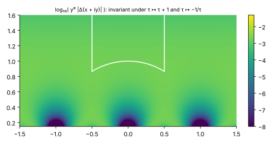

<sub>log₁₀(y⁶|Δ(x+iy)|): הפונקציה הזו שמורה תחת SL₂(ℤ); הקווים הלבנים – התחום היסודי.</sub>

**[אינווריאנט $`j`$](../pages/%D7%90%D7%99%D7%A0%D7%95%D7%95%D7%A8%D7%99%D7%90%D7%A0%D7%98%20j.md).** המנה של שתי תבניות מאותו משקל היא פונקציה **אינווריאנטית**:
```math
j(\tau) = \frac{E_4(\tau)^3}{\Delta(\tau)} = \frac1q + 744 + 196884\,q + 21493760\,q^2 + \dots
```
$`j`$ מגדירה התאמה חד-חד-ערכית $`\mathcal F \to \mathbb C`$ (עד זיהויי השפה): העקום $`\mathbb C/\Lambda_\tau`$ נקבע עד איזומורפיזם על ידי $`j(\tau)`$, וזה בדיוק ה-$`j`$-אינווריאנט של העקום מ[שיעור 20](20-עקומים-אליפטיים.md). $`j(i) = 1728`$ (העקום $`y^2 = x^3 - x`$), $`j(\rho) = 0`$ (העקום $`y^2 = x^3 + 1`$).

### דוגמה 4: $`e^{\pi\sqrt{163}}`$
**משפט (כפל מרוכב).** אם $`\tau`$ הוא שורש של משוואה ריבועית עם דיסקרימיננטה $`D \lt 0`$, אז $`j(\tau)`$ הוא **מספר אלגברי שלם** ממעלה $`h(D)`$. כש-$`h(D) = 1`$ – $`j(\tau) \in \mathbb Z`$. (זה המשפט שמאחורי שדה מחלקות הילברט בשיעור 19א.)

עבור $`\tau = \tfrac{1 + \sqrt{-163}}{2}`$: $`h(-163) = 1`$ ו-$`j(\tau) = -640320^3`$. אבל $`q = e^{2\pi i\tau} = -e^{-\pi\sqrt{163}}`$, מספר זעיר ($`\approx -3.8\cdot 10^{-18}`$). לכן
```math
-640320^3 = j(\tau) = -e^{\pi\sqrt{163}} + 744 - 196884\,e^{-\pi\sqrt{163}} + \dots \quad\Longrightarrow\quad e^{\pi\sqrt{163}} = 640320^3 + 744 - 7.5\cdot 10^{-13}\ldots
```
ואכן $`e^{\pi\sqrt{163}} = 262537412640768743.99999999999925\ldots`$, ו-$`640320^3 + 744 = 262537412640768744`$. באותו אופן $`e^{\pi\sqrt{67}} \approx 5280^3 + 744 - 1.3\cdot10^{-6}`$ ו-$`e^{\pi\sqrt{43}} \approx 960^3 + 744 - 2.2\cdot 10^{-4}`$. בדקנו בחישוב ברמת דיוק של 40 ספרות.

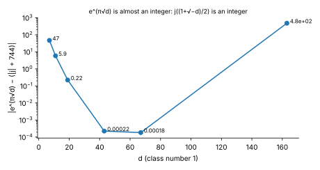

<sub>|e^(π√d) − (|j| + 744)| עבור d = 7, 11, 19, 43, 67, 163: ככל ש-d גדל, e^(π√d) קרוב יותר למספר שלם.</sub>

(המקדם 196884 = 196883 + 1, כאשר 196883 הוא המימד של ההצגה הלא-טריוויאלית הקטנה של חבורת המפלצת – "ירח מטורף", שהוכח על ידי בורצ'רדס.)

---

## 4. אופרטורי הקה ותבניות עצמיות

למה $`\tau(n)`$ כפלית? כי על $`M_k`$ פועלים [אופרטורי הקה](../pages/%D7%90%D7%95%D7%A4%D7%A8%D7%98%D7%95%D7%A8%20%D7%94%D7%A7%D7%94.md) $`T_n`$, ועל המקדמים:
```math
T_p\left(\sum a(n)q^n\right) = \sum_n\left(a(pn) + p^{k-1}a(n/p)\right)q^n \qquad (a(n/p) = 0 \text{ אם } p \nmid n).
```
($`T_p`$ "ממצע" על $`p + 1`$ תת-סריגים מאינדקס $`p`$.) האופרטורים מתחלפים זה עם זה ו-$`T_mT_n = T_{mn}`$ ל-$`m, n`$ זרים. כיוון ש-$`S_{12}`$ חד-ממדי, $`T_p\Delta = \lambda_p\Delta`$, ומהמקדם של $`q^1`$: $`\lambda_p = \tau(p)`$. משוואת המקדם של $`q^n`$ נותנת:
```math
\tau(p)\tau(n) = \tau(pn) + p^{11}\tau(n/p),
```
וזה בדיוק כללי רמנוג'אן 1–2. **[תבנית עצמית](../pages/%D7%AA%D7%91%D7%A0%D7%99%D7%AA%20%D7%A2%D7%A6%D7%9E%D7%99%D7%AA.md)** מנורמלת ($`a(1) = 1`$) לכל $`T_n`$ היא תבנית שהמקדמים שלה הם הערכים העצמיים – והם כפליים. ל-$`L(f, s) = \sum a(n)n^{-s}`$ יש אז **מכפלת אוילר**:
```math
L(f, s) = \prod_p\frac{1}{1 - a(p)p^{-s} + p^{k-1-2s}} .
```
**השערת רמנוג'אן–פטרסון** (דלין): $`|a(p)| \le 2p^{(k-1)/2}`$ – כלומר שני השורשים של $`X^2 - a(p)X + p^{k-1}`$ בערך מוחלט $`p^{(k-1)/2}`$. זו בדיוק התבנית של משפט האסה מ-שיעור 20 ($`k = 2`$). [המכפלה הפנימית של פטרסון](../pages/%D7%9E%D7%9B%D7%A4%D7%9C%D7%94%20%D7%A4%D7%A0%D7%99%D7%9E%D7%99%D7%AA%20%D7%A9%D7%9C%20%D7%A4%D7%98%D7%A8%D7%A1%D7%95%D7%9F.md) הופכת את $`T_n`$ להרמיטיים, ולכן $`S_k`$ נפרש על ידי תבניות עצמיות.

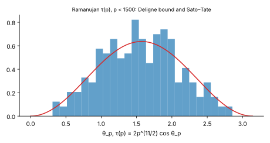

<sub>הזוויות θ_p עם τ(p) = 2p^(11/2) cos θ_p, לכל p < 1500: כולן מוגדרות (דלין), ומתפלגות לפי (2/π)sin²θ (סאטו–טייט).</sub>

---

## 5. פונקציות תטא וסכומי ריבועים

$`\theta(\tau) = \sum_{n \in \mathbb Z}q^{n^2}`$. אז $`\theta(\tau)^k = \sum_n r_k(n)q^n`$, כאשר $`r_k(n)`$ הוא מספר ההצגות של $`n`$ כסכום של $`k`$ ריבועים (עם סדר וסימנים). $`\theta`$ אינה מודולרית ביחס ל-$`\mathrm{SL}_2(\mathbb Z)`$, אבל כן ביחס ל-[תת-חבורת הקונגרואנציה](../pages/%D7%AA%D7%AA-%D7%97%D7%91%D7%95%D7%A8%D7%AA%20%D7%A7%D7%95%D7%A0%D7%92%D7%A8%D7%95%D7%90%D7%A0%D7%A6%D7%99%D7%94.md)
```math
\Gamma_0(4) = \left\{\begin{pmatrix}a&b\\c&d\end{pmatrix} \in \mathrm{SL}_2(\mathbb Z) : 4 \mid c\right\}
```
(ממשקל $`\tfrac12`$; הסיבה: נוסחת פואסון נותנת $`\theta(-1/4\tau) = \sqrt{-2i\tau}\,\theta(\tau)`$, משיעור כ11). לכן $`\theta^4 \in M_2(\Gamma_0(4))`$, מרחב **דו-ממדי** הנפרש על ידי טורי אייזנשטיין. השוואת שני מקדמים קובעת:

**משפט יעקובי (1829).**
```math
r_4(n) = 8\sum_{d \mid n,\ 4 \nmid d} d .
```

### דוגמה 5: $`r_4(n)`$ עבור $`n = 1, \ldots, 6`$
| $`n`$ | מחלקים שאינם כפולות של 4 | $`8\sum`$ | ספירה ישירה |
|---|---|---|---|
| 1 | 1 | 8 | $`(\pm1, 0, 0, 0)`$ ב-4 מקומות: 8 |
| 2 | 1, 2 | 24 | $`(\pm1, \pm1, 0, 0)`$: $`\binom42\cdot 4 = 24`$ |
| 3 | 1, 3 | 32 | $`(\pm1, \pm1, \pm1, 0)`$: $`4\cdot 8 = 32`$ |
| 4 | 1, 2 | 24 | $`(\pm2, 0, 0, 0)`$: 8; $`(\pm1, \pm1, \pm1, \pm1)`$: 16 |
| 5 | 1, 5 | 48 | $`(\pm2, \pm1, 0, 0)`$: $`12\cdot 4 = 48`$ |
| 6 | 1, 2, 3, 6 | 96 | $`(\pm2, \pm1, \pm1, 0)`$: $`12\cdot 8 = 96`$ |

מסקנה מיידית: $`r_4(n) \ge 8 \gt 0`$ לכל $`n \ge 1`$ – **[משפט ארבעת הריבועים של לגראנז'](../pages/%D7%9E%D7%A9%D7%A4%D7%98%20%D7%90%D7%A8%D7%91%D7%A2%D7%AA%20%D7%94%D7%A8%D7%99%D7%91%D7%95%D7%A2%D7%99%D7%9D%20%D7%A9%D7%9C%20%D7%9C%D7%92%D7%A8%D7%90%D7%A0%D7%96%27.md)**. ובאותה דרך, $`r_8(n) = 16\sum_{d\mid n}(-1)^{n+d}d^3`$: $`r_8(1) = 16`$, $`r_8(2) = 112`$, $`r_8(3) = 448`$. בדקנו בחישוב את $`r_4`$ עד 12 ואת $`r_8`$ עד 5 בספירה ישירה.

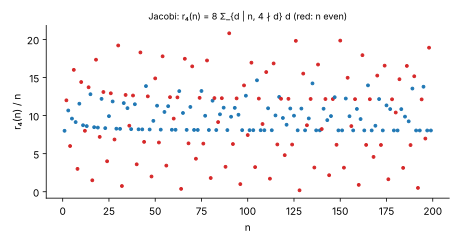

<sub>r₄(n)/n עד 200: המנה תלויה רק בגורמים של n; היא קטנה יותר ב-n זוגיים (אדום) בגלל ההשמטה של מחלקים המתחלקים ב-4.</sub>

---

## 6. חלוקות ופונקציית האטא

מספר ה**חלוקות** $`p(n)`$ (דרכים לכתוב $`n`$ כסכום של מספרים חיוביים, בלי חשיבות לסדר) מקיים
```math
\sum_{n\ge0}p(n)q^n = \prod_{n\ge1}\frac{1}{1 - q^n} = \frac{q^{1/24}}{\eta(\tau)} .
```
כך תבנית מודולרית (ממשקל $`-\tfrac12`$) שולטת בפונקציה קומבינטורית.
* **הארדי–רמנוג'אן (1918):** $`p(n) \sim \dfrac{1}{4n\sqrt3}e^{\pi\sqrt{2n/3}}`$, בשיטת המעגל (שיעור 15), שמשתמשת בהתנהגות של $`\eta`$ ליד כל נקודה רציונלית – כלומר בטרנספורמציה של $`\eta`$ תחת $`\mathrm{SL}_2(\mathbb Z)`$. למשל $`p(100) = 190569292`$, והקירוב נותן $`1.993\cdot 10^8`$ (יחס $`\approx 1.046`$; רדמכר שיפר את זה לטור מתכנס).
* **רמנוג'אן:** $`p(5n + 4) \equiv 0 \pmod 5`$, $`p(7n + 5) \equiv 0 \pmod 7`$, $`p(11n + 6) \equiv 0 \pmod{11}`$. למשל $`p(4) = 5`$, $`p(9) = 30`$, $`p(14) = 135`$, $`p(19) = 490`$, $`p(24) = 1575`$ – כולם מתחלקים ב-5. בדקנו בחישוב.

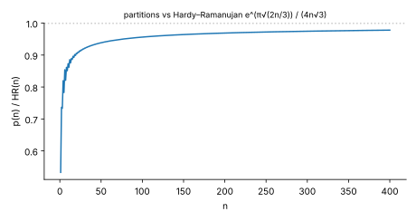

<sub>p(n) חלקי הקירוב של הארדי–רמנוג'אן, עד n = 400: היחס שואף ל-1 לאט (כמו 1 − c/√n).</sub>

---

## 7. רמה $`N`$, תבניות חדשות ומשפט המודולריות

לתת-החבורה $`\Gamma_0(N)`$ (מטריצות עם $`N \mid c`$) יש מרחבים $`M_k(\Gamma_0(N)) \supseteq S_k(\Gamma_0(N))`$, ו[עקום מודולרי](../pages/%D7%A2%D7%A7%D7%95%D7%9D%20%D7%9E%D7%95%D7%93%D7%95%D7%9C%D7%A8%D7%99.md) $`X_0(N) = \Gamma_0(N)\backslash\mathbb H^*`$. עובדה גאומטרית: $`\dim S_2(\Gamma_0(N))`$ = **הגנוס** של $`X_0(N)`$. הגנוס 0 עבור $`N \le 10`$ (וגם 12, 13, 16, 18, 25), ו-1 עבור $`N = 11`$.

**תבניות חדשות** (אטקין–לנר, [תורת אטקין–לנר](../pages/%D7%AA%D7%95%D7%A8%D7%AA%20%D7%90%D7%98%D7%A7%D7%99%D7%9F%E2%80%93%D7%9C%D7%A0%D7%A8.md)): תבניות ברמה $`N`$ שאינן באות מרמה קטנה יותר. תבנית חדשה עצמית מנורמלת היא אובייקט "אטומי", עם מכפלת אוילר ומשוואה פונקציונלית $`s \leftrightarrow k - s`$.

### דוגמה 6: $`S_2(\Gamma_0(11))`$ והעקום 11a
$`S_2(\Gamma_0(11))`$ חד-ממדי, ונפרש על ידי
```math
f = \eta(\tau)^2\eta(11\tau)^2 = q\prod(1 - q^n)^2(1 - q^{11n})^2 = q - 2q^2 - q^3 + 2q^4 + q^5 + 2q^6 - 2q^7 - 2q^9 - 2q^{10} + q^{11} - 2q^{12} + 4q^{13} + \dots
```
(המשקל: $`2\cdot\tfrac12 + 2\cdot\tfrac12 = 2`$; והחזקה של $`q`$: $`\tfrac{2 + 22}{24} = 1`$.) כפי שראינו בשיעור 20, $`a(p) = p + 1 - \#E(\mathbb F_p)`$ עבור $`E`$ = 11a. כיוון שהמרחב חד-ממדי, $`f`$ תבנית עצמית, ולכן $`a(n)`$ כפליים – וזה מסביר "למה" ספירת הנקודות של העקום מודולו ראשוניים שונים מתנהגת בצורה מתואמת.

**[איזומורפיזם אייכלר–שימורה](../pages/%D7%90%D7%99%D7%96%D7%95%D7%9E%D7%95%D7%A8%D7%A4%D7%99%D7%96%D7%9D%20%D7%90%D7%99%D7%99%D7%9B%D7%9C%D7%A8%E2%80%93%D7%A9%D7%99%D7%9E%D7%95%D7%A8%D7%94.md).** לכל תבנית חדשה $`f \in S_2(\Gamma_0(N))`$ עם מקדמים רציונליים יש עקום אליפטי $`E_f`$ עם מוליך $`N`$ ו-$`a_p(E_f) = a(p)`$. **משפט המודולריות** (ויילס, טיילור–ויילס 1995; ברויל–קונרד–דיימונד–טיילור 2001) אומר שזה **על**: כל עקום אליפטי מעל $`\mathbb Q`$ מגיע כך.

**המשפט האחרון של פרמה.** נניח $`a^\ell + b^\ell = c^\ell`$, $`\ell \ge 5`$ ראשוני. [עקום פריי](../pages/%D7%A2%D7%A7%D7%95%D7%9D%20%D7%A4%D7%A8%D7%99%D7%99.md) $`y^2 = x(x - a^\ell)(x + b^\ell)`$ מודולרי (ויילס), ולכן מגיע מתבנית חדשה ממשקל 2. [משפט ריבט](../pages/%D7%9E%D7%A9%D7%A4%D7%98%20%D7%A8%D7%99%D7%91%D7%98.md) (1990, "הורדת רמה") מראה שההצגה של גלואה על נקודות ה-$`\ell`$-פיתול שלו באה גם מתבנית ברמה **2**. אבל $`X_0(2)`$ מגנוס 0, כלומר $`S_2(\Gamma_0(2)) = 0`$. סתירה. (ההכללה: [השערת המודולריות של סר](../pages/%D7%94%D7%A9%D7%A2%D7%A8%D7%AA%20%D7%94%D7%9E%D7%95%D7%93%D7%95%D7%9C%D7%A8%D7%99%D7%95%D7%AA%20%D7%A9%D7%9C%20%D7%A1%D7%A8.md), שהוכחה על ידי קארה–וינטנברגר.)

**הלאה.** [תבניות מודולריות מדומות](../pages/%D7%AA%D7%91%D7%A0%D7%99%D7%AA%20%D7%9E%D7%95%D7%93%D7%95%D7%9C%D7%A8%D7%99%D7%AA%20%D7%9E%D7%93%D7%95%D7%9E%D7%94.md) (מהמכתב האחרון של רמנוג'אן, 1920; ההבנה המלאה – זוויגרס 2002), [תבניות מאס](../pages/%D7%AA%D7%91%D7%A0%D7%99%D7%AA%20%D7%9E%D7%90%D7%A1.md) (לא הולומורפיות, עם ערכים עצמיים של הלפלסיאן), [תבניות של זיגל](../pages/%D7%AA%D7%91%D7%A0%D7%99%D7%AA%20%D7%9E%D7%95%D7%93%D7%95%D7%9C%D7%A8%D7%99%D7%AA%20%D7%A9%D7%9C%20%D7%96%D7%99%D7%92%D7%9C.md) (במשתנים רבים), ו[תבניות $`p`$-אדיות](../pages/%D7%AA%D7%91%D7%A0%D7%99%D7%AA%20%D7%9E%D7%95%D7%93%D7%95%D7%9C%D7%A8%D7%99%D7%AA%20p-%D7%90%D7%93%D7%99%D7%AA.md). כל אלה הם מקרים פרטיים של **תבניות אוטומורפיות** – שיעור 23.

---

## 8. תרגילים

**תרגיל 1.** השתמשו בזהות $`\sigma_7(n) = \sigma_3(n) + 120\sum_{m=1}^{n-1}\sigma_3(m)\sigma_3(n - m)`$ ובדקו אותה עבור $`n = 4`$.

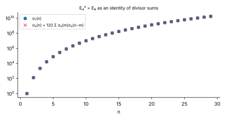

<sub>σ₇(n) מול צד ימין של הזהות, עד n = 30: התאמה מלאה.</sub>

<details><summary>פתרון</summary>

$`\sigma_7(4) = 1 + 128 + 16384 = 16513`$. $`\sigma_3(1) = 1`$, $`\sigma_3(2) = 9`$, $`\sigma_3(3) = 28`$, $`\sigma_3(4) = 1 + 8 + 64 = 73`$. הסכום: $`\sigma_3(1)\sigma_3(3) + \sigma_3(2)^2 + \sigma_3(3)\sigma_3(1) = 28 + 81 + 28 = 137`$. צד ימין: $`73 + 120\cdot 137 = 73 + 16440 = 16513`$ ✓.
</details>

**תרגיל 2.** חשבו את $`\tau(2)`$ ו-$`\tau(3)`$ מהמכפלה $`q\prod(1 - q^n)^{24}`$.

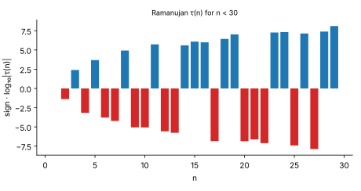

<sub>τ(n) עבור n < 30 (סימן ולוגריתם): הסימנים משתנים בלי סדר נראה לעין.</sub>

<details><summary>פתרון</summary>

עד $`q^2`$ (בתוך המכפלה) רלוונטיים רק $`(1 - q)^{24}(1 - q^2)^{24}`$. $`(1 - q)^{24} = 1 - 24q + \binom{24}{2}q^2 - \dots = 1 - 24q + 276q^2 - \dots`$, ו-$`(1 - q^2)^{24} = 1 - 24q^2 + \dots`$. המכפלה: $`1 - 24q + (276 - 24)q^2 + \dots = 1 - 24q + 252q^2`$. כפול $`q`$: $`\tau(1) = 1`$, $`\tau(2) = -24`$, $`\tau(3) = 252`$ ✓.
</details>

**תרגיל 3.** בדקו את $`\tau(n) \equiv \sigma_{11}(n) \pmod{691}`$ עבור $`n = 3`$.

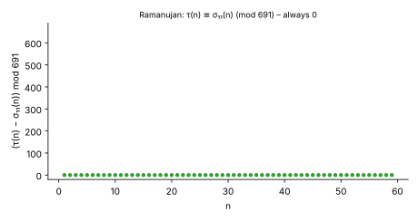

<sub>(τ(n) − σ₁₁(n)) mod 691 עד n = 60: תמיד 0.</sub>

<details><summary>פתרון</summary>

$`\sigma_{11}(3) = 1 + 3^{11} = 1 + 177147 = 177148`$. $`\tau(3) - \sigma_{11}(3) = 252 - 177148 = -176896`$. $`691 \cdot 256 = 176896`$ ✓. לכן $`\tau(3) \equiv \sigma_{11}(3) \pmod{691}`$.
</details>

**תרגיל 4.** חשבו את $`r_4(12)`$ בעזרת נוסחת יעקובי, ובדקו בספירה ישירה.

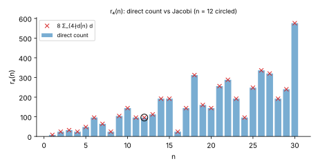

<sub>r₄(n) עד 30: ספירה ישירה (עמודות) מול נוסחת יעקובי (x); n = 12 מסומן.</sub>

<details><summary>פתרון</summary>

המחלקים של 12: $`1, 2, 3, 4, 6, 12`$. בלי כפולות של 4: $`1 + 2 + 3 + 6 = 12`$, ולכן $`r_4(12) = 96`$. **ספירה:** הדרכים לכתוב 12 כסכום של ארבעה ריבועים (בלי סדר): $`9 + 1 + 1 + 1`$ ו-$`4 + 4 + 4 + 0`$. הראשונה: מיקום ה-3 – 4 אפשרויות, סימנים – $`2^4 = 16`$: 64. השנייה: מיקום ה-0 – 4, סימנים – $`2^3 = 8`$: 32. סה"כ $`64 + 32 = 96`$ ✓.
</details>

**תרגיל 5.** צמצמו את $`\tau = \tfrac12 + \tfrac{i}{2\sqrt3}`$ לתחום היסודי. לאיזה עקום אליפטי הוא מתאים?

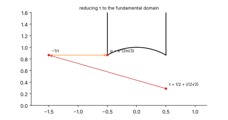

<sub>τ = 1/2 + i/(2√3) → −1/τ → ρ: הנקודה מגיעה לפינה של התחום היסודי.</sub>

<details><summary>פתרון</summary>

$`|\tau|^2 = \tfrac14 + \tfrac1{12} = \tfrac13 \lt 1`$. מפעילים $`S`$: $`-\tfrac1\tau = -\tfrac{\bar\tau}{|\tau|^2} = -3\left(\tfrac12 - \tfrac{i}{2\sqrt3}\right) = -\tfrac32 + \tfrac{\sqrt3}{2}i`$. מזיזים ב-$`T`$: $`-\tfrac12 + \tfrac{\sqrt3}2 i = \rho = e^{2\pi i/3}`$. לכן $`j(\tau) = j(\rho) = 0`$, והעקום הוא (עד איזומורפיזם מעל $`\mathbb C`$) $`y^2 = x^3 + 1`$ – עם האוטומורפיזם הנוסף $`(x, y) \mapsto (\omega x, y)`$ מסדר 3. (למעשה $`\tau = \tfrac{\rho}{2\rho + 1}`$, כלומר $`\tau = \begin{pmatrix}1&0\\2&1\end{pmatrix}\rho`$.)
</details>

**תרגיל 6.** בדקו ש-$`p(29) = 4565`$ מתחלק ב-5, ושגם $`p(5) = 7`$ ו-$`p(12) = 77`$ מתחלקים ב-7 (קונגרואנציית רמנוג'אן השנייה).

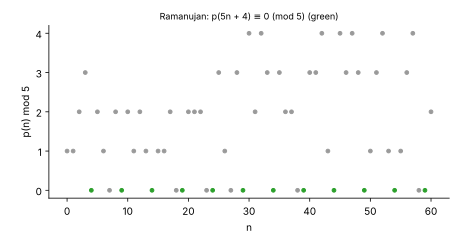

<sub>p(n) mod 5 עד n = 60: הנקודות הירוקות (n ≡ 4 mod 5) כולן על 0.</sub>

<details><summary>פתרון</summary>

$`4565 = 5\cdot 913`$ ✓. $`p(5) = 7`$: החלוקות של 5 הן $`5, 4{+}1, 3{+}2, 3{+}1{+}1, 2{+}2{+}1, 2{+}1{+}1{+}1, 1{+}1{+}1{+}1{+}1`$ – שבע ✓. $`p(12) = 77 = 7\cdot 11`$ ✓. (שני הערכים הם $`n = 7m + 5`$ עם $`m = 0, 1`$.)
</details>

---

## סיכום
* $`\mathrm{SL}_2(\mathbb Z)`$ פועלת על $`\mathbb H`$; התחום היסודי $`|\mathrm{Re}\,\tau| \le \tfrac12`$, $`|\tau| \ge 1`$; נקודות = עקומים אליפטיים מעל $`\mathbb C`$.
* **$`M_k`$ ממימד סופי** ⇒ זהויות: $`E_4^2 = E_8`$ נותן נוסחה ל-$`\sigma_7`$; $`\Delta = (E_4^3 - E_6^2)/1728 = q\prod(1-q^n)^{24}`$.
* **$`j = E_4^3/\Delta`$**: ערכים שלמים בנקודות של כפל מרוכב עם $`h = 1`$ ⇒ $`e^{\pi\sqrt{163}} \approx 640320^3 + 744`$.
* **הקה:** תבניות עצמיות ⇒ $`a(n)`$ כפליים ומכפלת אוילר; $`|a(p)| \le 2p^{(k-1)/2}`$ (דלין).
* **תטא ואטא:** $`r_4(n) = 8\sum_{4 \nmid d \mid n}d`$; $`p(n)`$, הארדי–רמנוג'אן, $`5 \mid p(5n + 4)`$.
* **רמה $`N`$:** $`\eta(\tau)^2\eta(11\tau)^2 \leftrightarrow`$ 11a; **מודולריות** + **ריבט** ⇒ פרמה.

**להעמקה:** [חצי המישור העליון](../pages/%D7%97%D7%A6%D7%99%20%D7%94%D7%9E%D7%99%D7%A9%D7%95%D7%A8%20%D7%94%D7%A2%D7%9C%D7%99%D7%95%D7%9F.md) · [תת-חבורת קונגרואנציה](../pages/%D7%AA%D7%AA-%D7%97%D7%91%D7%95%D7%A8%D7%AA%20%D7%A7%D7%95%D7%A0%D7%92%D7%A8%D7%95%D7%90%D7%A0%D7%A6%D7%99%D7%94.md) · [עקום מודולרי](../pages/%D7%A2%D7%A7%D7%95%D7%9D%20%D7%9E%D7%95%D7%93%D7%95%D7%9C%D7%A8%D7%99.md) · [אינווריאנט j](../pages/%D7%90%D7%99%D7%A0%D7%95%D7%95%D7%A8%D7%99%D7%90%D7%A0%D7%98%20j.md) · [פונקציית אטא של דדקינד](../pages/%D7%A4%D7%95%D7%A0%D7%A7%D7%A6%D7%99%D7%99%D7%AA%20%D7%90%D7%98%D7%90%20%D7%A9%D7%9C%20%D7%93%D7%93%D7%A7%D7%99%D7%A0%D7%93.md) · [תבנית שפיץ](../pages/%D7%AA%D7%91%D7%A0%D7%99%D7%AA%20%D7%A9%D7%A4%D7%99%D7%A5.md) · [הפונקציה האליפטית של ויירשטראס](../pages/%D7%94%D7%A4%D7%95%D7%A0%D7%A7%D7%A6%D7%99%D7%94%20%D7%94%D7%90%D7%9C%D7%99%D7%A4%D7%98%D7%99%D7%AA%20%D7%A9%D7%9C%20%D7%95%D7%99%D7%99%D7%A8%D7%A9%D7%98%D7%A8%D7%90%D7%A1.md) · [זוג מחזורים יסודי](../pages/%D7%96%D7%95%D7%92%20%D7%9E%D7%97%D7%96%D7%95%D7%A8%D7%99%D7%9D%20%D7%99%D7%A1%D7%95%D7%93%D7%99.md) · [פונקציית למבדא המודולרית](../pages/%D7%A4%D7%95%D7%A0%D7%A7%D7%A6%D7%99%D7%99%D7%AA%20%D7%9C%D7%9E%D7%91%D7%93%D7%90%20%D7%94%D7%9E%D7%95%D7%93%D7%95%D7%9C%D7%A8%D7%99%D7%AA.md) · [מכפלה פנימית של פטרסון](../pages/%D7%9E%D7%9B%D7%A4%D7%9C%D7%94%20%D7%A4%D7%A0%D7%99%D7%9E%D7%99%D7%AA%20%D7%A9%D7%9C%20%D7%A4%D7%98%D7%A8%D7%A1%D7%95%D7%9F.md) · [אופרטור הקה](../pages/%D7%90%D7%95%D7%A4%D7%A8%D7%98%D7%95%D7%A8%20%D7%94%D7%A7%D7%94.md) · [אלגברת הקה](../pages/%D7%90%D7%9C%D7%92%D7%91%D7%A8%D7%AA%20%D7%94%D7%A7%D7%94.md) · [תבנית עצמית](../pages/%D7%AA%D7%91%D7%A0%D7%99%D7%AA%20%D7%A2%D7%A6%D7%9E%D7%99%D7%AA.md) · [תורת אטקין–לנר](../pages/%D7%AA%D7%95%D7%A8%D7%AA%20%D7%90%D7%98%D7%A7%D7%99%D7%9F%E2%80%93%D7%9C%D7%A0%D7%A8.md) · [אינוולוציית פריקה](../pages/%D7%90%D7%99%D7%A0%D7%95%D7%95%D7%9C%D7%95%D7%A6%D7%99%D7%99%D7%AA%20%D7%A4%D7%A8%D7%99%D7%A7%D7%94.md) · [אופרטור יהלום](../pages/%D7%90%D7%95%D7%A4%D7%A8%D7%98%D7%95%D7%A8%20%D7%99%D7%94%D7%9C%D7%95%D7%9D.md) · [סכום דדקינד](../pages/%D7%A1%D7%9B%D7%95%D7%9D%20%D7%93%D7%93%D7%A7%D7%99%D7%A0%D7%93.md) · [נוסחת הגבול של קרונקר](../pages/%D7%A0%D7%95%D7%A1%D7%97%D7%AA%20%D7%94%D7%92%D7%91%D7%95%D7%9C%20%D7%A9%D7%9C%20%D7%A7%D7%A8%D7%95%D7%A0%D7%A7%D7%A8.md) · [טור אייזנשטיין ממשי-אנליטי](../pages/%D7%98%D7%95%D7%A8%20%D7%90%D7%99%D7%99%D7%96%D7%A0%D7%A9%D7%98%D7%99%D7%99%D7%9F%20%D7%9E%D7%9E%D7%A9%D7%99-%D7%90%D7%A0%D7%9C%D7%99%D7%98%D7%99.md) · [טור פואנקרה (תבנית מודולרית)](../pages/%D7%98%D7%95%D7%A8%20%D7%A4%D7%95%D7%90%D7%A0%D7%A7%D7%A8%D7%94%20%28%D7%AA%D7%91%D7%A0%D7%99%D7%AA%20%D7%9E%D7%95%D7%93%D7%95%D7%9C%D7%A8%D7%99%D7%AA%29.md) · [חוג התבניות המודולריות](../pages/%D7%97%D7%95%D7%92%20%D7%94%D7%AA%D7%91%D7%A0%D7%99%D7%95%D7%AA%20%D7%94%D7%9E%D7%95%D7%93%D7%95%D7%9C%D7%A8%D7%99%D7%95%D7%AA.md) · [תבנית מודולרית הולומורפית חלשה](../pages/%D7%AA%D7%91%D7%A0%D7%99%D7%AA%20%D7%9E%D7%95%D7%93%D7%95%D7%9C%D7%A8%D7%99%D7%AA%20%D7%94%D7%95%D7%9C%D7%95%D7%9E%D7%95%D7%A8%D7%A4%D7%99%D7%AA%20%D7%97%D7%9C%D7%A9%D7%94.md) · [תבנית מודולרית מדומה](../pages/%D7%AA%D7%91%D7%A0%D7%99%D7%AA%20%D7%9E%D7%95%D7%93%D7%95%D7%9C%D7%A8%D7%99%D7%AA%20%D7%9E%D7%93%D7%95%D7%9E%D7%94.md) · [תבנית מאס הרמונית](../pages/%D7%AA%D7%91%D7%A0%D7%99%D7%AA%20%D7%9E%D7%90%D7%A1%20%D7%94%D7%A8%D7%9E%D7%95%D7%A0%D7%99%D7%AA.md) · [תבנית מאס](../pages/%D7%AA%D7%91%D7%A0%D7%99%D7%AA%20%D7%9E%D7%90%D7%A1.md) · [זהויות רוג'רס–רמנוג'אן](../pages/%D7%96%D7%94%D7%95%D7%99%D7%95%D7%AA%20%D7%A8%D7%95%D7%92%27%D7%A8%D7%A1%E2%80%93%D7%A8%D7%9E%D7%A0%D7%95%D7%92%27%D7%90%D7%9F.md) · [השבר המשולב של רוג'רס–רמנוג'אן](../pages/%D7%94%D7%A9%D7%91%D7%A8%20%D7%94%D7%9E%D7%A9%D7%95%D7%9C%D7%91%20%D7%A9%D7%9C%20%D7%A8%D7%95%D7%92%27%D7%A8%D7%A1%E2%80%93%D7%A8%D7%9E%D7%A0%D7%95%D7%92%27%D7%90%D7%9F.md) · [פונקציית הטאו של רמנוג'אן](../pages/%D7%A4%D7%95%D7%A0%D7%A7%D7%A6%D7%99%D7%99%D7%AA%20%D7%94%D7%98%D7%90%D7%95%20%D7%A9%D7%9C%20%D7%A8%D7%9E%D7%A0%D7%95%D7%92%27%D7%90%D7%9F.md) · [השערת רמנוג'אן–פטרסון](../pages/%D7%94%D7%A9%D7%A2%D7%A8%D7%AA%20%D7%A8%D7%9E%D7%A0%D7%95%D7%92%27%D7%90%D7%9F%E2%80%93%D7%A4%D7%98%D7%A8%D7%A1%D7%95%D7%9F.md) · [משפט ריבט](../pages/%D7%9E%D7%A9%D7%A4%D7%98%20%D7%A8%D7%99%D7%91%D7%98.md) · [השערת המודולריות של סר](../pages/%D7%94%D7%A9%D7%A2%D7%A8%D7%AA%20%D7%94%D7%9E%D7%95%D7%93%D7%95%D7%9C%D7%A8%D7%99%D7%95%D7%AA%20%D7%A9%D7%9C%20%D7%A1%D7%A8.md) · [תבנית מודולרית של זיגל](../pages/%D7%AA%D7%91%D7%A0%D7%99%D7%AA%20%D7%9E%D7%95%D7%93%D7%95%D7%9C%D7%A8%D7%99%D7%AA%20%D7%A9%D7%9C%20%D7%96%D7%99%D7%92%D7%9C.md) · [התאמת שימורה](../pages/%D7%94%D7%AA%D7%90%D7%9E%D7%AA%20%D7%A9%D7%99%D7%9E%D7%95%D7%A8%D7%94.md) · [סמל מודולרי](../pages/%D7%A1%D7%9E%D7%9C%20%D7%9E%D7%95%D7%93%D7%95%D7%9C%D7%A8%D7%99.md) · [איזומורפיזם אייכלר–שימורה](../pages/%D7%90%D7%99%D7%96%D7%95%D7%9E%D7%95%D7%A8%D7%A4%D7%99%D7%96%D7%9D%20%D7%90%D7%99%D7%99%D7%9B%D7%9C%D7%A8%E2%80%93%D7%A9%D7%99%D7%9E%D7%95%D7%A8%D7%94.md) · [תבנית יעקובי](../pages/%D7%AA%D7%91%D7%A0%D7%99%D7%AA%20%D7%99%D7%A2%D7%A7%D7%95%D7%91%D7%99.md) · [משוואה מודולרית](../pages/%D7%9E%D7%A9%D7%95%D7%95%D7%90%D7%94%20%D7%9E%D7%95%D7%93%D7%95%D7%9C%D7%A8%D7%99%D7%AA.md) · [הפונקציות המודולריות של ובר](../pages/%D7%94%D7%A4%D7%95%D7%A0%D7%A7%D7%A6%D7%99%D7%95%D7%AA%20%D7%94%D7%9E%D7%95%D7%93%D7%95%D7%9C%D7%A8%D7%99%D7%95%D7%AA%20%D7%A9%D7%9C%20%D7%95%D7%91%D7%A8.md) · [אידיאל אייזנשטיין](../pages/%D7%90%D7%99%D7%93%D7%99%D7%90%D7%9C%20%D7%90%D7%99%D7%99%D7%96%D7%A0%D7%A9%D7%98%D7%99%D7%99%D7%9F.md) · [משפט מנין–דרינפלד](../pages/%D7%9E%D7%A9%D7%A4%D7%98%20%D7%9E%D7%A0%D7%99%D7%9F%E2%80%93%D7%93%D7%A8%D7%99%D7%A0%D7%A4%D7%9C%D7%93.md) · [תבניות מודולריות מודולו p](../pages/%D7%AA%D7%91%D7%A0%D7%99%D7%95%D7%AA%20%D7%9E%D7%95%D7%93%D7%95%D7%9C%D7%A8%D7%99%D7%95%D7%AA%20%D7%9E%D7%95%D7%93%D7%95%D7%9C%D7%95%20p.md) · [תבנית מודולרית p-אדית](../pages/%D7%AA%D7%91%D7%A0%D7%99%D7%AA%20%D7%9E%D7%95%D7%93%D7%95%D7%9C%D7%A8%D7%99%D7%AA%20p-%D7%90%D7%93%D7%99%D7%AA.md)

**השיעור הקודם:** [שיעור 20: עקומים אליפטיים](20-עקומים-אליפטיים.md) · **השיעור הבא:** [שיעור 22: פונקציות זטא גאומטריות](22-פונקציות-זטא-גאומטריות.md) · **חזרה ל:** [תוכן הקורס](../COURSE.md)

---
<sub>חלק מ[קורס תורת המספרים](../COURSE.md). התוכן מופץ ברישיון [CC BY-SA 4.0](https://creativecommons.org/licenses/by-sa/4.0/).</sub>
