# שיעור 22: פונקציות זטא גאומטריות – ספירת נקודות, מסלולים וגרפים

**מה נלמד:** פונקציית הזטא של רימן "סופרת" ראשוניים. מתברר שאותו מבנה – מכפלת אוילר על "ראשוניים", טור שסופר "נקודות", משוואה פונקציונלית והשערת רימן – מופיע בהקשרים רבים אחרים, ובחלקם השערת רימן **הוכחה**. נראה ש:
1. ליריעה מעל שדה סופי $`\mathbb F_q`$ יש **פונקציית זטא** שסופרת נקודות מעל $`\mathbb F_{q^n}`$, והיא **פונקציה רציונלית** ב-$`T = q^{-s}`$.
2. לעקום אליפטי היא נקבעת לגמרי על ידי $`a_q`$, ו**השערת רימן** שלה היא משפט האסה משיעור 20. **השערות וייל** (שהוכחו על ידי דבורק, גרותנדיק ודלין) מכלילות זאת לכל יריעה.
3. אותו רעיון עובד ל**מערכות דינמיות** (זטא של ארטין–מאזור: "ראשוניים" = מסלולים מחזוריים) ול**גרפים** (זטא של איהרה: "ראשוניים" = מעגלים בלי חזרות). השערת רימן לגרף ⇔ הגרף הוא **גרף רמנוג'אן**.
4. גם **ספירת תת-חבורות** ו**פתרונות מודולו $`p^k`$** נותנות פונקציות זטא.

**ידע קודם:** [שיעור 11](11-טורי-דיריכלה-וזטא.md) (מכפלת אוילר, $`\zeta(s)`$), [שיעור 19א](19א-תורת-שדות-המחלקה.md) (סכומי יעקובי), [שיעור 20](20-עקומים-אליפטיים.md) (ספירת נקודות, משפט האסה), [שיעור 21](21-תבניות-מודולריות.md) (מכפלות אוילר של תבניות).

---

## 1. התבנית הכללית

נזכור: $`\zeta(s) = \prod_p(1 - p^{-s})^{-1}`$. נגזרת לוגריתמית:
```math
-\frac{\zeta'}{\zeta}(s) = \sum_{p}\sum_{m \ge 1}\frac{\log p}{p^{ms}} .
```
כלומר: "ראשוניים" $`p`$ עם "גודל" $`N(p) = p`$, ו-$`\log\zeta`$ סופר את כל החזקות שלהם. כל פונקציית זטא בשיעור הזה בנויה כך:
```math
\zeta(u) = \prod_{\text{ראשוניים } P}\frac{1}{1 - u^{\deg P}} = \exp\left(\sum_{n \ge 1}\frac{N_n}{n}u^n\right), \qquad N_n = \sum_{\deg P \mid n}\deg P .
```
$`N_n`$ הוא מספר ה"נקודות" או ה"מסלולים" מסדר $`n`$, והשוויון בין שתי הצורות הוא אותו חישוב כמו $`-\zeta'/\zeta = \sum\Lambda(n)n^{-s}`$. (כאן $`u`$ ממלא את תפקיד $`q^{-s}`$.) **[היפוך מביוס](06-פונקציות-אריתמטיות.md)** מחזיר את מספר ה"ראשוניים" מ-$`N_n`$:
```math
\#\{P : \deg P = n\} = \frac1n\sum_{d \mid n}\mu(n/d)N_d .
```

---

## 2. יריעות מעל שדות סופיים

ליריעה $`X`$ מעל $`\mathbb F_q`$ (קבוצת פתרונות של משוואות פולינומיות), $`N_n = \#X(\mathbb F_{q^n})`$, ו[פונקציית הזטא המקומית](../pages/%D7%A4%D7%95%D7%A0%D7%A7%D7%A6%D7%99%D7%99%D7%AA%20%D7%96%D7%98%D7%90%20%D7%9E%D7%A7%D7%95%D7%9E%D7%99%D7%AA.md) היא
```math
Z(X, T) = \exp\left(\sum_{n\ge1}\frac{N_n}{n}T^n\right).
```
ה"ראשוניים" הם מסלולים של פרובניוס $`x \mapsto x^q`$ על הנקודות מעל $`\overline{\mathbb F}_q`$ (נקודות "סגורות"), וגודלם הוא $`q^{\deg}`$.

### דוגמה 1: הישר והישר הפרויקטיבי
* $`X = \mathbb A^1`$: $`N_n = q^n`$, ולכן $`Z = \exp\left(\sum\tfrac{(qT)^n}{n}\right) = \dfrac{1}{1 - qT}`$. בשפה של מכפלת אוילר: הנקודות הסגורות הן הפולינומים האי-פריקים המתוקנים מעל $`\mathbb F_q`$, והמשוואה $`\prod_f(1 - T^{\deg f})^{-1} = (1 - qT)^{-1}`$ היא **"משפט הפירוק היחיד"** ב-$`\mathbb F_q[x]`$. מהיפוך מביוס: מספר הפולינומים האי-פריקים ממעלה $`n`$ הוא $`\tfrac1n\sum_{d\mid n}\mu(n/d)q^d \approx q^n/n`$ – **משפט המספרים הראשוניים** לפולינומים, עם שגיאה $`O(q^{n/2}/n)`$.
* $`X = \mathbb P^1`$: $`N_n = q^n + 1`$, $`Z = \dfrac{1}{(1 - T)(1 - qT)}`$.

לדוגמה, מעל $`\mathbb F_2`$ יש $`\tfrac13(2^3 - 2) = 2`$ פולינומים אי-פריקים ממעלה 3 ($`x^3 + x + 1`$, $`x^3 + x^2 + 1`$) ו-$`\tfrac14(2^4 - 2^2) = 3`$ ממעלה 4.

### דוגמה 2: עקום אליפטי – $`y^2 = x^3 - 2`$ מעל $`\mathbb F_7`$
בשיעור 20 ספרנו $`N_1 = \#E(\mathbb F_7) = 7`$, כלומר $`a = 8 - 7 = 1`$. **משפט:** לעקום אליפטי
```math
Z(E, T) = \frac{1 - aT + qT^2}{(1 - T)(1 - qT)} .
```
נפרק $`1 - aT + qT^2 = (1 - \alpha T)(1 - \bar\alpha T)`$, כלומר $`\alpha + \bar\alpha = a`$, $`\alpha\bar\alpha = q`$. לוגריתם של שני הצדדים נותן
```math
N_n = q^n + 1 - (\alpha^n + \bar\alpha^n).
```
כאן $`\alpha, \bar\alpha`$ שורשי $`X^2 - X + 7`$, ו-$`s_n = \alpha^n + \bar\alpha^n`$ מקיים $`s_n = s_{n-1} - 7s_{n-2}`$, $`s_0 = 2`$, $`s_1 = 1`$:
```math
s_2 = 1 - 14 = -13, \quad s_3 = -13 - 7 = -20, \quad s_4 = -20 + 91 = 71 .
```
לכן $`N_2 = 49 + 1 + 13 = 63`$, $`N_3 = 343 + 1 + 20 = 364`$, $`N_4 = 2401 + 1 - 71 = 2331`$. בדקנו את $`N_2 = 63`$ בספירה ישירה מעל $`\mathbb F_{49} = \mathbb F_7[\sqrt3]`$. **ספירה אחת מעל $`\mathbb F_7`$ קובעת את מספר הנקודות מעל כל $`\mathbb F_{7^n}`$.**

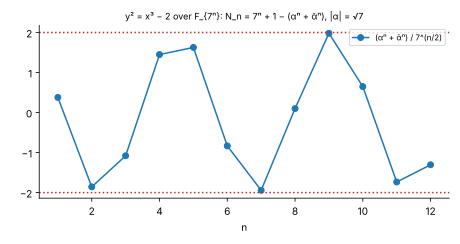

<sub>(αⁿ + ᾱⁿ)/7^(n/2) עבור n = 1..12: הערכים נשארים בין −2 ל-2, כי |α| = √7.</sub>

**השערת רימן לעקום.** $`|\alpha| = \sqrt q`$ (משפט האסה) שקול לכך שכל האפסים של $`Z(E, q^{-s})`$ נמצאים על $`\mathrm{Re}\,s = \tfrac12`$: אם $`1 - \alpha q^{-s} = 0`$ אז $`q^{\mathrm{Re}\,s} = |\alpha| = q^{1/2}`$. **ויל (1948)** הוכיח זאת לכל עקום חלק מגנוס $`g`$: המונה הוא פולינום ממעלה $`2g`$ עם כל השורשים ההפוכים בערך מוחלט $`\sqrt q`$, ולכן $`|N_1 - (q + 1)| \le 2g\sqrt q`$.

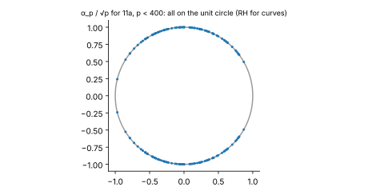

<sub>α_p/√p עבור העקום 11a, לכל p < 400: כל הנקודות על מעגל היחידה.</sub>

### דוגמה 3: עקום פרמה $`x^3 + y^3 = 1`$ וסכומי יעקובי
עבור $`p \equiv 1 \pmod 3`$ יש קרקטר מסדר 3, $`\chi`$, ו-$`\#\{(x, y) \in \mathbb F_p^2 : x^3 + y^3 = 1\} = \sum_{a + b = 1}\#\{x^3 = a\}\#\{y^3 = b\}`$. כיוון ש-$`\#\{x^3 = a\} = 1 + \chi(a) + \bar\chi(a)`$, פיתוח המכפלה משאיר רק סכומי יעקובי:
```math
N_{\text{affine}} = p - 2 + 2\,\mathrm{Re}\,J(\chi, \chi).
```
עבור $`p = 7`$: $`J = -1 - 3\omega`$ ([שיעור 19א](19א-תורת-שדות-המחלקה.md), דוגמה 8), $`\mathrm{Re}\,J = -1 + \tfrac32 = \tfrac12`$, ולכן $`N = 7 - 2 + 1 = 6`$. בפרויקטיבי מוסיפים 3 נקודות באינסוף ($`x^3 + y^3 = 0`$, כלומר $`y/x`$ שורש שלישי של $`-1`$): 9 נקודות. בדקנו בחישוב עבור $`p = 7, 13, 19, 31`$. כאן $`|J| = \sqrt p`$ **הוא** השערת רימן לעקום הזה – וויל הגיע להשערות שלו בדיוק מחישובים כאלה.

---

## 3. השערות וייל

ליריעה $`X`$ חלקה ופרויקטיבית ממימד $`d`$ מעל $`\mathbb F_q`$ – [השערות וייל](../pages/%D7%94%D7%A9%D7%A2%D7%A8%D7%95%D7%AA%20%D7%95%D7%99%D7%99%D7%9C.md) (ויל 1949):
1. **רציונליות:** $`Z(X, T) = \dfrac{P_1(T)P_3(T)\cdots P_{2d-1}(T)}{P_0(T)P_2(T)\cdots P_{2d}(T)}`$ עם $`P_i \in \mathbb Z[T]`$ (דבורק 1960, בשיטות $`p`$-אדיות).
2. **משוואה פונקציונלית:** $`Z(1/q^dT) = \pm q^{d\chi/2}T^{\chi}Z(T)`$, כאשר $`\chi`$ מאפיין אוילר.
3. **השערת רימן:** השורשים ההפוכים של $`P_i`$ בערך מוחלט $`q^{i/2}`$ (דלין 1974).
4. **מספרי בטי:** אם $`X`$ באה מיריעה מעל $`\mathbb Z`$, $`\deg P_i`$ = מספר הבטי ה-$`i`$ של היריעה המרוכבת $`X(\mathbb C)`$. (לעקום אליפטי: $`\deg P_1 = 2`$ – הטורוס.)

גרותנדיק בנה את **הקוהומולוגיה ה-$`\ell`$-אדית** כדי שנוסחת הנקודות הקבועות של לפשץ, $`N_n = \sum_i(-1)^i\mathrm{tr}(\mathrm{Frob}^n \mid H^i)`$, תסביר 1, 2, 4 (ראו [פונקציית זטא של לפשץ](../pages/%D7%A4%D7%95%D7%A0%D7%A7%D7%A6%D7%99%D7%99%D7%AA%20%D7%96%D7%98%D7%90%20%D7%A9%D7%9C%20%D7%9C%D7%A4%D7%A9%D7%A5.md)). דלין הוכיח את 3, ומכאן גם $`|\tau(p)| \le 2p^{11/2}`$ (שיעור 21).

**מעל $`\mathbb Q`$: זטא של האסה–וייל.** ליריעה מעל $`\mathbb Q`$ כופלים את הזטות המקומיות על כל הראשוניים: $`\zeta_X(s) = \prod_p Z(X_p, p^{-s})`$ ([פונקציית זטא של האסה–וייל](../pages/%D7%A4%D7%95%D7%A0%D7%A7%D7%A6%D7%99%D7%99%D7%AA%20%D7%96%D7%98%D7%90%20%D7%A9%D7%9C%20%D7%94%D7%90%D7%A1%D7%94%E2%80%93%D7%95%D7%99%D7%99%D7%9C.md)). לעקום אליפטי (עד גורמים ב-$`p \mid N`$):
```math
\zeta_E(s) = \frac{\zeta(s)\,\zeta(s - 1)}{L(E, s)} .
```
המשוואה הפונקציונלית שלה – **משפט המודולריות** מ-שיעור 21. ל-$`X = \mathrm{Spec}\,\mathbb Z`$ מקבלים את $`\zeta(s)`$ עצמה – ראו [פונקציית זטא אריתמטית](../pages/%D7%A4%D7%95%D7%A0%D7%A7%D7%A6%D7%99%D7%99%D7%AA%20%D7%96%D7%98%D7%90%20%D7%90%D7%A8%D7%99%D7%AA%D7%9E%D7%98%D7%99%D7%AA.md).

---

## 4. מערכות דינמיות: זטא של ארטין–מאזור

למפה $`f : X \to X`$, נגדיר $`N_n = \#\mathrm{Fix}(f^n)`$ (נקודות מחזוריות עם מחזור שמחלק את $`n`$), ו[פונקציית הזטא של ארטין–מאזור](../pages/%D7%A4%D7%95%D7%A0%D7%A7%D7%A6%D7%99%D7%99%D7%AA%20%D7%96%D7%98%D7%90%20%D7%A9%D7%9C%20%D7%90%D7%A8%D7%98%D7%99%D7%9F%E2%80%93%D7%9E%D7%90%D7%96%D7%95%D7%A8.md) $`\zeta_f(T) = \exp\left(\sum N_nT^n/n\right)`$. ה"ראשוניים" הם **מסלולים מחזוריים פרימיטיביים**. (פונקציית הזטא של יריעה מעל $`\mathbb F_q`$ היא המקרה של $`f = \mathrm{Frob}`$.)

### דוגמה 4: הזזת "יחס הזהב"
מרחב: סדרות אינסופיות של 0 ו-1 **בלי שני 1 צמודים**; $`\sigma`$ = הזזה שמאלה. נקודה קבועה של $`\sigma^n`$ = מילה מחזורית באורך $`n`$ בלי "11" (גם בין הסוף להתחלה). זה מספר המסלולים הסגורים באורך $`n`$ בגרף עם מטריצת השכנות $`A = \begin{pmatrix}1&1\\1&0\end{pmatrix}`$:
```math
N_n = \mathrm{tr}(A^n) = \varphi^n + (-\varphi)^{-n} = L_n \qquad (1, 3, 4, 7, 11, 18, 29, 47, \ldots),
```
מספרי לוקאס. מכאן
```math
\zeta_\sigma(T) = \exp\left(\sum_n\frac{\mathrm{tr}(A^n)}{n}T^n\right) = \frac{1}{\det(I - TA)} = \frac{1}{1 - T - T^2} .
```
(כי $`\log\det(I - TA)^{-1} = \sum_n\mathrm{tr}(A^n)T^n/n`$.) בדיקה עבור $`n = 3`$: המילים המחזוריות באורך 3 בלי "11": $`000, 001, 010, 100`$ – ארבע, ו-$`L_3 = 4`$ ✓. בדקנו בחישוב עד $`n = 8`$. **ההזזה המלאה** על $`k`$ סמלים נותנת $`N_n = k^n`$ ו-$`\zeta = 1/(1 - kT)`$ – בדיוק כמו $`\mathbb A^1`$ מעל $`\mathbb F_k`$.

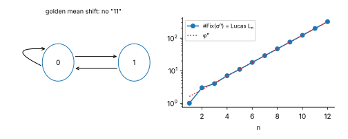

<sub>הגרף של הזזת יחס הזהב (אין מעבר 1 → 1), ומספר הנקודות המחזוריות L_n מול φⁿ.</sub>

**[זטא של רואל](../pages/%D7%A4%D7%95%D7%A0%D7%A7%D7%A6%D7%99%D7%99%D7%AA%20%D7%96%D7%98%D7%90%20%D7%A9%D7%9C%20%D7%A8%D7%95%D7%90%D7%9C.md) ו[סלברג](../pages/%D7%A4%D7%95%D7%A0%D7%A7%D7%A6%D7%99%D7%99%D7%AA%20%D7%96%D7%98%D7%90%20%D7%A9%D7%9C%20%D7%A1%D7%9C%D7%91%D7%A8%D7%92.md).** לזרימה גאודזית על משטח היפרבולי, ה"ראשוניים" הם **גאודזיות סגורות פרימיטיביות** $`\gamma`$ עם אורך $`\ell(\gamma)`$, ו-$`Z(s) = \prod_\gamma\prod_{k\ge0}(1 - e^{-(s+k)\ell(\gamma)})`$. האפסים שלה קשורים לערכים העצמיים של הלפלסיאן (כאן "השערת רימן" נכונה כמעט מההגדרה – הלפלסיאן צמוד לעצמו, ולכן האפסים הלא טריוויאליים על $`\mathrm{Re}\,s = \tfrac12`$, חוץ ממספר סופי של אפסים ממשיים שבאים מערכים עצמיים קטנים מ-$`\tfrac14`$), ו**משפט הגאודזיות הראשוניות** $`\#\{\gamma : e^{\ell(\gamma)} \le x\} \sim x/\log x`$ הוא האנלוג של משפט המספרים הראשוניים.

---

## 5. גרפים: זטא של איהרה

בגרף סופי, **מסלול סגור מצומצם** הוא מסלול שאינו חוזר מיד על צלע ($`e`$ ואז $`e^{-1}`$) – גם לא בין הסוף להתחלה. **ראשוני** $`[P]`$ = מחלקת סיבוב של מסלול סגור מצומצם שאינו חזקה של מסלול קצר יותר. [פונקציית הזטא של איהרה](../pages/%D7%A4%D7%95%D7%A0%D7%A7%D7%A6%D7%99%D7%99%D7%AA%20%D7%96%D7%98%D7%90%20%D7%A9%D7%9C%20%D7%90%D7%99%D7%94%D7%A8%D7%94.md):
```math
\zeta_G(u) = \prod_{[P]}\frac{1}{1 - u^{|P|}} .
```
**נוסחת איהרה (1966; באס 1992).** לגרף $`(q + 1)`$-רגולרי עם $`n`$ קודקודים, $`m`$ צלעות ומטריצת שכנות $`A`$:
```math
\zeta_G(u)^{-1} = (1 - u^2)^{m - n}\det\left(I - Au + qu^2I\right).
```
לכן $`\zeta_G`$ רציונלית, והקטבים שלה נקבעים על ידי הערכים העצמיים $`\lambda`$ של $`A`$: $`1 - \lambda u + qu^2 = 0`$.

**השערת רימן לגרף.** הערך העצמי הטריוויאלי $`\lambda = q + 1`$ נותן קטבים ב-$`u = 1`$ ו-$`u = 1/q`$. לכל שאר הערכים: השורשים של $`1 - \lambda u + qu^2`$ על המעגל $`|u| = 1/\sqrt q`$ **אם ורק אם** $`|\lambda| \le 2\sqrt q`$. גרף שבו זה מתקיים לכל $`\lambda \ne \pm(q + 1)`$ נקרא **גרף רמנוג'אן** – והוא "מרחיב" אופטימלי (אלון–בופנה: $`2\sqrt q`$ הוא החסם הטוב ביותר). לובוצקי–פיליפס–סרנק בנו משפחות אינסופיות של גרפי רמנוג'אן בעזרת קווטרניונים וה**השערת רמנוג'אן–פטרסון** (דלין) – ומשם השם.

### דוגמה 5: $`K_4`$
$`K_4`$ הוא 3-רגולרי ($`q = 2`$), $`n = 4`$, $`m = 6`$. הערכים העצמיים של $`A = J - I`$: $`3`$ (פעם אחת) ו-$`-1`$ (שלוש פעמים). לכן
```math
\zeta_{K_4}(u)^{-1} = (1 - u^2)^2\,(1 - 3u + 2u^2)\,(1 + u + 2u^2)^3 .
```
* $`1 - 3u + 2u^2 = (1 - u)(1 - 2u)`$ – הקטבים הטריוויאליים $`u = 1, \tfrac12`$.
* $`1 + u + 2u^2`$: $`|u|^2 = \tfrac12`$ (מכפלת השורשים), כלומר $`|u| = \tfrac{1}{\sqrt2}`$ ✓. $`K_4`$ הוא גרף רמנוג'אן ($`|-1| \le 2\sqrt2`$).

**ספירת ראשוניים.** $`N_m = \sum_{|P| \mid m}|P|`$ (המקדמים של $`u\,\tfrac{d}{du}\log\zeta`$) יוצאים מהנוסחה: $`N_1 = N_2 = 0`$, $`N_3 = 24`$, $`N_4 = 24`$, $`N_5 = 0`$, $`N_6 = 96`$. בדיקה ישירה: מסלולים סגורים מצומצמים באורך 3 הם משולשים: 4 משולשים × 3 נקודות התחלה × 2 כיוונים = 24 ✓. מספר ה**ראשוניים** באורך 3 הוא $`24/3 = 8`$ (4 משולשים × 2 כיוונים), ובאורך 4: $`24/4 = 6`$ (3 מרובעים × 2 כיוונים). אין ראשוניים באורך 5 ב-$`K_4`$ (אין מעגל באורך 5 בלי חזרה על צלע). בדקנו בחישוב בעזרת מטריצת הצלעות של השימוטו, $`N_m = \mathrm{tr}(B^m)`$.

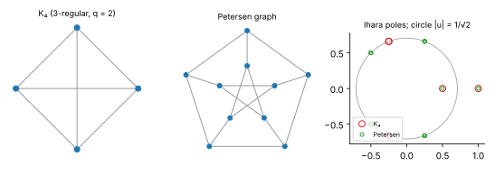

<sub>K₄ וגרף פטרסן (שניהם 3-רגולריים), והקטבים של פונקציות הזטא שלהם: כל הקטבים הלא טריוויאליים על המעגל |u| = 1/√2.</sub>

(בגרף פטרסן הערכים העצמיים הם $`3, 1, -2`$ – גם הוא גרף רמנוג'אן. ויש גם **משפט ראשוניים לגרפים**: $`\#\{[P] : |P| = m\} \sim q^m/m`$ כשהגרף לא דו-צדדי – אנלוג מדויק של $`\pi(x) \sim x/\log x`$ עם $`x = q^m`$.)

---

## 6. ספירה אלגברית: תת-חבורות ופתרונות מודולו $`p^k`$

**[גידול תת-חבורות](../pages/%D7%92%D7%99%D7%93%D7%95%D7%9C%20%D7%AA%D7%AA-%D7%97%D7%91%D7%95%D7%A8%D7%95%D7%AA.md).** לחבורה $`G`$ נסמן $`a_n(G)`$ = מספר תת-החבורות מאינדקס $`n`$, ו-$`\zeta_G(s) = \sum a_n(G)n^{-s}`$.

### דוגמה 6: $`\mathbb Z^2`$
כל תת-חבורה מאינדקס $`n`$ ב-$`\mathbb Z^2`$ נפרשת על ידי השורות של מטריצה יחידה בצורת הרמיט $`\begin{pmatrix}a & b\\ 0 & d\end{pmatrix}`$ עם $`ad = n`$ ו-$`0 \le b \lt d`$. לכל $`d \mid n`$ יש $`d`$ אפשרויות ל-$`b`$, ולכן
```math
a_n(\mathbb Z^2) = \sum_{d \mid n}d = \sigma(n), \qquad \zeta_{\mathbb Z^2}(s) = \sum\frac{\sigma(n)}{n^s} = \zeta(s)\,\zeta(s - 1).
```
באופן כללי $`\zeta_{\mathbb Z^k}(s) = \zeta(s)\zeta(s-1)\cdots\zeta(s - k + 1)`$. לחבורות נילפוטנטיות (למשל חבורת הייזנברג) מקבלים מכפלות אוילר רציונליות מעניינות (גרונוולד–סגל–סמית').

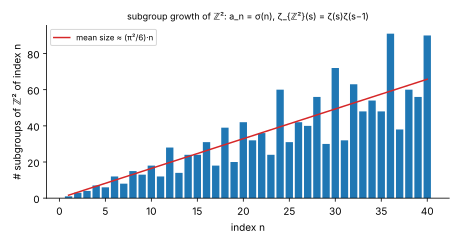

<sub>מספר תת-החבורות של ℤ² מאינדקס n הוא σ(n); הממוצע גדל כמו (π²/6)·n.</sub>

**[זטא של איגוסה](../pages/%D7%A4%D7%95%D7%A0%D7%A7%D7%A6%D7%99%D7%99%D7%AA%20%D7%96%D7%98%D7%90%20%D7%A9%D7%9C%20%D7%90%D7%99%D7%92%D7%95%D7%A1%D7%94.md).** לפולינום $`f`$ עם מקדמים שלמים, $`N_k = \#\{x \bmod p^k : f(x) \equiv 0 \pmod{p^k}\}`$. איגוסה הוכיח שטור פואנקרה $`\sum_k N_kp^{-k\dim}T^k`$ הוא **פונקציה רציונלית** של $`T`$. דוגמה פשוטה: $`f(x) = x^2`$ ו-$`p = 3`$: $`x^2 \equiv 0 \pmod{3^k}`$ ⇔ $`3^{\lceil k/2\rceil} \mid x`$, ולכן $`N_k = 3^{\lfloor k/2\rfloor}`$: $`1, 3, 3, 9, 9, 27`$ (בדקנו בחישוב). הטור $`\sum_k 3^{\lfloor k/2\rfloor - k}T^k`$ הוא טור הנדסי בכל זוגיות בנפרד, ולכן רציונלי.

**עוד בני משפחה.** [זטא של מינאקשיסונדרם–פליז'ל](../pages/%D7%A4%D7%95%D7%A0%D7%A7%D7%A6%D7%99%D7%99%D7%AA%20%D7%96%D7%98%D7%90%20%D7%A9%D7%9C%20%D7%9E%D7%99%D7%A0%D7%90%D7%A7%D7%A9%D7%99%D7%A1%D7%95%D7%A0%D7%93%D7%A8%D7%9D%E2%80%93%D7%A4%D7%9C%D7%99%D7%96%27%D7%9C.md) $`\sum\lambda_j^{-s}`$ על הערכים העצמיים של לפלסיאן (על מעגל: $`\lambda = n^2`$, ומקבלים $`2\zeta(2s)`$); [זטא של גוס](../pages/%D7%A4%D7%95%D7%A0%D7%A7%D7%A6%D7%99%D7%99%D7%AA%20%D7%96%D7%98%D7%90%20%D7%A9%D7%9C%20%D7%92%D7%95%D7%A1.md) – אנלוג בשדות פונקציות שבו גם הערכים של הפונקציה נמצאים בשדה ממאפיין $`p`$; ו[השערת דווארק](../pages/%D7%94%D7%A9%D7%A2%D7%A8%D7%AA%20%D7%93%D7%95%D7%95%D7%90%D7%A8%D7%A7.md) על כך שפונקציות זטא של "שורשי יחידה" במשפחות של יריעות הן מרומורפיות $`p`$-אדית (הוכחה על ידי דאצ'ינג ואן).

---

## 7. תרגילים

**תרגיל 1.** חשבו את $`Z(\mathbb A^2, T)`$ ואת $`Z(\mathbb P^2, T)`$, ומצאו את מספר הנקודות הסגורות ממעלה 2 על $`\mathbb P^1`$ מעל $`\mathbb F_q`$.

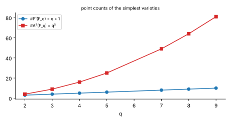

<sub>#P¹(F_q) = q + 1 ו-#A²(F_q) = q² עבור q קטנים.</sub>

<details><summary>פתרון</summary>

$`\mathbb A^2`$: $`N_n = q^{2n}`$, $`Z = \dfrac{1}{1 - q^2T}`$. $`\mathbb P^2`$: $`N_n = q^{2n} + q^n + 1`$, $`Z = \dfrac{1}{(1 - T)(1 - qT)(1 - q^2T)}`$ (מכפלה, כי $`\exp`$ הופך סכום למכפלה). נקודות סגורות ממעלה 2 על $`\mathbb P^1`$: $`\tfrac12(N_2 - N_1) = \tfrac12\left((q^2 + 1) - (q + 1)\right) = \tfrac{q^2 - q}{2}`$ – בדיוק מספר הפולינומים האי-פריקים המתוקנים ממעלה 2 מעל $`\mathbb F_q`$ (הנקודה באינסוף ממעלה 1). למשל מעל $`\mathbb F_2`$: אחד, $`x^2 + x + 1`$.
</details>

**תרגיל 2.** חשבו את $`N_5 = \#E(\mathbb F_{7^5})`$ עבור $`E : y^2 = x^3 - 2`$.

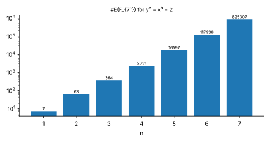

<sub>#E(F_{7ⁿ}) עבור n = 1..7.</sub>

<details><summary>פתרון</summary>

$`s_5 = s_4 - 7s_3 = 71 + 140 = 211`$. $`N_5 = 7^5 + 1 - 211 = 16807 + 1 - 211 = 16597`$. (בדיקת האסה: $`|211| \le 2\cdot 7^{5/2} \approx 259.3`$ ✓.)
</details>

**תרגיל 3.** בהזזת יחס הזהב, כמה מסלולים מחזוריים **פרימיטיביים** יש באורך 4 ובאורך 6? רשמו את אלה שבאורך 4.

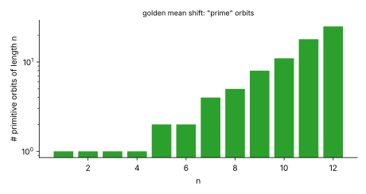

<sub>מספר המסלולים הפרימיטיביים בהזזת יחס הזהב לפי אורך.</sub>

<details><summary>פתרון</summary>

$`N_n = L_n`$: $`L_1 = 1`$, $`L_2 = 3`$, $`L_3 = 4`$, $`L_4 = 7`$, $`L_6 = 18`$. מספר הפרימיטיביים: $`\pi_n = \tfrac1n\sum_{d\mid n}\mu(n/d)L_d`$.
* $`n = 4`$: $`\tfrac14(L_4 - L_2) = \tfrac14(7 - 3) = 1`$. המסלול: $`0001`$ (וסיבוביו). (המילים $`0000`$ ו-$`0101`$ אינן פרימיטיביות – הן חזרות של $`0`$ ושל $`01`$.)
* $`n = 6`$: $`\tfrac16(L_6 - L_3 - L_2 + L_1) = \tfrac16(18 - 4 - 3 + 1) = 2`$: $`000001`$ ו-$`000101`$.
</details>

**תרגיל 4.** הראו שלמעגל $`C_n`$ (2-רגולרי, $`q = 1`$) מתקיים $`\zeta_{C_n}(u) = (1 - u^n)^{-2}`$, גם מההגדרה וגם מנוסחת איהרה.

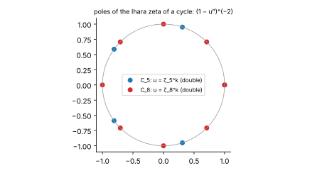

<sub>הקטבים של זטא של איהרה למעגל: שורשי היחידה מסדר n, כל אחד כפול.</sub>

<details><summary>פתרון</summary>

**הגדרה:** מסלול סגור מצומצם חייב להמשיך באותו כיוון, ולכן יש בדיוק שני ראשוניים – הסיבוב עם כיוון השעון ונגדו – שניהם באורך $`n`$. $`\zeta = (1 - u^n)^{-2}`$. **איהרה:** $`m = n`$, אז $`(1 - u^2)^0 = 1`$. הערכים העצמיים $`\lambda_k = \zeta_n^k + \zeta_n^{-k}`$, ו-$`1 - \lambda_ku + u^2 = (1 - \zeta_n^ku)(1 - \zeta_n^{-k}u)`$. המכפלה על $`k = 0..n-1`$: $`\prod_k(1 - \zeta_n^ku)^2 = (1 - u^n)^2`$ ✓.
</details>

**תרגיל 5.** רשמו את כל תת-החבורות מאינדקס 4 ב-$`\mathbb Z^2`$, ובדקו ש-$`a_4 = \sigma(4) = 7`$.

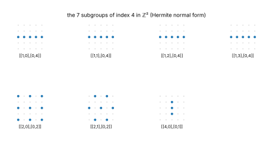

<sub>שבע תת-החבורות מאינדקס 4 ב-ℤ², לפי צורת הרמיט.</sub>

<details><summary>פתרון</summary>

$`\begin{pmatrix}a&b\\0&d\end{pmatrix}`$ עם $`ad = 4`$, $`0 \le b \lt d`$:
* $`d = 4, a = 1`$: $`b = 0, 1, 2, 3`$ → 4 תת-חבורות.
* $`d = 2, a = 2`$: $`b = 0, 1`$ → 2 (למשל $`b = 0`$ נותן $`2\mathbb Z \times 2\mathbb Z`$).
* $`d = 1, a = 4`$: $`b = 0`$ → 1 ($`4\mathbb Z \times \mathbb Z`$).

סה"כ $`4 + 2 + 1 = 7 = 1 + 2 + 4`$ ✓.
</details>

**תרגיל 6.** בדקו את הנוסחה $`N_{\text{affine}} = p - 2 + 2\,\mathrm{Re}\,J`$ עבור $`x^3 + y^3 = 1`$ ו-$`p = 13`$, בעזרת $`J = -4 - 3\omega`$ משיעור 19א.

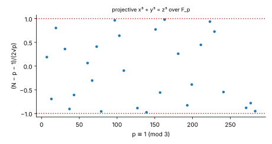

<sub>(N − p − 1)/(2√p) לעקום הפרויקטיבי x³ + y³ = z³: תמיד בין −1 ל-1.</sub>

<details><summary>פתרון</summary>

$`\mathrm{Re}\,J = -4 + \tfrac32 = -\tfrac52`$ (כי $`\mathrm{Re}\,\omega = -\tfrac12`$). $`N = 13 - 2 - 5 = 6`$. ספירה: הקוביות מודולו 13 הן $`\{0, 1, 5, 8, 12\}`$. צריך $`x^3 + y^3 = 1`$: $`0 + 1`$ (3 ערכי $`y`$ עם $`y^3 = 1`$: $`y = 1, 3, 9`$) → 3 פתרונות; $`1 + 0`$ → 3; $`5 + 9`$? $`9`$ לא קוביה; $`8 + 6`$? לא; $`12 + 2`$? לא. ושאר הצירופים של קוביות שונות מאפס: $`1 + 1 = 2`$, $`1 + 5 = 6`$, $`1 + 8 = 9`$, $`1 + 12 = 0`$, $`5 + 5 = 10`$, $`5 + 8 = 0`$, $`5 + 12 = 4`$, $`8 + 8 = 3`$, $`8 + 12 = 7`$, $`12 + 12 = 11`$ – אף אחד אינו 1. סה"כ $`6`$ ✓. בפרויקטיבי: $`6 + 3 = 9`$, ו-$`|9 - 14| = 5 \le 2\sqrt{13}`$ ✓.
</details>

---

## סיכום
* תבנית אחת: $`\zeta = \prod_P(1 - u^{\deg P})^{-1} = \exp\left(\sum N_nu^n/n\right)`$; היפוך מביוס עובר מ"נקודות" ל"ראשוניים".
* **יריעות מעל $`\mathbb F_q`$:** $`Z(\mathbb P^1) = 1/((1-T)(1-qT))`$; לעקום אליפטי $`Z = (1 - aT + qT^2)/((1-T)(1-qT))`$ ו-$`N_n = q^n + 1 - \alpha^n - \bar\alpha^n`$.
* **השערות וייל:** רציונליות (דבורק), משוואה פונקציונלית, השערת רימן $`|\alpha| = q^{i/2}`$ (דלין), מספרי בטי.
* **דינמיקה:** $`\zeta_f = 1/\det(I - TA)`$ להזזות; גאודזיות וזטא של סלברג.
* **גרפים:** נוסחת איהרה $`\zeta^{-1} = (1-u^2)^{m-n}\det(I - Au + qu^2)`$; השערת רימן ⇔ גרף רמנוג'אן ($`|\lambda| \le 2\sqrt q`$).
* **ספירה אלגברית:** $`\zeta_{\mathbb Z^2}(s) = \zeta(s)\zeta(s-1)`$; זטא של איגוסה רציונלית.

**להעמקה:** [פונקציית זטא מקומית](../pages/%D7%A4%D7%95%D7%A0%D7%A7%D7%A6%D7%99%D7%99%D7%AA%20%D7%96%D7%98%D7%90%20%D7%9E%D7%A7%D7%95%D7%9E%D7%99%D7%AA.md) · [פונקציית זטא של האסה–וייל](../pages/%D7%A4%D7%95%D7%A0%D7%A7%D7%A6%D7%99%D7%99%D7%AA%20%D7%96%D7%98%D7%90%20%D7%A9%D7%9C%20%D7%94%D7%90%D7%A1%D7%94%E2%80%93%D7%95%D7%99%D7%99%D7%9C.md) · [פונקציית זטא אריתמטית](../pages/%D7%A4%D7%95%D7%A0%D7%A7%D7%A6%D7%99%D7%99%D7%AA%20%D7%96%D7%98%D7%90%20%D7%90%D7%A8%D7%99%D7%AA%D7%9E%D7%98%D7%99%D7%AA.md) · [פונקציית זטא של ארטין–מאזור](../pages/%D7%A4%D7%95%D7%A0%D7%A7%D7%A6%D7%99%D7%99%D7%AA%20%D7%96%D7%98%D7%90%20%D7%A9%D7%9C%20%D7%90%D7%A8%D7%98%D7%99%D7%9F%E2%80%93%D7%9E%D7%90%D7%96%D7%95%D7%A8.md) · [פונקציית זטא של לפשץ](../pages/%D7%A4%D7%95%D7%A0%D7%A7%D7%A6%D7%99%D7%99%D7%AA%20%D7%96%D7%98%D7%90%20%D7%A9%D7%9C%20%D7%9C%D7%A4%D7%A9%D7%A5.md) · [פונקציית זטא של רואל](../pages/%D7%A4%D7%95%D7%A0%D7%A7%D7%A6%D7%99%D7%99%D7%AA%20%D7%96%D7%98%D7%90%20%D7%A9%D7%9C%20%D7%A8%D7%95%D7%90%D7%9C.md) · [פונקציית זטא של איהרה](../pages/%D7%A4%D7%95%D7%A0%D7%A7%D7%A6%D7%99%D7%99%D7%AA%20%D7%96%D7%98%D7%90%20%D7%A9%D7%9C%20%D7%90%D7%99%D7%94%D7%A8%D7%94.md) · [פונקציית זטא של איגוסה](../pages/%D7%A4%D7%95%D7%A0%D7%A7%D7%A6%D7%99%D7%99%D7%AA%20%D7%96%D7%98%D7%90%20%D7%A9%D7%9C%20%D7%90%D7%99%D7%92%D7%95%D7%A1%D7%94.md) · [פונקציית זטא של גוס](../pages/%D7%A4%D7%95%D7%A0%D7%A7%D7%A6%D7%99%D7%99%D7%AA%20%D7%96%D7%98%D7%90%20%D7%A9%D7%9C%20%D7%92%D7%95%D7%A1.md) · [השערת דווארק](../pages/%D7%94%D7%A9%D7%A2%D7%A8%D7%AA%20%D7%93%D7%95%D7%95%D7%90%D7%A8%D7%A7.md) · [פונקציית זטא של מינאקשיסונדרם–פליז'ל](../pages/%D7%A4%D7%95%D7%A0%D7%A7%D7%A6%D7%99%D7%99%D7%AA%20%D7%96%D7%98%D7%90%20%D7%A9%D7%9C%20%D7%9E%D7%99%D7%A0%D7%90%D7%A7%D7%A9%D7%99%D7%A1%D7%95%D7%A0%D7%93%D7%A8%D7%9D%E2%80%93%D7%A4%D7%9C%D7%99%D7%96%27%D7%9C.md) · [גידול תת-חבורות](../pages/%D7%92%D7%99%D7%93%D7%95%D7%9C%20%D7%AA%D7%AA-%D7%97%D7%91%D7%95%D7%A8%D7%95%D7%AA.md) · [יחס האסה–דבנפורט](../pages/%D7%99%D7%97%D7%A1%20%D7%94%D7%90%D7%A1%D7%94%E2%80%93%D7%93%D7%91%D7%A0%D7%A4%D7%95%D7%A8%D7%98.md) · [השערת רמנוג'אן–פטרסון](../pages/%D7%94%D7%A9%D7%A2%D7%A8%D7%AA%20%D7%A8%D7%9E%D7%A0%D7%95%D7%92%27%D7%90%D7%9F%E2%80%93%D7%A4%D7%98%D7%A8%D7%A1%D7%95%D7%9F.md) · [השערות וייל](../pages/%D7%94%D7%A9%D7%A2%D7%A8%D7%95%D7%AA%20%D7%95%D7%99%D7%99%D7%9C.md) · [פונקציית זטא של סלברג](../pages/%D7%A4%D7%95%D7%A0%D7%A7%D7%A6%D7%99%D7%99%D7%AA%20%D7%96%D7%98%D7%90%20%D7%A9%D7%9C%20%D7%A1%D7%9C%D7%91%D7%A8%D7%92.md)

**השיעור הקודם:** [שיעור 21: תבניות מודולריות](21-תבניות-מודולריות.md) · **השיעור הבא:** [שיעור 23: תבניות אוטומורפיות ותוכנית לנגלנדס](23-תוכנית-לנגלנדס.md)

---
<sub>חלק מ[קורס תורת המספרים](../COURSE.md). התוכן מופץ ברישיון [CC BY-SA 4.0](https://creativecommons.org/licenses/by-sa/4.0/).</sub>
