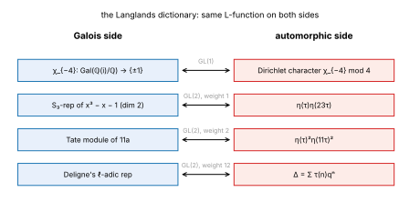
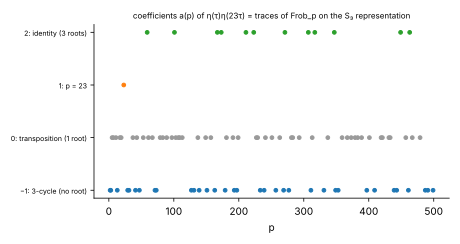
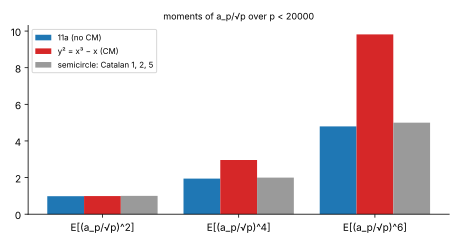
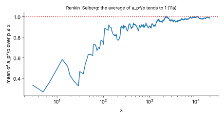
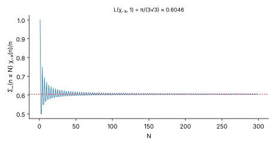
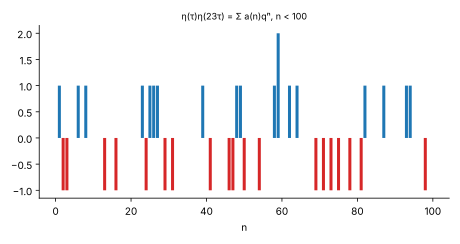
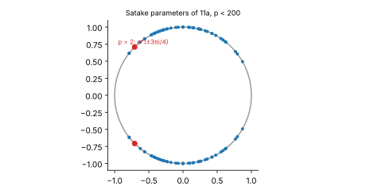
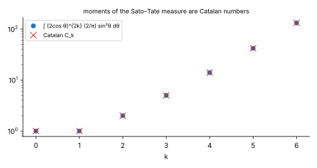
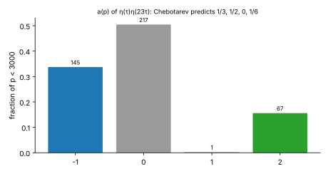
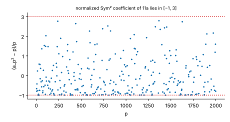

# שיעור 23: תבניות אוטומורפיות ותוכנית לנגלנדס

**מה נלמד:** זה השיעור האחרון בחלק האלגברי של הקורס, והוא מחבר את כל מה שראינו. לאורך השיעורים פגשנו אותה תופעה שוב ושוב: אובייקט "אריתמטי" (הרחבת גלואה, עקום אליפטי) ואובייקט "אנליטי" (קרקטר דיריכלה, תבנית מודולרית) **בעלי אותה פונקציית L**. **תוכנית לנגלנדס** היא ההשערה שזה תמיד כך. נראה:
1. **$`\mathrm{GL}(1)`$:** הצגות חד-ממדיות של חבורת גלואה ↔ קרקטרים של דיריכלה. זו בדיוק הדדיות ארטין (שיעור 19א).
2. **$`\mathrm{GL}(2)`$:** הצגות דו-ממדיות ↔ תבניות מודולריות. נראה דוגמה מלאה **לא אבלית**: ההצגה של $`S_3`$ שבאה מ-$`x^3 - x - 1`$ והתבנית $`\eta(\tau)\eta(23\tau)`$.
3. **פרמטרי סטקה**, **פונקציות L אוטומורפיות** ו**פונקטוריאליות**: איך מעבירים תבניות בין חבורות, ולמה זה הוכיח את סאטו–טייט.
4. **הצד המקומי:** השערות לנגלנדס המקומיות, והקבוע המקומי.
5. **ולדספורגר** – והחזרה למספרים החופפים של שיעור 20.

**ידע קודם:** [שיעור 13](13-קרקטרים-ופונקציות-L.md) (קרקטרים ופונקציות L), [שיעור 19א](19א-תורת-שדות-המחלקה.md) (הדדיות ארטין, אידלים), [שיעור 20](20-עקומים-אליפטיים.md) (עקומים, $`a_p`$, BSD), [שיעור 21](21-תבניות-מודולריות.md) (תבניות מודולריות, הקה), [שיעור 22](22-פונקציות-זטא-גאומטריות.md) (השערות וייל).

---

## 1. השפה: הצגות גלואה ופונקציות L של ארטין

תהי $`L/\mathbb Q`$ הרחבת גלואה עם חבורה $`G`$, ו-$`\rho : G \to \mathrm{GL}_n(\mathbb C)`$ הצגה. לכל ראשוני $`p`$ לא מסועף, $`\mathrm{Frob}_p`$ הוא מחלקת צמידות ב-$`G`$, ו-$`\rho(\mathrm{Frob}_p)`$ מוגדר עד צמידות – ולכן הפולינום האופייני שלו מוגדר היטב. **פונקציית ה-L של ארטין**:
```math
L(\rho, s) = \prod_{p}\frac{1}{\det\left(I - \rho(\mathrm{Frob}_p)\,p^{-s}\right)} \qquad (\text{עם תיקון בראשוניים מסועפים}).
```
* $`\rho`$ טריוויאלית ($`n = 1`$): $`L = \zeta(s)`$.
* $`\rho`$ ההצגה הרגולרית של $`G`$: $`L = \zeta_L(s)`$, הזטא של דדקינד של $`L`$.
* באופן כללי $`\zeta_L(s) = \prod_\rho L(\rho, s)^{\dim\rho}`$ על ההצגות האי-פריקות.

**השערת ארטין:** לכל $`\rho`$ אי-פריקה לא טריוויאלית, $`L(\rho, s)`$ **שלמה**. ידוע כשהיא חד-ממדית (מהדדיות ארטין: היא פונקציית L של דיריכלה), וגם במקרים רבים דו-ממדיים – **דרך לנגלנדס**: מראים ש-$`L(\rho, s)`$ שווה לפונקציית L של תבנית מודולרית, שהיא שלמה.

### דוגמה 1: $`\mathrm{GL}(1)`$ – השדה $`\mathbb Q(i)`$
$`G = \mathrm{Gal}(\mathbb Q(i)/\mathbb Q) = \{1, \sigma\}`$, ו-$`\rho(\sigma) = -1`$. $`\mathrm{Frob}_p = 1`$ אם $`p \equiv 1 \pmod 4`$ ו-$`\sigma`$ אם $`p \equiv 3`$. לכן $`\rho(\mathrm{Frob}_p) = \chi_{-4}(p)`$, ו
```math
L(\rho, s) = \prod_{p \text{ אי-זוגי}}\frac{1}{1 - \chi_{-4}(p)p^{-s}} = L(\chi_{-4}, s) = 1 - \frac1{3^s} + \frac1{5^s} - \frac1{7^s} + \dots
```
וב-$`s = 1`$: $`L(\chi_{-4}, 1) = \tfrac\pi4`$ (לייבניץ; בדקנו בחישוב). הזטא של $`\mathbb Q(i)`$ היא $`\zeta(s)L(\chi_{-4}, s)`$ – בדיוק ההתאמה משיעור 19. **צד ימין הוא קרקטר דיריכלה – תבנית אוטומורפית של $`\mathrm{GL}(1)`$.** כל הצגה חד-ממדית של $`\mathrm{Gal}(\overline{\mathbb Q}/\mathbb Q)`$ באה מקרקטר דיריכלה (קרונקר–ובר), וזה מקרה $`n = 1`$ של לנגלנדס.



<sub>המילון של לנגלנדס: ארבע דוגמאות מהקורס שבהן לאותה פונקציית L יש צד "גלואה" וצד "אוטומורפי".</sub>

---

## 2. $`\mathrm{GL}(2)`$: דוגמה לא אבלית מלאה

נחזור לשדה $`H`$ – שדה הפיצול של $`x^3 - x - 1`$, שדה מחלקות הילברט של $`\mathbb Q(\sqrt{-23})`$ (שיעור 19א, דוגמה 5). $`\mathrm{Gal}(H/\mathbb Q) \cong S_3`$. ל-$`S_3`$ יש הצגה אי-פריקה דו-ממדית $`\rho`$ (סימטריות המשולש), עם עקבות:

| מחלקה ב-$`S_3`$ | גודל | $`\mathrm{tr}\,\rho`$ | מתי $`\mathrm{Frob}_p`$ שם | מספר השורשים של $`x^3 - x - 1 \bmod p`$ |
|---|---|---|---|---|
| זהות | 1 | 2 | $`p`$ מתפצל לחלוטין ב-$`H`$ | 3 |
| חילוף | 3 | 0 | $`\left(\frac{p}{23}\right) = -1`$ | 1 |
| מחזור באורך 3 | 2 | $`-1`$ | $`p`$ מתפצל ב-$`\mathbb Q(\sqrt{-23})`$ לראשוניים לא ראשיים | 0 |

(הסיבה לעמודה האחרונה: פרובניוס פועל על שלושת השורשים כפרמוטציה, ומספר השורשים ב-$`\mathbb F_p`$ = מספר הנקודות הקבועות שלה.)

**הצד האוטומורפי.** הקה (1930s) מצא את התבנית ממשקל 1 וברמה 23:
```math
f(\tau) = \eta(\tau)\eta(23\tau) = q\prod_{n\ge1}(1 - q^n)(1 - q^{23n}) = \sum_{n\ge1}a(n)q^n .
```
(משקל $`\tfrac12 + \tfrac12 = 1`$; חזקת $`q`$: $`\tfrac{1 + 23}{24} = 1`$.)

### דוגמה 2: $`a(p) = \mathrm{tr}\,\rho(\mathrm{Frob}_p)`$
פותחים את המכפלה ומשווים לספירת שורשים:

| $`p`$ | שורשים של $`x^3 - x - 1`$ | $`\mathrm{tr}\,\rho(\mathrm{Frob}_p)`$ | $`a(p)`$ |
|---|---|---|---|
| 2 | 0 | $`-1`$ | $`-1`$ |
| 3 | 0 | $`-1`$ | $`-1`$ |
| 5 | 1 | 0 | 0 |
| 7 | 1 | 0 | 0 |
| 13 | 0 | $`-1`$ | $`-1`$ |
| 23 | (מסועף) | – | 1 |
| 59 | 3 | 2 | 2 |

בדקנו בחישוב את השוויון לכל $`p \lt 400`$. כלומר: **$`L(\rho, s) = L(f, s)`$**, ופונקציית ה-L של ארטין של הצגה **לא אבלית** היא שלמה. כאן אין שום תנאי קונגרואנציה שקובע את הפיצול של $`p`$ – אבל יש **תבנית מודולרית** שקובעת אותו. זה המסר של תוכנית לנגלנדס: "הדדיות לא אבלית" היא התאמה בין הצגות גלואה לבין תבניות אוטומורפיות.



<sub>a(p) של η(τ)η(23τ) לכל p < 500, צבוע לפי מחלקת פרובניוס ב-S₃.</sub>

**הכללות.** משפט דלין–סר (1974): כל תבנית חדשה ממשקל 1 באה מהצגת ארטין דו-ממדית. ההפך (**הצגות "אי-זוגיות"** → תבניות) הוא **השערת המודולריות של סר**, שהוכחה על ידי קארה–וינטנברגר (2009). למשקל 2: עקומים אליפטיים ↔ תבניות (שיעור 20–21). למשקל 12: לתבנית $`\Delta`$ יש הצגה $`\ell`$-אדית של דלין, עם $`\mathrm{tr}\,\rho(\mathrm{Frob}_p) = \tau(p)`$.

---

## 3. פרמטרי סטקה והשערת רמנוג'אן

לתבנית עצמית $`f`$ ממשקל $`k`$, נכתוב את הגורם המקומי של $`L(f, s)`$ אחרי נרמול:
```math
1 - \frac{a(p)}{p^{(k-1)/2}}X + X^2 = (1 - \alpha_pX)(1 - \beta_pX), \qquad \alpha_p\beta_p = 1 .
```
$`\{\alpha_p, \beta_p\}`$ הם **פרמטרי סטקה** של $`f`$ ב-$`p`$ – ובשפה של לנגלנדס, מחלקת צמידות ב-$`\mathrm{GL}_2(\mathbb C)`$ (החבורה הדואלית). [השערת רמנוג'אן–פטרסון](../pages/%D7%94%D7%A9%D7%A2%D7%A8%D7%AA%20%D7%A8%D7%9E%D7%A0%D7%95%D7%92%27%D7%90%D7%9F%E2%80%93%D7%A4%D7%98%D7%A8%D7%A1%D7%95%D7%9F.md) אומרת $`|\alpha_p| = |\beta_p| = 1`$ ("ההצגה המקומית **מתונה**"). לתבניות הולומורפיות זה משפט של דלין; לתבניות מאס זה עדיין פתוח.

### דוגמה 3: פרמטרי סטקה של $`\Delta`$ ב-$`p = 2`$
$`k = 12`$, $`a(2) = \tau(2) = -24`$, $`2^{11/2} = 45.25\ldots`$. אז $`\alpha + \beta = -\tfrac{24}{45.25} = -0.5303`$, $`\alpha\beta = 1`$. כיוון ש-$`|\alpha + \beta| \lt 2`$, השורשים צמודים על מעגל היחידה: $`\alpha = e^{i\theta}`$ עם $`\cos\theta = -0.2652`$, $`\theta \approx 105.4^\circ`$. בדקנו בחישוב.

**החבורה הדואלית.** לכל חבורה רדוקטיבית $`G`$ (כמו $`\mathrm{GL}_n`$, $`\mathrm{SL}_2`$, $`\mathrm{Sp}_{2n}`$) לנגלנדס מתאים [חבורה דואלית](../pages/%D7%94%D7%97%D7%91%D7%95%D7%A8%D7%94%20%D7%94%D7%93%D7%95%D7%90%D7%9C%D7%99%D7%AA%20%D7%A9%D7%9C%20%D7%9C%D7%A0%D7%92%D7%9C%D7%A0%D7%93%D7%A1.md) $`{}^LG`$ (הופכים את "נתוני השורשים"): $`\mathrm{GL}_n \leftrightarrow \mathrm{GL}_n`$, $`\mathrm{SL}_2 \leftrightarrow \mathrm{PGL}_2`$, $`\mathrm{Sp}_{2n} \leftrightarrow \mathrm{SO}_{2n+1}`$. פרמטרי סטקה של תבנית אוטומורפית על $`G`$ הם מחלקות צמידות ב-$`{}^LG`$, והצגות גלואה "צריכות" לנחות ב-$`{}^LG`$.

---

## 4. פונקציות L אוטומורפיות ופונקטוריאליות

לתבנית אוטומורפית $`\pi`$ על $`\mathrm{GL}_n`$ עם פרמטרי סטקה $`A_p = \mathrm{diag}(\alpha_{1,p}, \ldots, \alpha_{n,p})`$, ולהצגה $`r : \mathrm{GL}_n(\mathbb C) \to \mathrm{GL}_m(\mathbb C)`$, מגדירים
```math
L(\pi, r, s) = \prod_p\det\left(I - r(A_p)\,p^{-s}\right)^{-1} .
```
עם $`r`$ = ההצגה הסטנדרטית מקבלים את [פונקציית ה-L הסטנדרטית](../pages/%D7%A4%D7%95%D7%A0%D7%A7%D7%A6%D7%99%D7%99%D7%AA%20L%20%D7%A1%D7%98%D7%A0%D7%93%D7%A8%D7%98%D7%99%D7%AA.md). **עקרון הפונקטוריאליות** (לנגלנדס 1967): לכל הומומורפיזם ${}^LH \to {}^LG$ יש "העברה" של תבניות אוטומורפיות מ-$`H`$ ל-$`G`$ שמכבדת את פרמטרי סטקה. מקרים מוכחים:
* **[רנקין–סלברג](../pages/%D7%A9%D7%99%D7%98%D7%AA%20%D7%A8%D7%A0%D7%A7%D7%99%D7%9F%E2%80%93%D7%A1%D7%9C%D7%91%D7%A8%D7%92.md)** $`\mathrm{GL}_n \times \mathrm{GL}_m`$: $`L(\pi \times \pi', s)`$ עם הגורמים $`\prod_{i,j}(1 - \alpha_i\alpha'_jp^{-s})^{-1}`$ – מרומורפית, עם קוטב ב-$`s = 1`$ בדיוק כש-$`\pi' = \tilde\pi`$.
* **$`\mathrm{Sym}^2`$** מ-$`\mathrm{GL}_2`$ ל-$`\mathrm{GL}_3`$ (גלברט–ז'אקה 1978), $`\mathrm{Sym}^3, \mathrm{Sym}^4`$ (קים–שהידי), ו-$`\mathrm{Sym}^n`$ לכל $`n`$ – ניוטון–תורן (2021) לתבניות הולומורפיות.
* **החלפת בסיס** (לנגלנדס, ארתור–קלוזל) – מעבר לשדה גדול יותר.

### דוגמה 4: רנקין–סלברג וסאטו–טייט, מספרית
לעקום 11a, $`a_p/\sqrt p = \alpha_p + \beta_p = 2\cos\theta_p`$. 
* מ**רנקין–סלברג**: ל-$`L(f \times f, s)`$ יש קוטב פשוט ב-$`s = 1`$, ומזה $`\frac{1}{\pi(x)}\sum_{p\le x}a_p^2/p \to 1`$.
* סאטו–טייט (שיעור 20) נובע מכך ש-$`L(\mathrm{Sym}^n f, s)`$ לא מתאפסת על $`\mathrm{Re}\,s = 1`$ לכל $`n \ge 1`$ – ואז המומנטים של $`2\cos\theta_p`$ הם המומנטים של מידת חצי-העיגול, **מספרי קטלן**: $`\mathbb E[(2\cos\theta)^{2k}] = C_k = 1, 2, 5, 14, \ldots`$

בחישוב על כל $`p \lt 20000`$: $`\mathbb E[(a_p/\sqrt p)^2] = 0.985`$, $`\mathbb E[(a_p/\sqrt p)^4] = 1.945`$, $`\mathbb E[(a_p/\sqrt p)^6] = 4.795`$ – קרוב ל-$`1, 2, 5`$. לעקום עם כפל מרוכב $`y^2 = x^3 - x`$ מקבלים $`0.991, 2.959, 9.817`$ – קרוב ל-$`1, 3, 10`$: שם ההצגה **מושרית** מקרקטר של $`\mathbb Q(i)`$ (פונקטוריאליות מ-$`\mathrm{GL}_1`$ על $`\mathbb Q(i)`$ ל-$`\mathrm{GL}_2`$ על $`\mathbb Q`$), ולכן ההתפלגות שונה: חצי מהזוויות $`\pi/2`$ ושאר אחידות, עם מומנטים $`\tfrac12\binom{2k}{k}`$.



<sub>המומנטים של a_p/√p (p < 20000) ל-11a ולעקום עם כפל מרוכב, מול מספרי קטלן של חצי-העיגול.</sub>



<sub>הממוצע של a_p²/p על p ≤ x, לעקום 11a: שואף ל-1 (רנקין–סלברג).</sub>

---

## 5. הניסוח האדלי והצד המקומי

הניסוח המודרני מחליף את $`\mathbb H`$ ב-$`G(\mathbb Q)\backslash G(\mathbb A_\mathbb Q)`$, כאשר $`\mathbb A_\mathbb Q`$ הם האדלים (שיעור 19א). **הצגה אוטומורפית** $`\pi`$ היא הצגה אי-פריקה של $`G(\mathbb A)`$ שמופיעה בפונקציות על המרחב הזה, והיא מתפרקת למכפלה של הצגות **מקומיות**: $`\pi = \bigotimes_v\pi_v`$, עם $`\pi_p`$ הצגה של $`G(\mathbb Q_p)`$. תבנית מודולרית עצמית ↔ הצגה אוטומורפית של $`\mathrm{GL}_2(\mathbb A)`$; [פונקציית ה-L האוטומורפית](../pages/%D7%A4%D7%95%D7%A0%D7%A7%D7%A6%D7%99%D7%99%D7%AA%20L%20%D7%90%D7%95%D7%98%D7%95%D7%9E%D7%95%D7%A8%D7%A4%D7%99%D7%AA.md) היא מכפלת הגורמים המקומיים.

**[השערות לנגלנדס המקומיות](../pages/%D7%94%D7%A9%D7%A2%D7%A8%D7%95%D7%AA%20%D7%9C%D7%A0%D7%92%D7%9C%D7%A0%D7%93%D7%A1%20%D7%94%D7%9E%D7%A7%D7%95%D7%9E%D7%99%D7%95%D7%AA.md).** הצגות אי-פריקות של $`\mathrm{GL}_n(\mathbb Q_p)`$ ↔ הצגות $`n`$-ממדיות של חבורת וייל–דלין של $`\mathbb Q_p`$, בהתאמה ששומרת גורמי L ו**גורמי $`\varepsilon`$**. ל-$`n = 1`$ זו תורת שדות המחלקה המקומית ($`\mathbb Q_p^\times \cong W_{\mathbb Q_p}^{ab}`$). ל-$`\mathrm{GL}_n`$ הוכיחו האריס–טיילור והנניאר (2000–2001), בעזרת [יריעות שימורה](../pages/%D7%99%D7%A8%D7%99%D7%A2%D7%AA%20%D7%A9%D7%99%D7%9E%D7%95%D7%A8%D7%94.md). [הקבוע המקומי של לנגלנדס–דלין](../pages/%D7%94%D7%A7%D7%91%D7%95%D7%A2%20%D7%94%D7%9E%D7%A7%D7%95%D7%9E%D7%99%20%D7%A9%D7%9C%20%D7%9C%D7%A0%D7%92%D7%9C%D7%A0%D7%93%D7%A1%E2%80%93%D7%93%D7%9C%D7%99%D7%9F.md) $`\varepsilon(\rho_v)`$ הוא הגרסה המקומית של סכום גאוס (שיעור 19א): למשל לקרקטר ריבועי מודולו $`p`$, $`\varepsilon`$ הוא בעצם $`g(\chi)/\sqrt p \in \{1, i\}`$, והמכפלה של כל הקבועים המקומיים נותנת את הסימן במשוואה הפונקציונלית.

**יריעות שימורה וקונגרואנציית אייכלר–שימורה.** העקום המודולרי $`X_0(N)`$ הוא הדוגמה הפשוטה ביותר ל[יריעת שימורה](../pages/%D7%99%D7%A8%D7%99%D7%A2%D7%AA%20%D7%A9%D7%99%D7%9E%D7%95%D7%A8%D7%94.md). מודולו $`p`$, אופרטור הקה $`T_p`$ על $`X_0(N)`$ שווה ל-$`\mathrm{Frob} + \mathrm{Frob}^t`$ ([יחס הקונגרואנציה של אייכלר–שימורה](../pages/%D7%99%D7%97%D7%A1%20%D7%94%D7%A7%D7%95%D7%A0%D7%92%D7%A8%D7%95%D7%90%D7%A0%D7%A6%D7%99%D7%94%20%D7%A9%D7%9C%20%D7%90%D7%99%D7%99%D7%9B%D7%9C%D7%A8%E2%80%93%D7%A9%D7%99%D7%9E%D7%95%D7%A8%D7%94.md)). ומכאן: הערך העצמי של $`T_p`$ על תבנית = העקבה של פרובניוס על הקוהומולוגיה. זה הכלי שבונה את הצד הגלואה מתוך הצד האוטומורפי – והוא מה שעובד בכל ההוכחות של לנגלנדס בכיוון "אוטומורפי ⇒ גלואה".

---

## 6. ערכים מרכזיים: ולדספורגר וחזרה למספרים חופפים

[משפט ולדספורגר](../pages/%D7%9E%D7%A9%D7%A4%D7%98%20%D7%95%D7%9C%D7%93%D7%A1%D7%A4%D7%95%D7%A8%D7%92%D7%A8.md) (1981) קושר את **הערך המרכזי** של פונקציית L של תבנית ממשקל 2 מסובבת בקרקטר ריבועי, $`L(f \otimes \chi_D, 1)`$, ל**ריבוע של מקדם** של תבנית ממשקל $`\tfrac32`$ (דרך [התאמת שימורה](../pages/%D7%94%D7%AA%D7%90%D7%9E%D7%AA%20%D7%A9%D7%99%D7%9E%D7%95%D7%A8%D7%94.md)):
```math
L(f \otimes \chi_D, 1) \;\doteq\; \frac{c(|D|)^2}{\sqrt{|D|}} \quad (\text{עד קבוע שתלוי רק ב-}f\text{ ובמחלקה של }D).
```
**טאנל** (שיעור 20) הוא בדיוק מקרה פרטי: $`E_n`$ הוא הסיבוב של $`E_1 : y^2 = x^3 - x`$ ב-$`\chi_n`$, ו-$`A(n) - 2B(n)`$ (או גרסה דומה עם התבניות הטרנריות) הם המקדמים של תבנית ממשקל $`\tfrac32`$. לכן:
```math
L(E_n, 1) = 0 \iff A(n) = 2B(n),
```
וב-BSD, $`L(E_n, 1) = 0 \iff r(E_n) \gt 0 \iff n`$ חופף. (לפי קואטס–וויילס, $`L(E_n, 1) \ne 0 \Rightarrow r = 0`$ – הכיוון שהוכח.) כך סוגר הקורס מעגל: שאלה של פרמה על משולשים ⇒ עקום אליפטי ⇒ פונקציית L ⇒ תבנית ממשקל חצי-שלם ⇒ ספירת נקודות סריג בתבנית ריבועית טרנרית.

**הלאה:** [השערת גאן–גרוס–פרסאד](../pages/%D7%94%D7%A9%D7%A2%D7%A8%D7%AA%20%D7%92%D7%90%D7%9F%E2%80%93%D7%92%D7%A8%D7%95%D7%A1%E2%80%93%D7%A4%D7%A8%D7%A1%D7%90%D7%93.md) מכלילה את ולדספורגר לחבורות אורתוגונליות ויוניטריות; [פונקציות L מוטיביות](../pages/%D7%A4%D7%95%D7%A0%D7%A7%D7%A6%D7%99%D7%99%D7%AA%20L%20%D7%9E%D7%95%D7%98%D7%99%D7%91%D7%99%D7%AA.md) הן הצד הגאומטרי הכללי (וההשערה היא שכולן אוטומורפיות); ו[פונקציית L של שימיזו](../pages/%D7%A4%D7%95%D7%A0%D7%A7%D7%A6%D7%99%D7%99%D7%AA%20L%20%D7%A9%D7%9C%20%D7%A9%D7%99%D7%9E%D7%99%D7%96%D7%95.md) ו[פונקציות L אקוויווריאנטיות](../pages/%D7%A4%D7%95%D7%A0%D7%A7%D7%A6%D7%99%D7%99%D7%AA%20L%20%D7%90%D7%A7%D7%95%D7%95%D7%99%D7%95%D7%95%D7%A8%D7%99%D7%90%D7%A0%D7%98%D7%99%D7%AA.md) הן דוגמאות נוספות.

---

## 7. תרגילים

**תרגיל 1.** ההצגה הלא טריוויאלית של $`\mathrm{Gal}(\mathbb Q(\sqrt{-3})/\mathbb Q)`$: מצאו את $`\rho(\mathrm{Frob}_p)`$ לפי $`p \bmod 3`$, כתבו את $`L(\rho, s)`$ כטור דיריכלה, ובדקו מספרית ש-$`L(\rho, 1) = \tfrac{\pi}{3\sqrt3}`$.



<sub>הסכומים החלקיים של Σχ₋₃(n)/n מתכנסים ל-π/(3√3) ≈ 0.6046.</sub>

<details><summary>פתרון</summary>

$`p`$ מתפצל ב-$`\mathbb Q(\sqrt{-3})`$ ⇔ $`\left(\frac{-3}{p}\right) = 1`$ ⇔ $`p \equiv 1 \pmod 3`$ (הדדיות). לכן $`\rho(\mathrm{Frob}_p) = \chi_{-3}(p)`$: $`+1`$ ל-$`p \equiv 1`$, $`-1`$ ל-$`p \equiv 2`$, ו-$`p = 3`$ מסועף. $`L(\rho, s) = 1 - 2^{-s} + 4^{-s} - 5^{-s} + 7^{-s} - \dots`$. בזוגות: $`\sum_{k\ge0}\left(\tfrac{1}{3k + 1} - \tfrac{1}{3k + 2}\right) = 0.604599788\ldots = \tfrac{\pi}{3\sqrt3}`$ (בדקנו בחישוב). זה גם נוסחת מספר המחלקה: $`L(\chi_{-3}, 1) = \tfrac{2\pi h}{w\sqrt3}`$ עם $`h = 1`$, $`w = 6`$.
</details>

**תרגיל 2.** פתחו את $`q\prod(1 - q^n)(1 - q^{23n})`$ עד $`q^4`$, ובדקו ש-$`a(2) = a(3) = -1`$ ו-$`a(4) = a(2)^2 - 1 = 0`$.



<sub>המקדמים a(n) של η(τ)η(23τ) עבור n < 100: רובם 0, ±1, 2.</sub>

<details><summary>פתרון</summary>

עד $`q^3`$ (בתוך המכפלה, כלומר עד $`q^4`$ אחרי הכפל ב-$`q`$), $`(1 - q^{23n})`$ לא משפיע. $`\prod(1 - q^n) = 1 - q - q^2 + q^5 + q^7 - \dots`$ (מחומשי אוילר). לכן $`f = q - q^2 - q^3 + 0\cdot q^4 + \dots`$: $`a(2) = -1`$, $`a(3) = -1`$, $`a(4) = 0`$. במשקל 1 נוסחת הקה היא $`a(p^2) = a(p)^2 - \chi(p)`$ עם $`\chi = \chi_{-23}`$, ו-$`\chi_{-23}(2) = 1`$ (כי $`-23 \equiv 1 \pmod 8`$): $`a(4) = 1 - 1 = 0`$ ✓. ובצד הגלואה: מודולו 2 ל-$`x^3 - x - 1 = x^3 + x + 1`$ אין שורשים, אז $`\mathrm{Frob}_2`$ מחזור באורך 3, $`\mathrm{tr} = -1`$ ✓.
</details>

**תרגיל 3.** מצאו את פרמטרי סטקה של העקום 11a ב-$`p = 2`$.



<sub>פרמטרי סטקה של 11a לכל p < 200; ב-p = 2 הם e^(±3πi/4).</sub>

<details><summary>פתרון</summary>

$`a_2 = -2`$, $`k = 2`$: $`\alpha + \beta = -\tfrac{2}{\sqrt2} = -\sqrt2`$, $`\alpha\beta = 1`$. אז $`X^2 + \sqrt2X + 1 = 0`$, $`X = \tfrac{-\sqrt2 \pm i\sqrt2}{2} = e^{\pm 3\pi i/4}`$. על מעגל היחידה ✓ (רמנוג'אן–פטרסון = האסה). ו-$`\alpha^8 = 1`$: לכן $`\#E(\mathbb F_{2^8}) = 2^8 + 1 - 2^4(\alpha^8 + \beta^8) = 257 - 32 = 225`$ (בדקנו בחישוב בנוסחת הנסיגה של שיעור 22).
</details>

**תרגיל 4.** הראו שהמומנטים הזוגיים של מידת סאטו–טייט $`\tfrac2\pi\sin^2\theta\,d\theta`$, $`\mathbb E[(2\cos\theta)^{2k}]`$, הם מספרי קטלן.



<sub>המומנטים של מידת סאטו–טייט מול מספרי קטלן C_k עבור k = 0..6.</sub>

<details><summary>פתרון</summary>

$`2\cos\theta = e^{i\theta} + e^{-i\theta}`$ ו-$`\tfrac2\pi\sin^2\theta = \tfrac1\pi(1 - \cos2\theta)`$. כיוון ש-$`\tfrac1\pi\int_0^\pi e^{im\theta} + e^{-im\theta}\,d\theta`$ נותן 2 ל-$`m = 0`$ ו-0 אחרת (ל-$`m`$ זוגי), $`\mathbb E[(2\cos\theta)^{2k}]`$ = (המקדם האמצעי של $`(x + x^{-1})^{2k}`$) פחות (המקדם של $`x^2`$) = $`\binom{2k}{k} - \binom{2k}{k+1} = \tfrac{1}{k+1}\binom{2k}{k} = C_k`$. למשל $`k = 2`$: $`6 - 4 = 2`$; $`k = 3`$: $`20 - 15 = 5`$ ✓. (בשפה של חבורות: זה מספר הפעמים שההצגה הטריוויאלית מופיעה ב-$`V^{\otimes 2k}`$ עבור ההצגה הסטנדרטית $`V`$ של $`\mathrm{SU}(2)`$.)
</details>

**תרגיל 5.** לפי צ'בוטרב, באיזו שכיחות מקבלים $`a(p) = 2, 0, -1`$ בתבנית $`\eta(\tau)\eta(23\tau)`$? השוו לנתונים עד 3000.



<sub>השכיחות של a(p) ∈ {−1, 0, 1, 2} לכל p < 3000, מול התחזית 1/3, 1/2, 0, 1/6.</sub>

<details><summary>פתרון</summary>

לפי צ'בוטרב, $`\mathrm{Frob}_p`$ נופל במחלקת צמידות $`C`$ בשכיחות $`|C|/|G|`$: זהות $`\tfrac16`$ ($`a = 2`$), חילופים $`\tfrac36 = \tfrac12`$ ($`a = 0`$), מחזורים $`\tfrac26 = \tfrac13`$ ($`a = -1`$). מתוך 430 הראשוניים מתחת ל-3000: 67 עם $`a = 2`$ (15.6%), 217 עם $`a = 0`$ (50.5%), 145 עם $`a = -1`$ (33.7%), ואחד ($`p = 23`$) עם $`a = 1`$. בדקנו בחישוב. שימו לב: $`|a(p)| \le 2`$ תמיד – רמנוג'אן–פטרסון במשקל 1 נובע ישירות מכך ש-$`\rho(\mathrm{Frob}_p)`$ מסדר סופי.
</details>

**תרגיל 6.** חשבו את הגורם המקומי של $`L(\mathrm{Sym}^2 f, s)`$ ב-$`p = 2`$ לעקום 11a, כפולינום ב-$`T = 2^{-s}`$.



<sub>(a_p² − p)/p לעקום 11a: תמיד בין −1 ל-3.</sub>

<details><summary>פתרון</summary>

לא מנורמל: $`\alpha + \beta = a_2 = -2`$, $`\alpha\beta = 2`$. השורשים של $`\mathrm{Sym}^2`$: $`\alpha^2, \alpha\beta, \beta^2`$.
* $`e_1 = \alpha^2 + \alpha\beta + \beta^2 = (\alpha + \beta)^2 - \alpha\beta = 4 - 2 = 2`$.
* $`e_2 = \alpha\beta(\alpha^2 + \beta^2) + (\alpha\beta)^2 = 2\cdot(4 - 4) + 4 = 4`$.
* $`e_3 = (\alpha\beta)^3 = 8`$.

הגורם: $`(1 - \alpha^2T)(1 - \alpha\beta T)(1 - \beta^2T) = 1 - 2T + 4T^2 - 8T^3`$. (באופן כללי $`e_1 = a_p^2 - p`$, ו-$`|e_1| \le 3p`$ – מכאן החסם באיור.)
</details>

---

## סיכום
* **פונקציית L של ארטין** $`L(\rho, s)`$; **השערת ארטין**: שלמה. $`\mathrm{GL}(1)`$: $`\rho \leftrightarrow`$ קרקטר דיריכלה (ארטין, קרונקר–ובר).
* **$`\mathrm{GL}(2)`$ לא אבלי:** ההצגה של $`S_3`$ מ-$`x^3 - x - 1`$ ↔ $`\eta(\tau)\eta(23\tau)`$; $`a(p) = 2, 0, -1`$ לפי מספר השורשים מודולו $`p`$.
* **פרמטרי סטקה** במחלקות צמידות של ה**חבורה הדואלית**; **רמנוג'אן–פטרסון** = מתינות.
* **פונקטוריאליות:** רנקין–סלברג, $`\mathrm{Sym}^n`$ ⇒ סאטו–טייט; המומנטים – מספרי קטלן (וללא, עם כפל מרוכב).
* **מקומי:** לנגלנדס המקומי ל-$`\mathrm{GL}_n`$ (האריס–טיילור, הנניאר); $`\varepsilon`$-גורמים = סכומי גאוס מוכללים; יריעות שימורה ואייכלר–שימורה.
* **ולדספורגר:** ערכים מרכזיים = ריבועי מקדמים של תבניות ממשקל $`\tfrac32`$; טאנל ומספרים חופפים.

**להעמקה:** [פונקציית L אוטומורפית](../pages/%D7%A4%D7%95%D7%A0%D7%A7%D7%A6%D7%99%D7%99%D7%AA%20L%20%D7%90%D7%95%D7%98%D7%95%D7%9E%D7%95%D7%A8%D7%A4%D7%99%D7%AA.md) · [פונקציית L סטנדרטית](../pages/%D7%A4%D7%95%D7%A0%D7%A7%D7%A6%D7%99%D7%99%D7%AA%20L%20%D7%A1%D7%98%D7%A0%D7%93%D7%A8%D7%98%D7%99%D7%AA.md) · [פונקציית L מוטיבית](../pages/%D7%A4%D7%95%D7%A0%D7%A7%D7%A6%D7%99%D7%99%D7%AA%20L%20%D7%9E%D7%95%D7%98%D7%99%D7%91%D7%99%D7%AA.md) · [פונקציית L אקוויווריאנטית](../pages/%D7%A4%D7%95%D7%A0%D7%A7%D7%A6%D7%99%D7%99%D7%AA%20L%20%D7%90%D7%A7%D7%95%D7%95%D7%99%D7%95%D7%95%D7%A8%D7%99%D7%90%D7%A0%D7%98%D7%99%D7%AA.md) · [פונקציית L של שימיזו](../pages/%D7%A4%D7%95%D7%A0%D7%A7%D7%A6%D7%99%D7%99%D7%AA%20L%20%D7%A9%D7%9C%20%D7%A9%D7%99%D7%9E%D7%99%D7%96%D7%95.md) · [שיטת רנקין–סלברג](../pages/%D7%A9%D7%99%D7%98%D7%AA%20%D7%A8%D7%A0%D7%A7%D7%99%D7%9F%E2%80%93%D7%A1%D7%9C%D7%91%D7%A8%D7%92.md) · [השערת רמנוג'אן–פטרסון](../pages/%D7%94%D7%A9%D7%A2%D7%A8%D7%AA%20%D7%A8%D7%9E%D7%A0%D7%95%D7%92%27%D7%90%D7%9F%E2%80%93%D7%A4%D7%98%D7%A8%D7%A1%D7%95%D7%9F.md) · [החבורה הדואלית של לנגלנדס](../pages/%D7%94%D7%97%D7%91%D7%95%D7%A8%D7%94%20%D7%94%D7%93%D7%95%D7%90%D7%9C%D7%99%D7%AA%20%D7%A9%D7%9C%20%D7%9C%D7%A0%D7%92%D7%9C%D7%A0%D7%93%D7%A1.md) · [השערות לנגלנדס המקומיות](../pages/%D7%94%D7%A9%D7%A2%D7%A8%D7%95%D7%AA%20%D7%9C%D7%A0%D7%92%D7%9C%D7%A0%D7%93%D7%A1%20%D7%94%D7%9E%D7%A7%D7%95%D7%9E%D7%99%D7%95%D7%AA.md) · [הקבוע המקומי של לנגלנדס–דלין](../pages/%D7%94%D7%A7%D7%91%D7%95%D7%A2%20%D7%94%D7%9E%D7%A7%D7%95%D7%9E%D7%99%20%D7%A9%D7%9C%20%D7%9C%D7%A0%D7%92%D7%9C%D7%A0%D7%93%D7%A1%E2%80%93%D7%93%D7%9C%D7%99%D7%9F.md) · [יריעת שימורה](../pages/%D7%99%D7%A8%D7%99%D7%A2%D7%AA%20%D7%A9%D7%99%D7%9E%D7%95%D7%A8%D7%94.md) · [יחס הקונגרואנציה של אייכלר–שימורה](../pages/%D7%99%D7%97%D7%A1%20%D7%94%D7%A7%D7%95%D7%A0%D7%92%D7%A8%D7%95%D7%90%D7%A0%D7%A6%D7%99%D7%94%20%D7%A9%D7%9C%20%D7%90%D7%99%D7%99%D7%9B%D7%9C%D7%A8%E2%80%93%D7%A9%D7%99%D7%9E%D7%95%D7%A8%D7%94.md) · [משפט ולדספורגר](../pages/%D7%9E%D7%A9%D7%A4%D7%98%20%D7%95%D7%9C%D7%93%D7%A1%D7%A4%D7%95%D7%A8%D7%92%D7%A8.md) · [השערת גאן–גרוס–פרסאד](../pages/%D7%94%D7%A9%D7%A2%D7%A8%D7%AA%20%D7%92%D7%90%D7%9F%E2%80%93%D7%92%D7%A8%D7%95%D7%A1%E2%80%93%D7%A4%D7%A8%D7%A1%D7%90%D7%93.md) · [התאמת שימורה](../pages/%D7%94%D7%AA%D7%90%D7%9E%D7%AA%20%D7%A9%D7%99%D7%9E%D7%95%D7%A8%D7%94.md) · [הדדיות ארטין](../pages/%D7%94%D7%93%D7%93%D7%99%D7%95%D7%AA%20%D7%90%D7%A8%D7%98%D7%99%D7%9F.md) · [חבורת וייל](../pages/%D7%97%D7%91%D7%95%D7%A8%D7%AA%20%D7%95%D7%99%D7%99%D7%9C.md) · [משפט טאנל](../pages/%D7%9E%D7%A9%D7%A4%D7%98%20%D7%98%D7%90%D7%A0%D7%9C.md)

**השיעור הקודם:** [שיעור 22: פונקציות זטא גאומטריות](22-פונקציות-זטא-גאומטריות.md) · **חזרה ל:** [תוכן הקורס](../COURSE.md)

---
<sub>חלק מ[קורס תורת המספרים](../COURSE.md). התוכן מופץ ברישיון [CC BY-SA 4.0](https://creativecommons.org/licenses/by-sa/4.0/).</sub>
