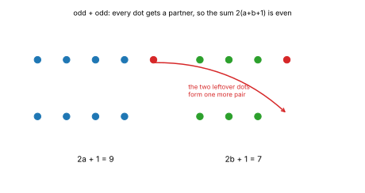
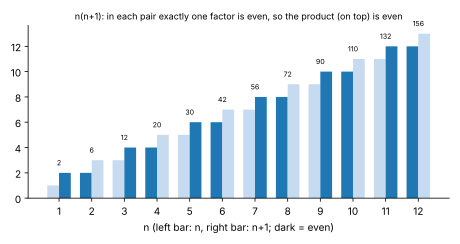
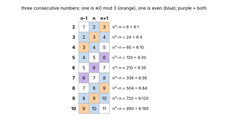
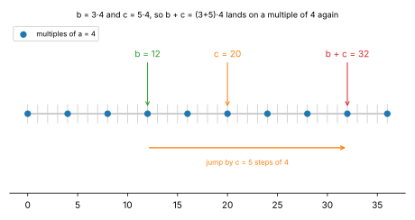
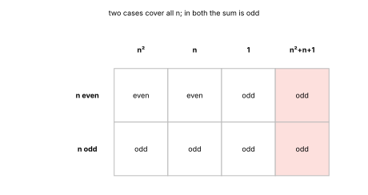
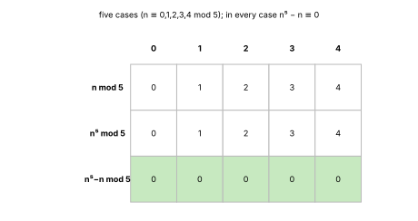
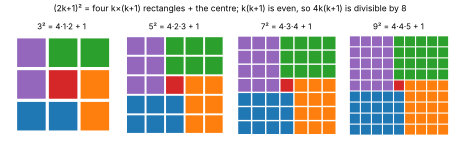

# שיעור P1: הוכחה ישירה וחלוקה למקרים

**מה נלמד:** איך בונים הוכחה ישירה: פותחים את ההגדרות, עושים אלגברה, ומגיעים למסקנה. ואיך מפצלים בעיה למספר סופי של מקרים שמכסים את כל האפשרויות.

**ידע קודם:** זוגיות, התחלקות ([שיעור 1 בקורס הראשי](01-התחלקות.md)).

---

## 1. העיקרון

רוב הטענות בתורת המספרים הן מהצורה "**אם** $`P`$ **אז** $`Q`$". בהוכחה ישירה:

1. **מניחים** את $`P`$.
2. **מתרגמים** את $`P`$ לשפת המשוואות, לפי ההגדרות. למשל, "$`n`$ אי-זוגי" פירושו: קיים שלם $`k`$ כך ש-$`n = 2k+1`$. "$`a \mid b`$" פירושו: קיים שלם $`m`$ כך ש-$`b = ma`$.
3. **מחשבים** עד שמגיעים לביטוי שהוא בדיוק התרגום של $`Q`$.

הטעות הנפוצה ביותר היא לבדוק כמה דוגמאות ולהכריז שהטענה נכונה. דוגמאות עוזרות **לנחש** ולהבין, אבל הוכחה צריכה לכסות את **כל** המספרים בבת אחת, ולכן היא עובדת עם אותיות.

**חלוקה למקרים.** לפעמים קשה לטפל בכל המספרים יחד, אבל קל לטפל בהם בקבוצות: זוגיים ואי-זוגיים, או לפי השארית בחלוקה ב-3 או ב-5. אם המקרים **מכסים את כל האפשרויות**, ובכל מקרה הטענה נכונה, היא נכונה תמיד. משפט החלוקה עם שארית מבטיח שכל שלם $`n`$ הוא בדיוק אחד מ-$`3k, 3k+1, 3k+2`$, ולכן חלוקה לפי שאריות תמיד מכסה הכול.

---

## 2. דוגמאות פתורות

### דוגמה 1: סכום של שני אי-זוגיים הוא זוגי

**טענה.** אם $`a`$ ו-$`b`$ אי-זוגיים, אז $`a + b`$ זוגי.

כל נקודה מקבלת בן זוג; שתי הנקודות שנשארו לבד בכל מספר אי-זוגי נעשות זוג נוסף.

**הוכחה.**
* **מניחים:** $`a`$ ו-$`b`$ אי-זוגיים.
* **מתרגמים:** יש שלמים $`k, m`$ כך ש-$`a = 2k+1`$ ו-$`b = 2m+1`$. (שימו לב: משתמשים באותיות **שונות**, כי אין סיבה ש-$`a`$ ו-$`b`$ יהיו שווים.)
* **מחשבים:** $`a + b = 2k + 1 + 2m + 1 = 2(k + m + 1)`$.
* **מסיקים:** $`k + m + 1`$ שלם, ולכן $`a + b`$ הוא פעמיים שלם, כלומר זוגי. ∎

**מה למדנו:** כל ההוכחה היא תרגום של ההגדרה, שורה אחת של אלגברה, ותרגום חזרה.

### דוגמה 2: מכפלה של שני מספרים עוקבים היא זוגית

**טענה.** לכל שלם $`n`$, המספר $`n(n+1)`$ זוגי.

בכל זוג עוקבים בדיוק אחד זוגי (העמודה הכהה), ולכן המכפלה זוגית.

**הוכחה בחלוקה למקרים.** כל שלם הוא זוגי או אי-זוגי.
* **מקרה א: $`n`$ זוגי**, $`n = 2k`$. אז $`n(n+1) = 2k(n+1)`$, זוגי.
* **מקרה ב: $`n`$ אי-זוגי**, $`n = 2k+1`$. אז $`n + 1 = 2k + 2 = 2(k+1)`$, ולכן $`n(n+1) = 2(k+1)n`$, זוגי.

שני המקרים מכסים את כל השלמים, ובשניהם המכפלה זוגית. ∎

### דוגמה 3: $`n^3 - n`$ מתחלק ב-6

**טענה.** לכל שלם $`n`$, $`6 \mid n^3 - n`$.

בכל שלשה של מספרים עוקבים יש כפולה של 3 (כתום) ומספר זוגי (כחול); בסגול – מספר שהוא שניהם.

**הוכחה.**
* **שלב 1: פירוק.** $`n^3 - n = n(n^2 - 1) = (n-1)\,n\,(n+1)`$: מכפלה של שלושה מספרים עוקבים.
* **שלב 2: התחלקות ב-2.** בין $`n`$ ל-$`n+1`$ יש זוגי (דוגמה 2), ולכן המכפלה זוגית.
* **שלב 3: התחלקות ב-3, בחלוקה למקרים.**
  * אם $`n = 3k`$, אז $`3 \mid n`$.
  * אם $`n = 3k+1`$, אז $`n - 1 = 3k`$, ולכן $`3 \mid n-1`$.
  * אם $`n = 3k+2`$, אז $`n + 1 = 3k+3 = 3(k+1)`$, ולכן $`3 \mid n+1`$.
  
  בכל מקרה אחד הגורמים מתחלק ב-3, ולכן גם המכפלה.
* **שלב 4: צירוף.** המכפלה מתחלקת ב-2 וב-3, ומכיוון ש-2 ו-3 זרים, היא מתחלקת ב-6. ∎

> **שימו לב לשלב 4:** מ-$`a \mid N`$ ומ-$`b \mid N`$ לא נובע תמיד $`ab \mid N`$ (למשל $`4 \mid 12`$ ו-$`6 \mid 12`$ אבל $`24 \nmid 12`$). זה נכון כאשר $`\gcd(a,b) = 1`$; ראו [שיעור 2](02-מחלק-משותף-מקסימלי.md).

---

## 3. תרגילים

**תרגיל 1.** הוכיחו: אם $`a \mid b`$ ו-$`a \mid c`$, אז $`a \mid b + c`$.

b ו-c הם כפולות של 4, ולכן גם הקפיצה מ-b ל-b+c נוחתת על כפולה של 4.

פתרון

מההגדרה יש שלמים $`k, m`$ כך ש-$`b = ka`$ ו-$`c = ma`$. אז $`b + c = ka + ma = (k + m)a`$, ו-$`k + m`$ שלם, ולכן $`a \mid b + c`$.

**תרגיל 2.** הוכיחו שלכל שלם $`n`$ המספר $`n^2 + n + 1`$ אי-זוגי.

שני מקרים מכסים את כל n, ובשניהם הסכום אי-זוגי.

פתרון

**דרך 1 (מקרים):** אם $`n`$ זוגי, $`n^2`$ ו-$`n`$ זוגיים, ולכן $`n^2 + n + 1`$ = זוגי + זוגי + 1 = אי-זוגי. אם $`n`$ אי-זוגי, $`n^2`$ ו-$`n`$ אי-זוגיים, וסכומם זוגי (דוגמה 1), ולכן שוב התוצאה אי-זוגית.

**דרך 2 (ישירה):** $`n^2 + n + 1 = n(n+1) + 1`$, ו-$`n(n+1)`$ זוגי לפי דוגמה 2. כך משתמשים בטענה שכבר הוכחה במקום לחזור על העבודה.

**תרגיל 3.** הוכיחו ש-$`5 \mid n^5 - n`$ לכל שלם $`n`$.

חמישה מקרים לפי השארית מודולו 5; בכולם n⁵ − n ≡ 0.

פתרון

נחלק לפי $`n \bmod 5`$. מספיק לבדוק את השאריות, כי אם $`n \equiv r \pmod 5`$ אז $`n^5 - n \equiv r^5 - r`$ (ראו [שיעור 4](04-חשבון-מודולרי.md)).
* $`r = 0`$: $`0 - 0 = 0`$.
* $`r = 1`$: $`1 - 1 = 0`$.
* $`r = 2`$: $`32 - 2 = 30 \equiv 0`$.
* $`r = 3`$: $`243 - 3 = 240 \equiv 0`$.
* $`r = 4`$: $`1024 - 4 = 1020 \equiv 0`$.

בכל המקרים מתקבל 0. (זה מקרה פרטי של [המשפט הקטן של פרמה](05-פרמה-אוילר-וילסון.md).)

**תרגיל 4.** הוכיחו שכל ריבוע של מספר אי-זוגי נותן שארית 1 בחלוקה ב-8.

ריבוע בצלע 2k+1 מתפרק לארבעה מלבנים k×(k+1) ולמשבצת אמצעית אחת.

פתרון

נכתוב $`n = 2k + 1`$. אז $`n^2 = 4k^2 + 4k + 1 = 4k(k+1) + 1`$. לפי דוגמה 2, $`k(k+1)`$ זוגי, כלומר $`k(k+1) = 2t`$. לכן $`n^2 = 8t + 1`$. למשל $`7^2 = 49 = 8 \cdot 6 + 1`$.

---

## סיכום
* הוכחה ישירה: הנחה ← תרגום לפי ההגדרה ← אלגברה ← תרגום חזרה.
* חלוקה למקרים: מפצלים לקבוצות שמכסות הכול (זוגיות, שאריות), ומוכיחים בכל אחת בנפרד.
* טענה שכבר הוכחה היא כלי: דוגמה 2 שימשה בדוגמה 3 ובתרגילים 2 ו-4.

**השיעור הבא:** [שיעור P2: אינדוקציה](P02-אינדוקציה.md)

**להעמקה:** [הוכחה](https://he.wikipedia.org/wiki/%D7%94%D7%95%D7%9B%D7%97%D7%94) · [חילוק עם שארית](https://he.wikipedia.org/wiki/%D7%97%D7%99%D7%9C%D7%95%D7%A7_%D7%A2%D7%9D_%D7%A9%D7%90%D7%A8%D7%99%D7%AA) · [שיעור 1 בקורס הראשי](01-התחלקות.md)

---
חלק מהקורס [שיטות הוכחה בתורת המספרים](../PROOFS.md). התוכן מופץ ברישיון [CC BY-SA 4.0](https://creativecommons.org/licenses/by-sa/4.0/).
