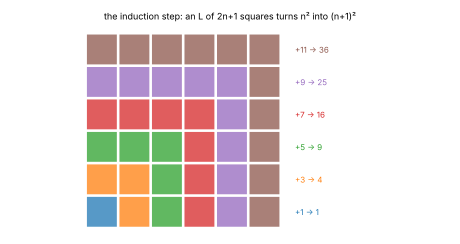
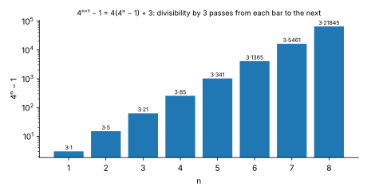
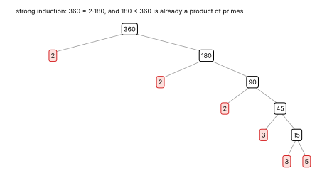
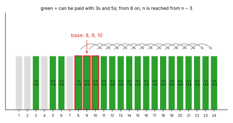
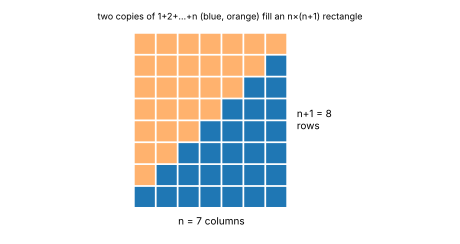
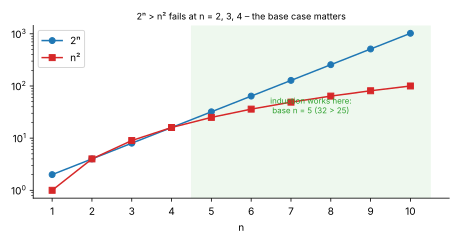
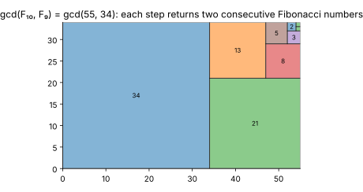
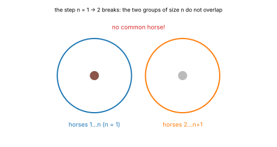

# שיעור P2: אינדוקציה, אינדוקציה שלמה ועקרון הסדר הטוב

**מה נלמד:** איך מוכיחים טענה לכל המספרים הטבעיים בבת אחת: בסיס וצעד. נכיר גם אינדוקציה שלמה (שבה מותר להשתמש בכל המקרים הקודמים), ונראה מה קורה כשהבסיס חסר או שהצעד שבור.

**ידע קודם:** [שיעור P1](P01-הוכחה-ישירה-וחלוקה-למקרים.md).

---

## 1. העיקרון

רוצים להוכיח טענה $`T(n)`$ לכל $`n \ge n_0`$. מספיק להוכיח שני דברים:

1. **בסיס:** $`T(n_0)`$ נכונה.
2. **צעד:** לכל $`n \ge n_0`$, **אם** $`T(n)`$ נכונה (זו **הנחת האינדוקציה**), **אז** גם $`T(n+1)`$ נכונה.

התמונה המוכרת היא שורת אבני דומינו: הבסיס מפיל את הראשונה, והצעד מבטיח שכל אבן שנופלת מפילה את הבאה.

**למה זה עובד?** נניח שהטענה נכשלת לפחות פעם אחת. ל**כל** קבוצה לא ריקה של טבעיים יש איבר קטן ביותר (**עקרון הסדר הטוב**), ולכן יש $`m`$ קטן ביותר שעבורו $`T(m)`$ נכשלת. לפי הבסיס $`m > n_0`$, ולכן $`m - 1 \ge n_0`$ ו-$`T(m-1)`$ נכונה (כי $`m`$ הוא הכישלון הראשון). אבל אז לפי הצעד $`T(m)`$ נכונה – סתירה. בשיעורים [P7](P07-ירידה-אינסופית.md) ו-[P8](P08-עקרון-הקיצון.md) נשתמש בעקרון הזה ישירות.

**אינדוקציה שלמה (חזקה).** בצעד מותר להניח את $`T(n_0), T(n_0+1), \dots, T(n)`$ **כולן**, ולא רק את $`T(n)`$. זה שימושי כשהמקרה $`n+1`$ נשען על מקרה רחוק יותר מהקודם, למשל על $`(n+1)/2`$.

---

## 2. דוגמאות פתורות

### דוגמה 1: סכום האי-זוגיים הראשונים

**טענה.** $`1 + 3 + 5 + \dots + (2n-1) = n^2`$ לכל $`n \ge 1`$.



<sub>צעד האינדוקציה בתמונה: צורת L של 2n+1 משבצות הופכת ריבוע n×n לריבוע (n+1)×(n+1).</sub>

**הוכחה.**
* **בסיס, $`n = 1`$:** אגף שמאל הוא 1, אגף ימין $`1^2 = 1`$. ✓
* **הנחת האינדוקציה:** $`1 + 3 + \dots + (2n-1) = n^2`$ עבור $`n`$ מסוים.
* **צעד:** צריך להראות ש-$`1 + 3 + \dots + (2n-1) + (2n+1) = (n+1)^2`$. נחליף את כל האיברים חוץ מהאחרון לפי ההנחה:
```math
\underbrace{1 + 3 + \dots + (2n-1)}_{=\,n^2} + (2n+1) = n^2 + 2n + 1 = (n+1)^2 .
```
∎

### דוגמה 2: $`3 \mid 4^n - 1`$

**טענה.** לכל $`n \ge 0`$, המספר $`4^n - 1`$ מתחלק ב-3.



<sub>הקשר 4ⁿ⁺¹ − 1 = 4(4ⁿ − 1) + 3 מעביר את ההתחלקות ב-3 מכל עמודה לבאה.</sub>

**הוכחה.**
* **בסיס, $`n = 0`$:** $`4^0 - 1 = 0`$, ו-$`3 \mid 0`$. ✓
* **צעד:** הטריק הוא לכתוב את המקרה החדש **בעזרת** הישן:
```math
4^{n+1} - 1 = 4 \cdot 4^n - 4 + 3 = 4(4^n - 1) + 3 .
```
לפי ההנחה $`3 \mid 4^n - 1`$, וגם $`3 \mid 3`$. לכן 3 מחלק את הסכום (תרגיל 1 בשיעור P1). ∎

**דרך ישירה, להשוואה:** $`4 \equiv 1 \pmod 3`$ ולכן $`4^n \equiv 1`$. אינדוקציה אינה הדרך היחידה, אבל היא עובדת גם כשאין קיצור כזה.

### דוגמה 3 (אינדוקציה שלמה): כל מספר הוא מכפלה של ראשוניים

**טענה.** כל $`n \ge 2`$ הוא ראשוני או מכפלה של ראשוניים.



<sub>360 = 2·180, ו-180 קטן מ-360, ולכן כבר ידוע שהוא מכפלה של ראשוניים.</sub>

**הוכחה.**
* **בסיס, $`n = 2`$:** 2 ראשוני. ✓
* **צעד (שלם):** נניח שהטענה נכונה **לכל** $`m`$ עם $`2 \le m \le n`$, ונוכיח אותה ל-$`n+1`$.
  * אם $`n+1`$ ראשוני, סיימנו.
  * אחרת $`n + 1 = ab`$ עם $`2 \le a, b \le n`$. לפי ההנחה, גם $`a`$ וגם $`b`$ הם מכפלות של ראשוניים, ולכן גם $`ab`$.

כאן אינדוקציה רגילה לא הייתה מספיקה: $`a`$ ו-$`b`$ אינם בהכרח $`n`$; הם יכולים להיות כל מספר קטן יותר. ∎

### דוגמה 4: כל סכום מ-8 ומעלה אפשר לשלם במטבעות של 3 ו-5

**טענה.** לכל $`n \ge 8`$ יש טבעיים $`a, b \ge 0`$ כך ש-$`n = 3a + 5b`$.



<sub>ירוק – סכום שאפשר לשלם. מ-8 והלאה כל n מתקבל מ-n − 3 בתוספת מטבע אחד של 3.</sub>

**הוכחה (אינדוקציה עם שלושה בסיסים).**
* **בסיס:** $`8 = 3 + 5`$, $`9 = 3 \cdot 3`$, $`10 = 5 + 5`$. ✓
* **צעד:** לכל $`n \ge 11`$, $`n - 3 \ge 8`$ ולכן לפי ההנחה $`n - 3 = 3a + 5b`$. אז $`n = 3(a+1) + 5b`$. ∎

**למה צריך שלושה בסיסים?** הצעד קופץ ב-3. בסיס אחד (8) היה מכסה רק את $`8, 11, 14, \dots`$. שלושה בסיסים עוקבים מכסים את שלוש השאריות מודולו 3. (ובאמת 7 אי אפשר לשלם, כפי שרואים בתמונה.)

---

## 3. תרגילים

**תרגיל 1.** הוכיחו באינדוקציה: $`1 + 2 + \dots + n = \frac{n(n+1)}{2}`$.



<sub>שני עותקים של 1+2+…+n ממלאים מלבן n×(n+1).</sub>

<details><summary>פתרון</summary>

**בסיס:** $`n = 1`$: $`1 = \frac{1 \cdot 2}{2}`$. ✓
**צעד:** $`1 + \dots + n + (n+1) = \frac{n(n+1)}{2} + (n+1) = (n+1)\left(\frac n2 + 1\right) = \frac{(n+1)(n+2)}{2}`$. זו בדיוק הנוסחה עם $`n+1`$ במקום $`n`$.
</details>

**תרגיל 2.** הוכיחו ש-$`2^n > n^2`$ לכל $`n \ge 5`$. מדוע אי אפשר להתחיל מ-$`n = 1`$?



<sub>2ⁿ > n² נכשל ב-n = 2, 3, 4; מ-5 והלאה האינדוקציה עובדת.</sub>

<details><summary>פתרון</summary>

**בסיס:** $`2^5 = 32 > 25`$. ✓
**צעד:** נניח $`2^n > n^2`$ עבור $`n \ge 5`$. אז $`2^{n+1} = 2 \cdot 2^n > 2n^2`$. נותר להראות $`2n^2 \ge (n+1)^2`$, כלומר $`n^2 - 2n - 1 \ge 0`$, כלומר $`(n-1)^2 \ge 2`$, שנכון לכל $`n \ge 3`$. לכן $`2^{n+1} > (n+1)^2`$.
**הבסיס חשוב:** $`2^2 = 4 = 2^2`$, $`2^3 = 8 \lt 9`$, $`2^4 = 16 = 4^2`$. הטענה **שגויה** עבור 2, 3, 4, אף שהצעד עצמו תקין מ-3 והלאה.
</details>

**תרגיל 3.** סדרת פיבונאצ'י: $`F_1 = F_2 = 1`$, $`F_{n+2} = F_{n+1} + F_n`$. הוכיחו ש-$`\gcd(F_n, F_{n+1}) = 1`$ לכל $`n`$.



<sub>אלגוריתם אוקלידס על 55 ו-34: כל שלב מחזיר זוג של מספרי פיבונאצ'י עוקבים.</sub>

<details><summary>פתרון</summary>

**בסיס:** $`\gcd(F_1, F_2) = \gcd(1, 1) = 1`$. ✓
**צעד:** $`\gcd(F_{n+1}, F_{n+2}) = \gcd(F_{n+1}, F_{n+1} + F_n) = \gcd(F_{n+1}, F_n)`$, כי מחלק משותף של שני מספרים מחלק גם את ההפרש שלהם ולהפך. לפי ההנחה זה 1.
</details>

**תרגיל 4 (מצאו את הטעות).** "**טענה:** כל הסוסים באותו צבע. **הוכחה:** לקבוצה של סוס אחד, ברור. נניח שכל קבוצה של $`n`$ סוסים היא בצבע אחד, וניקח $`n+1`$ סוסים. הסוסים $`1, \dots, n`$ באותו צבע לפי ההנחה, וכך גם הסוסים $`2, \dots, n+1`$. לשתי הקבוצות יש סוסים משותפים, ולכן כולם באותו צבע." איפה השגיאה?



<sub>במעבר מ-1 ל-2 שתי הקבוצות אינן נחתכות, ולכן אין סוס שמקשר ביניהן.</sub>

<details><summary>פתרון</summary>

הצעד נכשל במעבר מ-$`n = 1`$ ל-$`n = 2`$: הקבוצה $`\{1\}`$ והקבוצה $`\{2\}`$ **זרות**, ואין סוס משותף שיעביר את הצבע. הצעד חייב לעבוד **לכל** $`n`$ החל מהבסיס; כאן הוא עובד רק מ-$`n \ge 2`$, ואילו ה"בסיס" $`n = 2`$ (שני סוסים באותו צבע) הוא בדיוק מה שלא הוכח.
</details>

---

## סיכום
* אינדוקציה = בסיס + צעד. בצעד כותבים את המקרה $`n+1`$ בעזרת המקרה $`n`$.
* אינדוקציה שלמה: מותר להשתמש בכל המקרים הקודמים.
* אם הצעד קופץ ב-$`k`$, צריך $`k`$ בסיסים עוקבים.
* אינדוקציה נשענת על עקרון הסדר הטוב: לכל קבוצה לא ריקה של טבעיים יש מינימום.

**השיעור הקודם:** [שיעור P1](P01-הוכחה-ישירה-וחלוקה-למקרים.md) · **השיעור הבא:** [שיעור P3: הוכחה בדרך השלילה](P03-הוכחה-בדרך-השלילה.md)

**להעמקה:** [אינדוקציה מתמטית](https://he.wikipedia.org/wiki/%D7%90%D7%99%D7%A0%D7%93%D7%95%D7%A7%D7%A6%D7%99%D7%94_%D7%9E%D7%AA%D7%9E%D7%98%D7%99%D7%AA) · [עקרון הסדר הטוב](https://he.wikipedia.org/wiki/%D7%A2%D7%A7%D7%A8%D7%95%D7%9F_%D7%94%D7%A1%D7%93%D7%A8_%D7%94%D7%98%D7%95%D7%91) · [סדרת פיבונאצ'י](https://he.wikipedia.org/wiki/%D7%A1%D7%93%D7%A8%D7%AA_%D7%A4%D7%99%D7%91%D7%95%D7%A0%D7%90%D7%A6%27%D7%99) · [פרדוקס הסוסים](https://he.wikipedia.org/wiki/%D7%A4%D7%A8%D7%93%D7%95%D7%A7%D7%A1_%D7%94%D7%A1%D7%95%D7%A1%D7%99%D7%9D) · [המשפט היסודי של האריתמטיקה](https://he.wikipedia.org/wiki/%D7%94%D7%9E%D7%A9%D7%A4%D7%98_%D7%94%D7%99%D7%A1%D7%95%D7%93%D7%99_%D7%A9%D7%9C_%D7%94%D7%90%D7%A8%D7%99%D7%AA%D7%9E%D7%98%D7%99%D7%A7%D7%94)

---
<sub>חלק מהקורס [שיטות הוכחה בתורת המספרים](../PROOFS.md). התוכן מופץ ברישיון [CC BY-SA 4.0](https://creativecommons.org/licenses/by-sa/4.0/).</sub>
