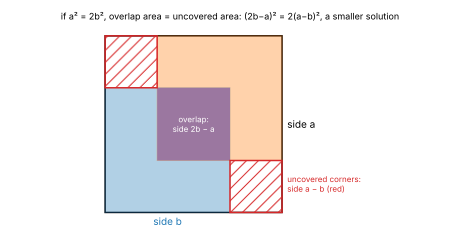
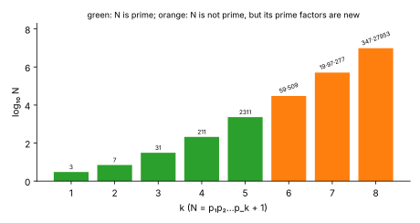
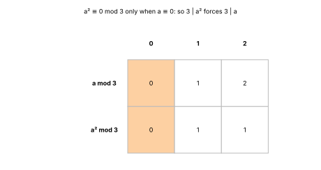
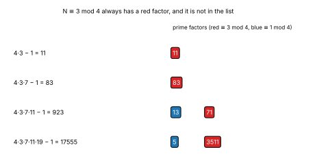
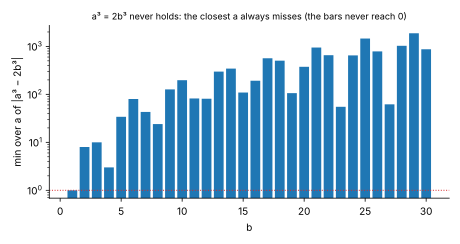
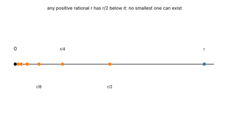

# שיעור P3: הוכחה בדרך השלילה

**מה נלמד:** איך מוכיחים שמשהו **אי אפשרי** או ש**אין סוף** למשהו: מניחים את ההפך ומגיעים לסתירה. נראה את שתי ההוכחות הקלאסיות: $`\sqrt 2`$ אינו רציונלי, ויש אינסוף ראשוניים.

**ידע קודם:** [שיעור P1](P01-הוכחה-ישירה-וחלוקה-למקרים.md); מספרים ראשוניים ([שיעור 3](03-מספרים-ראשוניים.md)).

---

## 1. העיקרון

כדי להוכיח טענה $`T`$:
1. **מניחים ש-$`T`$ שגויה.**
2. גוזרים מההנחה מסקנות, צעד אחר צעד.
3. מגיעים ל**סתירה**: לטענה וגם להפך שלה, או לדבר שידוע כשגוי (למשל $`1 = 0`$, או "מספר זוגי שהוא אי-זוגי").
4. מסיקים שההנחה שגויה, כלומר $`T`$ נכונה.

השיטה מתאימה במיוחד לטענות **שליליות** ("אין", "אינו", "אי אפשר"): קשה לעבוד ישירות עם "אין", אבל ההפך שלו, "יש", נותן לנו אובייקט קונקרטי לעבוד איתו. כך גם בטענות "יש אינסוף": ההפך, "יש רק מספר סופי", נותן לנו רשימה סופית להתבונן בה.

**כלל זהירות:** כתבו במפורש מה ההנחה השלילית, וסמנו היכן הסתירה.

---

## 2. דוגמאות פתורות

### דוגמה 1: $`\sqrt 2`$ אינו רציונלי

**טענה.** אין שלמים חיוביים $`a, b`$ כך ש-$`a^2 = 2b^2`$. (כלומר $`\sqrt 2 \ne a/b`$.)

**הוכחה.**
* **הנחה שלילית:** נניח שיש פתרון, $`\sqrt 2 = a/b`$. אפשר לצמצם את השבר, ולכן נניח ש-$`\gcd(a,b) = 1`$.
* **שלב 1:** $`a^2 = 2b^2`$, כלומר $`a^2`$ זוגי. ריבוע של אי-זוגי הוא אי-זוגי (שיעור P1), ולכן $`a`$ זוגי: $`a = 2c`$.
* **שלב 2:** נציב: $`4c^2 = 2b^2`$, כלומר $`b^2 = 2c^2`$. לכן גם $`b^2`$ זוגי, ו-$`b`$ זוגי.
* **סתירה:** $`a`$ ו-$`b`$ שניהם זוגיים, ולכן $`2 \mid \gcd(a,b)`$, בניגוד להנחה שהשבר מצומצם. ∎

**הוכחה גאומטרית (טננבאום).** הנה דרך לראות את אותו דבר בתמונה.

אם a² = 2b², שני ריבועים בצלע b בתוך ריבוע בצלע a: שטח החפיפה (סגול) שווה לשטח שלא כוסה (שתי פינות אדומות).

נניח ש-$`a^2 = 2b^2`$ עם $`a`$ **הקטן ביותר האפשרי**. נצייר שני ריבועים בצלע $`b`$ בפינות מנוגדות של ריבוע בצלע $`a`$. סכום שטחיהם $`2b^2 = a^2`$, ולכן השטח שכוסה פעמיים (ריבוע בצלע $`2b - a`$) שווה לשטח שלא כוסה (שני ריבועים בצלע $`a - b`$): $`(2b-a)^2 = 2(a-b)^2`$. זה פתרון חדש בשלמים, עם $`2b - a \lt a`$ – סתירה למינימליות. (זו גם הצצה ל[ירידה אינסופית](P07-ירידה-אינסופית.md).)

### דוגמה 2: יש אינסוף ראשוניים (אוקלידס)

**טענה.** קבוצת הראשוניים אינסופית.

N = p₁⋯p_k + 1 אינו תמיד ראשוני (כתום), אבל הגורמים הראשוניים שלו תמיד חדשים.

**הוכחה.**
* **הנחה שלילית:** יש רק מספר סופי של ראשוניים: $`p_1, p_2, \dots, p_k`$.
* **בנייה:** נגדיר $`N = p_1 p_2 \cdots p_k + 1`$. מתקיים $`N \ge 3`$, ולכן ל-$`N`$ יש גורם ראשוני $`q`$ ([שיעור 3](03-מספרים-ראשוניים.md)).
* לפי ההנחה, $`q`$ הוא אחד מ-$`p_1, \dots, p_k`$, ולכן $`q \mid p_1 \cdots p_k`$.
* אז $`q`$ מחלק גם את ההפרש $`N - p_1 \cdots p_k = 1`$.
* **סתירה:** אין ראשוני שמחלק את 1. ∎

> **טעות נפוצה:** ההוכחה **לא** אומרת ש-$`N`$ ראשוני. למשל $`2\cdot3\cdot5\cdot7\cdot11\cdot13 + 1 = 30031 = 59 \cdot 509`$. היא אומרת רק שלגורמים הראשוניים של $`N`$ אין מקום ברשימה.

---

## 3. תרגילים

**תרגיל 1.** הוכיחו ש-$`\sqrt 3`$ אינו רציונלי.

a² ≡ 0 (mod 3) רק כאשר a ≡ 0, ולכן 3 | a² גורר 3 | a.

פתרון

נניח $`a^2 = 3b^2`$ עם $`\gcd(a,b) = 1`$. אז $`3 \mid a^2`$. לפי הטבלה, אם $`a \not\equiv 0 \pmod 3`$ אז $`a^2 \equiv 1`$, ולכן $`3 \mid a`$: $`a = 3c`$. נציב: $`9c^2 = 3b^2`$, כלומר $`b^2 = 3c^2`$, ולכן גם $`3 \mid b`$. סתירה ל-$`\gcd(a,b) = 1`$.

**תרגיל 2.** הוכיחו שיש אינסוף ראשוניים מהצורה $`4k + 3`$. **רמז:** הניחו שהם $`p_1, \dots, p_k`$, והתבוננו ב-$`N = 4p_1 \cdots p_k - 1`$.

N ≡ 3 (mod 4) תמיד, ותמיד יש לו גורם אדום (≡ 3 mod 4) שאינו ברשימה.

פתרון

* $`N \equiv -1 \equiv 3 \pmod 4`$, ו-$`N`$ אי-זוגי.
* כל הגורמים הראשוניים של $`N`$ אי-זוגיים, כלומר $`\equiv 1`$ או $`3 \pmod 4`$. אם כולם היו $`\equiv 1`$, גם המכפלה שלהם $`N`$ הייתה $`\equiv 1`$. לכן יש ל-$`N`$ גורם ראשוני $`q \equiv 3 \pmod 4`$.
* לפי ההנחה $`q`$ הוא אחד מ-$`p_i`$, ולכן $`q \mid 4p_1\cdots p_k`$, ומכאן $`q \mid 4p_1 \cdots p_k - N = 1`$. סתירה.

(למה לא $`p_1 \cdots p_k + 1`$? כי ייתכן שכל הגורמים שלו הם $`\equiv 1 \pmod 4`$, ואז אין סתירה. הבחירה של $`N`$ נועדה **לכפות** גורם מהסוג הנכון.)

**תרגיל 3.** הוכיחו ש-$`\sqrt[3]{2}`$ אינו רציונלי.

לכל b, ה-a הקרוב ביותר עדיין מחטיא: a³ − 2b³ אף פעם אינו 0.

פתרון

נניח $`a^3 = 2b^3`$ עם $`\gcd(a,b) = 1`$. אז $`a^3`$ זוגי, ולכן $`a`$ זוגי (קובייה של אי-זוגי היא אי-זוגית): $`a = 2c`$. אז $`8c^3 = 2b^3`$, כלומר $`b^3 = 4c^3`$, ולכן $`b`$ זוגי. סתירה.

**תרגיל 4.** הוכיחו שאין מספר רציונלי חיובי קטן ביותר.

לכל רציונלי חיובי r יש את r/2 מתחתיו.

פתרון

נניח ש-$`r`$ הוא הרציונלי החיובי הקטן ביותר. אז $`r/2`$ רציונלי, חיובי, וקטן מ-$`r`$. סתירה. (השוו לעקרון הסדר הטוב בשיעור P2: בטבעיים **יש** קטן ביותר, ובזה בדיוק הם שונים מהרציונליים.)

---

## סיכום
* בדרך השלילה: מניחים את ההפך, מגיעים לסתירה.
* מתאים לטענות "אין" ו"יש אינסוף": ההפך נותן אובייקט קונקרטי או רשימה סופית.
* לעיתים קרובות הסתירה היא עם **מינימליות** או עם **צמצום** – רעיון שנפתח בשיעורים P7 ו-P8.

**השיעור הקודם:** [שיעור P2](P02-אינדוקציה.md) · **השיעור הבא:** [שיעור P4: העברה לניגוד](P04-העברה-לניגוד.md)

**להעמקה:** [הוכחה בדרך השלילה](https://he.wikipedia.org/wiki/%D7%94%D7%95%D7%9B%D7%97%D7%94_%D7%91%D7%93%D7%A8%D7%9A_%D7%94%D7%A9%D7%9C%D7%99%D7%9C%D7%94) · [השורש הריבועי של 2](https://he.wikipedia.org/wiki/%D7%94%D7%A9%D7%95%D7%A8%D7%A9_%D7%94%D7%A8%D7%99%D7%91%D7%95%D7%A2%D7%99_%D7%A9%D7%9C_2) · [מספר אי-רציונלי](https://he.wikipedia.org/wiki/%D7%9E%D7%A1%D7%A4%D7%A8_%D7%90%D7%99-%D7%A8%D7%A6%D7%99%D7%95%D7%A0%D7%9C%D7%99) · [שיעור 3 בקורס הראשי](03-מספרים-ראשוניים.md)

---
חלק מהקורס [שיטות הוכחה בתורת המספרים](../PROOFS.md). התוכן מופץ ברישיון [CC BY-SA 4.0](https://creativecommons.org/licenses/by-sa/4.0/).
