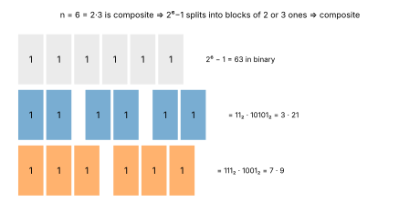
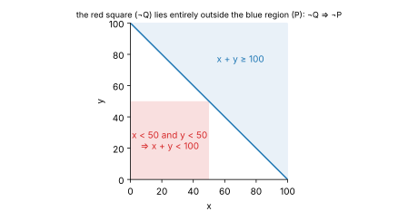
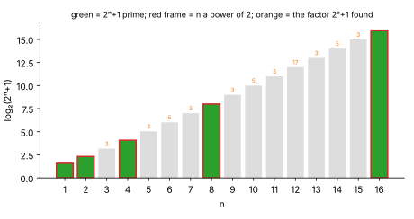
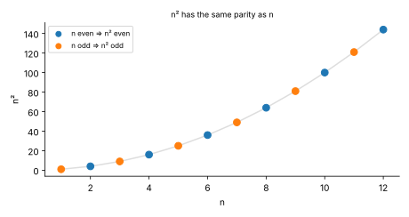
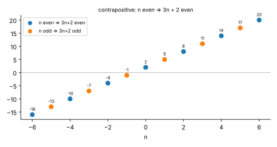
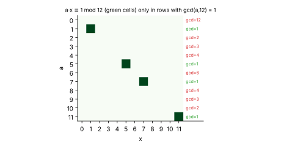
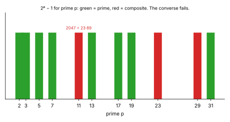

# שיעור P4: העברה לניגוד (קונטרה-פוזיטיב)

**מה נלמד:** הטענה "אם $`P`$ אז $`Q`$" שקולה לטענה "אם לא $`Q`$ אז לא $`P`$". לפעמים הכיוון השני קל הרבה יותר להוכחה. נלמד גם להבדיל בין העברה לניגוד לבין **הטענה ההפוכה**, שאינה שקולה.

**ידע קודם:** שיעורים [P1](P01-הוכחה-ישירה-וחלוקה-למקרים.md) ו-[P3](P03-הוכחה-בדרך-השלילה.md).

---

## 1. העיקרון

ארבע טענות קשורות:

| שם | צורה | שקולה למקורית? |
|---|---|---|
| המקורית | אם $`P`$ אז $`Q`$ | — |
| העברה לניגוד | אם לא $`Q`$ אז לא $`P`$ | **כן** |
| ההפוכה | אם $`Q`$ אז $`P`$ | לא |
| ההופכית | אם לא $`P`$ אז לא $`Q`$ | לא (שקולה להפוכה) |

**למה העברה לניגוד שקולה?** "אם $`P`$ אז $`Q`$" אומרת שאין מצב שבו $`P`$ נכונה ו-$`Q`$ שגויה. "אם לא $`Q`$ אז לא $`P`$" אומרת בדיוק את אותו דבר.

**מתי להשתמש?** כאשר $`P`$ הוא תנאי "חלש" שקשה לעבוד איתו (למשל "$`n^2`$ זוגי" או "$`2^n - 1`$ ראשוני"), ואילו "לא $`Q`$" נותן מבנה קונקרטי (למשל "$`n`$ אי-זוגי", כלומר $`n = 2k+1`$, או "$`n`$ פריק", כלומר $`n = ab`$).

**ההבדל מדרך השלילה:** בהעברה לניגוד מוכיחים ישירות את "לא $`Q`$ ⇒ לא $`P`$", בלי לחפש סתירה. הרבה הוכחות "בשלילה" הן בעצם העברות לניגוד, וכדאי לכתוב אותן כך: הן קצרות וברורות יותר.

---

## 2. דוגמאות פתורות

### דוגמה 1: אם $`2^n - 1`$ ראשוני, אז $`n`$ ראשוני

n = 6 פריק, ולכן 2⁶ − 1 = 111111 בבינארי מתפרק לבלוקים של 2 או של 3 אחדות.

**ניסיון ישיר:** מניחים ש-$`2^n - 1`$ ראשוני... ואין לנו מה לעשות עם זה.

**העברה לניגוד:** נוכיח **אם $`n`$ פריק, אז $`2^n - 1`$ פריק**.
* נניח $`n = ab`$ עם $`1 \lt a, b \lt n`$. נסמן $`x = 2^a`$, ואז $`2^n = x^b`$.
* לפי נוסחת הסדרה ההנדסית, $`x^b - 1 = (x - 1)(x^{b-1} + x^{b-2} + \dots + x + 1)`$.
* הגורם הראשון $`2^a - 1`$ גדול מ-1 (כי $`a \ge 2`$) וקטן מ-$`2^n - 1`$ (כי $`a \lt n`$). לכן $`2^n - 1`$ פריק. ∎

**בבינארי:** $`2^n - 1`$ הוא $`n`$ אחדות. אם $`n = ab`$, אפשר לחלק אותן ל-$`b`$ בלוקים של $`a`$ אחדות, וזה בדיוק הפירוק.

### דוגמה 2: אם $`x + y \ge 100`$ אז $`x \ge 50`$ או $`y \ge 50`$

הריבוע האדום (לא Q) נמצא כולו מחוץ לאזור הכחול (P).

**העברה לניגוד:** "לא ($`x \ge 50`$ או $`y \ge 50`$)" פירושו "$`x \lt 50`$ **וגם** $`y \lt 50`$". אז $`x + y \lt 100`$, כלומר לא $`P`$. ∎

**שימו לב:** השלילה של "או" היא "וגם" (חוקי דה מורגן). זה המקום שבו טועים הכי הרבה.

### דוגמה 3: אם $`2^n + 1`$ ראשוני, אז $`n`$ חזקה של 2

ירוק – 2ⁿ + 1 ראשוני; מסגרת אדומה – n חזקה של 2; בכתום – הגורם 2ᵃ + 1 שנמצא.

**העברה לניגוד:** נוכיח **אם $`n`$ אינו חזקה של 2, אז $`2^n + 1`$ פריק**.
* אם $`n`$ אינו חזקה של 2, יש לו גורם אי-זוגי $`b \ge 3`$: $`n = ab`$.
* נסמן $`x = 2^a`$. עבור $`b`$ אי-זוגי מתקיים $`x^b + 1 = (x + 1)(x^{b-1} - x^{b-2} + \dots - x + 1)`$. (בדיקה: הצבת $`x = -1`$ באגף שמאל נותנת $`-1 + 1 = 0`$, ולכן $`x + 1`$ גורם.)
* $`1 \lt 2^a + 1 \lt 2^n + 1`$, ולכן $`2^n + 1`$ פריק. ∎

למשל $`n = 12 = 4 \cdot 3`$: $`2^{12} + 1 = 4097 = 17 \cdot 241`$, ו-$`17 = 2^4 + 1`$. מכאן ש[מספרי פרמה](https://he.wikipedia.org/wiki/%D7%9E%D7%A1%D7%A4%D7%A8_%D7%A4%D7%A8%D7%9E%D7%94) הם המועמדים היחידים לראשוניים מהצורה $`2^n + 1`$.

---

## 3. תרגילים

**תרגיל 1.** הוכיחו: אם $`n^2`$ זוגי, אז $`n`$ זוגי.

n² שומר על הזוגיות של n.

פתרון

**העברה לניגוד:** אם $`n`$ אי-זוגי, $`n = 2k+1`$, אז $`n^2 = 4k^2 + 4k + 1 = 2(2k^2 + 2k) + 1`$, אי-זוגי. (בשיעור P3 השתמשנו בטענה הזו בדיוק.)

**תרגיל 2.** הוכיחו: אם $`3n + 2`$ אי-זוגי, אז $`n`$ אי-זוגי.

n זוגי ⇒ 3n + 2 זוגי.

פתרון

**העברה לניגוד:** אם $`n`$ זוגי, $`n = 2k`$, אז $`3n + 2 = 6k + 2 = 2(3k + 1)`$, זוגי.

**תרגיל 3.** הוכיחו: אם ל-$`a`$ יש הופכי מודולו $`n`$ (כלומר יש $`x`$ כך ש-$`ax \equiv 1 \pmod n`$), אז $`\gcd(a, n) = 1`$.

ax ≡ 1 (mod 12) (משבצות ירוקות) רק בשורות שבהן gcd(a, 12) = 1.

פתרון

**העברה לניגוד:** נניח $`d = \gcd(a, n) \gt 1`$. לכל $`x`$, $`d \mid ax`$ וגם $`d \mid n`$. אם היה $`ax = 1 + tn`$, אז $`d \mid ax - tn = 1`$, בלתי אפשרי. לכן ל-$`a`$ אין הופכי. (ראו [שיעור 4](04-חשבון-מודולרי.md) לכיוון השני.)

**תרגיל 4.** האם **ההפוכה** של דוגמה 1 נכונה: אם $`p`$ ראשוני, האם $`2^p - 1`$ ראשוני?

2ᵖ − 1 עבור p ראשוני: ירוק – ראשוני, אדום – פריק. ההפוכה אינה נכונה.

פתרון

לא. $`2^{11} - 1 = 2047 = 23 \cdot 89`$. זו דוגמה לכך שטענה והפוכתה אינן שקולות: דוגמה 1 אומרת שראשוניות של $`n`$ **הכרחית** לראשוניות של $`2^n - 1`$, אבל לא **מספיקה**. ראשוניים מהצורה $`2^p - 1`$ נקראים [ראשוני מרסן](https://he.wikipedia.org/wiki/%D7%9E%D7%A1%D7%A4%D7%A8_%D7%9E%D7%A8%D7%A1%D7%9F).

---

## סיכום
* "אם $`P`$ אז $`Q`$" ≡ "אם לא $`Q`$ אז לא $`P`$". משתמשים בזה כאשר "לא $`Q`$" נותן מבנה (למשל $`n = ab`$).
* ההפוכה ("אם $`Q`$ אז $`P`$") **אינה** שקולה; כדי להפריך אותה מספיקה דוגמה נגדית אחת.
* בשלילה של "או" ו"וגם" מחליפים אחד בשני.

**השיעור הקודם:** [שיעור P3](P03-הוכחה-בדרך-השלילה.md) · **השיעור הבא:** [שיעור P5: עקרון שובך היונים](P05-שובך-היונים.md)

**להעמקה:** [קונטרה פוזיטיב](https://he.wikipedia.org/wiki/%D7%A7%D7%95%D7%A0%D7%98%D7%A8%D7%94_%D7%A4%D7%95%D7%96%D7%99%D7%98%D7%99%D7%91) · [מספר מרסן](https://he.wikipedia.org/wiki/%D7%9E%D7%A1%D7%A4%D7%A8_%D7%9E%D7%A8%D7%A1%D7%9F) · [מספר פרמה](https://he.wikipedia.org/wiki/%D7%9E%D7%A1%D7%A4%D7%A8_%D7%A4%D7%A8%D7%9E%D7%94) · [שיעור 3 בקורס הראשי](03-מספרים-ראשוניים.md)

---
חלק מהקורס [שיטות הוכחה בתורת המספרים](../PROOFS.md). התוכן מופץ ברישיון [CC BY-SA 4.0](https://creativecommons.org/licenses/by-sa/4.0/).
