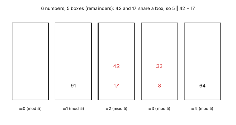
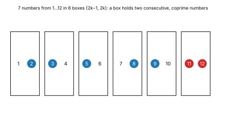
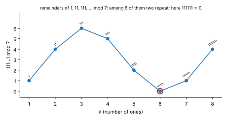
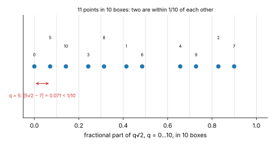
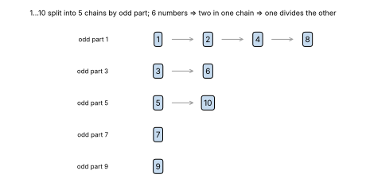
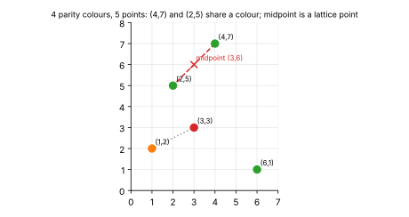
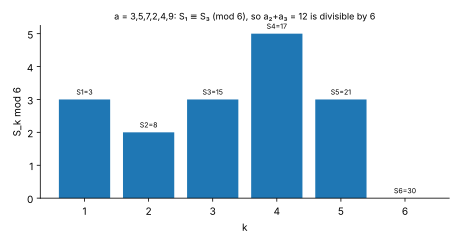
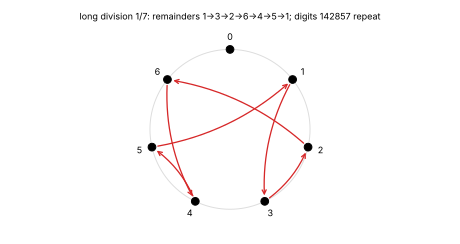

# שיעור P5: עקרון שובך היונים

**מה נלמד:** אם מכניסים יותר מ-$`n`$ עצמים ל-$`n`$ תאים, באחד התאים יש לפחות שני עצמים. העיקרון פשוט מאוד, והקושי הוא תמיד אחד: **מה הם התאים?** נראה כמה בחירות טיפוסיות: שאריות, זוגות, ושברים.

**ידע קודם:** [שיעור P1](P01-הוכחה-ישירה-וחלוקה-למקרים.md); שאריות ([שיעור 4](04-חשבון-מודולרי.md)).

---

## 1. העיקרון

**עקרון שובך היונים.** אם $`n + 1`$ יונים נכנסות ל-$`n`$ שובכים, יש שובך עם לפחות שתי יונים.

**הוכחה (בדרך השלילה):** אם בכל שובך יש לכל היותר יונה אחת, יש לכל היותר $`n`$ יונים. סתירה.

**הגרסה הכללית:** אם $`N`$ יונים נכנסות ל-$`n`$ שובכים, יש שובך עם לפחות $`\lceil N/n \rceil`$ יונים.

**איך משתמשים בזה:**
1. מזהים מה צריך להוכיח: בדרך כלל "יש **שניים** עם תכונה משותפת".
2. בוחרים **שובכים** כך ששני עצמים באותו שובך נותנים את מה שרוצים.
3. סופרים: יותר עצמים משובכים.

ההוכחה **אינה מראה איזה** זוג מקיים את הטענה, אלא רק **שיש** כזה. זו הוכחת קיום לא קונסטרוקטיבית (ראו [שיעור P9](P09-בנייה-ודוגמאות-נגדיות.md)).

---

## 2. דוגמאות פתורות

### דוגמה 1: הפרש שמתחלק ב-$`n`$

**טענה.** בין כל $`n + 1`$ שלמים יש שניים שההפרש שלהם מתחלק ב-$`n`$.

6 מספרים ב-5 תאים (שאריות מודולו 5): 42 ו-17 באותו תא, ולכן 5 | 42 − 17.

**הוכחה.**
* **שובכים:** $`n`$ השאריות האפשריות בחלוקה ב-$`n`$: $`0, 1, \dots, n-1`$.
* **יונים:** $`n + 1`$ המספרים; כל מספר נכנס לשובך של השארית שלו.
* לפי העיקרון יש שני מספרים $`a, b`$ עם אותה שארית $`r`$: $`a = qn + r`$, $`b = q'n + r`$. אז $`a - b = (q - q')n`$. ∎

### דוגמה 2: שני מספרים זרים

**טענה.** אם בוחרים $`n + 1`$ מספרים מתוך $`\{1, 2, \dots, 2n\}`$, יש ביניהם שניים זרים.

7 מספרים מתוך 1…12 ב-6 תאים מהצורה {2k−1, 2k}: באחד התאים יש שני מספרים עוקבים.

**הוכחה.**
* **שובכים:** $`n`$ הזוגות $`\{1,2\}, \{3,4\}, \dots, \{2n-1, 2n\}`$.
* $`n + 1`$ מספרים ב-$`n`$ זוגות: באחד הזוגות נבחרו שני המספרים, $`2k - 1`$ ו-$`2k`$.
* **מספרים עוקבים תמיד זרים:** אם $`d`$ מחלק את שניהם, הוא מחלק את ההפרש 1. ∎

**למה $`n + 1`$?** עם $`n`$ מספרים זה לא נכון: $`\{2, 4, \dots, 2n\}`$ – כל הזוגיים – ואין שניים זרים.

### דוגמה 3: כפולה שכתובה באחדות ובאפסים

**טענה.** לכל $`n \ge 1`$ יש כפולה של $`n`$ שספרותיה רק 0 ו-1.

השאריות של 1, 11, 111, … מודולו 7: בין 8 מהן שתיים חוזרות; כאן 111111 ≡ 0.

**הוכחה.**
* **יונים:** $`n + 1`$ המספרים $`R_1 = 1,\ R_2 = 11,\ \dots,\ R_{n+1} = \underbrace{11\dots1}_{n+1}`$.
* **שובכים:** $`n`$ השאריות מודולו $`n`$.
* יש $`i \lt j`$ עם $`R_i \equiv R_j \pmod n`$. אז $`n \mid R_j - R_i = \underbrace{1\dots1}_{j-i}\underbrace{0\dots0}_{i}`$. ∎

**דוגמה מספרית, $`n = 7`$:** השאריות הן $`1, 4, 6, 5, 2, 0, \dots`$, ו-$`R_6 = 111111 = 7 \cdot 15873`$.

### דוגמה 4: קירוב של מספר אי-רציונלי (משפט דיריכלה)

**טענה.** לכל ממשי $`\alpha`$ ולכל $`N \ge 1`$ יש שלמים $`p`$ ו-$`1 \le q \le N`$ כך ש-$`|q\alpha - p| \lt 1/N`$.

11 נקודות ב-10 תאים: שתיים מהן במרחק קטן מ-1/10.

**הוכחה.**
* **יונים:** $`N + 1`$ החלקים השבורים $`\{0\cdot\alpha\}, \{1 \cdot \alpha\}, \dots, \{N\alpha\}`$, כולם ב-$`[0, 1)`$.
* **שובכים:** $`N`$ הקטעים $`[0, \tfrac1N), [\tfrac1N, \tfrac2N), \dots, [\tfrac{N-1}N, 1)`$.
* שני חלקים שבורים $`\{i\alpha\}, \{j\alpha\}`$ עם $`i \lt j`$ נמצאים באותו קטע, ולכן $`|\{j\alpha\} - \{i\alpha\}| \lt 1/N`$.
* נסמן $`q = j - i`$. אז $`q\alpha = (j\alpha) - (i\alpha)`$, וההפרש בין $`q\alpha`$ לשלם $`\lfloor j\alpha \rfloor - \lfloor i\alpha \rfloor`$ קטן מ-$`1/N`$. ∎

**דוגמה:** $`\alpha = \sqrt2`$, $`N = 10`$: $`q = 5`$, $`p = 7`$, ו-$`|5\sqrt2 - 7| \approx 0.071 \lt 0.1`$. (ראו [קירוב דיופנטי](https://he.wikipedia.org/wiki/%D7%A7%D7%99%D7%A8%D7%95%D7%91_%D7%93%D7%99%D7%95%D7%A4%D7%A0%D7%98%D7%99).)

---

## 3. תרגילים

**תרגיל 1.** הוכיחו: בכל בחירה של $`n + 1`$ מספרים מתוך $`\{1, \dots, 2n\}`$ יש שניים שאחד מהם מחלק את השני.

המספרים 1…10 מתחלקים ל-5 שרשראות לפי החלק האי-זוגי; 6 מספרים ⇒ שניים באותה שרשרת ⇒ אחד מחלק את השני.

פתרון

כל מספר נכתב באופן יחיד כ-$`2^k m`$ עם $`m`$ אי-זוגי (ה"חלק האי-זוגי"). ב-$`\{1, \dots, 2n\}`$ יש $`n`$ חלקים אי-זוגיים אפשריים: $`1, 3, \dots, 2n-1`$. אלה השובכים. $`n + 1`$ מספרים ⇒ שניים עם אותו $`m`$: $`2^k m`$ ו-$`2^l m`$ עם $`k \lt l`$, והראשון מחלק את השני.

**תרגיל 2.** נתונות 5 נקודות במישור עם קואורדינטות שלמות. הוכיחו שיש שתיים שנקודת האמצע ביניהן היא בעלת קואורדינטות שלמות.

4 צבעים לפי זוגיות (x, y), 5 נקודות: (4,7) ו-(2,5) באותו צבע, ונקודת האמצע שלמה.

פתרון

נקודת האמצע היא $`\left(\frac{x_1 + x_2}2, \frac{y_1 + y_2}2\right)`$; היא שלמה בדיוק כאשר $`x_1, x_2`$ באותה זוגיות וגם $`y_1, y_2`$. **שובכים:** 4 צירופי הזוגיות (זוגי/אי-זוגי, זוגי/אי-זוגי). 5 נקודות ⇒ שתיים באותו צירוף.

**תרגיל 3.** נתונים $`n`$ שלמים $`a_1, \dots, a_n`$ (לא בהכרח שונים). הוכיחו שיש קבוצה לא ריקה שלהם שסכומה מתחלק ב-$`n`$, ואף רצף של איברים עוקבים.

a = 3,5,7,2,4,9: S₁ ≡ S₃ (mod 6), ולכן a₂ + a₃ = 12 מתחלק ב-6.

פתרון

נגדיר סכומים חלקיים $`S_k = a_1 + \dots + a_k`$ עבור $`k = 1, \dots, n`$.
* אם אחד מהם $`\equiv 0 \pmod n`$, סיימנו.
* אחרת, $`n`$ הסכומים נכנסים ל-$`n - 1`$ השאריות שאינן 0, ולכן יש $`i \lt j`$ עם $`S_i \equiv S_j`$. אז $`a_{i+1} + \dots + a_j = S_j - S_i \equiv 0`$.

(בדוגמה שבאיור גם $`S_6 = 30 \equiv 0`$, כך שגם הקבוצה כולה עובדת.)

**תרגיל 4.** הוכיחו שהפיתוח העשרוני של $`1/n`$ מחזורי, ושאורך המחזור לכל היותר $`n - 1`$.

חילוק ארוך של 1/7: השאריות 1→3→2→6→4→5→1, והספרות 142857 חוזרות.

פתרון

בחילוק ארוך, כל ספרה נקבעת על ידי השארית הנוכחית $`r`$: הספרה היא $`\lfloor 10r/n \rfloor`$ והשארית הבאה היא $`10r \bmod n`$. השאריות האפשריות הן $`0, 1, \dots, n-1`$. אם מופיעה שארית 0, הפיתוח נעצר (מחזור של אפסים). אחרת יש רק $`n - 1`$ שאריות, ולכן אחרי לכל היותר $`n - 1`$ צעדים שארית חוזרת, ומאותו רגע הכול חוזר. עבור $`n = 7`$ האורך הוא בדיוק 6.

---

## סיכום
* יותר יונים משובכים ⇒ שובך עם שתיים.
* כל הקושי: לבחור שובכים כך ש"שניים באותו שובך" נותן את המבוקש. בחירות נפוצות: שאריות, זוגות, קטעים, "חלק אי-זוגי".
* בעיות מספרים: סכומים חלקיים ושאריות שלהם הם טריק שחוזר הרבה.

**השיעור הקודם:** [שיעור P4](P04-העברה-לניגוד.md) · **השיעור הבא:** [שיעור P6: חסמים מודולריים](P06-חסמים-מודולריים.md)

**להעמקה:** [עקרון שובך היונים](https://he.wikipedia.org/wiki/%D7%A2%D7%A7%D7%A8%D7%95%D7%9F_%D7%A9%D7%95%D7%91%D7%9A_%D7%94%D7%99%D7%95%D7%A0%D7%99%D7%9D) · [קירוב דיופנטי](https://he.wikipedia.org/wiki/%D7%A7%D7%99%D7%A8%D7%95%D7%91_%D7%93%D7%99%D7%95%D7%A4%D7%A0%D7%98%D7%99) · [שיעור 4 בקורס הראשי](04-חשבון-מודולרי.md)

---
חלק מהקורס [שיטות הוכחה בתורת המספרים](../PROOFS.md). התוכן מופץ ברישיון [CC BY-SA 4.0](https://creativecommons.org/licenses/by-sa/4.0/).
