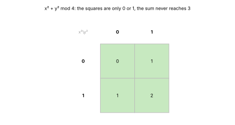
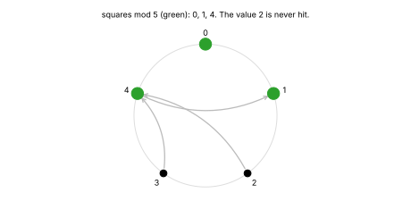
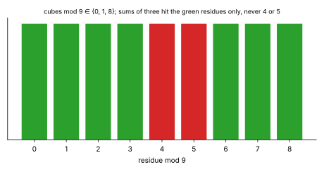
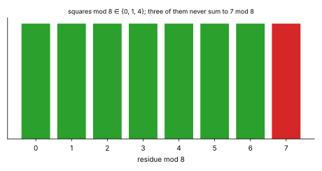
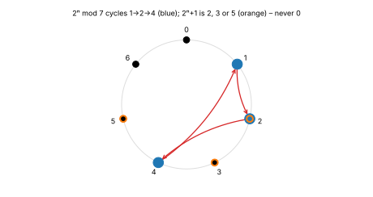
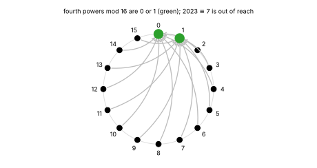
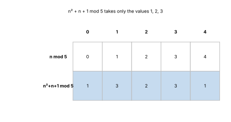
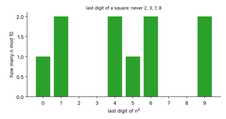

# שיעור P6: חסמים מודולריים – להוכיח שמשוואה אינה פתירה

**מה נלמד:** אם למשוואה יש פתרון בשלמים, יש לה פתרון גם מודולו כל מספר $`m`$. לכן, אם מוצאים $`m`$ שמודולו אליו אין פתרון, הוכחנו שאין פתרון בשלמים. זו אחת השיטות השימושיות ביותר בתורת המספרים.

**ידע קודם:** חשבון מודולרי ([שיעור 4](04-חשבון-מודולרי.md)); חלוקה למקרים ([שיעור P1](P01-הוכחה-ישירה-וחלוקה-למקרים.md)).

---

## 1. העיקרון

**הטענה הבסיסית.** אם $`F(x, y, \dots) = 0`$ בשלמים, אז $`F(x, y, \dots) \equiv 0 \pmod m`$ לכל $`m`$. זו העברה לניגוד ([שיעור P4](P04-העברה-לניגוד.md)):

> אין פתרון מודולו $`m`$ ⇒ אין פתרון בשלמים.

**המתכון:**
1. בוחרים מודולוס $`m`$. מועמדים טובים: 4 ו-8 (לריבועים), 3 ו-9 (לקוביות), 5, 7, 16, או מודולוס שמופיע במשוואה עצמה.
2. מחשבים את הערכים האפשריים של כל איבר מודולו $`m`$ – **מספר סופי של מקרים**.
3. בודקים שאף צירוף אינו נותן את התוצאה הנדרשת.

**למה הבחירה של $`m`$ חשובה?** ריבועים מקבלים מעט ערכים מודולו 4 ($`0, 1`$) ומודולו 8 ($`0, 1, 4`$); קוביות מקבלות מעט ערכים מודולו 9 ($`0, 1, 8`$); חזקות רביעיות מודולו 16 ($`0, 1`$). ככל שהאיברים מקבלים פחות ערכים, יותר קל לחסום.

**הגבלה חשובה:** השיטה עובדת רק בכיוון אחד. אם יש פתרון מודולו כל $`m`$, **אין זה אומר** שיש פתרון בשלמים. הדוגמה הקלאסית היא משוואת סלמר $`3x^3 + 4y^3 + 5z^3 = 0`$: יש לה פתרון לא טריוויאלי מודולו כל $`m`$, ואין לה פתרון לא טריוויאלי בשלמים. במקרים כאלה צריך כלים אחרים, כמו [ירידה אינסופית](P07-ירידה-אינסופית.md).

---

## 2. דוגמאות פתורות

### דוגמה 1: מספר מהצורה $`4k + 3`$ אינו סכום של שני ריבועים

x² + y² מודולו 4: הריבועים הם רק 0 או 1, והסכום לעולם אינו 3.

**הוכחה.**
* **ריבועים מודולו 4:** אם $`x = 2t`$, $`x^2 = 4t^2 \equiv 0`$. אם $`x = 2t + 1`$, $`x^2 = 4t^2 + 4t + 1 \equiv 1`$.
* **סכומים:** $`0 + 0 = 0`$, $`0 + 1 = 1`$, $`1 + 1 = 2`$. הערך 3 לא מתקבל.
* לכן $`x^2 + y^2 = 4k + 3`$ אינה פתירה. ∎

למשל 3, 7, 11, 15, 19, 23 אינם סכומים של שני ריבועים. (מי **כן** – ראו [שיעור 8](08-משוואות-דיופנטיות.md).)

### דוגמה 2: $`x^2 - 5y^2 = 2`$ אינה פתירה

ריבועים מודולו 5 (בירוק): 0, 1, 4. הערך 2 לא מתקבל.

**הבחירה של $`m`$:** המקדם 5 מציע לעבוד מודולו 5, כי אז האיבר $`5y^2`$ נעלם.

**הוכחה.** מודולו 5: $`x^2 \equiv 2`$. אבל $`0^2, 1^2, 2^2, 3^2, 4^2 \equiv 0, 1, 4, 4, 1`$. הערך 2 לא מופיע. ∎

### דוגמה 3: סכום של שלוש קוביות אינו $`\equiv 4, 5 \pmod 9`$

קוביות מודולו 9 הן 0, 1 או 8; סכומים של שלוש מגיעים רק לשאריות הירוקות, לעולם לא ל-4 או ל-5.

**הוכחה.**
* **קוביות מודולו 9:** לפי $`x \bmod 3`$: אם $`x = 3t`$, $`x^3 = 27t^3 \equiv 0`$. אם $`x = 3t \pm 1`$, $`x^3 = 27t^3 \pm 27t^2 + 9t \pm 1 \equiv \pm 1`$. כלומר קובייה היא $`0, 1`$ או $`-1 \equiv 8`$.
* **סכומים של שלוש:** כל סכום של שלושה מספרים מ-$`\{-1, 0, 1\}`$ הוא בין $`-3`$ ל-$`3`$, כלומר אחד מ-$`0, \pm1, \pm2, \pm3`$ מודולו 9. השאריות $`4`$ ו-$`5 \equiv -4`$ לא מתקבלות. ∎

לכן $`x^3 + y^3 + z^3 = 4`$ אינה פתירה. (על השאלה המפורסמת מה קורה ב-3, 33 ו-42 – ראו [סכומים של שלוש קוביות](https://he.wikipedia.org/wiki/%D7%A1%D7%9B%D7%95%D7%9D_%D7%A9%D7%9C_%D7%A9%D7%9C%D7%95%D7%A9_%D7%97%D7%96%D7%A7%D7%95%D7%AA_%D7%A9%D7%9C%D7%99%D7%A9%D7%99%D7%95%D7%AA).)

### דוגמה 4: מספר מהצורה $`8k + 7`$ אינו סכום של שלושה ריבועים

ריבועים מודולו 8 הם 0, 1 או 4; שלושה מהם לעולם אינם מסתכמים ל-7 מודולו 8.

**הוכחה.**
* **ריבועים מודולו 8:** זוגי: $`(2t)^2 = 4t^2 \equiv 0`$ או $`4`$. אי-זוגי: $`\equiv 1`$ (תרגיל 4 בשיעור P1).
* **סכום של שלושה מ-$`\{0, 1, 4\}`$:** כדי לקבל 7 צריך סכום אי-זוגי, כלומר מספר אי-זוגי של 1: או 1 אחד – $`1 + \{0,4\} + \{0,4\} \in \{1, 5\}`$ – או שלושה – $`1+1+1 = 3`$. אף פעם לא 7. ∎

זה החצי הקל של [משפט שלושת הריבועים של לז'נדר](../pages/משפט%20שלושת%20הריבועים%20של%20לז'נדר.md).

---

## 3. תרגילים

**תרגיל 1.** הוכיחו ש-$`2^n + 1`$ אינו מתחלק ב-7 לעולם.

2ⁿ מודולו 7 עובר במחזור 1→2→4 (כחול); 2ⁿ + 1 הוא 2, 3 או 5 (כתום) – לעולם לא 0.

פתרון

$`2^3 = 8 \equiv 1 \pmod 7`$, ולכן $`2^n \bmod 7`$ חוזר במחזור $`1, 2, 4`$. אז $`2^n + 1 \bmod 7 \in \{2, 3, 5\}`$, ואף פעם לא 0.

**תרגיל 2.** הוכיחו שאין שלמים עם $`x^4 + y^4 = 2023`$.

חזקות רביעיות מודולו 16 הן 0 או 1 (בירוק); 2023 ≡ 7 מחוץ להישג יד.

פתרון

* אם $`x`$ זוגי, $`x^4 = 16t^4 \equiv 0 \pmod{16}`$.
* אם $`x`$ אי-זוגי, $`x^2 = 8s + 1`$ (שיעור P1), ולכן $`x^4 = 64s^2 + 16s + 1 \equiv 1 \pmod{16}`$.
* $`x^4 + y^4 \bmod 16 \in \{0, 1, 2\}`$, אבל $`2023 = 16 \cdot 126 + 7 \equiv 7`$.

**תרגיל 3.** הוכיחו ש-$`n^2 + n + 1`$ אינו מתחלק ב-5 לעולם.

n² + n + 1 מודולו 5 מקבל רק את הערכים 1, 2, 3.

פתרון

לפי $`n \bmod 5`$: $`n = 0 \to 1`$; $`n = 1 \to 3`$; $`n = 2 \to 7 \equiv 2`$; $`n = 3 \to 13 \equiv 3`$; $`n = 4 \to 21 \equiv 1`$. הערך 0 לא מתקבל.

**תרגיל 4.** הוכיחו שריבוע לעולם אינו מסתיים בספרה 2, 3, 7 או 8. מה זה אומר על המספר 1234567?

הספרה האחרונה של ריבוע: לעולם לא 2, 3, 7, 8.

פתרון

הספרה האחרונה של $`n^2`$ היא $`n^2 \bmod 10`$, והיא תלויה רק ב-$`n \bmod 10`$: $`0,1,4,9,6,5,6,9,4,1`$. הספרות 2, 3, 7, 8 לא מופיעות. לכן 1234567 (מסתיים ב-7) אינו ריבוע, בלי לחשב שורש.

---

## סיכום
* פתרון בשלמים ⇒ פתרון מודולו כל $`m`$. לכן "אין פתרון מודולו $`m`$" ⇒ "אין פתרון".
* מודולוסים טובים: 4, 8, 16 לריבועים ולחזקות רביעיות; 9 לקוביות; מקדמים מהמשוואה עצמה.
* השיטה מוכיחה רק אי-פתירות; פתירות מודולו כל $`m`$ אינה מבטיחה פתרון.

**השיעור הקודם:** [שיעור P5](P05-שובך-היונים.md) · **השיעור הבא:** [שיעור P7: ירידה אינסופית](P07-ירידה-אינסופית.md)

**להעמקה:** [שארית ריבועית](https://he.wikipedia.org/wiki/%D7%A9%D7%90%D7%A8%D7%99%D7%AA_%D7%A8%D7%99%D7%91%D7%95%D7%A2%D7%99%D7%AA) · [משפט שלושת הריבועים של לז'נדר](../pages/משפט%20שלושת%20הריבועים%20של%20לז'נדר.md) · [משפט ארבעת הריבועים של לגראנז'](../pages/משפט%20ארבעת%20הריבועים%20של%20לגראנז'.md) · [שיעור 4 בקורס הראשי](04-חשבון-מודולרי.md)

---
חלק מהקורס [שיטות הוכחה בתורת המספרים](../PROOFS.md). התוכן מופץ ברישיון [CC BY-SA 4.0](https://creativecommons.org/licenses/by-sa/4.0/).
