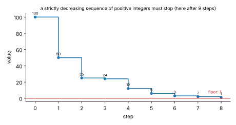
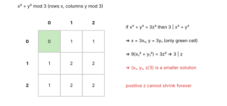
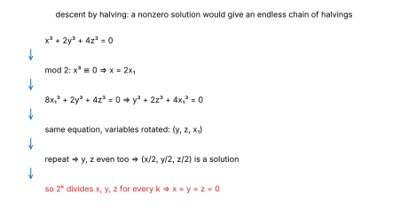
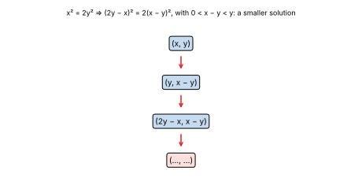
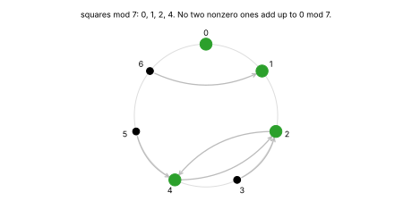
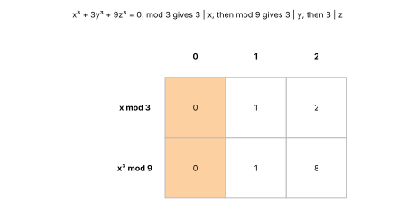
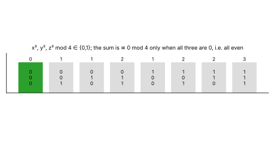

# שיעור P7: ירידה אינסופית

**מה נלמד:** שיטת ההוכחה של פרמה: מראים שמכל פתרון אפשר לבנות פתרון **קטן יותר**, באותו סוג. מכיוון שאין סדרה יורדת אינסופית של טבעיים חיוביים, לא קיים פתרון בכלל. השיטה משלבת יפה את [החסמים המודולריים](P06-חסמים-מודולריים.md) מהשיעור הקודם.

**ידע קודם:** שיעורים [P2](P02-אינדוקציה.md) (עקרון הסדר הטוב), [P3](P03-הוכחה-בדרך-השלילה.md), [P6](P06-חסמים-מודולריים.md).

---

## 1. העיקרון

**עובדה:** אין סדרה אינסופית של טבעיים חיוביים $`n_1 \gt n_2 \gt n_3 \gt \cdots`$.

סדרה יורדת ממש של טבעיים חיוביים חייבת להיעצר (כאן אחרי 9 צעדים).

זו בדיוק [עקרון הסדר הטוב](P02-אינדוקציה.md) בניסוח אחר: לקבוצה $`\{n_1, n_2, \dots\}`$ היה חייב להיות איבר קטן ביותר, אבל אחריו בא איבר קטן ממנו.

**מבנה הוכחה בירידה אינסופית:**
1. נניח שיש פתרון לא טריוויאלי (בשלמים חיוביים, או לא כולם אפס).
2. נמצא דרך **לבנות ממנו פתרון קטן יותר** (למשל לחלק את כל המשתנים ב-3).
3. אפשר לחזור על הבנייה שוב ושוב, ולקבל סדרה יורדת אינסופית של גדלים חיוביים. סתירה.

**ניסוח שקול (פתרון מינימלי):** בוחרים מראש את הפתרון ה**קטן ביותר**, ומראים שיש קטן ממנו – סתירה. זה מה שעשינו בהוכחה הגאומטרית של $`\sqrt 2`$ ב[שיעור P3](P03-הוכחה-בדרך-השלילה.md).

הכלי העיקרי בשלב 2 הוא בדרך כלל חשבון מודולרי: מראים שכל המשתנים מתחלקים במספר מסוים, ומחלקים.

---

## 2. דוגמאות פתורות

### דוגמה 1: $`x^2 + y^2 = 3z^2`$

**טענה.** הפתרון היחיד בשלמים הוא $`x = y = z = 0`$.

x² + y² מתחלק ב-3 רק כאשר x ו-y שניהם מתחלקים ב-3 (המשבצת הירוקה), ומכאן פתרון קטן יותר.

**הוכחה.**
* **שלב 1 (מודולו 3):** ריבועים מודולו 3 הם 0 או 1. אגף ימין מתחלק ב-3, ולכן $`x^2 + y^2 \equiv 0 \pmod 3`$. לפי הטבלה זה קורה רק כאשר $`x^2 \equiv y^2 \equiv 0`$, כלומר $`3 \mid x`$ ו-$`3 \mid y`$.
* **שלב 2:** נכתוב $`x = 3x_1`$, $`y = 3y_1`$. אז $`9(x_1^2 + y_1^2) = 3z^2`$, כלומר $`z^2 = 3(x_1^2 + y_1^2)`$. לכן $`3 \mid z^2`$ ו-$`3 \mid z`$: $`z = 3z_1`$.
* **שלב 3:** נציב: $`x_1^2 + y_1^2 = 3z_1^2`$. **אותה משוואה**, עם $`(x_1, y_1, z_1) = (x, y, z)/3`$.
* **ירידה:** אם $`z \ne 0`$, קיבלנו פתרון עם $`0 \lt |z_1| = |z|/3 \lt |z|`$. חוזרים שוב ושוב, ומקבלים סדרה יורדת אינסופית $`|z| \gt |z|/3 \gt |z|/9 \gt \cdots`$ של טבעיים חיוביים. סתירה. לכן $`z = 0`$, ואז $`x^2 + y^2 = 0`$ נותן $`x = y = 0`$. ∎

**מסקנה:** אין נקודות רציונליות על המעגל $`X^2 + Y^2 = 3`$ (הציבו $`X = x/z`$, $`Y = y/z`$).

**שימו לב:** חסם מודולרי לבד **לא** מספיק כאן, כי $`(0, 0, 0)`$ הוא פתרון מודולו כל מספר. הירידה היא שמסלקת את כל הפתרונות האחרים.

### דוגמה 2: $`x^3 + 2y^3 + 4z^3 = 0`$

**טענה.** הפתרון היחיד בשלמים הוא $`x = y = z = 0`$.

ירידה על ידי חציה: פתרון שאינו אפס היה נותן שרשרת חציות אינסופית.

**הוכחה.**
* **מודולו 2:** $`x^3 = -2y^3 - 4z^3`$ זוגי, ולכן $`x`$ זוגי: $`x = 2x_1`$.
* נציב: $`8x_1^3 + 2y^3 + 4z^3 = 0`$. נחלק ב-2: $`y^3 + 2z^3 + 4x_1^3 = 0`$.
* זו **אותה משוואה** עם המשתנים $`(y, z, x_1)`$ בסיבוב. לכן, באותו נימוק, $`y`$ זוגי, ואחר כך גם $`z`$ זוגי.
* לכן $`(x/2, y/2, z/2)`$ גם הוא פתרון בשלמים. חוזרים: $`2^k`$ מחלק את $`x, y, z`$ לכל $`k`$, וזה אפשרי רק אם $`x = y = z = 0`$. ∎

**מסקנה:** $`\sqrt[3]{2}`$ אינו רציונלי: אם $`\sqrt[3]2 = p/q`$, אז $`(-p)^3 + 2q^3 + 4\cdot 0^3 = 0`$ הוא פתרון שאינו אפס.

---

## 3. תרגילים

**תרגיל 1.** הוכיחו בירידה ש-$`x^2 = 2y^2`$ אין לה פתרון בשלמים חיוביים, בלי להשתמש בזוגיות. **רמז:** הראו ש-$`(2y - x)^2 = 2(x - y)^2`$.

x² = 2y² ⇒ (2y − x)² = 2(x − y)², עם 0 < x − y < y: פתרון קטן יותר.

פתרון

* **הזהות:** $`(2y - x)^2 - 2(x - y)^2 = 4y^2 - 4xy + x^2 - 2x^2 + 4xy - 2y^2 = 2y^2 - x^2 = 0`$.
* **גדלים:** מ-$`x^2 = 2y^2`$ נובע $`y^2 \lt x^2 \lt 4y^2`$, כלומר $`y \lt x \lt 2y`$. לכן $`0 \lt x - y \lt y`$ ו-$`2y - x \gt 0`$.
* קיבלנו פתרון חיובי חדש $`(2y - x,\ x - y)`$ עם $`y`$ קטן יותר. ירידה אינסופית – סתירה. (זו ההוכחה הגאומטרית משיעור P3, בלי תמונה.)

**תרגיל 2.** הוכיחו ש-$`x^2 + y^2 = 7z^2`$ פתירה רק ב-$`x = y = z = 0`$.

ריבועים מודולו 7: 0, 1, 2, 4. אין שניים שונים מאפס שסכומם 0 מודולו 7.

פתרון

* ריבועים מודולו 7: $`\{0, 1, 2, 4\}`$. כדי ש-$`x^2 + y^2 \equiv 0`$ עם $`x^2 \not\equiv 0`$ היה צריך $`y^2 \equiv -x^2 \in \{6, 5, 3\}`$, ואלה אינם ריבועים. לכן $`7 \mid x`$ ו-$`7 \mid y`$.
* $`x = 7x_1, y = 7y_1`$: $`49(x_1^2 + y_1^2) = 7z^2`$, כלומר $`z^2 = 7(x_1^2 + y_1^2)`$, ולכן $`7 \mid z`$.
* $`(x, y, z)/7`$ גם פתרון. ירידה.

**תרגיל 3.** הוכיחו ש-$`x^3 + 3y^3 + 9z^3 = 0`$ פתירה רק באפסים.

x³ + 3y³ + 9z³ = 0: מודולו 3 מקבלים 3 | x; אחר כך 3 | y; ואחר כך 3 | z.

פתרון

* מודולו 3: $`x^3 \equiv 0`$, ולכן $`3 \mid x`$: $`x = 3x_1`$.
* $`27x_1^3 + 3y^3 + 9z^3 = 0`$; נחלק ב-3: $`y^3 + 3z^3 + 9x_1^3 = 0`$. שוב אותה משוואה בסיבוב.
* לכן $`3 \mid y`$, ואחר כך $`3 \mid z`$, ו-$`(x, y, z)/3`$ פתרון. ירידה. (זו בדיוק דוגמה 2 עם 3 במקום 2.)

**תרגיל 4.** הוכיחו שמספר מהצורה $`4^a(8k + 7)`$ אינו סכום של שלושה ריבועים. **רמז:** הראו שאם $`x^2 + y^2 + z^2 \equiv 0 \pmod 4`$ אז $`x, y, z`$ כולם זוגיים, והשתמשו בדוגמה 4 בשיעור P6.

x², y², z² מודולו 4 הם 0 או 1; הסכום ≡ 0 רק כאשר שלושתם 0, כלומר כולם זוגיים.

פתרון

* ריבועים מודולו 4 הם 0 (זוגי) או 1 (אי-זוגי). סכום של שלושה הוא מספר האי-זוגיים ביניהם, 0 עד 3. הוא $`\equiv 0 \pmod 4`$ רק אם אין אי-זוגיים.
* לכן אם $`4m = x^2 + y^2 + z^2`$, אז $`x, y, z`$ זוגיים, ו-$`m = (x/2)^2 + (y/2)^2 + (z/2)^2`$.
* נניח ש-$`4^a(8k+7)`$ סכום של שלושה ריבועים. יורדים $`a`$ פעמים ומקבלים ש-$`8k + 7`$ סכום של שלושה ריבועים – בניגוד לשיעור P6. (כאן הירידה סופית: היא נעצרת אחרי $`a`$ צעדים בסתירה מודולרית.)

---

## סיכום
* ירידה אינסופית: מכל פתרון בונים פתרון קטן יותר; אין סדרה יורדת אינסופית של טבעיים, ולכן אין פתרון.
* השלב המרכזי: חשבון מודולרי שמראה שכל המשתנים מתחלקים ב-$`p`$, ואז מחלקים.
* סימן היכר: המשוואה "חוזרת לעצמה" אחרי החלוקה, לפעמים עם המשתנים בסיבוב.

**השיעור הקודם:** [שיעור P6](P06-חסמים-מודולריים.md) · **השיעור הבא:** [שיעור P8: עקרון הקיצון](P08-עקרון-הקיצון.md)

**להעמקה:** [עקרון הסדר הטוב](https://he.wikipedia.org/wiki/%D7%A2%D7%A7%D7%A8%D7%95%D7%9F_%D7%94%D7%A1%D7%93%D7%A8_%D7%94%D7%98%D7%95%D7%91) · [משפט שלושת הריבועים של לז'נדר](../pages/משפט%20שלושת%20הריבועים%20של%20לז'נדר.md) · [שיעור 8 בקורס הראשי](08-משוואות-דיופנטיות.md)

---
חלק מהקורס [שיטות הוכחה בתורת המספרים](../PROOFS.md). התוכן מופץ ברישיון [CC BY-SA 4.0](https://creativecommons.org/licenses/by-sa/4.0/).
