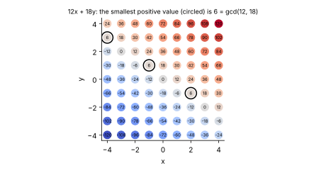
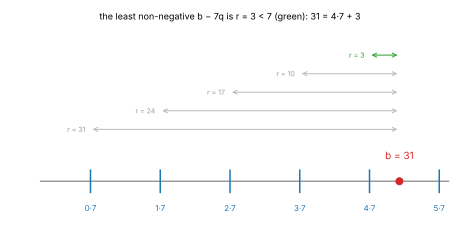
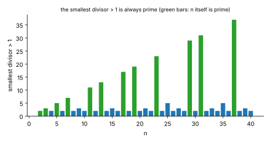
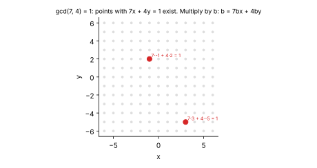
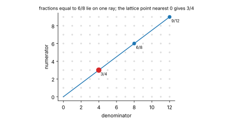
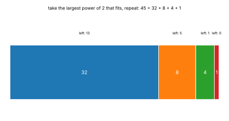
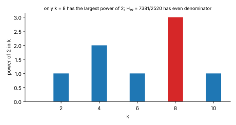

# שיעור P8: עקרון הקיצון ודוגמה נגדית מינימלית

**מה נלמד:** במקום להתבונן בכל האובייקטים, מתבוננים באחד **הקיצוני**: הקטן ביותר, הגדול ביותר, זה עם הכי הרבה גורמי 2. לאובייקט הקיצוני יש תכונות נוספות "בחינם", ולעיתים קרובות הן בדיוק מה שצריך. כך מוכיחים את הלמה של בזו, את משפט החלוקה עם שארית, ועוד.

**ידע קודם:** [שיעור P2](P02-אינדוקציה.md) (עקרון הסדר הטוב), [שיעור P3](P03-הוכחה-בדרך-השלילה.md).

---

## 1. העיקרון

**עקרון הסדר הטוב:** לכל קבוצה לא ריקה של טבעיים יש איבר **קטן ביותר**. לכל קבוצה סופית לא ריקה יש גם איבר **גדול ביותר**.

**המתכון:**
1. מגדירים קבוצה של אובייקטים שמעניינים אותנו, ומוודאים שהיא **לא ריקה**.
2. בוחרים את האיבר הקיצוני (בדרך כלל הקטן ביותר).
3. מראים שאם לאיבר הזה **אין** התכונה הרצויה, אפשר לבנות איבר עוד יותר קיצוני – סתירה.

**דוגמה נגדית מינימלית** היא אותו רעיון בשלילה: "נניח שהטענה נכשלת, וניקח את הדוגמה הנגדית הקטנה ביותר". זה בדיוק השלב שהופך אינדוקציה ([שיעור P2](P02-אינדוקציה.md)) וירידה אינסופית ([שיעור P7](P07-ירידה-אינסופית.md)) להוכחות.

---

## 2. דוגמאות פתורות

### דוגמה 1: הלמה של בזו

**טענה.** לכל שלמים $`a, b`$, לא שניהם אפס, יש שלמים $`x, y`$ כך ש-$`ax + by = \gcd(a, b)`$.

הערכים 12x + 18y על סריג: הערך החיובי הקטן ביותר (מוקף) הוא 6 = gcd(12, 18).

**הוכחה.**
* **הקבוצה:** $`S = \{ax + by : x, y \in \mathbb Z,\ ax + by \gt 0\}`$. היא לא ריקה: $`a^2 + b^2 \in S`$.
* **האיבר הקיצוני:** יהי $`d = ax_0 + by_0`$ האיבר הקטן ביותר ב-$`S`$.
* **$`d \mid a`$:** נחלק עם שארית: $`a = qd + r`$, $`0 \le r \lt d`$. אז $`r = a - qd = a(1 - qx_0) + b(-qy_0)`$, כלומר $`r`$ גם הוא צירוף של $`a`$ ו-$`b`$. אם $`r \gt 0`$, אז $`r \in S`$ ו-$`r \lt d`$ – **סתירה למינימליות**. לכן $`r = 0`$ ו-$`d \mid a`$. באותו אופן $`d \mid b`$.
* **$`d`$ הוא הגדול ביותר:** כל מחלק משותף $`c`$ של $`a`$ ו-$`b`$ מחלק את $`ax_0 + by_0 = d`$, ולכן $`c \le d`$.
* לכן $`d = \gcd(a,b)`$. ∎

**מה עשה כאן עקרון הקיצון?** ידענו ש-$`d`$ צירוף של $`a, b`$; המינימליות נתנה לנו בחינם ש-$`d`$ מחלק אותם.

### דוגמה 2: חלוקה עם שארית

**טענה.** לכל שלם $`b`$ ולכל $`a \ge 1`$ יש $`q, r`$ עם $`b = qa + r`$ ו-$`0 \le r \lt a`$.

ה-b − 7q הלא שלילי הקטן ביותר הוא r = 3 < 7 (בירוק): 31 = 4·7 + 3.

**הוכחה.**
* **הקבוצה:** $`S = \{b - qa : q \in \mathbb Z\} \cap \{0, 1, 2, \dots\}`$. לא ריקה: עבור $`q = -|b|`$, $`b - qa = b + |b|a \ge 0`$.
* **הקיצוני:** $`r = b - qa`$ הקטן ביותר ב-$`S`$. ודאי $`r \ge 0`$.
* **$`r \lt a`$:** אם $`r \ge a`$, אז $`r - a = b - (q+1)a \ge 0`$ גם ב-$`S`$, וקטן מ-$`r`$. סתירה. ∎

### דוגמה 3: למספר גדול מ-1 יש מחלק ראשוני

**טענה.** לכל $`n \ge 2`$, המחלק הקטן ביותר של $`n`$ שגדול מ-1 הוא ראשוני.

המחלק הקטן ביותר שגדול מ-1 הוא תמיד ראשוני (עמודות ירוקות: n עצמו ראשוני).

**הוכחה.**
* הקבוצה $`\{d \gt 1 : d \mid n\}`$ לא ריקה ($`n`$ בתוכה). יהי $`p`$ האיבר הקטן ביותר.
* אם $`p`$ לא ראשוני, $`p = ab`$ עם $`1 \lt a \lt p`$. אז $`a \mid p \mid n`$, כלומר $`a`$ מחלק של $`n`$ שגדול מ-1 וקטן מ-$`p`$. סתירה. ∎

---

## 3. תרגילים

**תרגיל 1 (הלמה של אוקלידס).** הוכיחו: אם $`p`$ ראשוני ו-$`p \mid ab`$, אז $`p \mid a`$ או $`p \mid b`$. **רמז:** השתמשו בדוגמה 1.

gcd(7, 4) = 1: יש נקודות עם 7x + 4y = 1. כופלים ב-b: b = 7bx + 4by.

פתרון

נניח $`p \nmid a`$. המחלקים של $`p`$ הם 1 ו-$`p`$, ולכן $`\gcd(p, a) = 1`$. לפי בזו יש $`x, y`$ עם $`px + ay = 1`$. נכפול ב-$`b`$: $`b = pbx + (ab)y`$. $`p`$ מחלק את שני המחוברים, ולכן $`p \mid b`$.

**תרגיל 2.** הוכיחו שכל שבר חיובי אפשר לכתוב בצורה מצומצמת $`a/b`$ עם $`\gcd(a, b) = 1`$.

השברים השווים ל-6/8 נמצאים על קרן אחת; נקודת הסריג הקרובה ביותר לראשית נותנת 3/4.

פתרון

בין כל ההצגות $`r = a/b`$ עם $`a, b`$ טבעיים, ניקח את זו עם $`b`$ **הקטן ביותר**. אם $`d = \gcd(a, b) \gt 1`$, אז $`r = (a/d)/(b/d)`$ עם מכנה קטן יותר. סתירה. לכן $`\gcd(a, b) = 1`$. (בהוכחה ש-$`\sqrt 2`$ אינו רציונלי בשיעור P3 הנחנו בדיוק את זה.)

**תרגיל 3.** הוכיחו שכל טבעי חיובי הוא סכום של חזקות **שונות** של 2.

לוקחים את החזקה הגדולה ביותר של 2 שנכנסת, וחוזרים: 45 = 32 + 8 + 4 + 1.

פתרון

**אינדוקציה שלמה + עקרון הקיצון.** עבור $`n = 1 = 2^0`$ ברור. עבור $`n \ge 2`$, תהי $`2^k`$ החזקה **הגדולה ביותר** עם $`2^k \le n`$. אז $`n \lt 2^{k+1}`$, ולכן $`m = n - 2^k \lt 2^k`$. אם $`m = 0`$ סיימנו. אחרת, לפי הנחת האינדוקציה $`m`$ הוא סכום של חזקות שונות של 2, וכולן קטנות מ-$`2^k`$ (כי $`m \lt 2^k`$). מוסיפים את $`2^k`$, והחזקות נשארות שונות. (זה הייצוג הבינארי.)

**תרגיל 4.** הוכיחו שלכל $`n \ge 2`$ המספר $`H_n = 1 + \frac12 + \frac13 + \dots + \frac1n`$ אינו שלם.

רק k = 8 מכיל את החזקה הגדולה ביותר של 2; H₁₀ = 7381/2520, והמכנה זוגי.

פתרון

* תהי $`2^k`$ החזקה **הגדולה ביותר** של 2 שאינה עולה על $`n`$ ($`k \ge 1`$). הטענה המרכזית: $`j = 2^k`$ הוא המספר **היחיד** ב-$`1, \dots, n`$ שמתחלק ב-$`2^k`$. אכן, כפולה אחרת של $`2^k`$ היא לפחות $`2 \cdot 2^k = 2^{k+1} \gt n`$.
* יהי $`D = \mathrm{lcm}(1, \dots, n) = 2^k m`$ עם $`m`$ אי-זוגי. נכפול: $`D \cdot H_n = \sum_{j=1}^n D/j`$.
  * עבור $`j = 2^k`$: $`D/j = m`$, אי-זוגי.
  * עבור כל $`j`$ אחר: ב-$`j`$ יש פחות מ-$`k`$ גורמי 2, ולכן $`D/j`$ זוגי.
* לכן $`D \cdot H_n`$ אי-זוגי. אבל אם $`H_n`$ היה שלם, $`D \cdot H_n`$ היה זוגי (כי $`D`$ זוגי). סתירה.

---

## סיכום
* בוחרים את האובייקט הקיצוני (קטן ביותר / גדול ביותר), ומראים שאם אין לו התכונה, יש אובייקט קיצוני יותר.
* כך מוכיחים את בזו (הצירוף החיובי הקטן ביותר), חלוקה עם שארית (השארית הקטנה ביותר), קיום מחלק ראשוני (המחלק הקטן ביותר).
* "החזקה הגדולה ביותר" ו"המספר עם הכי הרבה גורמי $`p`$" הם בחירות קיצוניות שימושיות.

**השיעור הקודם:** [שיעור P7](P07-ירידה-אינסופית.md) · **השיעור הבא:** [שיעור P9: בנייה ודוגמאות נגדיות](P09-בנייה-ודוגמאות-נגדיות.md)

**להעמקה:** [הלמה של בזו](https://he.wikipedia.org/wiki/%D7%94%D7%9C%D7%9E%D7%94_%D7%A9%D7%9C_%D7%91%D7%96%D7%95) · [הלמה של אוקלידס](https://he.wikipedia.org/wiki/%D7%94%D7%9C%D7%9E%D7%94_%D7%A9%D7%9C_%D7%90%D7%95%D7%A7%D7%9C%D7%99%D7%93%D7%A1) · [חילוק עם שארית](https://he.wikipedia.org/wiki/%D7%97%D7%99%D7%9C%D7%95%D7%A7_%D7%A2%D7%9D_%D7%A9%D7%90%D7%A8%D7%99%D7%AA) · [הסדרה ההרמונית](https://he.wikipedia.org/wiki/%D7%94%D7%A1%D7%93%D7%A8%D7%94_%D7%94%D7%94%D7%A8%D7%9E%D7%95%D7%A0%D7%99%D7%AA) · [שיעור 2 בקורס הראשי](02-מחלק-משותף-מקסימלי.md)

---
חלק מהקורס [שיטות הוכחה בתורת המספרים](../PROOFS.md). התוכן מופץ ברישיון [CC BY-SA 4.0](https://creativecommons.org/licenses/by-sa/4.0/).
