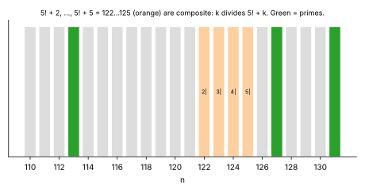
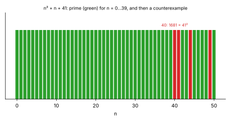
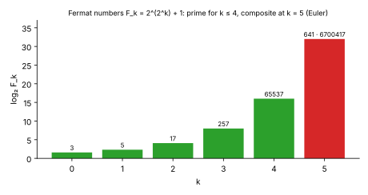
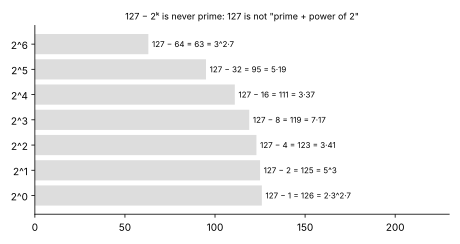
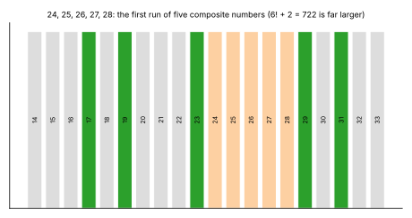
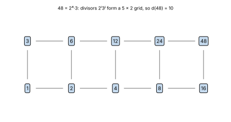
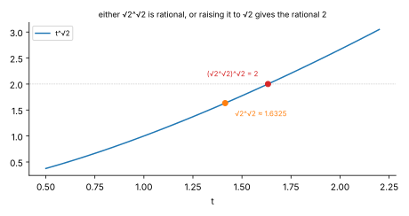

# שיעור P9: בנייה מפורשת ודוגמאות נגדיות

**מה נלמד:** שתי דרכים להוכיח טענת קיום: **לבנות** את האובייקט במפורש, או להראות שהוא קיים בלי לדעת מהו (הוכחה לא קונסטרוקטיבית). ובכיוון ההפוך: כדי להפריך טענה כללית מספיקה **דוגמה נגדית אחת**, ואין זה משנה כמה דוגמאות תומכות בה.

**ידע קודם:** שיעורים [P3](P03-הוכחה-בדרך-השלילה.md), [P4](P04-העברה-לניגוד.md), [P5](P05-שובך-היונים.md).

---

## 1. העיקרון

**הוכחת קיום בבנייה.** "יש $`x`$ עם התכונה $`T`$" – כותבים נוסחה ל-$`x`$ ובודקים שהיא מקיימת את $`T`$. ההוכחה נותנת גם את האובייקט עצמו, ולפעמים אלגוריתם.

**הוכחת קיום לא קונסטרוקטיבית.** מראים ש-$`x`$ חייב להיות קיים (בשובך היונים, בדרך השלילה, או בחלוקה למקרים שבה לא יודעים איזה מקרה מתקיים), בלי לזהות אותו.

**הפרכה בדוגמה נגדית.** הטענה "לכל $`n`$, $`T(n)`$" נופלת אם יש **$`n`$ אחד** שבו $`T(n)`$ שגויה. כמה מאות דוגמאות תומכות אינן הוכחה: בתורת המספרים יש טענות שנכונות עבור המספרים הראשונים, ואפילו עבור מיליונים של מספרים, ונכשלות אחר כך.

---

## 2. דוגמאות פתורות

### דוגמה 1 (בנייה): פערים גדולים כרצוננו בין ראשוניים

**טענה.** לכל $`n \ge 2`$ יש $`n - 1`$ מספרים עוקבים שכולם פריקים.



<sub>5! + 2, …, 5! + 5 = 122…125 (כתום) פריקים: k מחלק את 5! + k. בירוק – ראשוניים.</sub>

**הוכחה בבנייה.** נתבונן ב-$`n! + 2,\ n! + 3,\ \dots,\ n! + n`$.
* לכל $`2 \le k \le n`$, $`k \mid n!`$ (כי $`k`$ אחד הגורמים של $`n!`$), וגם $`k \mid k`$. לכן $`k \mid n! + k`$.
* $`n! + k \gt k`$, ולכן $`k`$ הוא מחלק לא טריוויאלי, ו-$`n! + k`$ פריק. ∎

**הערה:** הבנייה מוכיחה את הקיום, אבל אינה נותנת את הרצף **הקטן ביותר**. למשל ל-4 מספרים פריקים עוקבים היא נותנת $`122, \dots, 125`$, בעוד ש-$`24, 25, 26, 27, 28`$ הם כבר חמישה (ראו תרגיל 2).

### דוגמה 2 (דוגמה נגדית): $`n^2 + n + 41`$

**"טענה" של אוילר:** $`n^2 + n + 41`$ ראשוני לכל $`n \ge 0`$.



<sub>n² + n + 41 ראשוני (ירוק) עבור n = 0…39, ואז מגיעה דוגמה נגדית.</sub>

**בדיקה:** $`n = 0, 1, 2, \dots, 39`$ נותנים $`41, 43, 47, 53, \dots, 1601`$ – כולם ראשוניים. ארבעים דוגמאות!

**הפרכה:** $`n = 40`$: $`40^2 + 40 + 41 = 40 \cdot 41 + 41 = 41 \cdot 41 = 1681`$. ∎

**איך מוצאים את הדוגמה הנגדית בלי לחפש?** מחפשים $`n`$ שבו כל האיברים מתחלקים במשהו: עבור $`n = 41`$ ברור מיד ש-$`41 \mid 41^2 + 41 + 41`$. באופן כללי, **אין פולינום לא קבוע** שכל ערכיו ראשוניים: אם $`f(0) = p`$, אז $`p \mid f(kp)`$ לכל $`k`$.

### דוגמה 3 (דוגמה נגדית): מספרי פרמה

**השערת פרמה:** כל המספרים $`F_k = 2^{2^k} + 1`$ ראשוניים.



<sub>מספרי פרמה: ראשוניים עבור k ≤ 4, ופריקים ב-k = 5 (אוילר).</sub>

$`F_0 = 3,\ F_1 = 5,\ F_2 = 17,\ F_3 = 257,\ F_4 = 65537`$ – כולם ראשוניים. אבל אוילר מצא:
```math
F_5 = 2^{32} + 1 = 4294967297 = 641 \times 6700417 .
```
**בדיקה מהירה ש-$`641 \mid F_5`$:** $`641 = 5 \cdot 2^7 + 1 = 5^4 + 2^4`$. מהשוויון הראשון, $`5 \cdot 2^7 \equiv -1 \pmod{641}`$, ולכן $`5^4 \cdot 2^{28} \equiv 1`$. מהשוויון השני, $`5^4 \equiv -2^4`$. נציב: $`-2^4 \cdot 2^{28} = -2^{32} \equiv 1`$, כלומר $`2^{32} + 1 \equiv 0 \pmod{641}`$. ∎

(ראו [מספר פרמה](https://he.wikipedia.org/wiki/%D7%9E%D7%A1%D7%A4%D7%A8_%D7%A4%D7%A8%D7%9E%D7%94). עד היום לא ידוע אף מספר פרמה ראשוני מעבר ל-$`F_4`$.)

---

## 3. תרגילים

**תרגיל 1.** הפריכו: "כל מספר אי-זוגי גדול מ-1 הוא סכום של ראשוני וחזקה של 2 (כולל $`2^0 = 1`$)".



<sub>127 − 2ᵏ אף פעם אינו ראשוני: 127 אינו "ראשוני + חזקה של 2".</sub>

<details><summary>פתרון</summary>

$`n = 127`$. החזקות של 2 עד 127 הן $`1, 2, 4, 8, 16, 32, 64`$, וההפרשים: $`126 = 2\cdot3^2\cdot7`$, $`125 = 5^3`$, $`123 = 3\cdot41`$, $`119 = 7\cdot17`$, $`111 = 3\cdot37`$, $`95 = 5\cdot19`$, $`63 = 3^2\cdot7`$. אף אחד אינו ראשוני. (אגב, 127 עצמו ראשוני; זו דוגמה של דה פוליניאק, שהעלה את ההשערה ב-1849.)
</details>

**תרגיל 2.** מצאו את חמשת המספרים הפריקים העוקבים הקטנים ביותר, והשוו לבנייה של דוגמה 1.



<sub>24, 25, 26, 27, 28: הרצף הראשון של חמישה פריקים (6! + 2 = 722 גדול בהרבה).</sub>

<details><summary>פתרון</summary>

הראשוניים עד 30: $`2, 3, 5, 7, 11, 13, 17, 19, 23, 29`$. הפער הראשון של לפחות 6 הוא בין 23 ל-29, ולכן $`24, 25, 26, 27, 28`$. הבנייה של דוגמה 1 עם $`n = 6`$ נותנת $`722, \dots, 726`$. בנייה מוכיחה קיום, לא מינימליות.
</details>

**תרגיל 3.** בנו מספר עם בדיוק 10 מחלקים. מהו הקטן ביותר?



<sub>48 = 2⁴·3: המחלקים 2ⁱ3ʲ יוצרים רשת 5×2, ולכן d(48) = 10.</sub>

<details><summary>פתרון</summary>

אם $`n = p_1^{e_1} \cdots p_r^{e_r}`$, אז מספר המחלקים הוא $`(e_1 + 1)\cdots(e_r + 1)`$ (ראו [שיעור P11](P11-פירוק-יחיד.md)). כדי לקבל 10: $`10 = 10`$ (כלומר $`p^9`$) או $`10 = 5 \cdot 2`$ (כלומר $`p^4 q`$). **בנייה:** $`2^9 = 512`$ או $`2^4 \cdot 3 = 48`$. הקטן ביותר: בצורה $`p^4 q`$ כדאי לתת את המעריך הגדול לראשוני הקטן, ולכן 48.
</details>

**תרגיל 4 (קיום לא קונסטרוקטיבי).** הוכיחו שיש מספרים אי-רציונליים $`a, b`$ כך ש-$`a^b`$ רציונלי.



<sub>או ש-√2^√2 רציונלי, או שהעלאתו בחזקת √2 נותנת את הרציונלי 2.</sub>

<details><summary>פתרון</summary>

נתבונן ב-$`c = \sqrt2^{\sqrt2}`$. **שני מקרים:**
* אם $`c`$ רציונלי: $`a = b = \sqrt 2`$.
* אם $`c`$ אי-רציונלי: $`a = c`$, $`b = \sqrt 2`$, ואז $`a^b = \sqrt2^{\sqrt2 \cdot \sqrt2} = \sqrt2^2 = 2`$.

בשני המקרים יש זוג מתאים, אבל ההוכחה **לא אומרת לנו איזה מהם**. (כיום ידוע, ממשפט גלפונד–שניידר, ש-$`c`$ אי-רציונלי, ולכן המקרה השני הוא הנכון.)
</details>

---

## סיכום
* קיום בבנייה: נותנים נוסחה ובודקים. הבנייה לא חייבת להיות האופטימלית.
* קיום לא קונסטרוקטיבי: שובך יונים, מקרים, שלילה – יודעים ש"יש", לא יודעים "מי".
* להפרכה מספיקה דוגמה נגדית אחת; דוגמאות רבות תומכות אינן הוכחה.

**השיעור הקודם:** [שיעור P8](P08-עקרון-הקיצון.md) · **השיעור הבא:** [שיעור P10: ספירה כפולה וזיווג](P10-ספירה-כפולה-וזיווג.md)

**להעמקה:** [דוגמה נגדית](https://he.wikipedia.org/wiki/%D7%93%D7%95%D7%92%D7%9E%D7%94_%D7%A0%D7%92%D7%93%D7%99%D7%AA) · [מספר פרמה](https://he.wikipedia.org/wiki/%D7%9E%D7%A1%D7%A4%D7%A8_%D7%A4%D7%A8%D7%9E%D7%94) · [קונסטרוקטיביזם (פילוסופיה של המתמטיקה)](https://he.wikipedia.org/wiki/%D7%A7%D7%95%D7%A0%D7%A1%D7%98%D7%A8%D7%95%D7%A7%D7%98%D7%99%D7%91%D7%99%D7%96%D7%9D_%28%D7%A4%D7%99%D7%9C%D7%95%D7%A1%D7%95%D7%A4%D7%99%D7%94_%D7%A9%D7%9C_%D7%94%D7%9E%D7%AA%D7%9E%D7%98%D7%99%D7%A7%D7%94%29) · [שיעור 16 בקורס הראשי](16-השערות-על-ראשוניים.md)

---
<sub>חלק מהקורס [שיטות הוכחה בתורת המספרים](../PROOFS.md). התוכן מופץ ברישיון [CC BY-SA 4.0](https://creativecommons.org/licenses/by-sa/4.0/).</sub>
