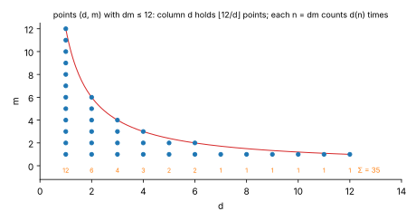
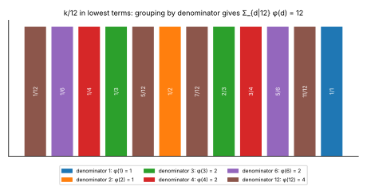
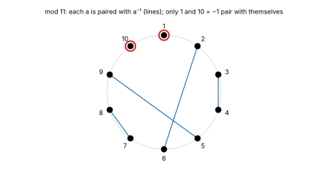
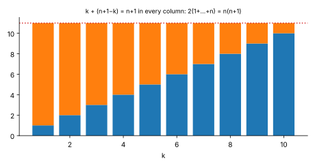
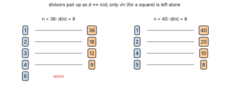
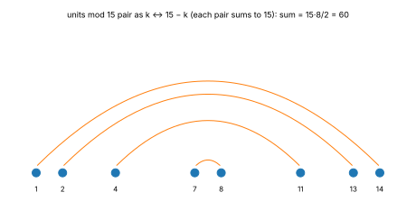
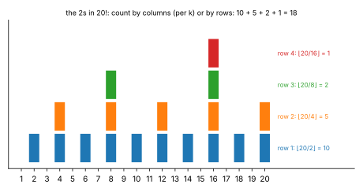

# שיעור P10: ספירה כפולה וזיווג

**מה נלמד:** שתי טכניקות ספירה. **ספירה כפולה:** סופרים את אותה קבוצה בשתי דרכים, ומשווים – כך מתקבלות זהויות. **זיווג:** מחלקים איברים לזוגות שכל אחד מהם קל לטפל בו, ובודקים מי נשאר בלי בן זוג.

**ידע קודם:** פונקציות אריתמטיות ([שיעור 6](06-פונקציות-אריתמטיות.md)): מספר המחלקים $`d(n)`$ ופונקציית אוילר $`\varphi(n)`$; הופכי מודולרי ([שיעור 4](04-חשבון-מודולרי.md)).

---

## 1. העיקרון

**ספירה כפולה.** סופרים קבוצה של **זוגות** $`(a, b)`$ פעם לפי $`a`$ (שורות) ופעם לפי $`b`$ (עמודות). שתי הספירות נותנות את אותו מספר, ולכן הסכומים שווים:
```math
\sum_{a}\#\{b : (a,b) \in S\} \;=\; |S| \;=\; \sum_{b}\#\{a : (a,b) \in S\} .
```
זו שיטה **ליצירת** זהויות: לעיתים קרובות סכום אחד קשה והשני קל.

**זיווג.** אם אפשר לחלק את האיברים לזוגות $`\{x, x'\}`$ כך שלכל זוג יש תכונה פשוטה (סכום קבוע, מכפלה 1), אז קל לחשב את הסכום או המכפלה של כולם. החלק המעניין הוא **האיברים שזוגו הם עצמם**: הם אלה שקובעים את התשובה.

---

## 2. דוגמאות פתורות

### דוגמה 1: סכום מספרי המחלקים

**טענה.** $`\displaystyle\sum_{n=1}^{x} d(n) = \sum_{d=1}^{x} \left\lfloor \frac{x}{d} \right\rfloor`$.



<sub>הנקודות (d, m) עם dm ≤ 12: בעמודה d יש ⌊12/d⌋ נקודות; כל n = dm נספר d(n) פעמים.</sub>

**הוכחה בספירה כפולה.** נספור את הקבוצה $`S = \{(d, m) : d, m \ge 1,\ dm \le x\}`$.
* **לפי $`n = dm`$:** לכל $`n \le x`$, מספר הזוגות עם $`dm = n`$ הוא מספר המחלקים $`d`$ של $`n`$, כלומר $`d(n)`$. סך הכול $`\sum_{n \le x} d(n)`$.
* **לפי $`d`$:** לכל $`d`$, ה-$`m`$ המותרים הם $`1, \dots, \lfloor x/d \rfloor`$. סך הכול $`\sum_{d \le x} \lfloor x/d \rfloor`$. ∎

**בדיקה עבור $`x = 12`$:** $`12+6+4+3+2+2+1+1+1+1+1+1 = 35`$, וגם $`d(1) + \dots + d(12) = 1+2+2+3+2+4+2+4+3+4+2+6 = 35`$. ✓

**למה זה שימושי?** את אגף ימין קל להעריך: $`\lfloor x/d \rfloor \approx x/d`$, ולכן הסכום בערך $`x(1 + \frac12 + \dots + \frac1x) \approx x \ln x`$. בממוצע, למספר עד $`x`$ יש בערך $`\ln x`$ מחלקים ([שיעור P12](P12-הערכות-וממוצעים.md); ראו גם [שיטת ההיפרבולה של דיריכלה](../pages/שיטת%20ההיפרבולה%20של%20דיריכלה.md)).

### דוגמה 2: $`\sum_{d \mid n} \varphi(d) = n`$



<sub>k/12 בצורה מצומצמת: מיון לפי המכנה נותן Σ φ(d) = 12 על פני המחלקים d של 12.</sub>

**הוכחה בספירה כפולה.** נספור את $`n`$ השברים $`\frac1n, \frac2n, \dots, \frac nn`$.
* **ספירה ישירה:** יש $`n`$ שברים.
* **לפי המכנה אחרי צמצום:** כל שבר $`k/n`$ מצטמצם ל-$`a/d`$ עם $`d \mid n`$, $`1 \le a \le d`$, $`\gcd(a, d) = 1`$. ולהפך, כל $`a/d`$ כזה שווה ל-$`(a \cdot n/d)/n`$. לכן מספר השברים עם מכנה מצומצם $`d`$ הוא בדיוק $`\varphi(d)`$.
* משווים: $`\sum_{d \mid n} \varphi(d) = n`$. ∎

**עבור $`n = 12`$:** $`\varphi(1) + \varphi(2) + \varphi(3) + \varphi(4) + \varphi(6) + \varphi(12) = 1 + 1 + 2 + 2 + 2 + 4 = 12`$. ✓

### דוגמה 3 (זיווג): משפט וילסון

**טענה.** אם $`p`$ ראשוני, $`(p-1)! \equiv -1 \pmod p`$.



<sub>מודולו 11: כל a מזווג עם a⁻¹ (קווים); רק 1 ו-10 = −1 מזווגים עם עצמם.</sub>

**הוכחה בזיווג.**
* כל $`a \in \{1, \dots, p-1\}`$ הפיך מודולו $`p`$. **נזווג** את $`a`$ עם ההופכי שלו $`a^{-1}`$. מכפלת כל זוג היא $`\equiv 1`$.
* **מי הזוג של עצמו?** $`a = a^{-1}`$ פירושו $`a^2 \equiv 1`$, כלומר $`p \mid (a-1)(a+1)`$, ולכן (כי $`p`$ ראשוני) $`a \equiv 1`$ או $`a \equiv -1`$.
* לכן $`(p-1)! \equiv 1 \cdot (-1) \cdot 1 \cdot 1 \cdots 1 = -1`$, כאשר כל אחת מהאחדות האחרונות היא מכפלה של זוג. ∎

**עבור $`p = 11`$:** הזוגות הם $`\{2, 6\}, \{3, 4\}, \{5, 9\}, \{7, 8\}`$ (למשל $`2 \cdot 6 = 12 \equiv 1`$). נשארים 1 ו-10, ו-$`10! \equiv 10 \equiv -1`$.

---

## 3. תרגילים

**תרגיל 1.** הוכיחו בזיווג ש-$`1 + 2 + \dots + n = \frac{n(n+1)}2`$ (הטריק של גאוס).



<sub>k + (n+1−k) = n+1 בכל עמודה: 2(1+…+n) = n(n+1).</sub>

<details><summary>פתרון</summary>

כותבים את הסכום פעמיים, פעם בסדר עולה ופעם בסדר יורד, ומזווגים את $`k`$ עם $`n + 1 - k`$. כל זוג מסתכם ל-$`n + 1`$, ויש $`n`$ זוגות. לכן $`2S = n(n+1)`$.
</details>

**תרגיל 2.** הוכיחו בזיווג: $`d(n)`$ אי-זוגי אם ורק אם $`n`$ ריבוע.



<sub>המחלקים מזדווגים לפי d ↔ n/d; רק √n (אם n ריבוע) נשאר לבד.</sub>

<details><summary>פתרון</summary>

נזווג כל מחלק $`d`$ עם $`n/d`$, גם הוא מחלק. זוג "מתנוון" לאיבר אחד רק כאשר $`d = n/d`$, כלומר $`d^2 = n`$. לכן אם $`n`$ אינו ריבוע, כל המחלקים בזוגות ו-$`d(n)`$ זוגי; אם $`n = m^2`$, נשאר בדיוק המחלק $`m`$ לבד ו-$`d(n)`$ אי-זוגי. למשל $`d(36) = 9`$, $`d(40) = 8`$.
</details>

**תרגיל 3.** הוכיחו שסכום המספרים $`1 \le k \le n`$ הזרים ל-$`n`$ הוא $`\frac{n\varphi(n)}2`$ (עבור $`n \ge 3`$).



<sub>ההפיכים מודולו 15 מזדווגים לפי k ↔ 15 − k (כל זוג מסתכם ל-15): הסכום 15·8/2 = 60.</sub>

<details><summary>פתרון</summary>

$`\gcd(k, n) = \gcd(n - k, n)`$, ולכן $`k \mapsto n - k`$ מזווג את המספרים הזרים ל-$`n`$ ביניהם. $`k = n - k`$ פירושו $`k = n/2`$, אבל $`\gcd(n/2, n) = n/2 \gt 1`$ עבור $`n \ge 3`$, ולכן אין איבר שזוגו הוא עצמו. יש $`\varphi(n)/2`$ זוגות, כל אחד מסתכם ל-$`n`$.
</details>

**תרגיל 4 (נוסחת לז'נדר).** הוכיחו בספירה כפולה שהחזקה של $`p`$ ב-$`n!`$ היא $`\sum_{i \ge 1} \lfloor n/p^i \rfloor`$. חשבו אותה עבור $`p = 2`$, $`n = 20`$.



<sub>גורמי ה-2 ב-20!: סופרים לפי עמודות (לכל k) או לפי שורות: 10 + 5 + 2 + 1 = 18.</sub>

<details><summary>פתרון</summary>

החזקה של $`p`$ ב-$`n!`$ היא $`\sum_{k=1}^n v_p(k)`$, כאשר $`v_p(k)`$ הוא מספר הפעמים ש-$`p`$ מחלק את $`k`$. נצייר לכל $`k`$ עמודה של $`v_p(k)`$ משבצות (כמו באיור), ונספור את המשבצות **לפי שורות**: בשורה $`i`$ יש משבצת בעמודה $`k`$ בדיוק כאשר $`p^i \mid k`$, ויש $`\lfloor n/p^i \rfloor`$ כאלה. עבור $`n = 20`$, $`p = 2`$: $`10 + 5 + 2 + 1 = 18`$.
</details>

---

## סיכום
* ספירה כפולה: סופרים זוגות לפי השורות ולפי העמודות, ומשווים. מקור לזהויות.
* זיווג: מחלקים לזוגות פשוטים; התשובה נקבעת על ידי האיברים שזוגם הוא עצמם.
* משפט וילסון, $`\sum_{d\mid n}\varphi(d) = n`$ ו-$`\sum d(n) = \sum \lfloor x/d \rfloor`$ – שלוש תוצאות מרכזיות, שלוש הוכחות של כמה שורות.

**השיעור הקודם:** [שיעור P9](P09-בנייה-ודוגמאות-נגדיות.md) · **השיעור הבא:** [שיעור P11: פירוק יחיד כשיטת הוכחה](P11-פירוק-יחיד.md)

**להעמקה:** [משפט וילסון](https://he.wikipedia.org/wiki/%D7%9E%D7%A9%D7%A4%D7%98_%D7%95%D7%99%D7%9C%D7%A1%D7%95%D7%9F) · [פונקציית אוילר](https://he.wikipedia.org/wiki/%D7%A4%D7%95%D7%A0%D7%A7%D7%A6%D7%99%D7%99%D7%AA_%D7%90%D7%95%D7%99%D7%9C%D7%A8) · [פונקציית מחלקים](https://he.wikipedia.org/wiki/%D7%A4%D7%95%D7%A0%D7%A7%D7%A6%D7%99%D7%99%D7%AA_%D7%9E%D7%97%D7%9C%D7%A7%D7%99%D7%9D) · [נוסחת לז'נדר](https://he.wikipedia.org/wiki/%D7%A0%D7%95%D7%A1%D7%97%D7%AA_%D7%9C%D7%96%27%D7%A0%D7%93%D7%A8) · [שיטת ההיפרבולה של דיריכלה](../pages/שיטת%20ההיפרבולה%20של%20דיריכלה.md) · [בעיית המחלקים של דיריכלה](../pages/בעיית%20המחלקים%20של%20דיריכלה.md)

---
<sub>חלק מהקורס [שיטות הוכחה בתורת המספרים](../PROOFS.md). התוכן מופץ ברישיון [CC BY-SA 4.0](https://creativecommons.org/licenses/by-sa/4.0/).</sub>
