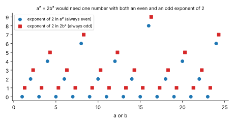
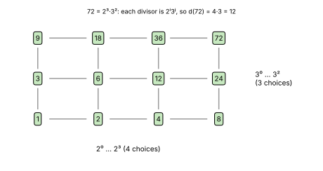
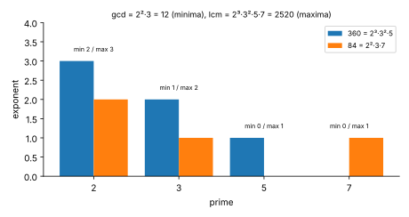
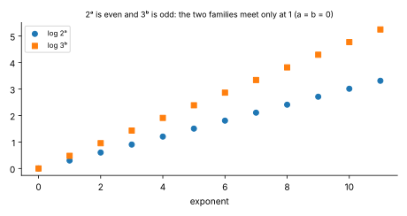
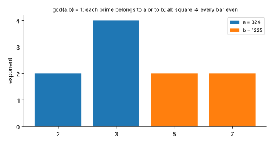
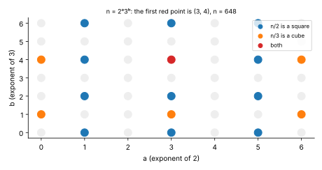
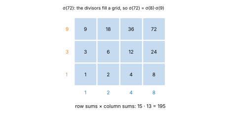

# שיעור P11: פירוק יחיד לגורמים כשיטת הוכחה

**מה נלמד:** המשפט היסודי של האריתמטיקה אומר שלכל מספר יש פירוק **יחיד** לראשוניים. בשיעור הזה נשתמש בו ככלי: מתרגמים שאלה על מספרים לשאלה על **המעריכים** בפירוק, ושם היא נעשית פשוטה – לפעמים שאלה על זוגיות של מעריך, לפעמים על מינימום ומקסימום.

**ידע קודם:** [שיעור 3](03-מספרים-ראשוניים.md) (פירוק לראשוניים), [שיעור P8](P08-עקרון-הקיצון.md) (הלמה של אוקלידס).

---

## 1. העיקרון

כל $`n \ge 1`$ נכתב באופן יחיד כ-
```math
n = \prod_{p} p^{v_p(n)} = 2^{v_2(n)}\, 3^{v_3(n)}\, 5^{v_5(n)} \cdots,
```
כאשר $`v_p(n) \ge 0`$ ורק מספר סופי מהם שונים מאפס. כללי החשבון עוברים למעריכים:

| על המספרים | על המעריכים |
|---|---|
| $`n = ab`$ | $`v_p(n) = v_p(a) + v_p(b)`$ |
| $`a \mid b`$ | $`v_p(a) \le v_p(b)`$ לכל $`p`$ |
| $`n`$ ריבוע ($`k`$-חזקה) | כל $`v_p(n)`$ זוגי (מתחלק ב-$`k`$) |
| $`\gcd(a, b)`$ | $`\min(v_p(a), v_p(b))`$ |
| $`\mathrm{lcm}(a, b)`$ | $`\max(v_p(a), v_p(b))`$ |

**היחידות היא העיקר.** בלי יחידות, שני פירוקים שונים של אותו מספר היו יכולים לתת מעריכים שונים, והתרגום לא היה עובד.

---

## 2. דוגמאות פתורות

### דוגמה 1: $`\sqrt 2`$ אינו רציונלי – בפעם השלישית



<sub>a² = 2b² היה מחייב מספר אחד עם מעריך זוגי ואי-זוגי של 2 בבת אחת.</sub>

**הוכחה.** נניח $`a^2 = 2b^2`$. נשווה את המעריך של 2 בשני האגפים:
* $`v_2(a^2) = 2v_2(a)`$ – **זוגי**.
* $`v_2(2b^2) = 1 + 2v_2(b)`$ – **אי-זוגי**.

לפי יחידות הפירוק, למספר אחד יש מעריך אחד של 2. סתירה. ∎

**אותו נימוק נותן הרבה יותר:** $`\sqrt n`$ רציונלי רק אם $`n`$ ריבוע שלם. אם $`n`$ אינו ריבוע, יש $`p`$ עם $`v_p(n)`$ אי-זוגי, ו-$`a^2 = nb^2`$ נותן זוגי = אי-זוגי.

### דוגמה 2: נוסחה למספר המחלקים

**טענה.** אם $`n = p_1^{e_1} \cdots p_r^{e_r}`$, אז $`d(n) = (e_1 + 1)(e_2 + 1)\cdots(e_r + 1)`$.



<sub>72 = 2³·3²: כל מחלק הוא 2ⁱ3ʲ, ולכן d(72) = 4·3 = 12.</sub>

**הוכחה.** לפי הטבלה, $`m \mid n`$ אם ורק אם $`m = p_1^{f_1}\cdots p_r^{f_r}`$ עם $`0 \le f_i \le e_i`$. לכל $`f_i`$ יש $`e_i + 1`$ אפשרויות, והן בלתי תלויות. לפי היחידות, צירופים שונים נותנים מחלקים שונים. ∎

**עבור $`n = 72 = 2^3 \cdot 3^2`$:** $`d(72) = 4 \cdot 3 = 12`$. המחלקים יוצרים רשת $`4 \times 3`$, כמו באיור.

### דוגמה 3: $`\gcd(a,b) \cdot \mathrm{lcm}(a,b) = ab`$



<sub>gcd = 2²·3 = 12 (מינימום המעריכים), lcm = 2³·3²·5·7 = 2520 (מקסימום).</sub>

**הוכחה.** לכל ראשוני $`p`$, $`\min(x, y) + \max(x, y) = x + y`$. לכן לכל $`p`$:
```math
v_p(\gcd) + v_p(\mathrm{lcm}) = v_p(a) + v_p(b) = v_p(ab).
```
שני המספרים בעלי אותם מעריכים לכל $`p`$, ולפי היחידות הם שווים. ∎

**עבור $`a = 360 = 2^3 3^2 5`$ ו-$`b = 84 = 2^2 \cdot 3 \cdot 7`$:** $`12 \cdot 2520 = 30240 = 360 \cdot 84`$. ✓

---

## 3. תרגילים

**תרגיל 1.** הוכיחו ש-$`\log_2 3`$ אינו רציונלי.



<sub>2ᵃ זוגי ו-3ᵇ אי-זוגי: שתי המשפחות נפגשות רק ב-1 (a = b = 0).</sub>

<details><summary>פתרון</summary>

אם $`\log_2 3 = a/b`$ עם $`a, b \gt 0`$, אז $`2^{a/b} = 3`$, כלומר $`2^a = 3^b`$. לפי יחידות הפירוק, למספר אחד אי אפשר שיהיה פירוק $`2^a`$ וגם $`3^b`$ (אלא אם $`a = b = 0`$). סתירה. (או פשוט: אגף שמאל זוגי ואגף ימין אי-זוגי.)
</details>

**תרגיל 2.** הוכיחו: אם $`\gcd(a, b) = 1`$ ו-$`ab`$ ריבוע, אז $`a`$ ו-$`b`$ שניהם ריבועים.



<sub>gcd(a,b) = 1: כל ראשוני שייך ל-a או ל-b; ab ריבוע ⇒ כל עמודה זוגית.</sub>

<details><summary>פתרון</summary>

לכל ראשוני $`p`$, לפחות אחד מ-$`v_p(a), v_p(b)`$ הוא 0 (אחרת $`p \mid \gcd`$). לכן $`v_p(ab) = v_p(a)`$ או $`v_p(b)`$, והשני 0. $`v_p(ab)`$ זוגי, ולכן גם $`v_p(a)`$ ו-$`v_p(b)`$ זוגיים, לכל $`p`$. לפי הטבלה, $`a`$ ו-$`b`$ ריבועים. (הטענה הזו היא המפתח לפרמטריזציה של שלשות פיתגוריות, [שיעור 8](08-משוואות-דיופנטיות.md).)
</details>

**תרגיל 3.** מצאו את ה-$`n`$ החיובי הקטן ביותר כך ש-$`n/2`$ ריבוע ו-$`n/3`$ קובייה.



<sub>n = 2ᵃ3ᵇ: הנקודה האדומה הראשונה היא (3, 4), כלומר n = 648.</sub>

<details><summary>פתרון</summary>

ראשוני נוסף רק מגדיל את $`n`$, ולכן $`n = 2^a 3^b`$. התנאים על המעריכים:
* $`n/2 = 2^{a-1}3^b`$ ריבוע: $`a - 1`$ זוגי, $`b`$ זוגי.
* $`n/3 = 2^a 3^{b-1}`$ קובייה: $`a \equiv 0`$, $`b - 1 \equiv 0 \pmod 3`$.

$`a`$ אי-זוגי ומתחלק ב-3: הקטן ביותר $`a = 3`$. $`b`$ זוגי ו-$`\equiv 1 \pmod 3`$: הקטן ביותר $`b = 4`$. לכן $`n = 2^3 \cdot 3^4 = 648`$. בדיקה: $`648/2 = 324 = 18^2`$, $`648/3 = 216 = 6^3`$. ✓
</details>

**תרגיל 4.** הוכיחו ש-$`\sigma`$ (סכום המחלקים) כפלית על מספרים זרים, וחשבו את $`\sigma(72)`$.



<sub>σ(72): המחלקים ממלאים רשת, ולכן σ(72) = σ(8)·σ(9).</sub>

<details><summary>פתרון</summary>

אם $`\gcd(m, n) = 1`$, הראשוניים של $`m`$ ושל $`n`$ זרים, ולכן לפי הפירוק כל מחלק של $`mn`$ נכתב **באופן יחיד** כמכפלה $`d_1 d_2`$ עם $`d_1 \mid m`$, $`d_2 \mid n`$. אז $`\sigma(mn) = \sum_{d_1, d_2} d_1 d_2 = \left(\sum d_1\right)\left(\sum d_2\right) = \sigma(m)\sigma(n)`$. עבור $`72 = 8 \cdot 9`$: $`\sigma(8) = 15`$, $`\sigma(9) = 13`$, ולכן $`\sigma(72) = 195`$.
</details>

---

## סיכום
* מתרגמים למעריכים: כפל ← חיבור, התחלקות ← אי-שוויון, ריבוע ← זוגיות, gcd/lcm ← מינימום/מקסימום.
* היחידות של הפירוק היא שמאפשרת להשוות מעריכים משני צדי שוויון.
* כך מקבלים נוסחאות ל-$`d(n)`$ ול-$`\sigma(n)`$, ואת $`\gcd \cdot \mathrm{lcm} = ab`$.

**השיעור הקודם:** [שיעור P10](P10-ספירה-כפולה-וזיווג.md) · **השיעור הבא:** [שיעור P12: הערכות וממוצעים](P12-הערכות-וממוצעים.md)

**להעמקה:** [המשפט היסודי של האריתמטיקה](https://he.wikipedia.org/wiki/%D7%94%D7%9E%D7%A9%D7%A4%D7%98_%D7%94%D7%99%D7%A1%D7%95%D7%93%D7%99_%D7%A9%D7%9C_%D7%94%D7%90%D7%A8%D7%99%D7%AA%D7%9E%D7%98%D7%99%D7%A7%D7%94) · [פונקציית מחלקים](https://he.wikipedia.org/wiki/%D7%A4%D7%95%D7%A0%D7%A7%D7%A6%D7%99%D7%99%D7%AA_%D7%9E%D7%97%D7%9C%D7%A7%D7%99%D7%9D) · [מספר אי-רציונלי](https://he.wikipedia.org/wiki/%D7%9E%D7%A1%D7%A4%D7%A8_%D7%90%D7%99-%D7%A8%D7%A6%D7%99%D7%95%D7%A0%D7%9C%D7%99) · [שיעור 3 בקורס הראשי](03-מספרים-ראשוניים.md) · [שיעור 6 בקורס הראשי](06-פונקציות-אריתמטיות.md)

---
<sub>חלק מהקורס [שיטות הוכחה בתורת המספרים](../PROOFS.md). התוכן מופץ ברישיון [CC BY-SA 4.0](https://creativecommons.org/licenses/by-sa/4.0/).</sub>
