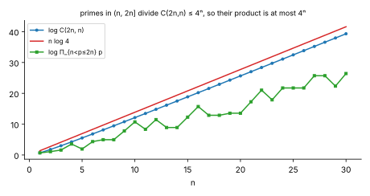
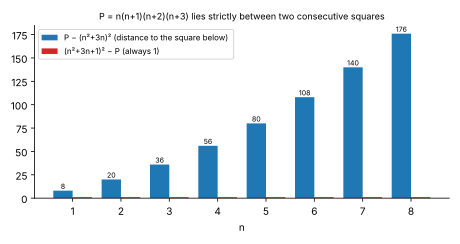
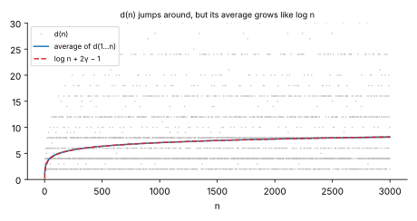
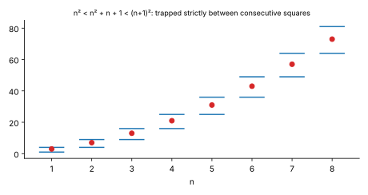
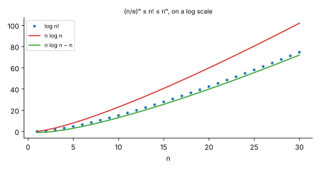
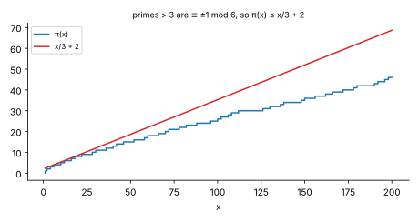

# שיעור P12: הערכות, סנדוויץ' וממוצעים

**מה נלמד:** הרבה שאלות בתורת המספרים אינן "שווה או לא שווה", אלא "כמה בערך". נלמד שלושה כלים: **סנדוויץ'** (מספר שנמצא ממש בין שני ריבועים עוקבים אינו ריבוע), **חסם דרך מספר שקל להעריך** (מקדם בינומי, עצרת), ו**ממוצעים** (פונקציה שמתנהגת בפראות יכולה להיות בעלת ממוצע מסודר).

**ידע קודם:** שיעורים [P10](P10-ספירה-כפולה-וזיווג.md) ו-[P11](P11-פירוק-יחיד.md); לוגריתם טבעי.

---

## 1. העיקרון

* **סנדוויץ':** אם $`m^2 \lt N \lt (m+1)^2`$, אז $`N`$ אינו ריבוע, כי אין ריבוע שלם בין שני ריבועים עוקבים. אותו דבר לקוביות ולחזקות אחרות.
* **השוואה לאובייקט מוכר:** כדי לחסום כמות לא ידועה (למשל מכפלת הראשוניים בקטע), מראים שהיא **מחלקת** או **קטנה** ממשהו שקל לחשב (מקדם בינומי, $`n!`$, $`4^n`$).
* **ממוצעים:** גם אם $`f(n)`$ קופצת, הסכום $`f(1) + \dots + f(x)`$ הוא לעיתים קרובות חלק וקל להערכה – למשל בעזרת ספירה כפולה.

---

## 2. דוגמאות פתורות

### דוגמה 1: מכפלת הראשוניים בין $`n`$ ל-$`2n`$ (צ'בישב)

**טענה.** $`\displaystyle\prod_{n \lt p \le 2n} p \;\le\; \binom{2n}{n} \;\lt\; 4^n`$.

הראשוניים בין n ל-2n מחלקים את C(2n, n) ≤ 4ⁿ, ולכן מכפלתם לכל היותר 4ⁿ.

**הוכחה.**
* **שלב 1 – התחלקות:** $`\binom{2n}{n} = \frac{(2n)!}{n!\,n!}`$. ראשוני $`p`$ עם $`n \lt p \le 2n`$ מופיע במונה (כגורם של $`(2n)!`$) ולא במכנה (כל הגורמים של $`n!`$ קטנים מ-$`p`$). לכן $`p \mid \binom{2n}{n}`$ ([שיעור P11](P11-פירוק-יחיד.md)), וגם המכפלה של כל הראשוניים האלה מחלקת אותו (הם זרים זה לזה).
* **שלב 2 – גודל:** $`\binom{2n}{n}`$ הוא אחד המחוברים ב-$`\sum_k \binom{2n}{k} = (1+1)^{2n} = 4^n`$, ולכן קטן ממנו.
* מחלק חיובי אינו גדול מהמספר, ולכן המכפלה $`\le \binom{2n}{n} \lt 4^n`$. ∎

**מסקנה:** כל ראשוני בקטע גדול מ-$`n`$, ולכן אם יש $`k`$ ראשוניים בקטע, $`n^k \lt 4^n`$, כלומר $`k \lt \frac{n \ln 4}{\ln n}`$. זה הצעד הראשון בדרך ל[הוכחת השערת ברטראן](../pages/הוכחת%20השערת%20ברטראן.md) ול[משפט המספרים הראשוניים](12-משפט-המספרים-הראשוניים.md).

### דוגמה 2: מכפלה של ארבעה מספרים עוקבים אינה ריבוע

**טענה.** לכל $`n \ge 1`$, $`P = n(n+1)(n+2)(n+3)`$ אינו ריבוע.

P = n(n+1)(n+2)(n+3) נמצא ממש בין שני ריבועים עוקבים.

**הוכחה בסנדוויץ'.**
* **אלגברה:** נזווג את הגורמים החיצוניים והפנימיים: $`n(n+3) = n^2 + 3n`$ ו-$`(n+1)(n+2) = n^2 + 3n + 2`$. נסמן $`t = n^2 + 3n`$. אז $`P = t(t+2) = (t+1)^2 - 1`$.
* **סנדוויץ':** $`t^2 \lt t^2 + 2t = P \lt (t+1)^2`$ (כי $`t \gt 0`$).
* $`P`$ נמצא ממש בין הריבועים העוקבים $`t^2`$ ו-$`(t+1)^2`$, ולכן אינו ריבוע. ∎

**עבור $`n = 1`$:** $`P = 24`$, $`t = 4`$, ובאמת $`16 \lt 24 \lt 25`$.

### דוגמה 3: בממוצע, למספר יש בערך $`\ln n`$ מחלקים

**טענה.** $`\displaystyle\frac1x\sum_{n \le x} d(n) = \ln x + O(1)`$.

d(n) קופצת בפראות, אבל הממוצע שלה גדל כמו log n.

**הוכחה.**
* **ספירה כפולה** ([שיעור P10](P10-ספירה-כפולה-וזיווג.md)): $`\sum_{n \le x} d(n) = \sum_{d \le x} \lfloor x/d \rfloor`$.
* **הערכה:** $`x/d - 1 \lt \lfloor x/d \rfloor \le x/d`$. לכן הסכום הוא $`x \sum_{d \le x} \frac1d`$, עם שגיאה של לכל היותר $`x`$.
* **הסדרה ההרמונית:** $`\sum_{d \le x} \frac1d = \ln x + O(1)`$ (משווים לאינטגרל $`\int_1^x \frac{dt}t`$).
* מחלקים ב-$`x`$: הממוצע הוא $`\ln x + O(1)`$. ∎

ההערכה המדויקת יותר, $`\ln x + 2\gamma - 1`$ (הקו המקווקו באיור), מתקבלת ב[שיטת ההיפרבולה של דיריכלה](../pages/שיטת%20ההיפרבולה%20של%20דיריכלה.md).

---

## 3. תרגילים

**תרגיל 1.** הוכיחו ש-$`n^2 + n + 1`$ אינו ריבוע לאף $`n \ge 1`$.

n² < n² + n + 1 < (n+1)²: כלוא ממש בין ריבועים עוקבים.

פתרון

$`n^2 \lt n^2 + n + 1`$ כי $`n + 1 \gt 0`$, ו-$`n^2 + n + 1 \lt n^2 + 2n + 1 = (n+1)^2`$ כי $`n \lt 2n`$ עבור $`n \ge 1`$. סנדוויץ'.

**תרגיל 2.** הוכיחו ש-$`\left(\frac ne\right)^n \le n! \le n^n`$.

(n/e)ⁿ ≤ n! ≤ nⁿ, בסקלה לוגריתמית.

פתרון

* **חסם עליון:** $`n! = 1 \cdot 2 \cdots n \le n \cdot n \cdots n = n^n`$.
* **חסם תחתון:** $`e^n = \sum_{k \ge 0} \frac{n^k}{k!}`$, וכל המחוברים חיוביים. לכן $`e^n \ge \frac{n^n}{n!}`$ (המחובר עם $`k = n`$), כלומר $`n! \ge n^n/e^n`$.

(הערך המדויק נותן [נוסחת סטרלינג](https://he.wikipedia.org/wiki/%D7%A0%D7%95%D7%A1%D7%97%D7%AA_%D7%A1%D7%98%D7%A8%D7%9C%D7%99%D7%A0%D7%92): $`n! \approx \sqrt{2\pi n}(n/e)^n`$.)

**תרגיל 3.** הוכיחו ש-$`\pi(x) \le \frac x3 + 2`$ לכל $`x \ge 1`$, כאשר $`\pi(x)`$ מספר הראשוניים עד $`x`$.

ראשוניים גדולים מ-3 הם ≡ ±1 (mod 6), ולכן π(x) ≤ x/3 + 2.

פתרון

* כל ראשוני $`p \gt 3`$ אינו מתחלק ב-2 או ב-3, ולכן $`p \equiv 1`$ או $`5 \pmod 6`$ (חלוקה למקרים לפי השארית מודולו 6, כמו ב[שיעור P1](P01-הוכחה-ישירה-וחלוקה-למקרים.md)).
* **ספירה:** המספרים $`1 \le n \le x`$ עם $`n \equiv 5 \pmod 6`$ הם $`5, 11, 17, \dots`$, ויש $`\lfloor (x+1)/6 \rfloor`$ כאלה. אלה עם $`n \equiv 1 \pmod 6`$ הם $`1, 7, 13, \dots`$, ויש $`\lfloor (x+5)/6 \rfloor`$ כאלה. ביחד לכל היותר $`\frac{x+1}6 + \frac{x+5}6 = \frac x3 + 1`$.
* **תיקונים:** המספר 1 נספר אבל אינו ראשוני (מורידים 1); הראשוניים 2 ו-3 לא נספרו (מוסיפים 2). לכן $`\pi(x) \le \frac x3 + 1 - 1 + 2 = \frac x3 + 2`$.

(החסם חלש – בפועל $`\pi(x)`$ קטן בהרבה מ-$`x/3`$ – אבל הוא מראה את הרעיון: כל מודולוס $`m`$ "מסנן" את הראשוניים לשאריות הזרות ל-$`m`$. זה הרעיון של [תורת הנפה](14-תורת-הנפה.md).)

---

## סיכום
* סנדוויץ': בין שני ריבועים עוקבים אין ריבוע. האתגר הוא למצוא את $`t`$ הנכון.
* חוסמים כמות לא ידועה בעזרת כמות מוכרת שהיא מחלקת או קטנה ממנה: $`\binom{2n}{n} \lt 4^n`$, $`n! \le n^n`$.
* ממוצעים חלקים יותר מהפונקציה; ספירה כפולה הופכת אותם לסכומים שקל להעריך.

**השיעור הקודם:** [שיעור P11](P11-פירוק-יחיד.md) · **חזרה לתוכן:** [שיטות הוכחה בתורת המספרים](../PROOFS.md)

**להעמקה:** [מקדם בינומי](https://he.wikipedia.org/wiki/%D7%9E%D7%A7%D7%93%D7%9D_%D7%91%D7%99%D7%A0%D7%95%D7%9E%D7%99) · [השערת ברטראן](https://he.wikipedia.org/wiki/%D7%94%D7%A9%D7%A2%D7%A8%D7%AA_%D7%91%D7%A8%D7%98%D7%A8%D7%90%D7%9F) · [נוסחת סטרלינג](https://he.wikipedia.org/wiki/%D7%A0%D7%95%D7%A1%D7%97%D7%AA_%D7%A1%D7%98%D7%A8%D7%9C%D7%99%D7%A0%D7%92) · [פונקציית מחלקים](https://he.wikipedia.org/wiki/%D7%A4%D7%95%D7%A0%D7%A7%D7%A6%D7%99%D7%99%D7%AA_%D7%9E%D7%97%D7%9C%D7%A7%D7%99%D7%9D) · [הוכחת השערת ברטראן](../pages/הוכחת%20השערת%20ברטראן.md) · [שיעור 10 בקורס הראשי](10-התפלגות-אלמנטרית.md)

---
חלק מהקורס [שיטות הוכחה בתורת המספרים](../PROOFS.md). התוכן מופץ ברישיון [CC BY-SA 4.0](https://creativecommons.org/licenses/by-sa/4.0/).
