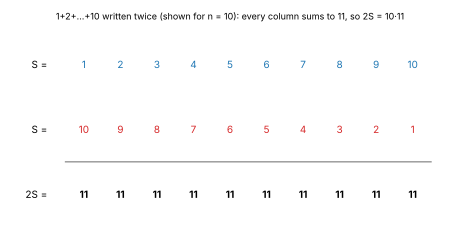
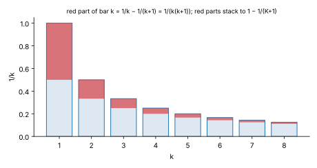
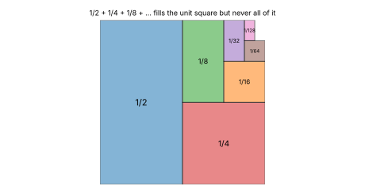
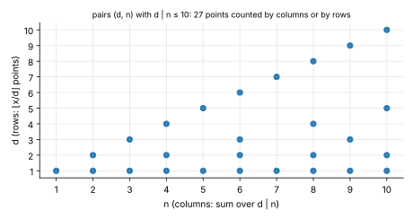
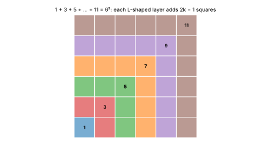
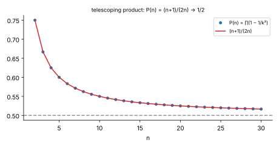
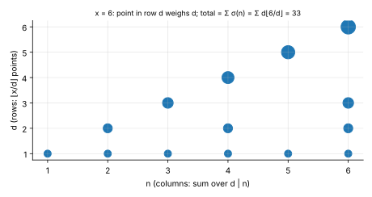
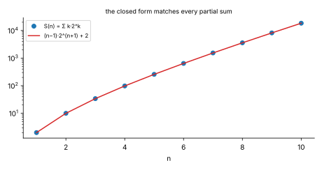

# שיעור כלים כ1: סכומים, מכפלות והחלפת סדר סכימה

**מה נלמד:** איך קוראים וכותבים את הסימנים $`\sum`$ (סכום) ו-$`\prod`$ (מכפלה), כולל סכומים "על המחלקים של $`n`$" ו"על הראשוניים עד $`x`$". נלמד ארבעה כלים שחוזרים בכל הקורס: חוקי חישוב בסכומים, **סכום טלסקופי**, **סכום הנדסי**, ו**החלפת סדר סכימה** בסכום כפול. נכיר גם את פונקציית **הערך השלם** $`\lfloor x \rfloor`$.

**ידע קודם:** חשבון של תיכון. (הוכחות באינדוקציה מופיעות ב[שיעור P2](P02-אינדוקציה.md), אבל אפשר לקרוא את השיעור הזה גם בלעדיו.)

---

## 1. הסימן $`\sum`$

הסימן $`\sum`$ (האות היוונית סיגמה, S כמו Sum) הוא קיצור לסכום ארוך:
```math
\sum_{k=1}^{n} a_k = a_1 + a_2 + \cdots + a_n .
```
* $`k`$ נקרא **משתנה הסכימה** (או האינדקס). השם שלו לא חשוב: $`\sum_{k=1}^n k^2`$ ו-$`\sum_{j=1}^n j^2`$ הם אותו מספר.
* מתחת לסימן כתוב **מאיפה** מתחילים, ומעליו **עד איפה**.
* אם אין אף איבר (למשל $`\sum_{k=1}^{0}`$), הסכום הוא **0** ("סכום ריק").

**דוגמאות לקריאה:**
* $`\sum_{k=1}^{4} k^2 = 1 + 4 + 9 + 16 = 30`$.
* $`\sum_{k=0}^{3} 2^k = 1 + 2 + 4 + 8 = 15`$.

### סכומים עם תנאי
בתורת המספרים כמעט תמיד כותבים **תנאי** מתחת לסימן במקום "מ-... עד ...":
* $`\sum_{d \mid n} f(d)`$ – סכום על כל **המחלקים החיוביים** $`d`$ של $`n`$. למשל $`\sum_{d \mid 12} d = 1 + 2 + 3 + 4 + 6 + 12 = 28`$.
* $`\sum_{n \le x} f(n)`$ – סכום על השלמים $`1 \le n \le x`$ (גם כש-$`x`$ אינו שלם: $`\sum_{n \le 3.7} n = 1 + 2 + 3`$).
* $`\sum_{p \le x} f(p)`$ – האות $`p`$ שמורה ל**ראשוניים**: $`\sum_{p \le 10} p = 2 + 3 + 5 + 7 = 17`$.

### חוקי חישוב
1. **ליניאריות:** $`\sum (a_k + b_k) = \sum a_k + \sum b_k`$ ו-$`\sum c\,a_k = c\sum a_k`$ (קבוע יוצא החוצה).
2. **פיצול:** $`\sum_{k=1}^{n} a_k = \sum_{k=1}^{m} a_k + \sum_{k=m+1}^{n} a_k`$.
3. **הזזת אינדקס:** $`\sum_{k=1}^{n} a_k = \sum_{j=0}^{n-1} a_{j+1}`$ (הצבנו $`k = j + 1`$).

**זהירות:** אין חוק כזה למכפלות בתוך סכום: $`\sum a_k b_k \ne \left(\sum a_k\right)\left(\sum b_k\right)`$ באופן כללי.

---

## 2. שלושה סכומים שכדאי להכיר

**(א) סכום חשבוני:**
```math
\sum_{k=1}^{n} k = \frac{n(n+1)}{2}.
```
**(ב) סכום טלסקופי:** אם כל איבר הוא הפרש $`a_k = b_k - b_{k+1}`$, כמעט הכול מצטמצם:
```math
\sum_{k=1}^{n} (b_k - b_{k+1}) = b_1 - b_{n+1}.
```
**(ג) סכום הנדסי:** לכל $`r \ne 1`$,
```math
\sum_{k=0}^{n} r^k = 1 + r + \cdots + r^n = \frac{r^{n+1} - 1}{r - 1}.
```
**הוכחה של (ג):** נסמן את הסכום ב-$`S`$. אז $`rS = r + r^2 + \cdots + r^{n+1}`$, ובחיסור כמעט הכול מצטמצם: $`rS - S = r^{n+1} - 1`$. מחלקים ב-$`r - 1`$.

---

## 3. הסימן $`\prod`$

באותו אופן, $`\prod`$ (פי גדולה, P כמו Product) מסמן מכפלה:
```math
\prod_{k=1}^{n} a_k = a_1 \cdot a_2 \cdots a_n, \qquad n! = \prod_{k=1}^{n} k .
```
* מכפלה ריקה שווה ל-**1** (כך ש-$`0! = 1`$).
* $`\prod_{p \mid n}`$ – מכפלה על הראשוניים שמחלקים את $`n`$. למשל $`\prod_{p \mid 12}\left(1 - \frac1p\right) = \left(1 - \frac12\right)\left(1 - \frac13\right) = \frac13`$.
* **מכפלה טלסקופית:** $`\prod_{k=1}^{n}\frac{b_{k+1}}{b_k} = \frac{b_{n+1}}{b_1}`$.

---

## 4. פונקציית הערך השלם

$`\lfloor x \rfloor`$ ("רצפה של $`x`$") הוא השלם הגדול ביותר שאינו עולה על $`x`$: $`\lfloor 3.7 \rfloor = 3`$, $`\lfloor 5 \rfloor = 5`$, $`\lfloor -1.2 \rfloor = -2`$.

**שתי עובדות:**
1. $`x - 1 \lt \lfloor x \rfloor \le x`$. כלומר $`\lfloor x \rfloor`$ שונה מ-$`x`$ בפחות מ-1.
2. **מספר הכפולות של $`d`$ בין 1 ל-$`x`$ הוא $`\lfloor x/d \rfloor`$.** (הכפולות הן $`d, 2d, \ldots, md`$, כאשר $`md \le x`$, כלומר $`m \le x/d`$.)

---

## 5. החלפת סדר סכימה

זה הכלי החשוב ביותר בשיעור. **סכום כפול** הוא סכום על זוגות. אפשר לסכום אותו "שורה אחר שורה" או "עמודה אחר עמודה", והתוצאה זהה, כי סופרים בדיוק את אותם זוגות.

**התבנית שתחזור שוב ושוב בקורס:**
```math
\sum_{n \le x}\ \sum_{d \mid n} f(d) \;=\; \sum_{d \le x} f(d)\cdot\#\{n \le x : d \mid n\} \;=\; \sum_{d \le x} f(d) \left\lfloor \frac{x}{d} \right\rfloor .
```
**למה זה נכון:** שני הצדדים הם סכום של $`f(d)`$ על כל הזוגות $`(d, n)`$ עם $`d \mid n`$ ו-$`n \le x`$. משמאל קבענו קודם את $`n`$ ועברנו על המחלקים שלו; מימין קבענו קודם את $`d`$ וספרנו את הכפולות שלו (עובדה 2).

---

## 6. דוגמאות פתורות

### דוגמה 1: הסכום החשבוני (הטריק של גאוס)

**שאלה.** חשבו את $`\sum_{k=1}^{100} k`$.



<sub>הטריק של גאוס, מודגם עבור n = 10: כותבים את הסכום פעמיים, פעם בסדר הפוך, וכל עמודה מסתכמת ל-n + 1.</sub>

**פתרון.**
1. נכתוב את הסכום $`S`$ פעמיים, פעם בסדר עולה ופעם בסדר יורד:
$`S = 1 + 2 + \cdots + 100`$ ו-$`S = 100 + 99 + \cdots + 1`$.
2. נחבר עמודה עמודה: בכל עמודה $`k + (101 - k) = 101`$, ויש 100 עמודות.
3. לכן $`2S = 100 \cdot 101`$, ו-$`S = 5050`$.

באופן כללי אותו טיעון נותן $`\sum_{k=1}^{n} k = \frac{n(n+1)}{2}`$.

### דוגמה 2: סכום טלסקופי

**שאלה.** חשבו את $`\displaystyle\sum_{k=1}^{99}\frac{1}{k(k+1)}`$.



<sub>כל איבר 1/(k(k+1)) הוא הפרש של שתי מדרגות 1/k − 1/(k+1); הסכום הוא 1 − 1/100.</sub>

**פתרון.**
1. **הפירוק:** $`\frac{1}{k(k+1)} = \frac{1}{k} - \frac{1}{k+1}`$. (בדיקה: $`\frac1k - \frac1{k+1} = \frac{(k+1) - k}{k(k+1)}`$.)
2. נכתוב את הסכום: $`\left(1 - \tfrac12\right) + \left(\tfrac12 - \tfrac13\right) + \cdots + \left(\tfrac1{99} - \tfrac1{100}\right)`$.
3. כל $`\frac1k`$ שמופיע עם מינוס מתבטל עם אותו $`\frac1k`$ עם פלוס באיבר הבא. נשארים רק הראשון והאחרון: $`1 - \frac{1}{100} = \frac{99}{100}`$.

### דוגמה 3: סכום הנדסי

**שאלה.** חשבו את $`\sum_{k=1}^{10}\frac{1}{2^k}`$, והסבירו למה הסכום תמיד קטן מ-1, כמה איברים שלא נחבר.



<sub>ריבוע בשטח 1: חצי, ואז רבע, ואז שמינית… כל חלק מכסה חצי ממה שנשאר, ונשאר תמיד חלק בגודל 1/2^n.</sub>

**פתרון.**
1. לפי נוסחת הסכום ההנדסי עם $`r = \frac12`$: $`\sum_{k=0}^{10} \frac1{2^k} = \frac{(1/2)^{11} - 1}{1/2 - 1} = 2 - \frac{1}{2^{10}}`$.
2. הסכום שלנו מתחיל ב-$`k = 1`$, אז מחסירים את האיבר $`k = 0`$ (שהוא 1): $`1 - \frac{1}{2^{10}} = \frac{1023}{1024}`$.
3. באופן כללי $`\sum_{k=1}^{n}\frac1{2^k} = 1 - \frac1{2^n} \lt 1`$, וזה בדיוק מה שהציור מראה: כל חלק ממלא חצי מהשטח שנשאר.

### דוגמה 4: החלפת סדר סכימה – סכום מספר המחלקים

**שאלה.** נסמן ב-$`d(n)`$ את מספר המחלקים של $`n`$. חשבו את $`\sum_{n=1}^{10} d(n)`$ בשתי דרכים.



<sub>הזוגות (d, n) עם d | n ≤ 10: ספירה לפי עמודות נותנת d(1)+⋯+d(10); ספירה לפי שורות נותנת ⌊10/1⌋+⌊10/2⌋+⋯+⌊10/10⌋. בשתי הדרכים יש 27 נקודות.</sub>

**פתרון.**
1. **לפי $`n`$ (עמודות):** $`d(1), \ldots, d(10) = 1, 2, 2, 3, 2, 4, 2, 4, 3, 4`$. הסכום: $`27`$.
2. **לפי $`d`$ (שורות):** $`d(n) = \sum_{d \mid n} 1`$, ולפי התבנית מסעיף 5 עם $`f = 1`$:
$`\sum_{n \le 10} d(n) = \sum_{d \le 10}\left\lfloor \frac{10}{d}\right\rfloor = 10 + 5 + 3 + 2 + 2 + 1 + 1 + 1 + 1 + 1 = 27`$.
3. שתי התשובות שוות, כי שתיהן סופרות את אותן נקודות בציור.

**למה הדרך השנייה טובה יותר:** את $`d(n)`$ קשה לחשב (צריך לפרק לגורמים), אבל $`\lfloor x/d \rfloor`$ קל. ב[שיעור 9](09-סדרים-של-פונקציות.md) נשתמש בדיוק בזה כדי להראות ש-$`\sum_{n\le x} d(n)`$ הוא בערך $`x \log x`$.

---

## 7. תרגילים

**תרגיל 1.** הוכיחו ש-$`\sum_{k=1}^{n}(2k - 1) = n^2`$ (סכום $`n`$ המספרים האי-זוגיים הראשונים), ובדקו עבור $`n = 10`$.



<sub>ריבוע n×n בנוי משכבות בצורת L בגדלים 1, 3, 5, …, 2n−1.</sub>

<details><summary>פתרון</summary>

**דרך אלגברית:** לפי ליניאריות, $`\sum_{k=1}^n (2k-1) = 2\sum_{k=1}^n k - \sum_{k=1}^n 1 = 2\cdot\frac{n(n+1)}{2} - n = n^2 + n - n = n^2`$.

**דרך טלסקופית:** $`2k - 1 = k^2 - (k-1)^2`$, ולכן הסכום הוא $`n^2 - 0^2 = n^2`$.

**דרך ציורית:** כל שכבת L מוסיפה לריבוע $`(k-1)\times(k-1)`$ שורה ועמודה, כלומר $`2k-1`$ משבצות, ומקבלים ריבוע $`k\times k`$.

**בדיקה:** $`1 + 3 + \cdots + 19 = 100 = 10^2`$.
</details>

**תרגיל 2.** חשבו את $`\displaystyle\prod_{k=2}^{10}\left(1 - \frac{1}{k^2}\right)`$.



<sub>המכפלה החלקית P(n) = (n+1)/(2n) יורדת אל 1/2.</sub>

<details><summary>פתרון</summary>

1. נפרק: $`1 - \frac1{k^2} = \frac{(k-1)(k+1)}{k^2} = \frac{k-1}{k}\cdot\frac{k+1}{k}`$.
2. המכפלה מתפצלת לשתי מכפלות טלסקופיות:
$`\prod_{k=2}^{10}\frac{k-1}{k} = \frac{1}{10}`$ ו-$`\prod_{k=2}^{10}\frac{k+1}{k} = \frac{11}{2}`$.
3. התוצאה: $`\frac{1}{10}\cdot\frac{11}{2} = \frac{11}{20}`$. באופן כללי $`\prod_{k=2}^{n}\left(1 - \frac1{k^2}\right) = \frac{n+1}{2n}`$, שמתקרב ל-$`\frac12`$.
</details>

**תרגיל 3.** הוכיחו ש-$`\sum_{n=1}^{x}\sigma(n) = \sum_{d=1}^{x} d\left\lfloor\frac{x}{d}\right\rfloor`$, כאשר $`\sigma(n) = \sum_{d\mid n} d`$ הוא סכום המחלקים של $`n`$ ו-$`x`$ שלם חיובי. בדקו עבור $`x = 6`$.



<sub>אותה רשת זוגות (d, n) כמו בדוגמה 4, אבל כל נקודה בשורה d שוקלת d.</sub>

<details><summary>פתרון</summary>

1. לפי ההגדרה, $`\sum_{n\le x}\sigma(n) = \sum_{n \le x}\sum_{d \mid n} d`$.
2. זו בדיוק התבנית מסעיף 5 עם $`f(d) = d`$: לכל $`d`$, המחובר $`d`$ מופיע פעם אחת לכל כפולה $`n \le x`$ של $`d`$, כלומר $`\lfloor x/d\rfloor`$ פעמים.
3. **בדיקה עבור $`x = 6`$:** $`\sigma(1..6) = 1, 3, 4, 7, 6, 12`$, סכום 33. מהצד השני: $`1\cdot6 + 2\cdot3 + 3\cdot2 + 4\cdot1 + 5\cdot1 + 6\cdot1 = 6+6+6+4+5+6 = 33`$.
</details>

**תרגיל 4.** חשבו את $`\sum_{k=1}^{n} k\,2^k`$. (רמז: נסו את אותו טריק כמו בהוכחת הסכום ההנדסי: חשבו $`2S - S`$.)



<sub>ערכי הסכום S(n) לעומת הנוסחה (n−1)·2^(n+1) + 2: הנקודות יושבות בדיוק על הנוסחה.</sub>

<details><summary>פתרון</summary>

1. $`S = 1\cdot2 + 2\cdot2^2 + 3\cdot2^3 + \cdots + n\cdot2^n`$.
2. $`2S = 1\cdot2^2 + 2\cdot2^3 + \cdots + (n-1)\cdot2^n + n\cdot2^{n+1}`$.
3. בחיסור $`2S - S`$, מכל חזקה $`2^k`$ עם $`2 \le k \le n`$ נשאר $`(k-1) - k = -1`$ פעמים: $`S = n\cdot2^{n+1} - (2 + 2^2 + \cdots + 2^n) = n\cdot 2^{n+1} - (2^{n+1} - 2)`$.
4. כלומר $`S = (n-1)2^{n+1} + 2`$. **בדיקה עבור $`n = 5`$:** $`2 + 8 + 24 + 64 + 160 = 258 = 4\cdot64 + 2`$.
</details>

---

## סיכום
* $`\sum`$ ו-$`\prod`$ הם קיצורים; סכום ריק = 0, מכפלה ריקה = 1.
* שלושה סכומים שכדאי לזכור: חשבוני, טלסקופי, הנדסי.
* $`\lfloor x/d \rfloor`$ = מספר הכפולות של $`d`$ עד $`x`$.
* **החלפת סדר סכימה:** $`\sum_{n\le x}\sum_{d\mid n} f(d) = \sum_{d\le x} f(d)\lfloor x/d\rfloor`$. זה הכלי שיעבוד בשבילנו בשיעורים 6, 9, 10 ו-14.

**השיעור הבא:** [שיעור 1: התחלקות](01-התחלקות.md)

**להעמקה:** [סיגמא (סימון)](https://he.wikipedia.org/wiki/%D7%A1%D7%99%D7%92%D7%9E%D7%90_(%D7%A1%D7%99%D7%9E%D7%95%D7%9F)) · [טור הנדסי](https://he.wikipedia.org/wiki/%D7%98%D7%95%D7%A8_%D7%94%D7%A0%D7%93%D7%A1%D7%99) · [פונקציית הערך השלם](https://he.wikipedia.org/wiki/%D7%A4%D7%95%D7%A0%D7%A7%D7%A6%D7%99%D7%99%D7%AA_%D7%94%D7%A2%D7%A8%D7%9A_%D7%94%D7%A9%D7%9C%D7%9D)

---
<sub>חלק מ[קורס תורת המספרים](../COURSE.md). התוכן מופץ ברישיון [CC BY-SA 4.0](https://creativecommons.org/licenses/by-sa/4.0/).</sub>
