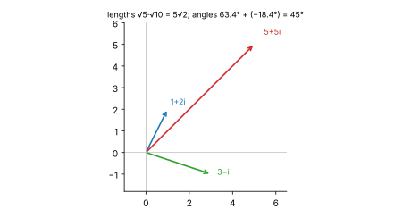
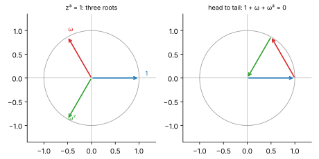
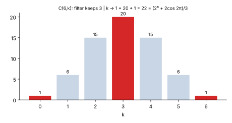
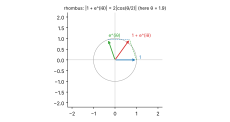
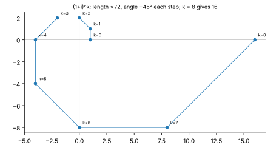
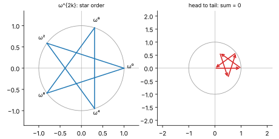
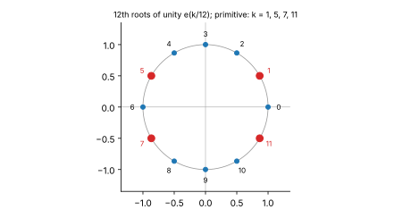
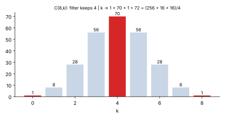

# שיעור כלים כ2: מספרים מרוכבים ושורשי יחידה

**מה נלמד:** מהו מספר מרוכב, איך מחשבים איתו, ולמה הכי נוח לחשוב עליו כ**חץ במישור**: כפל מרוכבים = כפל אורכים וחיבור זוויות. נגדיר את הסימון $`e^{i\theta}`$, נכיר את **שורשי היחידה**, ונוכיח את העובדה החשובה ביותר עליהם: **סכום כל שורשי היחידה מסדר $`n`$ הוא אפס**. מהעובדה הזו נבנה "מסננת" שבוחרת מתוך סכום רק את האיברים שמתחלקים ב-$`n`$. המסננת הזו היא הבסיס לסכומי רמנוג'אן ([שיעור 6](06-פונקציות-אריתמטיות.md)), לסכומי גאוס ([שיעור 7](07-שאריות-ריבועיות.md)), לקרקטרים ([שיעור 13](13-קרקטרים-ופונקציות-L.md)) ולסכומים אקספוננציאליים ([שיעור 15](15-סכומים-אקספוננציאליים.md)).

**ידע קודם:** טריגונומטריה של תיכון (סינוס, קוסינוס, נוסחאות הסכום $`\cos(\alpha+\beta)`$ ו-$`\sin(\alpha+\beta)`$), [שיעור כלים כ1](T01-סכומים-ומכפלות.md) (סכום הנדסי).

---

## 1. מהו מספר מרוכב

מוסיפים למספרים הממשיים מספר חדש $`i`$ המקיים $`i^2 = -1`$. **מספר מרוכב** הוא ביטוי $`z = a + bi`$ עם $`a, b`$ ממשיים.
* $`a = \mathrm{Re}\,z`$ נקרא **החלק הממשי**, $`b = \mathrm{Im}\,z`$ **החלק המדומה**.
* מחברים וכופלים כמו בביטויים אלגבריים רגילים, ובכל מקום ש-$`i^2`$ מופיע מחליפים ב-$`-1`$.

**הצמוד** של $`z = a + bi`$ הוא $`\bar z = a - bi`$, ו**הערך המוחלט** הוא $`|z| = \sqrt{a^2 + b^2}`$. עובדה שימושית:
```math
z\bar z = (a+bi)(a-bi) = a^2 - (bi)^2 = a^2 + b^2 = |z|^2 .
```
**חילוק:** כדי לחשב $`\frac{w}{z}`$ כופלים מונה ומכנה ב-$`\bar z`$, וכך המכנה נהיה ממשי: $`\frac{w}{z} = \frac{w\bar z}{|z|^2}`$.

---

## 2. המישור המרוכב והצורה הקוטבית

את $`z = a + bi`$ מציירים כנקודה $`(a, b)`$ במישור, או כחץ מהראשית אליה.
* **האורך** של החץ הוא $`r = |z|`$.
* **הזווית** $`\theta`$ (נמדדת מהציר הממשי החיובי, נגד כיוון השעון) נקראת **הארגומנט** של $`z`$.

לפי הגדרת סינוס וקוסינוס, $`a = r\cos\theta`$ ו-$`b = r\sin\theta`$, ולכן
```math
z = r(\cos\theta + i\sin\theta) .
```
זו **הצורה הקוטבית**.

### המשפט המרכזי: כפל = כפל אורכים וחיבור זוויות
אם $`z_1 = r_1(\cos\alpha + i\sin\alpha)`$ ו-$`z_2 = r_2(\cos\beta + i\sin\beta)`$, אז
```math
z_1 z_2 = r_1 r_2\big(\cos(\alpha+\beta) + i\sin(\alpha+\beta)\big).
```
**הוכחה:** פותחים סוגריים:
$`(\cos\alpha + i\sin\alpha)(\cos\beta + i\sin\beta) = (\cos\alpha\cos\beta - \sin\alpha\sin\beta) + i(\sin\alpha\cos\beta + \cos\alpha\sin\beta)`$,
ולפי נוסחאות הסכום של תיכון זה $`\cos(\alpha+\beta) + i\sin(\alpha+\beta)`$. ∎

### הסימון $`e^{i\theta}`$
מקצרים: $`e^{i\theta} := \cos\theta + i\sin\theta`$. זו נקודה על **מעגל היחידה** בזווית $`\theta`$. בסימון הזה המשפט המרכזי נראה כמו חוק חזקות רגיל:
```math
e^{i\alpha}\cdot e^{i\beta} = e^{i(\alpha+\beta)}, \qquad \left(e^{i\theta}\right)^n = e^{in\theta} \quad (\text{נוסחת דה-מואבר}).
```
(בשיעור כלים כ9 נראה שזה לא רק סימון: הפונקציה המעריכית באמת מקיימת $`e^{i\theta} = \cos\theta + i\sin\theta`$.)

עובדות שימושיות: $`|e^{i\theta}| = 1`$; $`\overline{e^{i\theta}} = e^{-i\theta} = 1/e^{i\theta}`$; $`e^{2\pi i} = 1`$; $`e^{i\pi} = -1`$.

**סימון מקובל בתורת המספרים:** $`e(x) := e^{2\pi i x}`$. אז $`e(x+1) = e(x)`$ (מחזוריות), ו-$`e(x)e(y) = e(x+y)`$.

---

## 3. שורשי יחידה

**שורש יחידה מסדר $`n`$** הוא מספר מרוכב $`z`$ עם $`z^n = 1`$.

**משפט.** יש בדיוק $`n`$ שורשי יחידה מסדר $`n`$, והם
```math
\omega^0, \omega^1, \ldots, \omega^{n-1}, \qquad \omega = e^{2\pi i/n} = e(1/n).
```
הם יושבים על מעגל היחידה, בקודקודים של מצולע משוכלל בן $`n`$ צלעות שאחד מקודקודיו הוא 1.

**הוכחה:** לפי דה-מואבר $`(\omega^k)^n = e^{2\pi i k} = 1`$, והזוויות $`2\pi k/n`$ ל-$`0 \le k \lt n`$ שונות, אז אלה $`n`$ שורשים שונים. לפולינום $`z^n - 1`$ ממעלה $`n`$ אין יותר מ-$`n`$ שורשים. ∎

שורש יחידה $`\omega^k`$ נקרא **פרימיטיבי** אם הסדר שלו בדיוק $`n`$ (כלומר $`(\omega^k)^m \ne 1`$ לכל $`0 \lt m \lt n`$). זה קורה בדיוק כאשר $`\gcd(k, n) = 1`$, ולכן יש $`\varphi(n)`$ שורשים פרימיטיביים ([שיעור 5](05-פרמה-אוילר-וילסון.md)).

### המשפט החשוב: סכום שורשי היחידה
```math
\sum_{k=0}^{n-1} e\!\left(\frac{km}{n}\right) = \begin{cases} n, & n \mid m,\\ 0, & n \nmid m.\end{cases}
```
**הוכחה:** נסמן $`q = e(m/n)`$. אם $`n \mid m`$, אז $`q = 1`$ וכל $`n`$ המחוברים שווים 1. אחרת $`q \ne 1`$, והסכום הוא סכום הנדסי ([שיעור כ1](T01-סכומים-ומכפלות.md)):
$`\sum_{k=0}^{n-1} q^k = \frac{q^n - 1}{q - 1} = \frac{e(m) - 1}{q - 1} = \frac{1 - 1}{q-1} = 0`$. ∎

**המשמעות הגאומטרית:** החיצים לקודקודים של מצולע משוכלל, כשמחברים אותם ראש לזנב, סוגרים מצולע וחוזרים לנקודת המוצא.

**המסננת:** המשפט אומר ש-$`\frac1n\sum_{k=0}^{n-1} e(km/n)`$ שווה 1 אם $`n \mid m`$ ו-0 אחרת. לכן אפשר "לסנן" מתוך כל סכום רק את האיברים שהאינדקס שלהם מתחלק ב-$`n`$:
```math
\sum_{\substack{m \\ n \mid m}} a_m = \frac1n\sum_{k=0}^{n-1}\ \sum_m a_m\, e\!\left(\frac{km}{n}\right).
```

---

## 4. דוגמאות פתורות

### דוגמה 1: כפל וחילוק, אלגברית וגאומטרית

**שאלה.** חשבו את $`(1 + 2i)(3 - i)`$ ואת $`\frac{2 - i}{1 + i}`$, ובדקו שהאורכים מוכפלים.



<sub>החיצים 1+2i ו-3−i והמכפלה 5+5i: האורך של המכפלה הוא √5·√10 = 5√2, והזווית שלה היא סכום הזוויות.</sub>

**פתרון.**
1. **כפל:** $`(1+2i)(3-i) = 3 - i + 6i - 2i^2 = 3 + 5i + 2 = 5 + 5i`$.
2. **בדיקת אורכים:** $`|1+2i| = \sqrt{1+4} = \sqrt5`$, $`|3-i| = \sqrt{9+1} = \sqrt{10}`$, ומכפלתם $`\sqrt{50} = 5\sqrt2`$. מהצד השני $`|5+5i| = \sqrt{25+25} = 5\sqrt2`$. מתאים.
3. **בדיקת זוויות:** הזווית של $`5+5i`$ היא $`45^\circ`$. הזווית של $`1+2i`$ היא $`\arctan 2 \approx 63.43^\circ`$, והזווית של $`3-i`$ היא $`-\arctan\frac13 \approx -18.43^\circ`$. הסכום: $`45^\circ`$. מתאים.
4. **חילוק:** כופלים מונה ומכנה בצמוד של המכנה, $`1 - i`$:
$`\frac{2-i}{1+i} = \frac{(2-i)(1-i)}{(1+i)(1-i)} = \frac{2 - 2i - i + i^2}{1 + 1} = \frac{1 - 3i}{2} = \frac12 - \frac32 i`$.
5. **בדיקה:** $`\left(\frac12 - \frac32 i\right)(1+i) = \frac12 + \frac12 i - \frac32 i - \frac32 i^2 = \frac12 + \frac32 - i = 2 - i`$. נכון.

### דוגמה 2: שורשי היחידה מסדר 3

**שאלה.** מצאו את כל הפתרונות של $`z^3 = 1`$, ובדקו שסכומם 0 ושמכפלתם 1.



<sub>שלושת שורשי היחידה מסדר 3 הם קודקודי משולש שווה צלעות על מעגל היחידה; כשמחברים את החיצים ראש לזנב חוזרים לראשית.</sub>

**פתרון.**
1. לפי המשפט, הפתרונות הם $`1, \omega, \omega^2`$ עם $`\omega = e^{2\pi i/3} = \cos 120^\circ + i\sin 120^\circ`$.
2. $`\cos 120^\circ = -\frac12`$ ו-$`\sin 120^\circ = \frac{\sqrt3}{2}`$, ולכן $`\omega = -\frac12 + \frac{\sqrt3}2 i`$.
3. $`\omega^2 = e^{4\pi i/3} = \cos 240^\circ + i\sin 240^\circ = -\frac12 - \frac{\sqrt3}2 i`$ (שימו לב: $`\omega^2 = \bar\omega`$).
4. **בדיקה ישירה ש-$`\omega^3 = 1`$:** $`\omega^2 = \left(-\frac12\right)^2 + 2\cdot\left(-\frac12\right)\cdot\frac{\sqrt3}2 i + \left(\frac{\sqrt3}{2}i\right)^2 = \frac14 - \frac{\sqrt3}2 i - \frac34 = -\frac12 - \frac{\sqrt3}{2}i`$, ואז $`\omega^3 = \omega\cdot\omega^2 = \left(-\frac12\right)^2 - \left(\frac{\sqrt3}2 i\right)^2 = \frac14 + \frac34 = 1`$ (כפל של צמודים).
5. **סכום:** $`1 + \left(-\frac12 + \frac{\sqrt3}2 i\right) + \left(-\frac12 - \frac{\sqrt3}2 i\right) = 0`$. בהתאם למשפט.
6. **מכפלה:** $`1\cdot\omega\cdot\omega^2 = \omega^3 = 1`$.

### דוגמה 3: המסננת – סכום מקדמים בינומיים בקפיצות של 3

**שאלה.** חשבו את $`\binom60 + \binom63 + \binom66`$ בלי לחשב כל מקדם בנפרד, ומצאו נוסחה כללית ל-$`\sum_{3 \mid k}\binom nk`$.



<sub>המקדמים הבינומיים C(6,k); המסננת עם שורשי היחידה מסדר 3 בוחרת רק את k = 0, 3, 6 (באדום): 1 + 20 + 1 = 22.</sub>

**פתרון.**
1. לפי הבינום של ניוטון, $`(1 + z)^n = \sum_{k=0}^n \binom nk z^k`$.
2. נציב $`z = 1, \omega, \omega^2`$ (שורשי היחידה מסדר 3) ונחבר:
$`(1+1)^n + (1+\omega)^n + (1+\omega^2)^n = \sum_k \binom nk\left(1 + \omega^k + \omega^{2k}\right)`$.
3. לפי המשפט החשוב (עם $`n = 3`$ ו-$`m = k`$), הסוגריים שווים 3 כאשר $`3 \mid k`$ ו-0 אחרת. לכן אגף ימין הוא $`3\sum_{3\mid k}\binom nk`$.
4. **חישוב אגף שמאל:** $`1 + \omega = \frac12 + \frac{\sqrt3}2 i = e^{i\pi/3}`$, ו-$`1 + \omega^2 = e^{-i\pi/3}`$ (הצמוד). לפי דה-מואבר: $`(1+\omega)^n + (1+\omega^2)^n = e^{in\pi/3} + e^{-in\pi/3} = 2\cos\frac{n\pi}{3}`$.
5. **הנוסחה:** $`\displaystyle\sum_{3\mid k}\binom nk = \frac{2^n + 2\cos(n\pi/3)}{3}`$.
6. **עבור $`n = 6`$:** $`\frac{64 + 2\cos 2\pi}{3} = \frac{66}{3} = 22`$. **בדיקה ישירה:** $`1 + 20 + 1 = 22`$.

### דוגמה 4: הגודל של $`1 + e^{i\theta}`$

**שאלה.** הוכיחו ש-$`|1 + e^{i\theta}| = 2\left|\cos\frac\theta2\right|`$.



<sub>מעוין עם צלעות 1 ו-e^{iθ}: האלכסון 1 + e^{iθ} חוצה את הזווית θ, ואורכו 2|cos(θ/2)|.</sub>

**פתרון.**
1. **הוצאת "חצי זווית":** $`1 + e^{i\theta} = e^{i\theta/2}\left(e^{-i\theta/2} + e^{i\theta/2}\right)`$. (בדיקה: פותחים סוגריים ומקבלים $`e^0 + e^{i\theta}`$.)
2. $`e^{i\theta/2} + e^{-i\theta/2} = \left(\cos\tfrac\theta2 + i\sin\tfrac\theta2\right) + \left(\cos\tfrac\theta2 - i\sin\tfrac\theta2\right) = 2\cos\frac\theta2`$.
3. לכן $`1 + e^{i\theta} = 2\cos\frac\theta2\cdot e^{i\theta/2}`$, ומכיוון ש-$`|e^{i\theta/2}| = 1`$, הגודל הוא $`2\left|\cos\frac\theta2\right|`$. ∎
4. **בדיקה עם $`\theta = \frac{2\pi}{3}`$:** $`1 + \omega = \frac12 + \frac{\sqrt3}{2}i`$ (מדוגמה 3), שגודלו $`\sqrt{\frac14 + \frac34} = 1`$, ואכן $`2\cos 60^\circ = 1`$.

הטריק של "הוצאת חצי זווית" חוזר הרבה, למשל בחישוב סכומים אקספוננציאליים.

---

## 5. תרגילים

**תרגיל 1.** חשבו את $`(1 + i)^8`$ בשתי דרכים: בכפל חוזר, ובצורה הקוטבית.



<sub>החזקות (1+i)^k: בכל צעד האורך גדל פי √2 והזווית גדלה ב-45°; אחרי 8 צעדים חוזרים לציר הממשי החיובי באורך 16.</sub>

<details><summary>פתרון</summary>

**כפל חוזר:** $`(1+i)^2 = 1 + 2i + i^2 = 2i`$. לכן $`(1+i)^4 = (2i)^2 = -4`$, ו-$`(1+i)^8 = (-4)^2 = 16`$.

**צורה קוטבית:** $`|1 + i| = \sqrt2`$ והזווית $`45^\circ = \pi/4`$, כלומר $`1 + i = \sqrt2\,e^{i\pi/4}`$. לפי דה-מואבר: $`(1+i)^8 = (\sqrt2)^8 e^{8i\pi/4} = 16\,e^{2\pi i} = 16`$.
</details>

**תרגיל 2.** יהי $`\omega = e(1/5)`$. חשבו את $`\sum_{k=0}^{4}\omega^{2k}`$ ואת $`\sum_{k=0}^{4}\omega^{5k}`$.



<sub>החזקות ω^{2k} מבקרות בכל חמשת הקודקודים בסדר של כוכב מחומש; החיצים, ראש לזנב, נסגרים לאפס.</sub>

<details><summary>פתרון</summary>

לפי המשפט החשוב עם $`n = 5`$: $`\sum_{k=0}^4 \omega^{km} = \sum_{k=0}^4 e(km/5)`$, ששווה 5 אם $`5 \mid m`$ ו-0 אחרת.
* עבור $`m = 2`$: $`5 \nmid 2`$, ולכן הסכום **0**. (גאומטרית: $`\omega^{2k}`$ עוברים על אותם חמישה קודקודים, רק בסדר אחר.)
* עבור $`m = 5`$: כל איבר הוא $`\omega^{5k} = 1`$, והסכום **5**.
</details>

**תרגיל 3.** אילו משורשי היחידה מסדר 12 הם פרימיטיביים? בדקו שמספרם $`\varphi(12)`$, ושסכומם 0.



<sub>12 שורשי היחידה מסדר 12; הפרימיטיביים (k = 1, 5, 7, 11) באדום.</sub>

<details><summary>פתרון</summary>

1. $`\omega^k = e(k/12)`$ פרימיטיבי בדיוק כאשר $`\gcd(k, 12) = 1`$, כלומר $`k = 1, 5, 7, 11`$. יש 4 כאלה, ואכן $`\varphi(12) = 12\left(1-\frac12\right)\left(1-\frac13\right) = 4`$.
2. למשל $`\omega^2`$ אינו פרימיטיבי: $`(\omega^2)^6 = \omega^{12} = 1`$, כלומר הסדר שלו 6.
3. **הסכום:** $`e\left(\frac1{12}\right) + e\left(\frac{11}{12}\right) = 2\cos 30^\circ = \sqrt3`$ ו-$`e\left(\frac5{12}\right) + e\left(\frac{7}{12}\right) = 2\cos150^\circ = -\sqrt3`$ (כל זוג הוא מספר וצמודו). סך הכול $`0`$.

(הסכום הזה הוא $`\mu(12)`$, כאשר $`\mu`$ היא פונקציית מביוס, ואכן $`\mu(12) = 0`$ כי $`4 \mid 12`$. נראה את זה ב[שיעור 6](06-פונקציות-אריתמטיות.md).)
</details>

**תרגיל 4.** בעזרת שורשי היחידה מסדר 4 ($`1, i, -1, -i`$), הוכיחו ש-$`\displaystyle\sum_{4\mid k}\binom nk = \frac{2^n + (1+i)^n + (1-i)^n}{4}`$ (עבור $`n \ge 1`$), וחשבו עבור $`n = 8`$.



<sub>המקדמים C(8,k): המסננת עם שורשי היחידה מסדר 4 בוחרת את k = 0, 4, 8: 1 + 70 + 1 = 72.</sub>

<details><summary>פתרון</summary>

1. בדיוק כמו בדוגמה 3: $`\sum_{j=0}^{3}(1 + i^j)^n = \sum_k\binom nk\sum_{j=0}^3 i^{jk}`$, והסכום הפנימי הוא 4 אם $`4\mid k`$ ו-0 אחרת.
2. אגף שמאל: $`2^n + (1+i)^n + 0^n + (1-i)^n`$ (עבור $`j = 2`$, $`1 + (-1) = 0`$, ו-$`0^n = 0`$ כי $`n \ge 1`$).
3. עבור $`n = 8`$: $`(1+i)^8 = 16`$ (תרגיל 1), וגם $`(1-i)^8 = \overline{(1+i)^8} = 16`$. לכן הסכום $`\frac{256 + 16 + 16}{4} = 72`$.
4. **בדיקה ישירה:** $`\binom80 + \binom84 + \binom88 = 1 + 70 + 1 = 72`$.
</details>

---

## סיכום
* $`z = a + bi`$; $`|z|^2 = z\bar z`$; חילוק = כפל בצמוד.
* **כפל = כפל אורכים, חיבור זוויות.** בסימון $`e^{i\theta} = \cos\theta + i\sin\theta`$ זה נראה כמו חוק חזקות.
* שורשי היחידה מסדר $`n`$: $`e(k/n)`$, $`0 \le k \lt n`$; יש $`\varphi(n)`$ פרימיטיביים.
* **המשפט החשוב:** $`\sum_{k=0}^{n-1}e(km/n)`$ הוא $`n`$ אם $`n\mid m`$ ו-0 אחרת. זו "מסננת" לתנאי התחלקות.

**השיעור הקודם:** [שיעור 5](05-פרמה-אוילר-וילסון.md) · **השיעור הבא:** [שיעור 6: פונקציות אריתמטיות](06-פונקציות-אריתמטיות.md)

**להעמקה:** [מספר מרוכב](https://he.wikipedia.org/wiki/%D7%9E%D7%A1%D7%A4%D7%A8_%D7%9E%D7%A8%D7%95%D7%9B%D7%91) · [שורש יחידה](https://he.wikipedia.org/wiki/%D7%A9%D7%95%D7%A8%D7%A9_%D7%99%D7%97%D7%99%D7%93%D7%94) · [נוסחת דה-מואבר](https://he.wikipedia.org/wiki/%D7%A0%D7%95%D7%A1%D7%97%D7%AA_%D7%93%D7%94-%D7%9E%D7%95%D7%90%D7%91%D7%A8)

---
<sub>חלק מ[קורס תורת המספרים](../COURSE.md). התוכן מופץ ברישיון [CC BY-SA 4.0](https://creativecommons.org/licenses/by-sa/4.0/).</sub>
