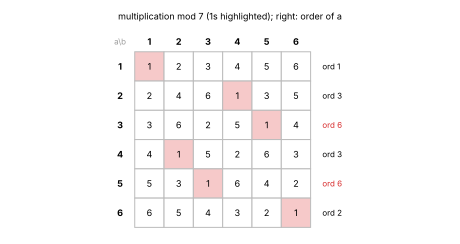
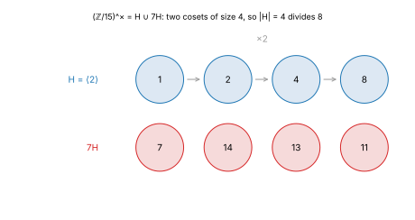
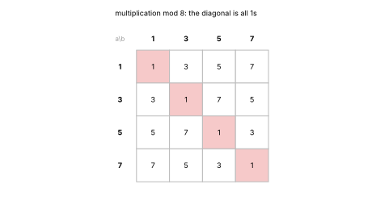
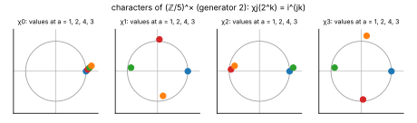
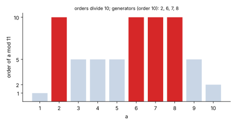
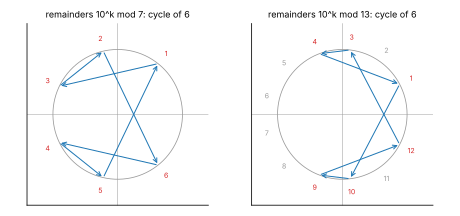
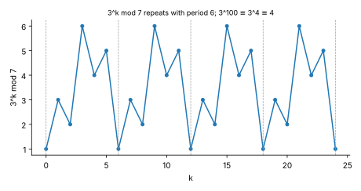
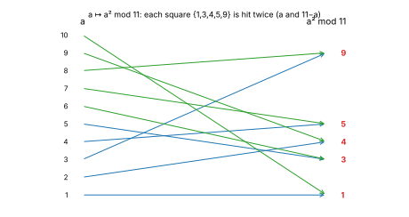

# שיעור כלים כ3: חבורות – המעט שצריך

**מה נלמד:** **חבורה** היא קבוצה עם פעולה שאפשר "לבטל". נראה שהשאריות ההפיכות מודולו $`n`$ יוצרות חבורה, נגדיר **סדר** של איבר ו**חבורה ציקלית**, ונוכיח את **משפט לגרנז'**: גודל של תת-חבורה מחלק את גודל החבורה. ממשפט לגרנז' נקבל מחדש, בשורה אחת, את משפטי פרמה ואוילר. בסוף נכיר **קרקטרים**, "פונקציות שמכבדות את הכפל", שיהיו הכלי המרכזי ב[שיעור 13](13-קרקטרים-ופונקציות-L.md).

**ידע קודם:** [שיעור 4](04-חשבון-מודולרי.md) (חפיפות והופכי מודולרי), [שיעור 5](05-פרמה-אוילר-וילסון.md) (פונקציית אוילר $`\varphi`$), [שיעור כלים כ2](T02-מספרים-מרוכבים.md) (שורשי יחידה).

---

## 1. ההגדרה

**חבורה** היא קבוצה $`G`$ עם פעולה $`\cdot`$ (שלוקחת שני איברים ומחזירה איבר של $`G`$) כך ש:
1. **קיבוציות:** $`(a\cdot b)\cdot c = a\cdot(b\cdot c)`$.
2. **איבר יחידה:** יש $`e \in G`$ כך ש-$`e\cdot a = a\cdot e = a`$ לכל $`a`$.
3. **הופכי:** לכל $`a`$ יש $`a^{-1}`$ עם $`a\cdot a^{-1} = a^{-1}\cdot a = e`$.

אם בנוסף $`a\cdot b = b\cdot a`$ תמיד, החבורה נקראת **אבלית** (חילופית). כל החבורות בקורס הזה אבליות.

**הדוגמאות שלנו:**
* $`\mathbb{Z}/n`$: השאריות $`0, 1, \ldots, n-1`$ עם **חיבור** מודולו $`n`$. היחידה היא 0, וההופכי של $`a`$ הוא $`n - a`$.
* $`(\mathbb{Z}/n)^\times`$: השאריות **הזרות** ל-$`n`$, עם **כפל** מודולו $`n`$. היחידה היא 1, וההופכי קיים לפי [שיעור 4](04-חשבון-מודולרי.md). מספר האיברים הוא $`\varphi(n)`$.
* שורשי היחידה מסדר $`n`$ עם כפל מרוכבים ([שיעור כ2](T02-מספרים-מרוכבים.md)).

**למה לא כל השאריות מודולו $`n`$ עם כפל?** כי ל-0 (ולכל שארית שאינה זרה ל-$`n`$) אין הופכי.

---

## 2. סדר של איבר וחבורות ציקליות

**הסדר** של איבר $`a`$ בחבורה סופית הוא הקטן ביותר $`k \ge 1`$ כך ש-$`a^k = e`$ (בכתיב כפלי). למשל ב-$`(\mathbb{Z}/7)^\times`$ הסדר של 2 הוא 3, כי $`2^1 = 2`$, $`2^2 = 4`$, $`2^3 = 8 \equiv 1`$.

**למה הסדר קיים:** החזקות $`a, a^2, a^3, \ldots`$ נמצאות בקבוצה סופית, ולכן שתיים מהן שוות, $`a^i = a^j`$ עם $`i \lt j`$. כופלים ב-$`(a^{-1})^i`$ ומקבלים $`a^{j-i} = e`$.

**תת-חבורה** היא תת-קבוצה $`H \subseteq G`$ שהיא בעצמה חבורה עם אותה פעולה. הדוגמה החשובה: **תת-החבורה שנוצרת על ידי $`a`$**, $`\langle a\rangle = \{e, a, a^2, \ldots, a^{k-1}\}`$, כאשר $`k`$ הוא הסדר של $`a`$. גודלה בדיוק $`k`$.

חבורה $`G`$ נקראת **ציקלית** אם יש $`g`$ עם $`\langle g\rangle = G`$; איבר כזה נקרא **יוצר**. ב[שיעור 7](07-שאריות-ריבועיות.md) נוכיח ש-$`(\mathbb{Z}/p)^\times`$ ציקלית לכל ראשוני $`p`$; יוצר שלה נקרא **שורש פרימיטיבי**.

---

## 3. משפט לגרנז'

**משפט.** אם $`H`$ תת-חבורה של חבורה סופית $`G`$, אז $`|H|`$ מחלק את $`|G|`$.

**הוכחה.** לכל $`a \in G`$ נגדיר את **המחלקה** $`aH = \{a\cdot h : h \in H\}`$.
1. **לכל מחלקה יש בדיוק $`|H|`$ איברים:** אם $`ah_1 = ah_2`$, כופלים משמאל ב-$`a^{-1}`$ ומקבלים $`h_1 = h_2`$.
2. **כל איבר נמצא במחלקה כלשהי:** $`a = a\cdot e \in aH`$.
3. **שתי מחלקות שוות או זרות:** אם $`c \in aH \cap bH`$, אז $`c = ah_1 = bh_2`$, ולכן $`a = b h_2 h_1^{-1}`$, ואז כל $`ah \in aH`$ שווה ל-$`b(h_2h_1^{-1}h) \in bH`$. כלומר $`aH \subseteq bH`$, ובאותו אופן $`bH \subseteq aH`$.
4. לכן $`G`$ מתחלקת למחלקות זרות, שבכל אחת $`|H|`$ איברים, ו-$`|G| = m\cdot|H|`$, כאשר $`m`$ הוא מספר המחלקות. ∎

**מסקנה 1.** הסדר של כל איבר מחלק את $`|G|`$ (כי הסדר הוא $`|\langle a\rangle|`$).

**מסקנה 2.** $`a^{|G|} = e`$ לכל $`a`$. (אם הסדר הוא $`k`$ ו-$`|G| = km`$, אז $`a^{|G|} = (a^k)^m = e`$.)

**מסקנה 3 (אוילר ופרמה, בשורה אחת).** עבור $`G = (\mathbb{Z}/n)^\times`$, $`|G| = \varphi(n)`$, ולכן $`a^{\varphi(n)} \equiv 1 \pmod n`$ לכל $`a`$ זר ל-$`n`$. כאשר $`n = p`$ ראשוני, $`\varphi(p) = p - 1`$, וזה המשפט הקטן של פרמה.

---

## 4. קרקטרים

**קרקטר** של חבורה אבלית סופית $`G`$ הוא פונקציה $`\chi : G \to \mathbb{C}`$, שאינה אפס, כך ש
```math
\chi(ab) = \chi(a)\chi(b)
```
לכל $`a, b \in G`$.
מכאן $`\chi(e) = 1`$ (כי $`\chi(e) = \chi(e)^2`$ ו-$`\chi(e) \ne 0`$), ו-$`\chi(a)^{|G|} = \chi(a^{|G|}) = 1`$. כלומר **הערכים של קרקטר הם שורשי יחידה**.

**קרקטרים של חבורה ציקלית.** אם $`G = \langle g\rangle`$ מסדר $`n`$, קרקטר נקבע לגמרי על ידי $`\chi(g)`$, שחייב להיות שורש יחידה מסדר $`n`$. לכן יש בדיוק $`n`$ קרקטרים:
```math
\chi_j(g^k) = e\!\left(\frac{jk}{n}\right), \qquad j = 0, 1, \ldots, n-1 .
```
הקרקטר $`\chi_0`$ (שערכו תמיד 1) נקרא **הקרקטר הטריוויאלי** (או הראשי).

**יחס האורתוגונליות.** לכל קרקטר $`\chi`$:
```math
\sum_{a \in G}\chi(a) = \begin{cases}|G|, & \chi = \chi_0,\\ 0, & \chi \ne \chi_0.\end{cases}
```
**הוכחה:** אם $`\chi \ne \chi_0`$, יש $`b`$ עם $`\chi(b) \ne 1`$. כשה-$`a`$ עובר על כל $`G`$, גם $`ba`$ עובר על כל $`G`$ (כל איבר פעם אחת). לכן $`S = \sum_a \chi(ba) = \chi(b) S`$, ומכיוון ש-$`\chi(b) \ne 1`$, $`S = 0`$. ∎

(עבור $`G = \mathbb{Z}/n`$ זה בדיוק המשפט על סכום שורשי היחידה מ[שיעור כ2](T02-מספרים-מרוכבים.md).)

---

## 5. דוגמאות פתורות

### דוגמה 1: החבורה $`(\mathbb{Z}/7)^\times`$

**שאלה.** חשבו את הסדר של כל איבר ב-$`(\mathbb{Z}/7)^\times = \{1, 2, 3, 4, 5, 6\}`$. האם החבורה ציקלית?



<sub>טבלת הכפל מודולו 7 של {1,…,6}; לכל איבר מסומנות החזקות שלו עד שמגיעים ל-1.</sub>

**פתרון.** מחשבים חזקות עד שמגיעים ל-1:
* $`1`$: סדר 1.
* $`2`$: $`2, 4, 1`$ – סדר 3.
* $`3`$: $`3, 2, 6, 4, 5, 1`$ – סדר 6. (למשל $`3^2 = 9 \equiv 2`$, $`3^3 = 3\cdot 2 = 6`$, $`3^4 = 3\cdot 6 = 18 \equiv 4`$, $`3^5 = 12 \equiv 5`$, $`3^6 = 15 \equiv 1`$.)
* $`4`$: $`4, 2, 1`$ – סדר 3.
* $`5`$: $`5, 4, 6, 2, 3, 1`$ – סדר 6.
* $`6 \equiv -1`$: $`6, 1`$ – סדר 2.

**בדיקת לגרנז':** כל הסדרים (1, 3, 6, 3, 6, 2) מחלקים את 6. **ציקליות:** כן; 3 ו-5 הם יוצרים (שורשים פרימיטיביים מודולו 7).

### דוגמה 2: משפט לגרנז' בפעולה

**שאלה.** ב-$`G = (\mathbb{Z}/15)^\times`$ מצאו את $`H = \langle 2\rangle`$ ואת המחלקות שלה, ובדקו ש-$`|H|`$ מחלק את $`|G|`$.



<sub>שמונת האיברים של (ℤ/15)^×, מחולקים לשתי מחלקות של H = ⟨2⟩: {1, 2, 4, 8} ו-7H = {7, 14, 13, 11}.</sub>

**פתרון.**
1. $`G = \{1, 2, 4, 7, 8, 11, 13, 14\}`$ (השאריות הזרות ל-15), ו-$`|G| = \varphi(15) = 8`$.
2. חזקות של 2: $`2, 4, 8, 16 \equiv 1`$. לכן $`H = \{1, 2, 4, 8\}`$ והסדר של 2 הוא 4.
3. נבחר איבר שאינו ב-$`H`$, למשל 7, ונחשב $`7H = \{7, 14, 28, 56\} \equiv \{7, 14, 13, 11\} \pmod{15}`$.
4. שתי המחלקות $`H`$ ו-$`7H`$ זרות, כל אחת בגודל 4, וביחד הן כל $`G`$. לכן $`8 = 2\cdot 4`$, ו-$`|H| = 4`$ מחלק את 8.
5. **מסקנה:** $`2^8 \equiv 1 \pmod{15}`$ (משפט אוילר), ואכן $`256 = 17\cdot15 + 1`$.

### דוגמה 3: חבורה שאינה ציקלית

**שאלה.** הראו ש-$`(\mathbb{Z}/8)^\times`$ אינה ציקלית.



<sub>ב-(ℤ/8)^× = {1, 3, 5, 7} כל איבר בריבוע שווה 1, כך שאין איבר מסדר 4.</sub>

**פתרון.**
1. $`(\mathbb{Z}/8)^\times = \{1, 3, 5, 7\}`$, בגודל 4.
2. נחשב ריבועים: $`3^2 = 9 \equiv 1`$, $`5^2 = 25 \equiv 1`$, $`7^2 = 49 \equiv 1 \pmod 8`$.
3. לכן הסדר של כל איבר הוא 1 או 2, ואין איבר מסדר 4. כלומר אין יוצר, והחבורה אינה ציקלית.

**לקח:** לא לכל $`n`$ יש שורש פרימיטיבי. (ב[שיעור 7](07-שאריות-ריבועיות.md): יש שורש פרימיטיבי בדיוק עבור $`n = 1, 2, 4, p^k, 2p^k`$.)

### דוגמה 4: הקרקטרים של $`(\mathbb{Z}/5)^\times`$

**שאלה.** מצאו את כל הקרקטרים של $`(\mathbb{Z}/5)^\times`$, ובדקו את יחס האורתוגונליות.



<sub>טבלת הקרקטרים של (ℤ/5)^×: כל שורה היא קרקטר, וערכיה הם שורשי יחידה מסדר 4 (נקודות על מעגל היחידה); סכום כל שורה לא טריוויאלית הוא 0.</sub>

**פתרון.**
1. **יוצר:** חזקות של 2 מודולו 5: $`2^0 = 1, 2^1 = 2, 2^2 = 4, 2^3 = 8 \equiv 3`$. כל האיברים מופיעים, אז $`g = 2`$ יוצר, והחבורה ציקלית מסדר 4.
2. **הקרקטרים:** $`\chi_j(2^k) = e(jk/4) = i^{jk}`$, עבור $`j = 0, 1, 2, 3`$. בטבלה (העמודות לפי $`a = 1, 2, 4, 3`$, כלומר $`k = 0, 1, 2, 3`$):

| | $`a=1`$ | $`a=2`$ | $`a=4`$ | $`a=3`$ |
|---|---|---|---|---|
| $`\chi_0`$ | 1 | 1 | 1 | 1 |
| $`\chi_1`$ | 1 | $`i`$ | $`-1`$ | $`-i`$ |
| $`\chi_2`$ | 1 | $`-1`$ | 1 | $`-1`$ |
| $`\chi_3`$ | 1 | $`-i`$ | $`-1`$ | $`i`$ |

3. **בדיקת כפליות (לדוגמה):** $`\chi_1(2\cdot 4) = \chi_1(8 \bmod 5) = \chi_1(3) = -i`$, ומצד שני $`\chi_1(2)\chi_1(4) = i\cdot(-1) = -i`$. מתאים.
4. **אורתוגונליות:** שורת $`\chi_0`$ מסתכמת ל-4; השורות האחרות: $`1 + i - 1 - i = 0`$, $`1 - 1 + 1 - 1 = 0`$, $`1 - i - 1 + i = 0`$.
5. **הערה:** $`\chi_2`$ מקבל רק את הערכים $`\pm1`$: הוא 1 על השאריות הריבועיות $`\{1, 4\}`$ ו-$`-1`$ על $`\{2, 3\}`$. זהו **סמל לז'נדר** מודולו 5 ([שיעור 7](07-שאריות-ריבועיות.md)).

---

## 6. תרגילים

**תרגיל 1.** מצאו את כל היוצרים של $`(\mathbb{Z}/11)^\times`$. כמה יש, ולמה זה המספר הצפוי?



<sub>הסדר של כל איבר ב-(ℤ/11)^×; היוצרים (סדר 10) באדום: 2, 6, 7, 8.</sub>

<details><summary>פתרון</summary>

1. לפי לגרנז' הסדר של כל איבר מחלק את 10, כלומר הוא 1, 2, 5 או 10. איבר הוא יוצר בדיוק כאשר $`a^2 \not\equiv 1`$ וגם $`a^5 \not\equiv 1`$.
2. נבדוק את 2: $`2^2 = 4`$, $`2^5 = 32 \equiv 10 \equiv -1`$. אף אחד מהם אינו 1, ולכן 2 יוצר.
3. כל איבר הוא $`2^k`$, והסדר של $`2^k`$ הוא $`10/\gcd(k, 10)`$. הוא 10 בדיוק כאשר $`\gcd(k,10) = 1`$, כלומר $`k = 1, 3, 7, 9`$: $`2^1 = 2`$, $`2^3 = 8`$, $`2^7 = 128 \equiv 7`$, $`2^9 = 512 \equiv 6`$.
4. **היוצרים:** 2, 6, 7, 8. יש $`4 = \varphi(10)`$ כאלה, כמו שצריך: בחבורה ציקלית מסדר $`m`$ יש $`\varphi(m)`$ יוצרים.
</details>

**תרגיל 2.** אורך המחזור של השבר העשרוני $`1/p`$ (עבור ראשוני $`p \ne 2, 5`$) הוא הסדר של 10 ב-$`(\mathbb{Z}/p)^\times`$. מצאו אותו עבור $`p = 7`$ ו-$`p = 13`$, ובדקו מול השברים.



<sub>השאריות בחילוק הארוך של 1/7 ושל 1/13: הן החזקות של 10 מודולו p, וחוזרות אחרי 6 צעדים בשני המקרים.</sub>

<details><summary>פתרון</summary>

1. בחילוק ארוך של $`1/p`$, השארית אחרי $`k`$ צעדים היא $`10^k \bmod p`$. המחזור נסגר כשהשארית חוזרת ל-1, כלומר אחרי (סדר 10) צעדים.
2. **$`p = 7`$:** $`10 \equiv 3`$, ולפי דוגמה 1 הסדר של 3 מודולו 7 הוא 6. ואכן $`1/7 = 0.\overline{142857}`$, מחזור באורך 6.
3. **$`p = 13`$:** $`10^1 = 10`$, $`10^2 = 100 \equiv 9`$, $`10^3 \equiv 90 \equiv 12 \equiv -1`$, ולכן $`10^6 \equiv 1`$, והסדר הוא 6 (לא 1, 2 או 3, לפי החישוב). ואכן $`1/13 = 0.\overline{076923}`$.
4. לפי לגרנז' אורך המחזור תמיד מחלק את $`p - 1`$: $`6 \mid 6`$ ו-$`6 \mid 12`$.
</details>

**תרגיל 3.** חשבו את $`3^{100} \bmod 7`$ בעזרת משפט לגרנז'.



<sub>החזקות של 3 מודולו 7 חוזרות כל 6 צעדים; 100 = 6·16 + 4, ולכן 3^100 ≡ 3^4 ≡ 4.</sub>

<details><summary>פתרון</summary>

1. $`|(\mathbb{Z}/7)^\times| = 6`$, ולכן $`3^6 \equiv 1 \pmod 7`$ (מסקנה 2).
2. $`100 = 6\cdot16 + 4`$, ולכן $`3^{100} = (3^6)^{16}\cdot3^4 \equiv 3^4 \pmod 7`$.
3. $`3^4 = 81 = 11\cdot 7 + 4`$, כלומר $`3^{100} \equiv 4 \pmod 7`$.
</details>

**תרגיל 4.** הראו שהריבועים ב-$`(\mathbb{Z}/11)^\times`$ יוצרים תת-חבורה, ומצאו אותה. מה הגודל שלה, ולמה?



<sub>העתקת הריבוע a ↦ a² מודולו 11: כל ריבוע מתקבל בדיוק פעמיים (מ-a ומ-−a), ולכן יש 5 ריבועים.</sub>

<details><summary>פתרון</summary>

1. **סגירות:** $`a^2\cdot b^2 = (ab)^2`$, וההופכי של $`a^2`$ הוא $`(a^{-1})^2`$. היחידה $`1 = 1^2`$. לכן הריבועים הם תת-חבורה.
2. **חישוב:** $`1^2, 2^2, \ldots, 10^2 \equiv 1, 4, 9, 5, 3, 3, 5, 9, 4, 1`$. הריבועים: $`\{1, 3, 4, 5, 9\}`$.
3. **גודל:** כל ריבוע מתקבל בדיוק פעמיים, מ-$`a`$ ומ-$`-a \equiv 11 - a`$ (ואין יותר, כי $`x^2 \equiv b`$ היא משוואה ממעלה 2 מודולו ראשוני). לכן הגודל הוא $`10/2 = 5 = (p-1)/2`$, ואכן 5 מחלק את 10.
</details>

---

## סיכום
* **חבורה:** קיבוציות, יחידה, הופכי. הדוגמאות שלנו: $`\mathbb{Z}/n`$ עם חיבור, $`(\mathbb{Z}/n)^\times`$ עם כפל, שורשי יחידה.
* **סדר** של איבר; חבורה **ציקלית** = יש יוצר.
* **לגרנז':** $`|H|`$ מחלק את $`|G|`$; לכן $`a^{|G|} = e`$, ומכאן אוילר ופרמה.
* **קרקטר:** $`\chi(ab) = \chi(a)\chi(b)`$; ערכיו שורשי יחידה; $`\sum_a\chi(a) = 0`$ לכל קרקטר לא טריוויאלי.

**השיעור הקודם:** [שיעור 6](06-פונקציות-אריתמטיות.md) · **השיעור הבא:** [שיעור 7: שורשים פרימיטיביים ושאריות ריבועיות](07-שאריות-ריבועיות.md)

**להעמקה:** [חבורה (מבנה אלגברי)](https://he.wikipedia.org/wiki/%D7%97%D7%91%D7%95%D7%A8%D7%94_(%D7%9E%D7%91%D7%A0%D7%94_%D7%90%D7%9C%D7%92%D7%91%D7%A8%D7%99)) · [משפט לגרנז' (תורת החבורות)](https://he.wikipedia.org/wiki/%D7%9E%D7%A9%D7%A4%D7%98_%D7%9C%D7%92%D7%A8%D7%A0%D7%96%27_(%D7%AA%D7%95%D7%A8%D7%AA_%D7%94%D7%97%D7%91%D7%95%D7%A8%D7%95%D7%AA)) · [חבורה ציקלית](https://he.wikipedia.org/wiki/%D7%97%D7%91%D7%95%D7%A8%D7%94_%D7%A6%D7%99%D7%A7%D7%9C%D7%99%D7%AA)

---
<sub>חלק מ[קורס תורת המספרים](../COURSE.md). התוכן מופץ ברישיון [CC BY-SA 4.0](https://creativecommons.org/licenses/by-sa/4.0/).</sub>
