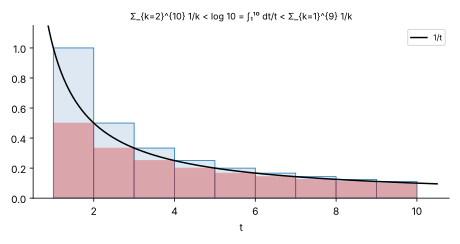
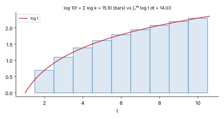
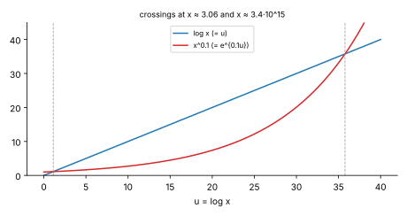
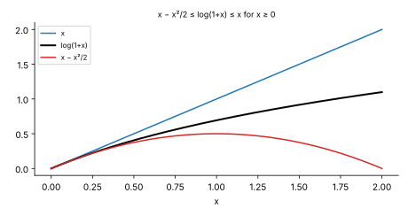
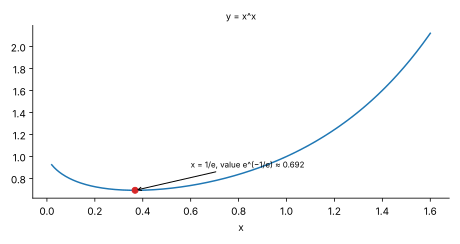
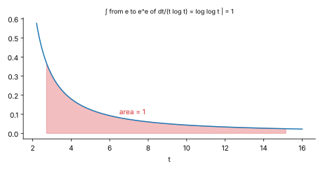
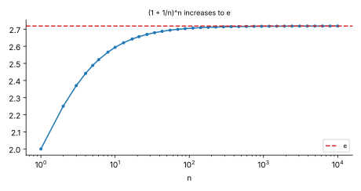
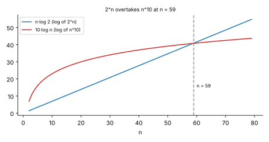

# שיעור כלים כ4: לוגריתם, המספר e, ומה שצריך מחדו"א

**מה נלמד:** חזרה מסודרת על הכלים מחדו"א של תיכון שנשתמש בהם בחצי השני של הקורס: הפונקציה המעריכית $`e^x`$ והלוגריתם הטבעי, נגזרות, אינטגרלים, **הצבה** ו**אינטגרציה בחלקים**. נלמד את **סולם הגידול** (לוגריתם ≪ חזקה ≪ מעריכית) ושלושה אי-שוויונים שימושיים. אחרי השיעור הזה אפשר לקרוא כל חישוב בשיעורים 9–12.

**ידע קודם:** חזקות ולוגריתמים, נגזרות ואינטגרלים בסיסיים, ברמת תיכון. [שיעור כלים כ1](T01-סכומים-ומכפלות.md).

**מוסכמה חשובה:** בקורס הזה $`\log x`$ הוא תמיד **הלוגריתם הטבעי** (לפי בסיס $`e`$), שבספרי תיכון מסומן $`\ln x`$.

---

## 1. המספר $`e`$ והפונקציה המעריכית

המספר $`e = 2.71828\ldots`$ מופיע בשתי דרכים שקולות:
```math
e = \lim_{n\to\infty}\left(1 + \frac1n\right)^n = 1 + \frac1{1!} + \frac1{2!} + \frac1{3!} + \cdots .
```
(הגבול הראשון: ריבית של 100% לשנה, שמחושבת $`n`$ פעמים בשנה.)

הפונקציה $`e^x`$ מקיימת את חוקי החזקות $`e^{x+y} = e^x e^y`$, $`(e^x)^y = e^{xy}`$, והיא **שווה לנגזרת של עצמה**: $`\frac{d}{dx}e^x = e^x`$. זו התכונה שהופכת אותה לטבעית.

## 2. הלוגריתם הטבעי

$`\log x`$ (ל-$`x > 0`$) הוא המספר $`y`$ עם $`e^y = x`$. חוקים:
```math
\log(xy) = \log x + \log y, \qquad \log(x^a) = a\log x, \qquad \log_b x = \frac{\log x}{\log b}.
```
**למה זה חשוב בתורת המספרים:** הלוגריתם הופך **מכפלה לסכום**. למשל $`\log n! = \sum_{k=1}^n \log k`$, ואם $`n = \prod p^{a_p}`$ אז $`\log n = \sum a_p \log p`$. כך שאלות על מכפלות (כמו מכפלת אוילר) הופכות לשאלות על סכומים.

## 3. נגזרות – תזכורת

הנגזרת $`f'(x)`$ היא השיפוע של המשיק לגרף. כללים:

| פונקציה | נגזרת |
|---|---|
| $`x^a`$ | $`a x^{a-1}`$ |
| $`e^x`$ | $`e^x`$ |
| $`\log x`$ | $`1/x`$ |
| $`f(x)g(x)`$ | $`f'g + fg'`$ (כלל המכפלה) |
| $`f(g(x))`$ | $`f'(g(x))\cdot g'(x)`$ (כלל השרשרת) |

**שימוש עיקרי:** אם $`f' \gt 0`$ בקטע, $`f`$ עולה שם. כך מוכיחים אי-שוויונים: כדי להראות $`f \le g`$, מראים ש-$`g - f`$ מתחיל באפס ועולה.

## 4. אינטגרלים – תזכורת

$`\int_a^b f(t)\,dt`$ הוא השטח (המסומן) מתחת לגרף. **המשפט היסודי:** אם $`F' = f`$, אז $`\int_a^b f = F(b) - F(a)`$. אינטגרלים שחוזרים כל הזמן:
```math
\int_1^x \frac{dt}{t} = \log x, \qquad \int t^a\,dt = \frac{t^{a+1}}{a+1}\ (a \ne -1), \qquad \int e^t\,dt = e^t .
```
**הצבה:** אם $`u = g(t)`$, אז $`\int f(g(t))g'(t)\,dt = \int f(u)\,du`$.

**אינטגרציה בחלקים** (נובעת מכלל המכפלה):
```math
\int_a^b u\,v'\,dt = \big[u v\big]_a^b - \int_a^b u'\,v\,dt .
```

## 5. סולם הגידול

כאשר $`x \to \infty`$, לכל $`\varepsilon \gt 0`$ ולכל $`A`$:
```math
\log x \;\ll\; x^{\varepsilon} \;\ll\; x^{A} \;\ll\; e^{\varepsilon x},
```
כאשר $`f \ll g`$ כאן פירושו ש-$`f/g \to 0`$. **הוכחה של הצעד הראשון:** נציב $`x = e^u`$; אז $`\frac{\log x}{x^\varepsilon} = \frac{u}{e^{\varepsilon u}}`$, ומכיוון ש-$`e^{v} \ge 1 + v + \frac{v^2}{2} \gt \frac{v^2}2`$ לכל $`v \ge 0`$ (מוכיחים בנגזרות, כמו בדוגמה 4), עם $`v = \varepsilon u`$ המנה קטנה מ-$`\frac{u}{\varepsilon^2u^2/2} = \frac{2}{\varepsilon^2 u} \to 0`$.

**זהירות:** "בסוף" לא אומר "מוקדם". ראו דוגמה 3.

## 6. שלושה אי-שוויונים

1. $`e^x \ge 1 + x`$ לכל $`x`$ ממשי.
2. $`\log(1 + x) \le x`$ לכל $`x \gt -1`$.
3. $`\log(1 + x) \ge x - \frac{x^2}{2}`$ לכל $`x \ge 0`$.

(1) ו-(2) הם אותו דבר (לוקחים לוגריתם). את (2) ו-(3) מוכיחים בנגזרות; ראו דוגמה 4.

---

## 7. דוגמאות פתורות

### דוגמה 1: $`\log x`$ כשטח, והסכום ההרמוני

**שאלה.** הראו ש-$`\log 10 \lt 1 + \frac12 + \cdots + \frac1{10} \lt 1 + \log 10`$.



<sub>השטח מתחת ל-1/t בין 1 ל-10 הוא log 10. המלבנים הכחולים (גובה 1/k מעל הקטע מ-k עד k+1) מכסים אותו מלמעלה; המלבנים האדומים (גובה 1/k מעל הקטע מ-k−1 עד k) נמצאים מתחתיו.</sub>

**פתרון.**
1. **חסם תחתון:** על הקטע $`[k, k+1]`$ מתקיים $`\frac1t \le \frac1k`$, ולכן $`\int_k^{k+1}\frac{dt}t \le \frac1k`$. מחברים עבור $`k = 1, \ldots, 9`$: $`\log 10 = \int_1^{10}\frac{dt}t \le \sum_{k=1}^{9}\frac1k \lt \sum_{k=1}^{10}\frac1k`$.
2. **חסם עליון:** על הקטע $`[k-1, k]`$ מתקיים $`\frac1t \ge \frac1k`$, ולכן $`\frac1k \le \int_{k-1}^k\frac{dt}{t}`$. מחברים עבור $`k = 2, \ldots, 10`$: $`\sum_{k=2}^{10}\frac1k \le \int_1^{10}\frac{dt}t = \log 10`$. מוסיפים את האיבר $`k = 1`$: $`\sum_{k=1}^{10}\frac1k \le 1 + \log 10`$.
3. **בדיקה מספרית:** $`\log 10 = 2.3026`$, הסכום $`= 2.9290`$, ו-$`1 + \log 10 = 3.3026`$.

אותו טיעון לכל $`n`$ נותן $`\log n \lt \sum_{k=1}^n \frac1k \le 1 + \log n`$. ב[שיעור כלים כ7](T07-סכומים-ואינטגרלים.md) נשפר את זה ל-$`\log n + \gamma + O(1/n)`$.

### דוגמה 2: אינטגרציה בחלקים ו-$`\log n!`$

**שאלה.** חשבו את $`\int_1^n \log t\,dt`$, והשוו ל-$`\log 10!`$.



<sub>log 10! הוא סכום שטחי המלבנים (גובה log k); האינטגרל של log t מ-1 עד 10 קרוב אליו.</sub>

**פתרון.**
1. **אינטגרציה בחלקים** עם $`u = \log t`$ ו-$`v' = 1`$, כלומר $`u' = 1/t`$ ו-$`v = t`$:
$`\int_1^n \log t\,dt = \big[t\log t\big]_1^n - \int_1^n t\cdot\frac1t\,dt = n\log n - 0 - (n - 1)`$.
2. כלומר $`\int_1^n \log t\,dt = n\log n - n + 1`$.
3. **בדיקה בגזירה:** $`\frac{d}{dt}(t\log t - t) = \log t + t\cdot\frac1t - 1 = \log t`$. נכון.
4. **השוואה עבור $`n = 10`$:** $`\log 10! = \log 3628800 = 15.104`$, ואילו $`10\log 10 - 10 + 1 = 14.026`$. ההפרש קטן יחסית; ב[שיעור כ7](T07-סכומים-ואינטגרלים.md) נראה שהוא בערך $`\frac12\log n - 0.08`$ (נוסחת סטירלינג): עבור $`n = 10`$, $`1.151 - 0.081 = 1.070`$, ואכן $`15.104 - 14.026 = 1.078`$.

### דוגמה 3: "בסוף" יכול להיות מאוד רחוק

**שאלה.** לפי סולם הגידול, $`\log x \lt x^{0.1}`$ עבור $`x`$ גדול מספיק. מאיפה זה מתחיל?



<sub>log x ו-x^0.1 בציר לוגריתמי: x^0.1 גדולה יותר בהתחלה, log x עוקפת אותה ב-x ≈ 3.06, ו-x^0.1 חוזרת להוביל רק ב-x ≈ 3.4·10^15.</sub>

**פתרון.**
1. נציב $`x = e^u`$. אז השאלה היא מתי $`u \lt e^{0.1u}`$.
2. בודקים את הפונקציה $`h(u) = e^{0.1u} - u`$: $`h(0) = 1 \gt 0`$; $`h(10) = e - 10 \lt 0`$; $`h(40) = e^4 - 40 \approx 14.6 \gt 0`$. לכן יש שתי נקודות חיתוך.
3. פתרון מספרי של $`h(u) = 0`$ נותן $`u \approx 1.118`$ ו-$`u \approx 35.77`$, כלומר $`x \approx 3.06`$ ו-$`x \approx 3.43\cdot10^{15}`$.
4. **מסקנה:** $`\log x \gt x^{0.1}`$ בכל הקטע $`3.06 \lt x \lt 3.4\cdot 10^{15}`$, ורק אחריו $`x^{0.1}`$ מנצחת לתמיד.

**הלקח:** טענות אסימפטוטיות ("בסוף", "עבור $`x`$ גדול מספיק") יכולות להיות לא רלוונטיות בטווח שאפשר לחשב בו. זה חשוב כשמשווים תוצאות מספריות לתאוריה (למשל ב[שיעור 12](12-משפט-המספרים-הראשוניים.md)).

### דוגמה 4: הוכחת אי-שוויון בעזרת נגזרת

**שאלה.** הוכיחו ש-$`x - \frac{x^2}{2} \le \log(1+x) \le x`$ לכל $`x \ge 0`$.



<sub>log(1+x) לכודה בין x − x²/2 (מתחת) לבין x (מעל); ליד 0 שלושתן כמעט זהות.</sub>

**פתרון.**
1. **הצד הימני.** נגדיר $`g(x) = x - \log(1+x)`$. אז $`g(0) = 0`$ ו-$`g'(x) = 1 - \frac{1}{1+x} = \frac{x}{1+x} \ge 0`$ עבור $`x \ge 0`$. לכן $`g`$ עולה, ו-$`g(x) \ge g(0) = 0`$.
2. **הצד השמאלי.** נגדיר $`h(x) = \log(1+x) - x + \frac{x^2}{2}`$. אז $`h(0) = 0`$ ו-$`h'(x) = \frac{1}{1+x} - 1 + x = \frac{1 - (1+x) + x(1+x)}{1+x} = \frac{x^2}{1+x} \ge 0`$. לכן $`h(x) \ge 0`$.
3. **שימוש:** לכל ראשוני $`p`$, $`\log\left(1 + \frac1p\right) \le \frac1p`$, ולכן $`\prod_{p \le x}\left(1 + \frac1p\right) \le \exp\left(\sum_{p\le x}\frac1p\right)`$. בטכניקה הזו נשתמש ב[שיעור 10](10-התפלגות-אלמנטרית.md).

---

## 8. תרגילים

**תרגיל 1.** מצאו את המינימום של $`f(x) = x^x`$ עבור $`x \gt 0`$.



<sub>הגרף של x^x: המינימום הוא בנקודה x = 1/e, וערכו e^(−1/e) ≈ 0.692.</sub>

<details><summary>פתרון</summary>

1. נכתוב $`x^x = e^{x\log x}`$. מספיק למצוא את המינימום של $`g(x) = x\log x`$, כי $`e^{(\cdot)}`$ עולה.
2. $`g'(x) = \log x + x\cdot\frac1x = \log x + 1`$ (כלל המכפלה).
3. $`g'(x) = 0 \iff \log x = -1 \iff x = 1/e`$. משמאל לנקודה $`g' \lt 0`$ ומימין $`g' \gt 0`$, אז זה מינימום.
4. הערך: $`g(1/e) = \frac1e\cdot(-1) = -\frac1e`$, ולכן המינימום של $`x^x`$ הוא $`e^{-1/e} \approx 0.692`$.
</details>

**תרגיל 2.** חשבו את $`\displaystyle\int_e^{e^e}\frac{dt}{t\log t}`$ בעזרת הצבה.



<sub>השטח מתחת ל-1/(t log t) בין e ל-e^e שווה בדיוק 1.</sub>

<details><summary>פתרון</summary>

1. נציב $`u = \log t`$. אז $`du = \frac{dt}{t}`$, והאינטגרל הוא $`\int \frac{du}{u} = \log u = \log\log t`$.
2. הגבולות: $`t = e \Rightarrow u = 1`$; $`t = e^e \Rightarrow u = e`$.
3. התוצאה: $`\log e - \log 1 = 1 - 0 = 1`$.

(הפונקציה $`\log\log t`$ תופיע ב[שיעור 10](10-התפלגות-אלמנטרית.md): $`\sum_{p\le x}\frac1p \approx \log\log x`$.)
</details>

**תרגיל 3.** הוכיחו ש-$`\left(1 + \frac1n\right)^n \to e`$, בעזרת דוגמה 4, וחשבו את הערכים עבור $`n = 1, 10, 100, 1000`$.



<sub>(1 + 1/n)^n עולה לאט אל e ≈ 2.71828.</sub>

<details><summary>פתרון</summary>

1. $`\log\left(1 + \frac1n\right)^n = n\log\left(1 + \frac1n\right)`$.
2. לפי דוגמה 4 עם $`x = \frac1n`$: $`\frac1n - \frac1{2n^2} \le \log\left(1 + \frac1n\right) \le \frac1n`$.
3. כופלים ב-$`n`$: $`1 - \frac1{2n} \le n\log\left(1 + \frac1n\right) \le 1`$. לכן הלוגריתם שואף ל-1, והביטוי עצמו שואף ל-$`e^1 = e`$.
4. **ערכים:** $`n = 1`$: 2; $`n = 10`$: 2.5937; $`n = 100`$: 2.7048; $`n = 1000`$: 2.7169. (לפי החסם, החסר הוא בערך $`\frac{e}{2n}`$: עבור $`n = 1000`$ זה $`0.00136`$, ואכן $`2.71828 - 2.71692 = 0.00136`$.)
</details>

**תרגיל 4.** מה הוא ה-$`n`$ הקטן ביותר שעבורו $`2^n \gt n^{10}`$?



<sub>n·log 2 לעומת 10·log n: הקו הישר עוקף את העקומה לראשונה ב-n = 59.</sub>

<details><summary>פתרון</summary>

1. מוציאים לוגריתם (הלוגריתם עולה, אז הוא שומר על אי-שוויונים): $`2^n \gt n^{10} \iff n\log 2 \gt 10\log n \iff \frac{n}{\log n} \gt \frac{10}{\log 2} \approx 14.43`$.
2. בודקים: עבור $`n = 58`$, $`\frac{58}{\log 58} = \frac{58}{4.060} \approx 14.28`$; עבור $`n = 59`$, $`\frac{59}{\log 59} = \frac{59}{4.078} \approx 14.47`$.
3. מכיוון ש-$`n/\log n`$ עולה עבור $`n \ge 3`$ (הנגזרת $`\frac{\log n - 1}{\log^2 n} \gt 0`$), התשובה היא $`n = 59`$. (צריך לבדוק גם את התחום הקטן: עבור $`n = 2`$, $`4 \lt 1024`$, כלומר אין פתרון קטן.)
</details>

---

## סיכום
* $`\log`$ = לוגריתם טבעי; הוא הופך מכפלות לסכומים.
* $`(e^x)' = e^x`$, $`(\log x)' = 1/x`$; $`\int_1^x dt/t = \log x`$.
* אינטגרציה בחלקים: $`\int \log t\,dt = t\log t - t`$.
* סולם הגידול: $`\log x \ll x^\varepsilon \ll x^A \ll e^{\varepsilon x}`$, אבל "בסוף" יכול להיות רחוק.
* $`x - x^2/2 \le \log(1+x) \le x`$ עבור $`x \ge 0`$.

**השיעור הקודם:** [שיעור 8](08-משוואות-דיופנטיות.md) · **השיעור הבא:** [שיעור כלים כ5: סדרות, גבולות וטורים](T05-טורים.md)

**להעמקה:** [e (קבוע מתמטי)](https://he.wikipedia.org/wiki/E_(%D7%A7%D7%91%D7%95%D7%A2_%D7%9E%D7%AA%D7%9E%D7%98%D7%99)) · [לוגריתם](https://he.wikipedia.org/wiki/%D7%9C%D7%95%D7%92%D7%A8%D7%99%D7%AA%D7%9D) · [אינטגרציה בחלקים](https://he.wikipedia.org/wiki/%D7%90%D7%99%D7%A0%D7%98%D7%92%D7%A8%D7%A6%D7%99%D7%94_%D7%91%D7%97%D7%9C%D7%A7%D7%99%D7%9D)

---
<sub>חלק מ[קורס תורת המספרים](../COURSE.md). התוכן מופץ ברישיון [CC BY-SA 4.0](https://creativecommons.org/licenses/by-sa/4.0/).</sub>
