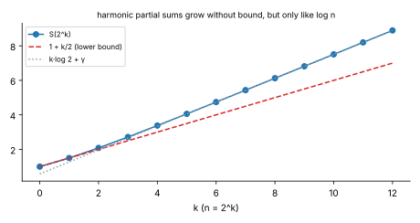
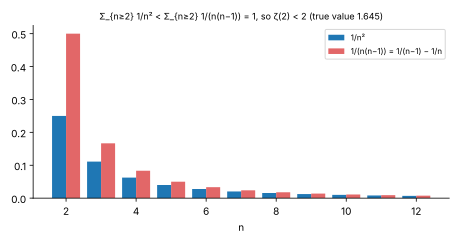
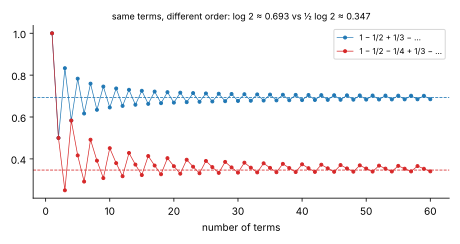
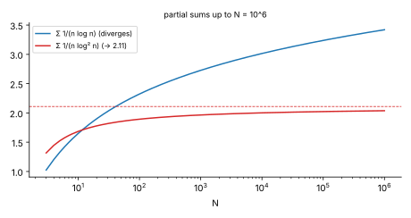
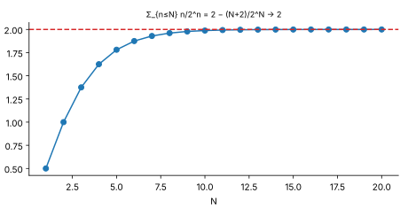
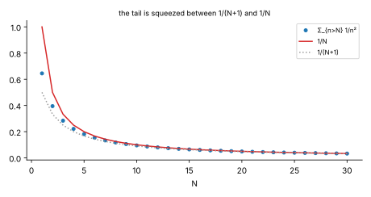
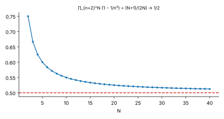
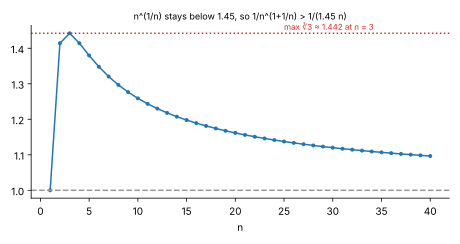

# שיעור כלים כ5: סדרות, גבולות וטורים אינסופיים

**מה נלמד:** מה פירוש "סכום של אינסוף מספרים", ומתי הוא בכלל קיים. נכיר את **הטור ההנדסי**, נוכיח ש**הטור ההרמוני מתבדר** אבל $`\sum 1/n^2`$ **מתכנס**, ונלמד שלושה מבחנים: **השוואה**, **אינטגרל**, ו**התכנסות בהחלט**. נראה גם למה סדר האיברים יכול לשנות את התוצאה, ונכיר **מכפלות אינסופיות**. אלה בדיוק הכלים שצריך כדי להבין את $`\zeta(s) = \sum n^{-s}`$ ואת מכפלת אוילר ב[שיעור 11](11-טורי-דיריכלה-וזטא.md).

**ידע קודם:** [שיעור כלים כ1](T01-סכומים-ומכפלות.md) (סכומים, סכום הנדסי וטלסקופי), [שיעור כלים כ4](T04-לוגריתם-וחדוא.md) (לוגריתם ואינטגרלים).

---

## 1. גבול של סדרה

סדרה $`a_1, a_2, a_3, \ldots`$ **מתכנסת** לגבול $`L`$, ונכתב $`a_n \to L`$ או $`\lim_{n\to\infty} a_n = L`$, אם $`a_n`$ מתקרבת ל-$`L`$ כרצוננו: **לכל** מרחק $`\varepsilon \gt 0`$, מרגע מסוים והלאה כל האיברים נמצאים במרחק קטן מ-$`\varepsilon`$ מ-$`L`$.

**דוגמה:** $`\frac1n \to 0`$. בהינתן $`\varepsilon = 0.001`$, כל $`n \gt 1000`$ מקיים $`\frac1n \lt 0.001`$; ובאופן כללי, כל $`n \gt 1/\varepsilon`$.

**חוקים:** גבול של סכום/מכפלה/מנה הוא הסכום/המכפלה/המנה של הגבולות (כשהם קיימים, ובמנה כשהמכנה אינו שואף לאפס). **סדרה עולה וחסומה מתכנסת** (עובדה בסיסית על המספרים הממשיים).

אם $`a_n`$ גדלה בלי הגבלה, כותבים $`a_n \to \infty`$ ואומרים שהיא **מתבדרת**.

## 2. טור אינסופי

**הטור** $`\sum_{n=1}^\infty a_n`$ הוא הגבול של **הסכומים החלקיים** $`S_N = \sum_{n=1}^N a_n`$, אם הגבול קיים. אם כן, אומרים שהטור **מתכנס**; אחרת – **מתבדר**.

**תנאי הכרחי:** אם הטור מתכנס, אז $`a_n \to 0`$ (כי $`a_n = S_n - S_{n-1}`$, ושני הסכומים שואפים לאותו גבול). **התנאי אינו מספיק** – ראו דוגמה 1.

**הטור ההנדסי:** עבור $`|x| \lt 1`$,
```math
\sum_{n=0}^{\infty} x^n = \frac{1}{1-x}.
```
**הוכחה:** $`S_N = \frac{1 - x^{N+1}}{1-x}`$ ([שיעור כ1](T01-סכומים-ומכפלות.md)), ו-$`x^{N+1} \to 0`$ כאשר $`|x| \lt 1`$. עבור $`|x| \ge 1`$ האיברים אינם שואפים לאפס, והטור מתבדר.

## 3. טורים עם איברים חיוביים

כאשר כל $`a_n \ge 0`$, הסכומים החלקיים עולים. לכן הטור מתכנס **אם ורק אם הסכומים החלקיים חסומים**. מכאן שני מבחנים:

**מבחן ההשוואה.** אם $`0 \le a_n \le b_n`$ ו-$`\sum b_n`$ מתכנס, גם $`\sum a_n`$ מתכנס. (ובכיוון ההפוך: אם $`\sum a_n`$ מתבדר, גם $`\sum b_n`$.)

**מבחן האינטגרל.** אם $`f`$ חיובית ויורדת, אז $`\sum_{n=1}^\infty f(n)`$ מתכנס **אם ורק אם** $`\int_1^\infty f(t)\,dt`$ סופי. (הסיבה: אותו ציור של מלבנים מעל ומתחת לגרף כמו ב[דוגמה 1 של שיעור כ4](T04-לוגריתם-וחדוא.md).)

**המסקנה החשובה (טורי $`p`$):**
הטור
```math
\sum_{n=1}^\infty \frac{1}{n^s}
```
מתכנס אם ורק אם $`s \gt 1`$.
כי $`\int_1^\infty t^{-s}\,dt = \left[\frac{t^{1-s}}{1-s}\right]_1^\infty = \frac{1}{s-1}`$ כאשר $`s \gt 1`$, ואינסופי כאשר $`s \le 1`$. **זו פונקציית הזטא של רימן:** $`\zeta(s) = \sum_{n\ge1} n^{-s}`$, המוגדרת (לעת עתה) עבור $`s \gt 1`$.

## 4. התכנסות בהחלט וסדר האיברים

טור $`\sum a_n`$ (עם איברים חיוביים ושליליים, או מרוכבים) **מתכנס בהחלט** אם $`\sum |a_n|`$ מתכנס. **התכנסות בהחלט גוררת התכנסות.**

**למה זה חשוב:** בטור שמתכנס בהחלט מותר **לשנות את סדר האיברים** ו**להחליף סדר סכימה** בסכום כפול, בלי לשנות את התוצאה. בטור שמתכנס רק "בתנאי" (כלומר לא בהחלט) **אסור**, ושינוי סדר יכול לשנות את הסכום (דוגמה 3).

## 5. מכפלות אינסופיות

$`\prod_{n=1}^\infty (1 + a_n)`$ הוא הגבול של המכפלות החלקיות. **הכלל שנשתמש בו:** אם $`\sum |a_n|`$ מתכנס (ואף $`1 + a_n`$ אינו אפס), המכפלה מתכנסת לגבול שונה מאפס.

**הסיבה:** לוקחים לוגריתם: $`\log\prod(1+a_n) = \sum\log(1+a_n)`$, ו-$`|\log(1 + a)| \le 2|a|`$ עבור $`|a| \le \frac12`$. לכן טור הלוגריתמים מתכנס בהחלט לפי מבחן ההשוואה.

**הדוגמה שתחזור:** מכפלת אוילר $`\prod_p \frac{1}{1 - p^{-s}}`$ מתכנסת עבור $`s \gt 1`$, כי $`\sum_p p^{-s} \le \sum_n n^{-s} \lt \infty`$.

---

## 6. דוגמאות פתורות

### דוגמה 1: הטור ההרמוני מתבדר

**שאלה.** הוכיחו ש-$`\sum_{n=1}^\infty \frac1n = \infty`$, אף ש-$`\frac1n \to 0`$.



<sub>הסכומים החלקיים של הטור ההרמוני בנקודות n = 2^k: הם עולים בכל הכפלה של n בלפחות 1/2 (ובפועל בערך ב-log 2 ≈ 0.69).</sub>

**פתרון (הקבצה, אורסם, המאה ה-14).**
1. נקבץ את האיברים לבלוקים: $`1 + \frac12 + \left(\frac13 + \frac14\right) + \left(\frac15 + \cdots + \frac18\right) + \left(\frac19 + \cdots + \frac1{16}\right) + \cdots`$.
2. בבלוק שמסתיים ב-$`\frac1{2^k}`$ יש $`2^{k-1}`$ איברים, וכל אחד מהם לפחות $`\frac1{2^k}`$. לכן כל בלוק $`\ge 2^{k-1}\cdot\frac{1}{2^k} = \frac12`$.
3. אחרי $`k`$ בלוקים: $`S_{2^k} \ge 1 + \frac{k}{2}`$. זה גדל בלי הגבלה, ולכן הטור מתבדר.
4. **מספרים:** $`S_{1024} = 7.509`$ – הטור מתבדר, אבל לאט מאוד (כמו $`\log n`$, לפי [שיעור כ4](T04-לוגריתם-וחדוא.md)).

### דוגמה 2: $`\sum 1/n^2`$ מתכנס

**שאלה.** הוכיחו ש-$`\sum_{n=1}^\infty \frac{1}{n^2} \lt 2`$ בעזרת טור טלסקופי.



<sub>האיברים 1/n² (כחול) קטנים מ-1/(n(n−1)) (אדום) עבור n ≥ 2; סכום האדומים טלסקופי ושווה 1.</sub>

**פתרון.**
1. עבור $`n \ge 2`$: $`\frac1{n^2} \lt \frac{1}{n(n-1)} = \frac{1}{n-1} - \frac1n`$.
2. לכן $`\sum_{n=2}^N \frac1{n^2} \lt \sum_{n=2}^N\left(\frac1{n-1} - \frac1n\right) = 1 - \frac1N \lt 1`$ (טלסקופי).
3. מוסיפים את האיבר $`n = 1`$: הסכומים החלקיים קטנים מ-2. הם עולים וחסומים, ולכן מתכנסים, והגבול לכל היותר 2.
4. **הערך המדויק** (אוילר, 1735) הוא $`\zeta(2) = \frac{\pi^2}{6} = 1.6449\ldots`$. נוכיח אותו ב[שיעור 11](11-טורי-דיריכלה-וזטא.md).

### דוגמה 3: סדר האיברים משנה

**שאלה.** הטור $`1 - \frac12 + \frac13 - \frac14 + \cdots`$ מתכנס ל-$`\log 2`$. הראו שאם מסדרים את אותם איברים בסדר "אחד חיובי, שניים שליליים", מקבלים $`\frac12\log 2`$.



<sub>הסכומים החלקיים של הטור המתחלף (כחול) מתכנסים ל-log 2; אותם איברים בסדר אחר (אדום) מתכנסים ל-½ log 2.</sub>

**פתרון.**
1. הסדר החדש: $`1 - \frac12 - \frac14 + \frac13 - \frac16 - \frac18 + \frac15 - \frac1{10} - \frac1{12} + \cdots`$. כל איבר מופיע פעם אחת בדיוק.
2. נקבץ שלשות: $`\left(\frac{1}{2j-1} - \frac{1}{4j-2}\right) - \frac1{4j}`$. הסוגריים שווים $`\frac{2 - 1}{4j - 2} = \frac{1}{4j-2}`$.
3. לכן כל שלשה היא $`\frac1{4j-2} - \frac1{4j} = \frac12\left(\frac{1}{2j-1} - \frac1{2j}\right)`$.
4. סכום השלשות הוא חצי מהטור המקורי: $`\frac12\left(1 - \frac12 + \frac13 - \frac14 + \cdots\right) = \frac12\log 2`$.
5. **בדיקה מספרית:** 20,000 שלשות נותנות $`0.346567`$, ו-$`\frac12\log2 = 0.346574`$.

**הלקח:** הטור המקורי **אינו** מתכנס בהחלט (טור הערכים המוחלטים הוא ההרמוני). לכן מותר לשנות סדר רק בטורים שמתכנסים בהחלט.

### דוגמה 4: הגבול הדק בין התכנסות להתבדרות

**שאלה.** האם $`\sum_{n\ge2}\frac{1}{n\log n}`$ מתכנס? ומה עם $`\sum_{n \ge 2}\frac{1}{n\log^2 n}`$?



<sub>הסכומים החלקיים: Σ 1/(n log n) ממשיך לעלות כמו log log n, ואילו Σ 1/(n log² n) מתייצב ליד 2.11.</sub>

**פתרון (מבחן האינטגרל).**
1. **הראשון:** $`\int_2^X\frac{dt}{t\log t} = \log\log X - \log\log 2`$ (בהצבה $`u = \log t`$, כמו ב[תרגיל 2 של שיעור כ4](T04-לוגריתם-וחדוא.md)). זה שואף לאינסוף, ולכן הטור **מתבדר**, אבל לאט מאוד.
2. **השני:** $`\int_2^X\frac{dt}{t\log^2 t} = \left[-\frac{1}{\log t}\right]_2^X = \frac{1}{\log 2} - \frac{1}{\log X} \to \frac1{\log 2}`$. סופי, ולכן הטור **מתכנס**.
3. **מספרים:** עד $`n = 10^6`$ הסכום הראשון כבר $`3.42`$ ועדיין עולה, והשני $`2.04`$ (והגבול בערך $`2.11`$).

**למה זה רלוונטי:** הראשוני ה-$`n`$-י הוא בערך $`n\log n`$ ([שיעור 12](12-משפט-המספרים-הראשוניים.md)). לכן $`\sum_p \frac1p`$ מתנהג כמו $`\sum\frac{1}{n\log n}`$ – ומתבדר. זה משפט של אוילר שנוכיח ב[שיעור 10](10-התפלגות-אלמנטרית.md).

---

## 7. תרגילים

**תרגיל 1.** הוכיחו ש-$`\sum_{n=1}^\infty \frac{n}{2^n} = 2`$. (רמז: גזרו את הטור ההנדסי, או השתמשו ב[תרגיל 4 של שיעור כ1](T01-סכומים-ומכפלות.md).)



<sub>הסכומים החלקיים של Σ n/2^n מתכנסים במהירות ל-2.</sub>

<details><summary>פתרון</summary>

**דרך 1 (גזירה):** עבור $`|x| \lt 1`$, $`\sum_{n\ge0} x^n = \frac1{1-x}`$. גוזרים את שני האגפים (מותר לגזור טור חזקות איבר-איבר בתוך תחום ההתכנסות; נצדיק זאת בשיעור כלים כ9): $`\sum_{n\ge1} n x^{n-1} = \frac{1}{(1-x)^2}`$. כופלים ב-$`x`$ ומציבים $`x = \frac12`$: $`\sum_{n\ge1}\frac{n}{2^n} = \frac{1/2}{(1/2)^2} = 2`$.

**דרך 2 (נוסחה סופית):** לפי השיטה של תרגיל 4 בשיעור כ1 (עם $`\frac12`$ במקום 2) מקבלים $`\sum_{n=1}^N \frac{n}{2^n} = 2 - \frac{N+2}{2^N}`$, ו-$`\frac{N+2}{2^N} \to 0`$.
</details>

**תרגיל 2.** הוכיחו ש-$`\sum_{n \gt N}\frac1{n^2} \lt \frac1N`$, ובדקו עבור $`N = 10`$.



<sub>הזנב Σ_{n>N} 1/n² (נקודות) מתחת לחסם 1/N (קו), עבור N = 1, …, 30.</sub>

<details><summary>פתרון</summary>

1. כמו בדוגמה 2: $`\frac{1}{n^2} \lt \frac{1}{n-1} - \frac1n`$.
2. $`\sum_{n=N+1}^{M}\frac1{n^2} \lt \sum_{n=N+1}^M\left(\frac1{n-1} - \frac1n\right) = \frac1N - \frac1M \lt \frac1N`$, ובגבול $`M \to \infty`$ מקבלים את החסם.
3. **$`N = 10`$:** $`\sum_{n=1}^{10}\frac1{n^2} = 1.54977`$, ולכן הזנב הוא $`\frac{\pi^2}{6} - 1.54977 = 0.09517 \lt 0.1`$.

(חסמים כאלה לזנב הם בדיוק מה שמאפשר לחשב ערכים של $`\zeta`$ בדיוק ידוע.)
</details>

**תרגיל 3.** הראו שהמכפלה האינסופית $`\prod_{n=2}^\infty\left(1 - \frac1{n^2}\right)`$ מתכנסת, ומצאו את ערכה.



<sub>המכפלות החלקיות (n+1)/(2n) יורדות אל 1/2.</sub>

<details><summary>פתרון</summary>

1. **התכנסות לפי הכלל:** $`a_n = -\frac1{n^2}`$, ו-$`\sum\frac1{n^2}`$ מתכנס (דוגמה 2). לכן המכפלה מתכנסת לגבול שונה מאפס.
2. **הערך:** לפי [תרגיל 2 של שיעור כ1](T01-סכומים-ומכפלות.md), המכפלה החלקית עד $`N`$ היא $`\frac{N+1}{2N} = \frac12 + \frac1{2N}`$, ששואפת ל-$`\frac12`$.

(בשיעור 11 נראה ש-$`\prod_p\left(1 - \frac1{p^2}\right) = \frac{6}{\pi^2}`$, כאן על **הראשוניים** בלבד.)
</details>

**תרגיל 4.** האם $`\sum_{n=1}^\infty \frac{1}{n^{1 + 1/n}}`$ מתכנס?



<sub>n^(1/n) עולה עד המקסימום ∛3 ≈ 1.442 ב-n = 3 ואז יורד אל 1; לכן כל איבר גדול מ-1/(1.45·n).</sub>

<details><summary>פתרון</summary>

1. נכתוב $`\frac{1}{n^{1+1/n}} = \frac1n\cdot\frac{1}{n^{1/n}}`$.
2. $`n^{1/n} = e^{(\log n)/n}`$. הפונקציה $`\frac{\log x}{x}`$ מקבלת מקסימום ב-$`x = e`$ (נגזרת $`\frac{1 - \log x}{x^2}`$), ולכן בשלמים המקסימום של $`n^{1/n}`$ הוא ב-$`n = 3`$: $`3^{1/3} \approx 1.442`$. בפרט $`n^{1/n} \lt 2`$ לכל $`n`$.
3. לכן $`\frac{1}{n^{1+1/n}} \gt \frac{1}{2n}`$, ו-$`\sum\frac1{2n}`$ מתבדר (דוגמה 1). לפי מבחן ההשוואה **הטור מתבדר**.

**הלקח:** המעריך $`1 + \frac1n`$ גדול מ-1 לכל $`n`$, אבל הוא שואף ל-1. כדי להתכנס צריך מעריך $`\ge 1 + \delta`$ **קבוע**.
</details>

---

## סיכום
* טור = גבול הסכומים החלקיים. $`a_n \to 0`$ הכרחי אבל לא מספיק.
* $`\sum x^n = \frac{1}{1-x}`$ עבור $`|x|\lt1`$.
* $`\sum n^{-s}`$ מתכנס בדיוק כאשר $`s \gt 1`$ (מבחן האינטגרל). $`\sum\frac1{n\log n}`$ מתבדר, $`\sum\frac1{n\log^2n}`$ מתכנס.
* התכנסות בהחלט ⇐ מותר לשנות סדר ולהחליף סדר סכימה.
* $`\sum|a_n| \lt \infty`$ ⇐ $`\prod(1 + a_n)`$ מתכנסת (לערך שונה מאפס אם אף גורם אינו אפס).

**השיעור הקודם:** [שיעור כלים כ4](T04-לוגריתם-וחדוא.md) · **השיעור הבא:** [שיעור כלים כ6: סימוני אסימפטוטיקה](T06-אסימפטוטיקה.md)

**להעמקה:** [טור (מתמטיקה)](https://he.wikipedia.org/wiki/%D7%98%D7%95%D7%A8_(%D7%9E%D7%AA%D7%9E%D7%98%D7%99%D7%A7%D7%94)) · [גבול של סדרה](https://he.wikipedia.org/wiki/%D7%92%D7%91%D7%95%D7%9C_%D7%A9%D7%9C_%D7%A1%D7%93%D7%A8%D7%94) · [הטור ההרמוני](https://he.wikipedia.org/wiki/%D7%94%D7%98%D7%95%D7%A8_%D7%94%D7%94%D7%A8%D7%9E%D7%95%D7%A0%D7%99)

---
<sub>חלק מ[קורס תורת המספרים](../COURSE.md). התוכן מופץ ברישיון [CC BY-SA 4.0](https://creativecommons.org/licenses/by-sa/4.0/).</sub>
