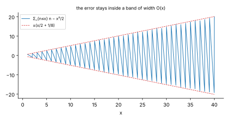
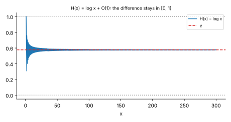
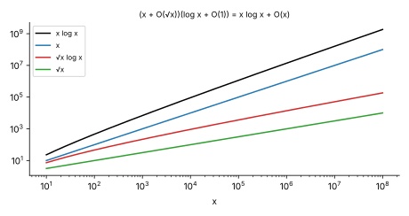
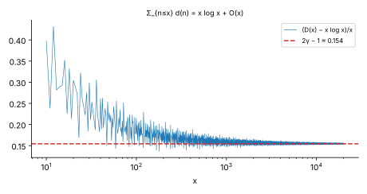
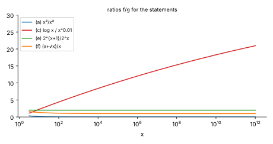
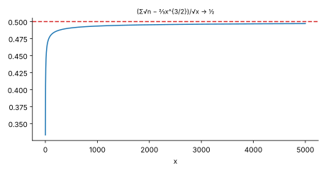
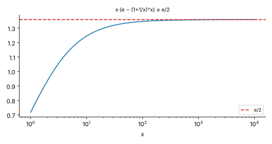
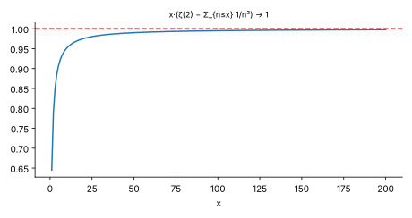

# שיעור כלים כ6: סימוני אסימפטוטיקה – $`O`$, $`o`$, $`\sim`$, $`\ll`$

**מה נלמד:** בתורת המספרים האנליטית כמעט אף פעם לא מחשבים משהו בדיוק. במקום זה כותבים "**האיבר העיקרי + שגיאה שאנחנו יודעים לחסום**". נלמד את השפה המקובלת לכך: $`O`$ ("לכל היותר בסדר גודל של"), $`\ll`$, $`o`$ ("זניח לעומת"), $`\sim`$ ("אסימפטוטי ל-"), ו-$`\asymp`$. נלמד לחשב עם הסימנים האלה, ונראה את הדוגמה המרכזית: $`\sum_{n\le x} d(n) = x\log x + O(x)`$.

**ידע קודם:** [שיעור כלים כ1](T01-סכומים-ומכפלות.md) (החלפת סדר סכימה, $`\lfloor x\rfloor`$), [שיעור כלים כ4](T04-לוגריתם-וחדוא.md) (לוגריתם, השוואה לאינטגרל), [שיעור כלים כ5](T05-טורים.md) (גבולות).

---

## 1. ההגדרות

יהיו $`f`$ ו-$`g`$ פונקציות של $`x`$ (או של $`n`$), כאשר $`g(x) \gt 0`$. אנחנו מתעניינים במה שקורה כאשר $`x \to \infty`$.

| סימון | נקרא | הגדרה |
|---|---|---|
| $`f = O(g)`$ או $`f \ll g`$ | "$`f`$ היא O גדול של $`g`$" | יש קבוע $`C`$ כך ש-$`\lvert f(x)\rvert \le C\,g(x)`$ לכל $`x`$ גדול מספיק |
| $`f = o(g)`$ | "o קטן" | $`f(x)/g(x) \to 0`$ |
| $`f \sim g`$ | "אסימפטוטי" | $`f(x)/g(x) \to 1`$ |
| $`f \asymp g`$ | "מאותו סדר גודל" | $`f \ll g`$ וגם $`g \ll f`$ |
| $`f = \Omega(g)`$ | "אומגה" | **לא** $`f = o(g)`$: יש אינסוף $`x`$ עם $`\lvert f(x)\rvert \ge c\,g(x)`$ |

**הערות:**
* הקבוע $`C`$ ב-$`O`$ נקרא **הקבוע המובלע**. אם הוא תלוי בפרמטר, מציינים זאת: $`O_\varepsilon(\cdot)`$ או $`\ll_\varepsilon`$.
* $`O(1)`$ פירושו "פונקציה חסומה". $`o(1)`$ פירושו "פונקציה ששואפת לאפס".
* **השוויון חד-כיווני:** $`x = O(x^2)`$ נכון, אבל לא כותבים $`O(x^2) = x`$. כדאי לקרוא את "$`=O(\ldots)`$" כ"שייכת למשפחה של פונקציות שחסומות על ידי...".

## 2. איך משתמשים: "איבר עיקרי + שגיאה"

הכתיבה $`f(x) = g(x) + O(h(x))`$ פירושה $`|f(x) - g(x)| \le C\,h(x)`$. למשל:
```math
\lfloor x \rfloor = x + O(1), \qquad \sum_{n\le x}\frac1n = \log x + O(1).
```
(השני הוא [דוגמה 1 של שיעור כ4](T04-לוגריתם-וחדוא.md).) **שגיאה "טובה"** היא שגיאה קטנה יותר מהאיבר העיקרי, ואז מקבלים גם אסימפטוטיקה: אם $`f = g + O(h)`$ ו-$`h = o(g)`$, אז $`f \sim g`$.

## 3. חוקי חישוב

לכל הפונקציות כאן ערכים חיוביים, ו-$`x`$ גדול:
1. $`O(f) + O(f) = O(f)`$, ו-$`c\cdot O(f) = O(f)`$ לקבוע $`c`$.
2. $`O(f)\cdot O(g) = O(fg)`$, ו-$`f\cdot O(g) = O(fg)`$.
3. אם $`f \ll g`$ אז $`O(f) + O(g) = O(g)`$ (השגיאה הגדולה "בולעת" את הקטנה).
4. **סכימה:** אם $`a_n = O(b_n)`$ עם קבוע אחיד, אז $`\sum_{n\le x}a_n = O\left(\sum_{n\le x} b_n\right)`$.
5. **זהירות:** $`f \sim g`$ **אינו** גורר $`f - g = O(1)`$ ($`x^2 + x \sim x^2`$, אבל ההפרש הוא $`x`$). ו-$`f = O(g)`$ **אינו** גורר $`e^f = O(e^g)`$ ($`2x = O(x)`$, אבל $`e^{2x}/e^x \to \infty`$).

---

## 4. דוגמאות פתורות

### דוגמה 1: סכום חשבוני עד $`x`$ לא שלם

**שאלה.** הראו ש-$`\sum_{n\le x} n = \frac{x^2}{2} + O(x)`$ לכל $`x \ge 1`$ ממשי.



<sub>הסכום Σ_{n≤x} n (מדרגות) לעומת x²/2 (קו): ההפרש נשאר בתוך רצועה ברוחב יחסי ל-x.</sub>

**פתרון.**
1. נסמן $`N = \lfloor x \rfloor`$ ו-$`x = N + \theta`$ עם $`0 \le \theta \lt 1`$.
2. $`\sum_{n\le x} n = \frac{N(N+1)}{2} = \frac{(x - \theta)(x - \theta + 1)}{2}`$.
3. נפתח: $`\frac{x^2 + x(1 - 2\theta) + \theta^2 - \theta}{2} = \frac{x^2}{2} + \frac{(1 - 2\theta)x}{2} + \frac{\theta^2 - \theta}2`$.
4. $`|1 - 2\theta| \le 1`$ ו-$`|\theta^2 - \theta| \le \frac14`$, ולכן ההפרש מ-$`\frac{x^2}{2}`$ חסום על ידי $`\frac x2 + \frac18 \le x`$ (עבור $`x \ge 1`$). כלומר השגיאה היא $`O(x)`$ עם קבוע מובלע 1.
5. **בדיקה:** $`x = 100.5`$: $`\sum_{n\le100} n = 5050`$, ו-$`x^2/2 = 5050.125`$. ההפרש $`-0.125`$ (כאן $`\theta = \frac12`$, כך שהאיבר הליניארי מתאפס).

### דוגמה 2: הוכחה ש-$`\sum_{n\le x} 1/n \sim \log x`$

**שאלה.** הראו ש-$`H(x) = \sum_{n\le x}\frac1n = \log x + O(1)`$, והסיקו ש-$`H(x) \sim \log x`$.



<sub>H(x) − log x נשאר חסום (ושואף ל-γ ≈ 0.577), ולכן היחס H(x)/log x שואף ל-1.</sub>

**פתרון.**
1. לפי [דוגמה 1 של שיעור כ4](T04-לוגריתם-וחדוא.md) (עם $`N = \lfloor x \rfloor`$): $`\log(N+1) \lt H(x) \le 1 + \log N`$.
2. $`\log N \le \log x \lt \log(N+1)`$, ו-$`\log(N+1) - \log N = \log(1 + 1/N) \le 1/N \le 1`$. לכן $`\log x - 1 \lt H(x) \le 1 + \log x`$, כלומר $`|H(x) - \log x| \le 1`$: $`H(x) = \log x + O(1)`$.
3. **אסימפטוטיקה:** $`\frac{H(x)}{\log x} = 1 + \frac{O(1)}{\log x} \to 1`$, כי $`\log x \to \infty`$.

### דוגמה 3: חשבון עם $`O`$

**שאלה.** פשטו את $`\big(x + O(\sqrt x)\big)\big(\log x + O(1)\big)`$.



<sub>ארבעת האיברים במכפלה לפי גודלם: x log x, x, √x log x, √x. כל האיברים מלבד הראשון בלועים ב-O(x).</sub>

**פתרון.**
1. נפתח סוגריים (חוק 2): $`x\log x + x\cdot O(1) + O(\sqrt x)\cdot\log x + O(\sqrt x)\cdot O(1)`$.
2. = $`x\log x + O(x) + O(\sqrt x\log x) + O(\sqrt x)`$.
3. $`\sqrt x\log x \ll x`$ (כי $`\frac{\log x}{\sqrt x} \to 0`$, לפי סולם הגידול ב[שיעור כ4](T04-לוגריתם-וחדוא.md)), ו-$`\sqrt x \ll x`$. לפי חוק 3 הכול נבלע ב-$`O(x)`$.
4. **התוצאה:** $`x\log x + O(x)`$.

### דוגמה 4: סכום מספר המחלקים

**שאלה.** הוכיחו ש-$`\sum_{n\le x} d(n) = x\log x + O(x)`$.



<sub>(Σ_{n≤x} d(n) − x log x)/x נשאר חסום (ושואף ל-2γ − 1 ≈ 0.154).</sub>

**פתרון.**
1. **החלפת סדר סכימה** ([שיעור כ1](T01-סכומים-ומכפלות.md)): $`\sum_{n\le x}d(n) = \sum_{d\le x}\left\lfloor\frac xd\right\rfloor`$.
2. **הערך השלם:** $`\left\lfloor\frac xd\right\rfloor = \frac xd + O(1)`$. סוכמים על $`d \le x`$ (חוק 4): $`\sum_{d\le x}\frac xd + \sum_{d \le x}O(1) = x\,H(x) + O(x)`$. (יש לכל היותר $`x`$ איברים, כל שגיאה בגודל לכל היותר 1.)
3. **ההרמוני:** לפי דוגמה 2, $`x\,H(x) = x(\log x + O(1)) = x\log x + O(x)`$.
4. **התוצאה:** $`\sum_{n\le x}d(n) = x\log x + O(x)`$. בפרט, **הסדר הממוצע** של $`d(n)`$ הוא $`\log n`$.
5. **מספרים:** עבור $`x = 10^5`$ הסכום הוא $`1{,}166{,}750`$, ו-$`x\log x = 1{,}151{,}293`$; ההפרש חלקי $`x`$ הוא $`0.155`$. ב[שיעור 9](09-סדרים-של-פונקציות.md) נשפר את השגיאה ל-$`(2\gamma - 1)x + O(\sqrt x)`$ (שיטת ההיפרבולה).

---

## 5. תרגילים

**תרגיל 1.** נכון או לא נכון? (א) $`x^2 = O(x^3)`$. (ב) $`x^3 = O(x^2)`$. (ג) $`\log x = o(x^{0.01})`$. (ד) $`\sin x = O(1)`$. (ה) $`2^{x+1} \sim 2^x`$. (ו) $`x + \sqrt x \sim x`$.



<sub>היחסים f/g עבור הסעיפים: (א) → 0; (ה) קבוע 2; (ו) → 1. ב-(ג) היחס עדיין עולה בכל הטווח המצויר: הוא מגיע למקסימום רק ב-x = e^100 ≈ 2.7·10^43, ורק אחר כך יורד ל-0.</sub>

<details><summary>פתרון</summary>

* **(א) נכון:** $`x^2 \le 1\cdot x^3`$ עבור $`x \ge 1`$.
* **(ב) לא נכון:** $`x^3/x^2 = x`$ אינו חסום.
* **(ג) נכון:** סולם הגידול ([שיעור כ4](T04-לוגריתם-וחדוא.md)): $`\log x/x^{\varepsilon} \to 0`$ לכל $`\varepsilon \gt 0`$. אבל זה קורה מאוחר מאוד: הנגזרת של $`\log x/x^{0.01}`$ מתאפסת ב-$`\log x = 100`$, כלומר היחס עולה עד $`x = e^{100}`$ ורק אז מתחיל לרדת (השוו לדוגמה 3 שם).
* **(ד) נכון:** $`|\sin x| \le 1`$.
* **(ה) לא נכון:** $`2^{x+1}/2^x = 2`$, לא 1. (אבל כן נכון ש-$`2^{x+1} \asymp 2^x`$, וגם $`2^{x+1} = O(2^x)`$.)
* **(ו) נכון:** $`\frac{x + \sqrt x}{x} = 1 + \frac{1}{\sqrt x} \to 1`$.
</details>

**תרגיל 2.** הראו ש-$`\sum_{n\le x}\sqrt n = \frac23x^{3/2} + O(\sqrt x)`$.



<sub>(Σ_{n≤x} √n − ⅔x^{3/2})/√x נשאר חסום (ושואף ל-½).</sub>

<details><summary>פתרון</summary>

1. $`\sqrt t`$ עולה. לכן לכל $`n \ge 1`$: $`\int_{n-1}^{n}\sqrt t\,dt \le \sqrt n \le \int_n^{n+1}\sqrt t\,dt`$.
2. נסמן $`N = \lfloor x\rfloor`$. סוכמים על $`n = 1..N`$: $`\int_0^N\sqrt t\,dt \le \sum_{n\le N}\sqrt n \le \int_1^{N+1}\sqrt t\,dt`$, כלומר $`\frac23N^{3/2} \le \sum \le \frac23(N+1)^{3/2} - \frac23`$.
3. נשווה ל-$`\frac23x^{3/2}`$: כיוון ש-$`N \le x \lt N + 1`$, שני הקצוות שונים מ-$`\frac23x^{3/2}`$ לכל היותר ב-$`\frac23\left((x+1)^{3/2} - (x-1)^{3/2}\right)`$.
4. לפי משפט הערך הממוצע של לגרנז' (ההפרש בין ערכי פונקציה גזירה בשני קצוות של קטע שווה לאורך הקטע כפול הנגזרת בנקודה כלשהי בתוכו), $`(x+1)^{3/2} - (x-1)^{3/2} = 2\cdot\frac32\xi^{1/2}`$ עבור $`\xi`$ כלשהו בין $`x-1`$ ל-$`x+1`$, כלומר $`\le 3\sqrt{x+1} = O(\sqrt x)`$.
5. **מספרים:** עבור $`x = 10^4`$ ההפרש חלקי $`\sqrt x`$ הוא $`0.498`$ – קרוב ל-$`\frac12`$, כפי שתנבא נוסחת אוילר–מקלורן ([שיעור כלים כ7](T07-סכומים-ואינטגרלים.md)).
</details>

**תרגיל 3.** הראו ש-$`\left(1 + \frac1x\right)^x = e + O\left(\frac1x\right)`$.



<sub>x·(e − (1 + 1/x)^x) מתקרב ל-e/2 ≈ 1.359: השגיאה היא בערך e/(2x).</sub>

<details><summary>פתרון</summary>

1. לפי [דוגמה 4 של שיעור כ4](T04-לוגריתם-וחדוא.md) עם $`t = \frac1x`$: $`1 - \frac1{2x} \le x\log\left(1+\frac1x\right) \le 1`$.
2. מעלים את $`e`$ בחזקה (פונקציה עולה): $`e^{1 - 1/(2x)} \le \left(1+\frac1x\right)^x \le e`$.
3. $`e - e^{1 - 1/(2x)} = e\left(1 - e^{-1/(2x)}\right) \le e\cdot\frac1{2x}`$, לפי $`1 - e^{-u} \le u`$ (אי-שוויון 1 ב[שיעור כ4](T04-לוגריתם-וחדוא.md)).
4. לכן $`0 \le e - \left(1 + \frac1x\right)^x \le \frac{e}{2x}`$, כלומר השגיאה היא $`O(1/x)`$. **מספרים:** עבור $`x = 1000`$, $`x\cdot(\text{error}) = 1.358`$, קרוב לחסם $`e/2 = 1.359`$.
</details>

**תרגיל 4.** הראו ש-$`\sum_{n\le x}\frac{1}{n^2} = \zeta(2) + O\left(\frac1x\right)`$, כאשר $`\zeta(2) = \sum_{n\ge1}\frac{1}{n^2}`$.



<sub>ζ(2) − Σ_{n≤x} 1/n², כפול x: נשאר בין 0 ל-1 (ושואף ל-1).</sub>

<details><summary>פתרון</summary>

1. $`\sum_{n\le x}\frac1{n^2} = \zeta(2) - \sum_{n \gt x}\frac1{n^2}`$.
2. לפי [תרגיל 2 של שיעור כ5](T05-טורים.md), $`\sum_{n \gt N}\frac1{n^2} \lt \frac1N`$, עם $`N = \lfloor x\rfloor`$.
3. $`\frac1N \le \frac{2}{x}`$ עבור $`x \ge 1`$ (כי $`N \ge x/2`$). לכן הזנב הוא $`O(1/x)`$.

(בשיעור 9 נשתמש בדיוק בזה כדי להראות שההסתברות ששני מספרים יהיו זרים היא $`1/\zeta(2) = 6/\pi^2`$.)
</details>

---

## סיכום
* $`f = O(g)`$ / $`f \ll g`$: $`|f| \le Cg`$. $`f = o(g)`$: $`f/g \to 0`$. $`f \sim g`$: $`f/g \to 1`$.
* כותבים "איבר עיקרי + $`O`$(שגיאה)", ומחשבים עם חוקי ה-$`O`$: שגיאה גדולה בולעת קטנה.
* $`\lfloor x\rfloor = x + O(1)`$, $`\sum_{n\le x}1/n = \log x + O(1)`$, $`\sum_{n\le x}d(n) = x\log x + O(x)`$.

**השיעור הקודם:** [שיעור כלים כ5](T05-טורים.md) · **השיעור הבא:** [שיעור כלים כ7: סכומים ואינטגרלים](T07-סכומים-ואינטגרלים.md)

**להעמקה:** [סימון O גדול](https://he.wikipedia.org/wiki/%D7%A1%D7%99%D7%9E%D7%95%D7%9F_O_%D7%92%D7%93%D7%95%D7%9C) · [סדר ממוצע של פונקציה אריתמטית](../pages/סדר%20ממוצע%20של%20פונקציה%20אריתמטית.md)

---
<sub>חלק מ[קורס תורת המספרים](../COURSE.md). התוכן מופץ ברישיון [CC BY-SA 4.0](https://creativecommons.org/licenses/by-sa/4.0/).</sub>
