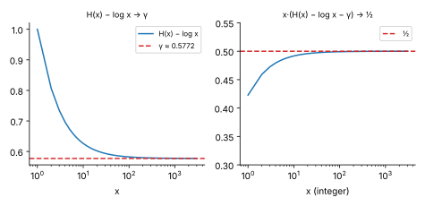
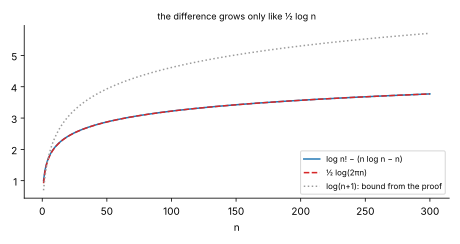
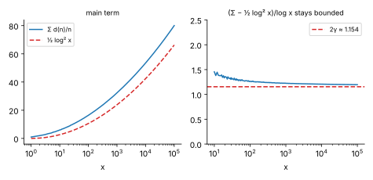
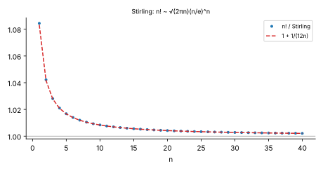
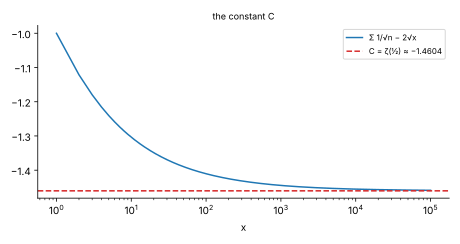
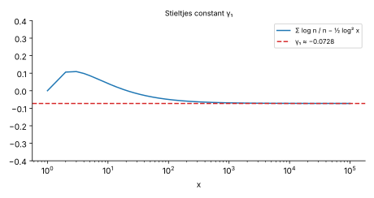
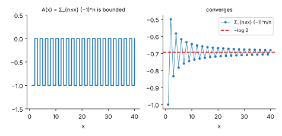
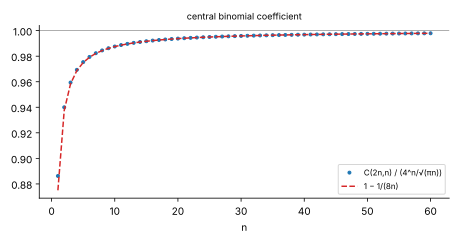

# שיעור כלים כ7: סכומים ואינטגרלים – קבוע אוילר, סכימה בחלקים וסטירלינג

**מה נלמד:** שלושה כלים להפיכת סכומים לאינטגרלים, שהם הלחם והחמאה של תורת המספרים האנליטית:
1. **השוואה לאינטגרל** עם שגיאה מדויקת, ומתוכה **קבוע אוילר–מסקרוני** $`\gamma`$: $`\sum_{n\le x}\frac1n = \log x + \gamma + O\left(\frac1x\right)`$.
2. **סכימה בחלקים (סכימת אבל):** איך עוברים מ"כמה יש" ($`A(x) = \sum_{n\le x}a_n`$) ל"סכום ממושקל" ($`\sum a_n f(n)`$).
3. **נוסחת סטירלינג:** $`\log n! = n\log n - n + \frac12\log(2\pi n) + O\left(\frac1n\right)`$.

**ידע קודם:** [שיעור כלים כ4](T04-לוגריתם-וחדוא.md) (אינטגרלים, אינטגרציה בחלקים), [שיעור כלים כ5](T05-טורים.md) (התכנסות), [שיעור כלים כ6](T06-אסימפטוטיקה.md) (סימוני $`O`$).

---

## 1. החלק השברי

לכל ממשי $`t`$ נגדיר את **החלק השברי** $`\{t\} = t - \lfloor t\rfloor`$, כך ש-$`0 \le \{t\} \lt 1`$. למשל $`\{3.7\} = 0.7`$. החלק השברי הוא "השגיאה" בין $`t`$ לשלם שמתחתיו, והוא יופיע בכל נוסחה בשיעור.

## 2. נוסחת הסכימה של אוילר (בגרסה הפשוטה)

**משפט.** אם $`f`$ גזירה ברציפות על $`[1, x]`$, אז
```math
\sum_{1 \lt n\le x} f(n) = \int_1^x f(t)\,dt + \int_1^x \{t\}\,f'(t)\,dt - \{x\}f(x).
```
**הוכחה (לשלם $`x = N`$, כדי לפשט).** בקטע $`[n-1, n]`$ מתקיים $`\{t\} = t - (n-1)`$. באינטגרציה בחלקים:
$`\int_{n-1}^{n}(t - n + 1)f'(t)\,dt = \big[(t-n+1)f(t)\big]_{n-1}^{n} - \int_{n-1}^n f(t)\,dt = f(n) - \int_{n-1}^n f`$.
מחברים על $`n = 2, \ldots, N`$: $`\int_1^N\{t\}f'(t)\,dt = \sum_{n=2}^N f(n) - \int_1^N f`$, וזו הנוסחה (עם $`\{N\} = 0`$). ∎

זהו המקרה הראשון של **נוסחת אוילר–מקלורן**: באינטגרציות בחלקים נוספות מקבלים איברי תיקון עם מספרי ברנולי, למשל $`\frac12 f(x)`$ ו-$`\frac{1}{12}f'(x)`$, ומהם באים האיברים $`\frac{1}{2x}`$ בדוגמה 1 ו-$`\frac{1}{12n}`$ בדוגמה 4.

**למה זה שימושי:** האיבר $`\int\{t\}f'`$ הוא בדרך כלל קטן (כי $`0 \le \{t\} \lt 1`$), ולעתים קרובות הוא מתכנס כשהקצה $`x \to \infty`$, ואז נותן **קבוע** ועוד שגיאה קטנה.

## 3. סכימה בחלקים (סכימת אבל)

**משפט.** תהי $`(a_n)`$ סדרה, $`A(t) = \sum_{n\le t}a_n`$, ו-$`f`$ גזירה ברציפות על $`[1, x]`$. אז
```math
\sum_{n\le x} a_n f(n) = A(x)f(x) - \int_1^x A(t)\,f'(t)\,dt .
```
**הוכחה.** לכל $`n \le x`$, לפי המשפט היסודי של החדו"א: $`f(n) = f(x) - \int_n^x f'(t)\,dt`$. לכן
$`\sum_{n\le x}a_nf(n) = f(x)\sum_{n\le x}a_n - \sum_{n\le x}a_n\int_n^xf'(t)\,dt`$.
בסכום השני מחליפים סדר סכימה ואינטגרציה ([שיעור כ1](T01-סכומים-ומכפלות.md) – אותו רעיון, עם אינטגרל במקום סכום): לכל $`t`$, המחוברים שבהם $`n \le t`$ תורמים $`\sum_{n\le t}a_n = A(t)`$. כך מקבלים $`\int_1^x A(t)f'(t)\,dt`$. ∎

**האנלוגיה:** זו "אינטגרציה בחלקים לסכומים": $`a_n`$ משחק את תפקיד $`u'`$, ו-$`A`$ את תפקיד $`u`$.

**השימוש הטיפוסי:** כשיודעים משהו על $`A(x)`$ (למשל כמה ראשוניים יש עד $`x`$), מקבלים ממנו מידע על סכומים ממושקלים כמו $`\sum_{p\le x}\frac1p`$ או $`\sum_{p \le x}\log p`$.

## 4. נוסחת סטירלינג

```math
\log n! = n\log n - n + \frac12\log(2\pi n) + O\!\left(\frac1n\right), \qquad n! \sim \sqrt{2\pi n}\left(\frac ne\right)^n .
```
את החלק $`n\log n - n + O(\log n)`$ נוכיח בדוגמה 2. את האיבר $`\frac12\log n`$ נותנת נוסחת אוילר בגרסה המדויקת יותר, ואת הקבוע $`\frac12\log(2\pi)`$ נותנת נוסחת המכפלה של ואליס. כאן נסתפק בבדיקה מספרית (דוגמה 4).

---

## 5. דוגמאות פתורות

### דוגמה 1: קבוע אוילר–מסקרוני

**שאלה.** הוכיחו ש-$`\sum_{n\le x}\frac1n = \log x + \gamma + O\left(\frac1x\right)`$ עבור קבוע $`\gamma`$, ומצאו נוסחה לקבוע.



<sub>H(x) − log x מתקרב ל-γ ≈ 0.5772; השגיאה כפול x מתקרבת ל-½ (כלומר השגיאה בערך 1/(2x)).</sub>

**פתרון.**
1. נפעיל את נוסחת אוילר עם $`f(t) = \frac1t`$, ו-$`f'(t) = -\frac1{t^2}`$:
$`\sum_{1\lt n\le x}\frac1n = \int_1^x\frac{dt}t - \int_1^x\frac{\{t\}}{t^2}\,dt - \frac{\{x\}}{x}`$.
2. נוסיף את האיבר $`n = 1`$ (שהוא 1): $`\sum_{n\le x}\frac1n = \log x + 1 - \int_1^x\frac{\{t\}}{t^2}\,dt - \frac{\{x\}}x`$.
3. **האינטגרל מתכנס כש-$`x\to\infty`$:** $`0 \le \frac{\{t\}}{t^2} \le \frac1{t^2}`$, ו-$`\int_1^\infty t^{-2}dt = 1`$. נכתוב $`\int_1^x = \int_1^\infty - \int_x^\infty`$, כאשר $`0 \le \int_x^\infty\frac{\{t\}}{t^2}\,dt \le \frac1x`$.
4. **התוצאה:** $`\sum_{n\le x}\frac1n = \log x + \gamma + O\left(\frac1x\right)`$ עם
```math
\gamma = 1 - \int_1^\infty\frac{\{t\}}{t^2}\,dt = 0.5772156649\ldots
```
5. **בדיקה מספרית:** עבור $`x = 10, 100, 1000`$: $`H - \log x = 0.62638,\ 0.58221,\ 0.57772`$, וההפרש מ-$`\gamma`$ כפול $`x`$ הוא בערך $`0.49,\ 0.499,\ 0.4999`$. (הגרסה המדויקת של נוסחת אוילר מראה שהשגיאה היא $`\frac{1}{2x} + O(1/x^2)`$ עבור $`x`$ שלם.)

### דוגמה 2: $`\log n!`$ בגסות

**שאלה.** הוכיחו ש-$`\log n! = n\log n - n + O(\log n)`$.



<sub>log n! לעומת n log n − n: ההפרש גדל רק כמו ½ log n.</sub>

**פתרון.**
1. $`\log n! = \sum_{k=1}^n\log k`$, ו-$`\log t`$ פונקציה עולה.
2. **השוואה לאינטגרל** (כמו ב[דוגמה 1 של שיעור כ4](T04-לוגריתם-וחדוא.md)): $`\int_{k-1}^k\log t\,dt \le \log k \le \int_k^{k+1}\log t\,dt`$.
3. סוכמים: $`\int_1^n\log t\,dt \le \log n! \le \int_2^{n+1}\log t\,dt \le \int_1^{n+1}\log t\,dt`$.
4. לפי [דוגמה 2 של שיעור כ4](T04-לוגריתם-וחדוא.md), $`\int_1^m\log t\,dt = m\log m - m + 1`$. החסם התחתון: $`n\log n - n + 1`$. החסם העליון: $`(n+1)\log(n+1) - n`$.
5. ההפרש בין החסמים: $`(n+1)\log(n+1) - n\log n - 1 = n\log\left(1 + \frac1n\right) + \log(n+1) - 1 \le 1 + \log(n+1) - 1 = \log(n+1)`$. לכן $`\log n! = n\log n - n + O(\log n)`$.
6. **מספרים:** $`\log 100! = 363.739`$, ו-$`100\log 100 - 100 = 360.517`$; ההפרש $`3.22`$, ואילו $`\frac12\log(2\pi\cdot100) = 3.22`$.

### דוגמה 3: סכימה בחלקים – $`\sum_{n\le x} d(n)/n`$

**שאלה.** בהינתן ש-$`D(x) = \sum_{n\le x}d(n) = x\log x + O(x)`$ ([שיעור כ6](T06-אסימפטוטיקה.md)), הוכיחו ש-$`\sum_{n\le x}\frac{d(n)}n = \frac12\log^2x + O(\log x)`$.



<sub>Σ_{n≤x} d(n)/n לעומת ½ log² x; ההפרש מחולק ב-log x נשאר חסום.</sub>

**פתרון.**
1. **סכימת אבל** עם $`a_n = d(n)`$, $`A = D`$, $`f(t) = \frac1t`$, $`f'(t) = -\frac{1}{t^2}`$:
$`\sum_{n\le x}\frac{d(n)}{n} = \frac{D(x)}x + \int_1^x\frac{D(t)}{t^2}\,dt`$.
2. **האיבר הראשון:** $`\frac{D(x)}x = \log x + O(1)`$.
3. **האינטגרל:** נציב $`D(t) = t\log t + O(t)`$: $`\int_1^x\frac{t\log t + O(t)}{t^2}\,dt = \int_1^x\frac{\log t}{t}\,dt + O\left(\int_1^x\frac{dt}{t}\right) = \frac12\log^2x + O(\log x)`$. (האינטגרל הראשון בהצבה $`u = \log t`$.)
4. **ביחד:** $`\frac12\log^2x + O(\log x)`$.
5. **מספרים:** עבור $`x = 10^5`$: הסכום $`80.04`$, ו-$`\frac12\log^2x = 66.27`$; ההפרש חלקי $`\log x`$ הוא $`1.20`$ (בפועל המקדם שואף ל-$`2\gamma = 1.154`$).

### דוגמה 4: בדיקת סטירלינג

**שאלה.** השוו את $`10!`$ ואת $`\log 100!`$ לנוסחת סטירלינג, ומצאו כמה ספרות יש ב-$`100!`$.



<sub>היחס n! / (√(2πn)(n/e)^n) יורד אל 1, בערך כמו 1 + 1/(12n).</sub>

**פתרון.**
1. **$`n = 10`$:** $`\sqrt{2\pi\cdot10}\left(\frac{10}e\right)^{10} = 3{,}598{,}696`$, ואילו $`10! = 3{,}628{,}800`$. היחס $`1.0084`$, ואכן $`1 + \frac{1}{12\cdot10} = 1.0083`$ (האיבר הבא בנוסחה).
2. **$`n = 100`$:** $`100\log100 - 100 + \frac12\log(200\pi) = 363.7385`$, לעומת $`\log100! = 363.7394`$. ההפרש $`0.0008 \approx \frac{1}{12\cdot100}`$.
3. **מספר הספרות:** $`\log_{10}100! = \frac{363.7394}{\log 10} = 157.97`$. לכן $`100! \approx 9.33\cdot10^{157}`$, ויש לו **158** ספרות.

---

## 6. תרגילים

**תרגיל 1.** הראו ש-$`\sum_{n\le x}\frac{1}{\sqrt n} = 2\sqrt x + C + O\left(\frac{1}{\sqrt x}\right)`$ עבור קבוע $`C`$, ומצאו את $`C`$ מספרית.



<sub>Σ_{n≤x} 1/√n − 2√x מתקרב לקבוע C ≈ −1.4604.</sub>

<details><summary>פתרון</summary>

1. נוסחת אוילר עם $`f(t) = t^{-1/2}`$, $`f'(t) = -\frac12t^{-3/2}`$, ועוד האיבר $`n = 1`$:
$`\sum_{n\le x}\frac1{\sqrt n} = 1 + (2\sqrt x - 2) - \frac12\int_1^x\{t\}t^{-3/2}\,dt - \frac{\{x\}}{\sqrt x}`$.
2. האינטגרל מתכנס: $`\int_1^\infty t^{-3/2}dt = 2`$, והזנב $`\int_x^\infty\{t\}t^{-3/2}dt \le 2/\sqrt x`$.
3. לכן $`C = -1 - \frac12\int_1^\infty\{t\}t^{-3/2}\,dt`$, והשגיאה $`O(1/\sqrt x)`$.
4. **מספרית:** עבור $`x = 10^6`$, $`\sum - 2\sqrt x = -1.45985`$, וההתכנסות נותנת $`C = -1.46035\ldots`$.

**הפתעה:** $`C = \zeta(\tfrac12)`$, הערך של פונקציית הזטא בנקודה $`\frac12`$ – שבה הטור $`\sum n^{-1/2}`$ **מתבדר**. זו דוגמה ראשונה ל"המשכה אנליטית" ([שיעור 11](11-טורי-דיריכלה-וזטא.md)).
</details>

**תרגיל 2.** הראו ש-$`\sum_{n\le x}\frac{\log n}{n} = \frac12\log^2x + C' + o(1)`$ עבור קבוע $`C'`$.



<sub>Σ_{n≤x} log n / n − ½ log² x מתייצב ליד −0.0728.</sub>

<details><summary>פתרון</summary>

1. נוסחת אוילר עם $`f(t) = \frac{\log t}{t}`$ (האיבר $`n = 1`$ הוא 0): $`\int_1^x\frac{\log t}t\,dt = \frac12\log^2x`$.
2. $`f'(t) = \frac{1 - \log t}{t^2}`$, ו-$`\int_1^\infty\frac{|1 - \log t|}{t^2}\,dt \lt \infty`$ (כי $`\frac{\log t}{t^2} \ll t^{-3/2}`$). לכן $`\int_1^x\{t\}f'(t)dt`$ מתכנס לקבוע, עם שגיאה שואפת לאפס.
3. האיבר $`\{x\}f(x) = O\left(\frac{\log x}x\right) = o(1)`$.
4. **מספרית:** $`C' = -0.07282`$. (זה **קבוע סטילטיס** $`\gamma_1`$, המקדם הבא אחרי $`\gamma`$ בפיתוח של $`\zeta(s)`$ סביב $`s = 1`$.)
</details>

**תרגיל 3.** בעזרת סכימת אבל, הוכיחו: אם הסכומים החלקיים $`A(x) = \sum_{n\le x}a_n`$ חסומים, אז $`\sum_{n\ge1}\frac{a_n}{n}`$ מתכנס. הסיקו ש-$`\sum\frac{(-1)^n}{n}`$ מתכנס.



<sub>הסכומים החלקיים A(x) של (−1)^n קופצים בין −1 ל-0, והסכומים של (−1)^n/n מתכנסים ל-−log 2.</sub>

<details><summary>פתרון</summary>

1. נניח $`|A(t)| \le M`$. לפי סכימת אבל עם $`f(t) = \frac1t`$: $`\sum_{n\le x}\frac{a_n}n = \frac{A(x)}x + \int_1^x\frac{A(t)}{t^2}\,dt`$.
2. $`\left|\frac{A(x)}x\right| \le \frac Mx \to 0`$.
3. האינטגרל מתכנס בהחלט: $`\int_1^\infty\frac{|A(t)|}{t^2}dt \le M\int_1^\infty\frac{dt}{t^2} = M`$.
4. לכן הסכומים החלקיים מתכנסים ל-$`\int_1^\infty\frac{A(t)}{t^2}\,dt`$.
5. עבור $`a_n = (-1)^n`$: $`A(x) \in \{-1, 0\}`$, חסום. לכן $`\sum\frac{(-1)^n}n`$ מתכנס (לערך $`-\log 2`$).

**למה זה חשוב:** בדיוק כך מראים ש-$`L(1,\chi) = \sum\frac{\chi(n)}n`$ מתכנס עבור קרקטר דיריכלה לא טריוויאלי ([שיעור 13](13-קרקטרים-ופונקציות-L.md)): הסכומים החלקיים של $`\chi`$ חסומים, לפי יחס האורתוגונליות של [שיעור כ3](T03-חבורות.md).
</details>

**תרגיל 4.** בעזרת סטירלינג, הראו ש-$`\binom{2n}{n} \sim \frac{4^n}{\sqrt{\pi n}}`$, ובדקו עבור $`n = 10`$.



<sub>היחס בין C(2n,n) ל-4^n/√(πn) עולה אל 1.</sub>

<details><summary>פתרון</summary>

1. $`\binom{2n}n = \frac{(2n)!}{(n!)^2}`$. לפי סטירלינג, $`(2n)! \sim \sqrt{4\pi n}\left(\frac{2n}{e}\right)^{2n}`$ ו-$`(n!)^2 \sim 2\pi n\left(\frac ne\right)^{2n}`$.
2. המנה: $`\frac{\sqrt{4\pi n}}{2\pi n}\cdot\frac{(2n)^{2n}}{n^{2n}} = \frac{2\sqrt{\pi n}}{2\pi n}\cdot 4^n = \frac{4^n}{\sqrt{\pi n}}`$.
3. **$`n = 10`$:** $`\binom{20}{10} = 184{,}756`$, ו-$`\frac{4^{10}}{\sqrt{10\pi}} = \frac{1{,}048{,}576}{5.6050} = 187{,}078`$. היחס $`0.9876 \approx 1 - \frac{1}{8n}`$.

(המקדם הבינומי המרכזי מופיע בהוכחת [אי-השוויונות של צ'בישב](10-התפלגות-אלמנטרית.md) על מספר הראשוניים.)
</details>

---

## סיכום
* **נוסחת אוילר:** $`\sum_{1\lt n\le x}f(n) = \int_1^xf + \int_1^x\{t\}f'(t)\,dt - \{x\}f(x)`$.
* $`\sum_{n\le x}\frac1n = \log x + \gamma + O(1/x)`$, $`\gamma = 0.5772\ldots`$.
* **סכימת אבל:** $`\sum_{n\le x}a_nf(n) = A(x)f(x) - \int_1^xA(t)f'(t)\,dt`$ – מעבר מספירה לסכום ממושקל.
* **סטירלינג:** $`n! \sim \sqrt{2\pi n}(n/e)^n`$.

**השיעור הקודם:** [שיעור כלים כ6: סימוני אסימפטוטיקה](T06-אסימפטוטיקה.md) · **השיעור הבא:** [שיעור כלים כ8: הסתברות בסיסית: תוחלת, שונות ואי-שוויון צ'בישב](T08-הסתברות.md)

**להעמקה:** [קבוע אוילר-מסקרוני](https://he.wikipedia.org/wiki/%D7%A7%D7%91%D7%95%D7%A2_%D7%90%D7%95%D7%99%D7%9C%D7%A8-%D7%9E%D7%A1%D7%A7%D7%A8%D7%95%D7%A0%D7%99) · [נוסחת סטירלינג](https://he.wikipedia.org/wiki/%D7%A0%D7%95%D7%A1%D7%97%D7%AA_%D7%A1%D7%98%D7%A8%D7%9C%D7%99%D7%A0%D7%92) · [קבועי סטילטיס](../pages/קבועי%20סטילטיס.md)

---
<sub>חלק מ[קורס תורת המספרים](../COURSE.md). התוכן מופץ ברישיון [CC BY-SA 4.0](https://creativecommons.org/licenses/by-sa/4.0/).</sub>
