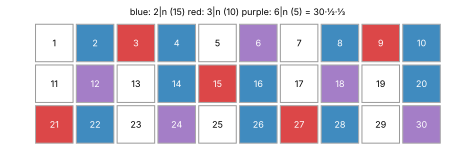
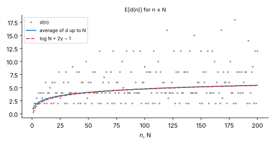
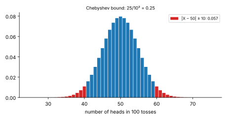
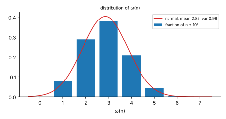
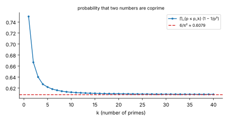
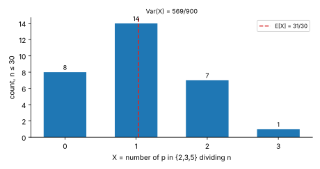
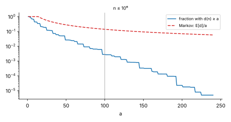
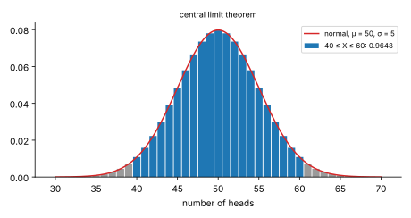

# שיעור כלים כ8: הסתברות בסיסית – תוחלת, שונות ואי-שוויון צ'בישב

**מה נלמד:** תורת המספרים משתמשת בשפת ההסתברות כדי לדבר על "מספר טבעי אקראי": מה הסיכוי שהוא זוגי? כמה מחלקים ראשוניים יש לו "בממוצע"? כמה הוא סוטה מהממוצע? נלמד:
1. מרחב הסתברות סופי ומשתנים מקריים.
2. **תוחלת** ו**ליניאריות התוחלת** – הכלי החשוב ביותר.
3. **אי-תלות**.
4. **שונות**, ו**אי-השוויונות של מרקוב וצ'בישב**.
5. **ההתפלגות הנורמלית** ומשפט הגבול המרכזי (ניסוח בלבד).

כל אלה נחוצים ב[שיעור 9](09-סדרים-של-פונקציות.md) (משפטי הארדי–רמנוג'אן וארדש–קאץ).

**ידע קודם:** [שיעור כלים כ1](T01-סכומים-ומכפלות.md) (סכומים והחלפת סדר), [שיעור כלים כ7](T07-סכומים-ואינטגרלים.md) (הסכום ההרמוני).

---

## 1. מרחב הסתברות סופי

**מרחב הסתברות סופי** הוא קבוצה סופית $`\Omega`$ (כל התוצאות האפשריות) שבה לכל תוצאה יש אותו סיכוי. **מאורע** $`A`$ הוא תת-קבוצה של $`\Omega`$, וההסתברות שלו היא
```math
\mathbb P(A) = \frac{|A|}{|\Omega|}.
```
**הדוגמה שלנו:** בוחרים $`n`$ באקראי מתוך $`\Omega = \{1, 2, \ldots, N\}`$. המאורע "$`d`$ מחלק את $`n`$" מכיל $`\lfloor N/d\rfloor`$ מספרים, ולכן
```math
\mathbb P(d \mid n) = \frac{\lfloor N/d\rfloor}{N} = \frac1d + O\!\left(\frac1N\right).
```
כש-$`N\to\infty`$ ההסתברות שואפת ל-$`\frac1d`$. כך מפרשים משפט כמו "**בהסתברות $`\frac1d`$ מספר מתחלק ב-$`d`$**": זו **הצפיפות** של קבוצת הכפולות של $`d`$.

## 2. משתנים מקריים ותוחלת

**משתנה מקרי** הוא פונקציה $`X: \Omega \to \mathbb R`$; למשל $`d(n)`$ (מספר המחלקים) או $`\omega(n)`$ (מספר הגורמים הראשוניים השונים). ה**תוחלת** (הממוצע) שלו:
```math
\mathbb E[X] = \frac{1}{|\Omega|}\sum_{n\in\Omega}X(n).
```
**משתנה מציין** של מאורע $`A`$: $`\mathbf 1_A(n) = 1`$ אם $`n\in A`$, ו-0 אחרת. אז $`\mathbb E[\mathbf 1_A] = \mathbb P(A)`$.

**ליניאריות התוחלת:** $`\mathbb E[X + Y] = \mathbb E[X] + \mathbb E[Y]`$ ו-$`\mathbb E[cX] = c\,\mathbb E[X]`$, **תמיד**, גם כשהמשתנים תלויים זה בזה. (ההוכחה: פיצול הסכום.)

**הטריק המרכזי:** כותבים משתנה מסובך כסכום של משתנים מציינים, ואז התוחלת היא סכום של הסתברויות. למשל
```math
\omega(n) = \sum_{p \le N}\mathbf 1[p \mid n] \quad\Longrightarrow\quad \mathbb E[\omega] = \sum_{p\le N}\frac{\lfloor N/p\rfloor}{N}.
```

## 3. אי-תלות

מאורעות $`A, B`$ הם **בלתי תלויים** אם $`\mathbb P(A\cap B) = \mathbb P(A)\,\mathbb P(B)`$: הידיעה ש-$`A`$ קרה לא משנה את הסיכוי של $`B`$.

**בתורת המספרים:** עבור ראשוניים שונים $`p, q`$, "$`p\mid n`$" ו-"$`q \mid n`$" יחד שקולים ל-"$`pq \mid n`$" (לפי [המשפט היסודי של האריתמטיקה](03-מספרים-ראשוניים.md)). לכן ההסתברויות בגבול הן $`\frac1p,\ \frac1q,\ \frac1{pq}`$ – **בלתי תלויים בגבול**. אם $`pq`$ מחלק את $`N`$, הם בלתי תלויים בדיוק. זו הסיבה שהמודל "הסתברותי" של הראשוניים עובד כל כך טוב.

## 4. שונות ואי-השוויונות של מרקוב וצ'בישב

**השונות** מודדת כמה $`X`$ מתפזר סביב התוחלת $`\mu = \mathbb E[X]`$:
```math
\mathrm{Var}(X) = \mathbb E\big[(X - \mu)^2\big] = \mathbb E[X^2] - \mu^2 .
```
(השוויון השני: לפתוח את הריבוע ולהשתמש בליניאריות.) **סטיית התקן** היא $`\sigma = \sqrt{\mathrm{Var}(X)}`$.

**עובדות שימושיות:**
* למשתנה מציין עם $`\mathbb P(A) = p`$: $`\mathrm{Var}(\mathbf 1_A) = p - p^2 = p(1-p)`$ (כי $`\mathbf 1_A^2 = \mathbf 1_A`$).
* אם $`X_1, \ldots, X_k`$ בלתי תלויים בזוגות, אז $`\mathrm{Var}(X_1 + \cdots + X_k) = \mathrm{Var}(X_1) + \cdots + \mathrm{Var}(X_k)`$. (בפתיחת הריבוע, האיברים המעורבים $`\mathbb E[(X_i - \mu_i)(X_j - \mu_j)]`$ מתאפסים בגלל אי-התלות.)

**אי-שוויון מרקוב.** אם $`X \ge 0`$ ו-$`a \gt 0`$, אז $`\mathbb P(X \ge a) \le \frac{\mathbb E[X]}{a}`$.

**הוכחה.** $`X \ge a\cdot\mathbf 1[X\ge a]`$ בכל נקודה: אם $`X \ge a`$ הצד הימני הוא $`a \le X`$, ואחרת הוא $`0 \le X`$. לוקחים תוחלת: $`\mathbb E[X] \ge a\,\mathbb P(X\ge a)`$. ∎

**אי-שוויון צ'בישב.** לכל $`t \gt 0`$:
```math
\mathbb P\big(|X - \mu| \ge t\big) \le \frac{\mathrm{Var}(X)}{t^2}.
```
**הוכחה.** מרקוב עבור המשתנה האי-שלילי $`(X-\mu)^2`$ עם $`a = t^2`$. ∎

**המשמעות:** אם השונות קטנה לעומת $`\mu^2`$, אז $`X`$ כמעט תמיד קרוב לתוחלת שלו. זה כל הרעיון בהוכחה של טוראן ל[משפט הארדי–רמנוג'אן](09-סדרים-של-פונקציות.md).

## 5. ההתפלגות הנורמלית

**ההתפלגות הנורמלית הסטנדרטית** היא ההתפלגות עם הצפיפות
```math
\phi(z) = \frac{1}{\sqrt{2\pi}}e^{-z^2/2}, \qquad \mathbb P(a \le Z \le b) = \int_a^b\phi(z)\,dz.
```
זו "עקומת הפעמון". בערך $`68\%`$ מהמסה נמצאת ב-$`|Z| \le 1`$, $`95.4\%`$ ב-$`|Z|\le 2`$, ו-$`99.7\%`$ ב-$`|Z|\le3`$. (העובדה ש-$`\int_{-\infty}^\infty e^{-z^2/2}dz = \sqrt{2\pi}`$ תוכח ב[שיעור כלים כ11](T11-גמא-פורייה-ותטא.md).)

**משפט הגבול המרכזי (ניסוח).** אם $`S = X_1 + \cdots + X_k`$ סכום של הרבה משתנים בלתי תלויים, שאף אחד מהם לא שולט בסכום, אז $`\frac{S - \mathbb E[S]}{\sqrt{\mathrm{Var}(S)}}`$ מתפלג **בקירוב נורמלית סטנדרטית**.

[משפט ארדש–קאץ](09-סדרים-של-פונקציות.md) אומר שזה נכון גם עבור $`\omega(n) = \sum_p\mathbf 1[p\mid n]`$, אף שהמחוברים רק "כמעט" בלתי תלויים.

---

## 6. דוגמאות פתורות

### דוגמה 1: מתי התחלקות ב-2 וב-3 בלתי תלויות?

**שאלה.** בוחרים $`n`$ באקראי מ-$`\{1, \ldots, N\}`$. בדקו אם המאורעות $`A = \{2\mid n\}`$ ו-$`B = \{3 \mid n\}`$ בלתי תלויים, עבור $`N = 30`$ ועבור $`N = 10`$.



<sub>המספרים 1 עד 30: כחול – מתחלק ב-2, אדום – מתחלק ב-3, סגול – בשניהם (כלומר ב-6).</sub>

**פתרון.**
1. **$`N = 30`$:** $`\mathbb P(A) = \frac{15}{30} = \frac12`$, $`\mathbb P(B) = \frac{10}{30} = \frac13`$.
2. $`A\cap B`$ הוא "$`6\mid n`$": המספרים $`6, 12, 18, 24, 30`$, כלומר $`\mathbb P(A\cap B) = \frac{5}{30} = \frac16`$.
3. $`\frac12\cdot\frac13 = \frac16`$ – **בלתי תלויים בדיוק**. (הסיבה: 6 מחלק את 30.)
4. **$`N = 10`$:** $`\mathbb P(A) = \frac5{10}`$, $`\mathbb P(B) = \frac3{10}`$, $`\mathbb P(A\cap B) = \frac1{10}`$ (רק 6).
5. $`\frac5{10}\cdot\frac3{10} = 0.15 \ne 0.1`$ – **תלויים**, אבל רק בגלל "אפקט הקצה": השגיאה היא $`O(1/N)`$ ונעלמת בגבול.

### דוגמה 2: ממוצע מספר המחלקים בעזרת ליניאריות

**שאלה.** חשבו את $`\mathbb E[d(n)]`$ עבור $`n`$ אקראי ב-$`\{1, \ldots, N\}`$, ומצאו את הקצב האסימפטוטי.



<sub>d(n) עבור n ≤ 200 (נקודות), והממוצע עד N (קו), שגדל כמו log N + 2γ − 1.</sub>

**פתרון.**
1. **פירוק למציינים:** $`d(n) = \sum_{k=1}^{N}\mathbf 1[k \mid n]`$ (כל $`k`$ שמחלק את $`n`$ תורם 1).
2. **ליניאריות:** $`\mathbb E[d] = \sum_{k=1}^N\mathbb P(k\mid n) = \frac1N\sum_{k=1}^N\left\lfloor\frac Nk\right\rfloor`$.
3. **הערכה:** $`\lfloor N/k\rfloor = N/k + O(1)`$, לכן $`\mathbb E[d] = \sum_{k\le N}\frac1k + O(1) = \log N + O(1)`$ ([שיעור כ7](T07-סכומים-ואינטגרלים.md)).
4. **מספרים:** עבור $`N = 100`$: $`\mathbb E[d] = \frac{482}{100} = 4.82`$. עבור $`N = 10^6`$: $`13.970`$. הערך המדויק יותר $`\log N + 2\gamma - 1`$ ([שיעור כ6](T06-אסימפטוטיקה.md)) נותן $`4.76`$ ו-$`13.970`$.

**שימו לב:** זה בדיוק החישוב של [שיעור כ6](T06-אסימפטוטיקה.md) (החלפת סדר סכימה), בשפה הסתברותית.

### דוגמה 3: צ'בישב להטלות מטבע

**שאלה.** מטילים מטבע הוגן 100 פעמים; $`X`$ מספר ה"עץ". חסמו את $`\mathbb P(|X - 50| \ge 10)`$, והשוו לערך האמיתי.



<sub>ההתפלגות של מספר ה"עץ" ב-100 הטלות; האזור |X − 50| ≥ 10 צבוע (הסתברות 0.057, חסם צ'בישב 0.25).</sub>

**פתרון.**
1. $`X = X_1 + \cdots + X_{100}`$, כאשר $`X_i`$ מציין של "עץ בהטלה $`i`$", עם $`p = \frac12`$.
2. **תוחלת:** $`\mathbb E[X] = 100\cdot\frac12 = 50`$.
3. **שונות:** ההטלות בלתי תלויות, לכן $`\mathrm{Var}(X) = 100\cdot\frac12\cdot\frac12 = 25`$, וסטיית התקן $`5`$.
4. **צ'בישב** עם $`t = 10`$: $`\mathbb P(|X - 50|\ge 10) \le \frac{25}{100} = 0.25`$.
5. **הערך האמיתי:** $`\sum_{|k-50|\ge10}\binom{100}{k}2^{-100} = 0.0569`$. צ'בישב לא חד, אבל הוא **כללי** ודורש רק את השונות – וזה מה שנדרש בדרך כלל בתורת המספרים.

### דוגמה 4: הממוצע והפיזור של $`\omega(n)`$

**שאלה.** עבור $`n \le N = 10^6`$, חשבו את $`\mathbb E[\omega]`$ ואת השונות, והשתמשו בצ'בישב כדי לחסום את החלק של ה-$`n`$ עם $`|\omega(n) - \mu| \ge 2`$.



<sub>ההתפלגות של ω(n) עבור n ≤ 10⁶ (עמודות) ועקומה נורמלית עם אותם ממוצע ושונות.</sub>

**פתרון.**
1. **תוחלת** (סעיף 2): $`\mathbb E[\omega] = \sum_{p\le N}\frac{\lfloor N/p\rfloor}N = 2.854`$.
2. **הקשר ל-$`\log\log N`$:** $`\sum_{p\le N}\frac1p = \log\log N + B + o(1)`$ עם $`B = 0.2615`$ (קבוע מרטנס, [שיעור 10](10-התפלגות-אלמנטרית.md)). כאן $`\log\log 10^6 = 2.626`$, ו-$`2.626 + 0.262 = 2.887`$ – קרוב ל-$`2.854`$ (ההפרש בא מ-$`\lfloor\cdot\rfloor`$).
3. **ההתפלגות בפועל:** מספר ה-$`n`$ עם $`\omega = 0, 1, \ldots, 7`$ הוא $`1,\ 78734,\ 288726,\ 379720,\ 208034,\ 42492,\ 2285,\ 8`$.
4. **שונות:** $`\mathrm{Var}(\omega) = 0.981`$. (בתיאוריה השונות היא $`\log\log N + O(1)`$, כמו סכום של מציינים כמעט בלתי תלויים עם $`\mathrm{Var} \approx \sum\frac1p(1 - \frac1p)`$.)
5. **צ'בישב:** $`\mathbb P(|\omega - 2.854| \ge 2) \le \frac{0.981}{4} = 0.245`$. בפועל: $`0.045`$.

**המסקנה לעתיד:** כש-$`N\to\infty`$, השונות $`\approx\log\log N`$ קטנה לעומת $`\mu^2 \approx (\log\log N)^2`$, ולכן כמעט כל $`n`$ מקיים $`\omega(n) \approx \log\log n`$. זה משפט הארדי–רמנוג'אן ב[שיעור 9](09-סדרים-של-פונקציות.md).

---

## 7. תרגילים

**תרגיל 1.** הסבירו בעזרת אי-תלות למה ההסתברות ששני מספרים אקראיים זרים היא $`\prod_p\left(1 - \frac1{p^2}\right)`$, וחשבו את המכפלה על $`p \le 7`$.



<sub>המכפלות החלקיות של (1 − 1/p²) על הראשוניים מתכנסות ל-6/π² ≈ 0.6079.</sub>

<details><summary>פתרון</summary>

1. $`a, b`$ זרים בדיוק כשאין ראשוני שמחלק את שניהם.
2. ההסתברות ש-$`p`$ מחלק את שניהם היא $`\frac1p\cdot\frac1p = \frac1{p^2}`$ (שתי בחירות בלתי תלויות). ההסתברות שלא: $`1 - \frac1{p^2}`$.
3. המאורעות עבור ראשוניים שונים בלתי תלויים (סעיף 3), לכן "ההסתברות" היא המכפלה $`\prod_p(1 - p^{-2})`$.
4. על $`p\le 7`$: $`\frac34\cdot\frac89\cdot\frac{24}{25}\cdot\frac{48}{49} = \frac{768}{1225} = 0.6269`$. על 25 הראשוניים הראשונים ($`p \le 97`$): $`0.6090`$.
5. הערך המדויק הוא $`\frac{1}{\zeta(2)} = \frac{6}{\pi^2} = 0.6079`$ (כפי שמוכח ב[שיעור 9](09-סדרים-של-פונקציות.md)).

**הערה:** הטיעון כאן הוא **היוריסטי**: אי-התלות מדויקת רק לכל מספר סופי של ראשוניים. ההוכחה המלאה משתמשת בפונקציית מביוס.
</details>

**תרגיל 2.** עבור $`n`$ אקראי ב-$`\{1, \ldots, 30\}`$, יהי $`X(n)`$ מספר הראשוניים מתוך $`\{2, 3, 5\}`$ שמחלקים את $`n`$. חשבו את $`\mathbb E[X]`$ ואת $`\mathrm{Var}(X)`$ בשתי דרכים.



<sub>ההתפלגות של X: ‏8, 14, 7, 1 מספרים עם X = 0, 1, 2, 3.</sub>

<details><summary>פתרון</summary>

1. **בעזרת הכלים:** $`X = \mathbf 1[2|n] + \mathbf 1[3|n] + \mathbf 1[5|n]`$. כיוון ש-$`30 = 2\cdot3\cdot5`$, שלושת המאורעות בלתי תלויים בדיוק (כמו בדוגמה 1).
2. $`\mathbb E[X] = \frac12 + \frac13 + \frac15 = \frac{31}{30}`$.
3. $`\mathrm{Var}(X) = \frac12\cdot\frac12 + \frac13\cdot\frac23 + \frac15\cdot\frac45 = \frac14 + \frac29 + \frac4{25} = \frac{569}{900} \approx 0.632`$.
4. **ישירות:** סופרים: $`X = 0`$ עבור 8 מספרים (1, 7, 11, 13, 17, 19, 23, 29), $`X=1`$ עבור 14, $`X=2`$ עבור 7, ו-$`X=3`$ עבור 1 (המספר 30).
5. $`\mathbb E[X] = \frac{0\cdot 8+1\cdot14+2\cdot7+3\cdot1}{30} = \frac{31}{30}`$ ✓. $`\mathbb E[X^2] = \frac{14 + 28 + 9}{30} = \frac{51}{30}`$, ו-$`\frac{51}{30} - \left(\frac{31}{30}\right)^2 = \frac{1530 - 961}{900} = \frac{569}{900}`$ ✓.
</details>

**תרגיל 3.** בעזרת אי-שוויון מרקוב, חסמו את החלק של המספרים $`n \le 10^6`$ שיש להם לפחות 100 מחלקים.



<sub>החלק של n ≤ 10⁶ עם d(n) ≥ a (כחול) לעומת חסם מרקוב: התוחלת של d חלקי a (אדום).</sub>

<details><summary>פתרון</summary>

1. $`d(n) \ge 0`$, ו-$`\mathbb E[d] = 13.97`$ (דוגמה 2).
2. מרקוב: $`\mathbb P(d(n)\ge 100) \le \frac{13.97}{100} = 0.14`$.
3. **בפועל:** $`0.0028`$ (בערך 2,800 מספרים). המקסימום הוא $`d(720720) = 240`$.
4. **מסקנה:** מרקוב גס מאוד, אבל הוא מראה בלי שום עבודה שרוב המספרים הם בעלי "מעט" מחלקים יחסית ל-$`\log N`$: לכל פונקציה $`g(N)\to\infty`$, כמעט כל $`n\le N`$ מקיימים $`d(n) \le g(N)\log N`$.
</details>

**תרגיל 4.** בעזרת משפט הגבול המרכזי, העריכו את $`\mathbb P(40 \le X \le 60)`$ עבור 100 הטלות מטבע, והשוו לערך המדויק.



<sub>ההתפלגות הבינומית (עמודות) והעקומה הנורמלית עם ממוצע 50 וסטיית תקן 5.</sub>

<details><summary>פתרון</summary>

1. $`\mu = 50`$, $`\sigma = 5`$ (דוגמה 3).
2. $`40 \le X \le 60`$ פירושו $`|X - 50| \le 10 = 2\sigma`$. לפי משפט הגבול המרכזי, ההסתברות $`\approx\mathbb P(|Z|\le 2) = 0.9545`$.
3. **תיקון רציפות:** $`X`$ שלם, ולכן עדיף לקחת $`|X - 50| \le 10.5 = 2.1\sigma`$: $`\mathbb P(|Z|\le2.1) = 0.9643`$.
4. **הערך המדויק:** $`\sum_{k=40}^{60}\binom{100}k2^{-100} = 0.9648`$. הקירוב הנורמלי טוב מאוד.
</details>

---

## סיכום
* בוחרים $`n\le N`$ באקראי; $`\mathbb P(d\mid n) \to \frac1d`$; התחלקות בראשוניים שונים – בלתי תלויה בגבול.
* **ליניאריות התוחלת:** כותבים כסכום מציינים, וסוכמים הסתברויות.
* $`\mathrm{Var}(X) = \mathbb E[X^2] - \mu^2`$; לסכום של בלתי תלויים השונויות מתחברות.
* **מרקוב:** $`\mathbb P(X\ge a)\le\mathbb E[X]/a`$. **צ'בישב:** $`\mathbb P(|X-\mu|\ge t)\le\mathrm{Var}(X)/t^2`$.
* **נורמלית:** סכום של הרבה בלתי תלויים, מנורמל, מתפלג בקירוב לפי $`\frac1{\sqrt{2\pi}}e^{-z^2/2}`$.

**השיעור הקודם:** [שיעור כלים כ7: סכומים ואינטגרלים: קבוע אוילר, סכימה בחלקים וסטירלינג](T07-סכומים-ואינטגרלים.md) · **השיעור הבא:** [שיעור 9: הסדר של פונקציות אריתמטיות](09-סדרים-של-פונקציות.md)

**להעמקה:** [תוחלת](https://he.wikipedia.org/wiki/%D7%AA%D7%95%D7%97%D7%9C%D7%AA) · [שונות](https://he.wikipedia.org/wiki/%D7%A9%D7%95%D7%A0%D7%95%D7%AA) · [אי-שוויון צ'בישב](https://he.wikipedia.org/wiki/%D7%90%D7%99-%D7%A9%D7%95%D7%95%D7%99%D7%95%D7%9F_%D7%A6%27%D7%91%D7%99%D7%A9%D7%91) · [משפט הגבול המרכזי](https://he.wikipedia.org/wiki/%D7%9E%D7%A9%D7%A4%D7%98_%D7%94%D7%92%D7%91%D7%95%D7%9C_%D7%94%D7%9E%D7%A8%D7%9B%D7%96%D7%99) · [משפט ארדש-קאץ](../pages/משפט%20ארדש-קאץ.md)

---
<sub>חלק מ[קורס תורת המספרים](../COURSE.md). התוכן מופץ ברישיון [CC BY-SA 4.0](https://creativecommons.org/licenses/by-sa/4.0/).</sub>
