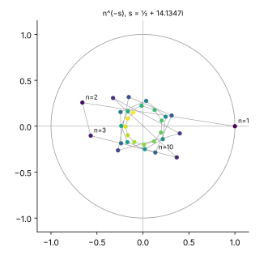
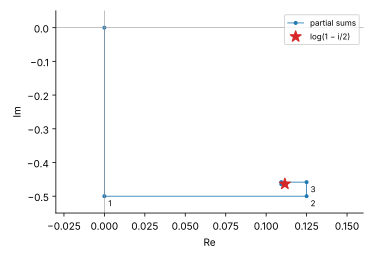
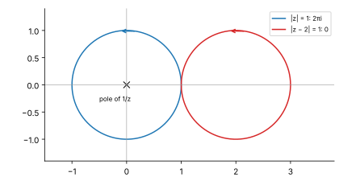
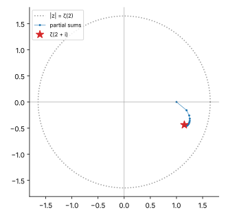
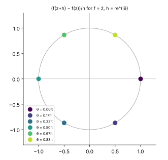
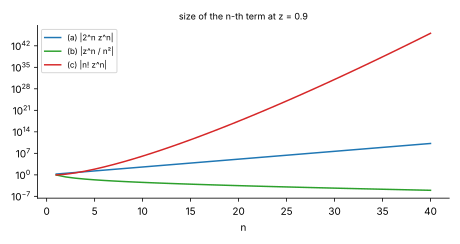
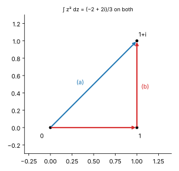
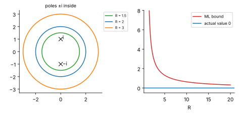

# שיעור כלים כ9: פונקציות של משתנה מרוכב – גזירות, טורי חזקות ואינטגרלים קוויים

**מה נלמד:** פונקציית הזטא של רימן היא פונקציה של משתנה **מרוכב** $`s`$. כדי לעבוד איתה צריך לדעת:
1. מהי החזקה $`n^{-s}`$ כש-$`s`$ מרוכב, ומה הגודל שלה.
2. מהי **נגזרת מרוכבת**, ומהי **פונקציה הולומורפית**.
3. **טורי חזקות** ו**רדיוס ההתכנסות**.
4. **אינטגרל קווי** במישור המרוכב, והחישוב החשוב ביותר: $`\oint\frac{dz}{z} = 2\pi i`$.
5. למה $`\zeta(s) = \sum n^{-s}`$ הולומורפית בחצי המישור $`\mathrm{Re}\,s \gt 1`$.

**ידע קודם:** [שיעור כלים כ2](T02-מספרים-מרוכבים.md) (מספרים מרוכבים, $`e^{i\theta}`$), [שיעור כלים כ4](T04-לוגריתם-וחדוא.md) (נגזרות ואינטגרלים), [שיעור כלים כ5](T05-טורים.md) (התכנסות טורים).

---

## 1. החזקה $`n^{-s}`$

**הסימון של רימן:** את המשתנה המרוכב כותבים $`s = \sigma + it`$, עם $`\sigma = \mathrm{Re}\,s`$ ו-$`t = \mathrm{Im}\,s`$.

עבור $`n \gt 0`$ ממשי מגדירים $`n^{-s} = e^{-s\log n}`$, כאשר $`e^{z}`$ עבור $`z = x + iy`$ הוא $`e^x(\cos y + i\sin y)`$ ([שיעור כ2](T02-מספרים-מרוכבים.md)). לכן
```math
n^{-s} = e^{-\sigma\log n}\,e^{-it\log n} = n^{-\sigma}\big(\cos(t\log n) - i\sin(t\log n)\big).
```
**העובדה החשובה:**
```math
|n^{-s}| = n^{-\sigma}.
```
הגודל תלוי רק בחלק הממשי $`\sigma`$. החלק המדומה $`t`$ רק **מסובב** את המספר בזווית $`-t\log n`$.

## 2. נגזרת מרוכבת ופונקציות הולומורפיות

$`f`$ **גזירה (במובן המרוכב)** בנקודה $`z_0`$ אם הגבול
```math
f'(z_0) = \lim_{h\to0}\frac{f(z_0 + h) - f(z_0)}{h}
```
קיים, כאשר $`h`$ שואף ל-0 **מכל כיוון במישור** (ממשי, מדומה, באלכסון...), ותמיד נותן אותו ערך. פונקציה שגזירה בכל נקודה של קבוצה פתוחה נקראת **הולומורפית** (או **אנליטית**) שם.

**דוגמאות:** פולינומים, $`e^z`$, $`\frac1z`$ (מחוץ ל-0), $`n^{-s}`$ (כפונקציה של $`s`$, עם נגזרת $`-\log n\cdot n^{-s}`$). כללי הגזירה (סכום, מכפלה, מנה, שרשרת) זהים לממשיים.

**הדרישה חזקה מאוד:** פונקציה הולומורפית גזירה אינסוף פעמים, ושווה לטור החזקות שלה סביב כל נקודה (נראה ב[שיעור כלים כ10](T10-משפט-קושי-ושאריות.md)). שום דבר כזה לא נכון לפונקציות ממשיות.

## 3. טורי חזקות

**טור חזקות** סביב $`z_0`$ הוא $`\sum_{n\ge0}a_n(z - z_0)^n`$.

**משפט.** לכל טור חזקות יש **רדיוס התכנסות** $`R\in[0, \infty]`$: הטור מתכנס בהחלט כש-$`|z - z_0| \lt R`$ ומתבדר כש-$`|z - z_0| \gt R`$. בפנים הוא פונקציה הולומורפית, ואפשר לגזור אותו איבר-איבר. אם הגבול קיים, $`R = \lim\left|\frac{a_n}{a_{n+1}}\right|`$ (מבחן המנה, [שיעור כ5](T05-טורים.md)).

**הוכחת החלק הראשון (בקצרה).** אם הטור מתכנס בנקודה $`w`$, האיברים $`a_nw^n`$ חסומים (נניח $`z_0 = 0`$), $`|a_nw^n|\le M`$. אז עבור $`|z| \lt |w|`$: $`|a_nz^n| \le M\left|\frac zw\right|^n`$ – טור הנדסי מתכנס. ∎

**דוגמאות:**
* $`\sum z^n = \frac{1}{1-z}`$, $`R = 1`$.
* $`e^z = \sum\frac{z^n}{n!}`$, $`R = \infty`$.
* $`-\log(1 - z) = \sum_{n\ge1}\frac{z^n}n`$, $`R = 1`$ (גוזרים איבר-איבר ומקבלים $`\sum z^{n-1} = \frac1{1-z}`$).

**הלוגריתם המרוכב:** $`\log z = \log|z| + i\arg z`$. הארגומנט מוגדר רק עד כפולה של $`2\pi`$, ולכן בוחרים **ענף**: למשל $`-\pi \lt \arg z \lt \pi`$ במישור בלי חצי הציר השלילי. בענף כזה $`\log`$ הולומורפית עם נגזרת $`\frac1z`$.

## 4. אינטגרלים קוויים

**מסילה** היא פונקציה גזירה $`\gamma: [a,b]\to\mathbb C`$. האינטגרל לאורכה:
```math
\int_\gamma f(z)\,dz = \int_a^b f(\gamma(t))\,\gamma'(t)\,dt .
```
**שלוש עובדות:**
1. **המשפט היסודי:** אם $`F' = f`$ על המסילה, אז $`\int_\gamma f = F(\gamma(b)) - F(\gamma(a))`$. בפרט, על מסילה **סגורה** האינטגרל הוא 0.
2. **אי-שוויון ML:** $`\left|\int_\gamma f\right| \le L\cdot M`$, כאשר $`L`$ אורך המסילה ו-$`M = \max_\gamma|f|`$.
3. **החישוב המרכזי:** על המעגל $`|z| = r`$ עם כיוון נגד השעון,
```math
\oint_{|z|=r} z^n\,dz = \begin{cases}2\pi i, & n = -1\\ 0, & n \ne -1.\end{cases}
```
עבור $`n\ne-1`$ זה נובע מעובדה 1 עם $`F = \frac{z^{n+1}}{n+1}`$. עבור $`n = -1`$ אין פונקציה קדומה על כל המעגל (הלוגריתם "קופץ" ב-$`2\pi i`$ בסיבוב), ומחשבים ישירות (דוגמה 3).

## 5. טורי דיריכלה הם הולומורפיים

**משפט (ויירשטראס).** גבול **במידה שווה** של פונקציות הולומורפיות הוא הולומורפי, ומותר לגזור איבר-איבר.

**יישום ל-$`\zeta`$.** בחצי המישור $`\sigma \ge \sigma_0 \gt 1`$: $`|n^{-s}| = n^{-\sigma} \le n^{-\sigma_0}`$, ו-$`\sum n^{-\sigma_0}`$ מתכנס. לכן הטור מתכנס במידה שווה (מבחן M של ויירשטראס), ו-$`\zeta(s)`$ **הולומורפית** ב-$`\sigma \gt 1`$, עם
```math
\zeta'(s) = -\sum_{n\ge1}\frac{\log n}{n^s}, \qquad |\zeta(s)| \le \zeta(\sigma).
```

---

## 6. דוגמאות פתורות

### דוגמה 1: חישוב $`2^{-s}`$ על הישר הקריטי

**שאלה.** חשבו את $`2^{-s}`$ עבור $`s = \frac12 + 14.1347i`$ (הגובה של האפס הראשון של זטא).



<sub>הנקודות n^(−s) עבור n = 1, …, 30 ו-s = ½ + 14.1347i: הגודל קטן כמו n^(−½) והזווית מסתובבת לפי −t log n.</sub>

**פתרון.**
1. **גודל:** $`|2^{-s}| = 2^{-1/2} = 0.70711`$.
2. **זווית:** $`-t\log 2 = -14.1347\cdot0.69315 = -9.7974`$ רדיאנים. מוסיפים $`4\pi = 12.5664`$ כדי להגיע לטווח $`(-\pi, \pi]`$: הזווית $`2.7689`$.
3. **בצורה קרטזית:** $`0.70711(\cos2.7689 + i\sin2.7689) = -0.65857 + 0.25746i`$.
4. **בדיקה:** $`0.65857^2 + 0.25746^2 = 0.5000`$ ✓.

### דוגמה 2: טור החזקות של $`\log(1-z)`$

**שאלה.** מצאו את רדיוס ההתכנסות של $`\sum_{n\ge1}\frac{z^n}n`$, וחשבו את הסכומים החלקיים ב-$`z = \frac i2`$. השוו ל-$`-\log(1 - \frac i2)`$.



<sub>הסכומים החלקיים של −Σ (i/2)^n / n במישור המרוכב, מתכנסים ל-log(1 − i/2) = 0.1116 − 0.4636i.</sub>

**פתרון.**
1. **רדיוס:** $`\left|\frac{a_n}{a_{n+1}}\right| = \frac{n+1}{n}\to1`$, לכן $`R = 1`$. הנקודה $`\frac i2`$ בפנים.
2. **ערך היעד:** $`\log(1 - \tfrac i2) = \log\left|1 - \tfrac i2\right| + i\arg(1 - \tfrac i2) = \tfrac12\log\tfrac54 - i\arctan\tfrac12 = 0.11157 - 0.46365i`$.
3. **סכומים חלקיים של $`-\sum\frac{z^n}{n}`$:** האיברים הם $`-\frac{i}{2},\ +\frac{1}{8},\ +\frac{i}{24},\ -\frac{1}{64},\ \ldots`$ (כי $`i^2 = -1`$, $`i^3 = -i`$, $`i^4 = 1`$).
4. אחרי איבר אחד: $`-0.5i`$; שניים: $`0.125 - 0.5i`$; שלושה: $`0.125 - 0.4583i`$; חמישה: $`0.1094 - 0.4646i`$; עשרה: $`0.11159 - 0.46368i`$. ✓
5. **קצב:** השגיאה קטנה בערך פי $`|z| = \frac12`$ בכל צעד – טור הנדסי.

### דוגמה 3: $`\oint\frac{dz}{z} = 2\pi i`$

**שאלה.** חשבו את $`\oint_{|z|=1}\frac{dz}z`$, את $`\oint_{|z|=1}z^2\,dz`$, ואת $`\oint_{|z-2|=1}\frac{dz}z`$.



<sub>שני מעגלים: |z| = 1 מקיף את 0 ונותן 2πi; ‏|z − 2| = 1 לא מקיף את 0 ונותן 0.</sub>

**פתרון.**
1. **מסילה:** $`\gamma(t) = e^{it}`$, $`0\le t\le2\pi`$, ו-$`\gamma'(t) = ie^{it}`$.
2. **$`\frac1z`$:** $`\int_0^{2\pi}\frac{1}{e^{it}}\cdot ie^{it}\,dt = \int_0^{2\pi}i\,dt = 2\pi i`$.
3. **$`z^2`$:** $`\int_0^{2\pi}e^{2it}\cdot ie^{it}\,dt = i\int_0^{2\pi}e^{3it}\,dt = i\left[\frac{e^{3it}}{3i}\right]_0^{2\pi} = 0`$.
4. **המעגל סביב 2:** בחצי המישור $`\mathrm{Re}\,z \gt 0`$ יש ל-$`\frac1z`$ פונקציה קדומה – הענף הראשי של $`\log z`$. המעגל $`|z-2| = 1`$ כולו שם, ולכן לפי המשפט היסודי האינטגרל הוא 0.
5. **המסקנה:** $`\oint\frac{dz}z`$ "סופר" כמה פעמים המסילה מקיפה את 0, כפול $`2\pi i`$. על זה בנויים משפט השאריות ועקרון הארגומנט ב[שיעור כ10](T10-משפט-קושי-ושאריות.md).

### דוגמה 4: $`\zeta(2+i)`$

**שאלה.** חסמו את $`|\zeta(2 + i)|`$ וחשבו אותו בקירוב בעזרת סכומים חלקיים.



<sub>הסכומים החלקיים של Σ n^(−2−i) "מתפתלים" אל ζ(2 + i) ≈ 1.1504 − 0.4375i, בתוך העיגול ברדיוס ζ(2).</sub>

**פתרון.**
1. **חסם:** $`|\zeta(2+i)| \le \sum|n^{-2-i}| = \sum n^{-2} = \zeta(2) = 1.6449`$.
2. **האיבר $`n=2`$:** $`2^{-2-i} = \frac14e^{-i\log2} = \frac14(\cos0.6931 - i\sin0.6931) = 0.1923 - 0.1597i`$.
3. **סכומים חלקיים:** $`N = 1`$: $`1`$; $`N = 2`$: $`1.1923 - 0.1597i`$; $`N = 3`$: $`1.2428 - 0.2587i`$; $`N = 10`$: $`1.2177 - 0.4373i`$; $`N = 100`$: $`1.1459 - 0.4430i`$.
4. **שגיאה:** הזנב $`\sum_{n\gt N}n^{-2-i}`$ חסום ב-$`\sum_{n\gt N}n^{-2} \lt \frac1N`$. עבור $`N = 100`$: שגיאה לכל היותר $`0.01`$.
5. **ערך מדויק:** $`\zeta(2+i) = 1.15036 - 0.43753i`$, ו-$`|\zeta(2+i)| = 1.231 \lt 1.645`$ ✓.

---

## 7. תרגילים

**תרגיל 1.** הראו ש-$`f(z) = \bar z`$ (הצמוד) **אינה** גזירה באף נקודה.



<sub>מנת ההפרשים של z̄ היא e^(−2iθ) כש-h = re^(iθ): כשהכיוון θ מסתובב, המנה מסתובבת על מעגל היחידה – אין גבול אחד.</sub>

<details><summary>פתרון</summary>

1. $`\frac{f(z+h) - f(z)}{h} = \frac{\bar h}{h}`$.
2. אם $`h = re^{i\theta}`$, אז $`\bar h = re^{-i\theta}`$ והמנה היא $`e^{-2i\theta}`$.
3. בכיוון ממשי ($`\theta = 0`$) מקבלים $`1`$; בכיוון מדומה ($`\theta = \frac\pi2`$) מקבלים $`e^{-i\pi} = -1`$.
4. שני גבולות שונים, לכן הנגזרת לא קיימת. (כפונקציה של שני משתנים ממשיים, $`(x, y)\mapsto(x, -y)`$ גזירה לגמרי. הגזירות המרוכבת דורשת הרבה יותר.)
</details>

**תרגיל 2.** מצאו את רדיוס ההתכנסות של: (א) $`\sum 2^nz^n`$; (ב) $`\sum\frac{z^n}{n^2}`$; (ג) $`\sum n!\,z^n`$. האם (ב) מתכנס על המעגל $`|z| = R`$?



<sub>הגודל של האיבר ה-n בנקודה z = 0.9: ‏(0.9·2)^n מתבדר, 0.9^n/n² דועך, ו-n!·0.9^n מתבדר מהר.</sub>

<details><summary>פתרון</summary>

1. **(א)** $`\left|\frac{a_n}{a_{n+1}}\right| = \frac12`$, לכן $`R = \frac12`$. (זה $`\frac{1}{1-2z}`$.)
2. **(ב)** $`\frac{(n+1)^2}{n^2}\to1`$, לכן $`R = 1`$. על $`|z| = 1`$: $`\left|\frac{z^n}{n^2}\right| = \frac1{n^2}`$, וזה מתכנס – **הטור מתכנס בכל המעגל**.
3. **(ג)** $`\frac{n!}{(n+1)!} = \frac1{n+1}\to0`$, לכן $`R = 0`$: הטור מתכנס רק ב-$`z = 0`$.
4. **השוואה:** $`\sum z^n`$ מתבדר בכל נקודה של $`|z| = 1`$ (האיברים לא שואפים ל-0), ו-$`\sum\frac{z^n}{n}`$ מתכנס בכל המעגל פרט ל-$`z = 1`$. על השפה כל דבר אפשרי.
</details>

**תרגיל 3.** חשבו את $`\int_\gamma z^2\,dz`$ מ-0 ל-$`1 + i`$ לאורך (א) הקו הישר; (ב) המסלול $`0\to1\to1+i`$.



<sub>שתי מסילות מ-0 ל-1 + i: הקו הישר והמסלול דרך 1. שתיהן נותנות (−2 + 2i)/3.</sub>

<details><summary>פתרון</summary>

1. **(א)** $`\gamma(t) = t(1+i)`$, $`\gamma' = 1+i`$: $`\int_0^1t^2(1+i)^2(1+i)\,dt = \frac{(1+i)^3}{3}`$. $`(1+i)^2 = 2i`$, $`(1+i)^3 = 2i(1+i) = -2+2i`$. התוצאה $`\frac{-2+2i}3`$.
2. **(ב)** קטע ראשון $`\gamma(t) = t`$: $`\int_0^1t^2\,dt = \frac13`$. קטע שני $`\gamma(t) = 1 + it`$, $`\gamma' = i`$: $`\int_0^1(1+it)^2\,i\,dt = i\int_0^1(1 - t^2 + 2it)\,dt = i\left(\frac23 + i\right) = -1 + \frac23i`$.
3. **סכום:** $`\frac13 - 1 + \frac23i = \frac{-2+2i}3`$ – **אותו ערך**.
4. **הסבר:** ל-$`z^2`$ יש פונקציה קדומה $`\frac{z^3}3`$, ולכן האינטגרל תלוי רק בנקודות הקצה: $`\frac{(1+i)^3}3`$.
</details>

**תרגיל 4.** בעזרת אי-שוויון ML, חסמו את $`\left|\oint_{|z|=R}\frac{dz}{z^2+1}\right|`$ עבור $`R \gt 1`$, והראו שהוא שואף ל-0 כש-$`R\to\infty`$. חשבו את החסם עבור $`R = 2`$.



<sub>המעגל |z| = R והקטבים ±i של 1/(z² + 1). החסם 2πR/(R² − 1) שואף ל-0.</sub>

<details><summary>פתרון</summary>

1. **אורך:** $`L = 2\pi R`$.
2. **מקסימום:** על $`|z| = R`$, לפי אי-שוויון המשולש $`|z^2+1| \ge |z|^2 - 1 = R^2 - 1`$, ולכן $`M \le \frac1{R^2-1}`$.
3. **חסם:** $`\frac{2\pi R}{R^2 - 1}\to0`$.
4. **$`R = 2`$:** $`\frac{4\pi}3 = 4.19`$.
5. **הפתעה:** חישוב מספרי נותן שהאינטגרל עבור $`R = 2`$ הוא **בדיוק 0**. הסיבה: האינטגרל לא תלוי ב-$`R`$ (כל עוד $`R \gt 1`$), והגבול שלו הוא 0. את זה נבין ב[שיעור כ10](T10-משפט-קושי-ושאריות.md): התרומות של שני הקטבים $`\pm i`$ מבטלות זו את זו.
</details>

---

## סיכום
* $`s = \sigma + it`$; $`n^{-s} = n^{-\sigma}e^{-it\log n}`$; $`|n^{-s}| = n^{-\sigma}`$.
* **הולומורפית:** גזירה במובן המרוכב (מכל כיוון אותו גבול).
* **טור חזקות:** מתכנס בעיגול ברדיוס $`R`$, הולומורפי בפנים.
* $`\int_\gamma f\,dz = \int f(\gamma(t))\gamma'(t)\,dt`$; $`\oint_{|z|=r}\frac{dz}z = 2\pi i`$; **ML**: $`|\int| \le L\cdot M`$.
* $`\zeta(s)`$ הולומורפית ב-$`\sigma \gt 1`$, ו-$`|\zeta(s)|\le\zeta(\sigma)`$.

**השיעור הקודם:** [שיעור 10: התפלגות הראשוניים בשיטות אלמנטריות](10-התפלגות-אלמנטרית.md) · **השיעור הבא:** [שיעור כלים כ10: משפט קושי, שאריות והמשכה אנליטית](T10-משפט-קושי-ושאריות.md)

**להעמקה:** [פונקציה הולומורפית](https://he.wikipedia.org/wiki/%D7%A4%D7%95%D7%A0%D7%A7%D7%A6%D7%99%D7%94_%D7%94%D7%95%D7%9C%D7%95%D7%9E%D7%95%D7%A8%D7%A4%D7%99%D7%AA) · [טור חזקות](https://he.wikipedia.org/wiki/%D7%98%D7%95%D7%A8_%D7%97%D7%96%D7%A7%D7%95%D7%AA) · [אינטגרל קווי](https://he.wikipedia.org/wiki/%D7%90%D7%99%D7%A0%D7%98%D7%92%D7%A8%D7%9C_%D7%A7%D7%95%D7%95%D7%99) · [פונקציית אטא של דיריכלה](../pages/פונקציית%20אטא%20של%20דיריכלה.md)

---
<sub>חלק מ[קורס תורת המספרים](../COURSE.md). התוכן מופץ ברישיון [CC BY-SA 4.0](https://creativecommons.org/licenses/by-sa/4.0/).</sub>
