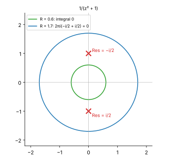
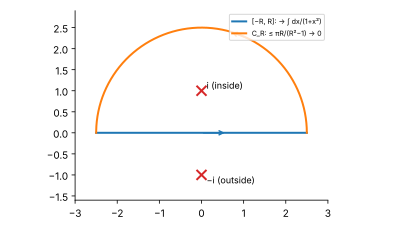
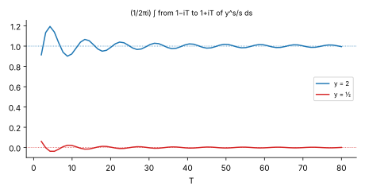
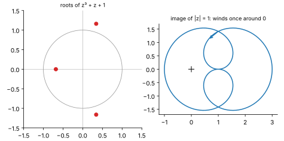
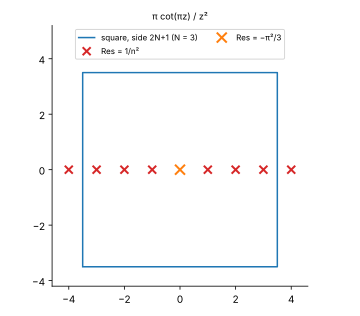
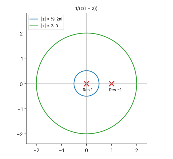
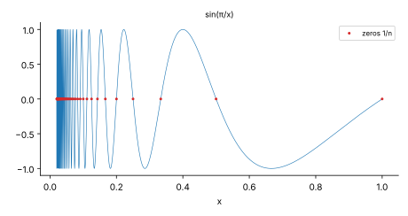
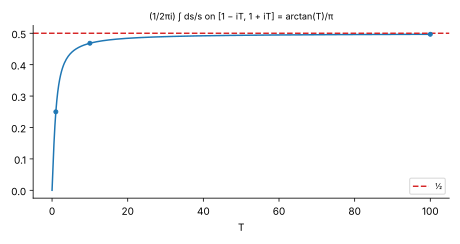

# שיעור כלים כ10: משפט קושי, שאריות והמשכה אנליטית

**מה נלמד:** הכלים שבעזרתם עוברים מפונקציית הזטא אל הראשוניים:
1. **משפט קושי** ו**נוסחת האינטגרל של קושי**.
2. **קטבים ושאריות**, ו**משפט השאריות**: אינטגרל על מסילה סגורה $`= 2\pi i\times`$ סכום השאריות בפנים.
3. **המסנן של פרון**: אינטגרל אחד שמבחין בין $`y \gt 1`$ ל-$`y \lt 1`$ – הבסיס ל[נוסחת פרון](11-טורי-דיריכלה-וזטא.md).
4. **עקרון הארגומנט**: איך סופרים אפסים בעזרת אינטגרל.
5. **משפט היחידות** ו**המשכה אנליטית**.

**ידע קודם:** [שיעור כלים כ9](T09-פונקציות-מרוכבות.md) (פונקציות הולומורפיות, טורי חזקות, אינטגרלים קוויים, $`\oint\frac{dz}{z} = 2\pi i`$).

---

## 1. משפט קושי

**משפט קושי.** אם $`f`$ הולומורפית בתחום **בלי חורים** (למשל עיגול, מלבן או חצי מישור), אז לכל מסילה סגורה $`\gamma`$ בתחום:
```math
\oint_\gamma f(z)\,dz = 0 .
```
**למה זה סביר:** ב[שיעור כ9](T09-פונקציות-מרוכבות.md) ראינו שאם יש ל-$`f`$ פונקציה קדומה, האינטגרל על מסילה סגורה הוא 0. בתחום בלי חורים אפשר לבנות קדומה: $`F(z) = \int_{z_0}^zf`$, והגזירות המרוכבת מבטיחה שהתוצאה לא תלויה בדרך. (ההוכחה המלאה עוברת דרך משולשים קטנים, ונמצאת בכל ספר באנליזה מרוכבת.)

**החור חשוב:** $`\frac1z`$ הולומורפית בכל המישור **פרט ל-0**, ו-$`\oint_{|z|=1}\frac{dz}{z} = 2\pi i \ne 0`$. החור ב-0 הוא כל ההבדל.

**הזזת מסילות:** אם שתי מסילות סגורות אפשר לעוות זו לזו בלי לעבור דרך נקודה שבה $`f`$ לא מוגדרת, האינטגרלים שווים. זה מה שמאפשר "להזיז את קו האינטגרציה" בהוכחת משפט המספרים הראשוניים.

**נוסחת האינטגרל של קושי.** אם $`f`$ הולומורפית בתוך המעגל $`\gamma`$ ועליו, ו-$`z_0`$ בפנים:
```math
f(z_0) = \frac{1}{2\pi i}\oint_\gamma\frac{f(z)}{z - z_0}\,dz .
```
**מסקנות:** ערכי $`f`$ בפנים נקבעים לגמרי מערכיה על השפה; $`f`$ גזירה אינסוף פעמים; ו-$`f`$ שווה לטור החזקות שלה בכל עיגול שבו היא הולומורפית.

## 2. קטבים ושאריות

נקודה $`z_0`$ שבה $`f`$ לא מוגדרת, אבל $`f`$ הולומורפית סביבה, היא **נקודה סינגולרית מבודדת**. סביבה אפשר לפתח את $`f`$ ל**טור לורן** – טור חזקות שמותר בו גם חזקות שליליות:
```math
f(z) = \sum_{n=-\infty}^{\infty}a_n(z - z_0)^n .
```
* אם יש רק מספר סופי של חזקות שליליות, והשלילית ביותר היא $`(z-z_0)^{-m}`$, אז $`z_0`$ **קוטב מסדר $`m`$**. סדר 1 נקרא **קוטב פשוט**.
* **השארית** היא המקדם $`a_{-1}`$: $`\mathrm{Res}_{z_0}f = a_{-1}`$.

**למה דווקא $`a_{-1}`$:** כשמשלבים את טור לורן על מעגל קטן סביב $`z_0`$, לפי [שיעור כ9](T09-פונקציות-מרוכבות.md) כל החזקות נותנות 0 פרט ל-$`(z-z_0)^{-1}`$, שנותנת $`2\pi i`$. לכן $`\oint f = 2\pi i\,a_{-1}`$.

**כללי חישוב לקוטב פשוט:**
* $`\mathrm{Res}_{z_0}f = \lim_{z\to z_0}(z - z_0)f(z)`$.
* אם $`f = \frac gh`$ כאשר $`g(z_0)\ne0`$, $`h(z_0) = 0`$ ו-$`h'(z_0)\ne0`$: $`\mathrm{Res}_{z_0}f = \frac{g(z_0)}{h'(z_0)}`$.

## 3. משפט השאריות

**משפט.** אם $`f`$ הולומורפית בתוך מסילה סגורה פשוטה $`\gamma`$ (נגד כיוון השעון) ועליה, פרט למספר סופי של נקודות סינגולריות $`z_1,\ldots,z_k`$ בפנים, אז
```math
\oint_\gamma f(z)\,dz = 2\pi i\sum_{j=1}^k\mathrm{Res}_{z_j}f .
```
**הוכחה (רעיון).** מקיפים כל $`z_j`$ במעגל קטן ומחברים אותו לשפה ב"מסדרון" צר. במסילה החדשה אין סינגולריות, ולכן לפי קושי האינטגרל עליה 0. המסדרונות מתבטלים (עוברים בהם הלוך וחזור), ונשאר: האינטגרל על $`\gamma`$ = סכום האינטגרלים על המעגלים הקטנים = $`2\pi i\sum a_{-1}^{(j)}`$. ∎

## 4. המסנן של פרון

**משפט.** עבור $`c \gt 0`$ ו-$`y \gt 0`$:
```math
\frac{1}{2\pi i}\int_{c-i\infty}^{c+i\infty}\frac{y^s}{s}\,ds = \begin{cases}1, & y \gt 1\\ \frac12, & y = 1\\ 0, & 0 \lt y \lt 1.\end{cases}
```
(האינטגרל על הקו האנכי $`\mathrm{Re}\,s = c`$, מובן כגבול של $`\int_{c-iT}^{c+iT}`$ כש-$`T\to\infty`$.)

**הוכחה (רעיון).**
* **$`y \gt 1`$:** $`|y^s| = y^{\sigma}`$ קטן כש-$`\sigma\to-\infty`$. "סוגרים" את הקו במלבן גדול **שמאלה**. בפנים יש קוטב פשוט אחד, ב-$`s = 0`$, עם שארית $`y^0 = 1`$. האינטגרלים על שלוש הצלעות האחרות שואפים ל-0 (אי-שוויון ML). התוצאה: 1.
* **$`y \lt 1`$:** עכשיו $`y^\sigma`$ קטן כש-$`\sigma\to+\infty`$. סוגרים **ימינה**; אין קטבים בפנים, והתוצאה 0.
* **$`y = 1`$:** חישוב ישיר (תרגיל 4).

**למה זה חשוב:** אם $`F(s) = \sum a_nn^{-s}`$, מציבים $`y = x/n`$ ומסכמים:
```math
\frac{1}{2\pi i}\int_{c-i\infty}^{c+i\infty}F(s)\frac{x^s}{s}\,ds = \sum_{n \lt x}a_n \quad(\text{for } x \notin \mathbb Z).
```
המסנן "מדליק" בדיוק את המחוברים עם $`n \lt x`$. זו **נוסחת פרון**, שהופכת שאלה על סכום של מקדמים לשאלה על הפונקציה $`F`$.

## 5. עקרון הארגומנט

**הנגזרת הלוגריתמית** של $`f`$ היא $`\frac{f'}{f}`$. אם ל-$`f`$ יש אפס מסדר $`k`$ ב-$`z_0`$, כלומר $`f(z) = (z-z_0)^kg(z)`$ עם $`g(z_0)\ne0`$, אז
```math
\frac{f'(z)}{f(z)} = \frac{k}{z - z_0} + \frac{g'(z)}{g(z)},
```
ולכן ל-$`\frac{f'}{f}`$ יש קוטב פשוט עם שארית $`k`$. בקוטב מסדר $`m`$ השארית היא $`-m`$.

**עקרון הארגומנט.** אם $`f`$ הולומורפית בתוך $`\gamma`$ ועליה (פרט לקטבים בפנים), ואין לה אפסים על $`\gamma`$:
```math
\frac{1}{2\pi i}\oint_\gamma\frac{f'(z)}{f(z)}\,dz = (\text{zeros}) - (\text{poles}),
```
כשכל אפס וקוטב נספר לפי הסדר שלו. **בצורה גאומטרית:** זה מספר הפעמים שהעקומה $`f(\gamma)`$ מקיפה את 0. כך סופרים את האפסים של $`\zeta`$ ב[שיעור 12](12-משפט-המספרים-הראשוניים.md) (נוסחת רימן–פון מנגולדט), וכך עובד [המבחן של טיורינג](../pages/השיטה%20של%20טיורינג.md).

**בתורת המספרים:** $`-\frac{\zeta'(s)}{\zeta(s)} = \sum\frac{\Lambda(n)}{n^s}`$ ([שיעור 11](11-טורי-דיריכלה-וזטא.md)). לפי הנאמר כאן, יש לה קוטב עם שארית $`+1`$ ב-$`s = 1`$ (הקוטב של $`\zeta`$), וקוטב עם שארית $`-1`$ בכל אפס פשוט של $`\zeta`$. משפט השאריות יחד עם נוסחת פרון נותן את **הנוסחה המפורשת** $`\psi(x) = x - \sum_\rho\frac{x^\rho}\rho - \cdots`$.

## 6. משפט היחידות והמשכה אנליטית

**משפט היחידות.** אם $`f, g`$ הולומורפיות בתחום **קשיר** $`D`$, ו-$`f = g`$ על קבוצה שיש לה נקודת הצטברות בתוך $`D`$ (למשל על קטע קטן, או על סדרה מתכנסת), אז $`f = g`$ בכל $`D`$.

**רעיון ההוכחה.** $`h = f - g`$ מתאפסת על סדרה $`z_k\to z_0`$. אם $`h`$ לא אפס זהותית, אז ליד $`z_0`$, $`h(z) = (z - z_0)^kg(z)`$ עם $`g(z_0)\ne0`$, ואז $`h\ne0`$ בסביבה מנוקבת של $`z_0`$ – סתירה. ∎

**המשכה אנליטית.** אם $`f`$ הולומורפית ב-$`D`$, ו-$`F`$ הולומורפית בתחום גדול יותר $`D' \supset D`$ ומסכימה עם $`f`$ על $`D`$, אז $`F`$ היא **ההמשכה האנליטית** של $`f`$ ל-$`D'`$. לפי משפט היחידות, **יש לכל היותר המשכה אחת**.

**דוגמה:** $`\sum_{n\ge0}z^n`$ מוגדר רק ב-$`|z| \lt 1`$, אבל שווה שם ל-$`\frac{1}{1-z}`$, שהולומורפית בכל המישור פרט ל-1. לכן $`\frac{1}{1-z}`$ היא ההמשכה היחידה. באותו אופן $`\zeta(s) = \sum n^{-s}`$ מוגדר ב-$`\sigma \gt 1`$, ויש לו המשכה יחידה לכל המישור פרט לקוטב ב-$`s = 1`$ ([שיעור 11](11-טורי-דיריכלה-וזטא.md)). "$`\zeta(-1) = -\frac1{12}`$" הוא ערך ההמשכה, לא ערך הטור.

---

## 7. דוגמאות פתורות

### דוגמה 1: למה $`\oint\frac{dz}{z^2+1} = 0`$

**שאלה.** חשבו את השאריות של $`f(z) = \frac{1}{z^2+1}`$, ואת $`\oint_{|z|=R}f`$ עבור $`R \lt 1`$ ו-$`R \gt 1`$. (זה מסביר את ה"הפתעה" בתרגיל 4 של [שיעור כ9](T09-פונקציות-מרוכבות.md).)



<sub>הקטבים של 1/(z² + 1) ב-i וב-−i, עם השאריות 1/(2i) ו-−1/(2i). מעגל עם R > 1 מקיף את שניהם.</sub>

**פתרון.**
1. $`z^2 + 1 = (z - i)(z + i)`$: קטבים פשוטים ב-$`\pm i`$.
2. **שארית ב-$`i`$** (לפי $`g/h'`$ עם $`g = 1`$, $`h = z^2+1`$, $`h' = 2z`$): $`\frac{1}{2i} = -\frac i2`$.
3. **שארית ב-$`-i`$:** $`\frac{1}{-2i} = \frac i2`$.
4. **$`R \lt 1`$:** אין קטבים בפנים, והאינטגרל 0 (קושי).
5. **$`R \gt 1`$:** $`2\pi i\left(-\frac i2 + \frac i2\right) = 0`$. השאריות מתבטלות.

### דוגמה 2: אינטגרל ממשי בעזרת שאריות

**שאלה.** חשבו את $`\int_{-\infty}^\infty\frac{dx}{1+x^2}`$ בעזרת משפט השאריות.



<sub>המסילה: הקטע מ-−R עד R וחצי המעגל העליון. רק הקוטב i בפנים.</sub>

**פתרון.**
1. **מסילה:** הקטע $`[-R, R]`$ ועליו חצי המעגל $`C_R`$: $`z = Re^{i\theta}`$, $`0\le\theta\le\pi`$. עבור $`R \gt 1`$ רק הקוטב $`i`$ בפנים.
2. **משפט השאריות:** $`\int_{-R}^R\frac{dx}{1+x^2} + \int_{C_R}\frac{dz}{1+z^2} = 2\pi i\cdot\left(-\frac i2\right) = \pi`$.
3. **חצי המעגל זניח (ML):** אורך $`\pi R`$, ו-$`|1+z^2| \ge R^2-1`$. לכן $`\left|\int_{C_R}\right| \le \frac{\pi R}{R^2-1}\to0`$.
4. **התוצאה:** $`\int_{-\infty}^\infty\frac{dx}{1+x^2} = \pi`$.
5. **בדיקה:** הקדומה היא $`\arctan x`$, ו-$`\arctan(\infty) - \arctan(-\infty) = \frac\pi2 + \frac\pi2 = \pi`$ ✓.

### דוגמה 3: המסנן של פרון, מספרית

**שאלה.** חשבו מספרית את $`I(y, T) = \frac{1}{2\pi i}\int_{1-iT}^{1+iT}\frac{y^s}s\,ds`$ עבור $`y = 2`$ ו-$`y = \frac12`$, עם $`T = 10, 50, 200`$.



<sub>I(y, T) כפונקציה של T: עבור y = 2 מתנודד סביב 1, ועבור y = ½ סביב 0. התנודות קטנות כמו 1/T.</sub>

**פתרון.**
1. **פרמטריזציה:** $`s = 1 + it`$, $`ds = i\,dt`$, ולכן $`I(y, T) = \frac{1}{2\pi}\int_{-T}^T\frac{y^{1+it}}{1+it}\,dt`$.
2. **$`y = 2`$:** $`I = 0.926,\ 1.018,\ 0.996`$ עבור $`T = 10, 50, 200`$ – מתקרב ל-1.
3. **$`y = \frac12`$:** $`I = 0.020,\ -0.005,\ 0.001`$ – מתקרב ל-0.
4. **קצב:** השגיאה בערך $`\frac{y^c}{\pi T|\log y|}`$ (אינטגרציה בחלקים של $`y^{it}`$). היא גדלה כש-$`y`$ קרוב ל-1, ולכן בנוסחת פרון הקטועה המחוברים עם $`n`$ קרוב ל-$`x`$ הם הבעייתיים.

### דוגמה 4: ספירת אפסים בעזרת עקרון הארגומנט

**שאלה.** כמה אפסים יש ל-$`f(z) = z^3 + z + 1`$ בעיגול $`|z| \lt 1`$?



<sub>התמונה של מעגל היחידה תחת f(z) = z³ + z + 1 מקיפה את 0 פעם אחת: אפס אחד בפנים.</sub>

**פתרון.**
1. **עקרון הארגומנט:** המספר הוא $`\frac{1}{2\pi i}\oint_{|z|=1}\frac{3z^2+1}{z^3+z+1}\,dz`$, כלומר מספר הסיבובים של $`f(e^{i\theta})`$ סביב 0.
2. **חישוב מספרי** של האינטגרל: $`1.000`$. יש **אפס אחד** בפנים.
3. **בדיקה ישירה:** השורשים הם $`-0.6823`$ ו-$`0.3412 \pm 1.1615i`$. הגודל של הזוג המרוכב: $`1.2106 \gt 1`$. רק השורש הממשי בפנים ✓.
4. **בדיקת עקביות:** מכפלת השורשים היא $`-1`$ (המקדם החופשי עם סימן הפוך), ואכן $`0.6823\cdot1.2106^2 = 1.000`$.

---

## 8. תרגילים

**תרגיל 1 ($`\zeta(2)`$ בעזרת שאריות).** הראו ש-$`\pi\cot(\pi z)`$ יש קוטב פשוט עם שארית 1 בכל שלם $`n`$. בעזרת $`f(z) = \frac{\pi\cot(\pi z)}{z^2}`$, וההנחה ש-$`|\cot(\pi z)|`$ חסום על שפות הריבועים $`|\mathrm{Re}\,z|, |\mathrm{Im}\,z| \le N + \frac12`$, הסיקו ש-$`\zeta(2) = \frac{\pi^2}6`$.



<sub>ריבוע עם צלע 2N + 1 סביב הראשית; הקטבים של π cot(πz)/z² בשלמים. ב-0 השארית −π²/3, ובכל n ≠ 0 השארית 1/n².</sub>

<details><summary>פתרון</summary>

1. $`\pi\cot(\pi z) = \frac{\pi\cos\pi z}{\sin\pi z}`$. ב-$`z = n`$: $`\sin\pi n = 0`$, והנגזרת $`\pi\cos\pi n \ne 0`$. לפי כלל $`g/h'`$: השארית $`\frac{\pi\cos\pi n}{\pi\cos\pi n} = 1`$.
2. **שאריות של $`f`$ ב-$`n\ne0`$:** $`\frac{1}{n^2}`$.
3. **ב-0:** $`\pi\cot\pi z = \frac1z - \frac{\pi^2}{3}z - \cdots`$ (מפיתוחי טיילור של $`\sin`$ ו-$`\cos`$). לכן $`f = \frac{1}{z^3} - \frac{\pi^2}{3z} - \cdots`$, והשארית $`-\frac{\pi^2}3`$.
4. **משפט השאריות** על הריבוע $`Q_N`$: $`\oint_{Q_N}f = 2\pi i\left(-\frac{\pi^2}3 + 2\sum_{n=1}^N\frac{1}{n^2}\right)`$.
5. **ML:** $`|f| \le \frac{B}{(N+\frac12)^2}`$ על השפה, והאורך $`8N + 4`$. לכן האינטגרל $`= O(1/N) \to 0`$.
6. **מסקנה:** $`2\sum_{n\ge1}\frac1{n^2} = \frac{\pi^2}3`$, כלומר $`\zeta(2) = \frac{\pi^2}6`$.
</details>

**תרגיל 2.** מצאו את השאריות של $`f(z) = \frac{1}{z(1-z)}`$, וחשבו את $`\oint f`$ על $`|z| = \frac12`$ ועל $`|z| = 2`$.



<sub>הקטבים 0 ו-1 של 1/(z(1 − z)); המעגל ברדיוס ½ מקיף רק את 0, והמעגל ברדיוס 2 את שניהם.</sub>

<details><summary>פתרון</summary>

1. **שברים חלקיים:** $`\frac{1}{z(1-z)} = \frac1z + \frac{1}{1-z}`$.
2. **ב-0:** $`\frac1z`$ תורם שארית 1, ו-$`\frac{1}{1-z}`$ הולומורפית שם. השארית: $`1`$.
3. **ב-1:** $`\frac{1}{1-z} = \frac{-1}{z-1}`$, שארית $`-1`$.
4. **$`|z| = \frac12`$:** $`2\pi i\cdot1 = 2\pi i`$.
5. **$`|z| = 2`$:** $`2\pi i(1 - 1) = 0`$.
6. **בדיקה ב-$`|z| = 2`$ (ML):** $`|f| \le \frac{1}{2\cdot1}`$, האורך $`4\pi`$ – החסם לא מראה 0, אבל עבור $`R\to\infty`$, $`|f| \le \frac{1}{R(R-1)}`$ והחסם $`\frac{2\pi}{R-1}\to0`$. כיוון שהאינטגרל לא תלוי ב-$`R \gt 1`$, הוא 0 ✓.
</details>

**תרגיל 3.** (א) הראו שאם $`f`$ הולומורפית בכל המישור ו-$`f(\frac1n) = 0`$ לכל $`n\ge1`$, אז $`f \equiv 0`$. (ב) הפונקציה $`\sin(\pi/z)`$ מתאפסת ב-$`\frac1n`$ ואינה אפס. למה אין סתירה?



<sub>sin(π/x) עבור 0 < x ≤ 1: האפסים 1/n מצטברים ב-0, והפונקציה מתנודדת בפראות שם.</sub>

<details><summary>פתרון</summary>

1. **(א)** האפסים $`\frac1n\to0`$, ו-0 נמצא בתחום (כל המישור). לפי משפט היחידות עם $`g = 0`$: $`f\equiv0`$.
2. **ישירות:** $`f(0) = \lim f(\frac1n) = 0`$. אם $`f\not\equiv0`$, אז $`f(z) = z^kg(z)`$ עם $`g(0)\ne0`$, ו-$`g(\frac1n) = 0`$ לכל $`n`$ – אבל $`g`$ רציפה, ולכן $`g(0) = 0`$. סתירה.
3. **(ב)** $`\sin(\pi/z)`$ **לא מוגדרת ב-0**. היא הולומורפית רק ב-$`\mathbb C\setminus\{0\}`$, ונקודת ההצטברות 0 אינה בתחום. אין סתירה.
</details>

**תרגיל 4.** חשבו במפורש את $`\frac{1}{2\pi i}\int_{c-iT}^{c+iT}\frac{ds}{s}`$, והראו שהגבול הוא $`\frac12`$ (המקרה $`y = 1`$ של המסנן).



<sub>arctan(T/c)/π כפונקציה של T (עבור c = 1): עולה אל ½.</sub>

<details><summary>פתרון</summary>

1. $`s = c + it`$, $`ds = i\,dt`$: $`\frac1{2\pi i}\int_{-T}^T\frac{i\,dt}{c + it} = \frac1{2\pi}\int_{-T}^T\frac{c - it}{c^2+t^2}\,dt`$.
2. החלק $`\frac{-it}{c^2+t^2}`$ אי-זוגי ונותן 0.
3. נשאר $`\frac{1}{2\pi}\int_{-T}^T\frac{c\,dt}{c^2+t^2} = \frac{1}{2\pi}\cdot2\arctan\frac Tc = \frac1\pi\arctan\frac Tc`$.
4. כש-$`T\to\infty`$: $`\frac1\pi\cdot\frac\pi2 = \frac12`$.
5. **מספרים (c = 1):** $`T = 1, 10, 100`$ נותנים $`0.25,\ 0.468,\ 0.497`$.

**המשמעות:** בנוסחת פרון, אם $`x`$ שלם, המחובר $`n = x`$ נספר בחצי.
</details>

---

## סיכום
* **קושי:** בלי חורים, $`\oint f = 0`$. **נוסחת קושי:** $`f(z_0) = \frac1{2\pi i}\oint\frac{f(z)}{z-z_0}dz`$.
* **שארית** = המקדם של $`(z-z_0)^{-1}`$; בקוטב פשוט $`\lim(z-z_0)f(z)`$ או $`g/h'`$.
* **משפט השאריות:** $`\oint f = 2\pi i\sum\mathrm{Res}`$.
* **פרון:** $`\frac1{2\pi i}\int_{(c)}\frac{y^s}s\,ds = \mathbf 1[y \gt 1]`$ (וחצי ב-$`y = 1`$).
* **עקרון הארגומנט:** $`\frac1{2\pi i}\oint\frac{f'}f`$ = אפסים פחות קטבים.
* **המשכה אנליטית** – אם קיימת, היא יחידה.

**השיעור הקודם:** [שיעור כלים כ9: פונקציות של משתנה מרוכב: גזירות, טורי חזקות ואינטגרלים קוויים](T09-פונקציות-מרוכבות.md) · **השיעור הבא:** [שיעור כלים כ11: פונקציית גמא, התמרת פורייה, נוסחת פואסון ופונקציית התטא](T11-גמא-פורייה-ותטא.md)

**להעמקה:** [נוסחת האינטגרל של קושי](https://he.wikipedia.org/wiki/%D7%A0%D7%95%D7%A1%D7%97%D7%AA_%D7%94%D7%90%D7%99%D7%A0%D7%98%D7%92%D7%A8%D7%9C_%D7%A9%D7%9C_%D7%A7%D7%95%D7%A9%D7%99) · [טור לורן](https://he.wikipedia.org/wiki/%D7%98%D7%95%D7%A8_%D7%9C%D7%95%D7%A8%D7%9F) · [משפט השאריות](https://he.wikipedia.org/wiki/%D7%9E%D7%A9%D7%A4%D7%98_%D7%94%D7%A9%D7%90%D7%A8%D7%99%D7%95%D7%AA) · [עקרון הארגומנט](https://he.wikipedia.org/wiki/%D7%A2%D7%A7%D7%A8%D7%95%D7%9F_%D7%94%D7%90%D7%A8%D7%92%D7%95%D7%9E%D7%A0%D7%98) · [המשכה אנליטית](https://he.wikipedia.org/wiki/%D7%94%D7%9E%D7%A9%D7%9B%D7%94_%D7%90%D7%A0%D7%9C%D7%99%D7%98%D7%99%D7%AA) · [נוסחת פרון](../pages/נוסחת%20פרון.md) · [השיטה של טיורינג](../pages/השיטה%20של%20טיורינג.md)

---
<sub>חלק מ[קורס תורת המספרים](../COURSE.md). התוכן מופץ ברישיון [CC BY-SA 4.0](https://creativecommons.org/licenses/by-sa/4.0/).</sub>
