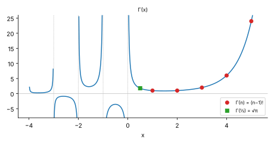
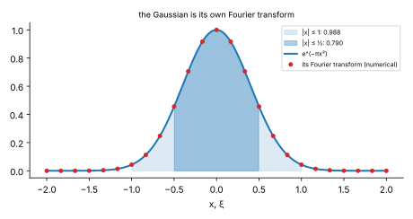
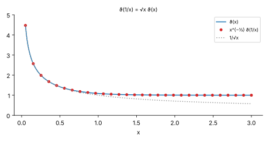
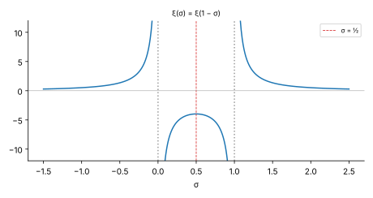
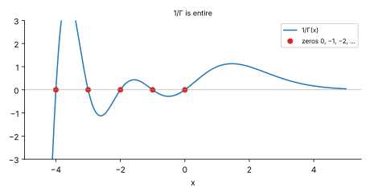
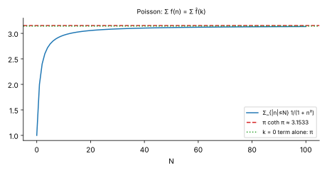
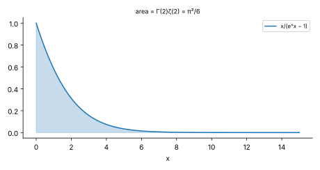
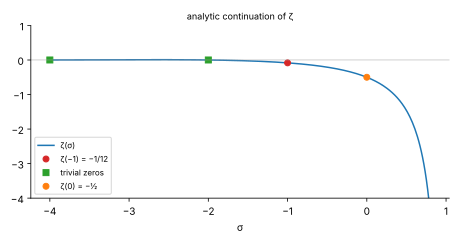

# שיעור כלים כ11: פונקציית גמא, התמרת פורייה, נוסחת פואסון ופונקציית התטא

**מה נלמד:** את כל הכלים שצריך כדי להוכיח את **משוואת הפונקציה** של רימן, $`\xi(s) = \xi(1-s)`$, ולהמשיך את $`\zeta`$ לכל המישור:
1. **פונקציית גמא** $`\Gamma(s)`$ – ההכללה של העצרת.
2. **האינטגרל הגאוסי** $`\int_{-\infty}^\infty e^{-\pi x^2}dx = 1`$.
3. **התמרת פורייה**, והעובדה ש-$`e^{-\pi x^2}`$ היא ההתמרה של עצמה.
4. **נוסחת הסכימה של פואסון:** $`\sum_nf(n) = \sum_k\hat f(k)`$.
5. **פונקציית התטא** והזהות $`\vartheta(1/x) = \sqrt x\,\vartheta(x)`$.
6. **התמרת מלין**, ואיך כל זה מתחבר להוכחה המלאה של משוואת הפונקציה (דוגמה 4).

**ידע קודם:** [שיעור כלים כ4](T04-לוגריתם-וחדוא.md) (אינטגרציה בחלקים, הצבה), [שיעור כלים כ9](T09-פונקציות-מרוכבות.md) ו[שיעור כלים כ10](T10-משפט-קושי-ושאריות.md) (פונקציות הולומורפיות, שאריות, המשכה אנליטית).

---

## 1. פונקציית גמא

**הגדרה.** עבור $`\mathrm{Re}\,s \gt 0`$:
```math
\Gamma(s) = \int_0^\infty x^{s-1}e^{-x}\,dx .
```
(האינטגרל מתכנס: ליד 0, $`|x^{s-1}| = x^{\sigma-1}`$ אינטגרבילית כש-$`\sigma \gt 0`$; ליד $`\infty`$, $`e^{-x}`$ מנצחת כל חזקה.)

**משוואת הנסיגה:** $`\Gamma(s+1) = s\,\Gamma(s)`$. **הוכחה:** אינטגרציה בחלקים עם $`u = x^s`$, $`dv = e^{-x}dx`$:
$`\Gamma(s+1) = \big[-x^se^{-x}\big]_0^\infty + s\int_0^\infty x^{s-1}e^{-x}\,dx = 0 + s\,\Gamma(s)`$. ∎

**עצרת:** $`\Gamma(1) = \int_0^\infty e^{-x}dx = 1`$, ולכן $`\Gamma(n+1) = n!`$.

**המשכה אנליטית:** כותבים $`\Gamma(s) = \frac{\Gamma(s+1)}{s}`$. הצד הימני מוגדר ל-$`\mathrm{Re}\,s \gt -1`$ פרט ל-$`s = 0`$. חוזרים על זה ומקבלים פונקציה הולומורפית בכל המישור פרט ל**קטבים פשוטים** ב-$`s = 0, -1, -2, \ldots`$, עם שאריות
```math
\mathrm{Res}_{s=-k}\Gamma = \frac{(-1)^k}{k!}.
```
**עובדה נוספת:** $`\Gamma`$ לא מתאפסת אף פעם. (זה נובע מנוסחת השיקוף $`\Gamma(s)\Gamma(1-s) = \frac{\pi}{\sin\pi s}`$.)

## 2. האינטגרל הגאוסי

```math
\int_{-\infty}^\infty e^{-\pi x^2}dx = 1 .
```
**הוכחה.** נסמן את האינטגרל ב-$`I`$. אז $`I^2 = \int\!\!\int e^{-\pi(x^2+y^2)}\,dx\,dy`$ – הנפח מתחת למשטח $`e^{-\pi r^2}`$ מעל כל המישור. נחלק את המישור לטבעות דקות סביב הראשית: לטבעת ברדיוס $`r`$ ובעובי $`dr`$ יש שטח $`2\pi r\,dr`$, ועליה הגובה $`e^{-\pi r^2}`$. לכן
$`I^2 = \int_0^\infty e^{-\pi r^2}\,2\pi r\,dr = \big[-e^{-\pi r^2}\big]_0^\infty = 1`$. ∎

**מסקנה:** $`\Gamma(\tfrac12) = \sqrt\pi`$ (דוגמה 1).

## 3. התמרת פורייה

**התמרת פורייה** של פונקציה $`f:\mathbb R\to\mathbb C`$ שדועכת מספיק מהר:
```math
\hat f(\xi) = \int_{-\infty}^\infty f(x)\,e^{-2\pi i x\xi}\,dx .
```
**הרעיון:** $`\hat f(\xi)`$ מודדת "כמה מהתדירות $`\xi`$" יש ב-$`f`$.

**משפט (הגאוסיאן הוא נקודת שבת).** אם $`f(x) = e^{-\pi x^2}`$, אז $`\hat f(\xi) = e^{-\pi\xi^2}`$.

**הוכחה.** משלימים לריבוע: $`-\pi x^2 - 2\pi ix\xi = -\pi(x + i\xi)^2 - \pi\xi^2`$. לכן $`\hat f(\xi) = e^{-\pi\xi^2}\int_{-\infty}^\infty e^{-\pi(x+i\xi)^2}dx`$. את האינטגרל על הקו $`\mathrm{Im}\,z = \xi`$ אפשר להזיז לציר הממשי (משפט קושי על מלבן; הצלעות האנכיות זניחות כי $`e^{-\pi z^2}`$ דועכת), והוא שווה ל-$`\int e^{-\pi x^2}dx = 1`$. ∎

**כלל המתיחה:** אם $`g(x) = f(ax)`$ עם $`a \gt 0`$, אז $`\hat g(\xi) = \frac1a\hat f\left(\frac\xi a\right)`$ (הצבה $`u = ax`$). בפרט, ההתמרה של $`e^{-\pi tx^2}`$ (כאן $`a = \sqrt t`$) היא $`\frac{1}{\sqrt t}e^{-\pi\xi^2/t}`$. **גאוסיאן צר ↔ גאוסיאן רחב.**

## 4. טורי פורייה ונוסחת פואסון

**טור פורייה.** פונקציה $`F`$ חלקה ומחזורית עם מחזור 1 שווה לטור
```math
F(x) = \sum_{k\in\mathbb Z}c_k\,e^{2\pi ikx}, \qquad c_k = \int_0^1F(x)\,e^{-2\pi ikx}\,dx .
```
(ההוכחה של ההתכנסות היא משפט מאנליזה; כאן נקבל אותו.)

**נוסחת הסכימה של פואסון.** אם $`f`$ ו-$`\hat f`$ דועכות מספיק מהר:
```math
\sum_{n\in\mathbb Z}f(n) = \sum_{k\in\mathbb Z}\hat f(k).
```
**הוכחה.**
1. נגדיר $`F(x) = \sum_{n\in\mathbb Z}f(x + n)`$. היא מחזורית עם מחזור 1.
2. המקדמים: $`c_k = \int_0^1\sum_nf(x+n)e^{-2\pi ikx}\,dx = \sum_n\int_n^{n+1}f(u)e^{-2\pi iku}\,du = \int_{-\infty}^\infty f(u)e^{-2\pi iku}\,du = \hat f(k)`$ (הצבה $`u = x+n`$, ו-$`e^{-2\pi ikn} = 1`$).
3. לכן $`F(x) = \sum_k\hat f(k)e^{2\pi ikx}`$. מציבים $`x = 0`$: $`\sum_nf(n) = \sum_k\hat f(k)`$. ∎

## 5. פונקציית התטא

```math
\vartheta(x) = \sum_{n\in\mathbb Z}e^{-\pi n^2x}, \qquad x \gt 0 .
```
**משפט.** $`\vartheta\!\left(\frac1x\right) = \sqrt x\,\vartheta(x)`$.

**הוכחה.** פואסון עם $`f(n) = e^{-\pi n^2x}`$. לפי כלל המתיחה, $`\hat f(k) = \frac1{\sqrt x}e^{-\pi k^2/x}`$. לכן $`\vartheta(x) = \frac{1}{\sqrt x}\vartheta\left(\frac1x\right)`$. ∎

**המשמעות:** כש-$`x\to0`$, הטור מתכנס לאט מאוד (הרבה איברים כמעט 1), אבל הזהות הופכת אותו לטור שמתכנס מהר מאוד: $`\vartheta(x) = \frac{1}{\sqrt x}(1 + 2e^{-\pi/x} + \cdots)`$.

## 6. התמרת מלין

**התמרת מלין** של $`f`$ על $`(0,\infty)`$: $`\mathcal Mf(s) = \int_0^\infty x^{s-1}f(x)\,dx`$. למשל $`\mathcal M[e^{-x}] = \Gamma(s)`$.

**הטריק המרכזי:** בהצבה $`x\mapsto ax`$, $`\mathcal M[f(ax)](s) = a^{-s}\mathcal Mf(s)`$. לכן
```math
\int_0^\infty x^{s-1}e^{-nx}\,dx = \Gamma(s)\,n^{-s}.
```
**מסכמים על $`n`$** ומקבלים טור דיריכלה! כך מחברים את $`\zeta(s)`$ לאינטגרלים של פונקציות כמו $`\frac{1}{e^x - 1}`$ או $`\vartheta`$ (תרגיל 3 ודוגמה 4).

---

## 7. דוגמאות פתורות

### דוגמה 1: ערכים של $`\Gamma`$

**שאלה.** חשבו את $`\Gamma(5)`$, $`\Gamma(\tfrac12)`$, $`\Gamma(\tfrac32)`$ ו-$`\Gamma(-\tfrac12)`$.



<sub>Γ(x) על הישר הממשי: עוברת דרך העצרות 1, 1, 2, 6, 24 בשלמים החיוביים, ויש לה קטבים ב-0, −1, −2, …</sub>

**פתרון.**
1. **$`\Gamma(5) = 4! = 24`$.**
2. **$`\Gamma(\tfrac12) = \int_0^\infty x^{-1/2}e^{-x}dx`$.** הצבה $`x = \pi u^2`$, $`dx = 2\pi u\,du`$: $`\int_0^\infty\frac{1}{\sqrt\pi u}e^{-\pi u^2}\,2\pi u\,du = 2\sqrt\pi\int_0^\infty e^{-\pi u^2}du = 2\sqrt\pi\cdot\frac12 = \sqrt\pi`$ (חצי מהאינטגרל הגאוסי).
3. **$`\Gamma(\tfrac32) = \tfrac12\Gamma(\tfrac12) = \frac{\sqrt\pi}{2} = 0.88623`$.**
4. **$`\Gamma(-\tfrac12)`$:** מ-$`\Gamma(\tfrac12) = (-\tfrac12)\Gamma(-\tfrac12)`$ מקבלים $`\Gamma(-\tfrac12) = -2\sqrt\pi = -3.5449`$.
5. **בדיקה מספרית:** $`\Gamma(\tfrac12)^2 = 3.14159`$ ✓.

### דוגמה 2: האינטגרל הגאוסי, מספרית

**שאלה.** בדקו מספרית ש-$`\int e^{-\pi x^2}dx = 1`$, וחשבו כמה מהשטח נמצא ב-$`|x| \le \frac12`$ וב-$`|x| \le 1`$.



<sub>e^(−πx²) והתמרת הפורייה שלה – אותה פונקציה. השטח הכולל 1; ‏79% ממנו ב-|x| ≤ ½ ו-98.8% ב-|x| ≤ 1.</sub>

**פתרון.**
1. **הקשר להתפלגות הנורמלית** ([שיעור כ8](T08-הסתברות.md)): $`e^{-\pi x^2} = e^{-x^2/(2\sigma^2)}`$ עם $`\sigma^2 = \frac{1}{2\pi}`$, $`\sigma = 0.399`$. כלומר זו צפיפות נורמלית עם סטיית תקן $`\sigma`$, ו-$`\frac{1}{\sqrt{2\pi}\sigma} = 1`$ – לכן השטח 1.
2. **$`|x|\le\frac12`$** הוא $`|x| \le 1.25\sigma`$: השטח $`0.7899`$.
3. **$`|x|\le1`$** הוא $`|x|\le2.51\sigma`$: השטח $`0.9878`$.
4. **מספרית:** $`\int_{-\infty}^\infty = 1.0000`$ ✓.

### דוגמה 3: הזהות של התטא

**שאלה.** בדקו את $`\vartheta(1/x) = \sqrt x\,\vartheta(x)`$ עבור $`x = 10`$ ו-$`x = 2`$.



<sub>ϑ(x) (כחול) ו-x^(−½)·ϑ(1/x) (נקודות אדומות): אותה פונקציה. ליד 0, ϑ(x) ≈ 1/√x.</sub>

**פתרון.**
1. **$`x = 10`$:** $`\vartheta(10) = 1 + 2e^{-10\pi} + \cdots = 1 + 4.3\cdot10^{-14}`$. לכן $`\sqrt{10}\,\vartheta(10) = 3.162278`$.
2. **הצד השני:** $`\vartheta(0.1) = \sum_ne^{-0.1\pi n^2}`$. האיברים: $`1,\ 2\cdot0.7304,\ 2\cdot0.2846,\ 2\cdot0.0591,\ 2\cdot0.0066,\ldots`$; הסכום $`3.162278`$ ✓.
3. **$`x = 2`$:** $`\vartheta(\tfrac12) = 1.419495`$, ו-$`\sqrt2\,\vartheta(2) = 1.41421\cdot1.003734 = 1.419495`$ ✓.
4. **הנקודה הקבועה $`x = 1`$:** הזהות לא אומרת כלום, ו-$`\vartheta(1) = 1.086435`$.
5. **התועלת:** כדי לחשב את $`\vartheta(0.1)`$ ישירות צריך 6–7 איברים; דרך הזהות מספיק **איבר אחד**.

### דוגמה 4: הוכחת משוואת הפונקציה של רימן

**שאלה.** נגדיר $`\xi(s) = \pi^{-s/2}\Gamma\left(\frac s2\right)\zeta(s)`$. הוכיחו ש-$`\xi`$ נמשכת לכל המישור פרט לקטבים ב-0 וב-1, ו-$`\xi(s) = \xi(1-s)`$.



<sub>ξ(σ) = π^(−σ/2) Γ(σ/2) ζ(σ) על הישר הממשי: סימטרית סביב σ = ½, עם קטבים ב-0 וב-1.</sub>

**פתרון.**
1. **מלין לאיבר אחד** (סעיף 6, עם $`s/2`$ במקום $`s`$ ו-$`a = \pi n^2`$): $`\int_0^\infty x^{s/2-1}e^{-\pi n^2x}\,dx = \Gamma\left(\frac s2\right)(\pi n^2)^{-s/2} = \pi^{-s/2}\Gamma\left(\frac s2\right)n^{-s}`$.
2. **סוכמים על $`n\ge1`$** (מותר ב-$`\sigma \gt 1`$, הכול חיובי): עם $`\omega(x) = \sum_{n\ge1}e^{-\pi n^2x} = \frac{\vartheta(x) - 1}{2}`$,
$`\xi(s) = \int_0^\infty x^{s/2-1}\omega(x)\,dx`$.
3. **הזהות של התטא בשפת $`\omega`$:** מ-$`\vartheta(1/x) = \sqrt x\,\vartheta(x)`$: $`\omega(1/x) = \sqrt x\,\omega(x) + \frac{\sqrt x - 1}{2}`$.
4. **מפצלים** $`\int_0^\infty = \int_0^1 + \int_1^\infty`$, ובחלק הראשון מציבים $`x\mapsto\frac1x`$ ($`dx\mapsto\frac{dx}{x^2}`$):
$`\int_0^1x^{s/2-1}\omega(x)\,dx = \int_1^\infty x^{-s/2-1}\omega(1/x)\,dx`$.
5. **מציבים את שלב 3:**
$`= \int_1^\infty x^{-s/2-1/2}\omega(x)\,dx + \frac12\int_1^\infty x^{-s/2-1/2}dx - \frac12\int_1^\infty x^{-s/2-1}dx`$.
שני האינטגרלים האחרונים: $`\frac12\cdot\frac{1}{s/2 - 1/2} = \frac{1}{s-1}`$ ו-$`\frac12\cdot\frac{1}{s/2} = \frac1s`$.
6. **ביחד:**
```math
\xi(s) = \frac{1}{s-1} - \frac1s + \int_1^\infty\left(x^{\frac s2 - 1} + x^{\frac{1-s}{2} - 1}\right)\omega(x)\,dx .
```
7. **המשכה:** $`\omega(x) \le 2e^{-\pi x}`$ עבור $`x\ge1`$, ולכן האינטגרל מתכנס לכל $`s`$ ומגדיר פונקציה **שלמה**. כל הצד הימני מגדיר את $`\xi`$ בכל המישור פרט ל-$`s = 0, 1`$.
8. **סימטריה:** החלפת $`s\leftrightarrow1-s`$ מחליפה את שתי החזקות באינטגרל זו בזו, ו-$`\frac{1}{s-1} - \frac1s \mapsto \frac{1}{-s} - \frac{1}{1-s} = \frac1{s-1} - \frac1s`$. לכן $`\xi(s) = \xi(1-s)`$. ∎
9. **בדיקה מספרית:** $`\xi(2) = \pi^{-1}\cdot1\cdot\frac{\pi^2}{6} = \frac\pi6 = 0.5236`$. עבור $`s = 0.3`$: הנוסחה בשלב 6 נותנת $`-4.7389`$, וגם $`\xi(0.7) = -4.7389`$ ✓. ועבור $`s = 0.3 + 2i`$: $`\xi(0.3+2i) = \xi(0.7-2i) = -0.2072 + 0.0434i`$ ✓.

---

## 8. תרגילים

**תרגיל 1.** הוכיחו ש-$`\mathrm{Res}_{s=-k}\Gamma = \frac{(-1)^k}{k!}`$.



<sub>1/Γ(x) – פונקציה שלמה, עם אפסים בדיוק במקומות שבהם ל-Γ יש קטבים: 0, −1, −2, …</sub>

<details><summary>פתרון</summary>

1. **מנסיגה $`k+1`$ פעמים:** $`\Gamma(s) = \frac{\Gamma(s + k + 1)}{s(s+1)\cdots(s+k)}`$.
2. ליד $`s = -k`$, המונה שואף ל-$`\Gamma(1) = 1`$, והגורם $`(s+k)`$ במכנה מתאפס.
3. **שארית:** $`\lim_{s\to-k}(s+k)\Gamma(s) = \frac{1}{(-k)(-k+1)\cdots(-1)} = \frac{1}{(-1)^kk!} = \frac{(-1)^k}{k!}`$.
4. **בדיקה ($`k = 1`$):** $`-1`$. ליד $`s = -1`$: $`\Gamma(s)\approx\frac{\Gamma(1)}{(-1)(s+1)}`$ ✓.
</details>

**תרגיל 2.** בעזרת שאריות, הראו שהתמרת הפורייה של $`f(x) = \frac{1}{1+x^2}`$ היא $`\hat f(\xi) = \pi e^{-2\pi|\xi|}`$. הסיקו מפואסון ש-$`\sum_{n\in\mathbb Z}\frac{1}{1+n^2} = \pi\coth\pi`$.



<sub>הסכומים החלקיים של Σ_{|n|≤N} 1/(1 + n²) מתכנסים (לאט, כמו 2/N) אל π coth π ≈ 3.1533.</sub>

<details><summary>פתרון</summary>

1. **$`\xi \gt 0`$:** $`e^{-2\pi ix\xi}`$ קטן בחצי המישור **התחתון** ($`|e^{-2\pi iz\xi}| = e^{2\pi\xi\,\mathrm{Im}z}`$). סוגרים בחצי מעגל תחתון (כיוון השעון), שבו הקוטב $`-i`$.
2. **שארית** של $`\frac{e^{-2\pi iz\xi}}{1+z^2}`$ ב-$`-i`$: $`\frac{e^{-2\pi\xi}}{-2i}`$.
3. **בכיוון השעון** מקבלים $`-2\pi i`$ כפול השארית: $`-2\pi i\cdot\frac{e^{-2\pi\xi}}{-2i} = \pi e^{-2\pi\xi}`$. (חצי המעגל זניח לפי ML.)
4. **$`\xi \lt 0`$:** סימטרי, $`\pi e^{2\pi\xi}`$. ביחד: $`\pi e^{-2\pi|\xi|}`$. **בדיקה:** ב-$`\xi = 0`$ מקבלים $`\pi`$, כמו ב[דוגמה 2 של שיעור כ10](T10-משפט-קושי-ושאריות.md) ✓.
5. **פואסון:** $`\sum_n\frac1{1+n^2} = \pi\sum_ke^{-2\pi|k|} = \pi\left(1 + \frac{2e^{-2\pi}}{1 - e^{-2\pi}}\right) = \pi\frac{1 + e^{-2\pi}}{1 - e^{-2\pi}} = \pi\coth\pi`$.
6. **מספרים:** $`\pi\coth\pi = 3.153348`$. הסכומים החלקיים: $`N = 5`$: $`2.7946`$; $`N = 100`$: $`3.1334`$. בצד של פורייה, כבר האיבר $`k=0`$ לבדו נותן $`\pi = 3.1416`$!
</details>

**תרגיל 3.** הראו ש-$`\Gamma(s)\zeta(s) = \int_0^\infty\frac{x^{s-1}}{e^x - 1}\,dx`$ עבור $`\sigma \gt 1`$, ובדקו עבור $`s = 2`$.



<sub>הפונקציה x/(e^x − 1): השטח מתחתיה הוא π²/6 ≈ 1.645.</sub>

<details><summary>פתרון</summary>

1. **מלין:** $`\int_0^\infty x^{s-1}e^{-nx}dx = \Gamma(s)n^{-s}`$.
2. **סוכמים על $`n\ge1`$:** $`\sum_ne^{-nx} = \frac{e^{-x}}{1-e^{-x}} = \frac{1}{e^x-1}`$ (טור הנדסי). החלפת הסכום והאינטגרל מותרת כי הכול חיובי.
3. **התוצאה:** $`\Gamma(s)\zeta(s) = \int_0^\infty\frac{x^{s-1}}{e^x-1}dx`$.
4. **$`s = 2`$:** $`\Gamma(2)\zeta(2) = \frac{\pi^2}6 = 1.644934`$, ואינטגרציה מספרית של $`\frac{x}{e^x-1}`$ נותנת $`1.644934`$ ✓.

(זו הנוסחה שבה השתמש רימן במאמר שלו כדי להמשיך את $`\zeta`$ – בעזרת אינטגרל על מסילה שעוקפת את 0.)
</details>

**תרגיל 4.** בעזרת $`\xi(s) = \xi(1-s)`$ עם $`s = 2`$, חשבו את $`\zeta(-1)`$.



<sub>ζ(σ) עבור −4 ≤ σ ≤ 0.8 (ההמשכה האנליטית): ζ(−1) = −1/12, ו-ζ(−2) = ζ(−4) = 0 (האפסים הטריוויאליים).</sub>

<details><summary>פתרון</summary>

1. $`\xi(2) = \frac\pi6`$ (דוגמה 4).
2. $`\xi(-1) = \pi^{1/2}\,\Gamma(-\tfrac12)\,\zeta(-1) = \sqrt\pi\cdot(-2\sqrt\pi)\,\zeta(-1) = -2\pi\,\zeta(-1)`$ (דוגמה 1).
3. **משוואת הפונקציה** $`\xi(-1) = \xi(2)`$: $`-2\pi\zeta(-1) = \frac\pi6`$.
4. **התוצאה:** $`\zeta(-1) = -\frac1{12}`$.

**הערה:** זה **ערך ההמשכה האנליטית**, לא "הסכום" $`1 + 2 + 3 + \cdots`$, שמתבדר (ראו [שיעור כ10](T10-משפט-קושי-ושאריות.md), סעיף 6). **אפסים טריוויאליים:** עבור $`s = -2`$ צריך $`\xi(-2) = \pi\,\Gamma(-1)\,\zeta(-2)`$ להיות סופי ($`= \xi(3)`$), אבל ל-$`\Gamma`$ יש קוטב ב-$`-1`$; לכן $`\zeta(-2) = 0`$.
</details>

---

## סיכום
* $`\Gamma(s) = \int_0^\infty x^{s-1}e^{-x}dx`$; $`\Gamma(s+1) = s\Gamma(s)`$; $`\Gamma(n+1) = n!`$; $`\Gamma(\frac12) = \sqrt\pi`$; קטבים ב-$`0, -1, -2,\ldots`$.
* $`\int e^{-\pi x^2}dx = 1`$, ו-$`e^{-\pi x^2}`$ היא התמרת הפורייה של עצמה.
* **פואסון:** $`\sum f(n) = \sum\hat f(k)`$. **תטא:** $`\vartheta(1/x) = \sqrt x\,\vartheta(x)`$.
* **מלין:** $`\int_0^\infty x^{s-1}e^{-nx}dx = \Gamma(s)n^{-s}`$ – הגשר מאינטגרלים לטורי דיריכלה.
* **משוואת הפונקציה:** $`\pi^{-s/2}\Gamma(\frac s2)\zeta(s)`$ סימטרית תחת $`s\mapsto1-s`$.

**השיעור הקודם:** [שיעור כלים כ10: משפט קושי, שאריות והמשכה אנליטית](T10-משפט-קושי-ושאריות.md) · **השיעור הבא:** [שיעור 11: טורי דיריכלה ופונקציית זטא](11-טורי-דיריכלה-וזטא.md)

**להעמקה:** [פונקציית גמא](https://he.wikipedia.org/wiki/%D7%A4%D7%95%D7%A0%D7%A7%D7%A6%D7%99%D7%99%D7%AA_%D7%92%D7%9E%D7%90) · [אינטגרל גאוסיאני](https://he.wikipedia.org/wiki/%D7%90%D7%99%D7%A0%D7%98%D7%92%D7%A8%D7%9C_%D7%92%D7%90%D7%95%D7%A1%D7%99%D7%90%D7%A0%D7%99) · [התמרת פורייה](https://he.wikipedia.org/wiki/%D7%94%D7%AA%D7%9E%D7%A8%D7%AA_%D7%A4%D7%95%D7%A8%D7%99%D7%99%D7%94) · [טור פורייה](https://he.wikipedia.org/wiki/%D7%98%D7%95%D7%A8_%D7%A4%D7%95%D7%A8%D7%99%D7%99%D7%94) · [פונקציית תטא](https://he.wikipedia.org/wiki/%D7%A4%D7%95%D7%A0%D7%A7%D7%A6%D7%99%D7%99%D7%AA_%D7%AA%D7%98%D7%90) · [התמרת מלין](../pages/התמרת%20מלין.md)

---
<sub>חלק מ[קורס תורת המספרים](../COURSE.md). התוכן מופץ ברישיון [CC BY-SA 4.0](https://creativecommons.org/licenses/by-sa/4.0/).</sub>
