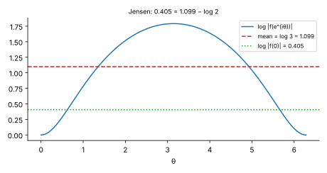
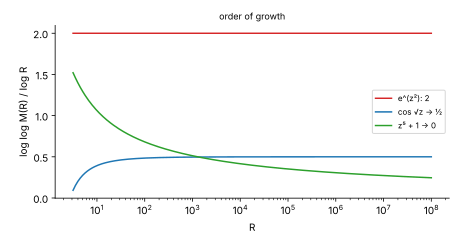
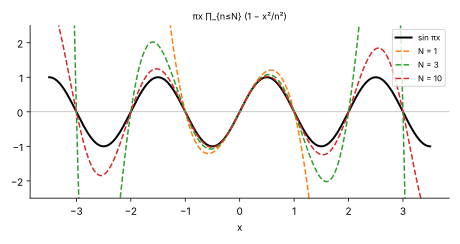
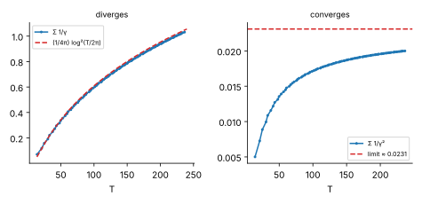
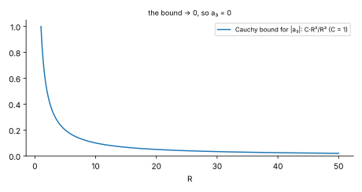
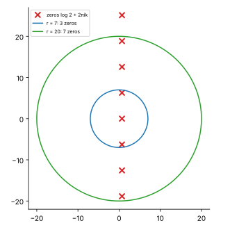
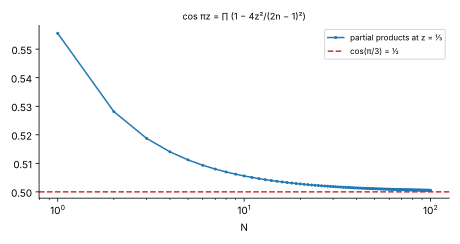
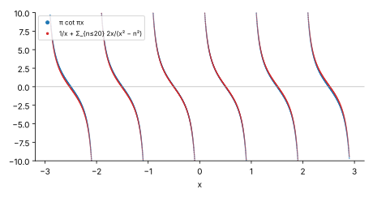

# שיעור כלים כ12: פונקציות שלמות – ליוביל, סדר גידול, נוסחת ינסן ומכפלת הדמר

**מה נלמד:** פולינום נקבע (עד קבוע) על ידי השורשים שלו: $`p(z) = c\prod(z - a_k)`$. האם גם פונקציה הולומורפית בכל המישור נקבעת על ידי האפסים שלה? התשובה של הדמר: **כן, אם היא לא גדלה מהר מדי**. זה בדיוק מה שמאפשר לכתוב את $`\zeta`$ כ"מכפלה על האפסים" שלה, ולקבל את הנוסחה המפורשת ב[שיעור 12](12-משפט-המספרים-הראשוניים.md). נלמד:
1. **משפט ליוביל** ו**אומדני קושי**.
2. **סדר הגידול** של פונקציה שלמה.
3. **נוסחת ינסן**: הקשר בין מספר האפסים לגידול.
4. **מכפלות אינסופיות**, **מכפלת הדמר**, והמכפלה של $`\sin\pi z`$.
5. היישום לפונקציית הזטא.

**ידע קודם:** [שיעור כלים כ10](T10-משפט-קושי-ושאריות.md) (נוסחת קושי, עקרון הארגומנט), [שיעור כלים כ11](T11-גמא-פורייה-ותטא.md) (גמא, משוואת הפונקציה).

---

## 1. פונקציות שלמות ומשפט ליוביל

פונקציה **שלמה** היא פונקציה הולומורפית בכל המישור $`\mathbb C`$. דוגמאות: פולינומים, $`e^z`$, $`\sin z`$, $`\frac{1}{\Gamma(z)}`$, ו-$`\xi`$ אחרי שמבטלים את הקטבים שלה (סעיף 5). טור החזקות של פונקציה שלמה, $`f(z) = \sum a_nz^n`$, מתכנס בכל המישור.

**אומדני קושי.** נסמן $`M(R) = \max_{|z| = R}|f(z)|`$. אז
```math
|a_n| \le \frac{M(R)}{R^n}\quad\text{for every } R \gt 0 .
```
**הוכחה.** לפי נוסחת קושי לנגזרות, $`a_n = \frac{1}{2\pi i}\oint_{|z|=R}\frac{f(z)}{z^{n+1}}dz`$. לפי ML: $`|a_n| \le \frac{1}{2\pi}\cdot2\pi R\cdot\frac{M(R)}{R^{n+1}}`$. ∎

**משפט ליוביל.** פונקציה שלמה **חסומה** היא קבועה.

**הוכחה.** אם $`|f| \le M`$, אז לכל $`n\ge1`$: $`|a_n| \le \frac{M}{R^n}\to0`$ כש-$`R\to\infty`$. לכן $`a_n = 0`$ לכל $`n\ge1`$. ∎

**הכללה:** אם $`|f(z)| \le C|z|^k`$ עבור $`|z|`$ גדול, אז $`f`$ פולינום ממעלה $`\le k`$ (תרגיל 1).

## 2. סדר הגידול

**הסדר** של פונקציה שלמה $`f`$ הוא המספר הקטן ביותר $`\rho`$ כך שלכל $`\varepsilon \gt 0`$:
```math
M(R) \le e^{R^{\rho+\varepsilon}} \quad\text{for all large } R .
```
בניסוח שקול: $`\rho = \limsup_{R\to\infty}\frac{\log\log M(R)}{\log R}`$.

| פונקציה | $`M(R)`$ | סדר |
|---|---|---|
| פולינום | $`\approx cR^d`$ | 0 |
| $`e^z`$, $`\sin z`$, $`1/\Gamma(z)`$ | $`\approx e^{R}`$ (עד גורמים) | 1 |
| $`\cos\sqrt z`$ | $`\approx e^{\sqrt R}`$ | $`\tfrac12`$ |
| $`e^{z^2}`$ | $`e^{R^2}`$ | 2 |
| $`e^{e^z}`$ | $`e^{e^R}`$ | $`\infty`$ |

**עובדה (סעיף 5):** הפונקציה $`\Xi(s) = \frac12s(s-1)\pi^{-s/2}\Gamma(\frac s2)\zeta(s)`$ שלמה ומסדר 1.

## 3. נוסחת ינסן

**משפט (ינסן, 1899).** אם $`f`$ הולומורפית בעיגול $`|z| \le R`$, $`f(0)\ne0`$, ו-$`a_1,\ldots,a_n`$ האפסים שלה ב-$`|z| \lt R`$ (לפי ריבוי), ואין לה אפסים על השפה, אז
```math
\log|f(0)| = \frac{1}{2\pi}\int_0^{2\pi}\log|f(Re^{i\theta})|\,d\theta - \sum_{k=1}^n\log\frac{R}{|a_k|}.
```
**רעיון ההוכחה.** עבור פונקציה **בלי אפסים**, $`\log f`$ הולומורפית, וערך הממוצע (נוסחת קושי ב-$`z_0 = 0`$) נותן $`\log|f(0)|`$ = ממוצע $`\log|f|`$ על המעגל. כל אפס $`a`$ בפנים "מוריד" את $`\log|f(0)|`$ ב-$`\log\frac{R}{|a|}`$: זה החישוב עבור הגורם $`z - a`$, שהממוצע של $`\log|Re^{i\theta} - a|`$ שלו הוא $`\log R`$ (כש-$`|a| \lt R`$), בעוד $`\log|0 - a| = \log|a|`$. ∎

**המסקנה החשובה: גידול חוסם את מספר האפסים.** נסמן ב-$`N(r)`$ את מספר האפסים ב-$`|z| \le r`$. בנוסחת ינסן עם $`R = 2r`$, כל אפס עם $`|a_k|\le r`$ תורם לפחות $`\log2`$. לכן
```math
N(r)\log2 \le \log M(2r) - \log|f(0)| .
```
אם $`f`$ מסדר $`\rho`$, אז $`N(r) = O(r^{\rho+\varepsilon})`$. **בפרט:** פונקציה מסדר 1 יש לה $`O(r^{1+\varepsilon})`$ אפסים בעיגול ברדיוס $`r`$, ולכן $`\sum_k\frac{1}{|a_k|^{1+\varepsilon}}`$ **מתכנס** לכל $`\varepsilon \gt 0`$.

## 4. מכפלות אינסופיות ומכפלת הדמר

**מכפלה אינסופית** $`\prod(1 + u_k)`$ מתכנסת (למספר שונה מ-0, כשכל $`1 + u_k \ne 0`$) אם $`\sum|u_k| \lt \infty`$. (לוקחים לוגריתם: $`\log(1+u) = u + O(u^2)`$.)

**הבעיה:** הניסיון הטבעי $`\prod_k\left(1 - \frac{z}{a_k}\right)`$ דורש $`\sum\frac{1}{|a_k|} \lt\infty`$, וזה לא תמיד נכון (למשל עבור האפסים של זטא). הפתרון של ויירשטראס: **גורמים מתקנים** $`\left(1 - \frac z{a_k}\right)e^{z/a_k}`$, שבהם $`\log`$ של הגורם הוא $`-\frac{z^2}{2a_k^2} - \cdots`$, וצריך רק $`\sum\frac{1}{|a_k|^2}\lt\infty`$.

**משפט (הדמר, 1893), מקרה סדר 1.** אם $`f`$ שלמה מסדר $`\le 1`$, עם אפס מסדר $`m`$ ב-0 ואפסים נוספים $`a_1, a_2, \ldots`$, אז יש קבועים $`A, B`$ כך ש
```math
f(z) = z^me^{A + Bz}\prod_k\left(1 - \frac z{a_k}\right)e^{z/a_k}.
```
**רעיון ההוכחה.** המכפלה $`P(z)`$ מתכנסת לפי סעיף 3 ($`\sum|a_k|^{-2} \lt\infty`$). המנה $`g = f/(z^mP)`$ שלמה **בלי אפסים**, ולכן $`g = e^h`$ עם $`h`$ שלמה. בעזרת אומדנים על $`P`$ מלמטה מראים ש-$`\mathrm{Re}\,h(z) = O(|z|^{1+\varepsilon})`$, ומגרסה של ליוביל, $`h`$ פולינום ממעלה $`\le1`$. ∎

**הדוגמה הקלאסית (אוילר):**
```math
\sin\pi z = \pi z\prod_{n=1}^\infty\left(1 - \frac{z^2}{n^2}\right).
```
(האפסים הם השלמים; בצימוד $`n`$ עם $`-n`$ הגורמים המתקנים מתבטלים: $`(1 - \frac zn)e^{z/n}(1 + \frac zn)e^{-z/n} = 1 - \frac{z^2}{n^2}`$; ומהזוגיות $`B = 0`$, ומ-$`\frac{\sin\pi z}{z}\to\pi`$ מקבלים $`e^A = \pi`$.)

**הנגזרת הלוגריתמית** של מכפלת הדמר היא סכום:
```math
\frac{f'(z)}{f(z)} = \frac mz + B + \sum_k\left(\frac{1}{z - a_k} + \frac1{a_k}\right).
```
זו הצורה שבה המכפלה משמשת בתורת המספרים.

## 5. היישום לזטא

* $`\xi(s) = \pi^{-s/2}\Gamma(\frac s2)\zeta(s)`$ יש לה קטבים ב-0 וב-1 ([שיעור כ11](T11-גמא-פורייה-ותטא.md)). לכן $`\Xi(s) = \frac12s(s-1)\xi(s)`$ **שלמה**.
* **האפסים של $`\Xi`$** הם בדיוק האפסים הלא-טריוויאליים $`\rho`$ של $`\zeta`$ (האפסים הטריוויאליים מתבטלים מול הקטבים של $`\Gamma`$).
* **סדר 1:** מהנוסחה של דוגמה 4 ב[שיעור כ11](T11-גמא-פורייה-ותטא.md) ומ-[סטירלינג](T07-סכומים-ואינטגרלים.md) ל-$`\Gamma`$ מקבלים $`|\Xi(s)| \le e^{C|s|\log|s|}`$, כלומר סדר $`\le1`$. (סדר בדיוק 1 – תרגיל 4.)
* **לכן (ינסן):** מספר האפסים עם $`|\gamma| \le T`$ הוא $`O(T\log T)`$, ו-$`\sum_\rho\frac{1}{|\rho|^{1+\varepsilon}}`$ מתכנס.
* **ולכן (הדמר):**
```math
\Xi(s) = e^{A+Bs}\prod_\rho\left(1 - \frac s\rho\right)e^{s/\rho}, \qquad \frac{\zeta'(s)}{\zeta(s)} = B - \frac{1}{s-1} + \frac12\log\pi - \frac12\frac{\Gamma'(s/2+1)}{\Gamma(s/2+1)} + \sum_\rho\left(\frac{1}{s-\rho} + \frac1\rho\right).
```
מהנוסחה הזו מגיעים ב[שיעור 12](12-משפט-המספרים-הראשוניים.md) ל**נוסחה המפורשת**, ל**אזור החופשי מאפסים**, ולספירת האפסים.

---

## 6. דוגמאות פתורות

### דוגמה 1: נוסחת ינסן, מספרית

**שאלה.** בדקו את נוסחת ינסן עבור $`f(z) = (z - \tfrac12)(z - 3)`$ ו-$`R = 1`$.



<sub>log |f(e^(iθ))| על מעגל היחידה. הממוצע שלו (1.099) פחות log(1/½) = 0.693 שווה ל-log|f(0)| = 0.405.</sub>

**פתרון.**
1. **צד שמאל:** $`f(0) = (-\tfrac12)(-3) = \tfrac32`$, $`\log\tfrac32 = 0.4055`$.
2. **אפסים בפנים:** רק $`\tfrac12`$. התרומה: $`\log\frac{1}{1/2} = \log2 = 0.6931`$.
3. **הממוצע על המעגל:** $`\log|f| = \log|e^{i\theta} - \tfrac12| + \log|e^{i\theta} - 3|`$. לפי ההוכחה, הממוצע של $`\log|e^{i\theta} - a|`$ הוא $`\log 1 = 0`$ כש-$`|a| \lt 1`$, ו-$`\log|a|`$ כש-$`|a| \gt 1`$ (אז $`z - a`$ בלי אפסים בעיגול). לכן הממוצע הוא $`0 + \log3 = 1.0986`$.
4. **צד ימין:** $`1.0986 - 0.6931 = 0.4055`$ ✓. (גם אינטגרציה מספרית נותנת $`0.405465`$.)

### דוגמה 2: חישוב סדר

**שאלה.** חשבו את הסדר של $`e^{z^2}`$, $`\cos\sqrt z`$ ו-$`z^5 + 1`$.



<sub>log log M(R) / log R כפונקציה של R: שואף ל-2 עבור e^(z²), ל-½ עבור cos √z, ול-0 עבור פולינום.</sub>

**פתרון.**
1. **$`e^{z^2}`$:** $`|e^{z^2}| = e^{\mathrm{Re}(z^2)}`$, והמקסימום על $`|z| = R`$ הוא ב-$`z = R`$: $`M(R) = e^{R^2}`$. אז $`\frac{\log\log M}{\log R} = \frac{\log R^2}{\log R} = 2`$. **סדר 2.**
2. **$`\cos\sqrt z = \sum\frac{(-1)^nz^n}{(2n)!}`$** – פונקציה שלמה (לא תלויה בבחירת השורש). עבור $`z = -R`$: $`\cos(i\sqrt R) = \cosh\sqrt R \approx \frac12e^{\sqrt R}`$, וזה המקסימום. $`\frac{\log(\sqrt R - \log 2)}{\log R}\to\frac12`$. **סדר ½.**
3. **$`z^5 + 1`$:** $`M(R) \approx R^5`$, $`\frac{\log(5\log R)}{\log R}\to0`$. **סדר 0.**
4. **מסקנה לפי ינסן:** ל-$`\cos\sqrt z`$ יש $`O(r^{1/2+\varepsilon})`$ אפסים ב-$`|z|\le r`$. ואכן האפסים הם $`z = \left(\frac{\pi}{2} + \pi k\right)^2`$, ובעיגול ברדיוס $`r`$ יש בערך $`\frac{\sqrt r}{\pi}`$ מהם ✓.

### דוגמה 3: מכפלת אוילר ל-$`\sin`$ ונוסחת ואליס

**שאלה.** הציבו $`z = \frac12`$ במכפלה של $`\sin\pi z`$, וקבלו נוסחה ל-$`\pi`$. בדקו מספרית.



<sub>המכפלות החלקיות πx ∏_{n≤N}(1 − x²/n²) עבור N = 1, 3, 10 מתקרבות ל-sin πx.</sub>

**פתרון.**
1. $`\sin\frac\pi2 = 1 = \frac\pi2\prod_{n\ge1}\left(1 - \frac{1}{4n^2}\right)`$.
2. $`1 - \frac{1}{4n^2} = \frac{(2n-1)(2n+1)}{(2n)^2}`$, ולכן
```math
\frac\pi2 = \prod_{n=1}^\infty\frac{(2n)^2}{(2n-1)(2n+1)} = \frac21\cdot\frac23\cdot\frac43\cdot\frac45\cdot\frac65\cdot\frac67\cdots
```
זו **נוסחת ואליס** (1655).
3. **מספרית:** $`\frac\pi2\prod_{n\le N}\left(1 - \frac1{4n^2}\right)`$ שווה ל-$`1.178,\ 1.0241,\ 1.00249,\ 1.00025`$ עבור $`N = 1, 10, 100, 1000`$. השגיאה בערך $`\frac{1}{4N}`$ – התכנסות איטית, כמצופה מ-$`\sum_{n\gt N}\frac{1}{4n^2}\approx\frac{1}{4N}`$.
4. **קשר לסטירלינג:** ואליס הוא המקור לקבוע $`\sqrt{2\pi}`$ בנוסחת סטירלינג ([שיעור כ7](T07-סכומים-ואינטגרלים.md)).

### דוגמה 4: האפסים של זטא – $`\sum1/|\rho|^2`$ מתכנס, $`\sum1/|\rho|`$ לא

**שאלה.** בעזרת 100 האפסים הראשונים של $`\zeta`$ על הישר הקריטי ($`\rho = \frac12 + i\gamma`$, $`0 \lt \gamma \le 236.52`$), בדקו את ההתנהגות של $`\sum\frac1{\gamma^2}`$ ו-$`\sum\frac1\gamma`$.



<sub>הסכומים החלקיים של 1/γ (עולה בלי חסם, בערך כמו (1/4π)·log²(T/2π)) ושל 1/γ² (מתכנס ל-0.0231) על 100 האפסים הראשונים.</sub>

**פתרון.**
1. **ספירה:** לפי [נוסחת רימן–פון מנגולדט](12-משפט-המספרים-הראשוניים.md), $`N(T) \approx \frac{T}{2\pi}\log\frac{T}{2\pi e} + \frac78`$. עבור $`T = 236.52`$: $`99.8`$ – ואכן 100 אפסים ✓. זה $`O(T\log T)`$, כפי שינסן מנבא לסדר 1.
2. **$`\sum\frac1{\gamma^2}`$:** על 10 האפסים הראשונים $`0.01354`$; על 100: $`0.01999`$. הזנב: $`\int_T^\infty\frac{dN(t)}{t^2} \approx \int_T^\infty\frac{\log(t/2\pi)}{2\pi t^2}dt = \frac{\log(T/2\pi) + 1}{2\pi T} = 0.0031`$. הסכום המלא: $`0.0231`$. **מתכנס.**
3. **$`\sum\frac1\gamma`$:** על 10: $`0.337`$; על 100: $`1.031`$. כיוון ש-$`dN(t) \approx \frac{1}{2\pi}\log\frac{t}{2\pi}dt`$, הסכום עד $`T`$ הוא $`\approx\frac{1}{4\pi}\log^2\frac{T}{2\pi}`$ – **מתבדר**.
4. **מסקנה:** לכן צריך את הגורמים המתקנים $`e^{s/\rho}`$ במכפלת הדמר של $`\Xi`$ (או לצמד כל $`\rho`$ עם $`\bar\rho`$), וסדר הגידול של $`\Xi`$ הוא בדיוק 1.

---

## 7. תרגילים

**תרגיל 1.** הוכיחו: אם $`f`$ שלמה ו-$`|f(z)| \le C|z|^2`$ עבור $`|z| \ge 1`$, אז $`f`$ פולינום ממעלה $`\le2`$.



<sub>אומדן קושי למקדם a₃: החסם C·R²/R³ = C/R שואף ל-0 כש-R גדל.</sub>

<details><summary>פתרון</summary>

1. **אומדני קושי:** $`|a_n| \le \frac{M(R)}{R^n} \le \frac{CR^2}{R^n}`$ לכל $`R \ge 1`$.
2. עבור $`n\ge3`$: $`|a_n| \le CR^{2-n}\to0`$ כש-$`R\to\infty`$. לכן $`a_n = 0`$.
3. נשאר $`f(z) = a_0 + a_1z + a_2z^2`$. ∎
</details>

**תרגיל 2.** מצאו את האפסים של $`f(z) = e^z - 2`$, וכמה מהם יש בעיגול $`|z|\le r`$. התאימו לנוסחת ינסן.



<sub>האפסים log 2 + 2πik על קו אנכי. בעיגול ברדיוס r יש בערך r/π מהם – גידול ליניארי, כמו שסדר 1 מנבא.</sub>

<details><summary>פתרון</summary>

1. $`e^z = 2 \iff z = \log2 + 2\pi ik`$, $`k\in\mathbb Z`$.
2. $`|z|\le r \iff (\log 2)^2 + 4\pi^2k^2 \le r^2`$, כלומר $`|k| \lesssim\frac{r}{2\pi}`$. מספר האפסים $`\approx 2\cdot\frac{r}{2\pi} = \frac r\pi`$.
3. **ינסן:** $`M(2r) \le e^{2r} + 2`$, $`|f(0)| = 1`$, ולכן $`N(r) \le \frac{\log(e^{2r} + 2)}{\log 2}\approx\frac{2r}{\log2} = 2.89r`$. בפועל $`N(r)\approx0.32r`$ – החסם נכון (וגס, כצפוי).
4. **הדמר:** $`\sum\frac{1}{|a_k|}`$ מתבדר (כמו $`\sum\frac1k`$), אבל $`\sum\frac{1}{|a_k|^2}`$ מתכנס – בדיוק המצב של סדר 1.
</details>

**תרגיל 3.** בעזרת $`\sin2\pi z = 2\sin\pi z\cos\pi z`$ ומכפלת אוילר, הוכיחו ש-$`\cos\pi z = \prod_{n\ge1}\left(1 - \frac{4z^2}{(2n-1)^2}\right)`$, ובדקו עבור $`z = \frac13`$.



<sub>המכפלות החלקיות של ∏(1 − 4z²/(2n − 1)²) ב-z = ⅓ מתכנסות ל-cos(π/3) = ½.</sub>

<details><summary>פתרון</summary>

1. $`\cos\pi z = \frac{\sin2\pi z}{2\sin\pi z} = \frac{2\pi z\prod_n(1 - \frac{4z^2}{n^2})}{2\pi z\prod_n(1 - \frac{z^2}{n^2})}`$.
2. במונה, הגורמים עם $`n = 2m`$ זוגי הם $`1 - \frac{4z^2}{4m^2} = 1 - \frac{z^2}{m^2}`$, והם מצטמצמים בדיוק עם כל המכנה.
3. נשארים הגורמים עם $`n`$ אי-זוגי: $`\prod_{m\ge1}\left(1 - \frac{4z^2}{(2m-1)^2}\right)`$. ∎
4. **$`z = \frac13`$:** הגורם הראשון $`1 - \frac49 = \frac59 = 0.556`$. אחרי 10 גורמים $`0.5056`$, אחרי 100 $`0.50056`$ ✓.
</details>

**תרגיל 4.** גזרו לוגריתמית את מכפלת אוילר והראו ש-$`\pi\cot\pi z = \frac1z + \sum_{n\ge1}\frac{2z}{z^2 - n^2}`$. השוו את המקדם של $`z`$ בשני הצדדים, וקבלו (שוב) $`\zeta(2) = \frac{\pi^2}6`$.



<sub>π cot πx (כחול) והסכום 1/x + Σ_{n≤N} 2x/(x² − n²) עבור N = 20 (אדום מקווקו): זהים כמעט לחלוטין.</sub>

<details><summary>פתרון</summary>

1. $`\log\sin\pi z = \log\pi + \log z + \sum_n\log\left(1 - \frac{z^2}{n^2}\right)`$. גוזרים: $`\pi\cot\pi z = \frac1z + \sum_n\frac{-2z/n^2}{1 - z^2/n^2} = \frac1z + \sum_n\frac{2z}{z^2 - n^2}`$.
2. **פיתוח ליד 0:** $`\frac{2z}{z^2 - n^2} = -\frac{2z}{n^2}\cdot\frac{1}{1 - z^2/n^2} = -\frac{2z}{n^2} + O(z^3)`$. לכן הצד הימני: $`\frac1z - 2\zeta(2)z + O(z^3)`$.
3. **הצד השמאלי** (מ[תרגיל 1 של שיעור כ10](T10-משפט-קושי-ושאריות.md)): $`\pi\cot\pi z = \frac1z - \frac{\pi^2}3z + O(z^3)`$.
4. **השוואה:** $`2\zeta(2) = \frac{\pi^2}{3}`$, כלומר $`\zeta(2) = \frac{\pi^2}{6}`$. ∎

**הערה:** **בדיוק** אותו חישוב, עם $`\Xi`$ במקום $`\sin`$, נותן את הנוסחה ל-$`\zeta'/\zeta`$ בסעיף 5.
</details>

---

## סיכום
* **ליוביל:** שלמה וחסומה ⇐ קבועה. **אומדני קושי:** $`|a_n|\le M(R)/R^n`$.
* **סדר:** $`\rho = \limsup\frac{\log\log M(R)}{\log R}`$.
* **ינסן:** גידול חוסם אפסים; סדר $`\rho`$ ⇐ $`N(r) = O(r^{\rho+\varepsilon})`$.
* **הדמר (סדר 1):** $`f = z^me^{A+Bz}\prod(1 - \frac z{a_k})e^{z/a_k}`$, ו-$`\frac{f'}{f} = \frac mz + B + \sum\left(\frac1{z-a_k} + \frac1{a_k}\right)`$.
* $`\sin\pi z = \pi z\prod(1 - \frac{z^2}{n^2})`$; $`\Xi(s)`$ שלמה מסדר 1, עם מכפלה על אפסי זטא.

**השיעור הקודם:** [שיעור 11: טורי דיריכלה ופונקציית זטא](11-טורי-דיריכלה-וזטא.md) · **השיעור הבא:** [שיעור 12: משפט המספרים הראשוניים ואפסי זטא](12-משפט-המספרים-הראשוניים.md)

**להעמקה:** [משפט ליוביל (אנליזה מרוכבת)](https://he.wikipedia.org/wiki/%D7%9E%D7%A9%D7%A4%D7%98_%D7%9C%D7%99%D7%95%D7%91%D7%99%D7%9C_%28%D7%90%D7%A0%D7%9C%D7%99%D7%96%D7%94_%D7%9E%D7%A8%D7%95%D7%9B%D7%91%D7%AA%29) · [פונקציה שלמה](https://he.wikipedia.org/wiki/%D7%A4%D7%95%D7%A0%D7%A7%D7%A6%D7%99%D7%94_%D7%A9%D7%9C%D7%9E%D7%94) · [משפט הפירוק של ויירשטראס](https://he.wikipedia.org/wiki/%D7%9E%D7%A9%D7%A4%D7%98_%D7%94%D7%A4%D7%99%D7%A8%D7%95%D7%A7_%D7%A9%D7%9C_%D7%95%D7%99%D7%99%D7%A8%D7%A9%D7%98%D7%A8%D7%90%D7%A1) · [מכפלת ואליס](https://he.wikipedia.org/wiki/%D7%9E%D7%9B%D7%A4%D7%9C%D7%AA_%D7%95%D7%90%D7%9C%D7%99%D7%A1)

---
<sub>חלק מ[קורס תורת המספרים](../COURSE.md). התוכן מופץ ברישיון [CC BY-SA 4.0](https://creativecommons.org/licenses/by-sa/4.0/).</sub>
