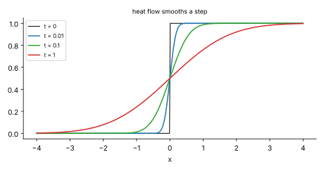
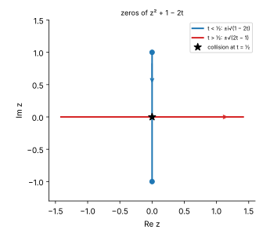
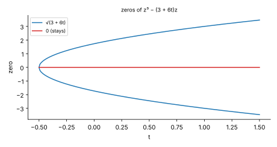
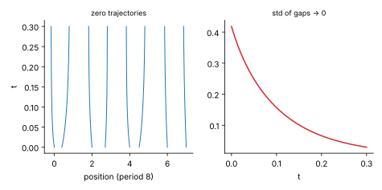
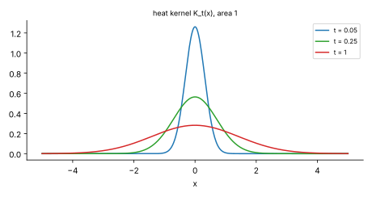
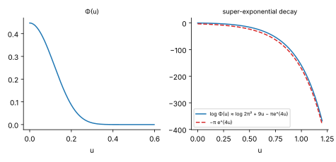
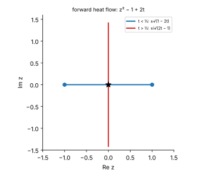
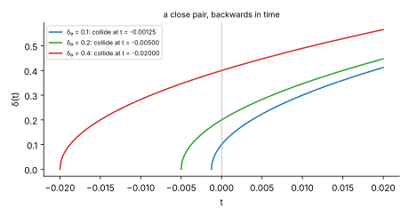

# שיעור כלים כ13: משוואת החום ותנועת האפסים

**מה נלמד:** הכלי האחרון לפני [שיעור 18](18-קבוע-דה-ברויין-ניומן.md). דה ברויין "הזיז" את פונקציית הזטא בזמן בעזרת **משוואת החום**, ושאל איך זזים האפסים. נלמד:
1. **משוואת החום** ואת **גרעין החום** – גאוסיאן שמתפשט.
2. **משוואת החום ההפוכה**, והמשפחה $`H_t`$ של דה ברויין.
3. איך זזים **אפסים של פולינום** תחת זרימת החום, והמשוואה $`\dot z_k = 2\sum_{j\ne k}\frac{1}{z_k - z_j}`$.
4. **דחייה, התנגשות ו"שיווי משקל"**: למה אפסים ממשיים נדחים, למה זוג אפסים מרוכב נמשך לציר הממשי, ולמה המרווחים מתיישרים.

**ידע קודם:** [שיעור כלים כ8](T08-הסתברות.md) (ההתפלגות הנורמלית), [שיעור כלים כ11](T11-גמא-פורייה-ותטא.md) (פורייה, תטא), [שיעור כלים כ12](T12-פונקציות-שלמות.md) (מכפלת הדמר).

---

## 1. משוואת החום

**משוואת החום** מתארת התפשטות חום במוט: $`u(x,t)`$ היא הטמפרטורה בנקודה $`x`$ בזמן $`t`$, ו
```math
\frac{\partial u}{\partial t} = \frac{\partial^2u}{\partial x^2}.
```
**האינטואיציה:** אם $`u`$ "קעורה כלפי מעלה" בנקודה ($`u'' \gt 0`$, הנקודה קרה מהשכנים), היא מתחממת; אם $`u'' \lt 0`$, היא מתקררת. **החום מחליק הכול.**

**גרעין החום:**
```math
K_t(x) = \frac{1}{\sqrt{4\pi t}}\,e^{-x^2/(4t)} .
```
זו בדיוק צפיפות נורמלית עם שונות $`2t`$ ([שיעור כ8](T08-הסתברות.md)). היא פותרת את משוואת החום (תרגיל 1), השטח מתחתיה תמיד 1, והיא מתפשטת עם הזמן. **הפתרון הכללי:** $`u(x,t) = \int K_t(x - y)\,u(y,0)\,dy`$ – ממוצע של ערכי ההתחלה, במשקל גאוסי.

**מבט פורייה:** $`e^{i\xi x}`$ הופכת ל-$`e^{-\xi^2t}e^{i\xi x}`$. כלומר כל תדירות דועכת, והתדירויות הגבוהות (הפרטים הקטנים) דועכות הכי מהר.

## 2. משוואת החום ההפוכה ומשפחת דה ברויין

**משוואת החום ההפוכה** היא $`\partial_tu = -\partial_x^2u`$: הסרט של החום, מוקרן אחורה. כאן $`e^{i\xi x}`$ הופכת ל-$`e^{+\xi^2t}e^{i\xi x}`$, והתדירויות הגבוהות **מתעצמות**. בדרך כלל זו משוואה "לא יציבה", אבל אם לפונקציה כמעט אין תדירויות גבוהות, אין בעיה.

**המשפחה של דה ברויין (1950).** נגדיר
```math
\Phi(u) = \sum_{n=1}^\infty\left(2\pi^2n^4e^{9u} - 3\pi n^2e^{5u}\right)\exp\!\left(-\pi n^2e^{4u}\right),\qquad H_t(z) = \int_0^\infty e^{tu^2}\,\Phi(u)\cos(zu)\,du .
```
* $`\Phi`$ דועכת **מהר מאוד** – כמו $`\exp(-\pi e^{4u})`$ (תרגיל 2). לכן האינטגרל מתכנס לכל $`t`$ ממשי ולכל $`z`$ מרוכב, ו-$`H_t`$ שלמה.
* **$`H_0`$ היא זטא:** $`H_0(z) = \frac18\,\Xi\!\left(\frac12 + \frac{iz}{2}\right)`$, כאשר $`\Xi(s) = \frac12s(s-1)\pi^{-s/2}\Gamma(\frac s2)\zeta(s)`$ ([שיעור כ12](T12-פונקציות-שלמות.md)). (את $`\Phi`$ מקבלים מפונקציית התטא של [שיעור כ11](T11-גמא-פורייה-ותטא.md) בהצבה $`x = e^{4u}`$.)
* **האפסים:** $`s = \frac12 + i\gamma`$ ↔ $`z = 2\gamma`$. לכן **השערת רימן ⇔ כל האפסים של $`H_0`$ ממשיים**.
* **משוואת החום ההפוכה:** גוזרים תחת האינטגרל: $`\partial_tH_t = \int u^2e^{tu^2}\Phi\cos(zu)\,du`$ ו-$`\partial_z^2H_t = -\int u^2e^{tu^2}\Phi\cos(zu)\,du`$. לכן
```math
\frac{\partial H_t}{\partial t} = -\frac{\partial^2H_t}{\partial z^2}.
```

## 3. אפסים זזים: המשוואה הדיפרנציאלית

נניח ש-$`H(z, t)`$ פותרת $`\partial_tH = -\partial_z^2H`$, ו-$`z_k(t)`$ אפס **פשוט** שזז חלק עם הזמן.

1. גוזרים את $`H(z_k(t), t) = 0`$ לפי $`t`$: $`\partial_zH\cdot\dot z_k + \partial_tH = 0`$, ולכן $`\dot z_k = -\frac{\partial_tH}{\partial_zH} = \frac{\partial_z^2H}{\partial_zH}`$ בנקודה $`z_k`$.
2. כותבים $`H = (z - z_k)G`$ עם $`G(z_k)\ne0`$. אז $`\partial_zH(z_k) = G(z_k)`$ ו-$`\partial_z^2H(z_k) = 2G'(z_k)`$.
3. לכן $`\dot z_k = 2\frac{G'(z_k)}{G(z_k)}`$. אם $`G`$ היא מכפלה על שאר האפסים (פולינום, או מכפלת הדמר), הנגזרת הלוגריתמית היא סכום, ומקבלים
```math
\boxed{\ \dot z_k = 2\sum_{j\ne k}\frac{1}{z_k - z_j}\ }
```
(עבור $`H_t`$ הסכום האינסופי מובן כגבול של סכומים סימטריים.)

## 4. מה המשוואה אומרת

**אפסים ממשיים נדחים זה מזה.** אם $`z_j \lt z_k`$ ממשיים, האיבר $`\frac{2}{z_k - z_j} \gt 0`$ דוחף את $`z_k`$ ימינה, הרחק מ-$`z_j`$. ככל שהם קרובים יותר, הדחייה חזקה יותר. כמו מטענים חשמליים באותו סימן.

**זוג מרוכב נמשך לציר הממשי.** האפסים של פונקציה ממשית באים בזוגות $`x\pm iy`$. התרומה של בן הזוג ל-$`\dot z`$ של $`z = x+iy`$: $`\frac{2}{(x+iy) - (x - iy)} = \frac{2}{2iy} = -\frac iy`$. כלומר $`y`$ **יורד** בקצב $`\frac1y`$ (ועוד תרומות של אפסים רחוקים). הזוג "נופל" לציר, מתנגש, ומשם ממשיך כשני אפסים ממשיים שנדחים.

**לכן (דה ברויין):** אם ל-$`H_{t_0}`$ יש רק אפסים ממשיים, אז גם לכל $`H_t`$ עם $`t \gt t_0`$. ו**ניומן (1976)** הראה שיש קבוע $`\Lambda`$ – **קבוע דה ברויין–ניומן** – כך ש
```math
H_t\ \text{has only real zeros}\iff t\ge\Lambda,\qquad\text{RH}\iff\Lambda\le0 .
```

**שיווי משקל:** אם האפסים ממשיים ו**שווי מרווחים** (סדרה חשבונית $`z_k = k\delta`$), הדחייה משמאל ומימין מתבטלת, ושום אפס לא זז. למשל $`\sin z`$: $`-\partial_z^2\sin z = \sin z`$, ולכן $`H_t = e^t\sin z`$ פותרת את המשוואה, והאפסים $`k\pi`$ לא זזים. **מרווחים לא שווים מתיישרים:** אפס שקרוב מדי לשכן נדחף ממנו. זה "הרפיה לשיווי משקל" (דוגמה 4).

**קנה מידה:** אם מכפילים את כל המרחקים ב-$`\delta`$, המשוואה $`\dot z = 2\sum\frac1{z_k-z_j}`$ נשמרת אם מכפילים את הזמן ב-$`\delta^2`$. לכן **אפסים עם מרווח $`\delta`$ מתיישרים בזמן בסדר גודל $`\delta^2`$**. האפסים של זטא בגובה $`T`$ צפופים מאוד: המרווח הממוצע (במשתנה $`z`$) הוא $`\frac{4\pi}{\log T}\to0`$. זה הלב של המאמר של רוג'רס וטאו ב[שיעור 18](18-קבוע-דה-ברויין-ניומן.md).

---

## 5. דוגמאות פתורות

### דוגמה 1: החום מחליק מדרגה

**שאלה.** מוט אינסופי: בהתחלה $`u(x, 0) = 1`$ עבור $`x \gt 0`$ ו-0 עבור $`x \lt 0`$. מצאו את $`u(x,t)`$.



<sub>הטמפרטורה u(x, t) בזמנים t = 0.01, 0.1, 1: המדרגה החדה הופכת לעקומה חלקה שמתרחבת כמו √t.</sub>

**פתרון.**
1. **קונבולוציה עם גרעין החום:** $`u(x,t) = \int_0^\infty K_t(x - y)\,dy`$.
2. **הצבה** $`w = \frac{y - x}{\sqrt{2t}}`$: זו ההסתברות שמשתנה נורמלי עם ממוצע $`x`$ ושונות $`2t`$ הוא חיובי, כלומר $`\mathbb P\left(Z \gt -\frac{x}{\sqrt{2t}}\right)`$.
3. **בעזרת פונקציית השגיאה** $`\mathrm{erf}`$: $`u(x,t) = \frac12\left(1 + \mathrm{erf}\frac{x}{2\sqrt t}\right)`$.
4. **בדיקות:** ב-$`x = 0`$ תמיד $`\frac12`$ (ממוצע). ב-$`x = 2\sqrt t`$: $`\frac12(1 + \mathrm{erf}\,1) = 0.921`$. רוחב אזור המעבר גדל כמו $`\sqrt t`$.

### דוגמה 2: זוג אפסים מרוכב נופל לציר

**שאלה.** פתרו את $`\partial_tp = -\partial_z^2p`$ עם $`p_0(z) = z^2 + 1`$, ותארו את מסלול האפסים.



<sub>מסלולי האפסים של z² + 1 − 2t: ‏±i(1 − 2t)^½ יורדים לאורך הציר המדומה, מתנגשים ב-0 בזמן t = ½, ואז זזים על הציר הממשי ±(2t − 1)^½.</sub>

**פתרון.**
1. **ניחוש:** $`p_t(z) = z^2 + c(t)`$. אז $`\partial_tp = c'(t)`$ ו-$`-\partial_z^2p = -2`$. לכן $`c' = -2`$, ו-$`p_t(z) = z^2 + 1 - 2t`$.
2. **אפסים:** $`z^2 = 2t - 1`$.
3. **$`t \lt \frac12`$:** $`z = \pm i\sqrt{1 - 2t}`$ – מרוכבים, ונעים לעבר 0.
4. **$`t = \frac12`$:** אפס כפול ב-0 (התנגשות).
5. **$`t \gt \frac12`$:** $`z = \pm\sqrt{2t - 1}`$ – ממשיים, ונדחים זה מזה.
6. **בדיקת המשוואה (סעיף 3):** עבור $`z_1 = \sqrt{2t-1}`$, $`z_2 = -z_1`$: $`2\cdot\frac{1}{z_1 - z_2} = \frac{1}{z_1}`$, ואכן $`\frac{d}{dt}\sqrt{2t-1} = \frac{1}{\sqrt{2t-1}}`$ ✓.
7. **כאן "$`\Lambda = \frac12`$":** הזמן הראשון שממנו והלאה כל האפסים ממשיים.

### דוגמה 3: שלושה אפסים ממשיים נדחים

**שאלה.** פתרו עבור $`p_0(z) = z^3 - 3z`$ (אפסים $`0, \pm\sqrt3`$), ובדקו את המשוואה $`\dot z_k = 2\sum\frac{1}{z_k-z_j}`$.



<sub>האפסים של z³ − (3 + 6t)z: האפס האמצעי נשאר ב-0 (הדחייה משני הצדדים מתבטלת), והחיצוניים מתרחקים כמו (3 + 6t)^½.</sub>

**פתרון.**
1. **ניחוש:** $`p_t = z^3 + a(t)z`$. אז $`\partial_tp = a'z`$ ו-$`-\partial_z^2p = -6z`$. לכן $`a' = -6`$, $`a = -3 - 6t`$, ו-$`p_t = z^3 - (3 + 6t)z`$.
2. **אפסים:** $`0`$ ו-$`\pm\sqrt{3+6t}`$.
3. **האפס $`z_1 = \sqrt{3+6t}`$:** $`\dot z_1 = \frac{3}{\sqrt{3+6t}}`$.
4. **המשוואה:** $`2\left(\frac{1}{z_1 - 0} + \frac{1}{z_1 + z_1}\right) = 2\cdot\frac{3}{2z_1} = \frac{3}{z_1}`$ ✓.
5. **האפס 0:** $`2\left(\frac{1}{0 - z_1} + \frac{1}{0 + z_1}\right) = 0`$ – לא זז ✓.
6. **הערה:** עבור $`t \lt -\frac12`$ ($`3 + 6t \lt 0`$) שני האפסים החיצוניים מרוכבים. אחורה בזמן, שלושת האפסים מתקרבים ומתנגשים ב-$`t = -\frac12`$.

### דוגמה 4: הרפיה לשיווי משקל

**שאלה.** 8 אפסים על "מעגל" באורך 8 (כלומר מחזוריים: הם והעתקים שלהם בהזזות של 8), עם מרווחים $`0.4, 1.6, 0.7, 1.3, 0.5, 1.5, 1.0, 1.0`$. הריצו את המשוואה וראו מה קורה למרווחים.



<sub>שמאל: מסלולי 8 האפסים לאורך הזמן. ימין: סטיית התקן של המרווחים יורדת מ-0.42 ל-0.03 עד t = 0.3 – המרווחים מתיישרים לסדרה חשבונית.</sub>

**פתרון.**
1. **המשוואה עם העתקים:** סכימה על כל ההעתקים $`z_j + 8m`$ נותנת (בעזרת המכפלה של $`\sin`$ מ[שיעור כ12](T12-פונקציות-שלמות.md)) $`\dot z_k = \frac{2\pi}{8}\sum_{j\ne k}\cot\frac{\pi(z_k - z_j)}{8}`$.
2. **פתרון מספרי.** המרווחים בזמנים שונים:
   * $`t = 0`$: $`0.40,\ 1.60,\ 0.70,\ 1.30,\ 0.50,\ 1.50,\ 1.00,\ 1.00`$ (סטיית תקן $`0.418`$).
   * $`t = 0.05`$: $`0.66,\ 1.36,\ 0.83,\ 1.16,\ 0.72,\ 1.33,\ 1.01,\ 0.95`$ ($`0.248`$).
   * $`t = 0.1`$: $`0.79,\ 1.23,\ 0.90,\ 1.09,\ 0.83,\ 1.22,\ 1.01,\ 0.94`$ ($`0.157`$).
   * $`t = 0.3`$: $`0.96,\ 1.03,\ 0.99,\ 1.01,\ 0.98,\ 1.05,\ 1.01,\ 0.97`$ ($`0.029`$).
3. **מסקנה:** בזמן קצר יחסית ל-(מרווח)$`^2 = 1`$, המרווחים כמעט שווים. אם המרווח היה $`\delta`$, הזמן היה קטן פי $`\delta^2`$ (סעיף 4).
4. **הקשר לזטא:** אם $`\Lambda \lt 0`$, האפסים של $`H_t`$ ממשיים ומתיישרים כך לאורך כל הזמן מ-$`\Lambda`$ עד 0. בגובה $`T`$ המרווח הוא $`\frac{4\pi}{\log T}`$, ולכן ב-$`t = 0`$ האפסים של זטא היו צריכים להיות **כמעט סדרה חשבונית**. אבל ידוע שהם לא (יש הרבה מרווחים קטנים) – וזו הסתירה של רוג'רס וטאו.

---

## 6. תרגילים

**תרגיל 1.** הוכיחו ש-$`K_t(x) = \frac{1}{\sqrt{4\pi t}}e^{-x^2/(4t)}`$ פותרת את משוואת החום, ושהשטח מתחתיה 1.



<sub>גרעין החום K_t(x) בזמנים t = 0.05, 0.25, 1: גאוסיאן שמתרחב ונמוך, והשטח תמיד 1.</sub>

<details><summary>פתרון</summary>

1. **$`\log K = -\frac12\log(4\pi t) - \frac{x^2}{4t}`$.** לכן $`\frac{\partial_tK}{K} = -\frac1{2t} + \frac{x^2}{4t^2}`$.
2. $`\frac{\partial_xK}{K} = -\frac{x}{2t}`$, ו-$`\partial_x^2K = \partial_x\left(-\frac{x}{2t}K\right) = -\frac{1}{2t}K + \frac{x^2}{4t^2}K`$.
3. **השוואה:** $`\partial_tK = \partial_x^2K`$ ✓.
4. **שטח:** הצבה $`x = \sqrt{4\pi t}\,y`$: $`\int K_t\,dx = \int e^{-\pi y^2}dy = 1`$ ([שיעור כ11](T11-גמא-פורייה-ותטא.md)) ✓.
</details>

**תרגיל 2.** הראו ש-$`\Phi(u)`$ דועכת כמו $`2\pi^2e^{9u}\exp(-\pi e^{4u})`$ כש-$`u\to\infty`$, וחשבו את $`\Phi(0)`$ ו-$`\Phi(0.5)`$. למה מותר לשים $`e^{tu^2}`$ באינטגרל לכל $`t`$?



<sub>Φ(u) (שמאל) ו-log Φ(u) (ימין) לעומת −π e^(4u): דעיכה מהירה מכל אקספוננט – ולכן גם e^(tu²) לא מפריע.</sub>

<details><summary>פתרון</summary>

1. **האיבר $`n = 1`$ שולט:** האיבר ה-$`n`$ מכיל $`\exp(-\pi n^2e^{4u})`$, ולכן האיבר $`n = 2`$ קטן פי $`\approx e^{-3\pi e^{4u}}`$ מהראשון.
2. **בתוך האיבר הראשון**, $`2\pi^2e^{9u}`$ גדול בהרבה מ-$`3\pi e^{5u}`$ כש-$`u`$ גדל. לכן $`\Phi(u)\approx2\pi^2e^{9u}\exp(-\pi e^{4u})`$.
3. **מספרים:** $`\Phi(0) = 0.4467`$, $`\Phi(0.5) = 1.38\cdot10^{-7}`$, $`\Phi(1) = 5.1\cdot10^{-70}`$.
4. **$`e^{tu^2}`$:** $`\log\Phi(u)\approx-\pi e^{4u}`$, בעוד $`tu^2`$ גדל רק ריבועית. לכן $`e^{tu^2}\Phi(u)`$ עדיין דועכת כמו $`\exp(-\pi e^{4u}/2)`$ לכל $`t`$, והאינטגרל מתכנס בכל המישור $`z`$ (גם עם $`|\cos(zu)| \le e^{|\mathrm{Im}z|u}`$).
</details>

**תרגיל 3.** פתרו את משוואת החום **הרגילה** $`\partial_tp = +\partial_z^2p`$ עם $`p_0 = z^2 - 1`$. מה קורה לאפסים? למה זה מסביר את הכיוון ב"$`t\ge\Lambda`$"?



<sub>תחת משוואת החום הרגילה, האפסים הממשיים ±1 של z² − 1 + 2t מתקרבים, מתנגשים בזמן t = ½, והופכים למרוכבים.</sub>

<details><summary>פתרון</summary>

1. $`p_t = z^2 + c(t)`$ עם $`c' = +2`$: $`p_t = z^2 - 1 + 2t`$.
2. **אפסים:** $`z = \pm\sqrt{1 - 2t}`$: ממשיים ומתקרבים עד $`t = \frac12`$, ואחר כך $`\pm i\sqrt{2t-1}`$ – מרוכבים.
3. **המשמעות:** משוואת החום הרגילה היא $`\partial_t = -\partial_z^2`$ עם זמן הפוך. מה שהיא עושה קדימה, ההפוכה עושה אחורה.
4. **לכן:** תחת $`H_t`$ (חום הפוך), **הגדלת** $`t`$ הופכת אפסים לממשיים; **הקטנת** $`t`$ גורמת לאפסים ממשיים קרובים להתנגש ולצאת מהציר. לכן הקבוצה $`\{t: H_t\text{ has only real zeros}\}`$ היא קרן $`[\Lambda, \infty)`$.
</details>

**תרגיל 4 (זוגות להמר).** שני אפסים ממשיים במרחק $`\delta_0`$, רחוקים מכל השאר. בהזנחת השאר, מצאו את $`\delta(t)`$ ואת הזמן $`t \lt 0`$ שבו הם מתנגשים. מה זה אומר על $`\Lambda`$?



<sub>המרחק δ(t) = (δ₀² + 8t)^½ בין שני אפסים, עבור δ₀ = 0.1, 0.2, 0.4: אחורה בזמן הם מתנגשים ב-t = −δ₀²/8.</sub>

<details><summary>פתרון</summary>

1. **המשוואה לשניים:** $`\dot z_2 = \frac{2}{z_2 - z_1}`$, $`\dot z_1 = \frac{2}{z_1 - z_2}`$. לכן $`\dot\delta = \dot z_2 - \dot z_1 = \frac4\delta`$.
2. **פתרון:** $`\frac{d}{dt}\delta^2 = 2\delta\dot\delta = 8`$, ולכן $`\delta(t)^2 = \delta_0^2 + 8t`$.
3. **התנגשות:** $`\delta = 0`$ ב-$`t = -\frac{\delta_0^2}{8}`$. לפני כן (עוד אחורה) הזוג מרוכב.
4. **המשמעות:** אם לזטא יש זוג אפסים קרוב במיוחד ("**זוג להמר**", על שם ד"ה להמר שגילה כזה ב-1956), אז $`H_t`$ עם $`t`$ קצת שלילי כבר יש לה אפסים מרוכבים, כלומר $`\Lambda \ge -\frac{\delta_0^2}{8}`$ בערך (התיקון מהאפסים האחרים ניתן לחישוב). כך הוכחו חסמים תחתונים, עד $`\Lambda \ge -1.15\cdot10^{-11}`$ (סאוטר, גורדון ודמישל, 2011). רוג'רס וטאו החליפו את הזוג הבודד בטיעון סטטיסטי על **כל** האפסים.
</details>

---

## סיכום
* **חום:** $`\partial_tu = \partial_x^2u`$, גרעין גאוסי, מחליק. **הפוך:** $`\partial_tH = -\partial_z^2H`$.
* $`H_t(z) = \int_0^\infty e^{tu^2}\Phi(u)\cos(zu)\,du`$; $`H_0(z) = \frac18\Xi(\frac12 + \frac{iz}2)`$; RH ⇔ האפסים של $`H_0`$ ממשיים.
* **אפסים זזים:** $`\dot z_k = 2\sum_{j\ne k}\frac1{z_k - z_j}`$ – ממשיים נדחים, זוגות מרוכבים נופלים לציר.
* **$`\Lambda`$:** $`H_t`$ עם אפסים ממשיים בלבד ⇔ $`t\ge\Lambda`$; RH ⇔ $`\Lambda\le0`$.
* **הרפיה:** מרווחים מתיישרים בזמן $`\sim\delta^2`$.

**להעמקה:** [משוואת החום](https://he.wikipedia.org/wiki/%D7%9E%D7%A9%D7%95%D7%95%D7%90%D7%AA_%D7%94%D7%97%D7%95%D7%9D) · [השערת ניומן](../pages/השערת%20ניומן.md) · [תנועה בראונית ופונקציית זטא של רימן](../pages/תנועה%20בראונית%20ופונקציית%20זטא%20של%20רימן.md)

**השיעור הקודם:** [שיעור 17: אנשים בתורת המספרים האנליטית](17-אישים.md) · **השיעור הבא:** [שיעור 18: קבוע דה ברויין–ניומן: קריאה מודרכת במאמר של רוג'רס וטאו](18-קבוע-דה-ברויין-ניומן.md)

---
<sub>חלק מ[קורס תורת המספרים](../COURSE.md). התוכן מופץ ברישיון [CC BY-SA 4.0](https://creativecommons.org/licenses/by-sa/4.0/).</sub>
