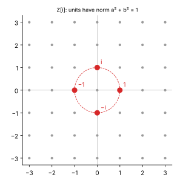
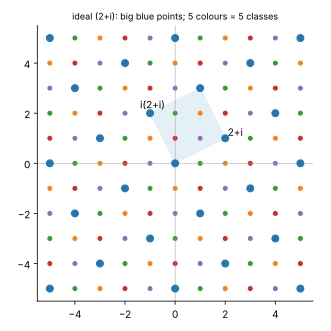
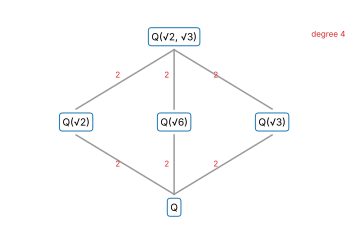
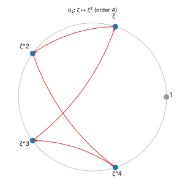
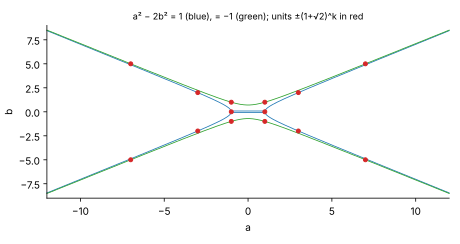
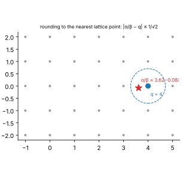
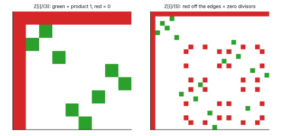
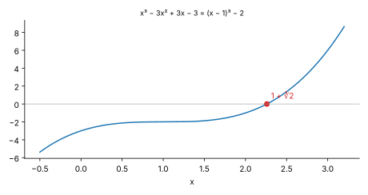
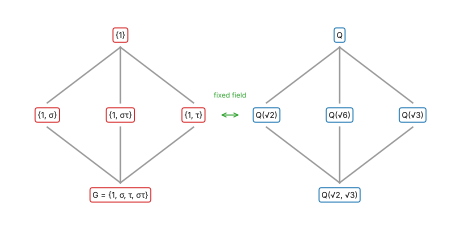
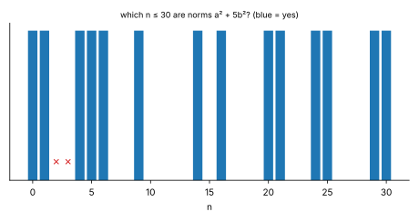

# שיעור כלים כ14: חוגים, אידיאלים והרחבות שדות

**מה נלמד:** הכלים האלגבריים ש[שיעור 19](19-תורת-המספרים-האלגברית.md) צריך. ב[שיעור כלים כ3](T03-חבורות.md) הכרנו **חבורה** – קבוצה עם פעולה אחת. עכשיו נוסיף פעולה שנייה:
1. **חוג** – קבוצה שאפשר לחבר ולכפול בה, כמו $`\mathbb Z`$, $`\mathbb Z/n`$, או השלמים של גאוס $`\mathbb Z[i]`$.
2. **אידיאל** – "כל הכפולות" של משהו; ו**חוג מנה**, שהוא הכללה של חשבון מודולרי.
3. **אידיאלים ראשוניים ומקסימליים** – ההכללה של "מספר ראשוני".
4. **הרחבות שדות**: המעלה $`[L:K]`$, **פולינום מינימלי**, ו**נורמה** ו**עקבה**.
5. **אוטומורפיזמים** ו**חבורת גלואה** – הסימטריות של הרחבה.

**ידע קודם:** [שיעור 2](02-מחלק-משותף-מקסימלי.md) (gcd ואוקלידס), [שיעור 4](04-חשבון-מודולרי.md) (חשבון מודולרי), [שיעור כלים כ2](T02-מספרים-מרוכבים.md) (מספרים מרוכבים ושורשי יחידה), [שיעור כלים כ3](T03-חבורות.md) (חבורות).

---

## 1. חוגים

**חוג** (קומוטטיבי, עם יחידה) הוא קבוצה $`R`$ עם שתי פעולות, חיבור וכפל, כך ש:
1. $`(R, +)`$ היא חבורה אבלית (יש 0, ולכל $`a`$ יש $`-a`$);
2. הכפל קיבוצי וחילופי, ויש איבר יחידה $`1`$ עם $`1\cdot a = a`$;
3. **פילוג:** $`a(b + c) = ab + ac`$.

**דוגמאות:**
* $`\mathbb Z`$, $`\mathbb Q`$, $`\mathbb R`$, $`\mathbb C`$.
* $`\mathbb Z/n`$ – השאריות מודולו $`n`$ (שיעור 4).
* **השלמים של גאוס** $`\mathbb Z[i] = \{a + bi : a, b \in \mathbb Z\}`$: סכום ומכפלה של שניים כאלה הם שוב כאלה, כי $`(a + bi)(c + di) = (ac - bd) + (ad + bc)i`$.
* $`\mathbb Z[\sqrt{-5}] = \{a + b\sqrt{-5}\}`$, ובאופן כללי $`\mathbb Z[\sqrt d]`$.
* **חוג פולינומים** $`\mathbb Q[x]`$: כל הפולינומים עם מקדמים רציונליים.

**יחידה** (איבר הפיך) היא $`u`$ שיש לו $`v`$ עם $`uv = 1`$. ב-$`\mathbb Z`$ היחידות הן $`\pm1`$; ב-$`\mathbb Z[i]`$ הן $`\pm1, \pm i`$ (ראו דוגמה 1); ב-$`\mathbb Z/n`$ הן השאריות הזרות ל-$`n`$.

**תחום שלמות** הוא חוג שבו $`ab = 0`$ גורר $`a = 0`$ או $`b = 0`$. $`\mathbb Z`$ ו-$`\mathbb Z[i]`$ תחומי שלמות (הם בתוך $`\mathbb C`$); $`\mathbb Z/6`$ אינו, כי $`2\cdot3 = 0`$.

**שדה** הוא חוג שבו כל איבר שונה מאפס הפיך: $`\mathbb Q, \mathbb R, \mathbb C`$, ו-$`\mathbb Z/p`$ כאשר $`p`$ ראשוני (שם מסמנים אותו $`\mathbb F_p`$).

### נורמה: הכלי שמבין את $`\mathbb Z[i]`$
עבור $`\alpha = a + bi`$ נגדיר $`N(\alpha) = a^2 + b^2 = \alpha\bar\alpha = |\alpha|^2`$. מאחר ש-$`|\alpha\beta| = |\alpha||\beta|`$,
```math
N(\alpha\beta) = N(\alpha)N(\beta).
```
באותו אופן ב-$`\mathbb Z[\sqrt{-5}]`$: $`N(a + b\sqrt{-5}) = a^2 + 5b^2`$, וגם היא כפלית.

### דוגמה 1: היחידות של $`\mathbb Z[i]`$
אם $`uv = 1`$, אז $`N(u)N(v) = N(1) = 1`$, ושתי הנורמות הן מספרים שלמים חיוביים – לכן $`N(u) = 1`$, כלומר $`a^2 + b^2 = 1`$. הפתרונות: $`(\pm1, 0)`$ ו-$`(0, \pm1)`$. לכן היחידות הן $`1, -1, i, -i`$ – ואכן $`i\cdot(-i) = 1`$.

באותו אופן, ב-$`\mathbb Z[\sqrt{-5}]`$: $`a^2 + 5b^2 = 1`$ רק ל-$`(\pm1, 0)`$, והיחידות הן $`\pm1`$ בלבד.



<sub>השלמים של גאוס כסריג במישור; ארבע היחידות (אדום) על מעגל היחידה.</sub>

---

## 2. אידיאלים וחוגי מנה

ב-$`\mathbb Z`$, "כל הכפולות של 6" היא קבוצה $`6\mathbb Z`$ שסגורה לחיבור, וכשכופלים איבר שלה בכל מספר שלם נשארים בה. זו ההגדרה:

**אידיאל** של חוג $`R`$ הוא תת-קבוצה $`I`$ כך ש:
1. $`0 \in I`$, ו-$`a, b \in I \Rightarrow a + b \in I`$, $`-a \in I`$;
2. $`a \in I,\ r \in R \Rightarrow ra \in I`$ ("סופג כפל").

**אידיאל ראשי:** $`(a) = aR = \{ra : r\in R\}`$ – כל הכפולות של $`a`$. **אידיאל שנוצר על ידי כמה איברים:** $`(a, b) = \{ra + sb : r, s \in R\}`$.

**ב-$`\mathbb Z`$ כל אידיאל ראשי.** אם $`I \ne 0`$, יהי $`d`$ האיבר החיובי הקטן ביותר ב-$`I`$. לכל $`a \in I`$ נחלק עם שארית: $`a = qd + r`$, $`0 \le r \lt d`$, ו-$`r = a - qd \in I`$; מהמינימליות $`r = 0`$. לכן $`I = (d)`$. בפרט, $`(a, b) = (\gcd(a, b))`$ – זו הלמה של בזו (שיעור 2) בשפה חדשה: למשל $`(12, 18) = (6)`$.

**חוג שבו כל אידיאל ראשי** נקרא **תחום ראשי**. $`\mathbb Z`$ ו-$`\mathbb Z[i]`$ תחומים ראשיים (ב-$`\mathbb Z[i]`$ יש חילוק עם שארית; ראו תרגיל 2). אבל לא כל חוג כזה: ב-$`\mathbb Z[\sqrt{-5}]`$ האידיאל $`(2, 1 + \sqrt{-5})`$ אינו ראשי – זה בדיוק מה ששיעור 19 יחקור.

### חוג מנה
בהינתן אידיאל $`I`$, אומרים ש-$`a \equiv b \pmod I`$ אם $`a - b \in I`$. מחלקות השקילות יוצרות חוג חדש, **חוג המנה** $`R/I`$, עם חיבור וכפל של נציגים. זו בדיוק ההכללה של $`\mathbb Z/n = \mathbb Z/(n)`$.

### דוגמה 2: $`\mathbb Z[i]/(2 + i) \cong \mathbb Z/5`$
מודולו $`2 + i`$ מתקיים $`i \equiv -2`$. לכן כל $`a + bi \equiv a - 2b`$, מספר שלם. בנוסף $`5 = (2 + i)(2 - i) \equiv 0`$. מכאן שכל מחלקה מיוצגת על ידי אחד מ-$`0, 1, 2, 3, 4`$, והם שונים זה מזה (אם $`2+i`$ מחלק מספר שלם $`m`$, אז $`N(2+i) = 5`$ מחלק את $`N(m) = m^2`$, ולכן $`5 \mid m`$). חוג המנה הוא אפוא $`\mathbb Z/5`$, שדה עם 5 איברים. למשל $`3 + 4i \equiv 3 - 8 = -5 \equiv 0`$: אכן $`3 + 4i = (2 + i)^2`$.

שימו לב: **מספר האיברים** של $`\mathbb Z[i]/(\alpha)`$ הוא $`N(\alpha)`$ – כאן 5. זו התחלת המושג "נורמה של אידיאל".



<sub>האידיאל (2+i) הוא תת-סריג (נקודות כחולות) בתוך ℤ［i］; לכל נקודה יש אחד מחמישה צבעים לפי המחלקה שלה מודולו 2+i.</sub>

### דוגמה 3: $`\mathbb Q[x]/(x^2 + 1) \cong \mathbb Q(i)`$
מודולו $`x^2 + 1`$ מתקיים $`x^2 \equiv -1`$, ולכן כל פולינום שקול ל-$`a + bx`$ (מחלקים ב-$`x^2 + 1`$ עם שארית). הכפל: $`(a + bx)(c + dx) = ac + (ad + bc)x + bdx^2 \equiv (ac - bd) + (ad + bc)x`$ – בדיוק הכפל של $`a + bi`$ ו-$`c + di`$. כלומר "$`x`$ מתנהג כמו $`i`$". כך **בונים** שדות חדשים מפולינומים.

---

## 3. אידיאלים ראשוניים ומקסימליים

ב-$`\mathbb Z`$, $`p`$ ראשוני אם ורק אם: $`p \mid ab \Rightarrow p \mid a`$ או $`p \mid b`$. בשפת אידיאלים:

* אידיאל $`P \ne R`$ הוא **ראשוני** אם $`ab \in P \Rightarrow a \in P`$ או $`b \in P`$. **שקול:** $`R/P`$ תחום שלמות.
* אידיאל $`M \ne R`$ הוא **מקסימלי** אם אין אידיאל ביניהם: $`M \subsetneq J \subseteq R \Rightarrow J = R`$. **שקול:** $`R/M`$ שדה.

**ב-$`\mathbb Z`$:** האידיאלים הראשוניים השונים מאפס הם $`(p)`$ עבור $`p`$ ראשוני, והם גם מקסימליים: $`\mathbb Z/p`$ שדה. האידיאל $`(6)`$ אינו ראשוני: $`2\cdot 3 \in (6)`$ אבל $`2, 3 \notin (6)`$.

**ב-$`\mathbb Z[i]`$:** $`(2 + i)`$ מקסימלי, כי $`\mathbb Z[i]/(2+i) = \mathbb Z/5`$ שדה (דוגמה 2). לעומת זאת $`(5)`$ אינו ראשוני: $`(2 + i)(2 - i) = 5 \in (5)`$, אבל $`2 + i \notin (5)`$ (כי $`\tfrac{2 + i}{5} \notin \mathbb Z[i]`$). **הראשוני 5 של $`\mathbb Z`$ "מתפצל" ב-$`\mathbb Z[i]`$.** לעומתו, $`(3)`$ נשאר ראשוני ב-$`\mathbb Z[i]`$: $`\mathbb Z[i]/(3) = \{a + bi : a, b \in \{0,1,2\}\}`$ הוא שדה עם 9 איברים (תרגיל 3).

### דוגמה 4: אידיאל ראשוני שאינו מקסימלי
ב-$`\mathbb Z[x]`$, האידיאל $`(x)`$ (הפולינומים בלי מקדם חופשי) ראשוני: $`\mathbb Z[x]/(x) \cong \mathbb Z`$ (שולחים כל פולינום למקדם החופשי שלו), ו-$`\mathbb Z`$ תחום שלמות. אבל הוא לא מקסימלי, כי $`\mathbb Z`$ אינו שדה; ואכן $`(x) \subsetneq (2, x) \subsetneq \mathbb Z[x]`$, ו-$`\mathbb Z[x]/(2, x) \cong \mathbb Z/2`$. (בחוגים של שלמים אלגבריים, שבהם נעסוק, זה לא קורה: כל אידיאל ראשוני שונה מאפס מקסימלי.)

---

## 4. הרחבות שדות

אם $`K \subseteq L`$ שדות, אומרים ש-$`L`$ **הרחבה** של $`K`$. אפשר לראות ב-$`L`$ **מרחב וקטורי** מעל $`K`$ (מחברים, וכופלים ב"סקלרים" מ-$`K`$). המימד שלו נקרא **המעלה**, $`[L : K]`$.

**דוגמה:** $`\mathbb Q(\sqrt2) = \{a + b\sqrt2 : a, b \in \mathbb Q\}`$. זה שדה: $`\frac1{a + b\sqrt2} = \frac{a - b\sqrt2}{a^2 - 2b^2}`$ (המכנה לא אפס, כי $`\sqrt2`$ אי-רציונלי). בסיס: $`\{1, \sqrt2\}`$, ולכן $`[\mathbb Q(\sqrt2) : \mathbb Q] = 2`$.

**מספר אלגברי** הוא שורש של פולינום עם מקדמים רציונליים. ה**פולינום המינימלי** שלו הוא הפולינום המתוקן (מקדם מוביל 1) ממעלה מינימלית שהוא שורש שלו; הוא אי-פריק, ו-$`[\mathbb Q(\alpha) : \mathbb Q] = \deg(\text{הפולינום המינימלי})`$, עם בסיס $`1, \alpha, \ldots, \alpha^{n-1}`$.

**כלל המגדל:** אם $`K \subseteq L \subseteq M`$, אז $`[M:K] = [M:L]\,[L:K]`$ (בסיס של $`M`$ מעל $`K`$: מכפלות של בסיס של $`M/L`$ בבסיס של $`L/K`$).

### דוגמה 5: $`\sqrt2 + \sqrt3`$
יהי $`\alpha = \sqrt2 + \sqrt3`$. אז $`\alpha^2 = 5 + 2\sqrt6`$, $`(\alpha^2 - 5)^2 = 24`$, כלומר $`\alpha^4 - 10\alpha^2 + 1 = 0`$. האם הפולינום הזה מינימלי? לפי כלל המגדל, $`[\mathbb Q(\sqrt2, \sqrt3) : \mathbb Q] = [\mathbb Q(\sqrt2,\sqrt3) : \mathbb Q(\sqrt2)]\cdot 2`$, והגורם הראשון הוא 2 כי $`\sqrt3 \notin \mathbb Q(\sqrt2)`$ (אילו $`\sqrt3 = a + b\sqrt2`$, אז $`3 = a^2 + 2b^2 + 2ab\sqrt2`$, ולכן $`ab = 0`$, ושתי האפשרויות נותנות $`3 = a^2`$ או $`3 = 2b^2`$ – בלתי אפשרי ברציונליים). לכן המעלה 4. בנוסף, $`\sqrt2 = \frac{\alpha^3 - 9\alpha}{2}`$ (בדקו!), ולכן $`\mathbb Q(\alpha) = \mathbb Q(\sqrt2, \sqrt3)`$, מעלתו 4, והפולינום $`x^4 - 10x^2 + 1`$ מינימלי.



<sub>המגדל Q ⊂ Q(√2) ⊂ Q(√2, √3): כל צעד מכפיל את המעלה ב-2; שלושה תת-שדות ריבועיים.</sub>

### נורמה ועקבה
לכל $`\alpha \in L`$, הכפל ב-$`\alpha`$ הוא העתקה ליניארית $`m_\alpha: L \to L`$. מגדירים
```math
N_{L/K}(\alpha) = \det(m_\alpha), \qquad \mathrm{Tr}_{L/K}(\alpha) = \mathrm{tr}(m_\alpha).
```
**דוגמה:** ב-$`\mathbb Q(\sqrt d)`$ עם הבסיס $`\{1, \sqrt d\}`$: $`\alpha = a + b\sqrt d`$ שולח $`1 \mapsto a + b\sqrt d`$ ו-$`\sqrt d \mapsto bd + a\sqrt d`$, ולכן
```math
m_\alpha = \begin{pmatrix} a & bd \\ b & a\end{pmatrix},\qquad N(\alpha) = a^2 - db^2,\qquad \mathrm{Tr}(\alpha) = 2a .
```
זו בדיוק הנורמה מסעיף 1 (עם $`d = -1`$ או $`d = -5`$). מכפליות הדטרמיננטה נובע $`N(\alpha\beta) = N(\alpha)N(\beta)`$ תמיד. **נוסחה שימושית:** $`N(\alpha)`$ היא מכפלת כל ה"צמודים" של $`\alpha`$ – כל השורשים של הפולינום המינימלי שלו (כל אחד בריבוי $`[L:\mathbb Q(\alpha)]`$). למשל $`N(\sqrt[3]2) = \sqrt[3]2\cdot\omega\sqrt[3]2\cdot\omega^2\sqrt[3]2 = 2`$, כאשר $`\omega = e^{2\pi i/3}`$.

---

## 5. אוטומורפיזמים וחבורת גלואה

**אוטומורפיזם** של $`L`$ מעל $`K`$ הוא העתקה חד-חד-ערכית ועל $`\sigma: L \to L`$ ששומרת חיבור וכפל ומקבעת כל איבר של $`K`$. הם יוצרים חבורה, $`\mathrm{Aut}(L/K)`$.

**עובדה מרכזית:** אוטומורפיזם שולח שורש של פולינום עם מקדמים ב-$`K`$ לשורש של אותו פולינום (כי $`\sigma(f(\alpha)) = f(\sigma(\alpha))`$). לכן הוא רק "מערבב צמודים".

* $`\mathbb Q(\sqrt d)/\mathbb Q`$: $`\sqrt d \mapsto \pm\sqrt d`$. שני אוטומורפיזמים: הזהות וה**הצמדה** $`a + b\sqrt d \mapsto a - b\sqrt d`$. ($`N(\alpha) = \alpha\cdot\bar\alpha`$!)
* $`\mathbb Q(\sqrt[3]2)/\mathbb Q`$: הצמודים האחרים של $`\sqrt[3]2`$ אינם ממשיים, ולכן אינם בשדה (שכולו ממשי). יש רק אוטומורפיזם אחד – הזהות.

כאשר מספר האוטומורפיזמים שווה למעלה, $`|\mathrm{Aut}(L/K)| = [L : K]`$, ההרחבה נקראת **הרחבת גלואה**, והחבורה נקראת **חבורת הגלואה** $`\mathrm{Gal}(L/K)`$. $`\mathbb Q(\sqrt d)`$ – גלואה; $`\mathbb Q(\sqrt[3]2)`$ – לא.

**המשפט היסודי של תורת גלואה (בקצרה):** בהרחבת גלואה, תת-החבורות $`H`$ של $`\mathrm{Gal}(L/K)`$ מתאימות לשדות הביניים $`K \subseteq F \subseteq L`$, כאשר $`F`$ = קבוצת האיברים ש-$`H`$ מקבעת, ו-$`[L:F] = |H|`$.

### דוגמה 6: $`\mathbb Q(\zeta_5)`$
יהי $`\zeta = e^{2\pi i/5}`$. הפולינום המינימלי שלו הוא $`x^4 + x^3 + x^2 + x + 1`$ (שורשיו $`\zeta, \zeta^2, \zeta^3, \zeta^4`$), והמעלה 4. כל אוטומורפיזם נקבע לפי $`\sigma_a(\zeta) = \zeta^a`$, $`a \in \{1,2,3,4\}`$, ו-$`\sigma_a\sigma_b = \sigma_{ab \bmod 5}`$. לכן
```math
\mathrm{Gal}(\mathbb Q(\zeta_5)/\mathbb Q) \cong (\mathbb Z/5)^\times,
```
ציקלית מסדר 4 (נוצרת על ידי $`\sigma_2`$). לתת-החבורה $`\{\sigma_1, \sigma_4\}`$ מתאים שדה ביניים ממעלה 2: האיבר $`\zeta + \zeta^4 = 2\cos 72^\circ`$ מקובע על ידי $`\sigma_4`$ (שמחליף בין $`\zeta`$ ל-$`\zeta^4`$). חישוב קצר נותן $`(\zeta + \zeta^4)^2 + (\zeta + \zeta^4) - 1 = 0`$, ולכן $`\zeta + \zeta^4 = \frac{-1 + \sqrt5}{2}`$, ושדה הביניים הוא $`\mathbb Q(\sqrt5)`$. זו הדוגמה הראשונה של התופעה ששיעור 19 ירחיב: **שדות ריבועיים יושבים בתוך שדות ציקלוטומיים.**



<sub>חמשת שורשי היחידה מסדר 5; σ₂ מסובב אותם במחזור ζ→ζ²→ζ⁴→ζ³→ζ.</sub>

---

## 6. תרגילים

**תרגיל 1.** מצאו את כל היחידות של $`\mathbb Z[\sqrt{-2}]`$ ושל $`\mathbb Z[\sqrt2]`$ (לשני רמזים: בראשון הנורמה $`a^2 + 2b^2`$; בשני $`a^2 - 2b^2 = \pm1`$).



<sub>הפתרונות של a² − 2b² = ±1: היחידות של ℤ［√2］ על שתי היפרבולות.</sub>

<details><summary>פתרון</summary>

ב-$`\mathbb Z[\sqrt{-2}]`$: $`a^2 + 2b^2 = 1`$ רק עבור $`(\pm1, 0)`$, ולכן היחידות הן $`\pm1`$. ב-$`\mathbb Z[\sqrt2]`$: $`1 + \sqrt2`$ יחידה, כי $`(1 + \sqrt2)(-1 + \sqrt2) = 1`$. לכן גם כל החזקות $`\pm(1+\sqrt2)^k`$, $`k \in \mathbb Z`$, הן יחידות: $`(1+\sqrt2)^2 = 3 + 2\sqrt2`$ (נורמה $`9 - 8 = 1`$), $`(1+\sqrt2)^3 = 7 + 5\sqrt2`$ (נורמה $`49 - 50 = -1`$), ועוד. יש **אינסוף** יחידות – וזו בדיוק משוואת פל (שיעור 8). (אפשר להוכיח שאלה כל היחידות.)
</details>

**תרגיל 2.** (חילוק עם שארית ב-$`\mathbb Z[i]`$.) חלקו את $`\alpha = 11 + 7i`$ ב-$`\beta = 3 + 2i`$: מצאו $`q, r \in \mathbb Z[i]`$ עם $`\alpha = q\beta + r`$ ו-$`N(r) \lt N(\beta)`$. השתמשו בזה כדי למצוא את $`\gcd(11 + 7i,\ 3 + 2i)`$.



<sub>חילוק עם שארית ב-ℤ［i］: עיגול α/β לנקודת הסריג הקרובה; השארית קטנה מ-β.</sub>

<details><summary>פתרון</summary>

$`\frac{\alpha}{\beta} = \frac{(11 + 7i)(3 - 2i)}{13} = \frac{33 - 22i + 21i + 14}{13} = \frac{47 - i}{13} \approx 3.62 - 0.08i`$. מעגלים: $`q = 4`$. אז $`r = \alpha - 4\beta = 11 + 7i - 12 - 8i = -1 - i`$, עם $`N(r) = 2 \lt 13`$. ממשיכים: $`\frac{3 + 2i}{-1 - i} = \frac{(3 + 2i)(-1 + i)}{2} = \frac{-5 + i}{2} = -2.5 + 0.5i`$; ניקח $`q = -2`$, ו-$`r = (3 + 2i) - (-2)(-1 - i) = 1`$. השארית 1 היא יחידה, ולכן ה-gcd הוא 1 (עד כדי יחידה): $`11 + 7i`$ ו-$`3 + 2i`$ זרים. (בדיקה בנורמות: $`N(11+7i) = 170 = 2\cdot5\cdot17`$, $`N(3+2i) = 13`$ – זרות.)
</details>

**תרגיל 3.** הראו ש-$`\mathbb Z[i]/(3)`$ הוא שדה עם 9 איברים, וש-$`\mathbb Z[i]/(5)`$ אינו שדה.



<sub>טבלת הכפל של 1+i ושל 1+2i: ב-ℤ［i］/(3) יש לכל איבר הופכי; ב-ℤ［i］/(5) המכפלה (2+i)(2−i) היא 0.</sub>

<details><summary>פתרון</summary>

ב-$`\mathbb Z[i]/(3)`$ האיברים הם $`a + bi`$ עם $`a, b \in \{0, 1, 2\}`$ – תשעה. אם $`(a + bi)(c + di) \equiv 0 \pmod 3`$ אז, בנורמות, $`3 \mid (a^2 + b^2)(c^2 + d^2)`$. אבל $`a^2 + b^2 \equiv 0 \pmod 3`$ רק כש-$`a \equiv b \equiv 0`$ (הריבועים מודולו 3 הם 0, 1, ו-$`1 + 1 = 2`$). לכן אין מחלקי אפס, וחוג סופי בלי מחלקי אפס הוא שדה (הכפל באיבר שונה מאפס חד-חד-ערכי, ולכן על, ולכן מגיע ל-1). דוגמה: $`(1 + i)(2 + i) = 1 + 3i \equiv 1`$, כלומר $`(1+i)^{-1} = 2 + i`$. ב-$`\mathbb Z[i]/(5)`$: $`(2 + i)(2 - i) = 5 \equiv 0`$ אבל אף גורם אינו 0 – יש מחלקי אפס, ולכן זה לא שדה.
</details>

**תרגיל 4.** מצאו את הפולינום המינימלי של $`\sqrt[3]2 + 1`$ ואת $`N(\sqrt[3]2 + 1)`$ ו-$`\mathrm{Tr}(\sqrt[3]2+1)`$ ב-$`\mathbb Q(\sqrt[3]2)`$.



<sub>הגרף של x³ − 3x² + 3x − 3: שורש ממשי יחיד ב-1 + ∛2 ≈ 2.26.</sub>

<details><summary>פתרון</summary>

נסמן $`y = \sqrt[3]2 + 1`$. אז $`(y - 1)^3 = 2`$, כלומר $`y^3 - 3y^2 + 3y - 3 = 0`$. הפולינום אי-פריק (קריטריון אייזנשטיין עם 3: כל המקדמים פרט למוביל מתחלקים ב-3, והחופשי לא ב-9), ולכן זה הפולינום המינימלי, ממעלה 3. הנורמה היא מכפלת השורשים: לפולינום מתוקן ממעלה 3 זו מינוס המקדם החופשי, כלומר $`N(y) = 3`$. העקבה היא סכום השורשים, מינוס המקדם של $`y^2`$: $`\mathrm{Tr}(y) = 3`$. (בדיקה: $`\mathrm{Tr}(1) = 3`$ ו-$`\mathrm{Tr}(\sqrt[3]2) = 0`$, וסכומם 3.)
</details>

**תרגיל 5.** מצאו את חבורת הגלואה של $`\mathbb Q(\sqrt2, \sqrt3)/\mathbb Q`$ ואת כל שדות הביניים.



<sub>ההתאמה של גלואה: שלוש תת-החבורות מסדר 2 ↔ שלושת התת-שדות הריבועיים.</sub>

<details><summary>פתרון</summary>

אוטומורפיזם נקבע לפי $`\sqrt2 \mapsto \pm\sqrt2`$ ו-$`\sqrt3 \mapsto \pm\sqrt3`$: ארבע אפשרויות, וכולן אוטומורפיזמים (המעלה 4, דוגמה 5). כל אחד מסדר 1 או 2, ולכן החבורה היא $`\mathbb Z/2\times\mathbb Z/2`$. שלוש תת-החבורות מסדר 2: $`\{1, \sigma\}`$ עם $`\sigma`$ שמשנה רק את $`\sqrt3`$ – מקבעת את $`\mathbb Q(\sqrt2)`$; עם $`\tau`$ שמשנה רק את $`\sqrt2`$ – מקבעת את $`\mathbb Q(\sqrt3)`$; עם $`\sigma\tau`$ שמשנה את שניהם – מקבעת את $`\sqrt2\sqrt3 = \sqrt6`$, כלומר את $`\mathbb Q(\sqrt6)`$. לכן שדות הביניים: $`\mathbb Q`$, $`\mathbb Q(\sqrt2)`$, $`\mathbb Q(\sqrt3)`$, $`\mathbb Q(\sqrt6)`$, $`\mathbb Q(\sqrt2,\sqrt3)`$.
</details>

**תרגיל 6.** הראו שב-$`\mathbb Z[\sqrt{-5}]`$ המספר 3 **אי-פריק** (אי אפשר לכתוב אותו כמכפלה של שני איברים לא הפיכים), ובכל זאת $`3 \mid (1 + \sqrt{-5})(1 - \sqrt{-5})`$ בלי לחלק אף אחד מהגורמים. מה זה אומר על האידיאל $`(3)`$?



<sub>הנורמות a² + 5b² של איברי ℤ［√−5］: הערכים 2 ו-3 לא מופיעים לעולם.</sub>

<details><summary>פתרון</summary>

אם $`3 = \alpha\beta`$ עם שניהם לא יחידות, אז $`9 = N(\alpha)N(\beta)`$ עם $`N(\alpha), N(\beta) \gt 1`$, ולכן $`N(\alpha) = 3`$, כלומר $`a^2 + 5b^2 = 3`$ – אין פתרון ($`b = 0`$ נותן $`a^2 = 3`$; $`b \ne 0`$ נותן לפחות 5). לכן 3 אי-פריק. מצד שני $`(1 + \sqrt{-5})(1 - \sqrt{-5}) = 6`$, ו-$`3 \mid 6`$. אבל $`\frac{1 \pm \sqrt{-5}}{3} \notin \mathbb Z[\sqrt{-5}]`$. לכן האידיאל $`(3)`$ **אינו ראשוני**, אף על פי ש-3 אי-פריק: ב-$`\mathbb Z[\sqrt{-5}]`$, "אי-פריק" ו"ראשוני" אינם אותו דבר – וזה בדיוק הכישלון של הפירוק היחיד. בשיעור 19 נראה ש-$`(3) = (3, 1+\sqrt{-5})(3, 1-\sqrt{-5})`$ כמכפלה של שני אידיאלים ראשוניים.
</details>

---

## סיכום
* **חוג:** חיבור וכפל. **תחום שלמות:** בלי מחלקי אפס. **שדה:** כל איבר שונה מאפס הפיך.
* **נורמה** $`N(a + b\sqrt d) = a^2 - db^2`$ היא כפלית; יחידות = איברים מנורמה $`\pm1`$.
* **אידיאל:** סגור לחיבור וסופג כפל. ב-$`\mathbb Z`$ כל אידיאל ראשי, $`(a,b) = (\gcd(a,b))`$. **חוג מנה** $`R/I`$ = חשבון "מודולו $`I`$"; $`|\mathbb Z[i]/(\alpha)| = N(\alpha)`$.
* **ראשוני** ⇔ $`R/P`$ תחום; **מקסימלי** ⇔ $`R/M`$ שדה. 5 מתפצל ב-$`\mathbb Z[i]`$, 3 לא.
* **הרחבות:** המעלה היא מימד; כלל המגדל; פולינום מינימלי; $`N = \det(m_\alpha)`$, $`\mathrm{Tr} = \mathrm{tr}(m_\alpha)`$.
* **גלואה:** אוטומורפיזמים מערבבים צמודים; $`\mathrm{Gal}(\mathbb Q(\zeta_n)/\mathbb Q) \cong (\mathbb Z/n)^\times`$; תת-חבורות ↔ שדות ביניים.

**להעמקה:** [חוג (מבנה אלגברי)](https://he.wikipedia.org/wiki/%D7%97%D7%95%D7%92_(%D7%9E%D7%91%D7%A0%D7%94_%D7%90%D7%9C%D7%92%D7%91%D7%A8%D7%99)) · [אידיאל (אלגברה)](https://he.wikipedia.org/wiki/%D7%90%D7%99%D7%93%D7%99%D7%90%D7%9C_(%D7%90%D7%9C%D7%92%D7%91%D7%A8%D7%94)) · [חוג מנה](https://he.wikipedia.org/wiki/%D7%97%D7%95%D7%92_%D7%9E%D7%A0%D7%94) · [הרחבת שדות](https://he.wikipedia.org/wiki/%D7%94%D7%A8%D7%97%D7%91%D7%AA_%D7%A9%D7%93%D7%95%D7%AA) · [תורת גלואה](https://he.wikipedia.org/wiki/%D7%AA%D7%95%D7%A8%D7%AA_%D7%92%D7%9C%D7%95%D7%90%D7%94) · [שלם ריבועי](../pages/%D7%A9%D7%9C%D7%9D%20%D7%A8%D7%99%D7%91%D7%95%D7%A2%D7%99.md) · [הרחבה אבלית](../pages/%D7%94%D7%A8%D7%97%D7%91%D7%94%20%D7%90%D7%91%D7%9C%D7%99%D7%AA.md) · [שדה דו-ריבועי](../pages/%D7%A9%D7%93%D7%94%20%D7%93%D7%95-%D7%A8%D7%99%D7%91%D7%95%D7%A2%D7%99.md)

**השיעור הקודם:** [שיעור 18: קבוע דה ברויין–ניומן: קריאה מודרכת במאמר של רוג'רס וטאו](18-קבוע-דה-ברויין-ניומן.md) · **השיעור הבא:** [שיעור 19: תורת המספרים האלגברית: שדות מספרים, אידיאלים וחבורת המחלקות](19-תורת-המספרים-האלגברית.md)

---
<sub>חלק מ[קורס תורת המספרים](../COURSE.md). התוכן מופץ ברישיון [CC BY-SA 4.0](https://creativecommons.org/licenses/by-sa/4.0/).</sub>
